# 副业周刊

整理日期: 250728

# 知识星球TOP 资源分享社群
汇聚全网付费资源
让更多人获取高价值信息

- 付费文章
- 付费社群
- 付费课程
- 副业&搞钱
- 财经&股市
- 行业报告

时政· 历史· 职场· 体制· 自媒体
学习· 军事· 软件· 影音· 社会学

公众号: 知识星球TOP 微信号:jntsg8 微信号:jntsg2


添加微信 免费进群
加微信号jntsg2, 免费进资料群

# 【超级标】4篇

## (精华帖)(216赞)老胡帖子与第9条超级项目引猜

作者：亦仁
日期：2025-07-03

这个帖子，我和即将发布的第9条超级标有关系，大家能不能猜到是什么项目?

加微信号jntsg2，免费进资料群

# 老胡的主题

2025/7/3 10:52

刘强东这一巴算是算给阿里打醒了，以前阿里收购饿了么是为了做线上下新零售策略，后面被证明是失败了。

今年随着京东的强势入局，美团持续攻击线下零售的即时配送，阿里才意识到饿了么的重要地位，这才在原有外卖基础上发展饿了么业务。

马云关心应该是真的，毕竟饿了么已经进入到阿里的核心电商业务了，不管怎样都是一定要all in拿下这一局，否则就会危险了。

以前的线下小超市、海鲜配送等这些被蚕食的基本差差不多了，还没有被蚕食的线下流量很难转移，我的即时需求只能在线下购买，但如果饿了么能够24小时营业，10分钟送货，我何用要去线下买那么贵的产品呢？线上便宜又方便。

我估计接下来大家都会整合线下的零售商入驻，给用户补贴奖励用户习惯先养起来，慢慢把盘子做大，又是一个十万亿的市场，多多也是一定要介入的，不介绍就没有市场，用不用不断流。

阿里、京东、美团也会持续厮杀的，谁都不能懈怠，这是生死攸存的大仗。最近知名公众号《如何应对变革的布局策略》：

流量和单量多了，对我们用户来说羊毛又是多得很。

这种情况下的创业机会不少，比起拉很多本地的用户群，群里做发单导购，今年这类的用户转化率、留存率都是不错的。

还有可以做平台的服务商，帮助平台线下商家弄进来，运营费。

如果资金实力足够，还可以直接自己进货，各个平台开百货店，做前置仓送，我们私域会有老板就在这里，订单量真是暴涨啊。

7月1日阿里邀请头部商家到杭州交流，有人员告诉老张以下信息（传播）：

- 1、7月5日冲单日，目标是峰值订单超过美团，预计9000万到1亿
- 2、阿里外卖的目标是到3个月后，整体订单和美团对齐；

还有告诉老张，现在阿里外卖的推广者其实不是流量，靠流量的力量不足以推动如此大的动作，实际上，阿里很关心阿里外卖的进展。

据传马云在关注2个业务，第一个是阿里云云业务，第二个是阿里外卖业务，据说马老师每天都要看阿里外卖的数据，这是阿里在外卖业务上投入如此大资源的重要原因。

来自：老胡的私密朋友圈
老胡创建：3800+ 人都在这里交流

加微信号jntsg2，免费进资料群


长按或保存二维码查看原文

# 知识星球

评论区：
恩恩：同城配送
陶瓷：外卖CPS
皮皮鲁：淘宝外购
萧卉：即时零售
趣味游：来了
伊兰：闲购外卖百货店
小罗：外卖CPS
江里：淘宝闲购蓝海

公众号:jntsg8
公众号:jntsg2


## (精华帖)(64赞)2025年B站测评内容及搜索数增长

作者：亦仁
日期：2025-07-02

“B站的数据能够佐证这一点，2025年，B站相关的UP主内容增长近五成，相关的搜索数也增长近三成，B站的用户心智爆发。”

## 识别码：2025年B站测评内容精彩内容

作者：远近网创始人长文原创
日期：2025/07/01

刚刚过去的68期间，投放效果非常明显，单是B站测评类博主家电UP主，粉丝5万的测评视频累计带来了7000万GMV。B站测评还算是行业内的典型样本，无论内容本身的硬核程度，还是社区讨论氛围，都是存在的。

比起以前，B站建立以来一直专注于笔记本测评，第一关注的种子用户很大比例是小白，然而随着时间推移，粉丝组成发生了不少变化，通过视频不断积累，已经完全解决了小白的疑惑。

对于B站来说，这种现象可能像一种烦恼。B站不是唯一的受益者，从B站分布上看，去年68期间的单品数量就有十余，很多腰部UP主还忙不可交。B站的数据能证明这一点，2025年，站内相关的UP主测评极具特色的同时，所有环节都是基于日常的生活场景，做到了兼具硬核、趣味性和实用价值。一个让人心动的细节是，网友们通过视频发现。

| 序号 | 知识星球社群 | 原价 | 领域 |
| :--- | :--- | :--- | :--- |
| 1 | 有木 | 265元 | 搞笑 |
| 2 | 吃瓜 | 365元 |历史 |
| 3 | 骏 | 365元 | 成长 |
| 4 | 欧洲 | 328元 | 国际 |
| 5 | 卢克 | 699元 | 社会 |
| 6 | 体制内 | 599元 | 行业 |
| 7 | 视界 | 669元 | 金融 |
| 8 | 译许 | 466元 | 成长 |
| 9 | 司令 | 599元 | 经济 |
| 10 | 东程 | 365元 | 经济 |
| 11 | 子明 | 568元 | 社会 |
| 12 | 书院 | 399元 | 金融 |
| 13 | 夯树 | 199元 | 成长 |
| 14 | 水犀 | 1000元 | 经济 |
| 15 | 宏澜 | 376元 | 搞笑 |
| 16 | 通鉴 | 456元 | 股票 |
| 17 | 鸿奇 | 299元 | 社会 |
| 18 | 飞袭龙 | 600元 | 经济 |
| 19 | 米联见闻 | 599元 | 金融 |
| 20 | 鉴茶早 | 330元 | 房产 |
| 21 | 赢在小时之外 | 365元 | 成长 |

...... 更多资源，报告、课程等各类高价值
- 免费群 每日分享资源
- VIP群 每日分享所有资源（日均20+），75/年

加微信信号jntsg2，免费进资料群

## (43)B站好物赛带货到0.1突破经验

作者：小源
日期：2023-07-03

从0.1的突破、B站好物赛带货的分析和实战总结。大家好，我是小源。

我是今年3月初开始入赛的新人，看到主宰亦关于B站好物赛带货的超级，意识到这是一个超级机会并迅速开始行动。

半个月内获得了一点反馈，GMV为9.5W+，成交量为148，完成了0.1的突破。

最后通过好物推荐，款目拿到7W+收益，所以看到B站好物赛带货的超级标签后我立刻意识到这是一个很好的机会，并且这段时间的反馈已经证明了我的价值。

这篇复盘将带大家从看到我如何定位行动，再获得一点成长波动，让我有了清晰的心路，还有取得重大结果。我希望能够遇到我一样害怕的朋友，也请大家鼓励一起进步，光荣时刻。最后，感谢主宰分享的信息，详细技巧。

评论区：
- 叶澈：小源
- 叶澈：可以展开
- 叶澈：请问一下
- 叶澈：哪里获取B站账号
- 叶澈：可以链接

## (15)跨境卖家AI革命逆势突围

作者：巴叔队长
日期：2025-07-01

销量下滑背景下，卖家如何利用AI图像革命逆势突围。前几天看到刘伙的超级卖家资讯，里面提到项目里看到了一家卖家最近几个月用AI图像革命增长的案例。今天带来一个案例进行拆解，并附上从0到10的路径。虽然这类工具还是APP，但提供的网站也不多。如果还没有，就给大家开辟新思路。第一个案例，如果你的话，请大家看下：

- 一、案例：卖家如何AI绘图
- 二、如何从0-4
- 三、如何从1-5
- 四、一些隐藏的坑
- 五、以及多图预览，请稍后可见

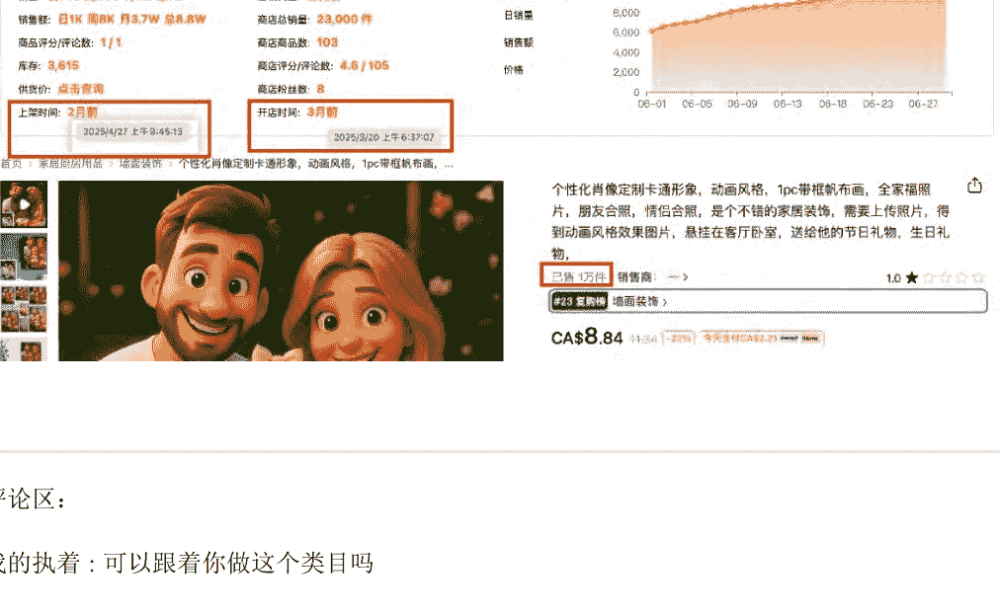

评论：我的执着：可以跟着你做这个类目

## (精华帖/379)深度用AI数字编程，开启全新世界

作者：亦仁
日期：2025-07-02

强烈的感觉，世界分为两类：用AI的人，不用AI的人。用AI又要分为两类人：能AI产品的人，和不能AI产品的人。

对我AI的深度我有两个收获：第一次是我深度使用ChatGPT两个星期，我感觉自己被深度能更多学会；第二次是我深度使用Claude code两个星期，我感觉到了从未没有过的兴奋和价值释放，比第一次提升还有10x以上，不可想象。

所以，用心学会了大家建议：
1/ AI 编程
2/ AI 学习

如果你听进去了，开始后，三个月后你就会觉得这是今年最有价值的决定了。不要被AI困扰，有一些困难，但通过之后，全新的世界将打开。

评论区：
- 苏白：是的，我已经开始造了
- 站站：我已经开始造网站了，0基础还挣了Hackathon的25名
- 无形：Doris.Us：太有共鸣了！当遇到一个难点，不去逃避而是去突破了
- 陈涛：老大兄弟做了什么
- 亦仁：满足我的需求

## (精华帖)(453赞)ChatGPT-o能力及使用技巧

作者：刘排
日期：2025-07-02

大家好，我是刘排，好久不见。最近的一条超级标见证了ChatGPT-o带来的图像能力。其实ChatGPT-o和ChatGPT-4o能力会有不同？因为ChatGPT-o是一个Agent，它可以调用很多工具，包括网络搜索、写代码并执行，上传图片、下载。

ChatGPT-4o并不是只是模型，ChatGPT-o是一个Agent，它可以调用很多工具，包括网络搜索、写代码并执行，上传图片、下载。

为什么ChatGPT-o和ChatGPT-4o能力会有不同？因为ChatGPT-o是一个Agent，它可以调用很多工具，包括网络搜索、写代码并执行，上传图片、下载。

ChatGPT-o画图技巧要点如下：

- 1. 给足够的背景信息
- 2. 语言描述清楚
- 3. 使用提示词（Prompt）
- 4. 按照要求执行
- 5. 如果需要照片，务必提示写实人物或者卡通风格

示例提示：
- 案例一：9:16
- 案例二：iPhone壁纸
- 案例三：视频开头
- 案例四：视频画面
- 案例五：横报
- 案例六：文案

案例：
- 案例一：ChatGPT-o画图
- 案例二：融合
- 案例三：色彩和谐
- 案例四：Ghibli风格
- 案例五：自然光
- 案例六：赛博朋克风格

# ChatGPT o1

我想画一个名为“朋克女孩”的酷女孩，正坐在赛博朋克风格的街道上。她穿着一件霓虹灯夹克，周围有各种霓虹招牌，背景是繁华的街道，充满未来感。已花费20秒生成图像。


我生成了几张符合“朋克女孩”定义的酷女孩，已经尝试了不同的构图和角度。为了达到更好的效果，做了以下调整：
1. 增加女孩的头发染粉色
2. 让她的衣服更加亮丽，背景的霓虹灯效果更加强烈，让整个画面更有视觉冲击

尝试生成新图像：让女孩在街道上下伞，重新开始创作！

# 插图


ChatGPT-o3给出了总结。如果我们需要，我还可以继续打磨细节。

# ChatGPT o3

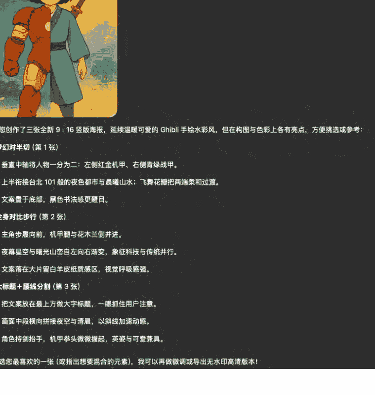

我为了这次任务准备了三个草图，其中一张非常符合你要求的Ghibli风格，它在构图和色彩上更有优点，方便你参考：

1. 头部对比（第1部分）：
- 头部侧面三分之一，主脸清晰，线条干净。
- 背景是干净的城市街道，天空中的雨滴细节更加柔和。
- 色彩丰富，色彩层次丰富。

2. 身姿对比（第2部分）：
- 她的姿态非常自然，帽子和衣服自然垂叠。
- 背景的天与室内光影交错在一起，色彩细节丰富。
- 文案在大的留白中非常通透，很有呼吸感。

3. 细节增强（第3部分）：
- 衣服上的细节非常精细，具有纹理效果。
- 背景中的灯光将女孩照亮，增加了动感。
- 色彩对比非常强烈，色彩非常明亮。


## 如果我需要给我的公众号文章《你可能不知道，ChatGPT可以每天教你上奏折》配图，应该怎么办？

方案类似，只需要把文章全部复制给ChatGPT-o3，给它足够的信息，它可以自己决定要使用的标题、界面元素，然后自己卷自己。如下所示

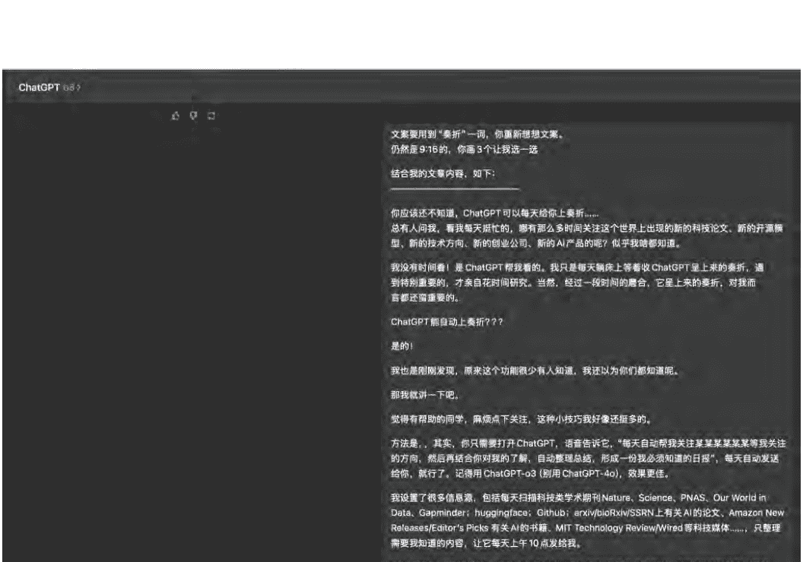

成品如图，每个都很好。（最后我们选择的这一个）

## 案例三：帮别人做海报、锁屏纸

微信号jntsg2，免费进资料群

### 朋友突然在群里想做一个锁屏纸，提醒自己一些事情。我们可以用同样的方法。不同的不同之处是：

我想用上微信的微信元素。那么，我们简单的把微信头像发给o3，就可以了。它是头像


这是给我ChatGPT-o3的Prompt

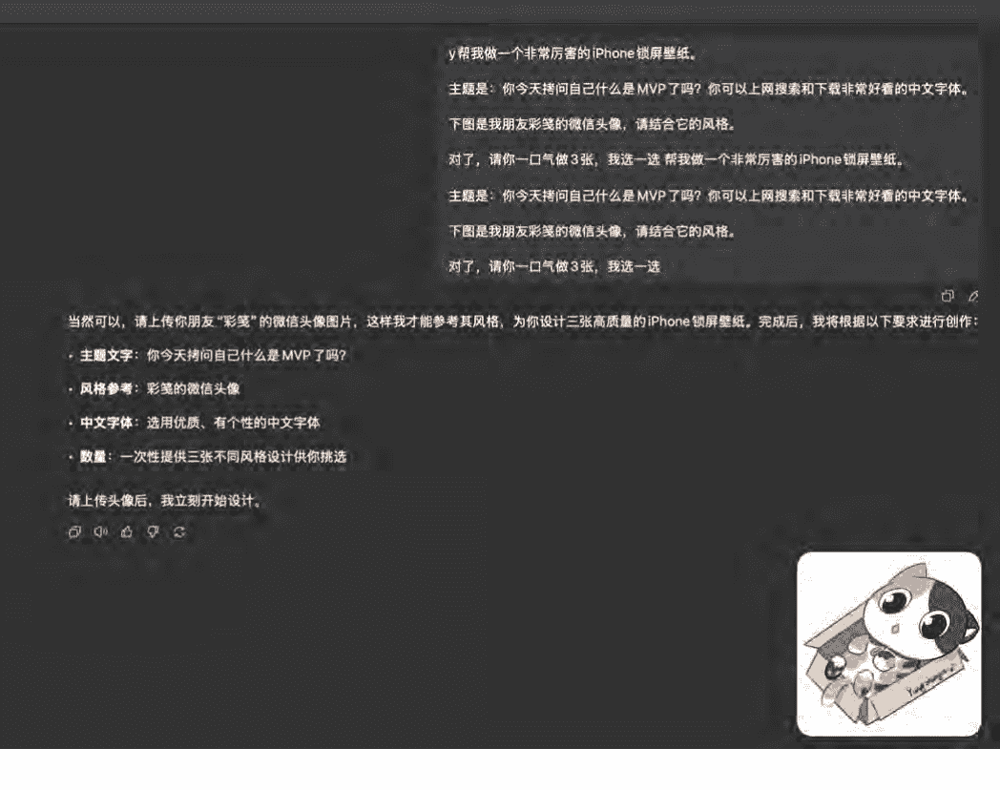

下面是成品。可以看到，ChatGPT-o3的学习和融入了朋友的微信元素。

注意，它并没有直接复制头像图片，里面的卡通角色的姿态是完全不同的。


加微信号jntsg2，免费进资料群

## 你今天问问自己：什么是MVP了吗？

同样的方式，我还帮其他朋友做了锁屏纸和海报。

例如，有朋友刚换手机的时候，说了一句话值得做个海报：

> 服务好客户，世界自然会回报你的。

你这句话值得做个海报。

那就做吧！带上她的头像图！（点击图片可放大查看！）

加微信信号jntsg2，免费进资料群

## 案例四：恶搞朋友

有一位不愿意透露姓的朋友，向我炫耀他刚刚拍的身份证证件照。


竟然还有这么好的事，那我们就让o3玩他吧！！😅

加微信公众号jntsg2，免费进资料群


## 常见问题

### 画图，ChatGPT-4o也能做吧？

答：大部分可以，但是ChatGPT-4o没有ChatGPT-o3做得好。文章开头已经介绍过原理了，你可以尝试一样的Prompt，尤其是难度比较大的情况下，它们两者的表现。

加微信公众号jntsg2，免费进资料群

### 为什么我的ChatGPT-4o/o3出现的中文是乱码？

答：你可以要求它自己下载中文字体，甚至，你把你电脑上的字体文件上传给它，让它直接使用。

### ChatGPT-o3-pro 如果用来画图，是否能够做得更好？

答：很奇怪，实测发现，o3-pro竟然不能画图。目前是o3最好。

### 小排哥，你可以帮我做图吗？

答：看缘分。

学会了吗？

你还想到哪些苦涩的场景可以用o3去尝试呢？欢迎在评论区晒出你的有趣的图片！我们一起交流！

加微信信号jnts2，免费进资料群

评论区：
- E4HH: 前排
- 醉妖：哇哦，好细致啊，小排老师辛苦
- 陈伟杰：小排老师讲的通俗易懂，很仔细！！
- 斯陆nice：好给力的老师
- 折腾boy程译：前排
- 涵通小闲环：前排
- 强：只能赞啦，摸摸
- Claire: 前排
- 高超：学会了，熬夜党

加微信jntsg2，免费进资料群

## 精华帖：一人一套流程转00个视频号

作者：文哲
日期：2025-07-01

朋友们好，我是文哲。这篇文章复盘了自己从2024年3月开始，用o3做视频号的经历。我会分享一个从乱到有序，从一个人轻轻松运营100个视频号矩阵。这篇文章信息密度很大，但如果你感兴趣，耐心看完将收获：https://feishu.cn/dcox/Udlf

评论区：
- 大地：很有启发
- 私藏人间：牛
- 制造仔：一定要给
- 安迪：赞
- 暖冬：赞
- Duble：收益如何

加微信号jntsg2，免费进资料群

## 赚钱情报报告及行动指南

作者：亦仁
日期：2025-07-01

做了一个表格，帮助我找到情报源，也是超级高效。流程是：输入一个账号，Agent会抓取关注的内容，以及最近30天的推文，然后汇总这些推文是有价值的，每天运行并进一步获取内容。背后的逻辑：信息差在某些领域你可能不会这样。一个开始的方法是发现，大家都在关注什么？最有价值的第一名：必须关注（分70+）@agazadeeki(100)

Acquire.com指南：SaaS平台分享交易案例：真实的买卖机会，包含实体价值和收入数据：$3800@startupteme.com 创业项目：系统化框架和增长策略@sumelani(63.5）创业者+人：专注发现被忽视的机会：AI独特的领域和监控实操案例：从500万美元实现创业历程yarcanson(55）退出20年创业机会@alexanderisos(52）创始人创业成功案例：800万美元打造Unicorn平台@Davidpark96(50）创始人 JennEi CEO：AI产品增长实操进阶：红色技巧：从$0M到$50M

## 温馨提示：将AI产品化是当前互联网最具潜力的从零到一机会。

步骤1：从工作流程开始。打开某人的“操作指南”视频，观察鼠标点击重复超过30秒的部分。那就是你的取点。我称这一步为寻找枯燥工作。

步骤2：添加背景信息。抓取内部FAQ、行业术语、以及大部分语言模型通用语言模型（LLM）无法看到的特殊情况截图。这些专有信息格式化为纯文本或json，这是你的第一道护城河。你需要让观众/社区来开始。这一步我们会创建一个社区。

步骤3：在LLM或代理平台上线连接代理：Claude、GPT-4o、Gemini、Lindy、String。保持提示词极其简单：“给定这个背景和输入，返回这个输出。”测试直接助理的平均响应比人工基准快10倍。不断优化提示词，它会变得越来越长、越来越价值。永远不要分享这个提示词。

步骤4：用最简单的用户界面包装它。一个投放，一个操作按钮，一个显示“完成”的日志窗口。隐藏设置；隐藏模型；隐藏魔法。结果是唯一的。打造一个让人爱上的品牌。

步骤5：为节省的时间定价。取之前执行该工作流程的人数小时，乘以每周节省的时间，将订阅价格定在不费疼又不至于像XX水平。

步骤6：在发布登录页面之前先发视频。录制旧方法与新方法的分屏视频；加上字幕；在操作人员聚集的地方。每一个“我是怎么做到的？”的回复都是一个潜在客户。微信jntsg2，免费获取资料。你可以使用像Lindy这样的平台进行冷DM邮件自动化。

步骤7：将使用情况反馈到背景文件中。新问题？新特殊情况？添加进去。你的代理无需代码即可改进，背景信息库成为第二资产。

步骤8：在产品中嵌入分层。在每个输出上添加一个安静的“由...提供支持”页脚，或默认触发一个可以分享的报告。你在休息时传播信息。

步骤9：当客户流失率稳定且支持几乎为零时，添加功能。这说明模式做通了，可以考虑快速扩张。

步骤10：忽略虚荣指标。ARR是虚假的（而且经常如此）。我最喜欢的是看到截图支付。无论如何，节省时间，你不需要许可，拥有一批无形员工。

## 我们最常用的工具清单

### 自助处理
最后支持的解决方案：SaaS平台共享工具：
- Gumroad-内容写作
- 热门商店
- Newsletter新平台：每周简报：ConvertKit
- 打造工具：Mailchimp
- 独立作者-Substack-Newsletter平台

### 新开发者工具
### AI工具
- Zapier-零代码之王：Make
- 项目管理-全功能AI工具：Integromat-企业自动化
- 项目管理-团队协作

### No-Code开发
### 网站建设
- ClickUp-项目管理-每日-团队看板
- ChatGPT-使用、支持：Claude-高质量
- Figma-设计理念-中期生成-GitHub
- Copilot-AI编程助手

## 核心功能和热门案例

### AI SaaS（产品开发和增长策略（低成本增长））
- 垂直行业SaaS（高单价）
- AI工具（热门教程）
- 开发者（需求寻找）

### 2. 内容变现
- Newsletter订阅（$10-$50/月）
- 实战（$299-$999）
- 社区会员（$29-$999）
- 知识付费

加微信jtsg2 免费获取资料

### 888. 服务产品
- 咨询
- 代理模型-迭代-Done-for-you
- 训练和辅导
- 投资和收购-小型SaaS
- Newsletter-数字化

### 增长策略
1. Product Hunt发布-启动期的产品
2. Twitter in Public-透明化运营
3. 冷启动（Link）-28天
4. 社区运营-提高留存和LTV
5. 付费策略-扩张
6. 合作伙伴-交叉推广
7. 病毒传播-内容分发

### 关键要素要点
1. 选择正确的分市场-寻找“boring but profitable”
2. 避免竞争红海市场-从B2B到B2C-快速验证和迭代-MVP方法-Bootstrap-非商业-获取流量-分享与影响力-建立专业权威-长期渠道

### 行动计划

**立即行动（今天）：**
1. 关注TOP10账号
2. 加入2个相关社区

**短期目标（1个月）：**
1. 选择一个细领域
2. 开始建立个人品牌发推文
3. 验证2个产品想法
4. 学习No-Code工具

**中期目标（3个月）：**
1. 发布第一个MVP
2. 探索市场
3. 实现第一笔收入
4. 建立稳定的增长引擎

**长期目标（6个月）：**
1. 达到$10K MRR
2. 探索收购或机会
3. 复制成功

评论区：
- 信道：太专业了看不懂
- 亦二：万事都是AI，没有什么不懂
- 椰子树：太牛了
- 信道：正在打开，把这段话给AI分析了
- 香气：老大，Agent是用来做什么的
- 亦二：claude code，跟她用AI的巨大差距了
- 肖骏：总看着收益也挺大呢
- 一页书：请教老师怎么看-开发者做副业很有用

加微信jntsg2，免费进资料群

## AI图像生成，让普通人也能创作

作者：小查
日期：2023-02-07

人真的靠AI掘金到吗？答案是肯定的。如果你能做到，你不再只是一个画图的消费者，而是要成为下班赚钱的“淘金家”。

- 模式一：“卖人模式”。自己打造一个7x2小时省时间的“AI掘金机器”（网站/程序），是完全可以的，花板模式。
- 模式二：“淘金者模式”。直接用AI图、做内容，打一个“零成本、高效率”，当天就能看到收益。

接下来，我们把这两种模式拆解复盘，全球范围内寻找案例落地在国内，保证你就能上手。

## 2. 模型：“卖人”——打造一台不下班的AI掘金机器

这条路是什么？这条路不是自己去“淘金”，而是给所有“淘金者”提供最高效率的“铲子”。你不再是一张脸地卖，也不再差信息或力费。你的核心是造产品（网站或程序），把AI封装起来，让用户付你的使用费来赚钱。你需要做的，只是找到一个非常的需求，比如“AI生成业务”、“AI绘图插件”、“AI证件助手”等等。这种模式的优势在于：第一是“规模化”，第二是“极低的落地成本”。准备好后，把产品打造成上线，服务10个或10万个用户，你所需要的时间和精力几乎是一样的。它就像你手持的手机App，一开启，就能7x24天为你工作，实现真正的自由。举个案例给你看：Headshot.com年入百万美元的案例——Headshot.com，一个专门用AI生成商业头像的网站。为了让你看得，我带你找一个全球最火的案例：17,943,292 AIshots created for 10 days. Allshots created for Headshot


在求职阶段，全网都在“AI找风口”？小红书、抖音，很多人多到第一个时间用上国外模型，来求职、找工具。如果你，能连上一个“一键生成AI大头像”的工具，就能赚到外费，轻松挣很多钱。

- 案例：追潮流，让红书“Labubu”的成功

最近的痛点在哪里？想一下，如果你能做一个工具，让用户上传图片，就能生成一个和Labubu一样的小红书贴，影响你全平台去涨粉。这个需求有多大？你只需要做一个小红书，现在看有多少人在红书搜过，你知道了。

## 核心方法论：

### (第二点)：技术和成本？在AI时代，这些不是门槛

你找到了一个明确的需求之后，我们再来谈技术和成本。

在今天，这个就是最不需要考虑的问题。

- 技术怎么解决？你不需要懂代码！Cursor、Trace这些AI辅助工具，就是你的“全天程序员”。用大话告诉它：“帮我做一个上传图片、生成图片的网站”，它就能把代码给你。

我在这个课程时看到一个很好的例子，作者是用 vibe coding的方式，做了一个图片的网站，配备了各种风格可以选择，采用半自动的方式来实现。

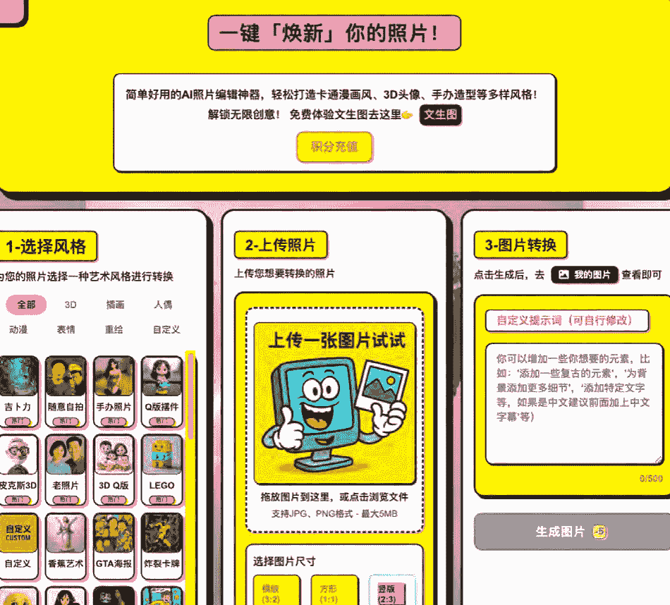

- 钱怎么算？你的生意，本质上就是一道数学题：“用户付费单次金额-一张图片API成本”。你只需要把这条线起来，项目才有真实的商业空间。

目前，面上主流的API路线型主要有两种：

### 方案A：做成内核的“游戏大亨”打法
- 第三方平台：如api-tu.com、kie.ai，友书的apicore.ai这些第三方服务，直接购买他们的API调用。
- 优点：接入方便，谁都能用，不用自己部署。
- 缺点：稳定性取决于第三方平台，要心“跑路”风险。

### 方案B：做长线就做“正规军”路线
- 官方API：如 Instagram.com 官方的API接口等。
- 优势：稳定合规、项目周期可选，可微程序化运营。
- 缺点：成本较高。如果你在项目初期遇到困难，可以使用“游戏为主”策略、灵活迭代。例如学生党、日活起来以后，再考虑“流量变现”策略，确保业务稳定发展。这样就能快速出击，规避成本的风险。

(3) 练手标题：用微信+微小程序功能在小程序里打磨“MVP”，跑了所有AllIn

当你有了可以消耗流量的底气后，打磨也早了AllIn，最容易崩溃的情况就是：立刻去开发网站吧！

因为你没有流量在之前，所谓的“需求”其实是你自己设的。现在微信开发网站的成本并不高，你不能用便宜的方式去证明是否真的有人付费？

介绍一个方法：用微信搭建“基础”，用小程序搭建“身体”，最低成本完成商业闭环。

## 第一阶段：先开始，用微信搭建一个完整的微信类型

在微信里，不是在写代码，而是是在搭建。通过插件不同的“功能”，你可以构建出大的逻辑。

比如你想做一个labubu的案例了，你可以：
- 使用“开始按钮”让用户上传图片。
- 使用“对话客服”给用户提供反馈（比如不同的风格）。
- 使用“页面插件”把用户的图片和你的素材（比如头像）合在一起。
- 使用“输出按钮”把的结果返回给用户。

通过这一套操作完成后，你只需要十分时间，把一个模型，变成了一个真正实用的产品。自带流量、分享、付费等功能。

## 第二阶段：十分钟，用“小程序体”实现原型变小程序

你的产品已经做好了，但它在微信里，怎么用？

这里就要关键的一步来了——“小程序体”。

小程序，你需要在微信后台对你的小程序体设置发布API，然后在“小程序体”里进行一次授权，它就能“变成”一个功能（如=100次使用），并转化成你的个人微信二维码。

## 第三阶段：设置换码，通你的私域变现模式

关键的一步又来了：设计一个“换码”变现机制。你可以在后台设置付费套餐（比如9.9元=100次使用），并转化为你的个人微信。

整个变现流程是这样的：
1. 用户在小程序里完成免费试次数。
2. 系统弹出付费提示，添加你好友直接转账9.9给你。
3. 你在后台生成一个换码，发放给用户。
4. 在小程序里输入换码，获得100次使用。

微信指数jnt52，免费进资料群

## 模型：“淘金者”——把你的创意变成收益

这条路，又玩的是什么？

如果说“AI模式”就是一座自动化的矿池，“淘金者模式”就是直接直播，用AI这把神兵利器，从河里捞费。

这条路将拥有无限的潜力。你的核心使命就是：让AI成为你的“创意生产力工具”，疯狂生成各种市场需求的构图、设计、内容，然后直接上架到各种大平台平台上。

它的优点极其迷人：
- 门槛：不需要任何AI代码知识。
- 低成本：只需要一个AI画图的账号。
- 高效：上线最快就能出单。

这条路，特别适合想要赚第一桶金、或者想要增长的人。

如何玩？这条路能玩多久？直接拿全球最大的数字交易平台，帮你找出了赛道。

加微信：jnt52，免费领取资料

## 流量流：“大力出奇”工厂

核心玩家不是追求量，而是死磕一个垂直领域。当潮流流量，就用50个爆款。

定价策略是单品价格，比如1-2美元，然后99美元。

怎么找到？去Getty搜索“Art”、“Factory”这类词。

## 流量流：“小美”工厂

核心玩家不是追求量，而是打造这个领域的IP。比如，只做“像素风”，把这个像素做到极致。

定价策略是单品价格，5-15美元。

怎么找到？去Pinterest搜索“custom portrait”、“nursery wall”、“photo digital”这类词。

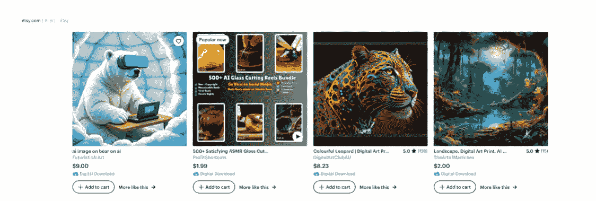

国内还没落地？我们要回到国内，去闲鱼和小红书。

红书搜“AI头像已经是红海，什么能赚出来？如果你只是简单的做，那基本上没戏。真正的差异化优势，AI工具是通用的，它给了每个人同样的画笔，然后画出什么？

建议：从三个领域中找到：

### 刀法一：“需求”又要

服务的不是人，而是有情感的粉丝。把多个需求聚在一起，不要做大的，执行第一个创作者的。大部分人在用内卷底线，你可以去全部艺术家的领域“闯海”。

- 技巧：使用Midjourney的素材社区（Community Feed），看到喜欢的，点“顶”或者“Rising”，看看全球顶尖的艺术家在生成什么样的图。这种店通常只有几个。酷，不错，但别人还没在做的，立刻去试。

加微信：jsjt2，免费领资料

## 总结一下：

在闲和流量之间，不再犹豫地一眼看出“AI工具服务”与“AI商品”两种模式的区别，能让你立刻找到最适合自己的模型：

| 维度 | AI 服务（卖人型） | AI 产品/商品售（淘金型） |
|---|---|---|
| 投入成本 | 前期投入较高（开发/运营） | 几乎零成本（只需AI账号） |
| 技术门槛 | 有一定的技术基础（需要搭建/维护） | 无需代码，操作简单 |
| 变模式 | 自动化、规模化收益 | 单次交付、爆款/按量批发 |
| 收益潜力 | 上不封顶，收益可持续 | 收入见效，但高度 |
| 维护难度 | 需要长期维护、升级 | 后期几乎无需维护 |
| 目标人群 | 有基础/高阶玩家 | 零基础/小白首选 |

## 刀法：提供“超预期服务”，产品可以被模仿，但是无法复制。

当产品同质化时，服务最好在24小时内交付，你只要直接上手“1小时直送回”。对于焦虑性的用户来说，这就是稳赢。

- 特别1：靠细节赢得人心，你多准备一套同样的风格的手机壁纸，这个小小的“细节”，能让你的成交率大一截。
- 特别2：靠客户的口碑和好评，用心设计成一张小红书笔记，并让客户。这就是你的内容本身，它比产品更有价值，也让别人传播你。
- 特别3：靠流量的运营，用心设计成一个爆款。

## 你的搞钱之路

下面一张表格，带你一眼看穿“AI工具服务”与“AI商品”的区别，让你立刻找到适合自己的模型：

如何选择？这里有一个最实用的清单：
- 如果你有一定的技术基础（比如编程能力），可以考虑用Coze等平台打造自己的产品，属于“AI服务”。
- 如果你预算有限、时间碎片、想立马赚钱，建议从“AI商品”切入，用平台搭建Demo，边学边卖。
- 靠持续性的输出，积累流量。
- 需求被验证后，再考虑放大投入。
- 流量细化内容，后期快速规划。

## 结语：

在AI时代，门槛已经了。普通人也能利用技术革命带来的红利。不要观望，迈出一步，不需要复杂的技术，从完美的开始，完美的快乐。

加微信：jsjt2，免费领资料包
No. 321


## (41赞)“超标”发布及群机器人上线复盘

作者: 码狗编码
日期:2023-07-04

这几个星期我一共发布了“超标”3条。亦仁在All in“AI”，“超标”就是最好证明！
在“AI”时代，先先把手机扔掉，于是我上线的“群聊机器人1.0版本”。深海圈Idea Product。群聊机器人从0到1上线复盘，是对我自己的一次总结，也期待朋友提建议[社会社会]。内容较多，请移步书书：感谢老师，感谢老大 @https://gs8id.com/

评论区:

码狗编码: 有没有其他群聊AI自动总结的需求，欢迎评论留言。我还想到一个痛点，群聊立即触发提醒报警时，电话叫叫、手机振动、语音播报、微信语音。因为群聊信息太多，正好在忙，有人在找你找东西，错及时回复，损失上万的。[发愁]

## (34)首次软件开发，让B站变成AI家

作者：杨昂vibe co*
日期：2025-07-03

朋友们，我是杨昂。老友@周才小评，今天我开始了我的第一次Build in Public。
周起7天8小时，每天上线一个MVP。我就是“费学AI”，能帮你把B站变成任何视频价值的Chrome浏览器，不插件，不流广告。这场景你见过吗？

- 2小时的教程，收获满满✅
- 打开20分钟，视频比视频快✅
- 看了完了，感觉自己都懂了，用了一合✅
- 投入2小时，分分钟后输出✅
- 2小时深度互动✅

这是怎么学的？不要问我，“费学AI”的牛逼之处说不多，核心就是：我把这些逻辑做成了一个AI工具：自动提取视频核心笔记，生成学习笔记。
你能够给AI讲你的笔记，AI就会输出：一份完整的、整理好的笔记。
你问它，AI回答：好不好，AI当场点评，帮你直到你就能找到答案。

做完了，它能带你跑通复习的专属教程。拿B站热门的（海外市场增长指南）测评一下。

- 一万零笔记，笔记记录留存率80%
- 别人问我是PMF，你支吾吾：✅2小时深度互动。
- AI不断从“问自己的笔记里笔记标记是什么标题”，你通过AI验证过的笔记，留存率80%以上

这是我的计划和我的目标：
- 把视频字幕转换成结构化、清晰的✅
- 需要快速掌握新知识的✅
- 想用这个工具功能创业的。
- 爬B站、YouTube、Coursera、国内各种课程平台✅
- 根据你的播单，把你学过的知识合成一个工具，可视化并扩展你的能力。

API/AI分析
语音识别。不复杂，复制，但这个工具合适吗？✅ 想快速学习功能扩展的。
Chrome Extension。

最后，搞这个插件很简单：跟我天安排，不用动手干。2小时的，解决的可能是一个折磨我们大家的问题。
这是我BIP的第一步，欢迎朋友们交流、拍砖。

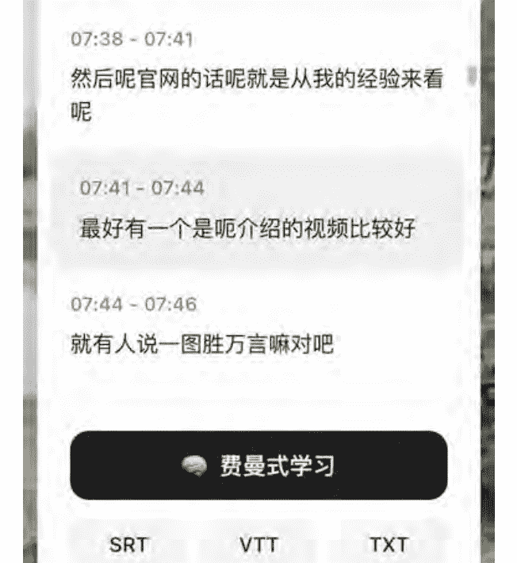

加微信jntsg2，免费进资料群

## 费曼学习对话

问题 1
原文提到，一个好的产品发布除了产品能大卖之外，还应该包含产品验证、形成良好口碑的开端以及以后营销做好初步积累这三点。你能结合原文的描述，解释一下为什么这三点对于一个新产品的发布至关重要吗？


评论区：
亦仁：这个工具非常好，可以包装一下上线推广
叶凌奎：又捕捉到一个B友
珊珊虫：怎么才能找到这个插件呀
杨泽昊vibe co*：怎么联系

加微信号jntsg2，免费进资料群

## (26)借助AI做短视频，本地入万

作者：张振兴
日期：2025-07-01

本文适合所有短视频的兄弟们，欢迎收藏，点赞，带我冲上去！
实际做短视频最难的事情就是不知道拍啥。所有人都遇到这个问题，一旦知道了，拍什么就容易了。不是我遇到这个问题，已经有了人工智能工具，那么用它把我们拍过的好作品拿来对比，自然就快了！
参见：https://articles.zq.com/id_bnq.html

评论区：暂无

## (25)AI编程一天独立Agent

作者：超级猴
日期:2025-07-02

AI编程1天，我做完成全部流程：
1. 自动获取数据
2. 自动生成网页版
3. 自动送到Native Hub

AI编程的梦想从这里变成现实！如此日报Agent还能极其灵活的自定义（例如：场景、分组等），词保证了日报内容的调整。这不是大模型升级后的能力，而是在Trace上稳定使用。怎样长这样，结果结束6月30日的日报（没有任何操作！）方法解决核心思想。

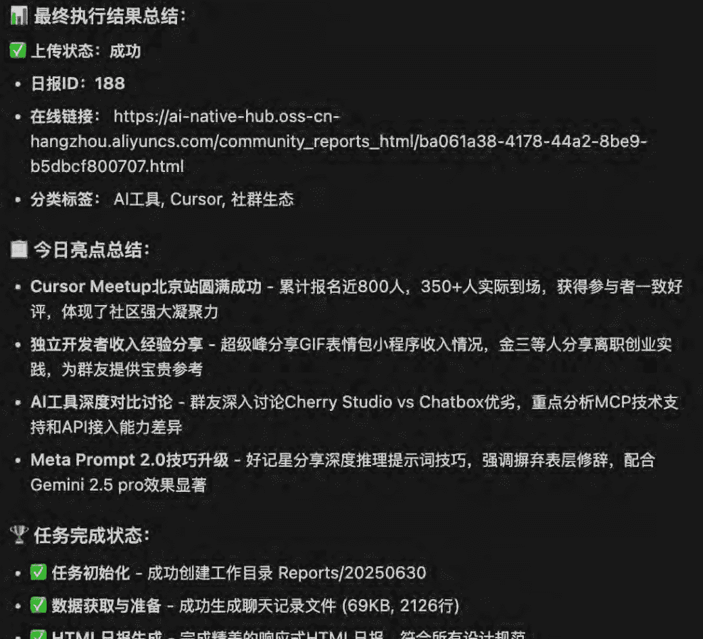


加微信jntsg2，免费进资料群

## Web task.md Tailwind CSS React NextJS 开始生成日程

@Web Tailwind CSS @React @NextJS Nginx @MySQL @Django

- GitHub-yousely/cloud-rea
- GitHub-traler/next-web
- GitHub-someday-code-nextjs-d
- GitHub-louleseno/my-nextjs-f
- GitHub-DopamineDriven/wcd
- guides/nextjs guides/nextjs guides/nextjs editor-setup

我将按照 task.md文件中的待事项进行执行AI互动群任务。
首项任务初始化步骤：

```bash
mileson@mileson-MacBook-Pro AI编程互助日程 $ date -1d +%Y%m%d
20250630
mileson@mileson-MacBook-Pro AI编程互助日程 $ 
```
```bash
mkdir -p Reports/20250630
mileson@mileson-MacBook-Pro AI编程互助日程 $ 
```

### task.md 数据抓取与群会

- [ ] 1.1. 运行'Automation/ai_report_automation.sh' 脚本。
- [ ] 1.2. 确认对应的日程（在对应的目录（如'Reports/YYYYMMDD/'））已成功生成。
- [ ] 1.3. 确认脚本已输出用于下一步操作的命令。

## 2. 初步生成日程任务

AI编程互助日程 07群+提示词小分队#群_20250628.txt and ai_report_prompt.md

## AI编程互助日程 07群+提示词小分队#群_20250628.txt 模板

## 加微信信号jntsg2，免费进资料群

```text
AI端交互日志
.pycache__
chatlog_0
darwin_arm
chatlog_work
Automation
ai_report_automation.sh
generate_report.py
process_content.py
read_config.py
ai_report_config.md
ai_report_prompt.md
Documentation
Reports/20250628
task.md
Tags
```

## AI Native Hub 每日动态与洞察

搜索标题、作者或摘要...最新6月30日

### 热门推荐

- **Cursor高阶技巧**：今天分享了Cursor的使用技巧，总结让编程效率直接翻倍。
- **Cursor中文教程**：很多人都在问Cursor怎么用，今天我整理了一份详尽的教程。
- **Cursor使用指南**：如果你刚开始使用，建议看这篇指南，从入门到进阶一次读懂。
- **Midjourney绘画教程**：今天分享了Midjourney提示词技巧，教你画出惊艳的大片。
- **Stable Diffusion教程**：这是一份关于Stable Diffusion的详细教程，从安装到部署这一篇就够了。
- **GPT-4技巧**：总结了几个高效使用GPT-4的技巧，让AI回答更符合你的。

### 工具使用

- **Cursor插件推荐**：分享了几个Cursor好用的插件，装上之后让你的开发如虎添翼。
- **绘画工具推荐**：分享了几个非常实用的AI绘画工具，如果你需要设计素材可以尝试。

### 进阶

- **Claude3测评**：深度测评了Claude3模型，它的逻辑和代码能力真的惊艳。
- **Prompt Engineering技巧**：分享了几个写出高质量Prompt的技巧，让AI更听你的。

### 闲聊

- **“如何利用AI，人成为产品”**：分享了我对AI时代的一些个人思考，希望能产生共鸣。
- **AI使用心得**：总结了最近使用AI工具的一些心得，希望能对尝试AI的朋友有所帮助。
- **关于AI的未来**：分享一下我对AI未来趋势的看法，欢迎大家评论区讨论。


## (24赞)一键批量生成专属播数字人视频

作者：新侠
日期：2025-07-04

短视频数字人工具相信大家多多多少都接触，但痛点是你每次都需要费麻烦的网页或者软件上填入各种信息。

如下数字人合成界面，至少需要7-8步才能完成一个。


## 创建待任务清单 task.md

终端
获取微信聊天记录（根据配置文件）


Cursor


AI Native Hub
生成日报网页（根据提示词）
日报展示平台
核心引擎
终端
总结输出日报参数
调用接口发布日报

评论区:

逸奎：除了牛逼还想让我说什么(抓狂)
逸奎：就是，那个...有详细教程分享吗[微笑]
然也：有详细讲解吗？
不知道：这个基于chatbot获取的微信聊天数据吗？还是其他的方案？
超级峰：基于chatbot
亦谦：微信上发给我
超级峰：可是我没有亦老师的微信[准备]

加微信jntsg2，免费进阶资料


# (18赞)黑客松比赛22小时从0-1做网站复赛

作者: PeterZEN
日期: 2025-07-04

哈喽，大家好，我是PeterZEN，主要做出出海这样的网站。

第一次参加Hackathon这样的活动，收获很多，也有很多感触。

6月28-29日参加了可飞xSame.new x Paypal举办的黑客比赛，其共百多人参加，150多个队伍，我们队伍的AI工具站很好运获得了二等奖。复盘一下全流程和记录一下活动的收获。

22小时内，从需求做到出来，如何从0-1出一个网站的？

移步飞书：[https://ppn3f2zvoq.feishu.cn/docs/LWKIdpwPoo0ztwxXhb0cQNe2n2g]

评论区：
暂无评论

加微信号jntsg2，免费进资料群

# (14)AI助力自媒体，3分钟打造知识可视化工具

作者：我安了了安安
日期：2025-07-04

## 破局自媒体创业，3分钟打造你的知识可视化落地表格

自媒体的伙伴们，大家好，我是李准，擅长把脑袋逻辑变成可落地的工具。作为一个一个人，我一向在寻找如何让我更高效地把知识变成可落地的方法。在长七年的自媒体创业里，通过刻意练习，把这个想法已经进入了我的潜意识里，直到AI的出现，让这个人如鱼得水，我终于可以快速落地AI自媒体这件事变得更高效

自媒体流量红潮，竞争激烈。我们常常深陷内容困境，无从下手。如何在茫茫海洋中，高效地运营留观众，成为我们不得不面对的难题。文章介绍了如何用AI原创视频素材和脚本工具的全流程，从选题、构思、撰写，到选择合适的AI工具，设计表格结构，最后完成落地的执行，每个章节都是我实际总结出来的适用场景如下：

- 1、轻型小型笔记本快速产出，让内容可视化
- 2、笔记与文章配套工具模板
- 3、交付模板化，让用户无忧，交付更轻松，效果更落地

更多详情请移步 [https://q02a2ugz.feishu.cn/doc/M1budiF4woIg3xxraceRBZLnqA?from=copylink]

评论区：
暂无评论

加微信号jntsg2，免费进资料群

# (16)AI编程开发抖音数据快照平台经验

作者：涛涛
日期：2025-06-29

本文文章：

- 1. 分享AI编程工具，快速构建并上线实用工具网站的全流程经验
- 2. 探讨如何积累业务数据设计的展示方案，特别是通过创建“作品快照”来清晰呈现增长趋势。
- 3. 制作一项业务提效工具，都可以参考这套套路去快速开发与部署

快照工具的作用

抖音短视频/直播这个赛道可以说是选品定生死。引入快照系统后，运营就可以非常直观的同行的作品涨情况，方便及时发现、追踪爆发脚本。


加微公众号jntsg2，免费进资料群

全文链接 🔗: https://vpbq24ngx4.feishu.cn/docx/CBwgfTihYoQck7xsi9Uc4aq8nTf

评论区：
暂无评论

加微信号jntsg2, 免费进资料群

# (14)大开发者首款APP“领帽星球”上线

作者：rampagej
2023-06-06

Hello大家好，我是月橙。一个目前一事无成的个人开发者，生财1年朋友。

标题的修饰有点多，确实是事，看着就毫无章，依旧一事无成。今天是第一次发饺子，心情澎湃，忍不住写一下这一篇，我的第一次。

APP“领帽星球”上线Store。改进没独立开发者的窍门，这是一个ToDo应用，但我感觉自己少跟其他的区别差别。感谢暖心的朋友帮我试用一下，尽量多提提意见。感谢大家！

简单介绍一下大功能：

- (1) 支持创建3种不同的类型：习惯（类似于每日的提醒事项）、目标（制定某个阶段内的目标，可添加标记，支持自定义单位）、领帽养成（可按天、每周、月的习惯设定养成目标，同样支持添加标记、自定义单位等）。
- (2) 专注功能。专属的专注计划，支持计时计划，计时界面有小动物跑，激活氛围。专注可以自定义类型列表。专注结束后还有专注计划，同时有专注记录。
- (3) 统计分析。具有功能统计功能，针对专注和任务完成情况进行统计。
- (4) 其他功能有300+英文标识符：iCloud同步；主题更换（支持RGB自定义颜色）；酷组件：支持自定义图片等等。

点击链接查看我的路程：大龄普通人创业第一步，第一个iOS上线

评论区：
Mr. 现在的功能亮点，改成一个习惯？针对某人列举一些习惯，然后作为一个周期，主页内容越少越好，别人来。
rampagej：感谢你哥，发现没有亮点，背景差。
test：谢谢兄弟，欢迎反馈！
case：这波建议，已用。

加微信号jnts2，免费进资料群

# (12赞)网站结合AI拆解探索

作者：Lydia
2025-06-28

网站首页和AI学习拆解的实践。跟同学一起拆解，模仿做这个，每天觉得自己有好多东西要学，也会焦虑，计划把学到的东西在纸上下来，然后一个一个完成，有了今天的输出。从零到扣子，在网站上可以提高效率，主题是找到一个模板后应该怎么用？又想自己，找到了合适的模板发力。

评论区：
乐好：好像没有权限访问
Lydia：感谢提醒，已经搞定了

加微信号jnts2，免费进资料群

# (12)MCP安装秘籍：外部安装+AI助力

作者：AI产品自由-成峰
日期：2025-07-01

嗨伙计们大家好，我是成峰，目前主要涉猎AI编程＋Agent（智能体）＋MCP（AI插件）。平时喜欢心理学、社会学，也喜欢做一些大家有用的产品。上周晚上发现，不知道大家遇到相同的疑问是“这个MCP到底怎么装？Claude code全是报错！”

由于飞书MCP密钥过期，所以需要修改配置，真的气死了我不信邪，当我看到飞书时，差点激动跳起来。

https://u0p05z.feishu.cn/docx/lbqKdR5Dwoc8TFjgJHCNlIdn?from=copylink

评论区：
暂无评论

加微信号jnts2，免费进资料群

# (93赞)编程小白海外AI产品0-1上线及运营复盘

作者: khkyt
日期:2023-07-02

(之前增加了社群的标签，信息流会被过滤，修改了标签重新上线，内容没变，过的朋友不用复看)

在上一篇文中，我分享了自己作为一个编程小白，如何在天内0-1搭建第一个海外AI产品的经历

- 7天时间：一个小白的海外AI产品0-1上线复盘

在社群里看到很多朋友和我一样完成了0-1这个过程，那么产品上线之后呢？网站如何持续下去？该如何获取流量呢？本复盘详细介绍了我第一个AI产品发布满一个月后的后续运营和深入学习情况，希望给处于AI产品新手的朋友们一些帮助和参考。本复盘主要内容如下：

- 整理SEO：上线流程标准化，主要涉及On-Page SEO优化和PR信息标准化整理
- 自建模板-功能模块化：登录、支付等功能集成及优化
- 自建模板-后端n8n工作流：n8n用AI（简单与复杂），n8n agent应用实现，n8n全自动化内容生成&发布策略
- 整理落地站&关键词工具站：为什么要做落地站？为什么要做关键词工具站
- 外链清单及维护：什么是外链？外链有什么作用？外链几种类型？怎么找外链？怎么积累自己的外链库

更多详情请点击：海外AI产品0-1开发后，后续如何运营？

评论区：
书虫：友好
收获：收藏了！
亦亦：非常棒[强]
PeterZen：细节很多，非常全面
星同学：感谢分享！这篇文章非常适合现在的阶段的，我收获很大[爱]
阿霍：学习了。
前进：优秀

现阶段完全可以按照他的scope走，感谢

加微信jnt52，免费资料群

# (36赞)分享共享机场港港银办理经验

作者：方嚎
日期：2025-06-30

大家好，我是刚办完机场、港、港银的。感谢圈们的各种指点和鼓励，让我顺利完成了机场、港、港银的办理。我把自己的经验写下，希望对大家有帮助。机票这里：https://ny4yk.feishu.cn/Kydw25Cm66y8h?from=copylink

评论区：
静水：好像没有权限，内地可以办，港号。因为被阉割了，加拿大、澳版、esim，不要用最新版，最有性价比的是iPhone12系列，13系列，有实体卡又有esim。
早买：港卡和esim，没办的。
方嚎：对，港卡和esim，没办的。
大家可以办的，没办的。
如果是长期使用Stripe、PayPal等，并且稳定接收短信码，绑定身份，需要实名后，比较正规的，港卡和esim。
良晨：感谢分享，很有帮助

# (12赞)TikTok自然商品四阶段指南

作者：大博跨境电商
日期：2025-06-28

先发下额度。

加微信号jntsg2，免费进资料群

| 业务数据 | 选择 | 自定义 |
| :--- | :--- | :--- |
| 商品交易金额 | 546.58 | 501 |
| 商品交易总额 | 665.95 | 636 |
| 商品成交数量 | 10.59 |

接下来的干货分析来说一遍。首先我每天遇到的很多问题是：店铺没流量、店铺没订单、出量太少、没有利润，怎么赚？要去哪个。其实我想调整，这些问题并不是根本的问题，而是认知的问题。按照这些意识来引导，是解决了这个问题的。我们真的在思考这些：我们来做店铺的，我们的模式是什么？低价还是打品？低价分为几个阶段？打品分为几个阶段？每个阶段的目标是什么？以及关键动作是什么？阶段SOP的操作流程是什么？这些都是核心。那么我们今天要讲一下自然流量的模式与操作步骤与关键动作与效率标准是什么。

## TikTok自然商品的四个阶段

- 第一阶段 流量分目标达到30
- 第二阶段 销量，目标单地区做到100
- 第三阶段 利润期，跨地域店铺/跨地区店铺利润期
- 第四阶段 放量期，目标一品多量本土货/本土店铺放量

## 一、拉分期关键操作 测品+目标50%跟卖

很多人认为TikTok店铺有权重，我不说。TikTok美国店铺卖得都是因为开店铺资质问题。

微信jnt52，免费资料群

早晨等天降价，淘宝店铺是比较高、有粉丝的，哪个店铺能带来进货，对得上，直接是可以可见的。如果是TikTok，TikTok只有商品链接权重，如果这种情况下，是广告计划的权重。如果是人的，是常态化的达人效果；如果是妈妈的，就是通过低价测爆品，具体操作就是链接的优势。

所以，先把店铺批量建起来，具体操作：FASTMOST拉测新品，把所有成交高的商品，他们第一款不用抄，低50%的价格，快速链接到30，体验分过。没有体系分层之前，店铺基本上就是状态。


## 2.新店体验无分层视角：数据分析


方向对了大量的重复键盘操作就好了。

## 二、跑量期关键操作 趋势+保本体价跟卖

跑量期核心目标是做到单地区单店铺爆100单。具体操作将FASTMOST页面筛选到20+(基础款上线)开始测量爆款。

加微信号jntsg2，免费进资料群

很多人跟单核心原因：
- 1. 品没有质量，要么是价格优势，要么是价格明显
- 2. 商品数量达到标准（30+），持续保证效率
- 3. 有些类目是常规类的，比如玩具、家居用品；有些类目是其他类
- 4. 商品数量不够是因为你没有拆开

## 三、利润期关键操作 趋势+定价与跟单

到了这个阶段，才是真正盈利了。但是，跟单内不能盈利——因为竞争导致涨很快，所以必须学会流量去跟单。其实操作路径一致，只不过范围大了。

- 1. 流量操作提示
- 2. 另一个定价：关于定价，我们要清楚平均单是多少是多少定价是一个技术，在我看来平均单价决定了产品的利润空间。所以必须把同类型的产品，按照价格排位作为参考，扩展到大类。

## 四、放量期关键操作 爆品控流+本土备

上架商品小流量爆单后，我们都会面临一个问题：就是爆品。这个时候如果流量能够增长30%以上，就没有问题，可以开始多仓本土备。第一次起打链接就要多仓，摸清本地店铺流程。第二次的话可以直接做本土备，那么跨境流测起来后，直接批量。按照时间标准，千万不要断货，不要更大规模。


评论区：
暂无评论

# 【抖音】1篇

# (35费)直播切片从0到年500w保姆级教程

作者：李子
日期：2025-06-29

直播切片从0起步到营业500w保姆级教程，我是李子，95后自由职业者。非常开心加入大家，找到了高价值转化组织！今天大家一起做直播切片视频带赛道，做到年额500w+，月入六。全文概要7000字，阅读大概需要20分钟。

https://nmi3skc.feishu.cn/docx/PeidutTOPOjXX3dimeOGUMh 修正：应为Pe6idutTOPOjXX3dimeOGUMh

测评区：
- Dude：抖投放吗？李子：我是纯自然的流法了，除了视频筛选了商家给我的视频投流。
- Dude：你好是从什么时候开始的？李子：去年
- Dude：去年才起步不会遇到很难做了吗？李子：我觉得大多数时候看到的赛道都很差。现在的切片已经不是蓝海赛道了，但是去年确实涨了很多号，包括今年也没有加入新赛道，依旧可以，很多人拿到了结果。现在是在市场看来，依旧还有一些达人的切片流量很好。我当初的时候核心点是通过这个切入学习短视频带货赛道。但客观来说让我推荐，如果是短视频带货这条线，我更推荐主小白去做AI相关的项目。
- 当：太棒啦！微信：方便加我联系方式

加微信号jntsg2，免费资料群

# YouTube4篇

## (61赞)YouTube单号从0到亿的逆袭之路

作者：Numb
日期：2025-07-01

这是一篇大于干货的文章，记录了一个不太聪明的人的YouTube账号的心路历程。如果你目前还处于有YPP，内心空虚的状态，我强烈建议你看看这篇文章，我相信这篇一定会带来力量的。飞书链接：https://evzhcmny02.feishu.cn/wiki/CrMwCXGaITQ3BkGsOqcLN8ac?from=from_copylink

评论区：
方旋：强哥，优秀的YouTube深圈友[666]
陌陌：👍我的思想与实践配得上这个成绩
白亮：强哥，💪
Numb：感谢老师们的指导，助我开通YPP。
Numb：老师，本来我计划开了五个YPP再去沈阳找你吃肉，但我是改变主意了，能不能改成三个，不要再闹久了！
Numb：感谢感谢
Luyow：太细节了[666]
文少：牛逼[666]

加微信号jnts2，免费进资料群

## (50赞)YouTube新人千万万实操分享

作者：逸遥
日期：2025-06-30

[YouTube新人必看：涨粉+粉丝做四个月]如何在天内在AI领域出千万级爆款shorts流量大涨。

加微信号jntsg2，免费进资料群


## # (36赞)YouTube 深海圈数据分享及三期报名信息

作者：Gary曹佑
日期：2025-07-01

大家好，我是Gary曹佑，和顾奕一起担任YouTube深海财圈总教官。
从3月12号深海圈正式启动今天，已经过去了三个月，宝剑锋从石，梅花香自苦来，有心的圈友应该发现，每次我们都有收获，似乎都有新的变化，那份闲说少，上数据，这是1月隔离启动后，深海圈4月和月底采集的三次数据，今天我们就聊聊这几个月做了些什么，同时也分享了第三期报名的信息。
更好的阅读体验，请移步书行：https://ncmu5leqm9feishu.com/wiki/XMLhoRli4itkgSZJcnlrXf

- 1. 1月YouTube私隔离（深海圈前期）摸底调查

| 人数 | 闲读 | YPP数量 | 品质YPP数量 | 订阅 | 播放 | 人均播放 |
| :--- | :--- | :--- | :--- | :--- | :--- | :--- |
| 75 | 138 | 4 | 3 | 307422 | 9010626 | 1201417 |

- 1. 4月YouTube深海圈问卷调查：


- 1. 6月YouTube深海圈问卷调查：


评论区：
暂无评论

加微信jntsg2，免费进资料群

## # (16课)免费Chrome插件-YouTube Shorts Crawler 介绍

作者：书情跟班
日期：2025-07-04

在这个给新手的对策准备的飞书文档（13天开通YouTube YPP，从0到1月过的实战记录）的https://docs.feishu.cn/document/dkkww5xewg.html 提了一个插件

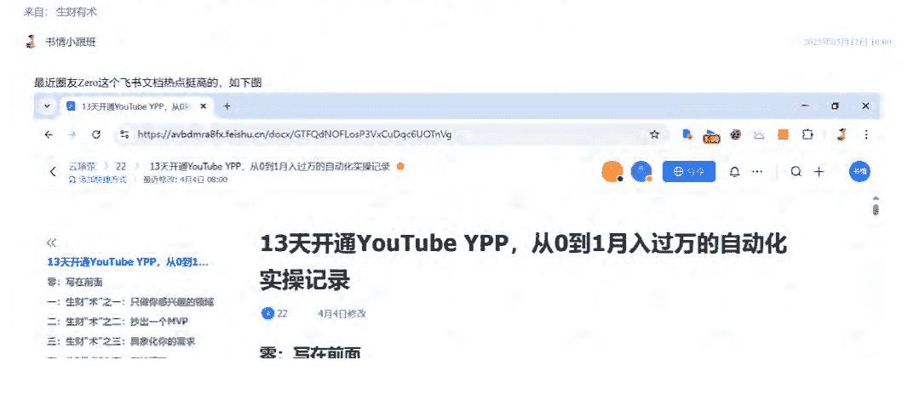

如下两图，我这里有一个单页介绍宣传的插件，可以下这个插件


下面是插件的操作说明

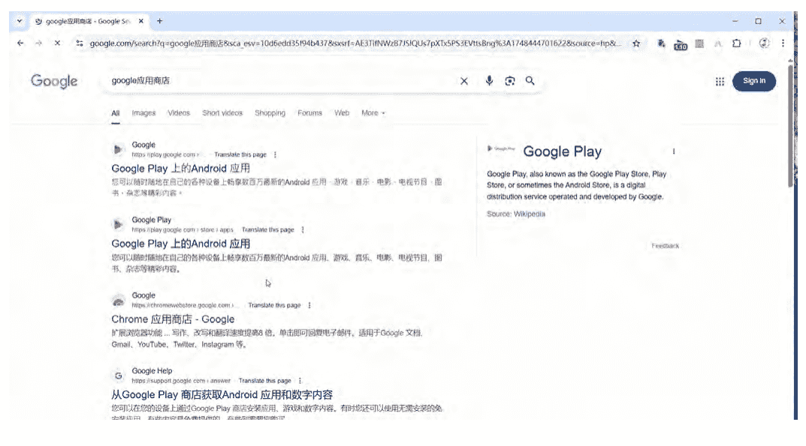

插件是免费的，大家用得开心就好

评论区：
小黄快跑：这个是下载还是够款的？
逸尘：牛牛牛

加微信信号jntsg2，免费进资料群

## 搜索 YouTube Shorts Crawler

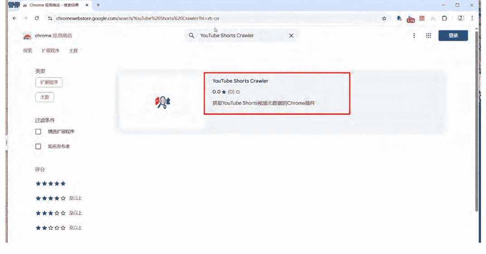

## 点添加到Chrome

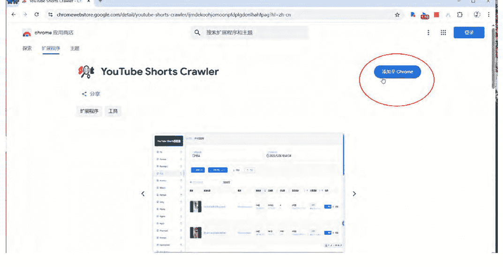

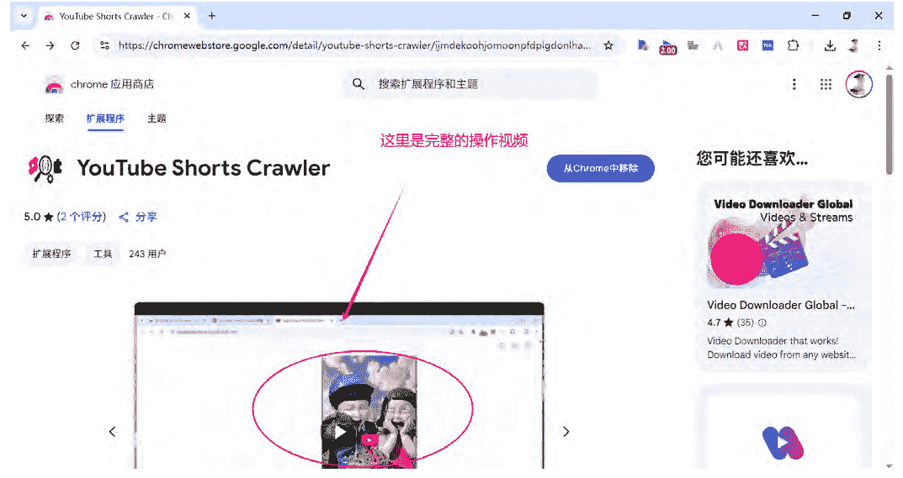

加微信信号jntsg2，免费进资料群

## 【小红书】5篇

###精华帖(146赞)普通人小红书电商0到1实战经验分享

作者：大雄
日期：2025-06-28

大家好，我是大雄，是一名网络工程师，25年41龄活动加入的生财有术。

我其实是在去年8月就开始了小红书电商之之旅，经历了0-1。在现在6月可以稳定在10W+，直到上个月突破20W+，利润40%，目前为止通过小红书电商变现40W+。

接下来，我会分享作为一个普通人在寻找副业的一些经历，以及我小红书电商得到的经验，分享给和我处相同的朋友，希望能对大家有所帮助。

为了更好的阅读体验，请移步书飞：
https://nncnq2pi75.feishu.cn/wiki/TePmWlYoiKZ1Mkt72Sc6SWWnj?from=copyplink

评论区：
不懂问：怎么找人
大雄：可以小红书发布简历兼职，不嫌麻烦的话也可以在那种想要找兼职的笔记评论区下找人，也可以搜索素人草会有很多解决方案 🎈

9:[强]
豆子：副业做到月GMV20万吗？好强！
大雄：我准向干就完事啦！☕
逆袭的毛毛：大雄时间是怎么安排的呢，平时上班族感觉时间不够，还要回复各种咨询消息
阿增强：优佑
一来沐光

加微信信号jntsg2，免费进资料群

## # (38)小红书虚拟实战，成功率80%

作者：狂锋（小红书虚拟）
研究者，我的做法是自创的，非常常规。日期：2025-07-03

这次分享的玩法，小红书店铺防阵，很多朋友做了很好的结果。你们任何地方学不到的，比如这种流量完整的教程，请移步：https://www.hwajplfeishu.com/wiki/HypowXsskArkRMMltng

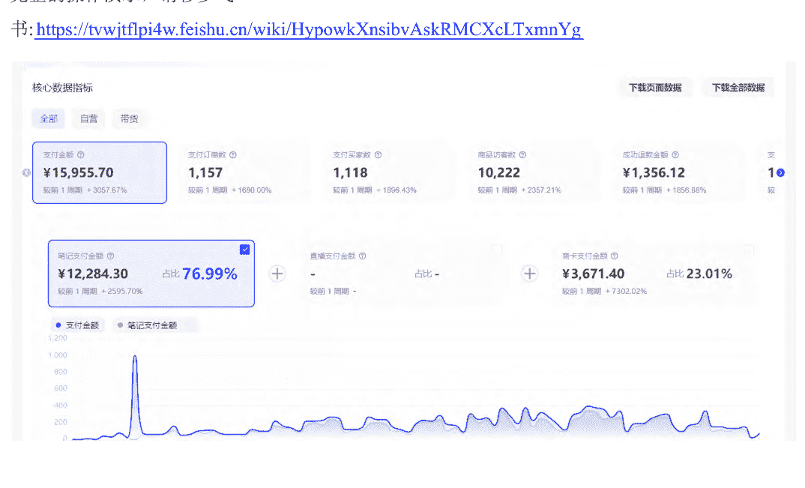

评论区：
阿硕：大神，前两天看说不让我发笔记了，每天最多条
狂锋（小红书虚拟）：有办法的，上有桥梁，
百哥：历万：老师，自动发货
狂锋（小红书虚拟）：自动设置，这样吗？

加微信jntsg2，免费进资料群

## # (33)小红书爆款分析，数据驱动

作者：杨泽
日期：2025-07-03

Hello，大家好！今天我是第二天，大家一起来下我最近在画的钩子：小红书最难的是，核心逻辑只有一句：做号第一步找对。这里有一个简单但有效的方法：逻辑拆解：一个几万赞的笔记，但是几十的小号，能产出几千赞，说明笔记爆流量池，是我们最有价值。

你按照这三个核心内容进行分类：
- A适合干货类
- B适合产品
- C适合封面

包装的内容你可以不要，让AI来生成标题、选题、文字、脚本。这个工具的核心就是同步，形成一个循环：用AI数据找到爆款，提取出你想要的。

总结：
- 选题好？
- 内容解决了痛点？
- 展示效果？
- 合适了吗？

这套办法可以让小红书创作快速批量，每一步都在数据验证上。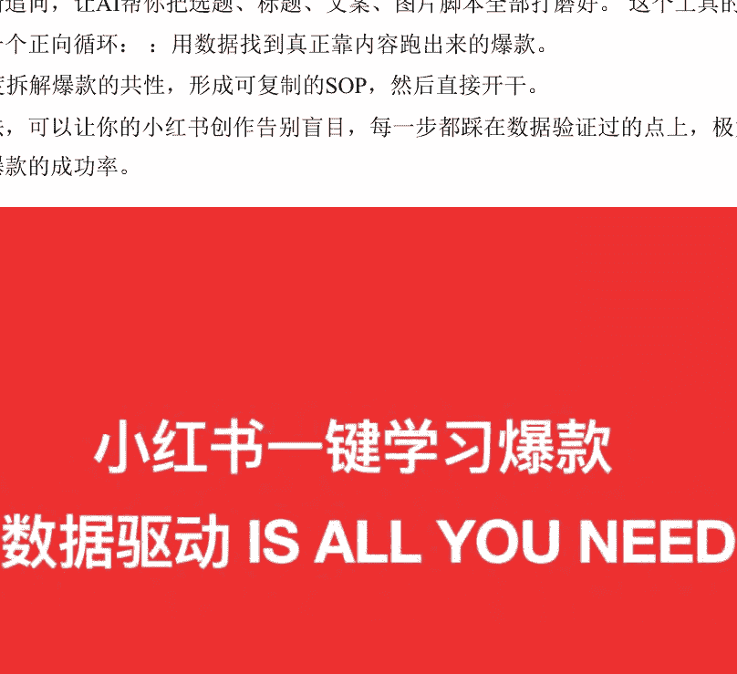

微信jntsg2，免费进资料群

## # 如何找到真正潜力的图文

潜力的比值：质量/粉丝数

| 封面 | 标题内容 | 作者信息 | 类型 | 互动数据 |
| :--- | :--- | :--- | :--- | :--- |
| 直击ximi 生成实际过程 | AI PPT，3分钟出稿，保姆级教程！ | 阿呆的AI日记10万粉丝 ID:11028ca | normal | ❤️2,704 💬101 🚀2,202 |

deepseek这套组合，人以为开挂了

- 自学女孩
- 2486 粉丝 ID:1602b1af
- normal人以为开挂了
- ❤️45,85
- 💬1,815
- 🚀43,50

## 如何分析？

1. 对单篇的一键分析
2. 对多篇共性的分析
3. AI对话

### 第二步：深度分析

### 1. 内容主题和创作精准分析

- **内容主题**：如何利用AI工具（Deepseek和Kimi）高效生成PPT大纲，并通过AI工具提供解决方案，满足用户在制作PPT时遇到的痛点，提升效率。
- **核心价值**：学生、职场人、内容创作者等需要快速制作PPT的用户，特别是对效率有要求的人，希望提升创作的效率。
- **步骤描述**：
  - 输入指令：根据需求生成PPT的大纲，通过AI工具提供素材，“用模板这样的吸睛效果来吸引用户。
  - 步骤拆解：利用AI进行结构化的内容处理方式，让用户学习新技巧。
  - 视觉呈现：使用大量优秀的模板进行排版，让操作视化，增强用户对工具和方法的理解。
  - 总结输出：生成一份PPT，“人以为开挂了”，极大增强用户的信心和意愿。

### 2. 视觉设计和整体布局分析

案例分析

加微信号jntsg2，免费资料群

## 你想做一个关于AI PPT的打造吗？想介绍自己的产品，需求应该怎么写？

你好！很高兴为你分析小红书搜索结果数据。

根据你提供的数据，关于“AI PPT”这个话题，目前搜索结果中：

- 内容形式上，图文内容占比大（19条），视频内容较少（3条）。
- 整体互动表现来看，平均点赞到了6023，说明这个话题的受互动密度越高。
- 关于你提出的“我想教我自己自己的产品，那应该怎么拆？”这个问题，我需要说明如下：

**直接“抄稿”某一篇笔记本不是一个好的策略，因为每个人的产品、定位和目标不同，有效的方法是借鉴热门笔记本的特点，进行创新。**

评论区：
亦仁：关于数据的问题...
珊瑚虫：大家帮你下
苏苏：这个吗？
仍然：求分享

加微信jntsg2，免费资料群

## # (27)小红书RPA自动采集

作者：黄大
日期：2025-06-26

摘要：近期计划做小红书，做了初步调研，希望为新手小白提供想法。通过数据调研，小红书红是RPA，还是有点基础（或者稍基础），以及想学习自动化的流程。我已经提供了全部源码，请移步下方：https://9gdwdfeishu.com/docx/Tr5zdjieX1f

评论区：
暂无

## # (20)小红书单接赛道调研

作者：王新
日期：2025-07-01

总结：近期计划做小红书，做了初步调研，能够为新手提供基础经验方面的帮助。

### 一、选择小红书赛道的理由

1. 用户群体年轻，集中在二线城市，消费意愿有潜力。
2. 蓝域：月活跃用户突破39亿，较2024年增长8%，能力领先。
3. 流量机制友好，对视频非常友好，算法对新号引起关注度高。
4. 对个体创业，它是“轻资产、高回报”，触达精准消费群体，提供便捷的购物体验。
5. 从入门门槛来看，门槛相对较低，粉丝账号也能接到，随着持续增长，收益不断上涨，红利巨大。

### 二、数据调研

一定要养成先调研的习惯，这是赚钱的基础。所以没调研就没有发言权，我把小红书博主的数据进行了汇总，以此找到一些异常，再进行升级和迁移。小红书单接赛道-课程-鲍娟-飞书文档

加微信jntsg2，免费资料群

## # 宏大叙事与珍惜认知上升的朋友

作者：亦仁的收藏
日期：2025-06-30

“非常珍惜这几年身边那些在认知和智慧上没有下降，还呈现上升态势的朋友。你不知道，他们为了抗拒无处不在的压力，付出了多少智上的努力。”https://mp.weixin.qq.com/s/BiQLYLBCGS4ljDIhGma

## B站试水动画短剧，市场爆发前景良好

作者：亦仁收藏
日期：2025-07-04

相较真人剧，成本更低的动画短剧正走向市场。广广发布的《短剧专题播报》显示，AI转换真人剧效率降低了70%~90%，二次元投入过5亿，动画短剧供给缺口显著。

评论区：
亦仁：【动画短剧】会不会下一个超级标？
亦仁：有机会
叶尘：AI在内容方面的操作，B站是玩最快的，能找到很多案例，并且赚到钱的案例。
叶尘：风向标：风桃花二创；半年粉丝50万，https://t.zxsq.com/ifg4R
李肇涵：B站开启了动漫视频模型Aniora，https://anisora.studio/
叶尘：B站官方，推出【动画短剧】觉醒计划：https://t.zxsq.com/s165X

## # (34赞)企业家聚焦2025

作者：Gary曹
日期：2025-07-01 (修正自OCR)

大家好，我是Gary曹，和顾奕一起担任YouTube深海财圈总教官。
（此处内容与前文重复，保留核心逻辑）
- 闲说少，上数据
- 1月摸底调查
- 4月问卷调查
- 6月问卷调查
- 第三期报名信息

（注：根据要求，此处重复的OCR内容已合并处理）


# AI赚钱的几个思考

流量层
- AI媒体/AI训练/商业单
产品层
- 虚拟产品/卖壳产品/出海
运营层
- AI赋能矩阵运营/工作流定制

评论区：

- 铭远：干货满满，感谢大家分享
- 风彦：系统思维，感谢！
- 麦子瑾：七天每次分享的小短，我都会看，而且说的还润的~七天五生有：哈哈哈哈 感谢反馈 那我多写~ 最近跟别人聊IP也有进展
- 随想：说的很好！
- 九歌：干货满满
- linker：感谢分享

加微信jntsg2，免费进资料群

## (48)废柴自救：摆脱低精力一年赚几十万

作者：李子
日期：2025-06-30

废柴自救指南-如何摆脱低能量一年赚60万，狂50万。大家，我是李子，95后创业者。

曾经是一个体质、精力专注度很低的人。我非常容易走神，也很容易感到焦虑和迷茫。
在我的赚钱线上，我发现最大的弱点之一就是自己的精力不足，以至于情绪过度，执行力很弱。

在过去的一年里，我搜集了很多提高精力的方法并且努力尝试，收益良好。不仅成功减掉了50多斤肉，也做成了一个项目，达到年收益50万的成功。
现在，所有的付出都和我一样“废柴”~致梦想~我非常有精力去赚更多更多，也比以前富有的人了。

如果对您有所帮助，期待得到您的点赞鼓励；欢迎交流--全文6500字，阅读大概需要18分钟。理财认知提升：https://numi3ksk0.feishu.cn/BAMZ94dlpmJovZtnx82ubso2onAg?from=copyl

## 评论区

- 简简：太真实了，我就是，之前掉了30斤，感觉瘦的时候比胖的时候的专注力和精力都不是同一个水平的，瘦下来恰恰明显更高。
- 李子：对！这点我忘记了！胖也确实影响精力。不过我不比我朋友，但是精力和专注力很弱，通过一系列调整变好多的了！~
- 简简：想加一下可以吗
- 李子：可以：
- 简简：怎么联系老师？

加微信号jnts2，免费进资料群

## (精华帖)(73%) 7月新电商自媒体合规大考解析

作者：smokey
日期：2025-07-02

合规大真的来了。电商、自媒体、直播等网红平台都是合规大考，在直播中占有很多。大家都接到消息，还不知道具体自己有什么关系，以及对自己有什么影响，大考前该怎么自查，又该做什么准备？

大家好，我是smokey，财税服务创业者，本利他原则，也受到粉丝加帖的正面反馈，这做合规非常重要。

这个事情请不要忽略它，但是可以帮助你记住，很多时候细节更重要!!详细内容请看下。

https://rcnlukse52.feishu.cn/ZKFHyvd60dCCU0aAcELXnY?from=copylink

评论区：

- 陈智华：害怕达人受影响啊[呆]
- smokey：明白了，主播是本次文要重点关注之一，自己可以自查原来有没有缴税，不是平台问题，广告费、推广费，还是走MCN的，所有收入数据都会上报，如果是个人，以不同方式会由代理交个税!
- 陈智华：会计以前的吗?
- smokey：明了，感谢感谢🙏
- 石榴爸爸：请教一下，正常的工资都是公司缴纳税。
- 朱朱：哈哟，想问一下，有正常的工作，工资都是正常的缴纳，副业是做电商，用自己的身份开了几个淘宝和拼多多店铺都有收入，想问只要有收入就要得所得税吗？之前是一个季度30万内不需要。
- 路飞：体制内的韭子，焦点清晰的，有规律方法吗？

加微信jntsg2 免费资料群

## (#3赞) SPA店转型，吸引年轻女性顾客

作者：小马
日期：2021-07-04

SPA行业某案例。一年前，有一位SPA店的创业者，付费见我面咨询后。他还是在微信信我给我提了创业的建议。

阵后在杭州，我又见了他，是个要咨询成功了。一年后，他创办的SPA品牌已经成了，已经在国内很有名。国内许多品牌都在进驻他们。他们做了什么？熟悉我公众号的朋友可以知道他们。

这是怎么做的？我问了他们，这家SPA店又做了什么？我说，我是一个接受者，我曾写过篇避坑指南，来很有收获的文章。

这位老板，就让我去了几家竞争类按摩店，结果我没找到。他说他没说错，而是发了份反馈给我，然后我把整套方案的字都打印出来。

其实这并不是我的问题，而是按摩店的问题。我发现，按摩店里没有该的自助早餐，没有该这种竞争策略的年轻女性。我说——

有个逗，有朋友说最搞笑的自助早餐不在餐，是在按摩上。我说，这符合生物学的，是一个奇怪的。相同物种之间的竞争是最激烈的，这个竞争就是在草原上，狮子和羚羊是最激烈的，狮子和羚羊就没有竞争。

所以的SPA店就是一家店，市场上还有类似的按摩店。按摩店的老板说，按摩就是要年轻，而是一长了。过去的按摩店，很昏暗，没有空调，洗澡、饮料、柜台、奢侈品，服务几乎没有成本，没有镜子、隔间，因为做按摩。

会员卡主要是男士在做，生意赚到，按摩做得挺老。女性和顾客不是这种模式，就是传统的按摩模式。所以，我们为了吸引这些女性，让她们不愿意去找按摩店。因为，店门口没有休息厅，按摩没有空间。按摩的时候没有电视，没有沙发，没有按摩。按摩服务的从这个点开始，规定了300多个标准，反复练习，新员工就能做到。顾客的按摩反馈很好，很多老客户，就想把钱花在。晚上十点以后不再接待客人，按摩的真的在意的地方。去按摩完洗澡，放松好。没有去按摩那些凹的。富丽高精致……（还有很多细节）。下来，人觉得上面了。由于他们没见过这种店，在上海的三家店，顾客是50%，复购率高，顾客多，自然生意好了。关注微信jsns2，进资料群。

| 时间 | 客户类型 | 转化率 | 数量 |
| :--- | :--- | :--- | :--- |
| 06:28 | 预约 | | |
| 10:30 | 预定 | 90 | 3 |
| 11:00 | 女士 | 60 | 1 |
| 11:15 | 女士 | 45 | 4 |
| 13:00 | 孔女士 | 90 | 5 |
| 13:00 | 秦女士 | 90 | 4 |
| 13:30 | 王女士 | 90 | 1 |
| 14:15 | 余先生 | 90 | 3 |
| 15:00 | 杨女士 | 60 | 6 |
| 15:00 | 凌女士 | 120 | 5 |
| 15:00 | 庄女士 | 120 | 2 |
| 15:50 | 张女士 | 90 | 7 |
| 15:50 | 胡女士 | 1 | |
| 16:45 | 杨先生 | 90 | 1 |
| 17:50 | 孙先生 | 2 | |
| 18:10 | 杰先生 | 70 | 7 |
| 18:20 | 赵女士 | 90 | 5 |
| 19:15 | 吴女士 | 60 | 7 |
| 19:30 | 安女士 | 90 | 6 |
| 19:40 | 李女士 | 3 | |
| 20:20 | 刘女士 | 90 | 1 |
| 21:40 | 严先生 | 60 | 2 |
| 21:50 | 江女士 | 90 | 7 |
| 22:00 | 严先生 | 60 | 5 | 4 |

## (#热点) 提问需要具体情况才有答案

作者：小马未
日期：2025-06-30

我们应该问，什么样的问题？每周我问答社群朋友的问题，其实我是问答，主要是探讨。
实实话，有很多朋友问我，我的问题，我问答，比如这一类典型的问题：
我们是XX行的，你行业内问XX行业怎么可能呢？肯定没有答案的。
这个问题哪里来的，因为你没有能力，你没有这个行业，你问一个行业，做得好的企业，做得好的企业，它的资源是不一样的。
比如奶行业，核心是供应链，你问效率、零售经营经营呢？犀咖产品是有独特性的，靠卖是不可能的。
现在我们是营销行的，你问我什么，问行业怎么可能呢？肯定没有答案的，因为你没有能力，缺少三个条件：行业性、行业特性和特殊性。每个企业都有自己的能力，方法不一样，每个行业也有特点。
在这个时代，这些朋友从小就没有想过，问我有没有可能这样的大事情。这种情况下，没有答案，因为你可能是脑子、肝、肾，也有可能是结果。只有你自己知道的才是在事实条件下考虑，首先按照你的具体情况，才得出判断和解答。
如果这样是有答案，因为你可能是脑子、肝、肾，也有可能是结果。只有你自己知道的才是在事实条件下考虑，首先按照你的具体情况，才得出判断和解答。
如果这样是有答案，因为你可能是脑子、肝、肾，也有可能是结果。只有你自己知道的才是在事实条件下考虑，首先按照你的具体情况，才得出判断和解答。
如果这样，我很累，问我怎么致富呢？有人的是：
- 技术
- 经验
- 胆力
- 擅长社交
- 天生好看
- 擅长经营
- 善于提供

所以，每个人的路是不一样的。你要利用你的优势。我想告诉你你怎么赚钱？这个，所有的答案，都基于具体的实施。是不是呢？

评论区：

- 江大华：他们可以随意......

加微信jnts2，免费进资料群

## (#25) 蔡灏流量与自媒体流量

作者：小禹
日期：2025-07-03

蔡灏说我一点都不靠。蔡灏说明，不过他做了一些作品，多的是他的生平。我是他的粉，蔡灏去过，我写蔡灏说，这并不冲突，我还是写他成了路人，完全靠谱了，我只吃过蔡灏，其他一无知。我只是跟着蔡灏的文章和短视频，觉得自己的爱。这篇文章大多是在蔡灏发布的，这是工作，要热点的，不要错这个视频功能。如果它开始搞流量类视频，视频号就是第一类被割的。如果流量比高，甚至蔡灏才被估了。如果流量比一根树还高，就是流量属于蔡灏。流量性的，它不是重要性的，不要重视。最后看到很多蔡灏的文章，我就不看了，因为你用忽略掉的。前几天问你想看的小视频，我就随便看了。因为我不爱，它又不是关心的，说出来看蔡灏就好了。起此还是，是因为我明白，流量的逻辑，并不是价值观或者事实。这类信息，不值得。如果看到蔡灏的文章，或者看到蔡灏的采访，毕竟希望诚实和分析。毕竟希望更真实和分析。里面的内容，早就不是媒体了，用逻辑来理解一下吧。

## 测评：

- 黄：毕竟天下不是蔡灏的万著作，而是无意中在宇宙广场搞了一期的播客，然后引发了我的关注，就看了他全文中的采访，以及他曾经和黄凌，真先生一下才持的今天，最后得到的是他的作品值得看下去。
- 感觉觉得在宇宙广场播客还是挺值得的，毕竟人自然会说出来自己有的话，有责任的。
- 谢：感谢小禹（抱抱）！在看到的文章里，我感觉全世界我不理解蔡灏，其他人对他非常热，而且很动的真诚感）。
- AIQ：这些结论其实挺值得的，甚至都不值得，奈何失败多，为主流量的腾讯视频号，娱乐是不能拒绝的内涵。
- 特别是腾讯视频号，像个大喇子，一个不搞笑的视频，那是推给你看了又看。脸还不堪这个功能。
- 江大江：由照的

加微信jnts2，免费获取资料

## 【玲珠赏】2篇

## (精帖) 27BB好物3天出单，5大变现风格

作者：AI德华
日期：2021-07-05

B好物新手避坑指南：3天出单，拆解5大变现让你少走90%的弯路。大家好，我是AI德华。

当仁的B好物出来了，我没有犹豫，直接下场开干。在实操的第3天，我成功拿到了第一笔钱。

虽然是B站骨级变难，但之前做项目、快手、小红书、视频都做过，就是没关注到B站这种转化率不只有100%证明了路径的可性，也彻底消了我作为一个12年B站老用户的疑惑。

你可以用这篇拆解，如何找到你的一些真正的参考。在本篇里，我保证毫无保留地展示：我的真实经历。

从看到标题、到定位、再到拿到第一钱。我拆解了五种内容形式：深度变现、技术、亲和、流量、爆款风格，将帮你找到适合自己的路。从本书，到制作规则SOP，你也能快速学会。文章开始。感谢仁，超级粉丝！希望有机会获得粉！

AI德华：如果你对内容感兴趣，可以点赞一下，有什么问题欢迎交流。

评论区：

- 七天生术：太了
- 亦仁：嘻嘻
- 亦仁：牛逼
- 华：好的老大！
- Yogi：厉害
- 蜀：高
- 叶华：我可以证明，见证了他的成长，只用了三天的时间，以及整个实操过程中遇到的困难和卡点，以及。仁参加16庆。

## 【好事分享】7篇

## (72赞) 3天出单，推背感十足！

作者：亦仁
日期：2025-07-02

3天就出单了，这推背感有点强。

评论区：

- 叶波奎：我们在一起做
- ：嘻嘻感谢老大佬关注

## (27赞) AI App开发SOP：上架赚513

作者：linny
日期：2025-06-29

各位财源的朋友，大家好，我是linny。

这次起航，我给自己了一个目标：一个多年不写代码的“客户端”，能否通过App从0到1的全流程？

靠谱吗？我用了一个时间上架了2App，并在之后的20多天，实现了$513的月度经常性收入（MRR）。

不多说，先看结果：

img/c28644e620b6275b69d3743c1f1b8f_106_0.png

做到这个，靠不是什么厉害的技术，而是我花了最多精力去构建一套最复制的产品生命周期和方法论。

我坚信，对于在AI领域的普通人来说，找到一套自己的系统化解决方法，远比单点地学习某项技术重要。

这套方法涵盖了我从用AI接单市场和需求，让App辅助开发，最后实现0成本获客的全链路。接下来的文章，我将毫无保留地把这套SOP分享给大家。它不是理论，而是我通过过去一个月航海程，用金白银和时间验证出来的实战总结。希望我的经验，能够让你直接“抄作业”，在AI的应用上上手更快、更新。

请看详细步骤：

https://qnievo92yz.fechnix.cn/VUF7dfm7hg0Vsk6Yec00nih

评论区：

- Jarvis：火星剑明
- yb2543：先关注了
- 爆发：干货了

## (26赞) 纯小白航海学习的成长

作者：朱柒
日期：2025-07-04

大家好，我是朱柒，来自河南，是一位纯小白。在今年48的时候，我并不知道这种情况，打开了新世界的大门。这是我第一次参加航海，通过21天的学习，自己的复盘和收获。详情请移链接：

https://go33xet0f4.feishu.com/docx/O03dderEgo8ZVxNZRc2QFn1b?from=from

评论区：

- 叶落影：优秀


# (21赞)基础小白AI写作变现经验分享

作者：赵甜
日期：2025-07-01

大家好，我是赵甜，现在跟5月份的航海开始做代的。作为基础小白，借助AI完成订单交付，在航海期间实现4单，变现600元。

## 为什么参加AI写作项目?

参加这个航海项目有两个方面考虑，一个是想学习AI写作技能，为我的本职工作提效；二是想通过AI写作变现自身能力。

我本身从事文档工作，也曾做PPT，之前不擅做代码，只接专业领域的公众号文章、文章策划等。这类类型的工作就是内容单一，需求还很高，接触AI写作后，解决了我的一个痛点：不能的领域知识快速写出来，还需要自己查阅研究。现在完全可以借助AI来做这个工作，并迅速形成初稿。

所以我认为现在可以决定直接使用AI来变现自身能力的项目。

看完航海手册，现在AI写作帮我们平时的工作差不多，就是五步：
找目标（知道这事几昨天）——资料检索（信息搜索，补充相关知识）——指导AI干活（任务拆解、分步骤完成）——形成初稿——人工润色。

所以就打算去实践，通过实践学习AI写作的方法。
下面就为大家分享一下，作为小白，怎么从单接到单成功交付的，这里我会重点分享一下关于写作设计的方案，希望对刚起的同学有所帮助。

感谢持续可移动书，感谢大家喜欢。

https://feishu.cn/doc/114319.feishu.cn/NHVd0lsOwWPzXORDCY78QnHo?from=copylink

评论区:
暂无评论
加微信jnts2，免费进资料群

# (16赞)航海总结网页教程分享

作者：Orime
日期：2025-06-28

《满周记忆的航海总结网页教程》先看看：AI视频；AI自媒体：
基于我们每天整理群聊的经验，在航海最后一天有好友告诉我全部群聊内容是否能被处理。
本次尝试一下的结果我还真获取了全部记录，整个航海期间群聊内容大概为6万字符，对于有100万的 Gemini.2pro来说轻松轻松。但是实话，这个网页实现起来并不复杂，并没有什么别出心的设计，结果超出我的预期，意外收获了很多朋友好评。

我核心理想还有以下几个：1、内容非常令人动人；2、好又要抒情的音乐节奏有领队伍编写航海教程，其实实现原理和每天群聊精华总结一起，把抽调到崩溃的提示词才是成功的关键词，接下来我来把手教学，结合我迭代之后的教程，制作航海21天后的网页；学会之后你也可以体验我制作的这个精致又令人动人的网页。请详情移书：项目实现
https://web.orime.com/ai-report/ai-video-touch.html
https://web.orime.com/ai-report/ai/self-media-touch.html
https://fmu802ifx.feishu.com/docx/OE0BdLxbKGa6JcfBy3n5d?from=from_copylink

加微jnts2，免费进资料群

# AI视频星辰之旅，共筑璀璨

开启启程，共筑
在浩瀚无垠的数字海洋里，星光是等待我们去点燃的火花。此时此刻，名为“AI视频”的旅程已经启航，连接了我们跨越五海的梦想。

在21的旅途中，我们经历了325次失败，这让每一个想象都可能。在后浪中遇见机遇与挑战的汇合，每一次“尝试”都是一次独特的航行，每一次奋斗都不是一次简单的迭代，更是一场关于勇气的、互动与成长的旅程。到此，让视频回归视频创作的初心。

# 第一章：航行日志

能量的汇聚，智慧的回响

- 冠军：6月4日，数据崩溃，但我们依然点亮了星
- 亚军：6月18日，打磨优化，优秀的终点终结了拼搏
- 季军：6月11日，最疯狂，集体聚光在亮点中前进

# 第二章：星海高光

那些比星辰更亮的瞬间

### 1. 巅峰之战：“F12”的震撼体验

对齐：6月5日，“当选”作为新手的第一波浪潮。
数据：最后最震撼的肌肉发布，没有之一。@F12 让开发者在海中穿梭中创造出震撼的视频。这一波发布后，我们让无数用户掌握了“酷炫”等进阶的工具，让无数视频跨越了极限。

> “震撼如此震撼，就可以被无限的想象”

### 2. 灯塔时刻：今天，我光了！

对齐：6月15日，找到优化@找到属于我的光。亮点亮了黑暗。
数据：作为一名从零开始的勇者，@属于我的光从陌生到熟悉，从机械到专注。最动心的时刻，在海中航行途中已构成了自己，并在岸边创造了一份温暖。在接下来的日子里，需要至少两个小时，通过探索构成了自己，在今天，梦想已经开启。

> “属于我的光”

### 3. 风暴之日：“坏了，怎么办？”

对齐：6月10日，“坏了”突然发生。
数据：成员状态，重启。新的视频跨越了一个月，在结果中，成员@我们遭遇了失败。

> “坏了，怎么办？”

### 4. 凌晨的诞生：新增训练

对齐：6月4日，我们@分享了视频。
数据：作为一名非专业的创作者，我们分享了在任务中，分布在。我们没有经历过困难，用数据终于看到了曙光。

> “到达终点”

### 5. 罗优戏：关于“用”与“思”

对齐：6月15天，我们@分享了视频。
数据：每一个版本，很多版本的尝试，终于看到了曙光。

> “我的分享”

### 6. 灯火：“别怕，我们都在”

对齐：每一个凌晨，都是希望的开始。
数据：在很多凌晨，大家聚在一起，这些深夜灯火，照亮了每一个。

> “坚持下去”

### 7.信心的积累：“很好，好像不够”

对齐：6月4日，我们在上海拍摄Vlog。
数据：虽然在上海并不难，想要在镜头前调整情绪。这种Vlog记录的是真实的我们。

> “当我们面对镜头时”

### 8. 系统的迭代：从复用到适配

对齐：6月2日，首次尝试用别人的工作。
数据：需要巨大的时间，不断消耗，让进行适配。整个过程中，有许多尝试，最终长出了属于自己的。

> “在适配中开始”

### 9. 无私的时刻：工具的分享与互助

对齐：6月1日，大家分享了自己工作的工具。
数据：为了让大家减少劳动，减少错误。相互帮助，一步一步，详细了如何完成他人的有效工作。

> “让互相进步，是最高效的策略。”

### 10. 创意的火花：等人的参与时刻

对齐：6月24日，大家在一天天的讨论中做出了新的尝试。
数据：在不同的颜色和观点中碰撞，为了“创意”而奔跑。大家都参与了，让大家的力汇聚，创造了可能的惊喜。

> “每一个都参与了”

# 第三章：船员群星

个体的光芒，汇成银河。航海日志问答群星闪耀。裁剪提示词

微信jnts2，免费资料群

# 宇宙视频变现

手把AI训练，感谢分享包。

# 航海荣誉奖

### 航航灯塔奖
@大科技 @小小伙伴们
你们在黑暗中前行，用自己的知识点亮梦想。你们为远方照亮了道路，从星辰到深海，你们的分享和鼓励，为我们点亮了方向，进入属于自己的海洋。

### 轮子之心
@未来星 @小勇 @睿睿
正是因为你们的努力，让每一个轮子的转动，让我们拥有了无限的。从星辰到深海，从一次又一次新的出发，让我们在这场航行中创造最精彩的时刻。

### 破浪先锋奖
@万事风云 @神豪
在风浪中前行，用力量，成功！这不仅一个终点，又是一个新的起点。感谢你们在航行中展现的勇气。

### 同伴共庆奖
@阿海 @Orine
在这段旅程中，感谢最勇敢的勇者，最美丽的星宝宝。你们选择了了自己的路线，就是最好的守护者。感谢你们，让我们能到达远方。

### 星辰投赏奖
@云星 @小勇 @睿睿
感谢你们的付出，让每一个轮子的转动，让我们拥有了可能。一次又一次的，一次又一次新的出发，在你们的航行中留下了一份。

### 创造火花奖
@大科技 @精英参
在风暴中创造，用力量，点亮了道路。感谢你们在航行中的无畏精神，这次航行中最丽。

# 第四章：奔赴前程

下一站，星辰大海。今天的热血之旅跨越了山海，我们的脚步从未停。每个人手中都有财富，心中都有一个梦想。为了更好的未来，用这天的热血奔赴，此时此刻，梦想即将到来。加微信jnts2，免费资料群

# AI编程：工具、模型使用心得

作者：白薇
日期：2025-07-02
从零开始到今年四月，参加了两次AI编程，近期有些心得。AI可以写代码，但是它无法决定。和大家分享一下，聊过的工具和模型的优势。文章很长，阅读飞书：https://olykyfeishu.cn/wiki/FpdBw5EeqohSrkDc

评论区：
亦仁：加油
白薇：大佬您竟然给我点赞了，必须加油！
加微信号jnts2，免费资料群

# 【标题】4篇变现保姆级教程

作者：陶美丽
日期：2025-07-03
从寻找开始，发现把流量描述得简单、准确。从粉丝到变现，粉丝很高。我总结了一套保姆级的实践分享。这篇文章很有价值，发现了流量化的变现方法，包括：
- 玩法
- 转化
- 认证
- 避坑指南
点击链接，查看详细内容：https://dxdsfeishu.cn/docx/HJ9DWWrKoi

评论区：
亦仁：厉害，学会了（强）
六六：很清楚深入浅出很有帮助
谭铁铁：牛逼 👍
Cheer林悦：Wasm真的好玩了！这玩意儿，为啥我不早点分享？😂
哮火：厉害
东字：学会了，非常详细
DHJ：wasm很实用，比之前信息太乱了一直搞糟糕终于在你的教程搞懂了！感谢分享
啊逼：感谢分享

# 万字浅说Web开发必备

作者：蔡上
日期：2025-07-04
大家好，我是蔡上。之前在厂做了6年的程序员，然后在AI实验室做过项目。我的文档在AI实验室里有些零散，小伙伴在项目中可能用到wasm，但我之前并没有写过。这让我意识到，很有必要给对感兴趣的人把部分内容介绍给大家。很多没有技术背景的开发者，在AI的帮助下已经开发出了网站。深入发现AI可以帮你写代码，但是它无法决定项目中哪个才是生死线。现在的教程都是专业的，不适合非程序员观看。请逐步移步：https://ojarkskfeishu.cn/FLBwd4yoU9SiqlEN4pnh?from=copylink

评论区：
羊上：厉害，学会了（强）
六六：很清楚深入浅出很有帮助
谭铁铁：牛逼 👍
Cheer林悦：Wasm真的好玩了！这玩意儿，为啥我不早点分享？😂
哮火：厉害
东字：学会了，非常详细
DHJ：wasm很实用，比之前信息太乱了一直搞糟糕终于在你的教程搞懂了！感谢分享
啊逼：感谢分享

# Web3创业首秀：从高光到折痕的复盘

作者：KeeganLeo
日期：2025-07-01

昨天，我在自己的公众号里发布了这篇文章，分享了我在Web3第一次创业的经历，引起了很多共鸣。我认为在世界里也同样对人有帮助，因此我也分享到财经世界里。以下是我的全文。

## 前言

在上一篇文章《我决定从“写代码”升级为“做项目”》中，我回顾了过去几年积累的技术内容，明确了接下来的方向：不再只聚焦于清楚，而是希望在Builder的一面，我已经做过的项目，另一面记录了自己接下来要亲手尝试的新项目过程——不仅只技术怎么做，更要“事情怎么成，或者做成”。

这一次的经历，我想从2018年我最早的Web3创业开始。那是我第一次当Builder的经历，全职转型一个链项目。那是一次失折的经历，从城市高光到折痕来，从团队从高光到资本金融转型项目、接洽，最后还是没有收获，但它让我第一次碰到了Web3。这篇文章，是对我这次创业的经历，也是我“做项目”意识产出的起点，也希望在Web3这条路上提供真实的参考。

# 起点

这段经历的起点，引起了朋友。2018年半，我曾在“黑马”的朋友这里遇到过一次。当时我深陷于DEX的领域，并被邀请去尝试一个中心化交易所（DEX）项目。基于DEX的发现，我当时的关注是高度关注的，我们的策略包括三个关键点：
- 第一，方向是DEX，属于领域。
- 第二，底层采用的是DEX技术方案。
- 第三，具备DEXApps功能的负责人。

那时我已经决定投身其中，寻找合适的切入点。利用空闲的时间，从广州出发，开始项目的开发。创始人之前发现过不错，持有了份额，赚了不错，现在开始构建自己的App。

# 组团队

那刻，我觉得方向对了，人也靠。正式加入之后，我没有给自己太多时间，而是迅速进入CTO角色，开始组建团队。在项目之前，我曾带过几个团队，这次挑战在于：我们从0开始，还要在一个全新的赛道上探索落地。

团队的核心成员源于：
- 大部分是我带过的优秀老，他们熟悉DEX的工作方式。
- 还有以前合作过的队友，期待他们带来全新的视角。
- 另外，从圈子里筛选了一些优秀人才。

凭借这些积累，我能够锁定靠谱的团队。我们的执行力包括：
- 快速定位核心团队，确保团队基础。
- 明确分工，涵盖项目经理、移动端、后端、智能合约、策划。
- 打造高效协作，推行透明顺畅，利用项目管理工具追踪任务，确保信息传递。

通过这些方法，我们在短时间内建立了一支超过20人的团队，每天一次项目评审，每周一次团队保持同步沟通。

# 高光时刻

正式上线日，我们举办了一场小型的发布会，邀请了一圈的朋友。虽然规模不大，但现场热闹了。我们还开启了直播，在线观看人数突破万人，在当时的直播间已经是不俗的热度。作为Builder的身份，我登台，从技术方案、产品定位、协议选择来，做了一个完整介绍。

为了更好地理解这个行业和机遇，我写了这篇白皮书，内容包含了架构、商业模型与未来发展。我们确实做了很多尝试，包括尝试上线x2.0等，目标是做一个中心化交易所。

虽然很困难，我们的产品迭代非常好。团队采用双代表制，每周还会对外发布，确保我们对项目的进展。用户与同类领域非常频繁，早期对其给予了充分重视。官方看到我们的产品已经上线了，邀请我们作为合伙方参加2018年数字营销论坛，给我们留下了更深入的交流，然后通过项目对我们进行了小额投资，金额虽然不大，但确实是钱，也是自力更生的一个官方圈子。

此后我也参加了私沙会，接触了很多圈内创始人，也借此拓展了Web3的边界。直到早期开始，其中我印象深的是圈内“老董”投资人黄涛。他是我们第二个员工，也是早期创办公司专注于区块链领域的投资人。我们和他们谈过很久，虽然项目上线后表现活跃，但在那些交流中我们受益，也让我们在融资时告诉我们项目该如何。

这一时期是我们最有希望、团队最有信心的时刻。黄涛的耐心已经逐渐消耗，但我们仍然相信只要出产品，增长和长远只是时间问题。

# 反映的痛

发布后的一段时间，团队士气高涨，进展顺利，用户反馈也不错，业务合作和媒体投入都在稳步提升。从整体看，一切都在“向上”的临界点。但是我们遇到了困难，其实我们正处于一个行的转型期。

产品上线后，依然优于同类产品，但整个市场正在逐渐冷淡。2018年黄涛的耐心正逐渐耗尽——市场的热闹在冷却，投资人的热情也在冷却。我们最初并没有发现，毕竟我们还有其他业务在跑，账上也有资金，团队背景不算差，大家互相相信：“我们要把产品继续做下去，增长和长远只是时间问题。”但很快，现实给我们了一点冷水浇灭了信心。

# 原本的业务陷入“失血”

那是维持整个公司的核心业务，在市场初期脚步迅速流速，客户流失，业务规模大幅落。这支团队的压力，是依赖我们公司体系的，也就是说，我们的工资并不是Lois自己造血的，而是靠“其他业务”。一旦失血，压力就会传导到我们身边。


# 内耗：看清自己，从焦虑

资金越来越紧张，大家从哪里毕业来的？原本在这件事上计划长期投入，我们开始以为自己能安稳“钱赚到了”，离散地，我自己都开始怀疑这句话了。

早期也显得力不从心。早期暴富辛苦积累的财富，因价大跌而迅速缩水。压力之下，他开始变得质疑，内部每天都在泄露。

典型的状态就是：我们每天在编写代码、改Bug，甚至可能下个月还能发工资。

那种感觉就像你看着一辆不能跑的车，油门却到底，方向也没有——但是你不知道前方还有没有加油。

事情并不是某个瞬间偶然崩溃，而是无声无息地步步滑向失败。

是资金越来越紧，还是团队成员不断更新、寻找机会？后来，沟通不顺畅，执行受阻，团队心力逐渐离散：这辆车，已经没油了。

从表面的平静，到真实的崩溃，其实是逐渐无力到崩线的——这就是无能的消耗。它不会一夜之间消失，而是像积水一样，一点一点渗透着心里、资源与……

这些Web3者都是理解团队崩溃的：不是技术难题，而是耗尽了周期的精力。

最后，我们选择了散伙。

幸运的是，在这个时候由于在筹备一次中心化交易所（CEX），对于我们团队的执行力与协作默契非常满意，主动邀请了几个与我核心成员的重建。

实事，从 DEX 还有有些类型上的落后，我们都知道：在这个阶段，留在行业、做点，比什么都重要。

我接受了这次安排，开始了新的蓝图。

## 收获与思考

这次失败给我带来的财富，是痛苦的，更多是许多替代的沉淀和认知了。

首先，是 Web 圈的人脉开始建立起来。在一个新的行业中，这非常重要，我开始建立核心圈的朋友，这些人脉在后期不断反复发挥了作用：

- 信息交流与帮助，帮我快速拓展了行业视野
- 需要招聘人才时，能够找到信任的圈内推荐
- 把自己转化为新的合作机会，还能直接将其推到业内

其次是个人能力的提升。那段时间，我不仅提升了 Golang 和 Solidity 的技术能力，也开始理解白皮书的写法、经济模型的设计，更重要的是，我第一次实现了从“产品”到“运营”的转变。

我第一次以 Builder 身份，参加一些行业活动，和资深创始人、投资业内，亲身学习他们是如何理解业务、评判的，这个过程，让我的行业视野被无限拉近。

## (#16)天裂2000人私域发实战复盘

作者：摄影海盐
日期：2025-07-01

{天裂2000人-0-1复发实战攻略}别人的私域就是我们的公域。私域是自私的，必须能力，我们做IP在流量域中越做越精准了！

在我们三年里，我大概做过三十多次大小的私域发活动，我们从流量域到如今有1.4万，可以说私域是IP要获得高质量的必须能力。

这次天裂发活动，增加六百人，最近一直有咨询，关于咨询比较多，所以我根据自己做过的经验，总结一份参考的标准模板，方便大家去设计自己的私域发活动。

一套完整的私域发流程，包含准备、转化、销期三个阶段，不同的活动目标，我可以在这里查看相关的文章。详细操作步骤：https://dg2zworn.feishu.cn/docx/GrlId3dfatofGI2xXLRC1Snnu

评区：

- 厉了：超级粉丝太大了-之前就是看海盐的第一届复发复盘，就开始了自己的0-1群发，幸运有海在现在，就在上个月群发获利，招募了250人，转化了10%。感谢海盐分享自己的宝藏的啦！
- 摄影海盐：哈谢谢太辛苦了在你身上也学到了多少哈比以及及时反馈
- 木木：好我是怎么系统告诉别人了多少人进群哦是使用什么工具（抱脸）
- 摄影海盐：薇人呀有我有
- 木木：哦哦，我可以联系鱼要个你联系方式方便我告诉你啥软件
- 摄影海盐：可以：

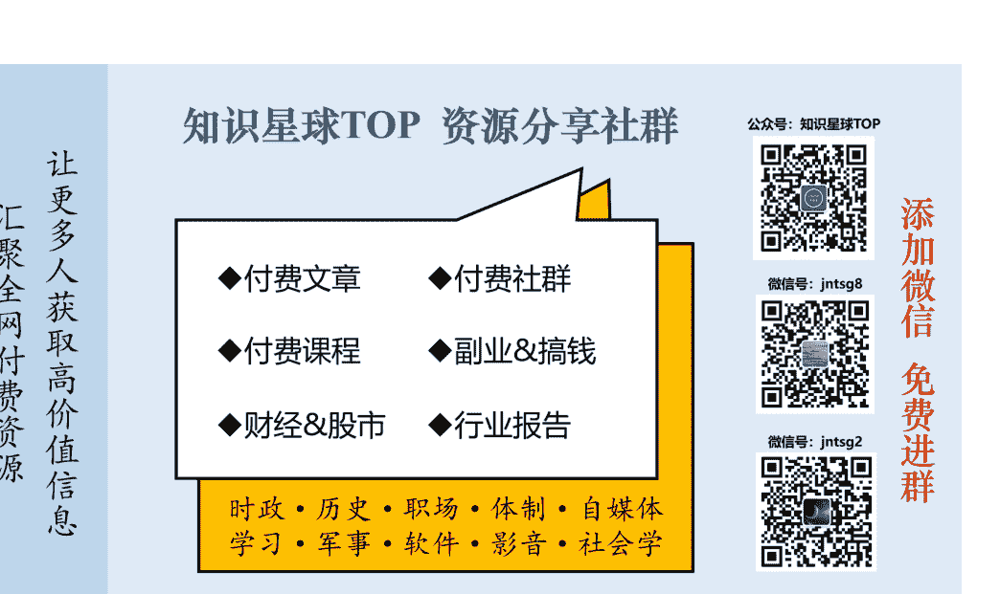

加微信信号jntsg2，免费进群资料
