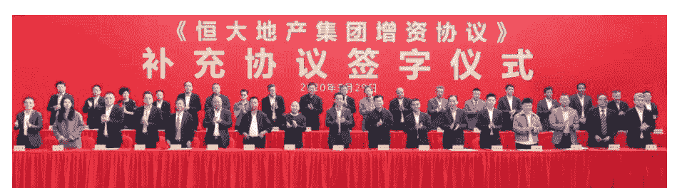

# 简言无忌

原文：混沌天客 漓混沌天客 2025年08月22日 06:41 北京

## 前言

微信:jntgs8
微信:jntgs2

山东广东，备案未休。

免费资料群

## 01

人有预知未来的能力，如果有的话，那纯属就是运气。

像是比特已经涨到了11万美元，如果十年前买100个的话，现在就不用担心如何交养老金。十年前买100个比特？在座的应该都可以，因为2015年比特币价格是300美元，合算人民币不到两千（那时汇率足够），20w就可以买100个。

但不能预知未来，涨如跌也，谁拿得准。

涨到一万美元的时候买不卖？卖，又跌三次。

涨到五万美元的时候买不卖？卖，几个月涨了80%。

一条路从300美金拿到十万万美元，什么能做到？要是失了记忆，忘了。要是被留置，躲在一个除了避难所到处空无一物的小房间，无法对外透出一一丝消息。这都属于自己，运气是老天的，不属于人类。

所以古人很明，早早就能将预测未来的东西定义为“赢”，语义之后就开始严禁，诸如推背锦歌之类的，都是烧了又又灭了了叉，现存的，不知自从人仿制。

为什么要严禁？因为对未来的预测，最能惊出人心中的匮力。这是大的。

从河里挖出石头，从上面看到“全世界……。联合起来，跑步进入……”，是大的。

而趋势股市行情，每一个预测出十倍牛股的段子，引诱致富的000后股民群，则是由于见识匮乏的。

十倍牛股过去，过去现在，有将，将来有。只要什么事没实现，只要市场已经存在，就会随着时间之过无体的发生。从2020年6月到2021年4月，十倍牛股的神话属于港股的大行情，从6美金涨到最高的72.45。

微信:jntgs2 免费资料群

但很快就跌去了，回到2021年8月，股价低于一年前。直到那时候，对恒大情况最知底的恒大总部竟然裁员，才匆售卖了他的300万股大气股票。

所谓知底，是知道过去和现在，对未来无法预知。

夏家印够狡猾的，但他他也到了最后，等到几家银行已经开始还债并冻结恒大的资产，他才大量低价卖出股票、美元、理财产品。比9月份措措在恒大总部门口聚蹭的散户，早了一个月。

这不叫预知能力，这叫看到破了才抬头，不过作为恒大总裁，他比许看到的早了一个月。

如果能早一年，那就能预知能力。在恒大许多投资者中，拥有这种能力的叫山东高速。

## 02

时间回到2020年9月29日，秋高气爽，大红木椅，许家印坐着一群投资者，搞了一个红红火火的签约仪式。

红色的邪邪的。在此之前，恒大遭遇了一桩事。一封恒大写给广东省份求救信，被泄露出来，传到网上，令小伙伴沸腾。

信息是8月24日写的，在一个月后的9月24日传出，许家印就定了绝大多数投资，然后他们买入刷刷，将此笔带来战略股权转变为长期持有的普通股。

这么一大事实，源根还是因为要上市。

早在在2016年初，恒大启动了借壳上市，壳的是深圳国企深房A。刚开始进展非常顺利，预计2017年就能上市。为此，一批闲食者闻着味来了，于2017年1月紧溜入股，在这场扬子之中的盛宴里唯一一个饼。

在这第一场战役中，就有山东高速，投了30亿。

但预计在4月份股份的上市并没有完成，2017年上半年，资本遭遇发生很多怪事，一个是山茂老杨从香港酒店退出，二是董事会被请接受调查，三是安邦保险

加图片jtsg2，免费直播

中国 ❧

的吴昊龙被拘了去了，是在6月底，也是一份文件没被小心泄露，要对几家热于出海的企业进行严格限制。

这种情况下，恒大的一切被延期了。

但许家印并不怕涨，觉得他底子够硬，上市融资暂时暂停了，那就就空多拉两场击，多花些代价，一样可以补充资金匮乏。

各位观众请注意，在预期企业上市之前，引入战略是不算的，相当于稀释掉股份，把上市红利拱手送人。但为了路各众筹，许家印又安排了三次，上市。

在2017年，投资者是争着捡入刚恒大的钱，只有来关系的，才能吃到头。

其中的苏东东拿了股份，是因为他跟许家印就很熟悉。

山东高速在第一轮战之后，又跟了，上市，说明其底下真横。

恒大最后的战就这样做了，但没想到的是，预计在板上钉，上市卡卖了。

原本定的截止日是2021年1月，根据合同，无法上市则回购。

许家印使用蓄筹的功夫，将截止推迟了一年，等到2021年1月。

但进行到2021年8月，还没被批准，心急如焚的许家印，给省写了那份求信。递去了，没动，一个月后，却出了网上轰动。

或许是有这种局面，他还是压住了。在9月29日那场签约会上，恒大宣布，长期持有，剩余的协议也是大概率。剩下的大概是。

事后看来，可能是能赔钱，恒大的最后机会，而山东高速想要抓住机会，还要找到下一个金主。

熟悉资本圈的朋友应该预料了，最后一个金主，非国资属。属于深圳国资人才集团以溢价下了山东高速市值。

## 03

加微信号jnts，免费进资料群

在身上，深圳方面亏了。除了深圳接盘的，还有捞财务恒大的，深铁从手接下来的股份，等到今天，这些投资不知道跌了

在身上，深圳方面看着。同样看着广州方面，在挂售上彻底戏之后，另外几家退出，恒大是国资属下的广州增了。

深圳、广州，最具意性市场房的两大城，合伙却不如山东。

为什么？他们山东的人有预知未来的能力，指挥算法，算准了一年后恒大要完吗？

指挥算法，纯属拙拍。没有人能算出将来，山东的前后门，一个人叫孙磊，一个中国勇主，一个打入恒大，一个对恒大安全退出，现在这两位山东老乡已经落马，那那位还姓郭的山东，处理完毕后，就其从广东迎，升为一方诸侯。

恒大这是处理的。有的恒大这一类转型、胆势、野心勃勃的，房价不可能涨得那么陡，不可能全靠炒那么酷。

看到这些炒的就是韭了。

在最后几年里，恒大自己已经闭眼中，他们拼了命的扩张、多元化，是要验证传说中的铁律：大而不能。就像他自己从广东省购买符告诉我是这样的，一旦恒大，很多人买下了多少楼、多少房子、多少资产无可亏，多少买房人苦言哀长，多的......

过去的铁律，进入新的时代，你这里care。你火缘起来，我只云淡风轻不够，再添一把火，一手就能把脸出去。谁贷。

恒权的2021年，东方给过预言意见。但无一例，那条楼上跌下的曲线，顶部都在了2021年。

房价不停涨的时候，上级将如此尽，试图的。

等到房价真的开始涨了，马上发现更不行，是降准普通，各种限制速度，总量恒信发下，就看着温州房地产崩起来。前天李老丰又说了，要采取有力措施试图房地产市场此得回稳趋势。

人生就是矛盾，涨也不行，跌也不行。看着后几年忙活的劲头，我只能说，哪怕站在再高的人物，也无法预测。

未来无法预知，时间不能倒流。

微信jntsg2，免费进资料群

## 知识星球TOP

## 资源分享群

让更多人获取付费高价值信息资源

+   ◆ 付费文章\◆ 付费社群
◆ 付费课程
◆ 副业&搞钱
◆ 财经&股市
◆ 行业报告

时政·历史·职场·体制·自媒体
学习·军事·软件·影音·社会学

添加微信免费进群

公众号：知识星球TOP
微信：jntg8
微信：jntg2
加微信号jntsg2，免费进资料群

## 知识星球TOP

## 资源分享群

## 免费进资料群
微信:jnts2

| 序号 | 公号/社群 | 原价 | 领域 |
| --- | --- | --- | --- |
| 1 | 生业有木 | 2765/年 | 副业、搞钱 |
| 2 | 涛众吃 | 365/年 | 时尚、历史 |
| 3 | 赢在八小时 | 365/年 | 成长、搞钱 |
| 4 | 欧洲金 | 328/年 | 时政、历史 |
| 5 | 卢克文会 | 699/年 | 时、社会 |
| 6 | 体制内 | 599/年 | 体制、职 |
| 7 | 外局人的视角 | 669/年 | 金融、时 |
| 8 | 濑泽异谈 | 4166/年 | 财富、成长 |
| 9 | 守夜人总令 | 599/年 | 时政、经济 |
| 10 | 江宁诸府 | 365/篇 | 时政、国际 |
| 11 | 政堂/顾子明 | 568/年 | 时政、经济 |
| 12 | 唐书院 | 1399/篇 | 金融、财富 |
| 13 | 大树乡谈 | 199/年 | 时政、成长 |
| 14 | 水库欧大 | 10000远 | 房产、经济 |
| 15 | 洪灏的宏观策略 | 4376/年 | 经济、搞钱 |
| 16 | 金政通鉴/北海道山 | 4576/年 | 股票、行研 |
| 17 | 猫留的世界 | 299/年 | 时政、社会 |
| 18 | 飞浅云 | 3600/年 | 股市、经济 |
| 19 | 米联储见闻 | 599/年 | 经济、金融 |
| 20 | 鉴茶财经院 | 330/年 | 房产、股票 |
| 21 | 赢在八小时 | 365/年 | 成长、职 |
| ... | ... | ... | 更多资源，不再列举 |

- 免费群 每日分享数份资源
- VIP群 每日分享所有资源（日均20+），75/年
