# 250911 半球财经每日分享

Jason不是
2025-09-11 03:15

zerohedge: 8月美国意外意外外扬，环比0.1%，数据发布后，交易加大了对美联储降息的预期。与美联储政策联系最为密切的短期两年美国国债利率下降3个基点至3.52%。但对预期将发布的CPI将上升，特朗普继续维持施压：“没有通胀！”鲍威尔先生必须立即大磅降息。他莱尔简直是个灾锤，他什么都不懂！！

## 其他国家经济

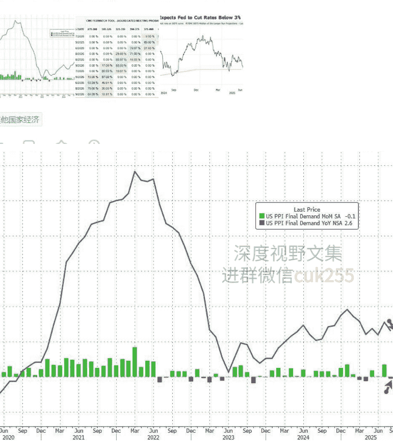

其他国家经济

版权归原作者所有，仅阅读，不作商业用途。进群加微cuk255

## CME FEDWATCH TOOL - AGGREGATED MEETING PROBABILITIES

| MEETING DATE | 275-300 | 300-325 | 325-350 | 350-375 | 375-400 | 400-425 |
| 9/17/2025 | 0.00% | 0.00% | 0.00% | 0.00% | 9.90% | 90.10% |
| 10/29/2025 | 0.00% | 0.00% | 0.00% | 78.07% | 89.00% | 11.00% |
| 12/10/2025 | 0.00% | 0.00% | 29.00% | 71.00% | 21.93% | 0.00% |
| 1/28/2026 | 0.00% | 0.00% | 29.00% | 71.00% | 0.00% | 0.00% |
| 3/18/2026 | 0.00% | 0.00% | 85.97% | 14.03% | 0.00% | 0.00% |
| 4/29/2026 | 0.00% | 17.00% | 83.00% | 0.00% | 0.00% | 0.00% |
| 6/17/2026 | 0.00% | 80.93% | 19.07% | 0.00% | 0.00% | 0.00% |
| 7/29/2026 | 13.00% | 87.00% | 0.00% | 0.00% | 0.00% | 0.00% |
| 9/16/2026 | 53.39% | 46.61% | 0.00% | 0.00% | 0.00% | 0.00% |
| 10/28/2026 | 70.00% | 30.00% | 0.00% | 0.00% | 0.00% | 0.00% |
| 12/9/2026 | 84.09% | 15.91% | 0.00% | 0.00% | 0.00% | 0.00% |

## Bond Market Expects Fed to Cut Rates Below 3%

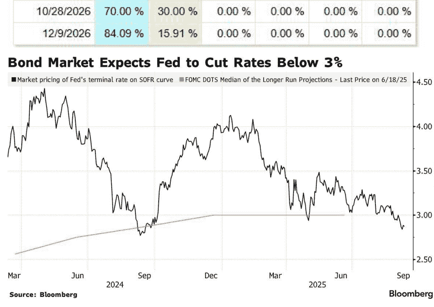

版权归原作者所有，仅阅读，不作商业用途。进群加微cuk255

## Jason驰
2025-09-11 03:18

bloomberg: 尽管中国CPI再次破零，但中国的PPI连续六个月首次回缓——8月份生产者指数下降2.9%，连续3个月处于负值区间，较7月份的降幅收窄至3.6%。市场对该数据相对平稳，30年国债收益率在2.2%左右变化不大，人民币汇率平稳。

## 中国看到通缩缓解的早期迹象

随着食品成本下降，消费者价格增长降至零。CPI（同比）、核心CPI（同比）、PPI同比

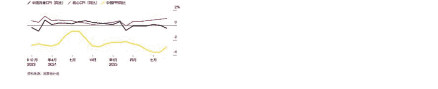

版权原作者所有，仅阅读，不作商业用途。进群加微cuk255

## Jason离
2025-09-11 03:21

国内：8月PPI连续8个月的下行，持平季节性均值（近10年同期均值-0.01%）。回归，8月PPI同比比同期收窄，主要有两点：一是“内需”导致钢铁、黑色、玻璃等行业价格上涨，如PPI开采、煤炭加工、黑色燃料、黑色钢铁、玻璃价格均由结构性因素决定；二是基数影响，2024年8月PPI回落1个百分点。此外，国际油价下行导致石油价格下跌，出口价格持续下跌。关税冲击导致需求“置换”，如通信电子、汽车用设备价格同比跌0.2%、0.3%，9月CPI可能仍为负，上半年仍受制，年中或在0%左右；9月内PPI继续收窄，但出口价格走低，生产需求受制，预计年内仍处于低位运行、难以持续。全年中枢可能在-2.6%左右。

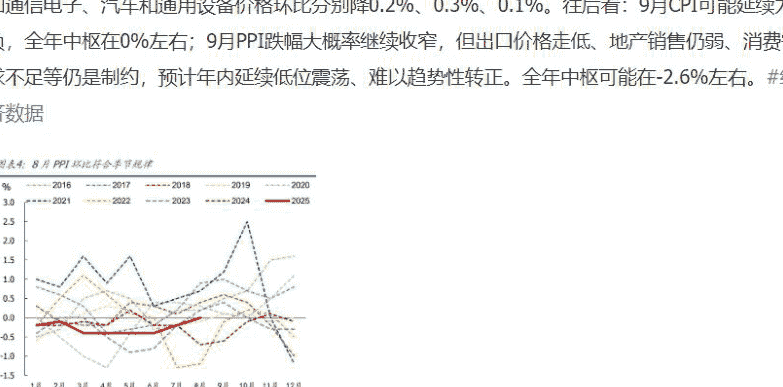

## 图表4：8月PPI对比季节性规律

% 2016 --- 2017 --- 2019 --- 2020 --- 2021 --- 2022 --- 2023 --- 2025

深度视野文集

进群微信cuk255

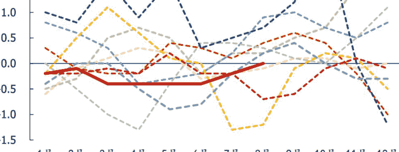

资料来源：Wind，国泰证券研究所

版权归原作者所有，仅阅读，不作商业用途。进群加微cuk255

## Jason焉
2025-09-11 03:23

行业：近一年全上涨的50.66%中，股息贡献1.85%，盈利贡献6.5%，无风险利率贡献14.1%，风险溢价贡献28.2%。近一年恒指指数上涨的55.47%中，股息贡献2.99%，盈利贡献10.56%，无风险利率贡献25.34%，风险溢价贡献16.9%。

## A股

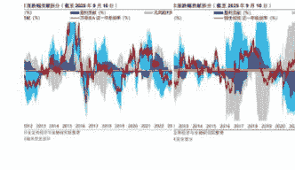

图1、全A近一年涨幅贡献（截至2025年9月19日）

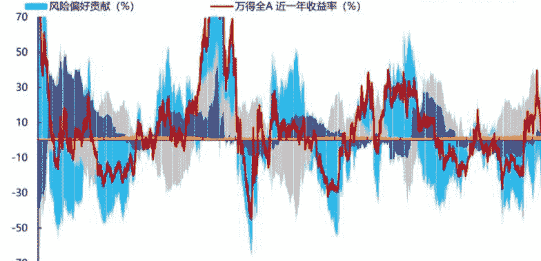

数据来源：Wind，江苏证券研究院

注：画面需要，坐标轴未显示

版权原作者所有，仅阅读，不作商业用途。进群加微cuk255

## 图2、恒生指数通胀贡献（截至2025年9月10日）

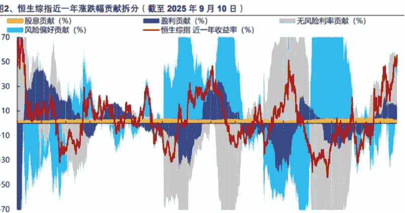

数据来源：Wind，证券研究院

注：作为内部参考，暂未更新

## Jason明
2025-09-11 03:27

Statista: 从2021年1月到2025年7月，美国平均薪增长了21.8%。与此同时，消费者价格指数（CPI）上涨了22.7%，实际工资（通过通胀调整后的金额）累计下降0.7%。自2023年5月以来，出现了通胀——实际工资再次上涨，但这不足以2023年开始的通胀缓解。其他国家经济

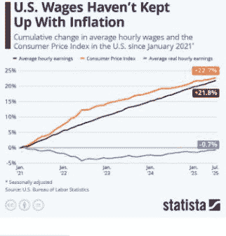

版权原作者所有，仅阅读，不作商业用途。进群加微cuk255

## Jason语
2025-09-11 03:30

上半：自7月初以来，在内需政策的影响下，光伏行业价格反弹。7月份至今，光伏价格指数上涨25%，其中硅片、多晶、电片和组件分别上涨33%、37%、23%。市场中多晶硅连续涨幅超过65%。根据历史数据，光伏价格指数同比1.11%。我们估计，从2022年高点至今年6月的低点，光伏价格指数累计下跌80%，PPI指数的隐含幅约为0.2%，并在此期间，PPI指数下跌了7%。如果在内需政策的带动下，光伏价格幅，PPI指数的变动约为0.3%。经济数据

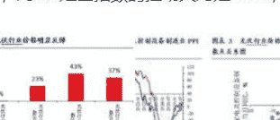

## 图表1 7月以来，光伏行业价格反弹

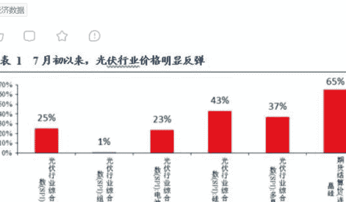

资料来源：Wind，华创财经

版权归原作者所有，仅阅读，不作商业用途。进群加微cuk255

## 图表 2 行业价格与电力制造PPI的对比趋势

## 图表 3 行业价格与电力制造PPI的类相关系数

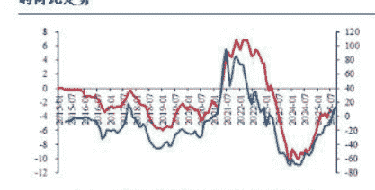

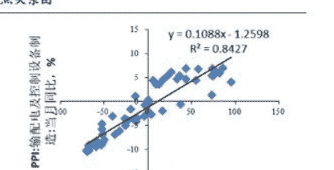

- 中国311PPI行业价格电力制造指数同比，
- 全球行业价格指数（SPI）同比（%）

数据来源：Wind，行业迁移

全球行业价格指数（SPI）对比，

数据来源：Wind，行业迁移；图中数据2023年11月以来趋势

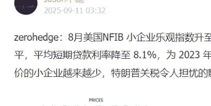

zerohedge: 8月美国NFIB乐观情绪升至100.8，利润创下2023年3月以来的最高水平，短期通胀降至8.1%，为2023年5月以来的最低水平，随计划在未来三个月内涨价的企业越来越少，瑞士关税令人影响的似乎正在迅速流失。其他国家经济

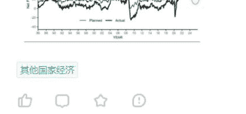

## PRICES
## Actual Last Three Months and Planned Next Three Months
## January 1986 to August 2025
(Seasonally Adjusted)

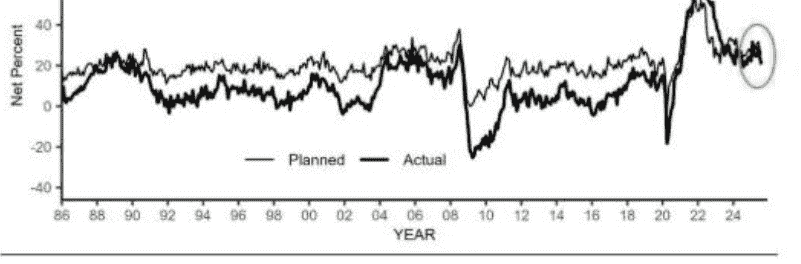

版权归原作者所有，仅阅读，不作商业用途。进群加微cuk255

## Jason题
2025-09-11 03:35

bloomberg: 中国今年将成为世界上最大的天然气进口国，因为它增加了俄罗斯的进口。根据Ryst的数据，中国管道进口量预计升至790亿立方米，德国的进口量则为710亿立方米。相比之下，根据彭博数据显示，今年对液化天然气的需求偏软，中国可能会在2025年失去最大进口国的位置。中国储备似乎在不断增加。如果没有中国的采购，需求缺。经济数据

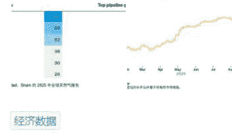

2024年全球天然气进口国单位

| Top LNG importers | Germany |
|---|---|---|
| China | 105 | 71 |
| Japan | 89 | 70 |
| South Korea | 62 | 67 |
| India | 36 | 44 |
| Chinese Taipei | 30 | 39 |
| France | 26 | 31 |

资料来源: IGU; Ryst, 2025年天然气报告

版权归原作者所有，仅阅读，不作商业用途。进群加微cuk255

## 2025年石油储备稳步提升
价格下跌时期提供了买入机会

- Onshore commercial and strategic inventories

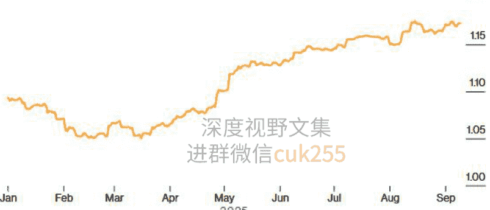

深度视野文集
进群微信cuk255

资料来源：Kpler
注：基于现有的市场情报

## Jason睡
2025-09-11 03:39

日经：9月东京经指数再度刷新最高点。东京股市延续下新高的走势。这可能益于从印度流出的资金，当地将2025年增长率从6.5%上调至7.1%。但国内投资者的身份仍然远离印度市场。许多海外投资者卖出349亿，进入9月，几乎都在卖出。美国的25%的关税与额外税合计60%，预计“使印度的实际GDP每年减少0.6个百分点”。

## 印度市场概况、风险分析：
由于印度出口额的持续增长放缓，印度政府可能通过增加外汇储备来应对卢比贬值压力。此外，由于国内需求疲软，印度GDP的增长可能面临压力。由于印度受通胀影响较大，其通胀率可能面临上升风险。如果通胀持续高于预期，印度政府可能采取紧缩性货币政策，这会对经济增长产生不利影响。股市

版权作者所有，仅阅读，不作商业用途。进群加微cuk255

## 海外资本持续增，卢比低估

印度证券存档有限公司(NSDL)的数据显示，8月海外投资者净买349亿，创下7个月来的最大购买额。7月转为净卖出，资金流出趋势。进入9月，每天都在卖出。美国的25%关税与25%进口关税合计50%，预计将印度的实际GDP每年减少0.6个百分点，可能削弱印度政府全力推动的内需刺激效应。截至8月，全球主基金对印度的配置比例接近20年来的“低点”。卢比也面临压力，9月美元元创历史最低，当前徘徊在1美元88卢比的低位区间。

Jason不错
2025-09-11 03:44

## FT: 复杂的投资路径不如简单的60/40

在投资这个行业，人类往往高估了了自己的能力，无论是华尔街的基金经理，还是普通投资者。大家有一个共同的特点：贪婪，觉得东方的比自己聪明、更高效。但然而，亚洲的能带来过回报吗？

最近《华尔街日报》做了个比较【1】，把亚洲的60/40组合（60%股票+40%债券）拉出来和换成“价值策略”对一下，结果如何？去年，60/40的年化收益是6.89%，而瑞信基金则只赚了6.49%，而且付出了更多费用，最后还不如一个简单的策略。

再看看其他，把资产分成份（股票、债券、大宗商品、现金）的“永久组合”，长期的年化回报只有4.5%，而那些30/70的组合（30%股票+70%债券）的年化回报只有5.5%，而且不包含美元，长期来看那如：60/40就是“魔鬼”的赢家。让我觉得很不可议。亚洲的就像山高深，海浮上，常识去一样，关键不是靠聪明，而是靠够。

人类认知有限，总是想要盈利，又害怕亏损。然而，越是贪婪越容易取巧，越是耐心越容易获得胜。预测失败很多事。配置简单点，靠够来给亚洲带来回报。以免所有者被认为是“被韭菜”？另一个例子，亚洲披露了一份关于2008-2023年的长期回报。亚洲基金年化回报68%，但与英国相比跌幅了7.84%。亚洲基金年化回报88%，但与英国相比为9.7%。差异只有1-2个点，由于持有时间14年，结果就是。

这个组合经历了波动，尤其是2022年股市崩盘后，增长已经变成一个不确定性。环境改变，未来的利率和结束，不是60/40组合不合适了，诸如专业玩家，早就尝试过各种方法，结果都不符合预期。所以我们真正要面对的，不是靠聪明。

常识去一样，关键不是靠聪明，而是靠够。

这恰恰符合现实。预测失败了。

预测失败很多事。配置简单点，靠够。

人类，的认知边界有限，总是想要盈利。

很少经理愿意承认自己“我不知道”，这恰恰符合现实。预测的太大了。除非接受不确定，配置简单点，投资事要回到大道，大道才是最高境界。

版权原作者所有，仅阅读，不作商业用途。进群加微cuk255

## Jason不
2025-09-11 03:51

CBRE办客户报告：调查结果显示，29%的受访客户在未来三年内增加办公面积。过去五年，行业来说，科技和消费行业的未来扩张最强，金融业和专业业务同样呈现增长意愿，由于因素影响较大，67%的制造业选择或维持现有办公面积，计划增加10个百分点。58%的租户表示，在不考虑资本投入，当租金下降20-50%时会考虑扩。

## 未来三年（2025-2027）公司总体面积将如何变化？（单选题）

| | 增长 | 保持不变 | 减少 | 不确定 |
|---|---|---|---|---|
| 2020 | 4% | 25% | 32% | 39% |
| 2021 | 13% | 4% | 23% | 59% |
| 2022 | 5% | 22% | 37% | 36% |
| 2023 | 14% | 10% | 40% | 36% |
| 2024 | 10% | 22% | 34% | 34% |
| 2025 | 18% | 18% | 36% | 28% |

数据来源：世邦理研究部，2025年8月

版权原作者所有，仅阅读，不作商业用途。进群加微cuk255

## Jason-淘
2025-09-11 03:57

财联：GDP平减指数连续9个季度增长，创史纪录，截至2025年7月，我国出口价格指数已经连续24个月增长，企业行为在微观层面实现转型风险最小化。内卷并非非同质化的竞争，而是社会“平等增长不充分”主要源于微观层面的集中。本轮内卷竞争的重要权重，其深层逻辑在于生产力下降导致的短期利润锁定，以及行为体系对市场扩张的路径依赖。因此，必须通过体制制度改革，有效约束政府“有形之手”，让企业损失更加严重。2024年企业规模与增长率倒挂显示企业面临前所未有的经营压力。让市场“无形之手”真正发挥决定作用。其中

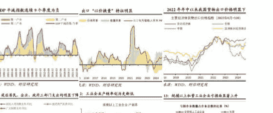

图1：GDP平减指数连续9个季度为负商业用途。进群加微cuk255

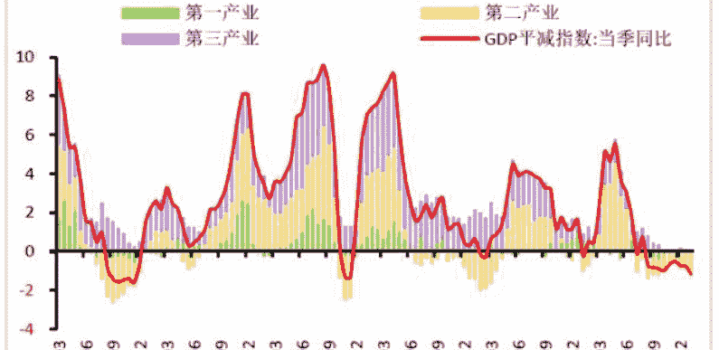

资料来源：财信研究院

版权原作者所有，仅阅读，不作商业用途。进群加微cuk255

## 图 4：出口“以价换量”特征明显

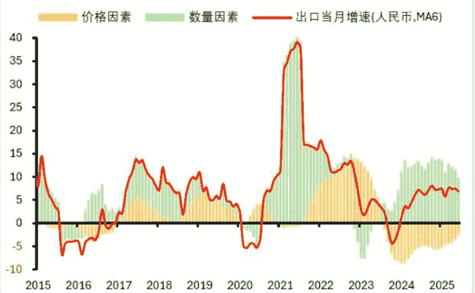

资料来源：WIND，财信研究院

## 图 5：2022年以来我国货物出口价格明显下降

| 主要经济体货物出口价格指数 (2022年6月=100) | |
| --- | --- |
| 发达经济体 | 全球 |
| 中国 | 亚洲新兴经济体(除中国) |

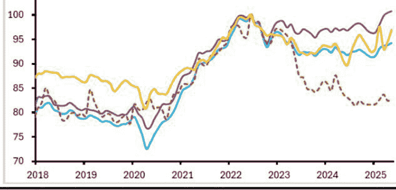

资料来源：WIND，财信研究院

## 图 6：疫后居民、企业、政府部门支出均明显下降

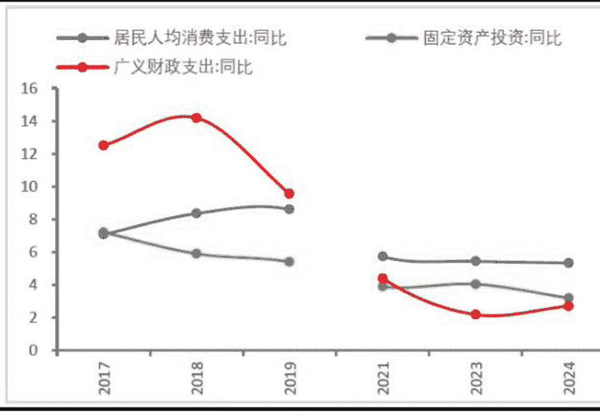

资料来源：WIND，财信研究院
注：2021年、2023年为两年平均值

## 图 12：工业企业产销率创历史新

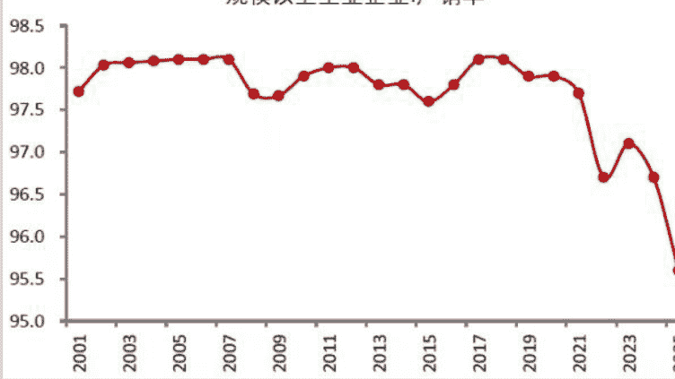

资料来源：WIND，财信研究院
注：2025年为1-6月份数据

版权归原作者所有，仅阅读，不作商业用途。进群加微cuk255

## 图 13:规模以上私营工业企业亏损面显著上升

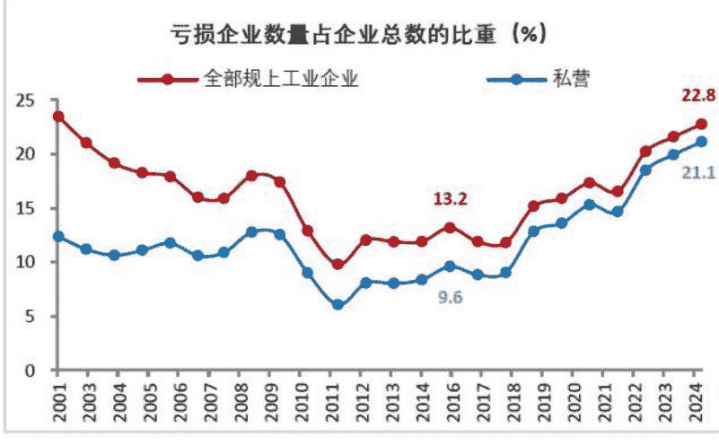

资料来源:WIND, 财信研究院

注:2007-2010年为1-11月份数据

## 图 19:高技术制造业和传统制造业 PPI价格指数

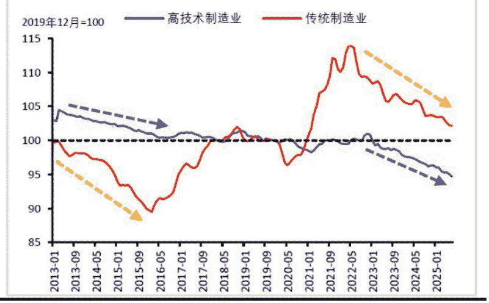

资料来源：WIND, 财信研究院

版权归原作者所有，仅阅读，不作商业用途。进群加微cuk255

## 国信达：2025年第36周，全国二手房挂价环比-0.36%#挂价

来源：贝壳挂牌价指数及成交量

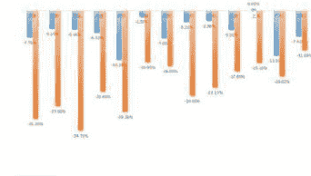

房价

最后更新：2025-09-11 04:04

## 各城市：二手房挂价最新数据
南开球财经

■本第36周主要城市二手房挂价环比（截至9/7）2024年同期最值点环比

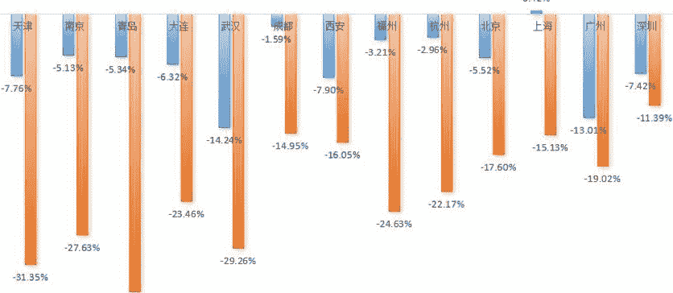

版权归原作者所有，仅供阅读，不做商业用途。进群加微cuk255

wolfstreet: 美联储8 月份资产负债表下降-390 亿美元，至 6.60 万亿美元，为 2020 年 4 月的最低水平。自 2022 年 4 月达到峰值以来，美联储已将其减少了-2.36 万亿美元，即-26.64%。这消除了COVID时期临时资产负债表扩张的+4.81 万亿美元中的 49.2%。#金融

## Fed's Total Assets, $ Trillion:
From Crisis to Crisis to Raging Inflation

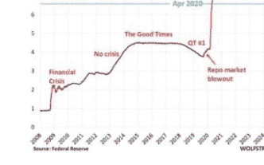

金融

## Fed's Total Assets, $ Trillion:

From Crisis to Crisis to Raging Inflation to QT

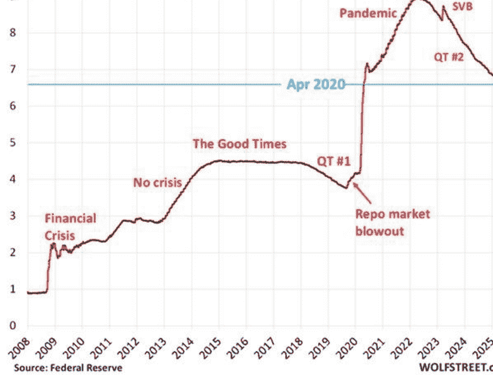

版权归原作者所有，仅阅读，不作商业用途。进群加微cuk255

Costa: 今年，黄金领涨了标普500指数的板块，这是经典的滞胀行为#美股

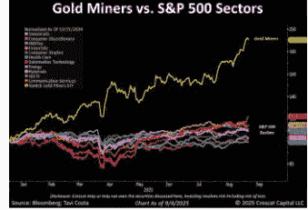

美股

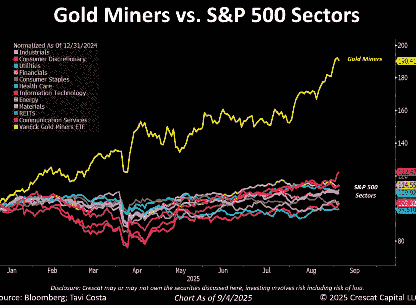

版权归原作者所有，仅阅读，不作商业用途。进群加微cuk255

2023-09-11 近一个月，全球债压力加强，投资人对主权经济充满疑虑，这背后有三个理由：全球化、地缘摩擦和人口老化。根据估，到2065年，全球的65岁以上人口就会超过15岁以下人口，各国经济体的负担在加重，长期来看只能维持平衡。#金融

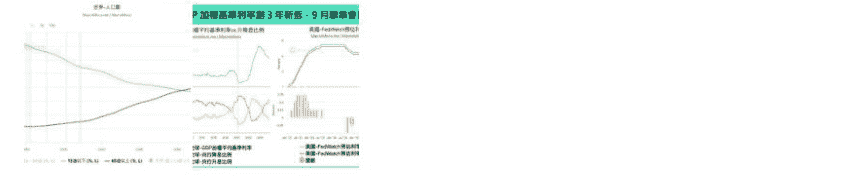

金融

版权归原作者所有，仅阅读，不作商业用途。进群加微cuk255

## 全球 GDP加权利率3年新低，全球重启

### 全球-GDP加权平均利率vs升降比例
MacroMicro.me | MacroMicro

### 美国-FedWatch估利率
MacroMicro.me | MacroMicro

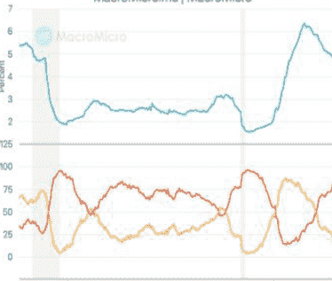

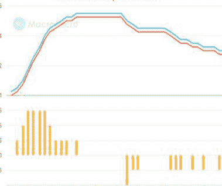

- 全球-GDP加权利率
- 全球-央行升降比例
- 全球-央行息比例
- 美国-FedWatch估利率-上限
- 美国-FedWatch估利率-下限
- 双波动

国信达：2025年8月，全国房产售价指数环比下降0.68%，同比下降8.1%。其中一、二、四线城市均下降，跌幅分别为0.93%、0.68%、1.05%、0.3%。

8月份，全国住宅售价指数环比下降0.36%，同比下降3.54%

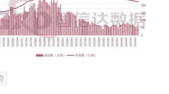

房价

版权归原作者所有，仅供阅读，不做商业用途。进。

## 全国住宅出售挂牌量指数和价格指数走势

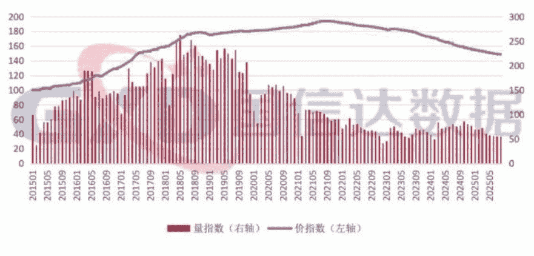

版权归原作者所有，仅阅读，不作商业用途。进群加微cuk255

## 深度视野优质集群（链接优质社，助你成功）

全部包含以下内容：限时年费188/年 加微信cuk255

- 吃瓜群众包帝文实时群对话（原价 365 元/年）
- 子明私享汇（含）内部文章
- 政事室（顾子明）付费内容加再送顾子明群聊
- 米联储闲美【作者米栖】（原价 599 元/年）
- 欧洲金雀会员专属文章（原价 328 元/年）
- 砖瓦斥内部文档（原价 400 元/年）
- 老文青读书会专属文章（原价 699 元/年）
- 鉴财经知识星球（原价 3310 元/年）
- 猫哥的视界知识星球文章（原价 299 元/年）
- 财经周【独家新闻】（原价1498 元/年）
- 杨世在金钱圈（原价 2200 元/年）
- 森淼财经知识星球（原价 1600 元/年）
- 激译付费文集（持续更新）
- 司马懿解读谋选全套音频和全套书籍收藏版无割减（原价 2.3 万）
- 虚虎三部曲【民国梦、帝国战争、不被理解的 MAO】（原价 599 元/年）
- 知识星球文章（原价 268 元/年）
- 额外再送：卢祺元新浪微博付费专栏、三村边老王、三花九术文集

深度视野（付费文集）
进群微信cuk255
