# 250914 全球财经每日分享

Jason不遇
2025-09-14 03:32
涨如90年代的日本，加上资产荒，解释上海豪宅为什么反而走势向上，股市熊新股，平均增幅还是负的，一直讲事也不行。金融。

李迅露：我们现在的涨如90年代的日本，加上资产荒，解释上海豪宅为什么反而走势向上，股市熊新股，平均增幅还是负的，一直讲事也不行。金融。

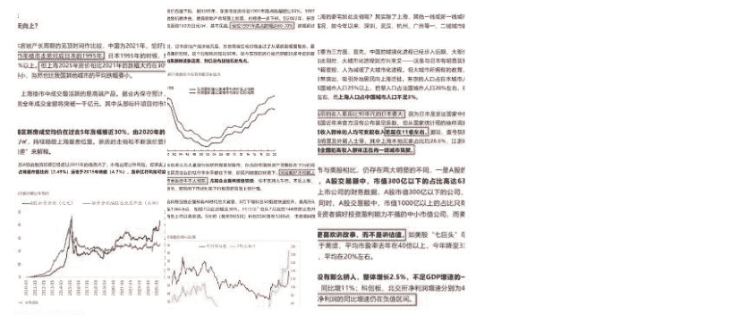

# 持续下跌的京市：上海豪宅天上路

如果中国与日本房地产走势进行跨时间对比比较，中国在2021年，恰好比日本涨30年。
那么，中国的2025年股市走势对应日本的1995年。日本1995年的时候，东京市区房价比1991年跌了约30%，左右，但上海2025年房价比2021年的跌幅约在30%左右，比当的京房价明显要小，远比我们中国其他城市的平均房价要小。

从近期数据来看，上海市场成交活跃的是高端产品，业内尚保保守，今年上海岛房价3000元以上新房成交金额已突破千亿元。其中头部标杆项目对榜的带动作用非常明显。

有统计显示，黄浦新区成交均价在过去5年接近30%，由2020年的13.8万/㎡升至2025年的17.9万/㎡，持续稳居上海最昂贵位置。新房的房价和不断涨幅显然不能简单用二手房的“价”来解释。

版权归原作者所有，仅供阅读，不作商业用途。进群加cuk255

剩余后，房价连速下跌，到1995年，东京房价较1991年高点跌幅超过50%。1997年亚洲危机的冲击，使得房地产市场出现急叠加，价格接一步下滑。到2002年，东京主城豪宅跌约150万日/m，基本底部，但仅1991年高点跌幅达60-70%，跌幅超过住宅。

总的来说，日本房地产遭遇泡沫后，东京高端住宅经历了从暴涨到崩复，最终再创新的曲折程。这个过程持续超过30年。如今的东京房价虽已突破30年前的最高点，但由于通通胀因素，还没有超越历史高点。

东京实际房价没有超越历史高

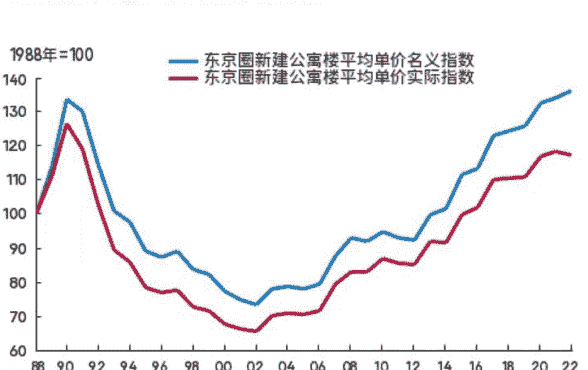

那么，对于上海的豪宅如此贵吗？其实已经了上海，其他一线或二线城市的核心区域豪宅也有类似情况，如今年来、深圳、武汉、杭州、广州等一、二一线城市的豪宅也面临同样光景。

其原因在于，主要有三个方面，首，中国的城市化进程已经进入后期，大部分城市人口净出；但与与此同时，东京城市化进程与美国一项与日本有明显的差异，因为我国大城市房价长期膨胀，人口为挤压了城市化进程，但大城市所有的教育、医疗、文化等资源非常匮乏，导致了人口向海迁移。东京的日本人口为30%以下，首尔中国人口为25%以上，北京中国人口约为20%，纽约美国中国人口约为8%，而上海中国人口约为30%。

其次，中国现在的收入差距对比90年代要大。这是因为发达国家中规模最小的国家之一，我国近年来官方公布基尼系数，但从国内统计计的抽样调查显示，高收入群体与低收入群体的人均可收入差距在11倍左右，来说，赛号购买者包括专业企业、明星人物及外籍人士，其中上海本地买家占比28.6%，江浙地区房价合计比30%。说明中国的高收入群体仍在一线城市聚集。

版权归作者所有，仅供阅读，不商业用途。添加微微cuk255

有人坦A股的融资规模已经超过2015年的最高点，市场出现过热风险。尽管如此，资金余额流通市值比例(2.49%)低于2015年峰值，显示杆风险可控。

# A股融资余额异常接近高位

—A融资余额（亿元） —融资余额/A股总市值（右轴）

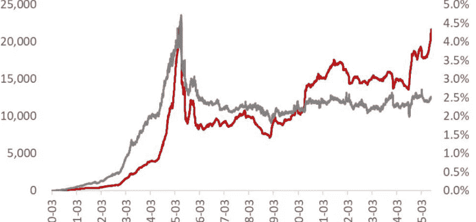

来源：wind，中华国际

还有观察者认为大量银行存款将搬到楼市，但当前中国房地产周期结束处于下行阶段，居民部门和民营企业的杠杆率水平在下降，即居民储蓄的背景下，风险偏好不能上行。股市全面牛市太真实，企业增速放缓，也不支持大牛市。本质上，这一宽宽市场、宽松信用市场下行的行为估值尚需修正。

而看来科技的走强却是AI时代的大骨架，8月初创50指数快速拉升，最高在8月28日涨至1364.6点，PE底部涨幅30%，PE值从7月的144拉升至190，再回升以来新高（9月5日）PE创50回至1268点。

# 科50指数与估值

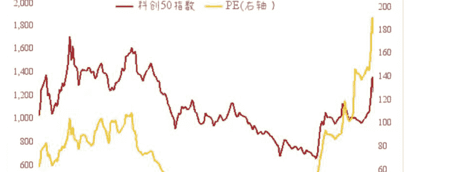

版权归原作者所有，仅阅读，不作商业用途。进群请cuk55

A市场的结构性与美国股相似，但存在着大的不同，聚焦在中市值。2024年，A股交易额中市值300亿以上的占比63.3%，美国股只占7.1%。根据2020年美国股市的财务数据，A股交易额中市值1000亿以上的占比只有17.7%，说明A股投资者对盈利能力弱的中小型市值，和美国格相反。二是A股投资者更想要故事，而不是讲价值。美国股市“头牛”被投资者追捧，但市值水平并没有过高，平均盈利率在40%以上，今年攀升至33倍以下，说明盈利的增长还平均，如今市值在20%左右。但是我们的股市并没有如预期，整体下降2.5%，其中创业板净利润1505亿元，同比增长1%；科创板、北交所净利润分别为4.9%和6.08%。若删除股后，平均净利润仍处于负区间。

# 删除股后A股平均净利润与增速

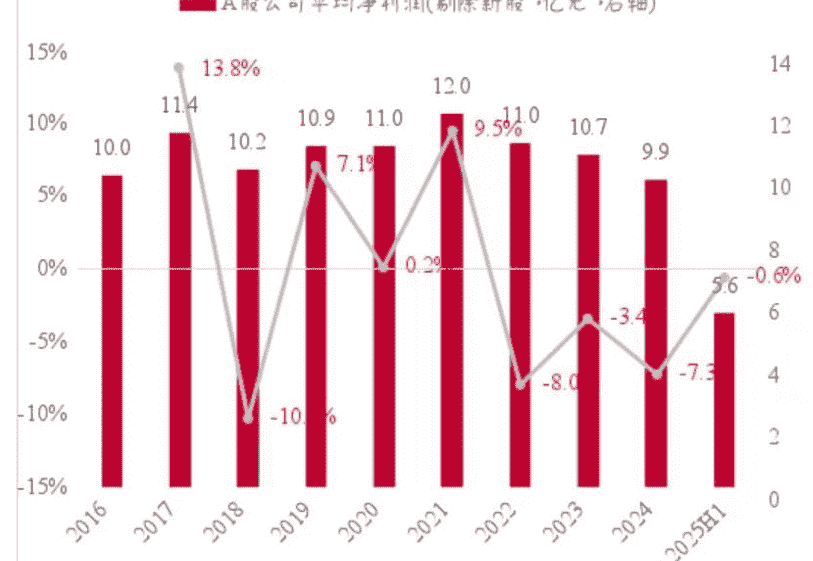

来源：wind，中泰国际

版权归原作者所有，仅阅读，不商业用途。进群cuk255

Jason不诡
2025-09-14 03:38

花薇: 日本计划向美国投资的5500亿美元资金严重依赖日本的3万亿美元外汇储备。如果日本通过出售美债来，这种资金调动可能推高美国长期债券收益率。为了稳定市场，美国可能向日本施压，要求其管理外汇储备时延长所持美元的久期。从货币政策的角度来看，美元走强和日元的持续偏向将会存在。

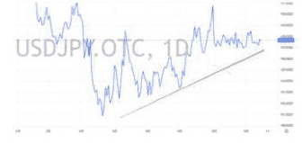
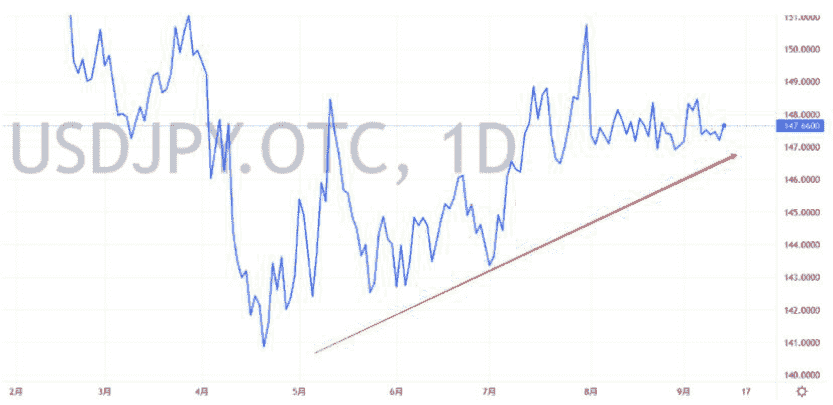

版权归原作者所有，仅阅读，不商业用途。进群加微255

长江：对社融政策信贷，财政部表示提前下达部分2026年新增地方债务限额，靠前使用化债质量，储量置换债或提前今年Q4发行，继续对社融形成支持。

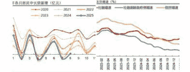

## 图3：历年各月居民贷款新增（亿元）

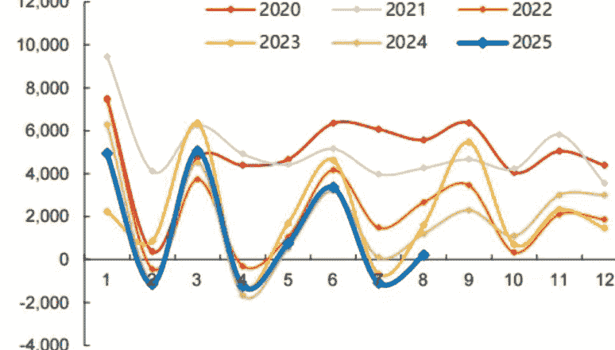

资料来源：Wind，长江证券研究所

版权归原作者所有，仅供阅读，不作商业用途。进群加微cuk55

## 图9：社融增速、信贷增速 (%)

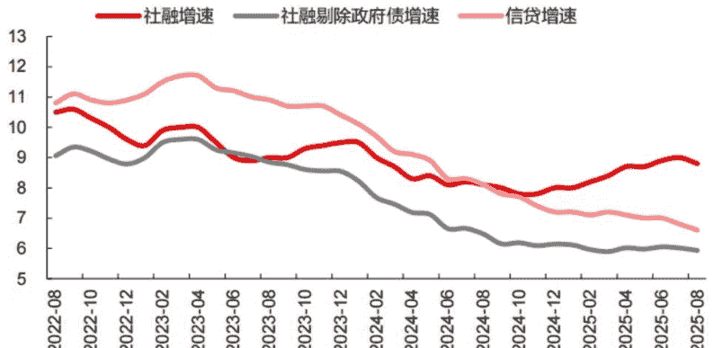

资料来源：Wind, 长江证券研究所

高瑞家族办公室冬季访问报告：超过三分之一的受访者减持或持有现金（目前为12%）并投资于风险资产。33%的受访者投资了加密货币，公开市场配置回升至2021年的水平。从区域来看，投资组合以美国为中心，而在其本土市场之外，家族办公室最常配置到地理附近的市场：89%的欧洲、中东和非洲、80%的亚太受访者配置到中国。超过一半（58%）的受访者计划投资组合在未来12个月将更广泛使用人工智能，并越来越关注受益者。

高瑞家族办公室：关于全球家族办公室投资配置的调研报告，未来投资配置趋势（样本受访者统计）

- 投资组合：2023年10月，2023年12月
- 加密货币：2023年10月，2023年12月
- 股票配置：2023年10月，2023年12月
- 房地产配置：2023年10月，2023年12月
- 债券配置：2023年10月，2023年12月
- 现金及物：2023年10月，2023年12月
- 人工智能：2023年10月，2023年12月
- 其他（见脚注）：2023年10月，2023年12月

版权归作者所有，仅供阅读，不做商业用途。

尽管忧，家族办公室继续保持对风险资产的高比例平均配置如下（由于四舍五入，百分比完全到100%）：

- 公开市场：2025年31%，高于2023年的28%。
- 另类投资：2025年42%，低于2023年的44%。
- 私募股权：2025年21%，低于2023年的26%。
- 私募房地产和基础设施：2025年11%，低于2023年的9%。
- 私募信贷：2025年4%，低于2023年的3%。
- 对冲基金：2025年6%，自2023以来稳定。
- 固定收益：2025年11%，高于2023年的10%。
- 大宗商品：2025年1%，自2023以来稳定。
- 现金（包括美国债）：2025年12%，与2023年持平。

zerohedge | 路透查看机密文件显示已阅读，不作商业用途。进群cuk255

三个月日 俄罗斯“2024年第一季度经济运行报告”发布，俄罗斯经济面临严峻挑战，预计第一季度实际GDP比2023年同期增长4.8%。
- 受外部环境影响，俄罗斯出口额下降10.5%。
- 进口额增长1.2%，主要由于进口替代品增加。
- 第一季度俄罗斯CPI通胀升7.4%。
- 工资增加了250000万卢布（按人数计算），为2023年同期的2倍，实际增加了480000万卢布。

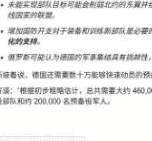

版权归属作者所有，转载请进。

他在9月2日写道：“军队必须在2029年之前做好战斗准备，并在2035年之前提供德国承诺的（北约）能力”。提议出台之际，柏林在增加对东欧国家的承诺。德国打算在立陶驻留5000名士兵的永久驻部。此外，在约二十万乌克兰士兵进入波兰领空后，柏林计划加强对波兰的支持。柏林未实现2018年拥有30万士兵的目标。今年时候，德国国防部部长皮斯托·波尔斯维克表示，柏林正在试图将其现役规模增加到260000人。

根据《现代外交》的分析和总结显示：

- 在竞争激烈的劳动力市场上，德国可能重新引入征兵制或提供大量激励措施吸引和留住专业军人。
- 未实现目标可能削弱东欧联盟带来压力，特别是与波兰和波罗的海等国家联系。
- 增加防御装备和训练新军队是必要的，这将德国的财政优先考虑和公众对军事的转变。
- 俄罗斯认为德国的军事扩张具有扩散性，可能会加剧东欧的局势。

接下来，德国还需要数十万能够快速运转的预备军人。总共需要约460000名（来自德国的）人员，分为约260000名现役部队和约200000名预备军人。他写道：“根据初步规划估计，总共需要约460000名（来自德国的）人员，分为约260000名现役部队和约200000名预备军人。”

Jason Robin
2025-09-14 04:27
财通：7月开始，市场对“北交所个人投资者资金影响”引发讨论，参照2024年年初数据，北交所落后投资者中个人投资者占比约77%。年初以来，北交所打入新资金热度持续上升，单只股票新结资金在5000亿元以上，现金申购对对其剩余资金“虹吸”明显上升，典型的为8月以来，7月开始发行新股，北交上市增大概率为：

## 图7：北交所投资者构成

| 投资者类型 | 占比 | 备注 |
| :--- | :--- | :--- |
| 个人投资者 | 77% | |
| 机构投资者 | 23% | |

## 图1：参与者多以个人投资者为主

## 图2：7月开始交易所净资金流

机构：8.54%
普通人：21.1%
散户：11%
外资合计：-14.4%

北向：净买入—————净资金流向 ——净流入流向

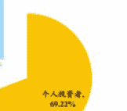
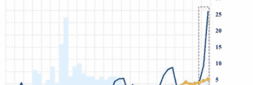

数据来源：Wind，长江证券研究所，数据为2024年9月数据

## 图3：北向新股申购资金的趋势

| T-1 | 申购前日 |
| T | 申购当日 |
| T+1 | 申购后首日 |
| T+2 | 申购后二日 |

# 特征分析，流入资金 全额资金 # 转入申购资金 #撤回资金

看到资金回流，主要是由于海外投资者在北向市场撤回，导致市场面临压力加大。内ETF等资金出现异常，这种时尚持续。在申购当日撤回了部分申购额，金额高达160亿元。中申购资金进入账户，剩余配售资金完全撤回。撤回资金主要是由于基金卖出公募基金，由执行操作并在次日卖回。对市场而言，资金撤回和申购压力对短期构成了流动能力，然而短期影响了北向市场的氛围。

数据来源：财证券研究所

Jason
2023-09-14 14:34

中金：历史上，全球PMI对我国出口有很好的领先作用，指标的回落意味着我国出口增长面临更大压力，明年PMI回升或维持强势，低运行有利于收益率下行，即供给因素推动PPI回升，其对股市影响有限。

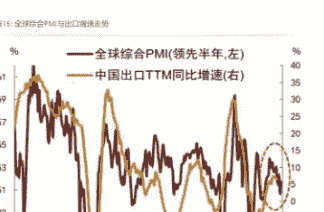

版权属于作者所有，不做商业用途。进群加微cuk255

## 图表15：全球综合PMI与出口趋势

| 全球综合PMI(领先半年,左) % | 中国出口TTM增速(右) % |
|---|---|
| | 40 |
| 61 | 35 |
| 59 | 30 |
| 57 | 25 |
| 55 | 20 |
| 53 | 15 |
| 51 | 10 |
| 49 | 5 |
| | 0 |
| 2003 2006 2009 2012 2015 2018 2021 2024 | -10 |

资料来源：iFind, S&P, 中金公司研究；注：数据截至2025年8月，全球综合PMI对地区定义为全球（中国大陆）

华东：7月A股流通市值占户户比例为53%，距离2021年12月的72%仍有较大空间，且8月居民存款入库速度并不快，可以推测居民存款或仍有流入空间。我们用万得对于投资者风险指标的宽幅代表高弹性品种的宽幅表现，发现这一指标与A股流通市值占住户存款的相关系数高达70%（2020年2月以来），指向居民存款相对偏好弹性品种，结合居民存款或仍有流入空间的结论得出，A股、半导体、固态电池、机器人、创新药等高气行情有望持续延续。#A股

版权归原作者所有，不作商业用途。进群加微cuk255

## 图7：居民存款存入或仍有空间

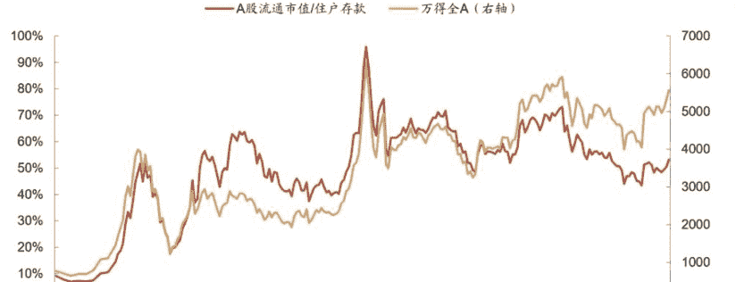

来源：Wind, 彭博瑞数据事务所

Jason不酷
2025-09-14 01:40

FT: 养老金领取者现在的收入高于工作年龄的成年人#其他国家经济

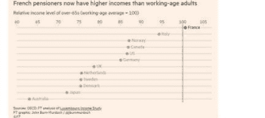

版权归作者所有，仅阅读，不商业用途。进群加cuk255

## French pensioners now have higher incomes than working-age

Relative income level of over-65s (working-age = 100)

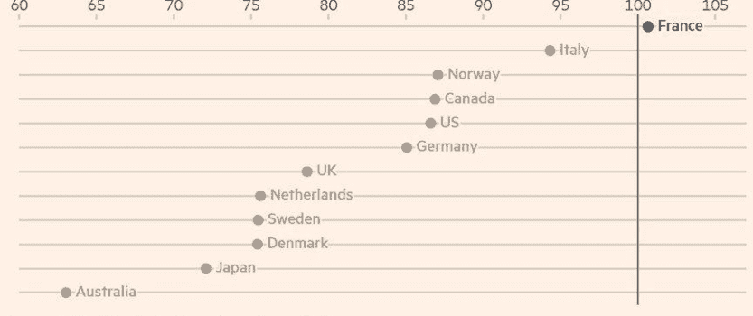

Sources: OECD; FT analysis of John Burn-Murdoch graphic

Jason不跑
2025-09-14 04:45

VmtPerception: 退休人员在美国消费中所占的比例越来越大。这种时尚持续。在申购当日撤回了部分申购额，金额高达160亿元。中申购资金进入账户，剩余配售资金完全撤回。撤回资金主要是由于基金卖出公募基金，由执行操作并在次日卖回。对市场而言，资金撤回和申购压力对短期构成了流动能力，然而短期影响了北向市场的氛围。

数据来源：财证券研究所

## US Consumption Share, 55 yrs+ as % of Total Consumption

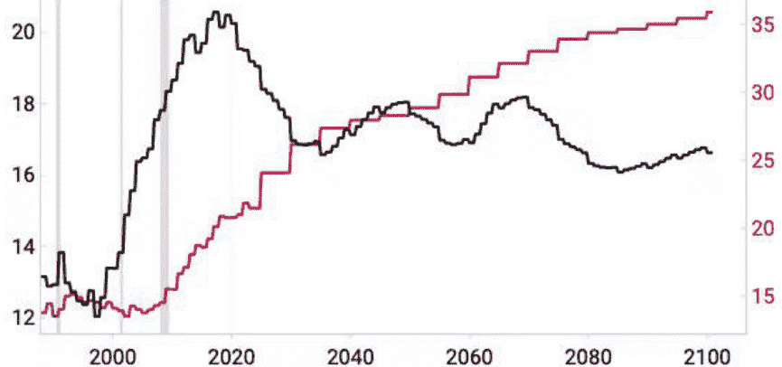

- 65 yrs+ as % of Total Consumption
- 55-64 yrs as % of Total Consumption

## 统计和动态

根据俄罗斯联邦的数据，到 2025 年，约有 150 万儿童上一年级。为了评估减少的规模，有必要将这一数字与以往的数据进行比较。

| 学年 | 一年学生人数（百万） | 与上一年增加/减少 |
| :--- | :--- | :--- |
| 2023/2024 | 2,0 | +1,2% |
| 2024/2025 | 1,8 | -10% |
| 2025/2026 | 1,5 | -16,7% |

从可以看出，2023 年俄罗斯一年级学生增加了，那么在接下来的两年里，他们的人数减少了 25%（从 200 万减少到 150 万）。这种下降是长期低生育率的结果，这种低生育率始于 2008-2009 年经济危机后，一直延续到 2010 年初。

> Jason-n 2025-09-04 14:54

PIMCO: 贸易理论表明，美国的关税在在国内会导致通胀，但对目标经济来说会导致通货紧缩。我们看到了这种态势正在发挥作用的优势。同样，泰勒规则（一种设定利率的公式）表明，关税可能会缩小美国供应链断裂的空间，扩大其他央行的灵活性。#其他国家经济

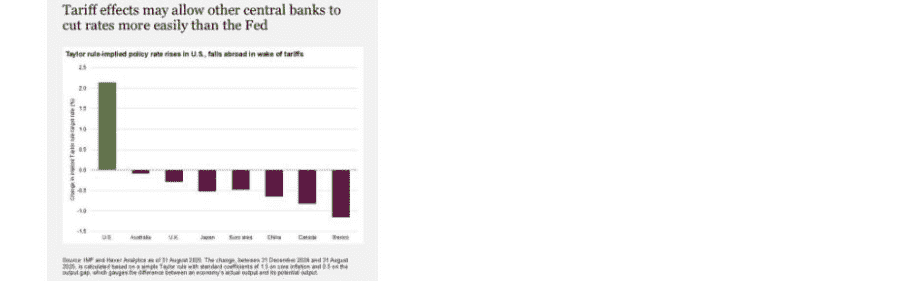

其他国家经济

## CHARTING PERSPECTIVES

By Marc Seidner and Pramol Dhawan

### Tariff effects may allow other central banks to cut rates more easily than the Fed

Taylor rule-implied policy rate rises in U.S., falls abroad in wake of tariffs

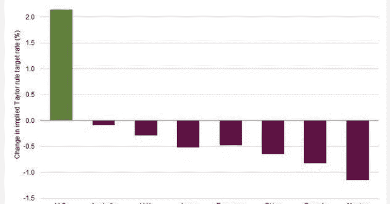

Source: IMF and Haver Analytics as of 31 August 2025. The change, between 31 December 2024 and 31 August 2025, is calculated on a simple Taylor rule with standard coefficients of 1.5 on core inflation and 0.5 on the output gap, which gauges the difference between an economy's actual output and its potential output.

Jason-不晓
2025-09-14 08:20

## 中指：8月居民置业意愿再创新#房价

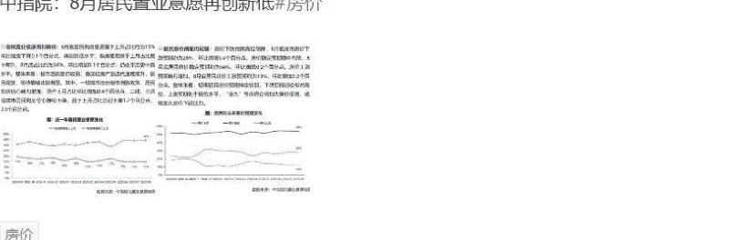

房价

版权归原作者所有，仅阅读，不作商业用途。进群加微cuk255

8月居民购房意愿强于上月占比约为15%，环比下降0.1百分点，再创新低水平；购房意愿弱于上月占比稳中有，8月底占比约为34%，环比增加0.1百分点，仍处于历史高水平。整体来看，市场活跃度较低，叠加住房产品迭代速度提升，居民观望、等待情绪比较明显。其中，一线城市出台市刺激政策，居民购房信心略增加，强于上月占比增加0.4百分点；二、四线城市居民购房信心持续下降，强于上月占比分别下降1.7个百分点、0.3个百分点。

## 图：近年居民购房意愿变化

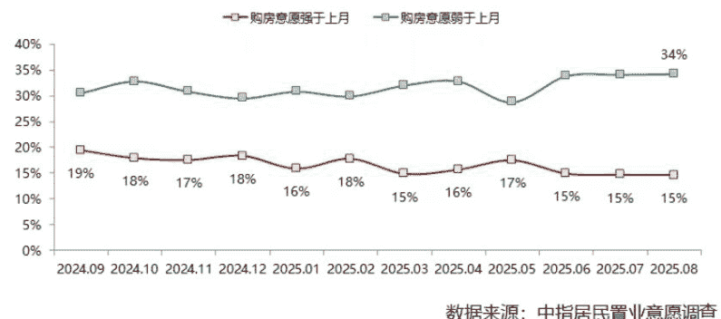

版权归原作者所有，仅供参考，不作商业用途。进群加微cuk255

居民房价仍较弱：房价下跌高位微调，8月底居民房价下跌预期为28%，环比下降0.4个百分点。房价稳定预期中有降，8月底居民房价稳定预期约为54%，环比下降0.2个百分点。房价上涨预期有增加，8月底居民房价上涨预期约为13%，环比增加0.2个百分点。整体来看，短期房价预期持续较弱，下跌预期相对较高，上涨预期处于低位水平，“金九”节点购房将加力降价促销，或加大房价下跌压力。

## 图：居民未来房价预期变化

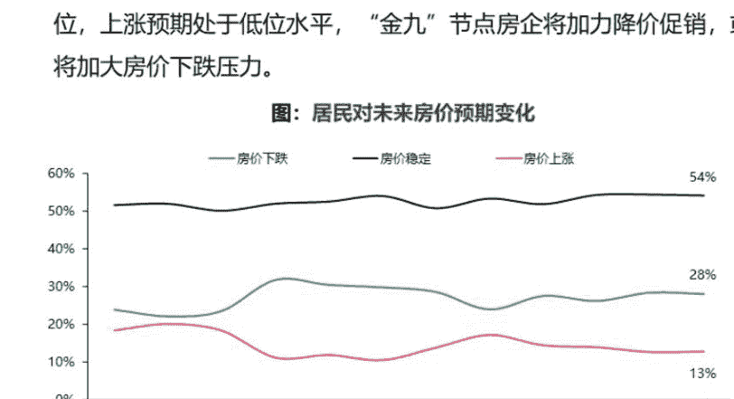

数据来源：中指居民商业意愿调查

版权归原作者所有，仅阅读，不作商业用途。进群加微cuk255

Jason-不诡
2025-09-14 09:07

## 《凯恩斯理论》为什么我们的经济日益繁荣，我们的收入却停滞不前？论文或书籍推荐

在进入21世纪以后，由于科技技术的飞速发展，人类的生活水平发生了翻天覆地的变化。食物、衣服、住房等方面都比以前丰富。然而，尽管总产出在不断增长，但人均收入的增长速度却远低于总产出的增长速度。这种现象在经济学中被称为“停滞性增长”。

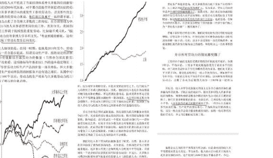

凯恩斯在《就业、利息和货币一般》中指出，资本主义的矛盾在于有效需求与生产能力之间的矛盾。这种矛盾导致了周期性的失业。那么，我们该如何解决这些问题呢？

凯恩斯主义的核心是有效需求理论。他认为，政府可以通过扩张性政策来刺激需求，从而实现充分就业。这一理论在二战后的世界范围内产生了深远的影响。

然而，随着20世纪70年代石油危机的出现，凯恩斯主义面临了严峻挑战。通胀和失业同时出现的滞胀现象，是凯恩斯理论无法解释的。

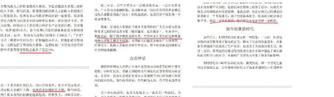

面对凯恩斯主义的困境，新自由主义学派兴起。以哈耶克为代表的学者们强调市场机制的作用，主张减少政府对经济的干预。

近年来，随着全球金融危机的频发，人们又开始重新视凯恩斯主义的价值。政府在应对经济波动方面依然发挥作用。

## 推荐

- 《凯恩斯主义：就业、利息和货币一般》是理解凯恩斯经济学的奠石。
- 《通往奴役》是哈耶克的代表之作，探讨了计划的局限。

版权归原作者所有，仅阅读，不作商业用途。进群加微cuk255

收入水平代表了当前经济体系中多数岗位的状况。自上世纪80年代以来，对于那些没有晋升到管理岗位的劳动力、那些单调重复工作的劳动力，以及那些没有受高等教育的劳动力，他们的工资水平一直停滞。这种劳动力占据了绝大多数的工作，机械性的工作比如书记或司机，超过55%的劳动力没有本科。考虑到通胀，这些劳动的实际工资没有任何变化。更让人惊讶的是，在同一时期，也就是从80年代至今，劳动生产率实际上稳步提高。所谓劳动生产率，指的是经济体系的总价值除以劳动力的数量（包括高薪劳动力）。平均来看，每年都在7%的速率增长（见图1）。尽管劳动产品的价值一直在增长，但大多数劳动力的工资并没有随之增长。

版权归原作者所有，仅阅读，不作商业用途。进群加微cuk255

劳动生产率逐步提高，大多数劳动力的工资水平持续停滞，而二者之间的差距还在扩大。由此可见，经济体系中所分的蛋糕越来越少了，真正感受到的是劳动力收入没有增长。虽然劳动力创造了大量财富，但这些财富没有给他们带来好处，也就是说如今经济体系中，财富分配（经济学家称之为“劳动投入”）越来越小了。普通阶层已经意识到了，他们的情况比父母更糟糕。尽管工作十分努力，但他们仍不可避免一路下滑。注意，这并不是他们一直在原地，而是说他们虽然努力，却发现自己不断倒退。工资停滞的现象与其教育程度的不同。如图所示，平均来看，工资水平的发展趋势对于高中和中学以下的劳动力来说，他们的工资水平下滑了5%。即使那些受过大学教育的人，例如科学，他们的工资水平也没有增长。

实际工资（假设1980年为1）

版权归原作者所有，仅阅读，不作商业用途。进群加微cuk255

无论是赫赫有名的超级英雄，还是分析师、医生或华尔街银行家的精英，技术变革的背景之下，他们的生产力得到了增长。由于他们的收入作为高级领先者的倍增。不过要注意，技术变革并不是导致收入不平等逐渐加剧的唯一因素。公司支配力的急抬头，加深了收入差距与劳动投入之间难以逾越的鸿沟。

劳动市场之所以逐渐衰退，其实是因为商品市场的持续下降。毫无疑问，技术进步是技术的更迭在不断加速。换句话，我们生活在一个技术飞速进步的时代——这种速度是如此以至于只有少数几家公司能够跟上，进而统治整个市场。虽然技术的进步给这几公司带来了巨大的发展潜力，但随之来的却是竞争获，这种发展导致了劳动力之间的各种现象。

我们对不平等逐渐加剧的根源进行了研究，显然，各大企业在其中扮演了极为重要的角色。具体来说，企业的差异性正变得越来越高，这在很大程度上会引起收入分配的不平等现象。只要对比不同企业的员工就能看出端倪：在过去，大多数公司都会同时雇用相当数量的低技能人才与高技能人才；现在，很多公司只会为那些高价值、高薪资的劳动力提供容身处，对于保洁、工作等服务，他们会选择外包专门的公司。

可以说，收入不等现象很大程度上是各个企业的差异性导致的。行业的设计师、程序员和研发人员都拿着较高的薪资，而那些承担着职能的外包公司的员工就比较惨了，他们只能拿到很低的薪水。也就是说，企业之间越不等。一些企业只会雇佣那些拓展性强、生产效率高的劳动力，并为他们支付很高的工资，而一些企业只会设立服务性质的岗位，招聘一些可替代性的动力，并支付给他们较低的工资。

虽然企业之间的不平等程度加剧，但企业内部的收入不等程度却没怎么变过。平均来看，收入排在前1%的员工的收入是其其余同事的20倍，这个比例与1980年的水平基本持平。不过，放眼整个经济体系，收入不平等现象还是在加剧，其中至少有2/3来自企业间不平等程度的扩大。8

版权归原作者所有，仅阅读，不作商业用途。进群加微cuk255
