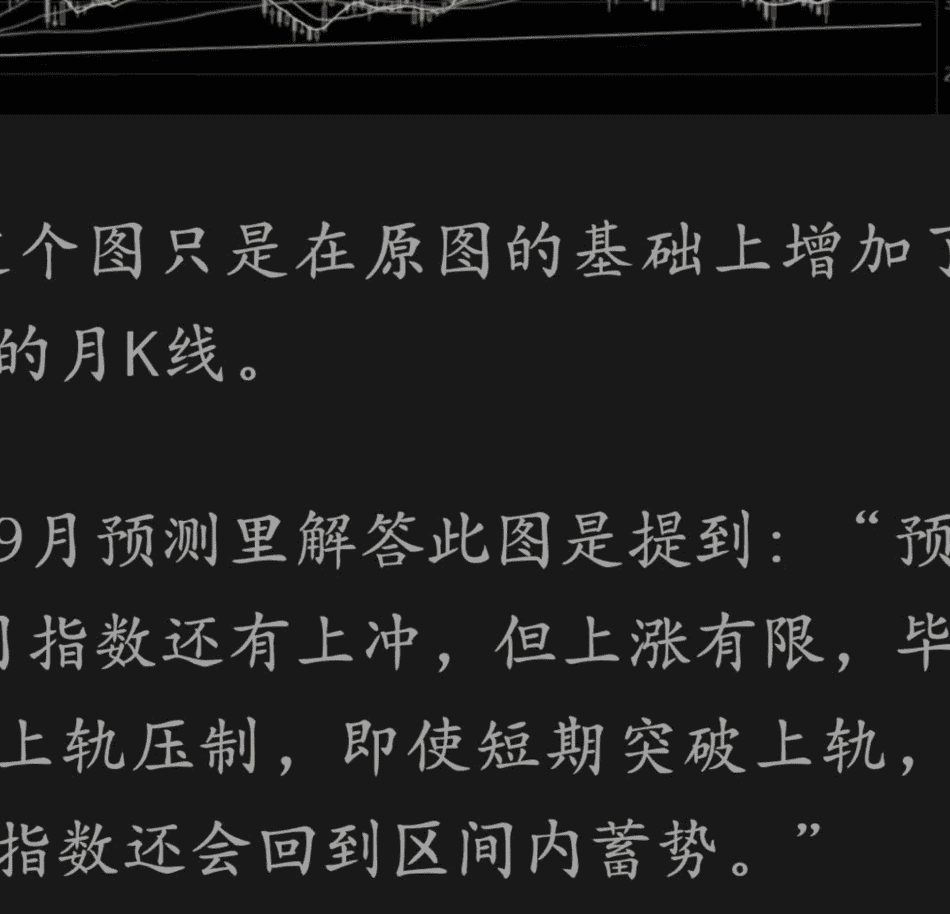
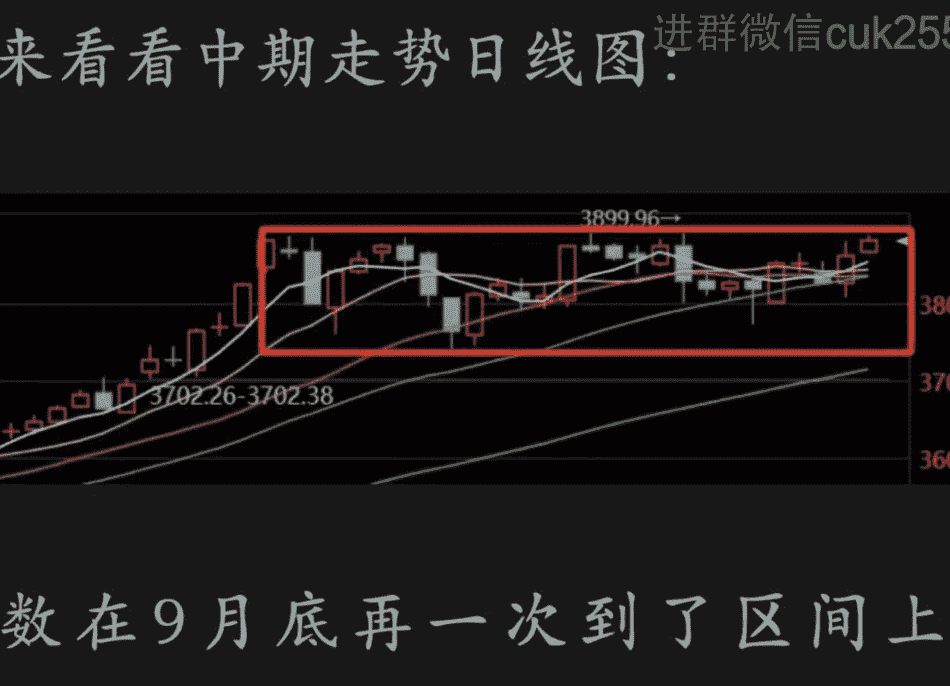
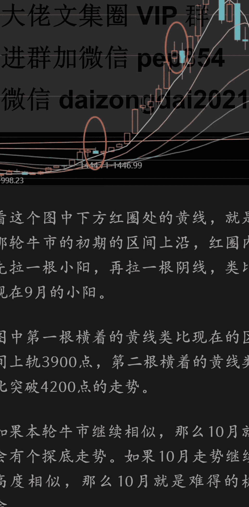
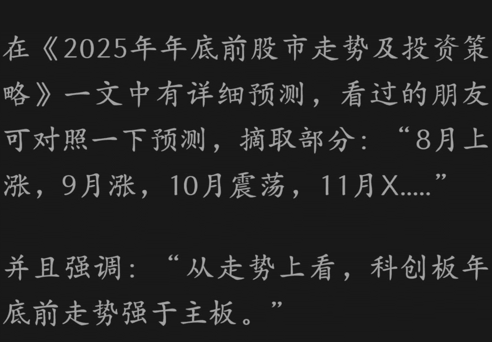
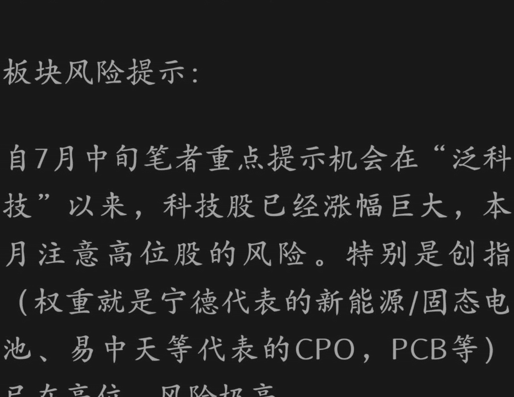

# 10月行情预测（大盘走势分析）

原文 五行对股市的影响 见五策略
2025年10月08日 19:31 山东

假期充实，划了6条走势预测，内容颇有利点，预测大盘走势，预测内容有这8篇分析长，预测内容包含以下8项，分别讲解如下：

深度视野文集
进阶期货仓255

1. 预测上大盘长期走势；
2. 预测上大盘中期走势；
3. 预测大盘10月走势，给出时间点，并直接给出大约高点和低点位置。
4. 预测大盘第四季度走势及大约高点低点位置。
5. 图解讲解科创50指数10月走势；
6. 图解讲解创业板指数10月走势；
7. 10月几个高风险的板块提示：
8. 10月投资机会及板块建议。

10月是非常重要的一个月份，对应今年，是一个大的波动月份，更是一个好的机会期，请大家抓好这个机会。

我有微信的，我可以直接发你我的预测件，或在此文下方付费阅读。

大盘长期走势，在“9月行情推演”里给出的预测长期有效，高度可以根据上轨斜率，自己下留盯位：

大盘中期走势，在“9月行情推演”里给出的预测：

这个只是在原的基础上增加了9月的K线。
在9月的预测里解释此粉丝提到：“预判9月指数虽有上涨，但上限有限，毕竟上轨压力，即使短期突破上轨，预测指数会回到区间内震荡”。

看到图中的9月K线，9月上涨0.64%，“区间内震涨”，10月大盘走势与预测吻合。

深度视野文集
进阶期货仓255

再来看看9月走势日线图

指数在9月底再次回到了区间上沿（3900点左右附近），接下来指数是突破上轨还是再次回头下呢？

在，“99行情推员”已经签妥了，把原图转过来，再详细讲解一下：

看这个图中下方红圈的黄线，就是蓝轮牛初期的区间上，红国内先拉一根小阳，再拉一根阴线，美比在9月的小阳。

图中第一根横着的黄线比在的区间上突破3900，第二根横着的黄线比跌突破4200的走势。

如果蓝轮牛继续相似，那么10月就会出现探底走势。如果10月走势继续高度相似，那么10月就是彻底的良机。

## 四季度大回调预测：

在过去两轮牛市中，也就是2007年6124的牛市和2015年5178的大牛市，其中正式开始以后，没有一次跌破半年线，也没有完全跌破五线，但跌到60日均线，限于涨幅，就不不一举了，可以自己看去历史趋势。

9月五线3621，10月份五线大3730左右，那样，如果有有利的话，10月份有可能跌突破3700；如果没有有利，就不会跌破3700，或者不会低于之前的3711和3730，跌进加群微信pep854

11月份，五月线大3810左右。12月份，五月线大3870左右。如果没有有利，四季度大盘会有效突破五月线3800，既然未跌穿，就要反向运行，大概会突破4200。

### 10月趋势预测：

从前两轮牛市历史走势，大盘都跌过60日均线，在60日均线位于3710附近，并以十几个日的速度上升，10月20日在3750左右，10月大底在3800左右。

如果10股回调到60日均线的话，回调低点在3750左右，如果回调低点在5月附近附近，那么大盘在3730左右。综合判断，涨指很难有效跌3700，除非出现有利的空。

## 四季度大盘预测：

在过去两轮牛市中，也就是2007年6124的牛市和2015年5178的大牛市，其中正式开始以后，没有一次跌破半年线，也没有完全跌破五线，但跌到60日均线，限于涨幅，就不不一举了，可以自己看去历史趋势。

9月五线3621，10月份五线大3730左右，11月份五月线大3810左右，12月份，五月线大3870左右。如果没有有利，四季度大盘会有效突破五月线，那么就无法有效突破五月线，就要反向运行，大概会突破4200。

## 10月时间点：10号；15号；20号；24（27）号

预到10月会有剧烈波动，低点可能在中旬后。

## 科创板月K线走势：

在《2025年年底前股走势及投资策略》一文中有详细预测，看着的朋友可对照一下预测，摘取部分：“8月上涨，9月涨，10月震荡，11月X……”

并且强调：“从走势上看，科创板年底前走势优于主板”。

对对下科创板走势，8月、9月都预测了。9月底小涨0.64%。科创0指已经突破1%！走势明显优于主板。当初预测的依据就是图中黄色的线条，指数已经突破压力线，主板还在压力之下，所以判断科创板年底走势优于主板。进积极加回pe54这里只介绍技术分析，还要用到我国方法，相互印证，预测的准确率较高。

在《2025年年底前股走势及投资策略》这份预测里，预测科创板10震荡。根据9月在高位看，10月有一个高冲后回落。

## 创业板走势：

从图中可以看出，指9月收盘K线已经在压力位置调整了。各大指数走势不同，上证已经在接近压力线（3900点左右）已经下回了多个月，指才开始上压力线，上看涨走势就知道指接下来的走势，不用不多，10月回调调整难敌。从科创板和创业板最近两个月涨幅来看，指数回调力度应该不大，可能会会有震下快，请注意风险。

## 板块风险提示：

7月中旬着重点机会在“科技迭代”起来，科技股已经格局巨大，主注意高位引发的风险。特别是指（权重就是宁德时代的新能源/蓝电芯片、易天等代表的芯片、PCB等）已在风险板块较高。

## 10月投资机会：

- 国内政策催化：10月的四十四对十五预期，是成长行情的核心驱动之一。
- 市场流向：资金将延续从传统板块向新兴活跃板块流动的趋势（“老换新），这种分化可能在11月中旬达到顶点。
- 证券：被称为牛市的牛，牛市动的牛市的催化剂），商股在牛行情中表现活跃，市场通需看三季业绩，如下10月行情下，不是不错的低吸机吗。
