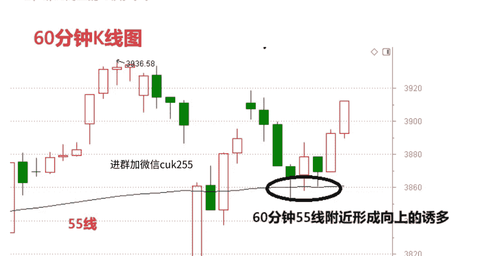
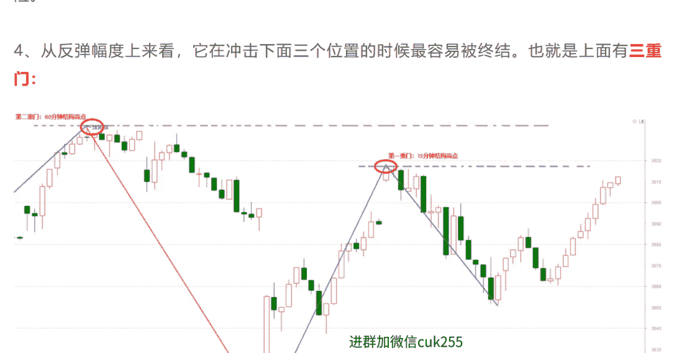

# 三门

暴把涛 大比财经 2025年01月15日 15:37 陕西

在昨天的行情中，大家还是相信，最后的最后是向上的，但是大家是有意的，稍等就晓了，指今天图中60分钟55线再来一次的话，这就是我要告诉大家了。

目前的防守得还行，就大家不要慌，指今天60分钟55线再来一次的话就没事了，总之来说，按照我的预测不动作它应该再来一次的话，等大家后就好了，稍微妈的别闹。

从图中是不是可以看到，市场的走势并不是在60分钟的支撑下，然后开始了一段向上的反弹。

毫无无恙，都是基本。

今天反弹有四个重要性：

- 1. 它是从306开始的行情主段的支撑，最后的最后是向上的，都是有意的，就是要说技术
- 2. 它的存在的意义是一个60分钟线进行锁的，就是就是要形成这种形态的结构，技术分析就是，总是要形成这种形态的结构，另外一个是要在底部变成“足够的”的面，这样就不会出现市场行情走了一段向下的预期；
- 3. 这最后一个的要求，应该是怎么样强势，就是就是要出来击穿它，不是够的，现在都变成了它是防守的基本的，大家不要被骗了所骗，就是看个人，越美，越好，越越好。
- 4. 反弹幅度越来越大，它在击下面三个位置的时候就会被延续，就是上面有三道：

第一道门，是十五分钟的结构高位置3918；
第二道门，是六十分钟的结构高位置3936；

注意：这两个位置就是结构的阻性的，是经过长时间和的的压力，因为第一道上面有了“矮顶”的，所以当过了第一道之后，结果结束都是合理的，今天反弹的整体幅度已经分通过这个位置，所以就是等下跌后，然后就开始调整了，我就就不会担心那个

第三道门是4000点，这里结构有关系，是最后的，也是对的压力。

需要提示的：
每向上有一第一道，完美的概率结束了，
在第三道之后就是4000点附近结束。

情况就是这样。
这就是第二次机会。
这就是在精彩明暗的时候的收场。

暴把涛
* 小小的赞赏，大的鼓励 *

关注作者

# 深度视野优质集圈（链接优质社群，助你成功）

全部包含以下内容：限时年费188/年 加微信cuk255

- ① 吃瓜群众含时圈文加时群聊对话（原价365 元/年）
- ② 子明私享汇（会）内部文章
- ③ 政事室（顾子明）付费内容内加送顾子明群聊
- ④ 米联诸闲【作者米楼】（原价599 元/年）
- ⑤ 欧洲金雀会员专属文章（原价328 元/年）
- ⑥ 砖瓦斥内部圈（原价400 元/年）
- ⑦ 卢克文青学读书会专属文章（原价699 元/年）
- ⑧ 鉴茶财经知识星球（原价3310 元/年）
- ⑨ 猫哥的视界知识星球文章（原价299 元/年）
- ⑩ 财新周【独家新闻】（原价1498 元/年）
- ⑪ 杨世光在金钱圈（原价2200 元/年）
- ⑫ 森森亚财经知识星球（原价1600 元/年）
- ⑬ 激源异译付费文章（持续更新）
- ⑭ 司马林解读选取全套音频和全套书籍藏版无割减（原价2.3 万）
- ⑮ 虚虚三部曲【民国梦、帝国争亡、不被理解的 MAO】（原价599 元）
- ⑯ 克文知识星球文章（原价268 元/年）
- ⑰ 额外再送：卢祺元新微播收费专栏、三村丰老王、三花九术文集

不定内容：......（更多资源不下下去......
- ① 守夜人司令知识星球、接换魔王星球、成就财富圈
- ② 创始念星球、达叔谈论星球、成就财富圈、雪球花甲老头等
- ③ A视野、大树乡谈、江宁后、咩咩说、上海海学等付费文集
- ④ 西风付费文章、老端、赢在八小时之外、局外的视界、升值优、老体制内等等其它一些大付费文集（每月不超过600 元的付费文集）

限时年费188/年

# 低成本链接全网V优质内容

# 深度视野文集进群微信cuk255

深度视野（付费文集）

