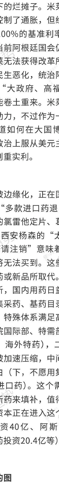

# 智优势对比

长期以来，全球经济形势日益复杂。随着大国竞争加剧，“脱钩”与“去风险化”博弈不断升级，全球供应链面临严峻挑战。这种不确定性加剧了全球经济复苏进程的异常困难，增长与衰退的阴影笼罩着全球。

# 一、 当前全球经济形势严峻复杂

当前，全球经济面临着通胀高位、增长放缓、地缘政治冲突等多重压力。尤其是“脱钩”与“去风险化”的博弈，加剧了全球供应链的裂痕，使得全球分工效率受到损害。“安全”正逐渐比“效率”成为许多国家的考量，这给全球经济复苏带来了巨大压力。

与此同时，由于通胀回落速度慢于预期，各国央行不得不维持高利率环境，甚至可能进一步加息。这种加息周期加剧了全球债务负担，特别是对于新兴市场国家，资本外流压力日益严峻。因此，全球经济衰退风险正在上升。

此外，地缘政治冲突不断升级，如俄乌冲突、巴以冲突等，进一步加剧了能源和粮食价格波动。这不仅推高了全球通胀压力，也削弱了国际市场的增长信心。综上所述，当前全球经济正面临着前所未有的挑战。

# 二、 全球经济增长呈现分化特征

当前，全球经济增长呈现出明显的分化特征。美国经济表现出较强的韧性，劳动力市场强劲，消费支出依然活跃，增长超出许多市场预期。相比之下，欧洲经济受能源危机和地缘冲突影响较重，增长乏力。新兴市场国家则表现不一，资源国家受益于大宗商品上涨，而依赖出口的新兴市场则面临更大的压力。

根据预测，2023年全球增长预计将放缓，但不会出现深度衰退。中国经济作为全球增长的重要引擎，其复苏进程将至关重要。然而，受内需不足、房地产调整等因素影响，中国经济也面临诸多挑战。这种分化的格局使得全球经济形势充满了复杂性和不确定性。

# 三、 中国经济：挑战与机遇并存

2023年，中国经济在经历疫情后的复苏后，正处于转型的关键期。一方面，由于内需不足、房地产市场低迷和外部需求收缩等挑战，增长面临较大压力。另一方面，政府出台了一系列积极的财政和货币政策，旨在提振需求、稳定市场。这种挑战与机遇并存的局面，也倒逼了中国经济向高质量发展迈进。

尽管面临挑战，中国经济仍拥有许多积极因素。首先，科技创新正在加速，人工智能、量子计算、生物技术等领域取得了突破性进展。其次，绿色转型持续推进。此外，“一带一路”倡议的深化也为中国增长带来了新动力。只要坚持稳健发展道路，中国经济有能力在复杂的国际形势中展现出更强大的韧性。

# 四、 全球竞争格局的深刻演变

当前，全球竞争已从传统的资源竞争转向科技、数据和规则的竞争。半导体、人工智能、生物医药等关键技术已成为大国竞争的核心。美国试图通过技术封锁和出口管制，在这些关键领域保持领先地位。与此同时，全球供应链的重构也在加速，各国都在寻求供应链的更加安全和韧性。

在这种背景下，中国必须不断加强科技自立自强，提升核心竞争力。同时，中国也要在国际舞台中更加积极地参与全球治理和规则制定，为维护公平开放的国际秩序贡献中国力量。未来的全球竞争格局将更加多元化，挑战与机遇并存。

# 五、 展望与对策

展望未来，全球形势将更加复杂。中国应当保持战略定力，精准把握发展机遇，有效化解各种风险。通过持续创新、扩大开放和加强国际合作，中国完全能够在变幻的全球局势中掌握主动权，实现高质量的可持续增长。

图1 智优势对比分析

作者：张某某

## 深度视野优质集团（链接优质社群，助你成功）

全部包含以下内容：时限年费188/年 加微信cuk255

- ① 吃瓜群众倍伶圈加微信时群对话 (原价 365 元/年)
- ② 子明私享汇（合）内部文章 (原价 568 元/年)
- ③ 政事室（顾子明）付费内容再送顾子明群聊
- ④ 米联储闲见【作者米穗】(原价 599 元/年)
- ⑤ 欧洲金雀会员专属文章 (原价 328 元/年)
- ⑥ 砖瓦仁内部文档 (原价 400 元/年)
- ⑦ 卢克青文读书会专属文章 (原价 699 元/年)
- ⑧ 鉴茶财经知识星球 (原价 3310 元/年)
- ⑨ 猫哥的视界知识星球文章 (原价 299 元/年)
- 十 财经周刊【独家新闻】(原价 1498 元/年)
- 十一 杨世光在金钱煽 (原价 2200 元/年)
- 十二 蔡森财经知识星球 (原价 1600 元/年)
- 十三 潇游异译付费文章星球 (持续更新)
- 十四 司马林课全套音频和全套书籍隐藏版 (原价 2.3 万)
- 十五 虚构三部曲[民国梦、帝国争霸、不被理解的MAO](原价 599 元)
- 十六 卢克青知识星球文章 (原价 268 元/年)
- 十七 额外再送：卢户新涨滚韭专栏、三村丰老王、三花九洞文集

不定内容：...... (更多资源写不下......

- ① 守夜人司令知识星球、接换魔王知识星球、成术花质富等
- ② 创创始笔记、达叔泛论知识星球、成术财富富等
- ③ A 视野、大树乡谈、江初将、泮咩说、上海海家学等付费文集
- ④ 西凤付费文章、老端、在八小时之时、局外人的视界、升值、老A体制内等一些大V付费文章 (每月不低于600 元的付费文章)

底价链接全网大V优质内容

深度视野（付费文集）
