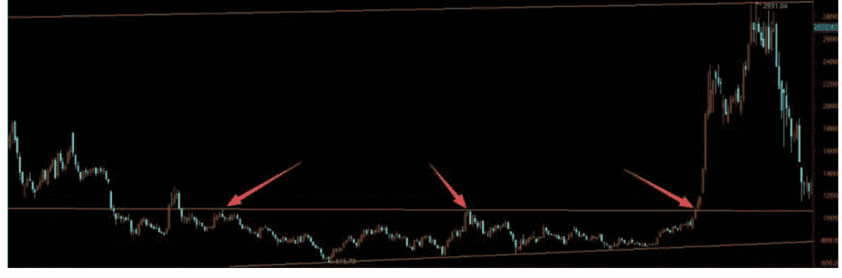
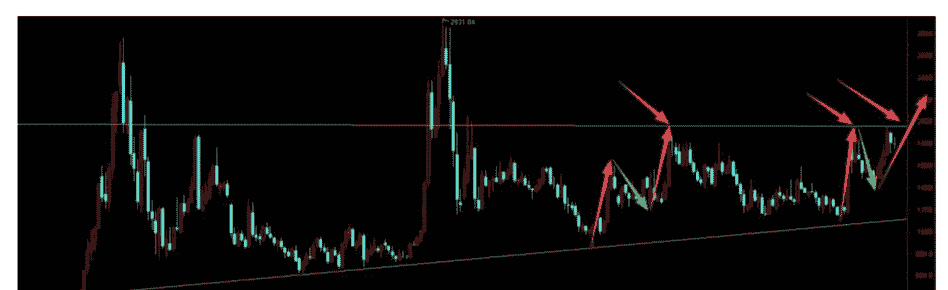
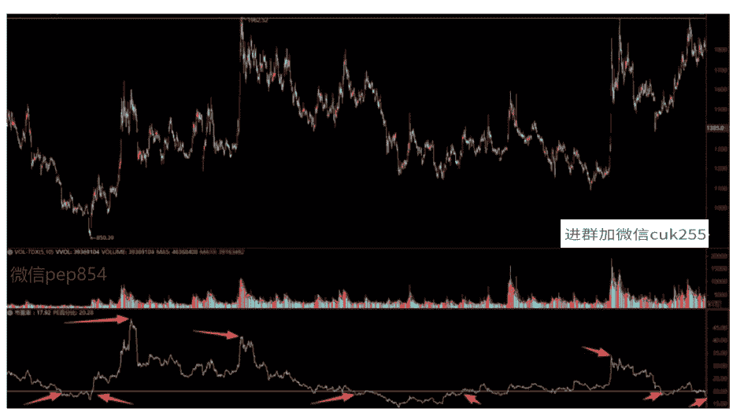

# 4000点以上炒什么？券商板块投资，选择品种已费

弹性+低估值+高增长=未来上涨空间。这是今天讲的投资的核心思想。

今天要讲券商板块的投资，该怎样样的投资？选择什么样的目标？怎么做到位基本面和技术面结合？从目前前面的情况来看，它属于弹性的，高增长，再加上估值的一个板块。因此，判断它大概率是有很好的上涨空间。如果我们前期的投资收入不是好的话，那么更要重视这个板块带来的机会。

因为这个板块的股，我们来比较容易有的收益。系统自行业的指数PE百分比显示，即使不是2007年和2015年的市值，从2019年的高点起，这个板块收益率的百分比也只有20.8%。

有人说券商没有列入十五规划，这个规划其实是对的。我们都知道，2023年中国就制定了金融战略国战，其重点和核心就是券商。而且我们团队的建议国家采纳，我们重点的是两个面的思想：第一是打造蓝航商，让他们能够高收益、摩士丹利直接在我国金融产品定价权面上拼刀。第二是建议券商合并，其中上海和北京会有几家蓝航券。

后来上海合并的结果是国泰君，北京已经被中金汇打成了金融整合的平台，预计未来一定会会有券商合并，并且之后会有两家券商板块。金融强国的最后时间指向2035年。

10月19日我们讲了一个板块指数，在大盘调整的情况下，这段时间，它并没有调整，而是连续慢慢上涨，从而形成了底部的突破。板块指数高涨是15.65%，是到10月31的数据。判断板块能涨，可能的方法是我们在牛市中反复使用的办法，做主流，底部突破。

本轮牛市中，这个方法我们用了了很多，包括XCO，包括锂电和它上游资源、设备等，10月19日又一次使用同一个办法。现在是再次使用，但稍有所异。券商板块的技术趋势和前面有不同，它的时间要更早一点，起点要低一些。为什么我们要讲到这个板块，是因为它是牛市里最需要关注的一个板块，群众基础很大。券商被称为

牛市里的旗手，它现在业绩增长是非常明显的，很增速，关键是现在还在低位，有很强的补涨的要求，未来恐怕很难压制住。

我们在写这篇文章的时候，这个板块的，多数都没有出业绩预报，也没有出现三季度报表。从面情况来看，整个板块增长没有悬念。10月31日，这个板块的所有公司都出了三季报，我们后面会整理一些基本的数据，也会根据我们业务逻辑进行投资品种的筛选和选择。

这一次筛选整个板块的做法，那么多的品种，一起按业务的逻辑进行筛选，工作量很大，数据很多，很难容易。

之前做过类似的工作，是对锂电的上游资源进行筛选，讲了内在的筛选。在走势走出来了，前几周，结果很好。我们8月2日讲那个指数，到上周为止，从最低到最高，板块指数涨了64.74%。这次按业务的逻辑来进行筛选，希望不错的结果。

本文图表较多，数据复杂，建议用电脑微信阅读。

下面我们读一下投资这个板块的各项理由和内在逻辑：

> (免责声明：本文只为开拓视野、引导思路，并非时卖，亦非荐股，股市有风险，入市需谨慎。本文不构成任何投资建议或意见，我们无力为大家的所有投资负责，请大家注意投资风险)

## 一、历史走势和技术参照

### 1. 2013年到2015年牛市的突破

此图为周K线，上面有三条线。最后一条为底部支撑线，最上一条为长期压力线。中间为底部支撑压力线。右侧可以看到它突破的走势。从1000点出发头到2931.04点。这是上一次底部形态和突破所留下的案例。

### 2. 长期走势（技术走势）

注意，这个图暂时没有突破。但上面的图有非常大的相似性，就是两条线，一条压力线和一条支撑线，非常相似。这让我们怀疑，历史会不会再重演？正因为没有突破，因此就要积极跟踪。

此图为月K线，可以看出它的长期走势。最左边的走势是从2005年到2007年的走势，中间那个大涨，是第一个中间那个大涨。图中画了4个箭头那个涨，是2019年到2021年的牛市，它只涨了3个小波，从2019年到2021年的牛市，以此牛市中，它只涨了一波，从2019年10月到2020年7月。图中画了3个小波上涨。从2020年7月，2024年11月8日最高360..7。。之后调整到2025年4月7日3344.27点，又反弹到2025年8月25日55.54点。而这一波，并不是一个完整的上升，因为它没有新高，所以它不成一个完整的涨。牛市的指数，一旦反弹，至少完成3个波。看来证券指数只成了两个波，我们要继续反弹。这是第一理由。第二理由，由于指数涨落后，4月7日以来，证券指数并没有新高。很多指数都创了高。因此证券指数涨落后，价位还在3600点到3700点一线，业绩严重匹配。

股指数，2024年11月8日最高3797.13，它最高点是3921.96点，11月12日后面有新高，12月12日最高是4318.5点，创新。2025年3月20日继续创新4454.59点，4月9日最低3427.54点，8月26日最高4258.5点，最高463.43点，反复创新。证指数，2024年最高点3674.40点，2025年4月7日最低3040.69点，8月26日最高3888.6点，突破了2024年的最高点。2025年最高4025.70点，再次创新。类似突破了2024年最高点的指数，有中证200；还有中小板指数，沪深300。还有上证50指数，这两个最弱的指数都创了2024年新高。前期给了这些指数压力支撑位。大家可以复习一下。

下面这些典型的指数，都突破，创了新高：
- 中证500
- 沪证100
- 国证300
- 沪100
- 大盘
- 中盘
- 小盘
- 国指
- 中证1000

这些指数中，有些指数已经突破了2019年2021年上半的高点；证券指数既没有突破2024年的高点，也没有突破2020年上半的高点。那么证券指数是跟白酒一样，没有成长性吗？如此可见，证券指数是因为各种原因导致涨落后的指数，但行业增长导致证券指数就有上涨的空间。因为业绩大涨，后期还会增长，增长的确定性高，还留了补仓空间。

### 3. 证券指数的市场定位

我们可以看看证券指数的市盈率百分比20.28%，现在在17.92倍。大家可以对照看看底下那根黄线，它就是底部的市盈率定位。也就是这个位置的市盈率是历史底部的数据。大家可以看看图中上面的三个箭头指向的市盈率，2019年的高点时市盈率为48.66，2020年的高点为41.54，去年的高点为32.4倍。现在是17.92倍，且从去年7月到9月低点时的市盈率黄色横线的区域，都是进入底部的趋势。并不是绝对的，而是有时间的提前或滞后，是某种时间会稍稍错开了走势。

这还不算2017年牛市高峰和2015年牛市高峰时的情况。结论：从市盈率位来看，这里容易进入底部。从技术上来看，它离颈线还有一些距离，高度还未到。我们后面看到颈线的相关数据。突破颈线就是突破大底，就是开了券商板块市场上涨的空间。但也只有突破颈线后，才是打开了上涨的空间。

## 三、业务因素决定证券业务领先高增长

### 1. 融资融券业务

如何把市盈率超过30倍的市值靠下34家。今年前三2家券商利息净收入为332.40亿，同比50.8%，增量111.97亿元。具体如下（单位：万）：

| 券商 | 2024年前利息净收入 | 2025年前利息净收入 | 增速% | 增量 |
| :--- | :--- | :--- | :--- | :--- |
| 长江证券 | 136758.05 | 171697.89 | 25.54 | 34939.84 |
| 华泰证券 | 130141.02 | 322000.33 | 151.26 | 196859.31 |
| 国泰海通 | 456725.82 | 502810.29 | 232.07 | | 66084.47 |
| 广发证券 | 137363.56 | 169046.76 | 23.065 | 31683.2 |
| 国信证券 | 104279.99 | 116913.11 | 45.364 | 36485.12 |
| 东莞证券 | 915336.20 | 96301.52 | 5.206 | 47653.22

|安证券 | 174465.65 | 256936.69 | 47.110 | 82280.04 |
| 招商证券 | 679853.33 | 1278108.84 | 87.998 | 59825.51 |
| 万宏源 | 159528.83 | 461979.44 | 189.591 | 30245.11 |
| 中国银河 | 262591.55 | 320693.82 | 22.126 | 58102.27 |
| 国投资 | 115484.77 | 121121.09 | -3.692 | -42638.68 |
| 方正证券 | 889269.94 | 1210159.00 | 36.085 | 320889.6 |
| 东方证券 | 917092.27 | 778392.11 | -15.124 | -138706.0 |
| 中信证券 | 919350.04 | 764123.55 | -16.884 | -155226.9 |
| 财通证券 | 381690.90 | 498187.95 | 30.700 | 110718.99 |
| 东北证券 | -130565.5 | 165038.9 | | 178095.44 |
| 国金证券 | 879194.46 | 1074837.78 | 22.662 | 199243.32 |
| 长城证券 | 61066.4 | 197039.6 | 312.777 | 190933.22 |
| 兴证券 | 878897.22 | 1243902.22 | 41.530 | 365005.0 |
| 华西证券 | 681087.71 | 539385.33 | -10.626 | -141702.09 |
| 东兴证券 | 476561.8 | 516892.0 | 13.183 | 62823.5 |
| 中金公司 | -1193147.7 | -1019885.99 | -14.521 | 173262.0 |
| 浙商证券 | 639014.00 | 906105.88 | 41.797 | 267091.18 |
| 中信建投 | 447768.88 | 673701.22 | 50.317 | 225502.24 |
| 西部证券 | -14523.3 | 25032.77 | | 17075.6 |
| 光大证券 | 1489951.15 | 1726482.99 | 15.875 | 236531.44 |
| 南京证券 | 596333.33 | 501686.22 | -15.872 | -94647.11 |
| 华鑫证券 | 36457.6 | 753974.1 | 202.746 | 739165.5 |
| 国民生 | -128624.8 | 103765.0 | | 232398.8 |
| 财达证券 | 576166.6 | 737284.2 | 30.365 | 751181.8 |
| 中泰证券 | 1973186.6 | 3251586.0 | 64.78 | 1278399.94 |
| 国元证券 | 647449.94 | 1107854.47 | 71.11 | 460040.53 |
| 山西证券 | 416953.22 | 631011.10 | 51.39 | 214057.8 |
| 总计 | 6066439.97 | 10610106.8 | 74.89 | 4545666.7 |

### 2. 手续费及佣金收入

准确地讲，最后算到券商头上就是经纪手续费及佣金收入，即券商自身业务，它是净收入。另外就是代收规费，如经手费、证管费和过户费等，这些券商给予其他单位。具体如下（单位：万元）：

| 经纪商 | 2024年前三手续费及净收入 | 2025年前三手续费及收入 | 增速% | 增量 |
| :--- | :--- | :--- | :--- | :--- |
| 长江证券 | 176272.61 | 280029.66 | 58.86 | 103757.05 |
| 华泰证券 | 396655.95 | 658820.79 | 66.13 | 262264.84 |
| 国泰海通 | 445383.36 | 1081976.88 | 142.82 | 636014.32 |
| 广发证券 | 398876.52 | 697919.57 | 74.97 | 299043.05 |
| 国信证券 | 303953.86 | 636185.53 | 109.30 | 332231.67 |
| 东吴证券 | 114800.67 | 171455.53 | 49.31 | 56654.86 |
| 华安证券 | 62343.42 | 110281.54 | 76.84 | 47938.12 |
| 招商证券 | 367338.30 | 659986.86 | 79.67 | 292648.56 |
| 万宏源 | 270926.85 | 448532.04 | 65.55 | 177605.19 |
| 中国银河 | 369261.31 | 630510.52 | 70.73 | 262129.16 |
| 国投资 | 229651.64 | 415668.08 | 81.39 | 186916.44 |
| 方正证券 | 159269.94 | 2310159.00 | 36.085 | 320889.6 |
| 中信证券 | 715437.92 | 1090398.38 | 52.91 | 378470.46 |
| 财通证券 | 832972.21 | 1385438.88 | 66.32 | 552466.7 |
| 东京证券 | 603260.05 | 1006590.7 | 67.35 | 406630.2 |
| 金国证券 | 116176.89 | 207301.75 | 78.46 | 91124.86 |
| 长城证券 | 53151.97 | 83094.88 | 53.35 | 29942.91 |
| 兴业证券 | 131186.94 | 216081.18 | 64.72 | 84894.24 |
| 西华证券 | 917280.11 | 1632462.28 | 77.96 | 715182.27 |
| 东兴证券 | 421584.48 | 716892.00 | 70.07 | 29530.72 |
| 中金公司 | 256123.50 | 451575.26 | 76.32 | 195451.76 |
| 浙商证券 | 145652.13 | 223536.72 | 59.62 | 86884.59 |
| 中信建建 | 374340.86 | 575705.48 | 53.79 | 201364.62 |
| 西部证券 | 54947.38 | 90820.81 | 65.28 | 35873.43 |
| 光大证券 | 182354.24 | 297172.78 | 62.96 | 114818.54 |
| 北京证券 | 29067.94 | 51672.30 | 77.76 | 22604.36 |
| 华鑫证券 | 50762.69 | 75398.71 | 48.52 | 24636.02 |
| 国联民生 | 39820.64 | 156513.93 | 293.07 | 116693.29 |
| 财达证券 | 41081.31 | 75064.64 | 82.72 | 33983.51 |
| 中泰证券 | 197318.66 | 325158.60 | 64.78 | 127839.94 |
| 国元证券 | 647449.94 | 1107854.47 | 71.11 | 460040.53 |
| 山西证券 | 416953.22 | 631011.10 | 51.39 | 21405.78 |
| 总计 | 6066439.97 | 10610106.8 | 74.89 | 4545666.7 |

| | 2024前三 | 2025前三 | 增速% | 增量 |
|---|---|---|---|---|
| 长江证券 | 25697.86 | 29020.68 | 12.930 | 3322.82 |
| 华泰证券 | 135723.11 | 194781.24 | 43.514 | 59058.13 |
| 国泰海通 | 179815.93 | 262917.45 | 46.215 | 83101.52 |
| 广发证券 | 53142.08 | 51550.87 | -2.994 | -1591.21 |
| 国信证券 | 64636.05 | 60751.40 | -6.010 | -3884.65 |
| 东吴证券 | 51354.88 | 59640.29 | 16.134 | 8285.41 |
| 华安证券 | 5125.45 | 13568.61 | 164.730 | 8443.16 |
| 招商证券 | 41904.67 | 50952.71 | 21.592 | 9048.04 |
| 申万宏源 | 65290.40 | 85090.18 | 30.326 | 19799.74 |
| 中国银河 | 36601.35 | 47538.65 | 29.982 | 10937.30 |
| 国投资本 | 14773.88 | 13076.16 | -11.491 | -1697.72 |
| 方正证券 | 80302.42 | 111749.72 | 41.089 | 34117.30 |
| 中信证券 | 281876.47 | 368925.17 | 30.882 | 87048.70 |
| 财通证券 | 39070.55 | 27663.21 | -29.197 | -11407.34 |
| 东北证券 | 7458.71 | 8724.85 | 16.975 | 1266.14 |
| 金国证券 | 66225.69 | 77239.31 | 16.630 | 11013.62 |
| 长城证券 | 17003.46 | 21065.61 | 23.672 | 4032.15 |
| 兴业证券 | 44160.05 | 41613.30 | -5.767 | -2546.75 |
| 华西证券 | 9175.48 | 5587.06 | -39.109 | -3588.42 |
| 东兴证券 | 39510.69 | 37125.86 | -6.036 | -2384.83 |
| 中金公司 | 202629.98 | 290433.73 | 42.553 | 87773.75 |
| 浙南证券 | 44925.99 | 50585.99 | 12.598 | 5660.00 |
| 中信建投 | 149673.76 | 184626.36 | 23.353 | 34952.60 |
| 西部证券 | 16161.76 | 28332.25 | 75.304 | 12170.49 |
| 光大证券 | 62173.97 | 48748.07 | -21.594 | -13425.90 |
| 南证券 | 14050.71 | 11281.14 | -19.711 | -2769.57 |
| 华泰证券 | 12952.64 | 11557.70 | -10.770 | -1394.94 |
| 国民民生 | 26388.55 | 68813.63 | 160.773 | 42425.28 |
| 财达证券 | 23822.88 | 23593.85 | -0.961 | -229.03 | 
| 中泰证券 | 63635.02 | 40628.48 | -36.172 | -23024.54 |
| 国元证券 | 9579.70 | 14859.51 | 55.115 | 5279.81 |
| 山西证券 | 22112.38 | 24948.21 | 12.825 | 2835.83 |
| 总计 | 191374.36 | 237601.25 | 24.179 | 46266.89 |

| 券商 | 2024前三 | 2025前三 | 增减% | 增量 |
|---|---|---|---|---|
| 长江证券 | 21725.71 | 20598.4 | -5.19 | -1127.67 |
| 华泰证券 | 374124.00 | 135444.22 | -63.79 | -238679.7 |
| 国泰海通 | 286262.76 | 427300.31 | 49.23 | 141083.55 |
| 广发证券 | 508125.91 | 566056.53 | 11.41 | 57930.62 |
| 国信证券 | 63439.70 | 49047.88 | -22.66 | -14391.82 |
| 东吴证券 | 12940.14 | 15881.14 | 22.78 | 2941.00 |
| 安华证券 | 42659.61 | 35424.44 | -16.96 | -7235.17 |
| 招证券 | 50238.05 | 65315.00 | 30.01 | 15076.95 |
| 中信宏源 | 59817.60 | 51831.39 | -13.51 | -7986.21 |
| 中国银河 | 3516.22 | 39956.32 | 12.75 | 4469.90 |
| 国投资本 | 141440.00 | 119835.00 | -15.53 | -22055.00 |
| 方正证券 | 17532.69 | 17293.49 | -1.34 | -239.20 |
| 东方证券 | 101670.01 | 97306.89 | -4.29 | -4363.12 |
| 中信证券 | 74876.59 | 87030.71 | 16.37 | 12143.12 |
| 财通证券 | 242924.05 | 263884.15 | 8.62 | 20960.10 |
| 东北证券 | 146265.13 | 180439.52 | 23.36 | 34174.39 |
| 国金证券 | 229036.18 | 335370.94 | 46.58 | 106694.76 |
| 长城证券 | 73229.56 | 118221.37 | 61.43 | 44991.81 |
| 兴业证券 | 349170.30 | 445870.99 | 27.69 | 96700.69 |
| 华西证券 | 110551.05 | 175281.90 | 58.55 | 64730.85 |
| 兴东证券 | 105665.49 | 126326.69 | 19.55 | 20661.20 |
| 中金公司 | 714332.96 | 1030070.48 | 44.20 | 315745.44 |
| 浙商证券 | 203038.48 | 318167.92 | 38.14 | 87849.44 |
| 中信建投 | 648799.16 | 908849.98 | 113.609 | 396734.05 |
| 西部证券 | 149212.88 | 210609.91 | 41.147 | 61397.03 |
| 光大证券 | 58109.73 | 66557.12 | 14.57 | 8447.39 |
| 南证券 | 6346.34 | 3076.21 | -51.58 | -3270.13 |
| 华鑫证券 | 14678.61 | 17143.64 | 16.79 | 2465.03 |
| 国民证券 | 48356.61 | 52712.98 | 9.09 | 4356.37 |
| 财达证券 | 21877.86 | 18475.14 | -15.55 | -3402.72 |
| 中泰证券 | 150667.17 | 176762.69 | 17.32 | 26095.52 |
| 哈股股份 | 11483.96 | 6260.58 | -45.84 | -5223.38 |
| 山西证券 | 22240.01 | 16995.30 | -23.52 | -5244.71 |
| 总计 | 321661.60 | 328538.48 | 2.14 | 68824.14 |

33券商今年三季度的资管净增为328.54亿元，因为资标标准的调整，净增量只有6.88亿元。

这个好处被哪些券拿到了呢？国海通增量为14.11亿，中信为12.24亿，它们合计为26.35亿，是33券商资管费收入增量的3.83倍。

此外，广发第三名，5.79亿；中泰证券第四名，2.61亿；中金第五名，2.23亿；招商证券第六，1.51亿；西部证券第七名，1.22亿。这五家合计增量为13.36亿，是全部33券商增量的1.94倍。下滑较大的华泰证券，同比23.87亿；财通证券，同比2.23亿；国投资本，同比2.21亿。国信证券，同比1.44亿。

| 券 | 2024三 | 2025三 | 增速% | 增量 |
|---|---|---|---|---|
| 长江证券 | 237179.99 | 351926.63 | 48.30 | 114746.70 |
| 华泰证券 | 923444.43 | 1014426.29 | 9.83 | 90981.86 |
| 国泰海通 | 943602.68 | 1822531.78 | 93.14 | 878929.10 |
| 广发证券 | 987470.21 | 1363635.64 | 38.09 | 376165.43 |
| 国信证券 | 448340.49 | 770799.91 | 71.92 | 322459.41 |
| 东莞证券 | 195014.79 | 267024.29 | 36.92 | 72009.50 |
| 安华证券 | 116688.93 | 171913.64 | 47.32 | 55224.71 |
| 招商证券 | 505491.81 | 826424.03 | 63.48 | 320932.14 |
| 申万长安 | 414997.91 | 623086.25 | 50.14 | 208088.34 |
| 中国银河 | 444727.57 | 725549.40 | 63.15 | 280821.83 |
| 国优资本 | 449799.30 | 514890.77 | 14.47 | 65091.47 |
| 方正证券 | 290435.75 | 493208.73 | 69.81 | 202772.98 |
| 东方证券 | 375070.94 | 483241.82 | 28.39 | 108166.92 |
| 中信证券 | 1132137.09 | 2456214.86 | 190.049 | 2151260.32 |
| 财通证券 | 242924.05 | 263884.15 | 8.62 | 20960.10 |
| 东北证券 | 146265.13 | 180439.52 | 23.36 | 34174.39 |
| 国金证券 | 229036.18 | 335370.94 | 46.58 | 106694.76 |
| 长城证券 | 73229.56 | 118221.37 | 61.43 | 44991.81 |
| 兴业证券 | 349170.30 | 445870.99 | 27.69 | 96700.69 |
| 华西证券 | 110551.05 | 175281.90 | 58.55 | 64730.85 |
| 兴东证券 | 105665.49 | 126326.69 | 19.55 | 20661.20 |
| 中金公司 | 714332.96 | 1030070.48 | 44.20 | 315745.44 |
| 浙商证券 | 203038.48 | 318167.92 | 38.14 | 87849.44 |
| 中信建投 | 648799.16 | 908849.98 | 113.609 | 396734.05 |
| 西部证券 | 149212.88 | 210609.91 | 41.147 | 61397.03 |
| 光大证券 | 57203.52 | 189829.86 | 231.850 | 132626.34 |
| 南证券 | 6346.34 | 3076.21 | -51.58 | -3270.13 |
| 华鑫证券 | 14678.61 | 17143.64 | 16.79 | 2465.03 |
| 国民证券 | 48356.61 | 52712.98 | 9.09 | 4356.37 |
| 财达证券 | 21877.86 | 18475.14 | -15.55 | -3402.72 |
| 中泰证券 | 150667.17 | 176762.69 | 17.32 | 26095.52 |
| 哈股股份 | 11483.96 | 6260.58 | -45.84 | -5223.38 |
| 山西证券 | 22240.01 | 16995.30 | -23.52 | -5244.71 |
| 总计 | 321661.60 | 328538.48 | 2.14 | 68824.14 |

表中中国投资资本的数据今年上半年度的数据，三季报中没有显示，只能用半年的数据替代。实际数据会有一些偏差。

3. 投资收益加总

在利润表中，含投资收益、公允价值变动收益，还有一个其他综合收益，利润中即为归属于公司股东的其他综合收益的税后净额。前二者主要是券商自营部分、跟投部分，也包括债券投资等，后面一项则按成本加收益计入利润或计入综合收益的部分。这一方面要讲清楚，因为券商跟了科创板、创业板少数股票，包括主板的股票，这些几年跌肉，但股市行情涨起来，所以券商的投资收益、公允价值变动增长很快。

还有，券商有部分股票的投资，是通过其他权益工具进行的，在财务会计上相应加价，亏损时不计入亏损，但会减少每股净资产，盈利时不计入利润，而增加每股资产，当然，券商的其他综合收益的税后净额，是以其他权益工具投资为主，还有其他的内容。这一部分收益虽不计入净利润，也要适当的考虑。其实分为两种，一种是不能重分类损益的其他综合收益，这一一种还在里面，不计入利润；另一种是将重分类类损益的其他综合收益，即此部分重新分类，进入投资收益或公允价值变动收益，那样就可以进入利润计算，牛市增厚利润。

先讲一下，东方财富是有明显的短板的，就是投资能力比较差。2024年前三季度收益增量为20.98亿，2025年前三季度增量为21.64亿，增量只有6609.28万。加上它的定位比较较高，因此我们就把它剔别了。

34家券商收益增量为1079.25亿。其中5名合计为622.34亿，占比57.66%，都是大券商。它们是中信，215.16亿，绝对领先；国泰海通，119.77亿；申万万，107.77亿；中金，96.71亿；中金，82.93亿。

第六到第10名，合计增量为206.20亿。前十名的增量合计为828.54亿，占全部34家券商收益增量的76.77%。第六名为招商，46.20亿；第7名国信，40.53亿；第8名兴业，40.42亿；第9家中信建投，39.67亿；第10名国联，39.38亿。

第11名到15名，合计增量为123.57亿，跟第2名国泰海通的增量差差不多。前15名增量合计为952.12亿，占比88.22%。其中长证111名，为28.20亿；第12名华泰，26.63亿；第13名国投资本，24.85亿；第14名财通，22.92亿；第15名浙商，20.98亿。

(2)公允价值变动收益。见下表（单位，万元）：

## 公允价值变动收益

| 证券 | 2024三前 | 2025三前 | 增速% | 增量 |
| --- | --- | --- | --- | --- |
| 长江证券 | 125309.60 | 77169.46 | -38.417 | -48140.14 |
| 华泰证券 | 8833.96 | -295108.40 | -34.613 | -303942.36 |
| 国泰海通 | 45364.28 | 288021.89 | -36.510 | -165624.39 |
| 广发证券 | 96840.50 | 429323.94 | 343.331 | 332483.44 |
| 国信证券 | 183137.60 | 206567.77 | 12.788 | 23420.17 |
| 东吴证券 | 34086.92 | 72416.61 | 112.447 | 38329.69 |
| 安安证券 | 49207.68 | 30843.90 | -37.319 | -445438.09 |
| 招商证券 | 323223.85 | -122214.24 | -137.811 | -618440.00 |
| 东方龙诚 | 606866.44 | -11573.96 | -101.907 | -618440.00 |
| 中国钢铁 | 707820.40 | 94869.81 | -86.601 | -613172.99 |
| 国资投资 | 30978.89 | -82206.95 | -365.364 | -113185.84 |
| 方正证券 | -40196.25 | -47936.11 | 19.255 | -7739.86 |
| 东方证券 | 23232.10 | 89903.32 | 286.979 | 66671.22 |
| 中信证券 | 1073258.39 | -75665.88 | -107.045 | -1148864.27 |
| 财通证券 | 149483.42 | -40757.72 | -131.480 | -196541.14 |
| 东北证券 | 19765.59 | 61672.16 | 212.018 | 41906.57 |
| 国金证券 | 16719.54 | -6296.44 | -137.659 | -23015.98 |
| 长城证券 | -16681.68 | 82188.89 | -89.399 | -281911.12 |
| 兴业证券 | 314534.18 | 33343.06 | 74.225 | 12918.78 |
| 华西证券 | 17404.92 | 30323.70 | 74.225 | 12918.78 |
| 东兴证券 | 82857.01 | 14255.01 | -82.796 | -68602.00 |
| 中金公司 | 154781.05 | -318184.63 | -305.571 | -472965.68 |
| 浙商证券 | 71365.42 | 20628.54 | -71.094 | -50736.88 |
| 中信建 | 183342.73 | -60487.65 | -132.992 | -243830.38 |
| 西部证券 | 11652.30 | -25244.86 | -316.651 | -36897.16 |
| 光大证券 | 111205.68 | 11982.06 | -89.225 | -99223.62 |
| 南京证券 | 26281.87 | -5777.70 | -121.541 | -32599.57 |
| 华鑫证券 | 9951.78 | 17598.61 | 76.839 | - |
| 国民生命 | 206317.24 | 16479.23 | -92.013 | -189838.01 |
| 财达证券 | 927.05 | -1981.37 | -313.728 | -2908.42 |
| 中泰证券 | -11867.82 | -41545.91 | 250.072 | -29678.09 |
| 哈洛股份 | -6678.03 | 561.06 | | | |
| 国元证券 | 63072.28 | -17240.86 | -127.335 | -80313.14 |
| 山西证券 | 8940.95 | 2075.71 | -76.784 | -6865.24 |
| 总计 | 509038.24 | 421752.05 | -91.715 | -466832.19 |

(3)归属母公司所有的其他综合收益的税后净额。这一部分综合收益虽然不计入利润，只是增减资产，也需要考虑损益表。具体见下表（单位，万元）：

## 归属母公司所有者的其他综合收益的税后净收益

| 证券 | 2024 年前 | 2025 前 | 增速率% | 增量 |
| --- | --- | --- | --- | --- |
| 长江证券 | 49565.26 | -14959.83 | -401.784 | -199145.09 |
| 华泰证券 | -5010.31 | 35427.96 | -794.287 | 40529.27 |
| 国泰证券 | 59320.76 | 17369.77 | 192.814 | 114379.01 |
| 广发证券 | 119289.26 | -29606.22 | -124.819 | -148895.48 |
| 国信证券 | 283645.98 | -125346.69 | -144.191 | -408992.67 |
| 东莞证券 | 22972.88 | -49738.98 | -316.512 | -72711.86 |
| 安华证券 | 25429.57 | -17143.41 | -167.415 | -42572.98 |
| 招商证券 | 50550.78 | -148366.20 | -393.383 | -199836.98 |
| 华宏 | 50066.90 | -44939.27 | -188.668 | -94460.17 |
| 中国银 | 285925.68 | -109904.71 | -138.123 | -394930.39 |
| 国投资 | -15239.71 | -4335.17 | -71.553 | 10904.54 |
| 方正证券 | 39908.39 | -59172.62 | -248.271 | -99081.01 |
| 东方证券 | 74697.42 | -40077.01 | -153.652 | -114774.43 |
| 中信证券 | -31901.05 | -47868.49 | 50.053 | -159674.44 |
| 财通证券 | 64615.53 | -22223.97 | -443.943 | -28685.50 |
| 东北证券 | 125867.72 | 185293.05 | 47.233 | 59425.33 |
| 国金证券 | 115914.15 | 162199.21 | 39.900 | 46285.06 |
| 长城证券 | 236848.39 | 275721.99 | | 38873.60 |
| 兴业证券 | 240960.35 | 314620.16 | 30.590 | 73659.81 |
| 西华证券 | 48965.97 | 99549.62 | 103.344 | 50583.65 |
| 东兴证券 | 148391.39 | 193243.63 | 30.262 | 44852.24 |
| 中金公司 | 734390.94 | 1042358.98 | 41.950 | 309768.04 |
| 浙江证券 | 123237.52 | 256883.98 | 108.444 | 133646.46 |
| 中信建投 | 550567.87 | 700282.47 | 27.190 | 149714.60 |
| 西部证券 | 160010.97 | 188469.37 | 17.780 | 24858.40 |
| 光大证券 | 172721.59 | 156115.01 | -9.610 | -16606.58 |
| 南京证券 | 73526.58 | 64845.64 | -11.870 | -8680.94 |
| 华泰证券 | 84006.70 | 90488.12 | 7.150 | 6481.12 |
| 国民财经 | 60217.47 | 57441.95 | -4.609 | -2775.52 |
| 财大证券 | -288.70 | -198.57 | 31.219 | 90.13 |
| 中泰证券 | 14889.77 | -15310.20 | -202.824 | -30199.97 |
| 哈投股份 | 20997.58 | -7206.61 | -134.322 | -28204.39 |
| 国元证券 | 3750.08 | -72267.87 | -207.102 | -76017.95 |
| 山西证券 | -1232.81 | -3529.20 | 186.273 | -2296.39 |
| 总计 | 1217448.03 | -807758.66 | -166.349 | -2025206.69 |

从可以看出，34家券商归属公司所有者的其他综合收益的净收益同比减少202.52%。前4家，其中第三季度同比正向综合收益的7家。第1名国泰海，11.44亿；第2名华泰，4.05亿；第3名国投资本，1.09亿；第4名东兴，17.78亿。这可以理解为在这里产生了收益，但并没有前面的报表调整，其实际调整应该要高一些。

增量为负的27家，其中6家共同相同减少综合收益146.57亿，占比72.37%。分别是第1名国信，40.90亿；第2名银华，-39.49亿；第3名长城，-19.91亿；-19.89亿；第5名广发，-14.89亿；第6名东友，-11.48亿。

第7到第15家共同相同减少综合收益56.28亿。前15名共同减少综合收益202.84亿，占比100.16%。其中第7名申方；第8名申万，9.91亿；第9名国元，7.60亿；第10名东友，7.27亿。第11名光大，5.45亿；第12名兴业，4.93亿；第13名中金，4.84亿。第14名华安，4.26亿；第15名中泰，-3.02亿。

## 投资收益

| 证券 | 2024年 | 2025年 | 增长% | 增量 |
| --- | --- | --- | --- | --- |
| 长安 | 129025.19 | 163741.81 | 26.900 | 34716.62 |
| 华泰证券 | 135492.03 | 135436.30 | 0.221 | 2854.27 |
| 国海通 | 115278.65 | 229915.63 | 99.450 | 114625.00 |
| 广发证券 | 769340.32 | 995405.29 | 28.040 | 226064.97 |
| 国信证券 | 881521.37 | 901247.81 | 2.228 | 19726.44 |
| 东吴证券 | 271169.68 | 319987.18 | 15.022 | 48817.80 |
| 华安证券 | 151519.75 | 196704.38 | 29.810 | 45184.63 |
| 招商证券 | 879355.65 | 696676.29 | -20.740 | -182369.36 |
| 中安 | 853653.87 | 1218465.24 | 42.750 | 364811.37 |
| 中国银 | 1141791.33 | 1000779.47 | -12.359 | -141011.86 |
| 国信资本 | 202081.48 | 342859.53 | 72.350 | 146208.05 |
| 方正证券 | 198170.29 | 228011.56 | 15.050 | 29841.27 |
| 东方证券 | 505678.42 | 632961.60 | 25.170 | 127283.18 |
| 中信证券 | 2173494.43 | 3160283.04 | 45.410 | 986788.61 |
| 财通证券 | 158485.22 | 162459.62 | 2.500 | 3974.40 |
| 东北证券 | 125867.72 | 185293.05 | 47.233 | 59425.33 |
| 国金证券 | 115914.15 | 162199.21 | 39.900 | 46285.06 |
| 长城证券 | 236848.39 | 275721.99 | | 38873.60 |
| 兴业证券 | 240960.35 | 314620.16 | 30.590 | 73659.81 |
| 西华证券 | 48965.97 | 99549.62 | 103.344 | 50583.65 |
| 东兴证券 | 148391.39 | 193243.63 | 30.262 | 44852.24 |
| 中金公司 | 734390.94 | 1042358.98 | 41.950 | 309768.04 |
| 浙江证券 | 123237.52 | 256883.98 | 108.444 | 133646.46 |
| 中信建投 | 550567.87 | 700282.47 | 27.190 | 149714.60 |
| 西部证券 | 160010.97 | 188469.37 | 17.780 | 24858.40 |
| 光大证券 | 172721.59 | 156115.01 | -9.610 | -16606.58 |
| 南京证券 | 73526.58 | 64845.64 | -11.870 | -8680.94 |
| 华泰证券 | 84006.70 | 90488.12 | 7.150 | 6481.12 |
| 国民财经 | 60217.47 | 57441.95 | -4.609 | -2775.52 |
| 财大证券 | -288.70 | -198.57 | 31.219 | 90.13 |
| 中泰证券 | 14889.77 | -15310.20 | -202.824 | -30199.97 |
| 哈投股份 | 20997.58 | -7206.61 | -134.322 | -28204.39 |
| 国元证券 | 3750.08 | -72267.87 | -207.102 | -76017.95 |
| 山西证券 | -1232.81 | -3529.20 | 186.273 | -2296.39 |
| 总计 | 1217448.03 | -807758.66 | -166.349 | -2025206.69

## 三方面净收入

| 证券 | 2024年前三 | 2025年前三 | 增速% | 增量 |
|---|---|---|---|---|
| 长城证券 | 502963.17 | 687636.36 | 36.66 | 184403.16 |
| 华泰证券 | 2405077.48 | 269562.92 | 12.08 | 290565.44 |
| 国泰证券 | 2253057.15 | 4624507.72 | 106.054 | 2389450.57 |
| 广发证券 | 189474.09 | 251807.69 | 32.99 | 623913.60 |
| 国信证券 | 141029.85 | 178952.82 | 26.850 | 37862.97 |
| 东奥证券 | 557720.60 | 675313.29 | 21.085 | 117592.62 |
| 华安证券 | 28564.33 | 394311.71 | 38.02 | 108637.38 |
| 招商证券 | 1452832.87 | 1651211.16 | 13.65 | 198378.29 |
| 中方资源 | 1284604.61 | 1887749.43 | 46.95 | 603144.82 |
| 中国银 | 1849110.50 | 2147022.69 | 16.11 | 297912.24 |
| 国投资资本 | 776365.55 | 974401.39 | 26.90 | 207035.84 |
| 方正证券 | 577538.92 | 842326.19 | 45.83 | 264703.21 |
| 东方证券 | 972462.59 | 1190402.63 | 22.78 | 221580.04 |
| 中信证券 | 4075857.91 | 5692837.25 | 39.672 | 161699.34 |
| 财通证券 | 439526.17 | 476162.56 | 8.335 | 36636.39 |
| 东北证券 | 207802.27 | 382326.46 | 41.17 | 111409.26 |
| 国金证券 | 432869.79 | 605773.93 | 39.94 | 172904.14 |
| 长城证券 | 310688.59 | 413647.32 | 33.19 | 102958.73 |
| 兴业证券 | 67820.37 | 884881.37 | 30.50 | 206881.00 |
| 华西证券 | 227625.73 | 350177.32 | 53.89 | 122551.59 |
| 东兴证券 | 307113.06 | 373508.58 | 23.76 | 71795.79 |
| 中金公司 | 1329409.11 | 1970448.79 | 48.20 | 641039.68 |
| 浙南证券 | 417457.40 | 665662.48 | 59.46 | 248205.08 |
| 中信建投 | 124143.93 | 1676439.57 | 34.76 | 432295.66 |
| 西部证券 | 258174.17 | 360779.50 | 39.74 | 102605.33 |
| 光大证券 | 629338.18 | 746317.13 | 18.58 | 116917.13 |
| 南证券 | 184182.29 | 182348.44 | -0.996 | -1833.85 |
| 鑫证券 | 166734.79 | 206889.48 | 24.083 | 40154.69 |
| 国联民生 | 259093.78 | 656207.59 | 153.27 | 397113.81 |
| 财达证券 | 144456.06 | 199511.89 | 38.027 | 54965.83 |
| 中泰证券 | 656643.92 | 861469.52 | 31.193 | 204825.60 |
| 哈戈股份 | 101394.25 | 118041.88 | 16.419 | 16647.63 |
| 国元证券 | 391395.68 | 417067.43 | 6.559 | 25671.75 |
| 山西证券 | 198677.74 | 236017.24 | 18.794 | 37339.50 |
| 总计 | 2893115.88 | 3957527.77 | 36.791 | 1064066.88 |
| 东方证券 | 752095.43 | 1071442.75 | 42.820 | 322047.32 |
| 东方家 | 2968321.32 | 4064941.52 | 36.944 | 1096614.20 |

### 市盈率(倍) 三季度扣非净增长率、前三季度扣非净增长率

| 市盈率(倍) | 三季度扣非净增长% | 前三季扣非净增长% |
|---|---|---|
| 长江证券 | 10.85 | 164.53 | 142.04 |
| 华泰证券 | 11.55 | 388.90 | 100.04 |
| 国泰海 | 11.61 | 101.52 | 80.46 |
| 广发证券 | 11.77 | 107.69 | 65.14 |
| 国信证券 | 11.80 | 117.33 | 88.22 |
| 东吴证券 | 12.19 | 49.28 | 59.98 |
| 华安证券 | 12.35 | 97.64 | 64.68 |
| 招商证券 | 12.74 | 53.79 | 24.02 |
| 甲方宏源 | 12.81 | 122.61 | 112.51 |
| 中国银河 | 13.14 | 77.10 | 58.05 |
| 国投资本 | 13.18 | 41.19 | 38.32 |
| 方方证券 | 13.37 | 130.15 | 95.91 |
| 东方证券 | 13.58 | 41.28 | 57.63 |
| 中信证券 | 14.10 | 51.81 | 37.41 |
| 财通证券 | 14.70 | 89.64 | 44.37 |
| 东北证券 | 14.94 | 92.37 | 135.04 |
| 国金证券 | 16.18 | 48.28 | 94.1 |
| 长城证券 | 17.32 | 45.90 | 76.44 |
| 兴业证券 | 17.68 | 216.90 | 92.81 |
| 华西证券 | 18.75 | 155.68 | 310.39 |
| 东兴证券 | 19.21 | 87.03 | 61.02 |
| 中金公司 | 20.32 | 248.29 | 128.46 |
| 浙商证券 | 21.07 | 56.30 | 49.75 |
| 中信建投 | 21.49 | 79.83 | 65.28 |
| 西部证券 | 23.16 | 548.59 | 71.81 |
| 光大证券 | 24.03 | 85.31 | 30.99 |
| 南京证券 | 25.65 | 93.66 | 31.69 |
| 华鑫证券 | 26.28 | 83.29 | 61.79 |
| 国联民生 | 26.61 | 96.23 | 348.81 |
| 财达证券 | 26.72 | 125.36 | 80.45 |
| 中泰证券 | 27.87 | 488.20 | 163.10 |
| 哈洛股份 | 21.47 | 211.18 | 161.12 |

这三个指标来看，除了东方财富，动态市盈率30倍以上的都掉了。它们的动态市盈率平均为17.98倍。我们按增量大小排序，然后把增量在10亿以下的淘汰掉。

我们用两个策略来进一步的筛选：

第一，用增量来，淘汰掉上表格中增量增速比较小的公司，这样就可以看到前三季度表现都不太错的公司，前面每个环节少有些弱点的公司。再结合三季度扣非净利润增速和市盈率。有如下结果：

| 市盈率(倍) | 三季度扣非净增长% | 前三季扣非净增长% |
|---|---|---|
| 国泰海 | 106.054 | 238940.57 | 80.46 |
| 中信证券 | 39.672 | 161697.34 | 37.41 |
| 中金公司 | 48.220 | 641039.68 | 48.20 |
| 广发证券 | 32.939 | 623913.60 | 65.14 |
| 万方宏源 | 46.952 | 603144.82 | 58.05 |
| 中信建投 | 34.746 | 432295.66 | 44.37 |
| 国联民生 | 153.270 | 397113.81 | 153.27 |
| 国信证券 | 26.085 | 378662.97 | 88.22 |
| 东方财富 | 42.820 | 322047.32 | 42.82 |
| 中国银河 | 16.111 | 297912.24 | 58.05 |
| 华泰证券 | 12.081 | 290565.44 | 12.08 |
| 方正证券 | 45.833 | 264703.21 | 45.83 |
| 浙商证券 | 59.456 | 248205.08 | 59.46 |
| 东方证券 | 22.785 | 221580.04 | 22.78 |
| 国投资资本 | 26.980 | 207035.84 | 26.90 |
| 业证券 | 30.510 | 206861.00 | 30.50 |
| 中泰证券 | 31.193 | 204825.60 | 31.19 |
| 招商证券 | 13.655 | 198378.29 | 13.65 |
| 长江证券 | 36.663 | 184403.16 | 36.66 |
| 国金证券 | 39.944 | 172904.14 | 39.94 |
| 华西证券 | 53.839 | 122551.59 | 53.89 |
| 东吴证券 | 21.085 | 117592.62 | 21.08 |
| 光大证券 | 18.588 | 116979.75 | 18.58 |
| 东北证券 | 41.137 | 111409.26 | 41.17 |
| 华安证券 | 38.028 | 108637.38 | 38.02 |
| 长城证券 | 33.139 | 102958.73 | 33.19 |
| 西部证券 | 39.743 | 102605.33 | 39.74 |

第二，用三季度扣非利润增速筛选。结果如下：

| 证券 | 增速% | 增长（万元） | 市盈率（倍） | 三季度扣非增速% |
|---|---|---|---|
| 西部证券 | 39.743 | 102605.33 | 23.16 | 548.59 |
| 中泰证券 | 31.193 | 204825.60 | 27.87 | 488.20 |
| 华泰证券 | 12.081 | 290565.44 | 11.55 | 388.90 |
| 中金公司 | 48.220 | 641039.68 | 20.32 | 248.90 |
| 兴业证券 | 30.510 | 206861.00 | 17.68 | 216.90 |
| 长江证券 | 36.663 | 184403.16 | 10.85 | 164.53 |

## 四、券商指数的技术压力

我们给券商指数的周K线走势图：

图中只画了第一条压力线，第二条压力线看上去跟第一条压力线重合，实际上一条一条两条。下面有支撑线。这里的整体技术形态和特点跟2024年11月相似。

券商有3条压力线，最低是2024年11月8日最高1960.70点到2025年8月25日的最高点1955.54点的线。第二条是上牛市的高点1962.52点到去年11月8日的高点1960.70点的线。

> 第三条压力线是水平，即2015年11月17日的最高点253点。这句话我们专门标记标红，希望大家记住。很多人看我们的文章根本就不过脑。那样容易把自己弄动的。

| 时间 | 压力线 1 | 压力线 2 |
| --- | --- | --- |
| 11 月 7 日 | 1960.27 | 1954.31 |
| 11 月 14 日 | 1960.26 | 1954.19 |
| 11 月 21 日 | 1960.26 | 1954.07 |
| 11 月 28 日 | 1960.25 | 1953.94 |
| 12 月 5 日 | 1960.24 | 1953.82 |
| 12 月 12 日 | 1960.23 | 1953.70 |
| 12 月 19 日 | 1960.22 | 1953.57 |
| 12 月 26 日 | 1960.21 | 1953.45 |
| 1 月 2 日 | 1960.21 | 1953.33 |
| 1 月 9 日 | 1960.20 | 1953.21 |
| 1 月 16 日 | 1960.19 | 1953.08 |
| 1 月 23 日 | 1960.18 | 1952.96 |
| 1 月 30 日 | 1960.17 | 1952.84 |
| 2 月 6 日 | 1960.16 | 1952.71 |
| 2 月 13 日 | 1960.16 | 1952.59 |
| 2 月 27 日 | 1960.15 | 1952.47 |
| 3 月 6 日 | 1960.14 | 1952.35 |
| 3 月 13 日 | 1960.13 | 1952.22 |
| 3 月 20 日 | 1960.12 | 1952.10 |
| 3 月 27 日 | 1960.12 | 1951.98 |
| 4 月 3 日 | 1960.11 | 1951.85 |

### 压力位

有效突破第三压力位，且回调，那券商的上涨空间就此打开。这个板块是牛市成长性好，且指数涨幅回落，还有底部线没有突破，上面的空间还没有。突破后或跟进，不要过早行动。

(免责声明：本文仅为开拓、引导思路，并非推荐股，股市有风险，入市谨慎。本文不构成任何建议或意见，我们无力为大家的投资负责，请大家注意风险)

### 深度视野优质集团（链接优质社群，助你成功）

全部包含以下内容：限时年费188/年 加微信cuk255

- 吃瓜群众包含微信加群对话（原价365 元/年）
- 子明享汇（内部）内部文章
- 政室（顾子明）付费内容再送顾子明群
- 米联储闲兜【作者米穗】（原价599 元/年）
- 欧洲金雀会员专属文章（原价328 元/年）
- 砖瓦斥内部图文（原价400 元/年）
- 卢克文读书会专属文章（原价699 元/年）
- 鉴茶财经星球星球（原价3310 元/年）
- 猫哥的视野星球文章（原价299 元/年）
- 财新周【独家新闻】（原价198 元/年）
- 杨世光在钱坝（原价2200 元/年）
- 森淼财经星球（原价1600 元/年）
- 潇漾异译课付费文章（持续更新）
- 司马林解课全套音频和全套书籍扫描版无删（原价2.3 万）
- 虚构三部曲[民国梦、帝国扩张、不理解的 MAO]（原价599 元/年）
- 卢克文知识星球文章（原价268 元/年）
- 额外再送：卢辟元新浪韭搏付费专栏、三村丰老王、三花九树文集

不定期内容：（更多资源写去了）......

- 守夜人知识星球、接换魔王知识星球、成术打造财富、雪球花甲老头等
- 创始笔记、达叔谈论星球、成术后财富、雪球
- A视野、大树乡谈、江初序、泮咩说、上海海家学等付费文集
- 西凤付费文章、老端、在八小时之外、局外人的视界、升值、老体制内等一些大 V 付费文章
