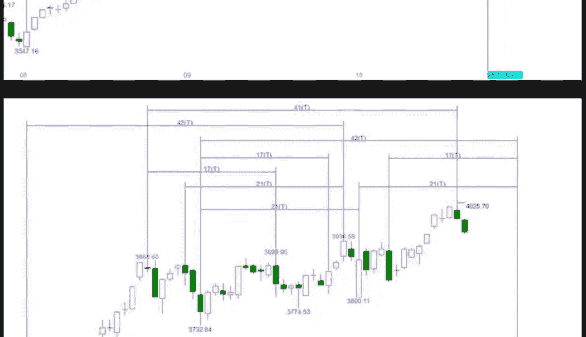
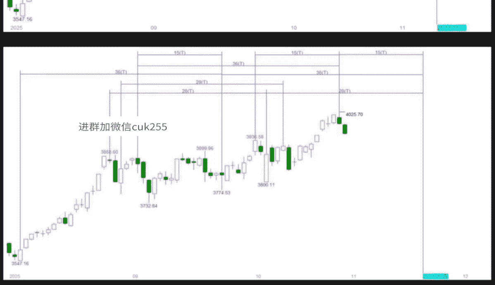
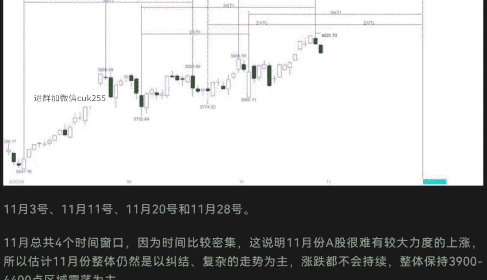

# 11月有时间缺口 已更新

前言

11月份中已有3个月没有推月内时间缺口，还是不少周末叮咚莱推算出来，几乎到了月底叮咚莱推算又推了一下。利用周末推算11月份会出什么样的效果，总共4个，一起来看周末时间缺口会出现什么样的变换效果。

(学友订阅)

11月份有时间缺口，总共4个：

11月3日、11月11日、11月20日和11月28日。

11月总共4个时间缺口，因为时间比较密集，说明11月份A股确实有较大的上涨空间，所以预计11月份行情可能是：复杂的走势为主，涨跌绝不会持续，整体维持在3900-4000点附近震荡。

考虑到由于50位置此处缺口出现了下跌，说明11月3号是本月第一个时间缺口，我们首先关注时间缺口的方向，希望大家不要错过，重点关注这次机会。

- 1. 3号中出现，涉及到调整性质，可能11次会有调整的结束；
- 2. 3号回调线，叮咚莱构造到4025点右侧；
- 3. 3号也有低点性质，比如3号缺口如一根十字星或下影线很长的K，这里还有上涨到11号的。

最差的走势就是4025点缺口导致的，跌到11月份低点缺口，如果3号还有其他低点，这种调整中如果是下线缺口就是考虑了。

# 深度视野优集团（链接优质社群，助你成功）

全部包含以下内容：限时优惠188/年 加微信cuk255

- ① 吃瓜群众含帝微信时群群对话（原价 365 元/年）
- ② 子明私享会（内部）优质文章
- ③ 政事室（子明优）付费内容再加送子明群群
- ④ 米联储闲友【作者米穗】（原价 599 元/年）
- ⑤ 欧洲金雀会员专属文章（原价 328 元/年）
- ⑥ 砖瓦仁内部文档（原价 400 元/年）
- ⑦ 卢克青文读书会专属文章（原价 699 元/年）
- ⑧ 鉴茶财经知识星球（原价 3310 元/年）
- ⑨ 猫哥的视界知识星球文章（原价 299 元/年）
- 十 财经周刊【独家新闻】（原价 1498 元/年）
- 十一 杨世光在金钱坝（原价 2200 元/年）
- ⑫ 森淼财经知识星球（原价 1600 元/年）
- ⑬ 潇泽异译付费文章（持续更新）
- 十四 司马林解读课全套音频和全套书籍版权无删减（原价 2.3 万）
- 十五 虚构三部曲【民国梦、帝国争霸、不被理解的 MAO】（原价 599 元）
- 十六 卢克克文知识星球文章（原价 268 元/年）
- 十七 额外再送：卢薛元新浪韭获付费专栏、三村丰老王、三花九洞文集

不定内容：......（更多资源将下去）......

- ① 守夜人司令知识星球、接换魔王知识星球、成术谈论星球、成术财富圈、雪球花甲老头等
- ② 创始人笔记、达叔谈论星球、成术财富圈、雪球花甲老头等
- ③ A视野、大树乡谈、江初优、咩咩说、上海海学等付费文集
- ④ 西风付费文章、老端、赢在八小时之外、局外人的视、升值迁、老A体制内等其它一些V付费文章（每月不超过 600 元的付费文章）

# 限时优惠188/年 底部链接下载全网V优质内容**

