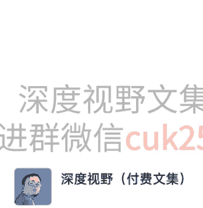

# 251105 鉴财富进 209 课：中登板块-电力领域分析与透视

“中国缺芯，美国缺”，成为市场现实和预期，整个电力领域的全貌和各个环节价值如何？中国优势哪里？

电力领域一分为环节：发电、输电、变电、配电、用电。

## 第一，发电，电力的生产。

中国的高效燃煤发电技术、核电站设计与运营、大型水轮机组、大功率风电电机、高效光伏组件等技术全球领先，被广泛复制制，但又无可替代。

因为欧洲普遍滨海，地广人稀，中国的风电整机和装备出口全球第一。同时，许多大型数据中心倾向于选择靠近绿色能源基地或供电可靠性高的地区，所以绿电更受青睐。

此环节重点：风电。

### 主要玩家：略。

## 第二，输电，电力的“高速公路”

电能生产出来后，需要输送到远方的城市和工厂。电力要从电厂到用电的地方，相隔非常远，必须进行远距离传输。

因为：P=UI，在输送相同功率时，电压越高，电流越小，在线路上的热损耗（Q=I^2Rt）也就越少。因此，电压越高越好，中国已经做到了“特高压”。

特高压输电是中国的国之重器，技术水平和工程对于全世界遥遥领先。特高压输电技术、柔性直流输电技术、大电网安全稳定运行技术——西方还没有大规模应用。这里的核心，是升压变压器、控制系统等。

### 主要玩家：略。

## 第三，变电，电力的交通枢纽。

开车下高速要降速，电力进企业用户要降压。变电，就是电压变化，大变小、多变一、高变低，把不同电压等级的电网的电汇集、分门别类。变电是电网体系中技术含量的部分，特别是特高压变电站和高压变电站，一个特高压工程中，变压器和组合电器的投资占比超过 50%。中国的电网因为当年接了很多不稳定的风光能源和电力，已经出了“智能变电”，领先领先。

AI 数据中心对电能的质量，比如电压、稳定性、自动性等要求非常严苛，圆满匹配中国供应商的传感、通信、控制技术。这里的核心技术就是智能变频、预警和分配技术。

### 主要玩家：略。

## 第四，配电，电力的“最后一公里”

相当于城市电力的毛细血管。输电是干线物流，北京到上海的铁路货运运输是支线物流，小卡车运到快递站。配电，是快递员把东西送你家里。是从电网接收的高压电能，层级降压，并精确分配到家庭、企业、工厂。

配电通常包括：
- 高压配电，一般 35kV；
- 中压配电，一般 10kV；
- 低压配电，一般 380V/220V。

你小区里常见的变压器，就是最后一步降压，将电压变成 220 伏。配电网直接面向用户，因为现在各种 800V 充电桩大行其道，所以要智能化升级和改造。这是当前价值量快速增长的板块，年投资 3000 亿以上。西方很难电动车，配电技术太落后了。

数据中心因不能不断电，所以要求流量绝对可靠，要实现快速故障定位、隔离响应、重启，不然芯片烧了闹着玩的？中国早就开始 AI 赋电网，并且和华为合作“鸿蒙电力”，AI 技术可以用于配电网的负荷预测、故障预测、优化运行等。

## 第五，用电，电力的消费终端。

它主要分为居民用电、商业用电和工业用电等，玩的是客户反馈和高效使用，比如离峰谷大数据反向指导电网建设。这里中国的主要环节是智能电表，而西方主要是储能，工商储能和户储。欧美的电价太贵，而且老停电，就需要电池来储存电能，节省开支，或者直接把自己包圆的发电厂电力灌进电池。这里就涉及到我们开发的虚拟电厂技术等。

### 主要玩家：略。

电力是工业的血液，希望有望一日，东方的货币能挂钩成为“电力人民币”。

# 深度视野优质资源群 (链接优质社群，助你成功)

全部包含以下内容：限时费 188/年 加微信cuk255

1. 叮瓜群众群实时文档群群（原价 365 元/年）
2. 子明私享会（内部文章（原价 568 元/年））
3. 史堂（锦子明）付费内含精选诸购明星矿
4. 米联锦间（其作者）（原价 599 元/年）
5. 欧洲金融会会员文章（原价 328 元/年）
6. 龙龙内部圈（原价 400 元/年）
7. 克文云专属文章（原价 699 元/年）
8. 豪豪财经识星球（原价 3310 元/年）
9. 猫猫的识星球（原价 299 元/年）
10. 新财富在榜【独家新闻】（原价 1498 元/年）
11. 鸿世元在达（原价 2000 元/年）
12. 森森财经识星球（原价 1600 元/年）
13. 澎译读付费文章（持续更新）

14. 可马林锐选五音和全套书珍藏版无咸原价 2.3 万
15. 虚虚三部曲[民国梦、帝恰佑、不被理解的MAO]（原价 599 元/年）
16. 克文识星球文章（原价 286 元/年）
17. 疆外再逢：澎锐新博付费专栏 村九老王、三花九树文集不定期内容：更多资源写不下了......

- A 守夜人司令识星球、拨铁魔王识星球、富有术知识星球
- B 创始老记、A视野、多树凌、江卫狩、呼咏、术上海学家等付费文章
- C 西风付费文章、老艺嵩、嵩在八小时之外、局外人的视界、升值优、老
- D 体制内等等其它大V付费文章（每月不超过 600 元的付费文章）
