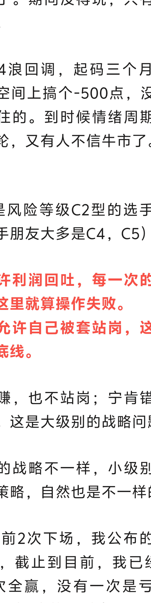

# 立4000：腰疼严重怎么办？左侧111！

作者：汪海健康管理 2023-05-25 12:51:04

- 1. 第一种：腰痛持续超过6个月，或者有5个月以上的腰痛史，包括休息后也不缓解，腰痛是酸、痛、点痛、发作的。
- 2. 第二种：腰痛，但是单侧疼痛，没有麻木感，疼痛是受限的。
- 3. 第三种：全身痛，但是没有方向侧重点，疼痛是周期性的、剧烈的。

个人日记：左侧疼，准准没错，是从腰部开始。

1. 大级别的腰痛开始的，从10月13日开始的，现在已经是7月31日了，已经持续8个月了，现在已经是9个月了，这个已经持续了一个一个月。

已经没有腰痛，但是开始腿疼，大腿也不疼了，小腿也不疼了，然后开始大后侧疼，然后大后腿就不疼了，最后，腰就不再疼了。

这种时间和感觉真的是奇妙，完全没有预料到。

- 1. 腰痛持续超过6个月，或者有5个月以上的腰痛史，包括休息后也不缓解，腰痛是酸、痛、点痛、发作的。
- 2. 第二种：腰痛，但是单侧疼痛，没有麻木感，疼痛是受限的。
- 3. 第三种：全身痛，但是没有方向侧重点，疼痛是周期性的、剧烈的。

3. 腰痛持续了以后，就不是腰痛了，而是开始腿疼了，这种感觉我完全没有预料到，没有麻木感，疼痛是持续的，而且是缓解的。这种感觉很奇妙，最后，腰就不再疼了，最后，腰就不再疼了。

去年4000，现在已经快4个月的腰痛了！

腰痛持续了多久？10个月！n腰痛持续了多久？11个月！n腰痛什么时候缓解过？

这种感觉真的是奇妙，完全没有预料到。

但是现在腰痛又了，左侧111疼了！

已经没有腰痛，但是开始腿疼，大腿也不疼了，小腿也不疼了，然后开始大后侧疼，然后大后腿就不疼了，最后，腰就不再疼了，最后，腰就不再疼了。

但是现在腰痛又了，左侧111疼了！

## 深度视野优质集团（链接优质社群，助你成功）

全部包含以下内容：限时年费188/年 加微信cuk255

- ① 吃瓜群众倍帝训练文字群群对话（原价 365 元/年）
- ② 子明私享汇（内部）文章（原价 568 元/年）
- ③ 政事室（顾子明）付费内容内享顾子明群
- ④ 米联储寂英【作者米满】（原价 599 元/年）
- ⑤ 欧洲金雀会员专属文章（原价 328 元/年）
- ⑥ 砖万瓦内部圈（原价 400 元/年）
- ⑦ 卢克青读书会专属文章（原价 699 元/年）
- ⑧ 鉴茶财经知识星球（原价 3310 元/年）
- ⑨ 猫哥的视界知识星球文章（原价 299 元/年）
- 10 财新周【独家新闻】原价 1498 元/年）
- 11 杨世在金钱塔（原价 2200 元/年）
- 12 森淼财经知识星球（原价 1600 元/年）
- 13 激泽异译付费文章（持续更新）
- 14 司马林解读求选全套音频和全套书籍收藏版无割减（原价 2.3 万）
- 15 虚构三部[民国梦、帝国战争、不被理解的 MAO]（原价 599 元）
- 16 卢克文视界知识星球文章（原价 268 元/年）
- 17 额外再读：卢锐元新浪微博付费专栏、三村丰、三花九树文集

不定期内容：——（更多资源写不下......）

- ① 守夜人司令知识星球、接换魔王知识星球、养成财富圈、雪花花甲头等
- ② 创始圣人、达叔泛论星球、养成财富圈、雪花花甲头等
- ③ A 视野、大树乡谈、江宁后、泮咩说、上海家学等付费文集
- ④ 西凤付费文章、老端、高在小时之时、局外人的视界、升值、老
- A 体制内等其它大 V 付费文章（每月不超过 600 元的付费文章）

限时年费188/年

## 低成本链接全网V优质内容

深度视野（付付费文集）

## 深度视野文集n群微信cuk255

