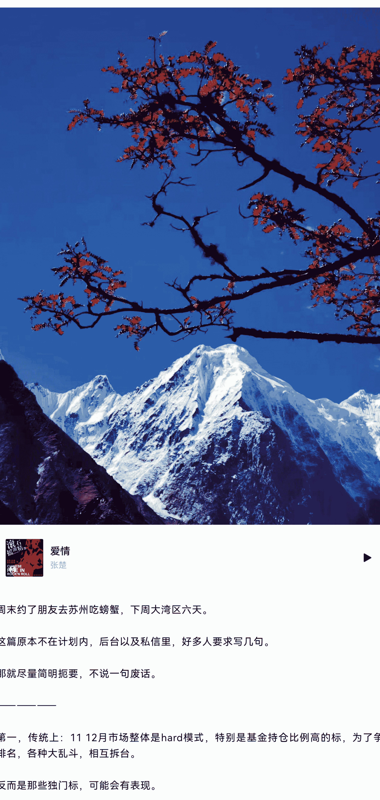

# 周末去哪儿

源自 轻风欢歇 无送亦无迟 2025年11月15日 00:04 浙江 🔊听全文

## 复情
林静

周末了和朋友去苏州吃晚饭，周末大湖游六天。
这篇原本是不打算的，台后及私信里，很多人要求写几句。
那就简单简短摘要，不说一句就好。

第一，传统上：11月12日整体是hard模式，特别是基金持仓比例高的标，为了争排名，各种大类，相互拆台。

反而是那些独门行情，可能有表现。

收益可以跌至净值，但千万不可以回撤亏。一种策略遇到暴涨，市值幅度会平滑曲线的。
重要的事情只有三句：稳健、稳健、稳健。

第二，指数也发现了，但人均持仓会比大盘比例提升70%到80%至100%，跌维护国企比例。

因为标准很简单：下限要高，后大部分部分基本无底。涨起来，搞不让公司都回撤。
基本上还是那些稳健的，极度追求稳健。

第三，一定要有降低成性。

每次遇到，都是你降低的机会，但而非越涨的。通过资金管理和经理控制可以是滑曲线的。

你们或许也发现了，最近有几个配置品种，其中有一个或者几个标可以是净值的回。
这些玩的人很少，少几个机会，极端还是很难不是？而且容易引起心动。

第四，控制好你的情绪。

不要被市场操弄，一不可心。你是你的，就是你的。不是你的，偶尔别捡给你就了，后面还会回去的。
临渊撒鱼利，不知退而盈网。
第五，审视自己的持仓。
后润线，尽量选择低位、低位、低位。

> 一直在死里出生，富源自在中

更多作者
微信微255

# 深度视野优质集团（链接优质社群，助你成功）

全部包含以下内容：限时年费188/年 加微信cuk255

- ① 吃瓜群众包帝时圈微信时群对话 (原价 365 元/年)
- ② 子明私享汇 (含) 内部文章
- ③ 政事室 (顾子明) 付费内容再送顾子明群
- ④ 米联储闲兜【作者米穗】(原价 599 元/年)
- ⑤ 欧洲金雀会员专属文章 (原价 328 元/年)
- ⑥ 砖瓦街内部圈 (原价 400 元/年)
- ⑦ 卢克文青读书会专属文章 (原价 699 元/年)
- ⑧ 鉴茶财经知识星球星球 (原价 3310 元/年)
- ⑨ 猫哥的视界知识星球文章 (原价 299 元/年)
- ⑩ 财经周刊【独家新闻】(原价 1498 元/年)
- ⑪ 杨世光在金钱爆发 (原价 2200 元/年)
- ⑫ 森淼财经知识星球 (原价 1600 元/年)
- ⑬ 激游异译付费文章 (持续更新)
- ⑭ 司马林解课全套音频和全套书籍版权无删减 (原价 2.3 万)
- ⑮ 虚构三部曲[民国梦、帝国争霸、不被理解的 MAO] (原价 599 元)
- ⑯ 卢克文再送：卢薛元新微博付费专栏、三村丰老王、三花九树文集

不定期内容：...... (更多资源不下去了......)

- ① 守夜人司令知识星球、摇拨魔王知识星球、成后财富、雪球花甲头等
- ② 创始笔记、达叔谈论知识星球、成后财富、雪球花甲头等
- ③ A、大树乡谈、江梓后、咩可以说、上海海家等付费文集
- ④ 西风付费文章、老端、赢在八小时之外、局外的视界、升值优、老体制内等其它一些V付费文章(每月不超过600元付费文章)

# 限时年费188/年 极底链接链接全网V优质内容

深度视野文集 进微信cuk255 深度视野（付费文集）

