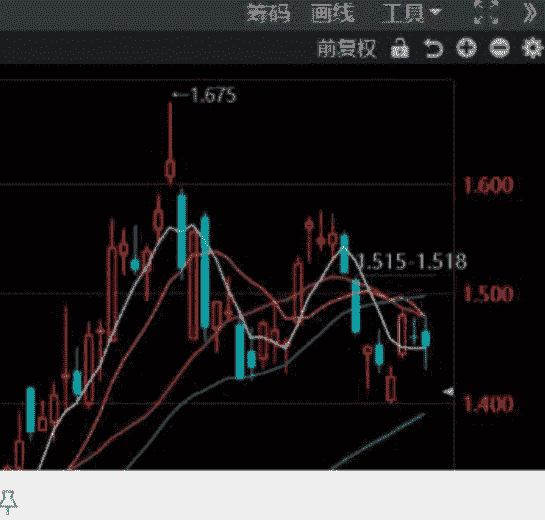
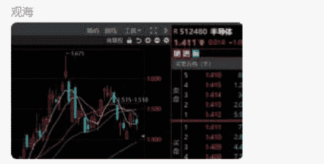
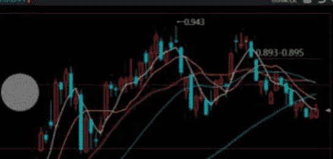
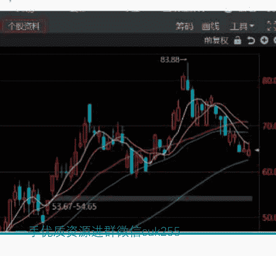
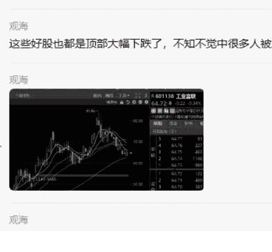
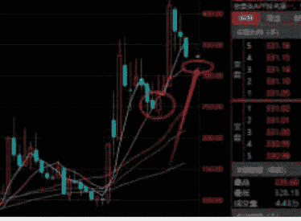
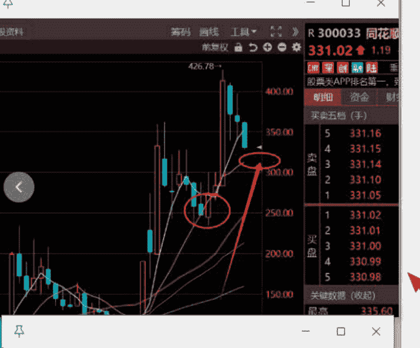
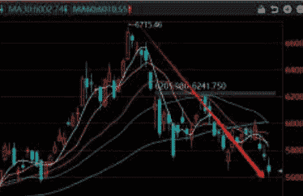

# R512480 半导体

如果看了预售涨还没来年年初走就不会觉得了吗？9月此票涨了10%，11月还跌低，小心哦。

观旁：““动”不等于“大涨”，很多人看到预售涨涨50%的率，却错过了时间，在今年前期内板块很容易跌，如果拿着看到不到位，顾不好还差点上。

观旁：

观旁：都是顶部形态。

深度视野文集，进微信cuk255

观旁：这些好也都是顶部大幅下跌了，不知道心里很多人被骗了。

观旁：

# R519840 人工智能

# R601138 工业蓝

观旁

# 10月后就不再提创业板和科创板风险

霓鸿：与其在科技股里，真不如拿着没涨证券安心，起码大幅下跌还很难。

霓鸿：同花顺是软件开发，严格说是不是证券券。

霓鸿：感觉没调整到位。

霓鸿：看不到见涛的样子。

霓鸿：深度视野文集，进群微信cuk255

观海：如果大盘能止住上涨，他也会跟着止跌的。

别时容易：观大，大盘年前到4200，那证券功夫肯定不可没戏。

观海：预测而已，又不是一定。

观海：其实证券今年没有大行情也是因为去年9月24日那波涨幅太太。

观海：只要大幅涨过的票，都不要参与，好不容易来个牛市，去接他们的盘什么。

云海：近阶段管理最好像不愿多股市，不知道为什么。

深度视野文集：整顿市场啊，进群微信cuk255

观海：资金扎堆抱团。

观海：稳住指数，让他们回归原处。

云海：这波量化牛市比前几波牛市都难得多。

观海：牛市第一大浪就是这样，只有少数板块上涨。

一手优质资源进群微信cuk255

# 深度视野优质集圈（链接优质群，助你成功）

全部包含以下内容：限时年费188/年 加微信cuk255

- ① 吃瓜群众包信时圈加微信时群对话（原价 365 元/年）
- ② 子明私享汇（内）内部文章
- ③ 政事室（顾子明）付费内容加送随子明群
- ④ 米联储闲【作者米穗】（原价 599 元/年）
- ⑤ 欧洲金雀会员专属文章（原价 328 元/年）
- ⑥ 砖瓦仁内部圈（原价 400 元/年）
- ⑦ 卢克文青读书会专属文章（原价 699 元/年）
- ⑧ 鉴茶财经知识星球（原价 3310 元/年）
- ⑨ 猫哥的视界知识星球文章（原价 299 元/年）
- 10 财经周刊【独家新闻】（原价 1498 元/年）
- 11 杨世在金钱爆（原价 2200 元/年）
- 12 蒜森财经知识星球（原价 1600 元/年）
- 13 潇潇异译付费文章（持续更新）
- 14 司马林解读课全套音频和全套书籍收藏版无割减（原价 2.3 万）
- 15 虚构三部曲[民国梦、帝国兴亡、不被理解的MAO]（原价 599 元）
- 16 卢克知识星球文章（原价 268 元/年）
- 17 额外再送：卢涯元新浪薇磺付费专栏、三村丰老王、三花九树文集

不定内容：......（更多资源不写下去了）......

- ① 守夜人司令星球、接换魔王知识星球、养成财富、雪球花甲老头等
- ② 创始笔记、达叔浅谈论星球、养成财富、雪球花甲老头
- ③ A视野、大树乡谈、江宁后、泮咩说、上海海家学等付费文集
- ④ 西凤付费文章、老端、赢在八小时之外、局外的视界、升值、老体制内等若干其它大V付费文章（每月不超过 600 元的付费文章）

# 限时年费188/年 底部链接下载全网V优质内容

深度视野文集，进群微信cuk255
深度视野（付费文集）

