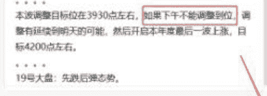
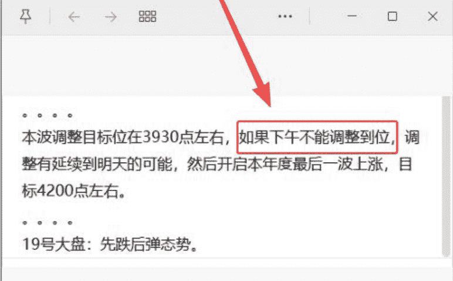

# 观海

预测是今天调整就结束了，如果你看不好，现在不要抛，起码等反弹后再减仓

# 观海

如果卖在低点上，对信心打击是挺大的

# 观海

给出的目标是3930点，昨天已经跌破3930点，说明昨天已经是最低点了

# 观海

进群加v:cuk255

# 观海

日本股市是央行直接下场，我们股市是通过“国家队”方式控制股市，都不会崩盘的，安心持股

## 深度视野优质集圈（链接优质社群，助你成功）

全部包含以下内容：限时年费188/年 加微信cuk255

- ① 吃瓜群众倍时圈加时群群对话（原价 365 元/年）
- ② 子明私享汇（含）内部文章
- ③ 政事室（子明佛）付费内加送额外子明群
- ④ 米联储寂英【作者米岩】（原价 599 元/年）
- ⑤ 欧洲金雀会员专属文章（原价 328 元/年）
- ⑥ 砖瓦仁内部圈（原价 400 元/年）
- ⑦ 卢克文青读书会专属文章（原价 699 元/年）
- ⑧ 鉴茶财经知识星球（原价 3310 元/年）
- ⑨ 猫哥的视界知识星球文章（原价 299 元/年）
- ⑩ 财财经周【独家新闻】（原价 1498 元/年）
- ⑪ 杨世光在金钱塔（原价 2200 元/年）
- ⑫ 森淼跃财经知识星球（原价 1600 元/年）
- ⑬ 激泽译异付费文章（持续更新）
- ⑭ 司马林解读猛选全套音频和全套书籍版权无割减（原价 2.3 万）
- ⑮ 虚构三部[民国梦、帝国争亡、不被理解的MAO]（原价 599 元）
- ⑯ 卢克文知识星球文章（原价 268 元/年）
- ⑰ 额外再送：卢译元新增微博付费专栏、三村丰老王、三花九洞文集

定期内容：——（更多资源不写下去了……）

- ① 守夜人知识星球、接换魔王后星球、达达滚论星球、成财富圈、雪花甲老头等
- ② A视野、大树乡谈、江宁后记、泮咩说、上海家居等付费文集
- ③ 西风付费文章、老端、赢在八小时之外、局外的视界、升值优、老A体制内等其它一些大V付费文章（每月不低于600 元付费文集）

## 限时年费188/年 低成本链接全网V优质内容

## 深度视野文集 进群微信cuk255

深度视野（付费文集）

