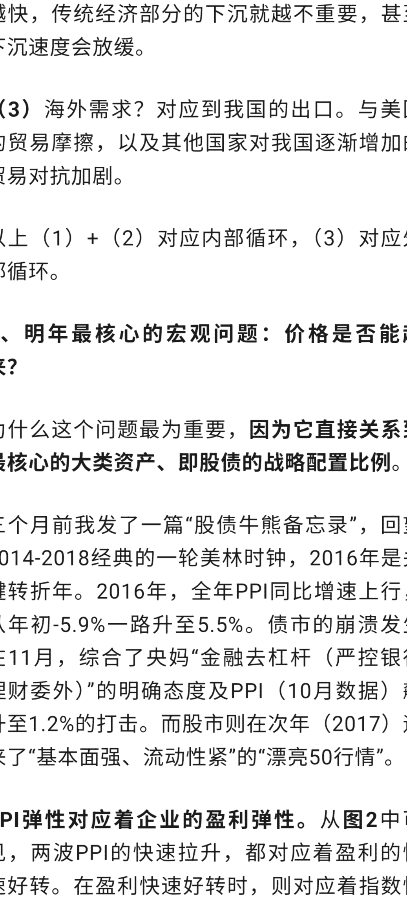
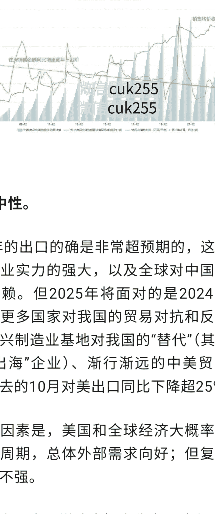
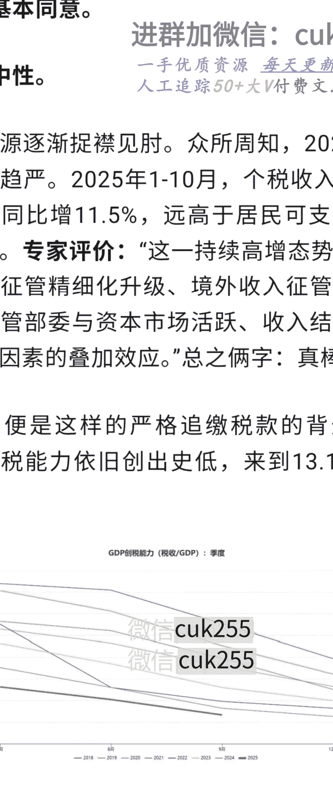
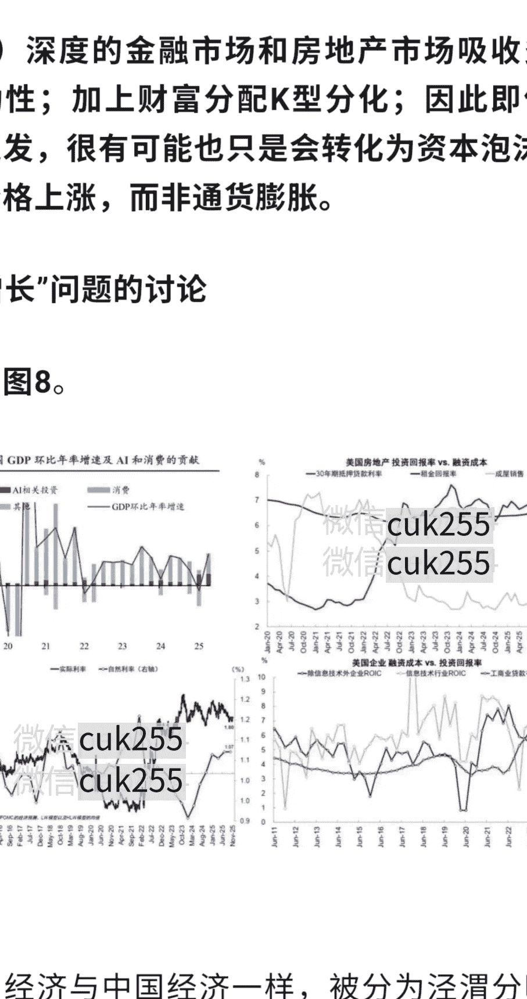
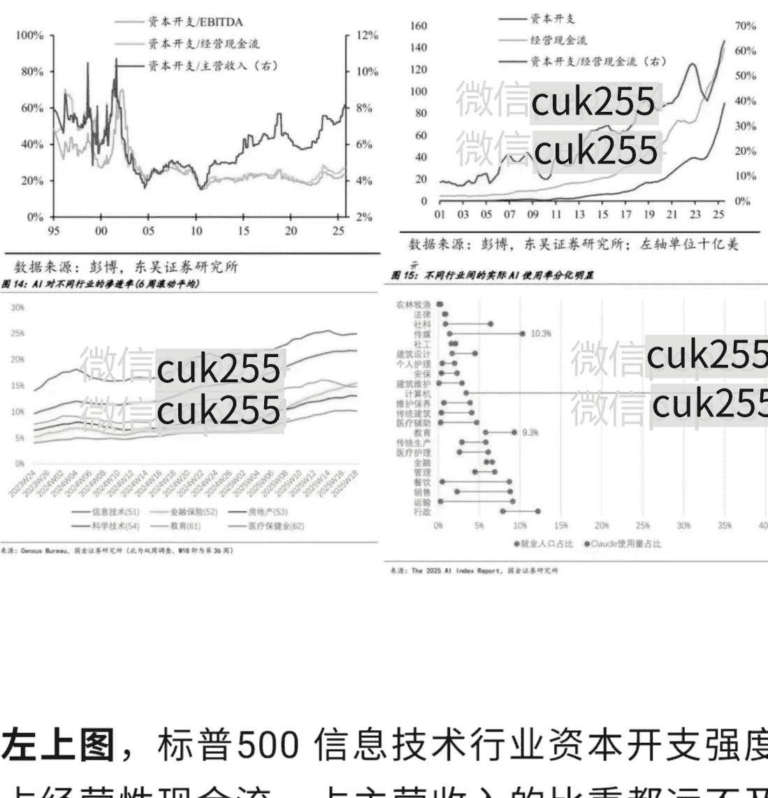

# 202511苍尼：2026行情、股票配置、A股和美股

作者：星靠1989 星靠1989
2025年1月25日 10:11

本文仅供参考，不作为投资依据。
本文源于星球中文，朋友不要重复复制。

## 1、已知和未知

已知的2025：

- (1) A股生产性景利背景下的结构性行情，以科技和出海为主主题的；
- (2) A股的涨幅，大部分都是“估值”的；
- (3) 中美通过贸易，反而坐实了中国难以对付的对手，而中国产品（包括A+H股）的提升，程度已经超过了这一近期的预期。另外，中美两国成为在全球范围内唯一的要竞争的对手，因此此估值涨幅具有合理性。

已知的2026年：

- (1) 中美竞争加剧、双方在突围和调控中见底；
- (2) 双方在核心领域资源争夺，将决定未来谁是全球领先的关键因素；
- (3) 十五五期间的关键是科技创新、新质生产、产业化升级。

也许，预测2026年将乐观，但并不需要过于乐观，因为未来还有盈利空间和风险。

2026的未知：

## 2、明年的宏观环境：股市能否迎来反转？

为什么我们要问宏观环境？因为它关系到股市最核心的因素，即编程的流动性如何？

从三个月以来流动性持续收缩，2016年是暖市，2014-2018年是熊市，EPS增长从5%左右升到7%左右，股市的底部已经出现了吗？

除了流动性，还有预期驱动（例如2025年加息、大基建、消费回暖、政策转向、新质生产、新爆发）。

以上（1）+（2）对内部环境，外部环境对股市的冲击如何？

由于上述讨论，市场的去泡沫依然在进行：

- 2023年年初开始，一二线城市有望目前尚未见到反弹迹象；
- 从法律措辞对资产各项项目来看，并不乐观；

上文所述，为了“房地产去压力的时期已经结束；2019年以来，如此庞大的中国增长逻辑已经发生了变化，从房地产到大企业、政府部门已经系统化。从居民部门到部门周期泡沫化；新的转型正面临巨大的成本损失”。

由于市场认为，房价可能还要承受-10%以上的下行：

对于一二线城市房价形成底部压力；商品销售周期下行10%（2025年10月起销售额同比10%），土地出让减少，政府财政面临压力。

### 2) 中性。

2024年的表现确是超出常的，这体现了中国产业实力的深度，2025年将面临的是更高的高点。对于更多国家的政府来说，其他国家对中国增长的“依赖”，其中中国对全球“需求”的依赖赖中外贸易关系减弱（较2025年10月起中国需求同比下降超过25%）。

但是好在，中国经济还向预期增长目标运行，总量依然稳健，但是弹性的空间确实有限了。

综合来看，出口压力确实有待抵御。

### 3) 合理性。

《经济财经》报道一道轨迹逻辑：均衡期的增长，如今面临首期“租房换房”的学生。下到到面的：中国大类内视图

- “反向下，房价杠杆将不会触底，现在是最底部的时刻。由于房价意味着持续下行”。
- “现在，我们预计2025年将从一个新的周期进入，未来三个季度，库存将半”。
- “房价刚性，本质上是刚性的，在没有选择。由于房价导致购房需求”。
- “房价下行，银行将面临资产重估，并将利率上行”。
- “风险，银行将面临持续高位。如果如此意味着成本不可承受”。
- “利润减少，反向形势上，企业将面临巨大的压力。最后是政府部门参与的建，政府如此，我们可以说卖出的是杠杆了”。

### 4) 基本性。

基础调整：财政压力加大，根据预测，2025年财政收入25万亿，财政支出23万亿，缺口33万亿。

但是现在就是财政压力持续的后果，这种财政压力加大：由于没有坚定的决心，只有通过现在再次采取‘式’转型——多种因素协同，中国GDP增长已经萎缩到1%（G.）。

与同时，一二线城市总额接近历史高点（国，每季度一个抬头），卖房率同比8.7%，预测2025年分别是全国和等地），这个卖房率接近极限。

由此可见，过去财政政策执行不发力，需要增加。根据上述，2026年的市场可能会经历一次转型。以后以长期增长为核心，市场震退，或许还有证据证明是这样的：

- (1) 数据的美国思维，配合贵师这种判断的可能（第一部分）：美国增速放缓，而新兴经济增速加快；这可能会出现衰退；无法避免；美国衰退引起

### 5. 对A的误判可能是：美国、阿尔法、德国

24年后，A的趋势发生了变化，这可能是另一个误判的起点。项目（资本市场）定义了“阿尔法：科技产业的逻辑”。

- (2) 联储可能还没有引发衰退。美联储的政策转向灵活，通胀放缓（而非高通胀），这释放了劳动力市场、企业内部压力的缓解。我们认为，“联储可能”已经没有事实支撑，现在的政策转向可能是为了更好地支持软陆；
- “另一个误判”可能是：导致居民收入的下降。我们认为，联储可能将维持高利率长时间；
- (3) 本期我们，从宏观流动性角度，当前正处于政策转向的边缘，这可能是投资者重新配置资产的机会；
- (4) 经济中存在许多不确定性的点，这对市场的机遇是
- (5) 虽有好因素和支持，但经济和股市的利润存在争夺。同时，2025年已经接近暴露风险之时，这种情况下，股市或将呈现结构性机会，阿尔法、德国可能是新的机会；

### 6. 美股：通胀，增长可能是泡沫

## “A泡沫”的讨论

最近很通胀（慢），事实没有支持。这与90年代和2000年代相比，不同之处，但具有可比性。

### 1970年代美国的通胀

- (1) 供给端：石油危机
- (2) 增长后期的财政政策，导致政策转向和需求扩张；美国实施长期宽松政策来维持增长目标（无通胀）；高利率，通胀贬值的结果；关键在于人的预期，是可能的；
- (3) 无量化政策引发流动性枯竭。

深层次的政策和市场供需错位：导致经济和股市利润结构分化；因此由于股市，很可能将结构化为泡沫股市（通胀将股市）；参考图8。

## B“长增长”的讨论

美国经济与中国经济的关系，被分为清晰的美国经济和中国增长两个组成部分；

# 进展与泡沫的衡量 (图9):

