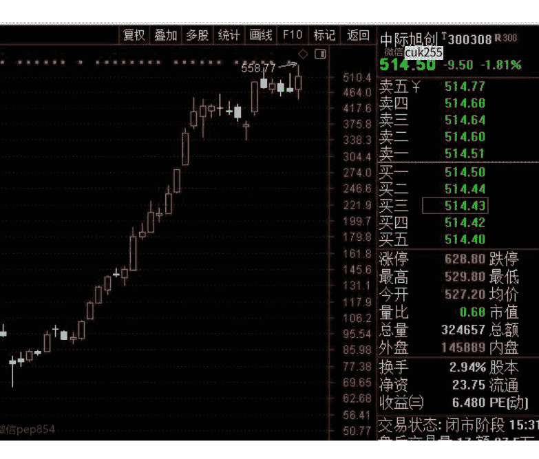
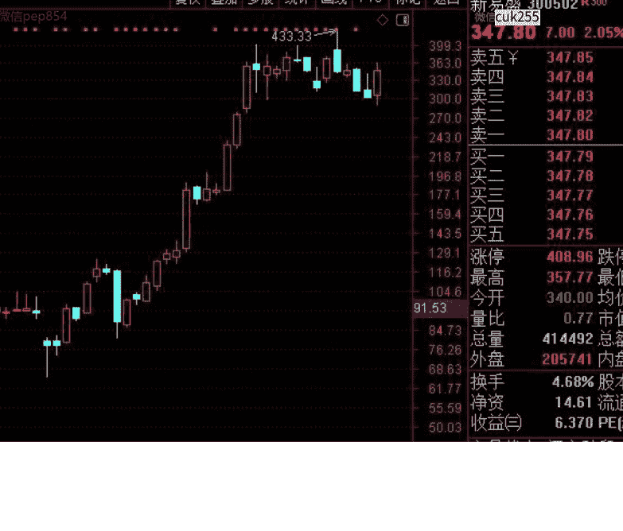

# 12月，年度收割与布局

12月，在片刻新情况中来到。

周五，白银创历史新高，白银是黄金的补涨弟弟。小新高，大哥务必，剩下的只是时间问题：
美联储态度两周一周，指向12月降息概率已经成局。
人民币对美元创出今年新高；中美三角关系，突然生变；
东亚大陆，上周再电话会；王毅透露明年的重大安排，涉及亚洲市场的收割方向，未来三个月布局，两张舞台，将在12月发力。

来说说整体的市场环境，就是地缘的12月。
12月，看来大概是地缘较为稳定的一个月。
东亚与西方最大的领导层，上周又过了一次。

过去的规律总是：中日好，中美好。差异，则中小型相同。
这一次，估计也不太例外。美银这种三角关系中，关系同时好、同时坏的概率极低，基本不能持续三个月。

美国刚那边通过，明年4月，他要来东亚。上期所说的东西亚恢复互访的事情，现在看差不多了。
应该，从12月到4月开始，东西两个大王国的地缘环境，都不会太坏。
至于关税与贸易战，对市场的影响已经成为了过去的事。
12月的市场，将回到更多的表面上。
废话不多，我们直接进入市场层面，来做一些简单的预测与规划。

## 大A。

来说结论：12月是收割与布局同时开始的一个月。
收割方向，主要是大AI科技方向为主。
从DESEEK时刻以来，大A的人工智能与AI为代表的大科技方向，出现了6个月以上的局部行情，头部的大科技，上涨的幅度非常大。其中代表的易中亚三只票，如下所示。

深度视野VIP群 人肉进场费进群加微信cuk255 微信chp5568

深度视野VIP群 人工追踪50+大V 付费群加微信cuk255 微信chp5568

它们最高的，价格涨了8倍，一个又涨了5倍，最低也是涨了2倍。

它们都是基于AI的布局的，并不是AI技术的核心部分。因此，随着AI科技12月进入一步的调整，这些头部的趋势大向，就是机构主导的科技股票，都有回调的行业，毕竟已经到了现在，该落袋为安，安排今年的时候了。

早就趋势的龙头，12月是逢、反弹的大概率时，那么科技类的大股票，也差不多是个走法。

所以，12月科技趋势大票，可能很难有的持续性的行情，一日的大涨，接着第二天的下跌套法到处。

所以，相似短线的逻辑，注意12月，在趋势AI这块区域追高，低吸也要达到足够的低才可以考虑的，比较好的低吸，可能在明年的3月出现。

至于银行，今年也积累了比较大的涨幅，银行板块整体涨幅21%。里面的资金，同样面临要考虑年底的分红。

趋势乏力，银行可能无好的表现。就基本意味着12月的指数行情，可能很难新高。

在这种情况下，可能会更多中小市的股票，或者非AI相关的科技方面会概率较大。比如近期的固态电池，走出了许多妖股。这就属于回避AI的科技新分。类似涨涨在十二月可以注意。

这个实际上也是2026年一季度的布局方向。

总结就是：
1. 非AI方向的科技，军工也是需要排除，因为2025年的方向，涨幅也不错，需要消化浮筹。
2. 是没有怎么急的中市值其他股票。
3. AI方向，依然可能是2026年的主流块之一，但是，需要一段时间的消毒，可能明年的3月，才是AI方向再次布局的机会。

12月的上证指数，或许难以真正突破此前的高点4034点，如果反弹到了这个点位，是一个需要考虑止损的点位，尤其是12月的前三周，如果挪到这个位置附近，则其需要运用追高策略。

## 美股

美股的12月，也是概率震荡的一个月。

目前的美股表现比A股好一点，纳斯达克与道琼，12月指数创新的概率还较大，但是，还可能还需要消化。尤其是纳斯达克。24000一线，还需要整理。
不是，在整理之后，美股继续上涨的概率还比较大。鉴于美股好，实际上，美股已经重夺了全球股市龙头的位置。

一些网络经济学家认为美股泡沫压力大，可能会破。
我认为，2026年会有小杀，但是不会破。
AI在现在看来似乎没有受伤的应用，但是可能这一年会有一次杀手级别的应用，用这个杀手级别的应用出现后，才能AI泡沫，真正的向倾斜，后还会迎来大清算，这个时间点估计到2028-2029年。

所以，如果12月美股（震荡），……（此处省略部分重复逻辑，保持原文语义）。
