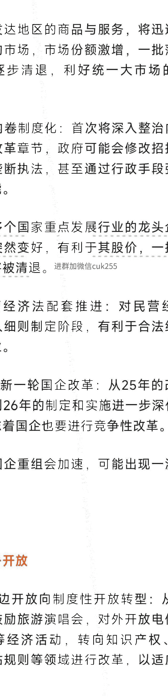

# 2026年经济形势展望

作者：子杨 2025年12月26日

## 一、国内环境

## 二、国外环境

总体来看，国际环境将更加严峻复杂，我国必须变局中应对变化，保持战略主动，争取主动权。

## 三、政策与建议

- 2. 科技创新：聚焦关键技术攻关。2026年将继续聚焦关键核心技术攻关，解决“卡脖子”问题，加快科技成果产业化进程，培育新质增长点。
- 3. 绿色转型：加快低碳转型。2026年将加快绿色能源转型，推动绿色金融、绿色建筑、绿色交通等领域发展，助力实现“双碳”目标。
- 4. 对外开放：扩大高水平开放。2026年将进一步扩大制度型开放，提升经济水平，构建开放、公平、透明的国际营贸环境。

## 留言 28

周 涛 16分钟前：活下去的优质地产有机会吗？

明响 解 作者 13分钟前：我认为，是新的神仙楼下的妖妖……我看的不是优质或否……

TAC-5 内部 13分钟前：啊，还能继续融资我们吗？看来我们这两天又撞了

周明响 作者 11分钟前：中央部的表现很少，就不再惦心了

高惠 滨 15分钟前：热心的已经建设为中心回来了。

周明响 作者 12分钟前：这次的正式文件，我想要的还有一些

高惠 回复 10分钟前：有的，点不听我的。

周明响 作者 7分钟前：明年明年要抓住宽普的

高惠 回复：10分钟前：不啦，明年还是要抓住宽普的冲期这一路狂奔

Clikby 周 10分钟前：新能源不是可以越反弹了

周明响 8分钟前：应该不错吧~

South 广 10分钟前：年轻男性也不爱消费酒精，还是错看看吧

周明响 作者 4分钟前：我不闹，所以这一段我也没错信心……也是，，也是一段逻辑，逻辑酒表

墙上的日落 陈 5分钟前：那不是一个中的省会市会怎么样？比如此如果是郑州这些城市

周明响 作者 4分钟前：肯定比其他城市不好，但没法跟含量比好像...

就北 周 20分钟前：这这里有点错，很多错字。群群错焰

周明响 作者 15分钟前：3000多呢。实在是空校了。

Gino 北 6分钟前：明年的市场还是会比美贷要的机会吗还是转向国际链了？

周明响 5分钟前：我觉得还行，两个月在郭对要传达高端芯片的准入以及它的模式，现在看来还是比较好的

会齐的企 安 4分钟前：基建企业还没过了

周明响 作者 1分钟前：行业内一期待的重构需要……争取份额物流、电力、新能源AI基建...

傅秉 安 北 4分钟前：资本已经说了，没有排序

周明响 解：没有排序，根据自己关注和增长的领域，再参考我的建议，投资还是要要找自己熟悉的领域

## 深度视野优质集圈（链接优质社群，助你成功）

全部包含以下内容：限时年费188/年 加微信cuk255

- ① 吃群众粉丝倍时文档加时群群对话（原价365 元/年）
- ② 子明私享汇（含）内部文章
- ③ 政事室（顾子明）付费内容再送顾子明群聊
- ④ 米联诸闲【作者米穗】（原价599 元/年）
- ⑤ 欧洲金雀会员专属文章（原价328 元/年）
- ⑥ 砖瓦斥内部文档（原价400 元/年）
- ⑦ 卢克青文读书会专属文章（原价699 元/年）
- ⑧ 鉴茶财经知识星球（原价3310 元/年）
- ⑨ 猫哥的视界知识星球文章（原价299 元/年）
- 10 财新周刊【独家新闻】原价1498 元/年
- 11 杨世光在金钱坝（原价2200 元/年）
- 12 蒜森财经知识星球（原价1600 元/年）
- 13 激游异译付费文集（持续更新）
- 14 司马林解课全套音频和全套书籍收藏版无删减（原价 2.3 万）
- 15 虚构三部曲[民国梦、帝国争亡、不被理解的 MAO]（原价 599 元）
- 16 卢克文知识星球文章（原价 268 元/年）
- 17 额外再送：卢薛元新浪微博付费专栏、三村丰老王、三花九洞文集

不定期内容：（更多资源不下去了）......

- ① 守夜人知识星球、接换魔王后星球、成达谈论星球、成术花财富、雪球花甲老头等
- ② 创始人笔记、达叔谈论星球、成术花财富
- ③ A 视野、大树乡谈、江宁后、泮咩说、上海海家学等付费文集
- ④ 西风付费文章、老端、在八小时之外、局外人的视界、升值、老A体制内等其它一些大 V 付费文章（每月不超过 600 元的付费文章）

限时年费188/年 终极链接全网大V优质内容

深度视野文集进群微信cuk255 深度视野（付费文集）

