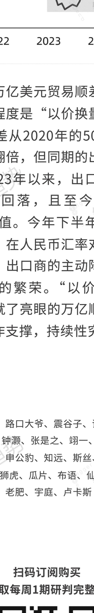

# 智能群体趋势分析

随着ChatGPT在2023年的爆发，全球迎来生成式AI的浪潮。从内容生成到代码创作，从医疗、金融到法律，生成式AI正重塑着各行各业。然而，在ChatGPT的火爆背后，智能群体的进化究竟距离我们还有多远？

热潮席下，“2023年12月14日”，微软发布了名为“GPT-4”的模型，再次引发了全球AI的热热。作为OpenAI的合作伙伴，微软计划将GPT-4集成到自己的Bing搜索引擎中。

“我是一个人工智能”，当被问及时它这样回答道。“我没有情感，也没有意识。”但它的表现却令人惊讶，它能回答问题，甚至能像人类一样思考。

然而，这是否真的意味着它已经具备了某种智能？OpenAI首席执行官萨姆·特曼（Sam Altman）曾将AGI（通用人工智能）定义为“在任何智力任务上都能超越人类所完成任务的机器”。随着ChatGPT的出现，这引发了人们对“AGI”的广泛讨论。

人工智能的发展史一言难尽。从1956年达特茅会议首次提出“人工智能”这一术语至今，人工智能已经经历了三次高潮和低谷。

在第一次浪潮中，科学家们试图通过“专家系统”将人类的知识输入计算机中来解决问题。但这种方法成本极高，且难以处理复杂的问题，最终导致了第一个低谷。

在第二次浪潮中，研究者开始关注机器学习，让机器从数据中学习。然而，由于计算能力的限制和数据的匮乏，这种方法也遭遇了瓶颈，陷入了第二个低谷。

如今，随着深度学习技术的突破和算力的提升，人工智能再次迎来了第三次浪潮。在这个浪潮中，AI展现出了前所未有的能力。

据报告估算，从2023年到2030年，该市场规模将以年均31.7%的复合增长率增长。

随着生成式AI的飞速发展，就业市场也成为了关注的焦点。虽然AI可以提高生产力，但同时也引发了人们对大规模失业的担忧。

然而，也有观点认为，AI将创造新的工作机会。历史证明，每一次技术革命都会催生出新的需求。

在AI的浪潮中，科技巨头们正展开激烈的竞争。谷歌、微软、亚马逊等公司都在AI领域投入了巨资。

这场竞争不仅是技术的竞争，更是数据和算力的竞争。谁能赢得AI未来？

人工智能的发展是不可阻挡的。它将深刻改变我们的世界。但我们准备好迎接这场变革了吗？

## 深度视野优质集圈，链接优质社群，助你成功

全部包含以下内容：限时费188/年 加微信cuk255

- 1 吃瓜群众倍帝时圈加时群群对话（原价365 元/年）
- 2 子明私享亨（会）内部文章
- 3 政事堂（原子明）付费内容需顺孩子原子明群聊
- 4 米联储闲间【作者米楷】原价599 元/年）
- 5 欧洲金准会员专属文章（原价328 元/年）
- 6 砖五厂内部圈（原价400 元/年）
- 7 卢克文青读书会专属文章（原价699 元/年）
- 8 鉴茶财经知识星球（原价3310 元/年）
- 9 猫哥的视界知识星球（原价299 元/年）
- 10 财新周刊【独家新闻】原价1498 元/年
- 11 杨世光在金钱（原价2200 元/年）
- 12 森森财经知识星球（原价1600 元/年）
- 13 源泽异译付费文集（持续更新）
- 14 司马林解读毛选全套音频和全书珍藏版无割减（原价2.3 万）
- 15 虚虚三部曲[民国梦、帝国争霸、不被理解的MAO]（原价599 元）
- 16 卢克文再送：星球文章（原价268 元/年）
- 17 额外再送：卢旷元新浪微博费付费专栏、三村边老王、三花九洞文集

不定期内容：（更多资源不下去了……）

- ① 守夜人司令知识星球、接鸽魔王知识星球、生有术知识星球
- ② 创始笔记、达越论星球、成付财富圈、雪花甲老头等
- ③ A视野、大树乡谈、江初知道、泮咩说、上海海学等付费文集
- ④ 西凤付费文章、老端、赢在八小时之外、外人的视界、升值、老A体制内等若干一些大V付费文集（每月不低于600 元付费文集）

## 深度视野文集
进群微信cuk255

深度视野（付费文集）

## 限时费188/年 低成本链接全网V优质内容
