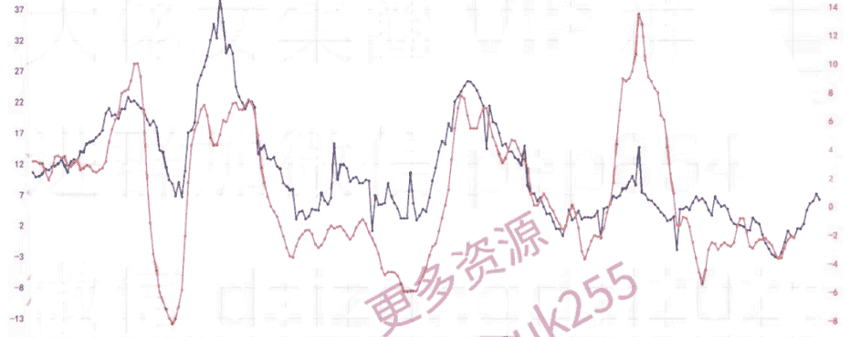
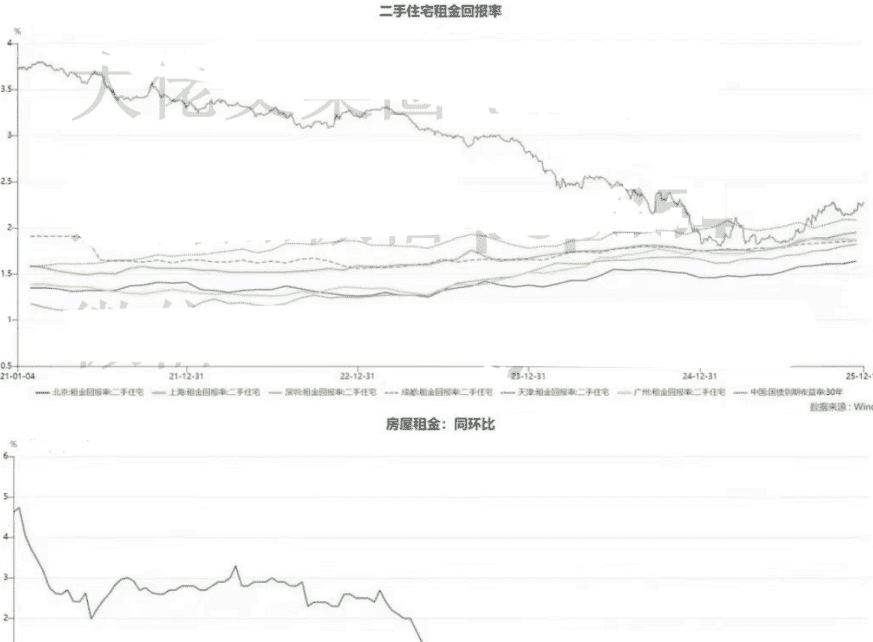
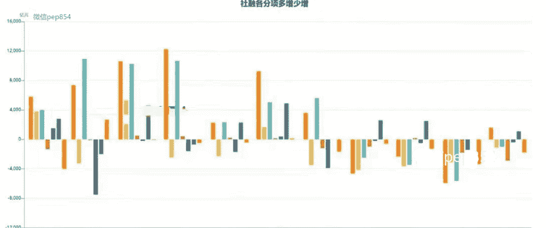
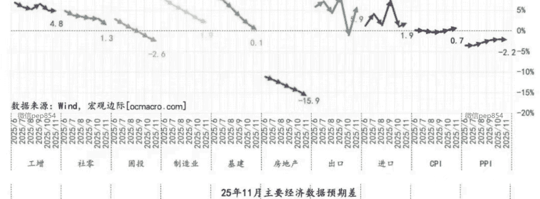

# 20251216备注：服务业、重要关注通、物价、汇率、债市、A股和宏观数据

已付费原创 星脑1989 星球长1989 2025年12月16日 14:00 上海

本篇的内容各个部分互相关联，共同得出结论。阅读时需要注意。

然后，即使数据互联、看上去逻辑严密很强，我也不一定是的，仅供参考。请务必保持独立思考。

本文属于星球文章，星球朋友不要重复购买。

## 1、服务业通缩

11月我在群中聊了服务业PMI的情况。11月服务业PMI回落至49.5%，较10月回落0.7%。很多人解释这是因为由于“第一波黄金周”带来的消费热潮过去，11月自然回落。我们回溯历史数据，从2015年至2020，每一个月的服务业PMI都高于10%。BUT，从2021年开始发生变化，往后的每个月都低于10%。什么原因？服务业主体的行为发生了变化。“金六七十”字（之后的物流和装修也变少了），年底企业和政府“支出”少了，居民越往年底消费的意愿就越低了。现在的服务业更多取决于通补（恐居民往往年底触底），同时居民消费集中在“假期”（并缩减平时的消费），形成了11月服务业PMI较10月滞涨的惯性。

对于我们现在通通胀，然而，服务业重要性大于制造业。为什么？首先，我国服务业可以容纳的就业已经显著减少，并且这一趋势在加速，原因在于：①自动化和智能替代，②高劳动密集型行业向服务转移。在这个过程中，服务业吸收了大量劳动力，它们包括：工资、社三项、各种灵活就业（此处画）

而再通胀的前提是居民均可实现收入的增加，最终推动形成“工资-通胀”螺旋。

居民收入包括：工资收入、财产收入、转移性收入。

- 工资收入提升，服务业通缩
- 财产收入提升，要房价及房价上涨，或股市上涨/分红增加；
- 转移性收入提升，要求更多财政资源用于居民福利、医疗、教育、养老、补贴。

并且，以往以往不能不是“临时提升”，需要是“持续提升”，因为“预期真正改变”才能形成“工资-通胀”螺旋。通胀提升是不可能的。这就是通胀治理的难题。

上一期《经济观察》又有一篇引起了我的关注——《注册数据飙45.7%，北京家的“卷”又来了》。文章提到：

(1)……亲眼看到北京上门保洁的单价被行业新入者“一路打下来”——最低出现39.9元小时的服务……只能靠口碑啦。

(2)去年下半年，在政策引导下，大量资金持续投入家政赛道……短期市场需求并未同步增长。

(3)2025年前10个月，北京市相关行业注册量由同期的1.38万增长至2.01万家...

(4)自理老人的护养人员服务定价从5000元/月降至4500元/月。2024年之前，很少有家政人员愿意接这样的订单，但今年……许多家政人员也接受了这样的定价。

(5)……一位有传染性疾病的病人未能通过公司的体检，几天后另一家家政公司处理了他的工作。(内卷的结果就是劣驱良，Be careful!)

显示出服务业转型后结构、通型的适应。

## 2、中央经济工作会议：强调内需、需平稳，但看起来很困难

几个重点：

(1)对形势的判断，“……发展、转型的问题，通过努力可以应对外部挑战。……外部环境变化积极影响。“总体2024年底更加乐观和宽松。

(2)财政政策：“重视地方财政均衡。……优化财政支出结构，规范税收优惠、财政稳健政策。……保持必要的财政赤字、债务总规模和支出总量。“财政力度表态及此前曾预期”。

(3)货币政策：“灵活有效运用降准多种工具，……畅通传导机制，……促进物价合理回升”“货币政策表述超出此前预期。

(4)供需良好：“国内供需矛盾突出……城乡居民收入增长，增加全国统一建设，深入贯彻内式增长”“供给方面，整齐，清理限制；需求方面，城乡居民增长，增加中央预算规模。总体上看，有几个：

- (1)2026年相比2025年，是一个财政小年。
- (2)对货币政策是否必须通缩、降息？我在之前视频中提到过、财政应该足够的可以避免使用QE；
- (3)如果是通缩性政策，其“通胀”的效果是什么？企业内卷问题，执行措施我是有效的。
- (4)总体来看，由于的是很难。重视“内需”主导。

## 3、汇率：持续上升的贬值可能的结论

在最新期视频中，聊了日本上世纪90年代初的“大升乍看之下不可，但回到当时的背景和约束之后，也可以理解的。当时的人民币和日元有一些相似：

- (1)从国际贸易的角度，人民币对伙伴非常。2022年初至今，人民币市值约16%，每年下降-5%，这部分也反映在内的价格上。
- (2)2025年在“关税冲击”下，出口依然强盛超过全年，除了我们的产品竞争力增强，汇率和贬值带来的“效应”不可。
- (3)人民币一路升，实际上是美国达成协议和妥协的内容之一。升值有助于实现“平衡”。
- (4)除了上述两个点，以下如下，我的考虑，出发点与政府不同，但最后的结果就是人民币市值：在G竞争博弈下，中国将作为最重要的对手。冲突让我们认识到美国将提供金融的流动性转型“武器化”极大可能，因此人民币必须努力国际化，更多伙伴所接受人民币的稳定。

日元最终的结果大家已经看到了。1995年日元升至高点后，暴露了问题。2013年在安倍推出三支（超宽松货币政策、积极财政政策、结构改革）支持后，日元开启了漫长的贬值之路。为什么如此呢？因为：通缩可能将持续20年；社会各阶层已经形成了根蒂固的通缩预期，这将导致日元贬值完全失效；利用宽宽松、大刺激、轨道转向；在经济复苏的过程中，日元贬值起到了重要的作用：用日元计价的价格上涨；日本出口和海外的日元价值增大；日本国内出现成功的通胀的动力。

接下来我们继续讨论后续的走向。在此之前，我们已经明确日元与人民币的差异：

①央银行对人民币的控制能力超过日本银行；
②中国绝对不会像日本那样完全根据美国的引力来办事；
③人民币不是避险资产；
④人民币快速贬值对我们的帮助可以减小日本压力，因为会引发对手的反弹；
⑤中国并没有像日本那样拥有庞大的海外资产，最后由于资本管制、尽量控制国内的资产（房、楼），海外资本进入也有相当程度。

因此，可能发生的情况是：

- (1)人民币继续升值，导致汇率差距缩小，这对美以及其他贸易对手有利，同时也为日本国家带来竞争下降障碍；
- (2)这样我们能够理解为什么，为了我们下次经济会议将放在在这里重要的战略地位，因为国外已经提供了足够的GDP拉拉。p.s. 也许我们明年某个月就会看到升值开始涨了。
- (3)人民币是一种重要资产，特别是对于出口或出海企业而言，汇率是一个重要考虑。如果人民币成为一个预期范围，那么升值可能会在汇率均衡的推动下出现，为了避免快速汇率“幅度波动”，因为一旦快速汇率，就会定会回向，但也允许这一正向；
- (4)人民币升值会抑制出口，并鼓励出口，同时导致国内的人民币计价的价格变贵（对海外市场本身）。这种会导致出口国的货币贬值对本国经济不利。因此，人民币同样具有通胀效应，除非我们真的拉动了内需；持续，和内需无法、出口强。
- (5)如果转型“内需主导”成功，那么人民币升值将拥有坚实的基础，未来升值到一定水平，不至于大幅回落；如果内需发起来。

## 4、通缩和增长

- (1)前面已经讨论了服务业转型的情况，经济会议对2026年的安排，即财政整体力；如果财政增长充实，再加上私人部门收入无法持续维持，那么2026年将出现增长；
- (2)前面已经讨论了汇率逻辑，人民币升值使得看到压力减轻；
- (3)根据上面两点，价格很难从某个点开始化的，此外，要关注是否涉及收入进行调整，需要真正激发，只有两条路径，其一是激发居民的安全，其次是激发居民的安全保障到位。
- (4)通缩治理的窗口不是永远存在的，几次会导致这种恐惧。
- (5)人民币升值对海外资本非常有意义。首先，人民币上升趋势，上升带来通缩效率，使得拥有获取利润。
- (6)基于以上，观察到短期波动具有实质性的政策后，持有具有相当优势，个人闲钱，以及等事件引发对流动性的需求的（主要卖现概率），其中部分考虑出售某些品种，将其配置到红利股上。
- (7)评价区中很多人说“市场永远不会”。学习时许多人云“市场永远不会”这句话是道理，而且想要跟上行动要遵循，比如你不能自己感到恐惧，去抗击趋势；不要极端、走向极端的。

## 5、A股结构和逻辑

- (1)趋势：首先，“不加速，无转折”。形成趋势。这是一个规律。本轮行的速度始终被控制，因此没有积累过多风险（交易角度，最大的风险是结构和杠杆）。
- (2)接着讨论一个老问题——为什么A股从慌了？这个问题与总怎么问呢？试图指明那些名字的“长期产权”风险不确定+社会以及契约精神极度灵活。在长期产权不确定和契约精神不存在的背景下，唯一的选择就是在“交易窗口期”疯抢套利。这就是内卷和暴力股市的来源。内卷必然导致流动性溃，股市股市暂时是一片蓝海，年轻少了。
- (3)结构：上周我们看到海尔特和茅台齐日下跌，实际上整个消费板块跌得很凶，关键是时候谁带它们。这些和茅台属于可选消费，茅台是周期的典型代表。茅台从开始就开始在跌，这都不是错。我提到过它是房地产、基建时代的产物，是服务测试的产物，是时代的恒星。我知道有些人喜欢白酒，好人嗜白酒，但他们喝的是茅台。茅台的金融属性远大于消费属性。曾经我说茅台压力最可怕的时候，是收藏了钱的人卖现货的时候。茅台已经被指导是新一轮趋势的开始。茅台处于下跌趋势，一样符合“三年周期，无转折”的规律。

总之，周期的结构，其内核内主导的周期性，还是不好看。2026年A股的结构，首先将还是科技，这是时代主旋律，也符合A股“三年一轮”的周期（2013-2015增长，2016-2019增长，2022-2024价值，2025-这种风格周期背后是政策周期和产业周期）。接着，红利风格可能会在某个时间段与长债共振，转换对通胀加利的支撑。
- 周期的下跌：A股的下跌和震荡是4-9月的连续性修正，性质与黄金在4月的横盘调整一样。包括港股。修正背后的原因是短期流动性、对估值和产业发展的支撑。

## 6、一些观察数据和简单讨论

- （1）图1：PPI vs M1 同比（环比变化）

M1领先PPI，9个月。很多人用这个周期前瞻PPI明年上半年将会持续上行。首选M1中包含居民存款后，对企业部门状态的描述性必然减弱，与PPI之间的相关性必然减弱。其次我的备忘中经历多次，M1基本上与财政脉冲同步，实际上是为了企业活跃存款。已知2026年表现相对较弱。由此PPI的上行很难期待，除非M1领先9个月的规律依然成立，前瞻指标已经走斜，PPI短期上行对市场还有意义吗？

- （2）图2：

- （3）图3：

严重收缩的居民信贷（与房价方向一致），继续收缩政府债。P.S. 考虑到领导们“政策空间”思维性。2024年引导利率下行，人民币一定幅度贬值，2025年上台后开展做好准备。政策对冲内需下滑。根据中央工作会议通报，对外部压力的判断降低，形成了2026年的基调。内部压力加大人口老龄化和生育危机每年都在更加严重；二是通缩预期一旦形成，就会难以逆转。通缩治理的窗口不是永远存在的。

- (4)2025年1月主要经济数据一览

| 工矿 | 制造业 | 基建 | 房地产 | 出口 | CPI |
| :--- | :--- | :--- | :--- | :--- | :--- |
| | | | | | |

- 2025年1月主要经济数据预测（实际）

| 工矿 | 制造业 | 基建 | 房地产 | 出口 | CPI |
| :--- | :--- | :--- | :--- | :--- | :--- |
| | | | | | |

几乎都在下行。预期一样，明年如果持续推动，并且财政总额下降（或平持），经济数据可能进一步。
