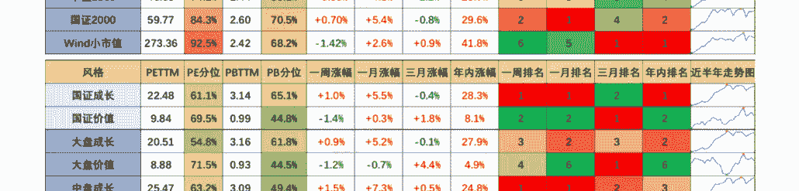
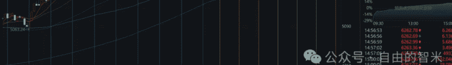

# 2025.12.14——重筹会议下的2026债市配置思路

原创 黄小梨 自由的智米 2025年12月15日 01:16 广东

## 前言

- 1. 中央经济工作会议解读及对2026股市、债市影响
- 2. 短期市场风险加大及抄底时机

自由的智米
课定而始，知止而得，方能于金融市场中立于不败之地
671篇原创内容

点击上方 公众名片 关注我们

深度视野VIP群 人工追踪50+大V 付费进群加微信cuk255 微信chp5568

## 2025-12-04 A股分行业行情概览

| 行业 | 子行业 | 近年分位 | PE | PB 分位 | 一年 | 一月 | 三月 | 半年 | 今年 | 涨跌趋势 | 价值分位 | 近年趋势 |
|---|---|---|---|---|---|---|---|---|---|---|---|---|
| 能源 | 石油化工 | 3.4% | 55.44 | 12.6 | 73.2% | -2.2% | -3.7% | 5.6% | 20 | 24 | 42% | |
| | 煤炭 | 5.0% | 71.3 | 8.8 | 73.8% | -3.0% | -0.6% | +5.7% | 15 | | 42% | |
| | 用电 | 1.3% | 75.9 | 10.8 | 83.6% | -0.0% | -0.1% | +2.4% | 22 | 12 | 8% | |
| 金属 | 钢铁 | 1.4% | 58.2 | 10.6 | 53.1% | -2.5% | -0.1% | +2.0% | 21 | 31 | 34% | |
| | 建筑材料 | 1.0% | 53.2 | 2.4 | 74.4% | -1.7% | -0.2% | +19.7% | 17 | 13 | 60% | |
| | 汽车 | 2.0% | 50.2 | 1.5 | 69.8% | -0.3% | -0.2% | +20.8% | 20 | 18 | 12% | |
| 基础设施 | 房地产 | 0.0% | 5.0% | 0.1 | 73.9% | -0.3% | -2.6% | -3.9% | | | | |
| | 电力公用 | 2.3% | 27.7 | 20.3 | 49.3% | -0.0% | +0.7% | -1.9% | 18 | 14 | 20% | |
| | 交通运输 | 2.4% | 44.0 | 22.1 | 78.8% | -12.3% | -1.5% | -0.0% | +0.9% | 17 | 11 | 32% | |
| | 机械 | 1.1% | 40.1 | 58.4 | 69.8% | +2.7% | -1.3% | +0.7% | 25 | 17 | 32% | |
| | 汽车制造 | 3.3% | 39.1 | 58.0 | 69.2% | -0.1% | +6.1% | +12.0% | 40 | 8 | 51% | |
| | 设备制造 | 1.1% | 62.9 | 10.4 | 33.0% | -3.6% | +5.0% | +24.8% | 4 | 10 | 74% | |
| | 国防 | 0.5% | 16.3 | 10.9 | 42.2% | +3.6% | +5.1% | +11.7% | 22 | 14 | 18% | |
| 医疗 | 医药 | 3.0% | 55.4 | 29.0 | 15.8% | -1.9% | +1.7% | +31.7% | 15 | 17 | 36% | |
| | 器械 | 1.4% | 48.2 | 80.7 | 30.5% | -1.1% | -0.6% | -8.0% | 22 | 23 | 16% | |
| | 食品 | 3.4% | 21.5 | 4.0 | 40.5% | -1.6% | -3.5% | -2.2% | 23 | 16 | 32% | |
| | 农药 | 1.9% | 28.3 | 14.1 | 39.1% | +0.1% | -0.5% | -20.8% | 21 | 15 | 44% | |
| | 酿酒 | 2.8% | 64.8 | 90.7 | 47.8% | -2.1% | +1.9% | -11.9% | 10 | 19 | 66% | |
| | 纺织制造 | 1.8% | 64.1 | 93.3 | 21.7% | -31.0% | -11.9% | +31.9% | 9 | 14 | 68% | |
| 消费 | 商零售 | 1.7% | 68.1 | 99.2 | 10.6% | -0.67% | -2.2% | -1.9% | 11 | 20 | 36% | |
| | 消费服装 | 1.2% | 77.9 | 81.7 | 49.7% | -0.02% | +0.5% | +7.8% | 3 | 7 | 34% | |
| | 电子 | 0.3% | 25.7 | 71.9 | 91.7% | +0.05% | -0.8% | +6.7% | 24 | | 24 | | |
| | 计算机 | 7.1% | 129.6 | 10.7 | 5.15% | -0.0% | -6.7% | +24.2% | 13 | 27 | 94% | | |
| | 传媒 | 1.4% | 64.9 | 26.7 | 30.4% | 24.8% | +0.6% | +68.1% | +0.5% | -27 | | | |
| | 通信 | 1.2% | 64.5 | 30.1 | 48.8% | -0.9% | +19.4% | +35.2% | | | 21% | | |
| 金融 | 银行 | 4.2% | 41.6 | 7.3 | 0.69 | -1.5% | -3.1% | +6.6% | 11 | 20 | 19 | | |
| | 非银行金融 | 2.0% | 58.4 | 11.04 | 1.46 | -2.9% | -0.1% | +0.7% | 8 | | 25% | | |
| | 证券 | 5.0% | 63.3 | 14.5 | 20.9% | -0.1% | -0.5% | +2.7% | 22 | 27 | 28% | | |
| 综合 | 租赁 | 0.4% | 27.7 | 0.9 | 1.82 | -58.3% | -1.0% | +22.3% | 14 | 32 | | | |

数据来源：wind, 公号：自由的眼镜

2025-12-12

深度视野VIP群 人工追踪50+大AI 付费进群加微信cuk2555 微信chp5568

## 2025-12-12 A股价值风格与成长行情趋势

| 指数 | PETTM | PE60 | PBR60 | PBR9 | 周涨 | 一月涨 | 月内排名 | 周内排名 | 三月排名 | 年内排名 | 半年内趋势 |
| :--- | :--- | :--- | :--- | :--- | :--- | :--- | :--- | :--- | :--- | :--- | :--- |
| 上证指数 | 16.24 | 91.4 | 1.7 | 55.9 | -0.3% | +1.4% | -0.2% | 16 | 5 | | |
| 沪深30 | 30.36 | 80.2 | 2.5 | 65.0 | -0.4% | +8.7% | -0.7% | 27 | 2 | | |
| 创业板 | 40.74 | 41.7 | 5.5 | 60.2 | +7.0% | +2.7% | +9.4% | 24 | | | |
| 中证500 | 15.28 | 95.0 | 5.9 | 52.8 | -1.4% | +7.1% | -3.9% | | | | |
| 上证50 | 11.7 | 85.9 | 1.2 | 72.8 | -0.1% | -2.3% | +0.7% | 11 | | | |
| 沪深300 | 39.91 | 79.1 | 1.4 | 71.5 | -0.8% | -2.1% | +9.9% | 18 | | | |
| 中证1000 | 36.69 | 78.1 | 2.3 | 72.9 | +0.1% | +5.1% | -3.2% | 21 | | | |
| 中证1050 | 40.66 | 74.1 | 2.5 | 70.5 | +0.9% | +4.3% | -2.2% | 23 | 7 | 4 | | |
| 国证2000 | 59.97 | 86.3 | 2.6 | 70.5 | +7.0% | +5.4% | +0.8% | 29.6 | | | |
| Wind-价值 | 27.36 | 95.2 | 2.4 | 68.2 | -1.4% | +2.7% | +0.9% | 41.8 | | | |

| 风格 | PETTM | PE60 | PBR60 | PBR9 | 周涨 | 一月涨 | 月内排名 | 周内排名 | 三月排名 | 年内排名 | 半年内趋势 |
| :--- | :--- | :--- | :--- | :--- | :--- | :--- | :--- | :--- | :--- | :--- | :--- |
| 沪成长 | 24.88 | 61.8 | 3.1 | 53.9 | -1.1% | +5.5% | -0.4% | 28.3 | | | | |
| 沪价值 | 9.84 | 69.5 | 0.9 | 44.8 | -1.3% | +1.4% | -0.8% | 18.1 | | | | |
| 大证成长 | 20.51 | 53.6 | 3.1 | 61.8 | -0.9% | +5.2% | -0.1% | 27.9 | 2 | 3 | 2 | |
| 大证价值 | 8.88 | 71.5 | 0.9 | 44.3 | -0.7% | -1.4% | +4.4% | 4 | 6 | 1 | 2 | |
| 中证成长 | 25.47 | 63.2 | 3.0 | 49.4 | -1.5% | +7.3% | +0.5% | 24.8 | | 4 | 5 | | |
| 中证价值 | 13.90 | 76.6 | 3.1 | 63.5 | -1.6% | -1.9% | -2.4% | 19.2 | | | 4 | |
| 小证成长 | 32.39 | 76.6 | 3.1 | 77.8 | +4.8% | -2.7% | 34.2% | 2 | 3 | 6 | | |
| 小证价值 | 18.15 | 73.4 | 1.2 | 53.3 | -1.4% | +2.7% | 15.5% | 5 | 5 | 4 | 5 | |

本周是以小微反弹为主，结构性震荡，制造等成长风格的老慢反弹，中盘风格明显优于大盘、小微，主要因素有三个：

第一，公募考核新增落地，确认绩效与业绩比较基挂钩。

- 过去三年跑输业绩基准10%且利润为负的基金经理减薪30%。
- 过去三年低于业绩比较基准100百分点且利润为负的基金应当下降。
- 过去三年不足业绩比较基准10个百分点且利润为负的基金，适当下降。
- 过去三年超过业绩比较基准且利润为正的基金，可以合理提高。
- 有过去三年跑输业绩基准，跑赢的，要么配置了科技，要么配置了红利，完成考核。

第二，美联储降落地，对于未来降息路径的表述超预期26年2次，利好成长风格。

第三，中央经济会议落地，延续2025年度宽松政策，对债市有较强压力，端10Y收益率上75BP，超长30Y收益率上9BP：

| | 1Y | 2Y | 3Y | 5Y | 7Y | 10Y | 超长 |
|---|---|---|---|---|---|---|
| 国债 | 1.3875 | 1.3950 | 1.4150 | 1.5575 | 1.7275 | 1.8425 | 2.2470 |
| | | 0.00 | 0.50 | 0.50 | 2.00 | 2.75 | 3.90 |
| 国开 | 1.5975 | 1.6300 | 1.6550 | 1.7500 | 1.8800 | 1.9165 | 2.0025 |
| | | 0.25 | 0.25 | 1.25 | 2.40 | 3.00 | 3.35 | 2.25 |
| 口行 | 1.5650 | 1.6650 | 1.6700 | 1.7850 | 1.9075 | 1.9850 | 1.9900 |
| | | 0.40 | 0.06 | 0.50 | 0.50 | 2.00 | 1.75 | 0.50 |
| 农发 | 1.5825 | 1.6500 | 1.6850 | 1.7850 | 1.8525 | 1.9900 | 2.0000 |
| | | 0.00 | 0.00 | 1.25 | 1.50 | 1.25 | 3.00 | |
| 地方债 | 1.3100 | 1.5025 | 1.3200 | 1.7420 | 1.7200 | 2.0525 | 2.4400 |
| | | | 0.75 | | | | |

这里重点解释一下，很多人可能还不知道，适度宽松的货币政策不应该是导致长债高涨吗？中央经济工作会议是否要灵活运用降抑制等多种政策工具吗？为什么对长债有如此压力？

2025年的经验告诉我们，适度宽松的货币政策不是大幅降准，而是扩张债务规模与货币增速，在目前的内需紧平衡背景下，可以通过两种手段：一是中央政府加杠杆，二是收小中美利差，引导外资本回流，在这个过程中可能出现小加息扩广的现象，2025年的表现如果是没有5月6D Omo从1.5%爬到1.4%，首年同业增长率将比24年末高出20BP;

土地是居民财富的，过多的存款引发市场[泡沫]风险，可以先在政府出手，把房子造出去，释放政策性需求：

- 坚持住底线，积极化解重点风险，对齐房地产市场，区域规划，验收保障性商品房
- 用于保障性住房，深化住房制度改革，构建新型房地产发展模式，加快市场化
- 恢复土地市场，引入新动力，优化融资结构和贷款种类，提高融资效率等技术性措施

整体来看，目前市场处于预期的调整期。第一，目前市场对热度过热，17家机构都认为2026年将正增长，平均增长4.3%，首次无负增长预期，和之前一直一致，认为并不到3%，但实际上达到了6%；第二，对于消费的蚕，目前市场房地产和消费性住房占比仅为6%，房机可能低至10%以下，房机可能出现大事件驱动，主动基金对于海外收入超过20%的海外客户购房市场占比提升至64%，这和顶层对于明年形势的判断和决策方向是相反的。

## 第一、优质资源：cuk255

在此，**2026年的配置上，还是以回归为主**，不要捂牢一拉科技长，这种消费奢侈结束也不要在周期性低迷时；

科技后成长，A股科技是美的映照，国内四股业绩优绩，两天下跌15%，经营流从上周81%跌到21%，自由流流量100，主要是公司司引通的AI收入利润率低于其非AI收入利润率，通联预计与OpenAI的合同在2026年不会产生太多收益，AI的投资资金可能不能产生利润时间很难证明，AI的故事可能很难持续下去；国内的科技拐遇到极致，可能短期内难以继续，反转的风险比较较大；

近2026年的长期配置调整，再来看一条短线的市场，下周五要谨慎，目前仍然如此。**

当前市场运行节奏加紧，从过去9个交易日为周期调整为8个交易日为周期运行，明天是周期的重点，新周期的起点，反弹已经持续两个周期，市场ABC的概率比较；2026年最大的利空就是下周五2月19日的日本加息，最近市场的震露，主要来自全球流动性问题，当周五美大股，全球焦点也将聚焦日本加息，明天开始可以C浪下跌将开始，如果发生，“断点”可能是全球流动性利空出清后，技术面上，是延续左右：

深度视野VIP群 人工进群微信cuk255 微信chp5568

> 以上内容仅供参考，不构成投资建议
> 仅代表个人观点，与所有机构无关

# 复日志·目录

上一篇
2025.12.7——债市何时企稳？春季震动何时开始？

下一篇
2025.12.15——扩大内需是战略之举

作者提示：投资观点，仅供参考

留言 2

王捷华 海南 昨天
请问市场ABC概率大 指的什么意思

自由的智米 作者 昨天
三浪调整，目前B反弹，可能即将C调整

# 深度视野VIP群 人工追踪50+大V 付费进群 加微信cuk255 微信chp5568

# 深度视野优质集团（链接优质社群，助你成功）

全部包含以下内容：限时年费188/年 加微信cuk255

- ① 吃瓜群众倍帝圈文加时群对话（原价 365 元/年）
- ② 子明私享汇（含）内部文章
- ③ 政事室（子明佛）付费内加送额外子明群
- ④ 米联储顶级【作者米糕】（原价 599 元/年）
- ⑤ 欧洲金雀会员专属文章（原价 328 元/年）
- ⑥ 砖瓦斥（原价 400 元/年）
- ⑦ 卢克文专属文章（原价 699 元/年）
- ⑧ 鉴茶知识星球（原价 3310 元/年）
- ⑨ 猫哥的视界星球（原价 299 元/年）
- ⑩ 财经周【独家新闻】（原价 1498 元/年）
- ⑪ 杨世光在钱圈（原价 2200 元/年）
- ⑫ 森淼财经星球（原价 1600 元/年）
- ⑬ 激赛异译付费文章（持续更新）
- ⑭ 司马林解读末选全套音频和全套书籍无删减（原价 2.3 万）
- ⑮ 虚构三部[民国梦、帝国战争、不被理解的 MAO]（原价 599 元）
- ⑯ 卢克文星球文章（原价 268 元/年）
- 额外再送：卢薛元新浪微博、三村丰老、三花九树文集

不定期内容：——（更多资源不写下了......

- ① 守夜人司令星球、接换魔王后星球、成术达论星球、养成财富圈、雪花甲老头
- ② 创始佳绪、达叔达论星球、养成财富圈、雪花甲老头
- ③ A视野、大树乡谈、江初国、泮咩说、上海海家学等付费文集
- ④ 西风付费文章、老端、高在小时之时、局外人的视界、升值、老 A体制内等其它一些大 V 付费文章（每月不超过600 元的付费文集）

# 限时年费188/年 低成本链接全网V优质内容

深度视野文集进群微信cuk255

深度视野（付费文集）

