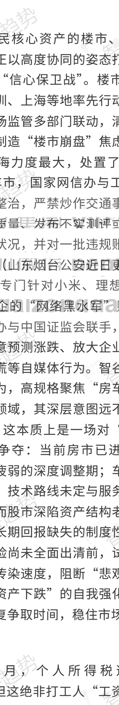
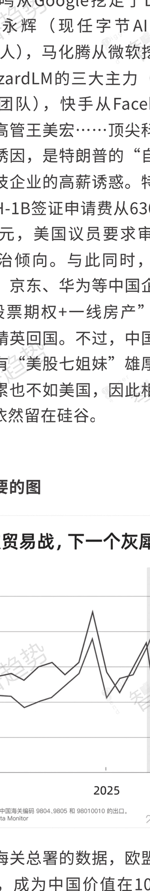

# 智能手机趋势报告

本报告旨在分析智能手机行业的发展趋势，并对未来市场进行预测，为相关决策者提供有价值的参考。

## 一 市场现状

2023年第四季度，全球智能手机出货量下降1.2%，至3.2亿台。尽管如此，行业已显示出复苏迹象。中国市场智能手机出货量为7200万台，同比增长15%。

与此同时，印度市场智能手机出货量为2300万台，同比增长20%。这主要受季节性需求、新机发布以及宏观经济因素的影响。

从全年来看，2023年全球出货量为11亿台，较2022年下降12%。在市场份额方面，三星、苹果、小米、OPPO和vivo市场份额有所波动。

其中，三星继续保持全球第一，苹果紧随其后。小米、OPPO和vivo表现稳健。在中国，本土品牌竞争愈发激烈。

此外，智能手机市场正面临需求转型的挑战，AI手机、折叠屏等技术的应用正成为新的增长点。

## 二 核心趋势

2024年，智能手机市场将迎来复苏。AI技术的深度集成将成为行业创新的核心动力。

首先，AI手机将成为主流。通过端侧大模型技术，手机将提供更智能、更具个性化的用户体验。

其次，折叠屏手机将持续增长。随着技术成熟和成本下降，折叠屏将吸引更广泛的用户群体。

最后，中端市场竞争将加剧。品牌将通过提升性价比和功能来争夺市场份额。

关注我们，获取更多行业深度报告！

## 三 市场预测

预计2024年，全球智能手机出货量将增长5%，达到12.5亿台。

中国市场将实现小幅增长，预计增速在3%左右。

印度和东南亚市场将保持强劲增长，增长率可能超过10%。

关注我们，获取更多行业深度报告！

# 深度视野优质集圈，链接优质群群，助你成功

全部包含以下内容：限时费188/年 加微信cuk255

- 1 吃瓜群众粉丝倍时圈加时群群对话（原价 365 元/年）
- 2 子明私享亨（会）内部文章
- 3 政事堂（原子明）付费内容再送顺子明群聊
- 4 米联储间【作者米楷（原价 599 元/年）
- 5 欧洲金雀会员专属文章（原价 328 元/年）
- 6 砖五厂内部圈（原价 400 元/年）
- 7 卢克文青读书会专属文章（原价 699 元/年）
- 8 鉴茶财经知识星球（原价 3310 元/年）
- 9 狮哥的视界知识星球文章（原价 299 元/年）
- 10 财新周【独家新闻】原价 1498 元/年）
- 11 杨世光在金钱（原价 2200 元/年）
- 12 森森财经知识星球（原价 1600 元/年）
- 13 源泽异译付费文章（持续更新）
- 14 司马林解谋选全套音频和全书珍藏版无割减（原价 2.3 万）
- 15 虚虚三部[民国梦、帝国争霸、不被理解的MAO]（原价 599 元）
- 16 卢克文再送：卢星球文章（原价 268 元/年）
- 17 额外再送：卢麟元新浪薇佛付费专栏、三村边老王、三九九文集

不定期内容：（更多资源写不下了...）

- ① 守夜人司令知识星球、接魂魔王知识星球、生有术知识星球
- ② 创始笔记、达越译论星球、成付财富圈、雪花花甲老头等
- ③ A视野、大树乡谈、江宁后、泮说什么、上海海学等付费文集
- ④ 西风付费文章、老端、赢在小时之外、局人的视界、升值、老体制内等及其其它大V付费文章（每月不低于600元的付费文章）

限时费188/年 低成本链接全网大V优质内容

# 深度视野文集
进群微信cuk255

深度视野（付费文集）

