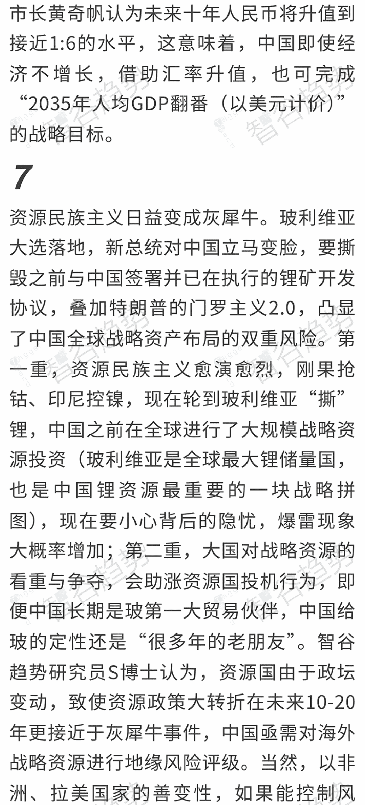
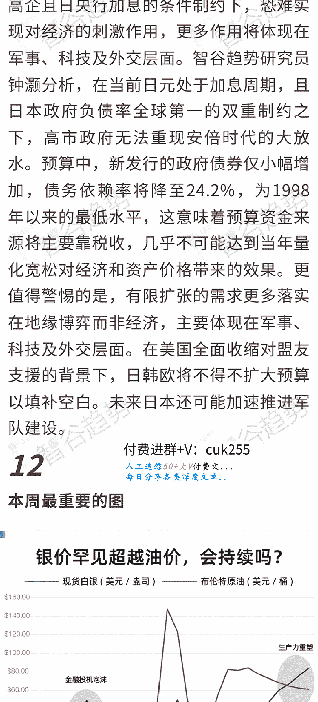

# 智能手机内部变革

> “智能手机行业正在经历着前所未有的内部变革，”高盛分析师郭建斌表示。

2022年，全球手机市场进入寒冬，出货量同比下降11.7%。数据显示，2022年全球手机出货量仅为12.1亿台，较2021年下降了1.7亿台，这是2011年来的最低水平。

然而，在行业寒冬中，中国手机厂商却表现出了极强的韧性。2022年，中国手机在全球市场的份额为28.5%，位居全球市场第一位。

郭建斌指出，中国手机厂商面临着双重挑战：一方面是宏观经济环境导致消费需求下降；另一方面，手机市场竞争也日益加剧。

据Canal数据显示，小米在2022年全球出货量为1.5亿台，下降19%。

与此同时，OPPO在2022年全球出货量为1.4亿台，下降16%。

vivo在2022年全球出货量为1.07亿台，下降13%。

苹果在2022年全球出货量为2.3亿台，下降5%。

三星在2022年全球出货量为2.6亿台，下降11%。

## 二 智能手机会迎来变革吗？

2022年，苹果发布了iPhone14系列，其中iPhone14 Pro和Pro Max搭载了全新的A16仿ionic芯片，并首次引入了“动岛”设计。

与此同时，三星发布了S22系列，其搭载的骁龙8Gen1芯片实现了性能的巨大飞跃。

小米、OPPO、vivo也发布了各自的旗舰手机，在影像、性能等硬件上有了新的突破。

然而，仅仅硬件的升级，真的能让智能手机行业迎来颠覆性的变革吗？

## 三 AI会成为手机的核心吗？

在2022年底，ChatGPT的火爆引发了全球对生成式AI的狂热。

# 深度视野优质文集，链接优质群，助你成功

全部包含以下内容：限时年费188/年 加微信cuk255

- 1 吃瓜群众包信时圈加时群对话（原价 365 元/年）
- 2 子明显私享亨（会）内部文章（原价 568 元/年）
- 3 政事堂（原子明）付费内容再加送顺子群聊
- 4 米联锦间【作者米褚】（原价 599 元/年）
- 5 欧洲金雀会员专属文章（原价 328 元/年）
- 6 砖五厂内部圈文（原价 400 元/年）
- 7 卢克文阅读书会专属文章（原价 699 元/年）
- 8 鉴茶财经知识星球（原价 3310 元/年）
- 9 猫哥的视界知识星球（原价 299 元/年）
- 10 财新周刊【独新闻】（原价 1498 元/年）
- 11 杨世光在金钱（原价 2200 元/年）
- 12 森森财经知识星球（原价 1600 元/年）
- 13 源译译付费文集（持续更新）

# 深度视野文集
群微微信cuk255

- 14 司马兰解读毛选全套音频和全套书籍珍藏无删减（原价 2.3 万）
- 15 虚走三部曲[民国梦、帝国统治、不被理解的MAO]（原价 599 元）
- 16 卢克文知识星球文章（原价 268 元/年）
- 17 额外再送：卢阡新源微播付费专栏、三村边老王、三花九树文集，不定期内容：（更多资源将下去……）
- 18 守夜人司令星球、拯救狂魔王知识星球、生财有知识星球、
- 19 创始笔记、达沃译论星球、成付财富圈、雪花甲老头等
- 20 A视野、大树乡谈、江哲号、泮咩说、上海海学等付费文集
- 21 西风付费文章、老端、赢在小时之外、局外的视界、升值、老A体制内等其它一些V付费文章（每月不低于600元的付费文章）

限时年费188/年 低成本链接全网V优质内容
