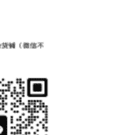

# 丁辰灵：

去年就给大家安利的测试机长川今天大大涨，总要来的。他们的SoC测试机国内领先，今年收入将50多亿，利润超过12亿，明年收入有望75亿，利润20亿，他们还有存储测试机。

# 丁辰灵：

港股科技龙头如小米，阿里，腾讯涨了这么久，PE还是很低，和美国那些巨头的估值不能比拟。但实际上这几家公司未来肯定要颠覆美国的巨头。不要怀疑，美国开始降息，流动性会出来，科技还会继续！很明显股代表中国企业国际化，品牌化，出海，替代美国的巨头，需要全球投资者进来玩。A股今天国产替代半导体设备等大涨，代表的是供应链，中国的供应链要在中国上市，减少外干预。（极少数两地上的中芯是正常的）都很有前途。

# 丁辰晨：

北方华创+拓荆+半导体材料，灵哥和大家之前说的国产化。

## 详情

别老沉沉。光模块，液冷这些英伟达的态稳中，当风冷说变就变。美国一旦爆发，我们可能会砸出很多政策出来。正技术的主线就是国产替代+高端制造！（包括半导体设备、导体材料，还有高端制造ETF等）此外，一系列保障，中央政府给地方政府不值，立刻好地产生，化债链条，恐怕好资金金融的风险和资管等板块。当然也会好消费等！

丁辰晨 专享 2025/9/11 22:31 北京
关注人数 2139

最后编辑：2025/9/11 22:33

Tz, 郭郭博远, Junyan, yc, 帽，农行拓光, Lanca, sydeny, Sam Q, 蔡立斌围圈研群等70人觉得很不错

加微信

提问：灵哥，降息后，大A短期会不会有调整呢？接下来的走势您怎么看？

如果从操作层面，您建议是躺平还是逢高卖，逢低做T呢？

丁辰灵回答：周五晚听直播

提问：灵哥如何看昨天尾盘中信证券与国泰海通尾盘的巨量卖单？另外近期商券板块各个股走势分化加剧，灵哥怎么看？谢谢

丁辰灵回答：上面控盘真太好了，等下我写文章

### 提问：灵哥请问河色几天跌的逻辑是不是卖现实？还继续看好，那几天回调买入是不是比较好的位置？谢谢！

提升知识学习365年（365天服务期），微信扫码或加微信：2818363845
加入群看更多优质资源，老客户群享折扣。学习群包含全部资源：

一、财经类博主（财经群里包含以下几位博主内容更新）：

- 1. 灵辰财富知识星球（原价3310元/年）/ 单卖149年
- 2. 鉴泰陈财经知识星球（原价3510元/年）/ 单卖149年
- 3. 血之妄陈家知识星球（原价2280元/年）/ 单卖199年
- 4. 户晨霍+Y会员（原价10000元/年）/ 单卖79年
- 5. 智哲哥内部复星球（原价199元/年）/ 单卖19.9年
- 6. 南丰半坤财经（原价400元/年）/ 单卖19.9年
- 7. 沫的实战策略以及其他博主付费免费赠送

二、时事博主（时事群共19位，包含以下11个博主更新）：

- 1. 李子明虹江（原价568元/年）/ 单卖29.9年
- 2. 来粮看视间（原价599元/年）/ 单卖29.9年
- 3. 大阿闹识星球（原价199元/年）/ 单卖19.9年
- 4. 蕾蕾的世界星球（原价299元/年）/ 单卖19.9年
- 5. 甄广矿后Q的内部群（原价400元/年）/ 单卖19.9年
- 6. 付克文知识星球+青金会员群（原价268元/年）/ 单卖19.9年
- 7. 付克文曾古语书会（原价699元/年）/ 单卖59.9年
- 8. 伍佑信金会员群（原价328元/年）/ 单卖29.9年
- 9. 欧陆詹金会员星球（原价308元/年）/ 单卖19.9年
- 10. 蜀三云西风付费星球，单卖29.9年
- 11. 江子号公众号付费星球，单卖29.9年

添加微信
免费领取资料
免费阅读体验
满意再进
更新365天
送还好文！

三、各种付费星球：

政大通录、外人的视角、翻译译玲、雪花莱姆老师、红幻故事、A视角、NVO 捷眼视角、冷泡小鱼、王凯涛等时事付费星球不更新，在六八小时之外、雷磊、凯凯等付费星球不更新，内容很多，不一而——

升级加入知识学习群包含以上所有资源，分享365天，赠送还历史文！
