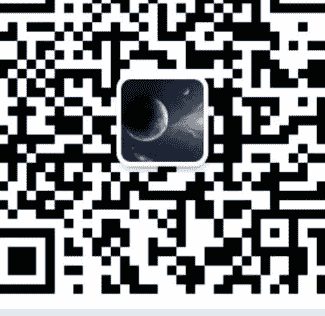
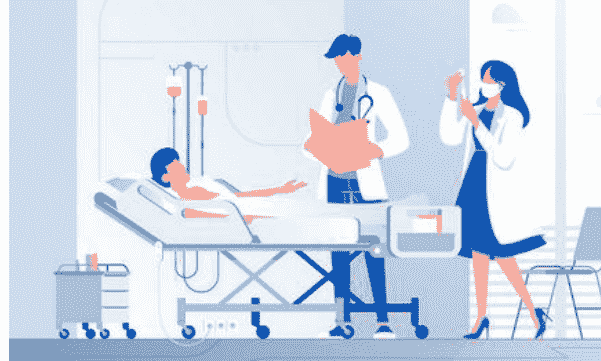
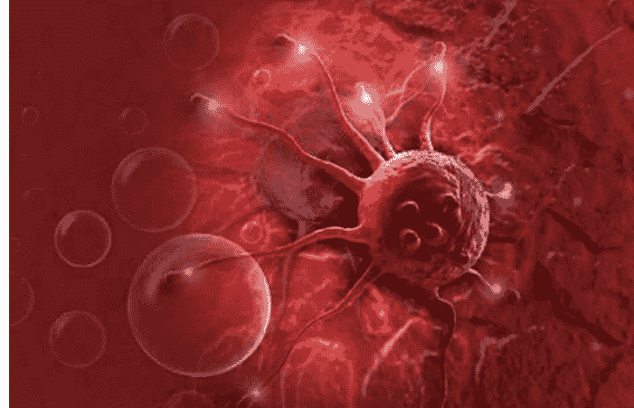
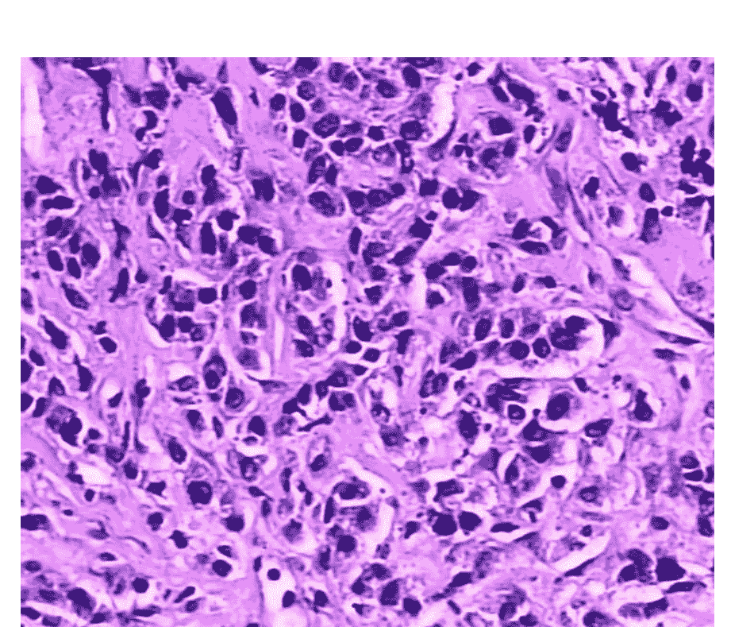
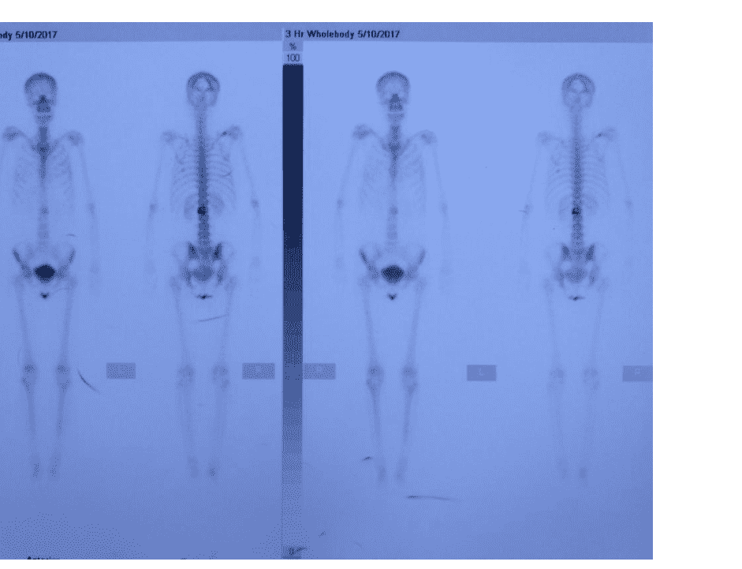

# 从癌症骨转移说起

# 重疾险——临床医生的视角和逻辑

## 扫码加入 知识星球TOP 免费资源群

免费
公众号: 知识星球TOP

- ✓ 每日免费获取高价值资源
- ✓ 提供各类资源搜索服务

价值
微信: jntsg8

| 热门付费文章 | 各行各业报告 |
| :--- | :--- |
| 精选图书资源 | 副业赚钱方法 |
| 职场实用资源 | AI政经自媒体 |

及时
微信: jntsg2

专注
分享资料仅供个人学习，请及时删除，切勿商用传播

## 重度恶性肿瘤（症）的定义

恶性肿瘤——重度指恶性细胞不受控制的进行性增长和扩散，浸润和破坏周围组织，可以经血管、淋巴管扩散转移到身体其他部位，病灶组织病理学检查（涵盖骨髓病理学检查）结果明确诊断，临床诊断属于世界卫生组织（WHO, World Health Organization）《疾病和有关健康问题的国际统计分类》（ICD-10）的恶性肿瘤类别及国际癌症肿瘤学分类第三版（ICD-O-3）的肿瘤形态学编码为3、6、9（恶性肿瘤）范畴的疾病。

- 下列疾病不属于“恶性肿瘤——重度”，在保障范围内：
  (1) ICD-O-3 肿瘤形态学编码属于 0（良性肿瘤）、1（意义未定性肿瘤）、2（原位肿瘤和非侵袭性肿瘤）范畴的疾病，如：
    a. 原位癌，前病变，非浸润性变，非侵袭性肿瘤，肿瘤细胞未侵犯基底层，上皮内涵变，细胞非典型增生等；
    b. 交界性肿瘤，交界性恶性肿瘤，低度恶性肿瘤，潜在性恶性肿瘤等；
  (2) TNM 分期为 I 期或更轻分期的甲状腺；
  (3) TNM 分期为 TN0 期或更轻分期的前列腺癌；
  (4) 黑色素瘤以外的发生淋巴结和远处转移的皮肤恶性黑色瘤；
  (5) 相当于 Binet 分期方案 A 程度的慢性淋巴白细胞；
  (6) 相当于 Ann Arbor 分期方案 I 程度的骨肉瘤；

## 癌症最致命的是啥？

- 肺转移
- 肝转移
- 脑转移
- 骨转移

身体消耗，脏器衰竭，导致死亡。各种转移是可以治疗的，但是……

## 癌症治疗越来越有效——也越来越贵

- 基因检测
- 靶向药物
- 免疫治疗
- 联合治疗
- 肿瘤耐药
- CAR-T治疗

逻辑：治疗越有效，活得越久，骨转移的发生率越高，治疗费用也越高，重疾险就越需要购买。

## 癌症骨转移常见的癌症有哪些

- 乳腺癌
- 肺癌
- 肾癌
- 甲状腺癌
- 前列腺癌
- 骨髓瘤

其他肿瘤：如肝癌、肠癌、胃癌、宫颈癌等也有骨转移，但总体发生率略低。

## 癌症骨转移检查——病理学穿刺或活检

- 并非所有骨转移病灶都需要穿刺活检。
- 临床上如果无法明确，特别是单发病灶，则需要穿刺或活检。
- 某些癌症（如乳腺癌）骨转移病灶可能与原发灶病理免疫组化类型不同，并影响治疗策略，则需要穿刺活检明确。
- 临床上存在二元论：即转移病灶不是原肿瘤灶。
- 成骨性病灶往往很难或不需要穿刺或活检。

## 骨转移检查——骨扫描

### 常见的 99Tc-MDP 骨扫描外摄取进展

郭娇、媛薇、武志芳
030001 太原，山西西医学大学第一医院医核医学科
通信者：志芳，武志芳，Email: wushifang@163.com
DOI: 10.3760/j.jssn.2017.4114.02.011

【摘要】99Tc-MDP 通过离子交换的方式与骨组织内碱性盐结合，从而引起异性沉积。骨扫描在临床上主要用于疾病诊断，然而临床上可见外摄取范围较少，本研究旨在探讨骨组织不良钙化、转移性肿瘤等局限性取有关，也可能与良性病变或某些结节有关。骨摄取的临床价值具有重要，了解摄取的成因有助于骨扫描提示受累，减少误检，提高诊断价值。国内外报道骨扫描中的摄取可能进行了探讨。

- 局部钙化增多
- 局部血管增多
- 乳腺癌脊柱转移的骨扫描假阳性较高，同时假阴性也有。

## 癌症转移检查 —— PET-CT

## 癌症骨转移——核磁共振 (MRI)

- 敏感性极高，很容易出现假阳性。如果是阴性，可作为排除手段。
- 对于肿瘤边界很重要。
- 在脊柱转移中建议使用，评价脊髓压迫和肿瘤侵犯范围很有必要。
- 没有辐射作用。
- 价格比较贵，检查需要等待，可在肿瘤周围使用。

## 肺癌骨转移治疗后

## 重疾险的优势在于保障

## 肺癌骨转移疼痛三个月的故事

患者，男性，57岁，肺瘤多发骨转移，原发灶控制不佳，肝转移，股骨病理性骨折，Hb：6.1g/L，整日疼痛，无法睡眠。评估：生存率可能不超过3个月。但是疼痛非常严重。

## 肺癌手术后的故事

## 乳腺癌骨转移患者从恐慌中恢复的故事

女性，乳腺癌骨转移无头痛，肝转移，L转移，临床表现卧床休息不痛，起床活动。ER、PR、HER2阳性。一般情况良好，2个月前旅游，下肢无损害，大小控制。

## 乳腺癌骨转移患者——从绝望中重生的故事

乳腺癌患者出现脊柱、骨盆、肋骨等并发转移。其中脊柱两个位置出现病理性骨折，主要在T4（胸椎）和T9（胸椎），患者无法起床，疼痛严重。我是今年3月30号做的手术，感谢你给了我第二次生命，感谢你让我乐观！我现在乳腺肿内接受治疗，每月打针。我感觉一天好天！今天出去运动！帮我拍视频发给我！谢谢。

## 乳腺癌骨转移患者回到生活的故事

病理会诊意见：
（左乳）浸润性管癌（III级）。
免疫组化(IH 13-127）肿瘤结果:ER+(50%, 弱), PR+(10%, 弱), Her2(3+), Her2/Neu(3+), Ki-67+(20%)

检测结果：
（左乳）乳癌FISH法检测Her-2基因扩增：(+) 有扩增
（注：Her-2信号呈家族）
