# 51区VI及定位策略

VISUAL IDENTIFICATION SYSTEM

BCC 佰策创意
品牌策划/空间设计/私宅营造

# 知识星球TOP 资源分享群

让更多人获取高价值信息
汇聚全网付费资源

公众号：知识星球TOP

微信号：jntsg8

添加微信免费进

- ◆付费文章、◆付费社群
- ◆付费课程、◆副业&搞钱
- ◆财经&股市、◆行业报告

时政·历史·职场·体制·自媒体
学习·军事·软件·影音·社会学

微信号：jntsg2

# 开门见山：

## 何为51区？

或者说，新消费时代
我们需要什么样的商业空间？

# 项目定位思路

Project positioning concept

## 当下人们喜欢做什么？？

重拾“附近500米”
迷玄学
小吃小饮
Live&微醺社交

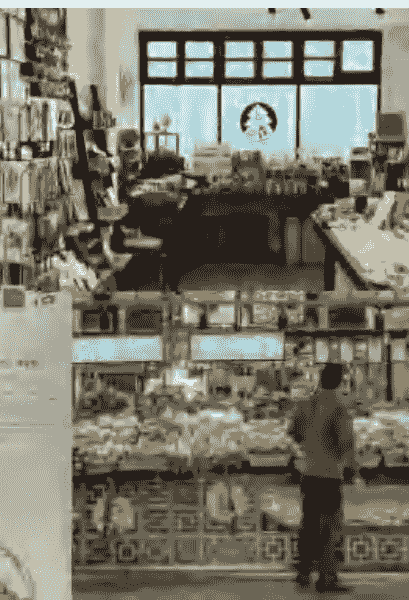
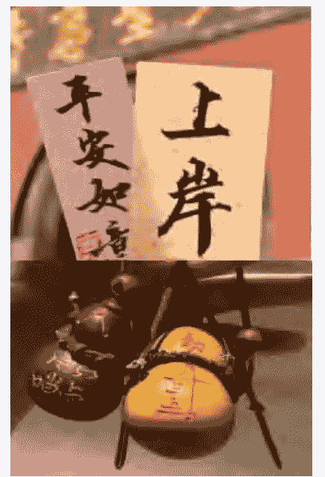
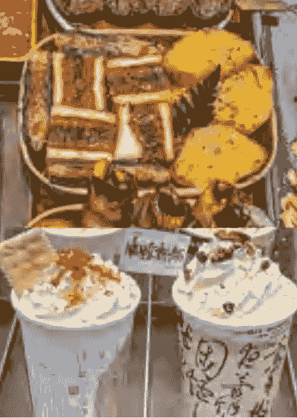
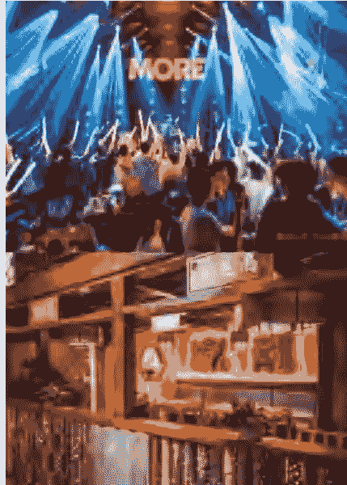

## 对标案例
Benchmarking cases

### 鸿寿坊：精致而具体的“烟火气”

地处上海普陀区长寿路商圈、始建于1933年，鸿寿坊内曾经是沪西西部著名的商业街，也是老上海人熟悉的“大自鸣钟菜场”。如今是一处小巧玲珑的商业天地，仅有1.5万方的规模，作为城市内有机更新项目，项目以精致的“烟火气”为定位，保留了石库门建筑和街巷肌理，打造娱乐、生活、休闲一体的“新天地”。

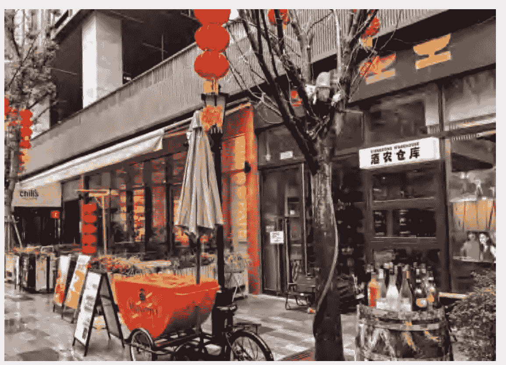
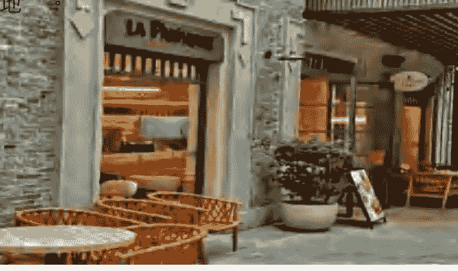

## 对标案例

### 单一不唯一，专注美食赛道

老字号、品质网红与口碑集合，生鲜、园艺丰富多元场景。项目招商时，以满足周边居民的日常生活需求为出发点，注重引入特色、有质量、有创意的品牌。项目鼓励品牌在内部开放广场和弄堂外接座位，为消费者提供多样的消费场景和体验，营造亲切舒适、活力的氛围。

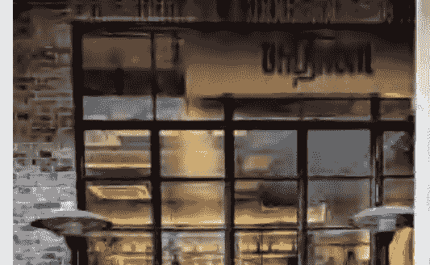
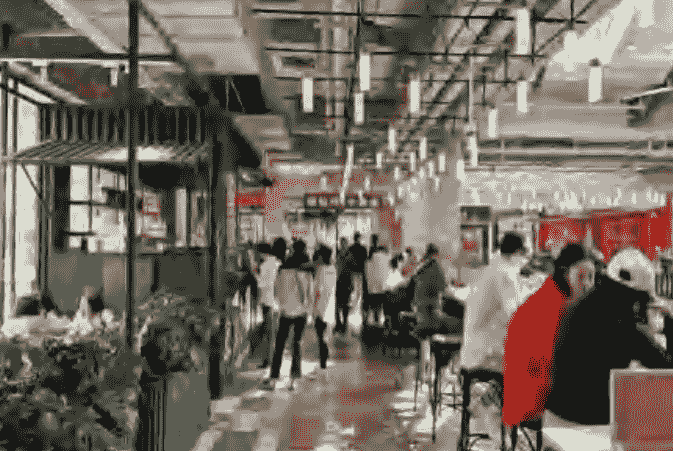
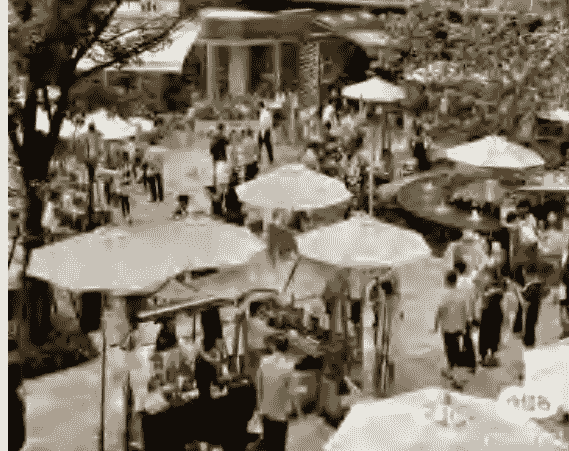

Benchmarking cases

## 对标案例

### 主理品牌魅力

Benchmarking cases

Gentle Maker Cafe & Bar 是一家主打咖啡夜酒的新式创意店铺，装修风格简约而时尚，充满北欧风的优雅。向顾客提供精品手冲咖啡、创意特调饮和小食。店内设有一个隐秘的活动空间，可用于现场策划服务、活动和展览。轻松随意的氛围，让人在繁忙的商业街中放松身心，尽享的空间。

酒农仓库是集酒类零售、酒吧、酒文化体验于一体的品牌，旨在为消费者提供高质量的酒类产品和服务。酒农仓库在鸿寿坊开了首家旗舰店，拥有近千种酒类，包括葡萄酒、白酒、啤酒、威士忌等。店内还设有酒吧区、品鉴区、教育区等多个功能区域，定期举办各类酒类活动和课程，为消费者提供专业的酒类知识和体验。

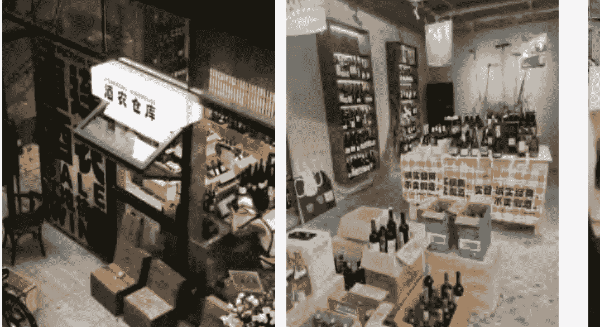
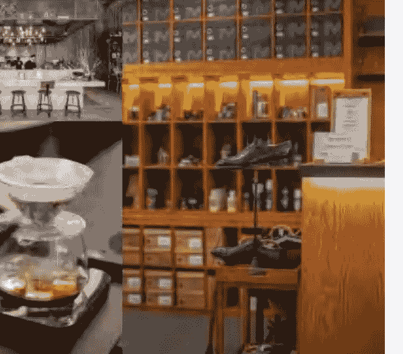

## 对标案例

### A Park：松弛感的非标商业

Benchmarking cases

从电子厂改造来的“松弛感”非标商业，为快节奏的客户提供一方喘息之地。A Park的首层业态集中在创新性的茶饮、咖啡和酒吧，以及潮流生活方式店铺如小众Bistro、春茶、面包、街头咖啡等。

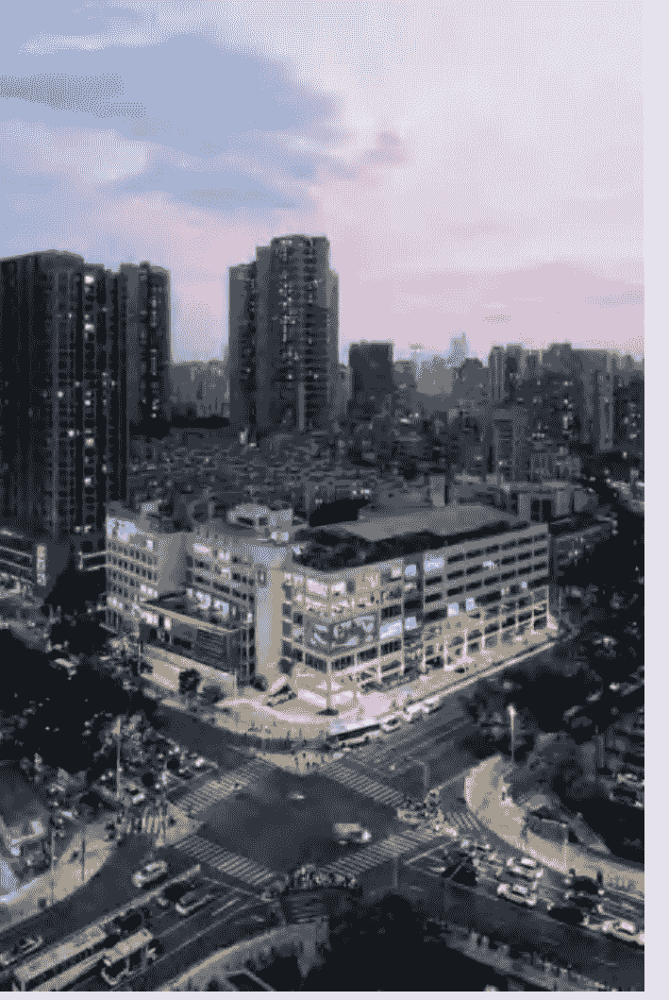

## 对标案例

### REGULAR源野：成都文化地标

Benchmarking cases

REGULAR源野位于成都中央公园下，包含一个沉浸式户外花园和多个公共空间，聚集了优质生活方式品牌。作为城市更新的先行者，项目位具有城市影响力的文化地标。

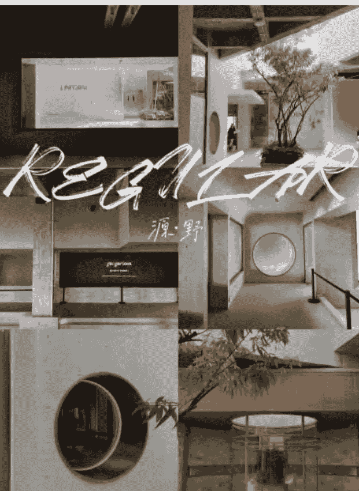
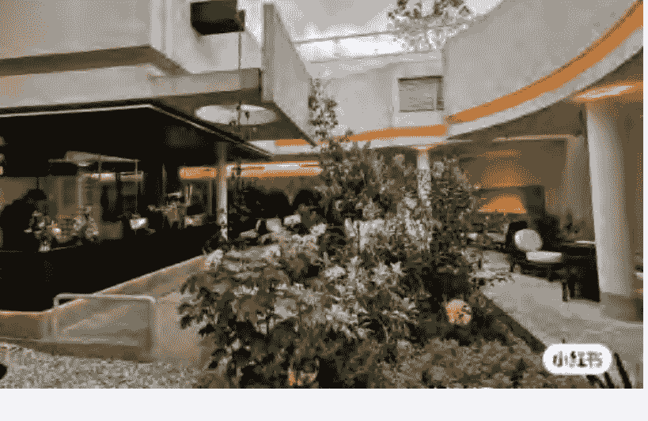

# 反观自身

### 51区突破市场竞争力的多元业态规划

- 日茶酒、Livehouse
- 树屋民宿
- 俄罗斯风情商业
- 霓虹夜市、精彩瞬间

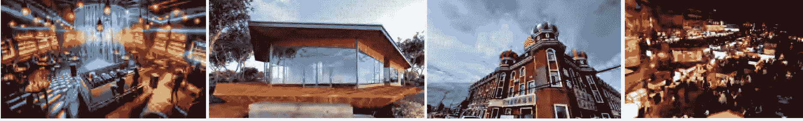

# 用一个词来形容51区你会想到什么？

# 策略阐述

Benchmarking cases

- 颠覆传统模式
- 激发新兴市场
- 引领潮流趋势
- 推动行业变革

51区为城市商业注入突破性思维，打破传统模式和界限，以前未见。

# 策略阐述

Benchmarking cases

- 树屋民宿——城市商业带来自然和独特的住宿。
- 俄罗斯风情商业——城市商业带来异国文化和独特体验。
- 酒吧——城市商业带来创意和社交的新方式。
- 霓虹夜市——城市商业带来丰富多元化的生活。

## 鸿寿·51区将构建以社交和互动、人与人、人与城市为核心的创新体，推动整个环境的发展和进步。

# 项目定位

Project positioning

不仅有Young和Old的选择，“年轻”也从来指年龄，而是属于我们的New Age时代。

## NEW AGE社交生活地标

城市落的青年潮流生活中心，更是鸿寿坊的开篇之作。

## 项目定位-备选

Project positioning

## NEW AGE城市转角

城市转角：这一表达象征着51位于城市的交汇点，不仅提升了地理重要性，也暗示它是一个发现新事的地方。每一个“转角”都可能带来新的惊喜和体验，强化了项目作为城市生活新地标的角色。

聚集：“不仅是一个商业空间，更是一个生活方式的集结。它提供了多功能的空间设计，适合各类社交活动和公共互动，打造了一个既满足活力又具有社区环境，鼓励人们在这里分享生活、交流思想，形成独特的社交网络。

# 项目口号

Project positioning

## 吃喝玩乐购住精彩尽51区
备选：掀起面向未来的潮流Shopping，像逛公园一样城市理想生活的叙事

# VI视觉识别系统

VISUAL IDENTIFICATION SYSTEM

BCC 佰策创意
品牌策划/空间设计/私宅营造

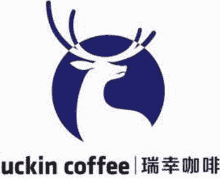

案例参考：根据参考，我们可以看出所有大牌logo都具备一个，那就是简单、简洁、干净，让人一眼就记住

## 酒
- 夜市、酒吧、经济

## 女性
- 客群、时尚、潮流

## 俄罗斯拼图
- 俄罗斯风情商业

科技/未来
商业/艺术
绿色/生态
大众/包容
众创/简约

# 城市灵感首发站

左右组合
上下组合

## 设计概念

英国殿堂级艺术家 Michael Craig-Martin 将人们熟悉的日常物品通过色彩和绘画转换，用自己的独特视觉和艺术的光去去理解，创作特点鲜明、色彩强烈的作品，令人过目难忘。

灵感来源于观念艺术家——迈克尔·克莱格·马丁成名作《一棵橡树》：“1973年，用玻璃、水、架子、印刷文本来表达杯水为什么是一棵橡树”。

迈克尔·克莱格·马丁的想法是：
> 让一个东西变成另一个东西，但是不改变它。（如艺术家杜向的泉）

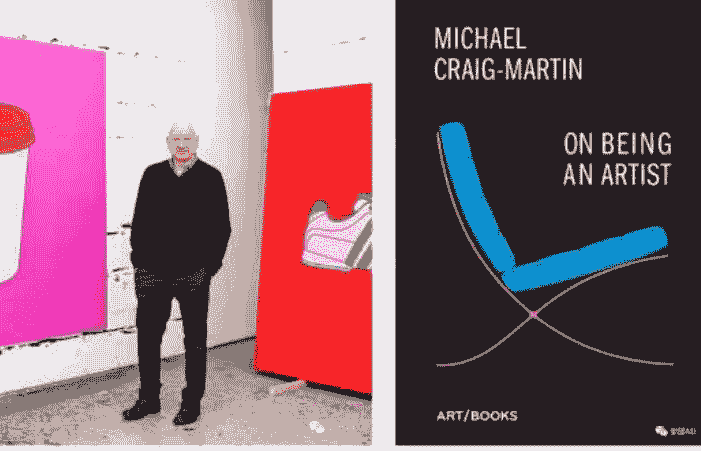

## 字体基因

斯韦斯字体设计延续了当代艺术设计的目的是为了遵循客观的法则，使理性的思想上的自我表达。

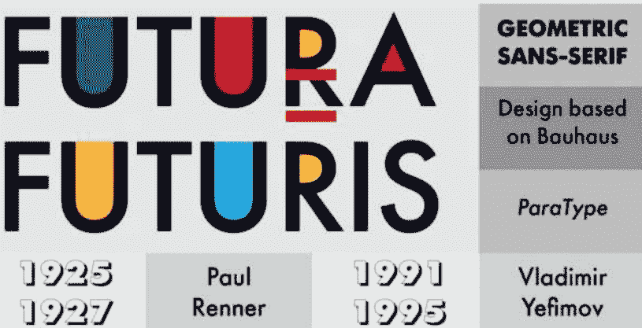
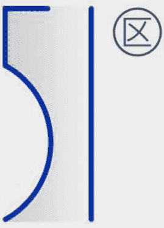

# 城市灵感首发站

INSPIRATION

logo+组合形式

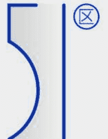

## 色彩选用

COLOR DESIGN

在斑驳的建筑群中出现单一的色彩，象征着天空和海洋的感受。国际克莱因蓝（International Klein Blue）是法国艺术家伊夫·克莱因（Yves Klein）获得专利的色彩。1960年他在米兰展出了八幅同样大小、涂满近似青色的颜料，从此，这种色彩被正式命名为“国际克莱因”（International Klein Blue）。

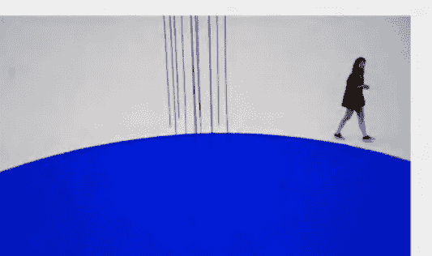
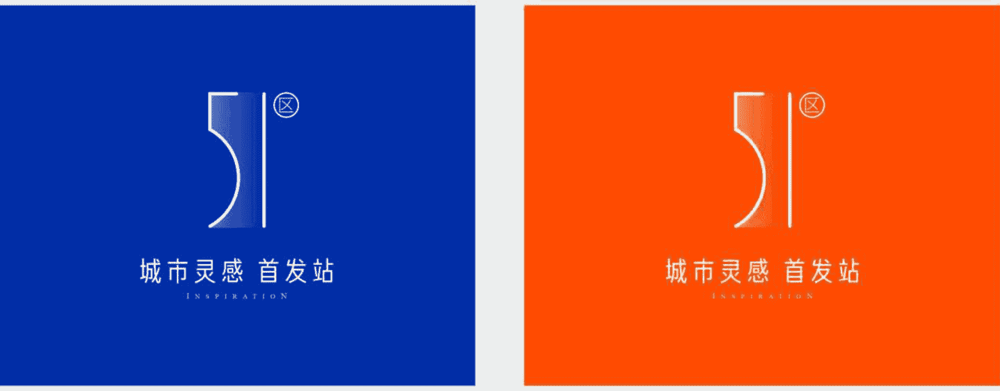

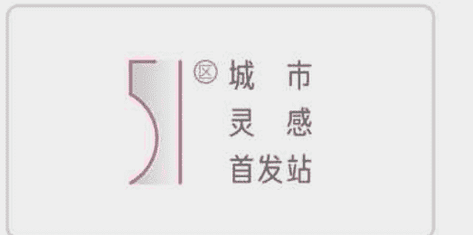
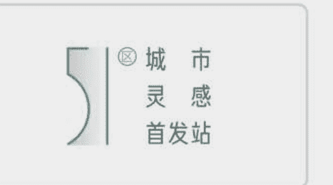
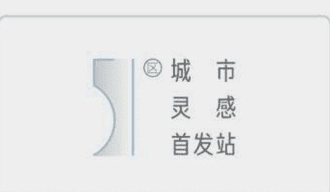
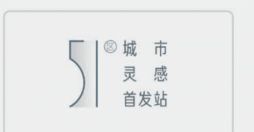
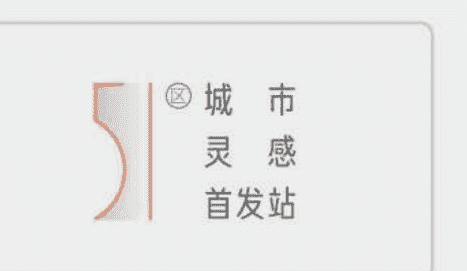
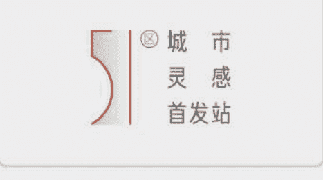
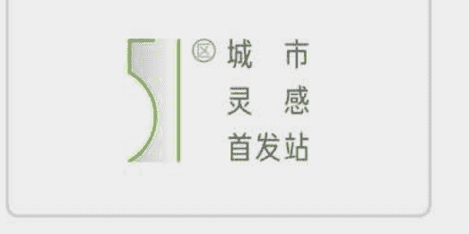
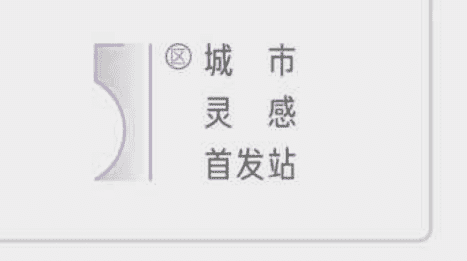

# 城市灵感首发站

禁止使用 < 2cm
使用极限 2.5cm
无限放大

取标志宽度的1/10，围绕标志形成安全范围，标志延伸出的组合形式均以此比例来执行。

## 思源系列、俊黑系列

## 企业专用中文字体示例：
- 粗黑
- 中黑
- 肃黑
- 细黑

英文字体体系：
- AVENIR 65 ABCDEFGHIJKLMN
- AVENIR 45 ABCDEF-GHIJKLMN
- AVENIR 中 ABCDEFGHIJKLMN
- AVENIR 55 ABCDEFGHIJKLMN
- AVENIR 35 ABCDEF-GHIJKLMN
- AVENIR 加 ABCDEFGHIJKLMN

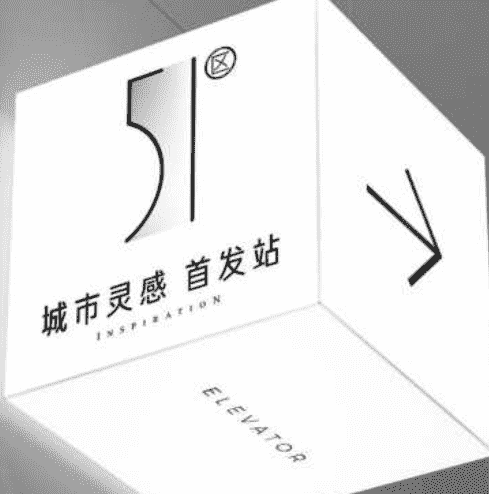

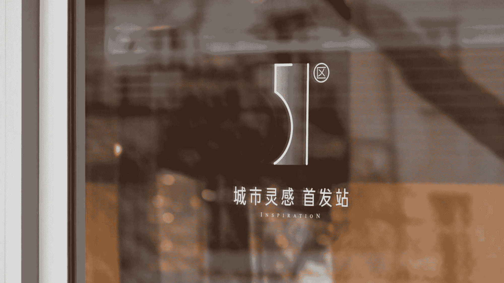

## 感谢观看

THANKS
FOR
WATCHING

BCC 佰策创意
品牌策划/空间设计/私宅营造
