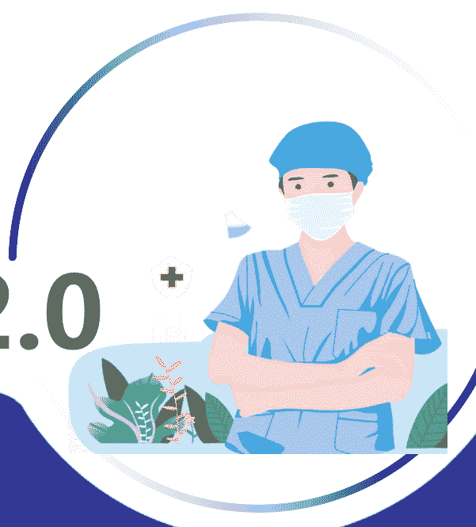
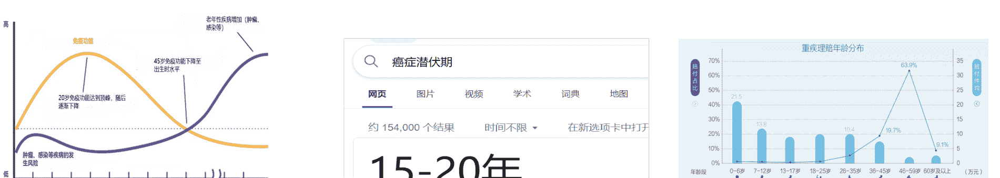
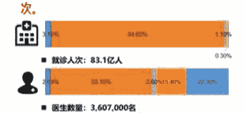
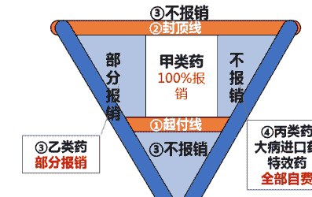
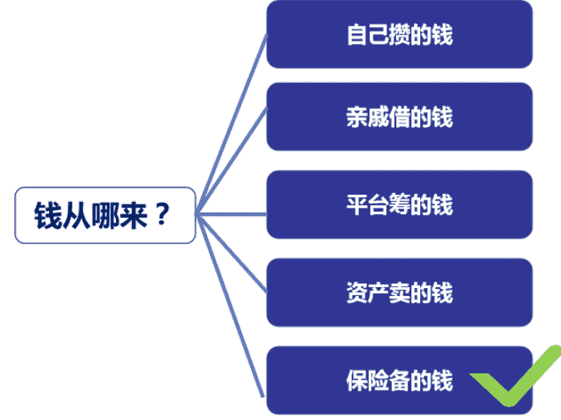
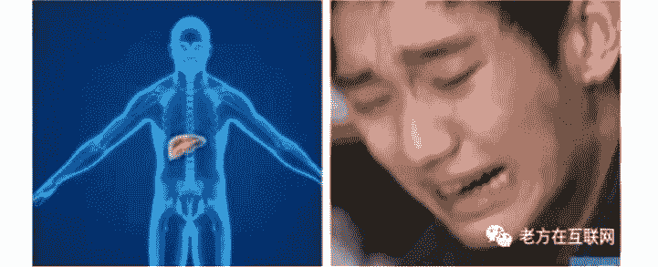
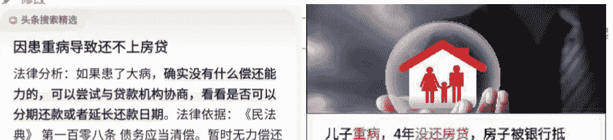
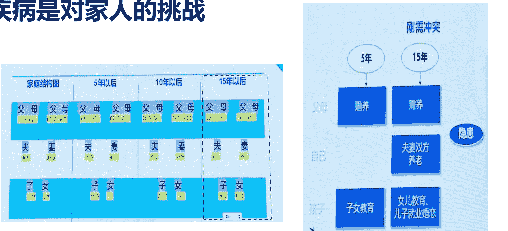
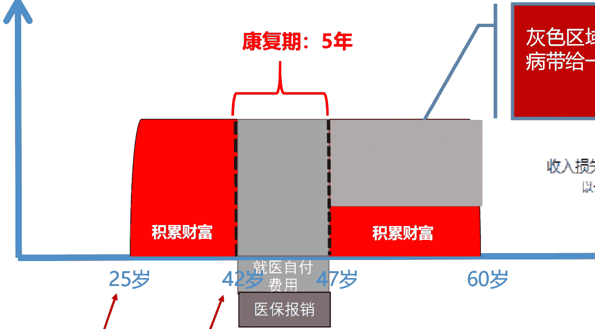

# 防诊疗一体化 终生无忧
重疾险销售新时代2.0

## 扫码加入 知识星球TOP 免费资源群

免费

公众号：知识星球TOP

- 每日免费获取高价值资源
- 可提供各类资源搜索服务

价值及时

微信号：jntsg8

| 热门付费文章 | 各行各业报告 |
| :--- | :--- |
| 精选图书资源 | 副业赚钱方法 |
| 职场实用资源 | AI及自媒体 |

及时专注

微信号：jntsg2

分享资料仅供个人学习，请及时删除，切勿商用传播

# 你觉得健康重要吗?

知乎上有一个热门问题：

从哪一刻，你开始觉得健康是最重要的？

置顶的回答只有短短的一句话：

躺在病床上的时候。

## 发病急-疾病突发，措手不及
## 重症一起来
## 潜伏期长，突然发现已经是晚期
## 年轻人重症风险不容忽视

## 15-20年

- 免疫力随年龄增加而降低，发生重症概率高

重症一起来，而且来得快，来得早，预防尤为重要

## 看病难
## 医疗资源紧张

挂号次数多次 84亿人次，相当于全国平均6次

## 优质医疗资源稀缺
其中三甲医院很少，导致就诊压力大

- 国内优质医疗资源主要集中于三甲医院，占比仅0.3%的三甲医院承担了72.3%的就诊人次。

- 就诊人次：83.1万人
- 医生人数：3,607,000名

数据来源：卫生部《2022中国卫生健康统计鉴》

## 重症就诊困难

> “排队3小时，问诊5分钟，专家排半年，重症等不起”

## 大医排队队长

上海公立三甲医院患者平均就诊等待时间为177.2分钟

## 就诊等待时间漫长

数据来源：上海某大医院，成都整理

| 手术 | 等待时间 |
| :--- | :--- |
| 胃肠镜 | 半年以上 |
| 关节置换 | 半年以上 |
| 血管手术 | 半年以上 |
| 乳腺癌手术 | 1年以上 |

- 医占比3.4万次（公立1.2万次）
- 平均25万人一次医院
- 医生440万
- 平均1909万次一个医生
- 医疗床位766万
- 平均32人合一张床

中国医学学会显示，中国的总诊疗的占比在30%左右，三甲医院就诊效率在10-20%左右，而门诊许多社区医院的就诊率在50%以下。

全国名前二医院，华西大学华西医院每天接待的患者最多可达6000人，部分手术等待半年以上。

## 看病贵
## 医疗费用高
## 医疗通胀快
## 费用缺规划

中国医疗通胀率为10%，医疗成本通胀一倍仅需7.2年。

医药指数通胀速度达128倍，代表更新需要抢救药品供应体系

- 重症治疗费用一般8-80万
- 重症治疗费用每疗程27.8万
- CAR-T治疗总费用超200万

□ 商业医疗保险支出占比低，医疗费用缺少合理规划
□ 导致保障保而不包，技术先进、费用越高

## 院后康复的重要性

重大疾病，三分治，七分养，治而不养，等于自盲！
挺不过5年，是绝症；挺过5年，是慢性病。

梗症治疗后五年内不复发，再复发率降至10%；
脑卒中发病后的半年，是肢体功能恢复的“黄金期”，之后还需要长时间康复治疗。

脑卒中患者康复功能改善：
未接受康复治疗的改善率：22.6%； 接受康复治疗后的改善率：53.9%

一个做过心脏支架的人，如果不注重保养，最短半年内就会发展为心脏搭桥手术

一个肾病患者，如果劳累、重活，肌酐指标达到700左右，就会开始长达十年的透析。

| 慢性肾衰竭 | 血液透析治疗 |
| :--- | :--- |
| 友好患者身体指标 | 每周3次血液透析 |
| 跟踪状况 | 血压、促红生成、活性维生素D等药物 |
| 绝大多数患者有较好的质量 | 但几乎继续工作 |

## 营养 (1/2)

康复的基础是休养

| 错过康复期 | 癌症再发 |
| :--- | :--- |
| 姚某，中国H某  | |
| 2011年5月，因乳腺癌进行左侧切除手术，手术成功。化疗结束后，她恢复得非常好。不久后重新踏上了岗位。 |
| 安排时间，甚至去医院检查。2014年6月，却发现癌症扩散到了全身，半年离开了人间。 |
| 按照姚某最初的治疗情况，癌症复发的概率不到10%。由于过度疲劳导致她未能挽回生命。 |

重症三分治，七分养。治而不养，等于自治！
数据来源：《疾病》，数据来源：国家卫委、中国发展基金

## 营养 (2/2)

康复的基础是休养

| 错过康复期 | 癌症再发 |
| :--- | :--- |
| 蔡某，《你的眼睛》 | |
| 2000年蔡某被查出胸部乳肿，怀疑是乳腺癌，立即住院进行了切除。术后医生提醒她一定要好好养。蔡某遵循医嘱，在自己事业辉煌的时候退出，好好修养，定期进行检查，让她走出了威胁。2004年，没有了癌症困扰，因此迎来了死亡。 |
| 其实蔡某最早的治疗情况并不乐观。但因为她遵循医嘱，五年康复期间顺利度过了危险时期，仍保持活跃。 |

专业治疗=五年生存率有效
数据来源：《疾病》，数据来源：国家卫、中国发展基金

## 重病不仅仅是治疗

重病不仅仅是治疗，可能没有意识到冰山下的损失

- 显性支出
- 药品费
- 住院费
- 手术费
- 器械费部分报销

- 不能报销
- 隐性支出
- 护理费
- 康复治疗费
- 定期复查费
- 康复营养费

- 收入损失
- 家庭日常开支
- 房贷车贷- 子女教育
- 父母养老
- 个人养老
- 品质生活完全自付

## 疾病会造成收入中断，但是房贷、生活压力不会中断

我们是“保险”，肩负房贷、车贷子女教育、赡养父母维持家庭生活

疾病意外、富裕、小康、一般保险

## 一场疾病对收入的影响

寒心！工作24年身患重病，两万多工资降至千多块

为公司拼命24年高管查出肝癌降至每月1200元尤先生是厦门一家公司的高管，已经工作24年。2015年的一次体检后确诊为肝癌，月薪从2万至1200元。公司回应，医疗期间对其工资的厦门市规定处理的，完全符合法律要求的。律师表示，这是相互损害职工权益。（杭州日报）

36岁华为高管魏延，癌症5年不幸离世，临终剩下4岁儿子

2013年6月6日，一位骨瘦如柴的华为高管正在病房中等待HR的续签合同。当他打开信封后，这位在华为拼了6年的计算机精英却看到一张终止合同。透明细胞肉瘤，这位高管内心极其复杂，脑海一片空空。他没等到一年前HR的承诺兑现，心情难免失落，但依旧保持乐观。尽管透明细胞癌致死率高达80%，这位高管还是意志坚定地与魔顽强斗争。2016年8月，在癌症搏斗5年后，最终撒手寰人，独自留下伶仃的妻子。

## 显性支出部分销，隐性支出完全自付

生病住院了，房子是医院的；还不起房贷，房子是银行的；买了保险，房子才是自己的：

## 女孩4年攒40万房，却患上乳腺癌

- 癌症
- 患症
- 个人信息咨询
- 修改

老公得了癌症，应该是卖房继续治疗还是把房子留给儿子？帮朋友。朋友：老公得了癌症，托人问了专家，基本上没有什么治愈的希望了，最多几年呢。情况严重没有告诉老公。我和公婆要不要继续治疗，但是家里没有钱，要把自己的房子和公婆的房子卖了，还要我父母出四五万。我是应该卖房养老还是给儿子留房子？

《南方都市》报道了：女孩4年攒40万房，却患上乳腺癌。这说起一个女孩在深圳拼了4年，终于攒了40万一套房子，没想到身体有些舒服，检查后确诊了乳腺癌。为了治疗只能把房子了。

## 疾病是对人性的挑战

重症费用需要覆盖至少5-10年

## 病假（医疗期）最长能多久？

## 病假期间工资怎么发？

## 可以长期休假吗？

此外，根据《中华人民共和国劳动法》若干意见，第39条规定：职工患疾病或非工伤，需要停止工作，根据实际工作年限和单位工作年限，给予三个月到十二个月。
- （一）实际工作年限十以下的，单位工作年限为三个月；五以上的六个月。
- （二）实际工作年限十以上的，单位工作年限为六个月；五以上的十二个月。

## 疾病是对身体的挑战

癌症

医学上认为一种恶性肿瘤经过治疗后，可能会复发于不同的部位。转移和复发是常见的现象，因此认为癌症是慢性病。心脑血管包括出血或梗死，容易引起组织损伤，引发功能受损。即使过后会导致严重后遗，则需要一段时间的康复。如果心脑血管的情况比较严重，已经产生脑梗死，复发可能会延长，通常复发在三个月后。言语不利、行动不利，会影响日常生活。心脑血管患者应该积极进行康复训练并保持训练，有助于早日回归日常生活。

| 治疗周期 | 首次治疗 | 维持治疗 | 治疗空窗 | 复发治疗 |
| :--- | :--- | :--- | :--- | :--- |
| 从手术后 | 首次治疗后3年内 | 以往维持 | 不接受任何治疗，半年到3年（观察期） | 发现复发后，再次治疗后3年内，再次复查 |

- 进行预防复发的康复训练，提高许多并防止疾病进展。
- 针对肢体功能训练，可能改善患者范围。通过训练使日常生活在合理的范围内进行。如果患者病情较重，重点是恢复肢体的活动功能。
- 对有工作力的，让患者康复，通过康复训练，他们可能回到社会。
- 视需要使用的辅助器具（如手杖、拐器、轮椅、座椅）以增强活动能力。
- 如果可能，对家庭和居住的小环境进行必要的改进。

首席主任医生：张立任
三亚医学大学附属第二医院 外科
- 典型病程

## 疾病是对家人的挑战

准备单不是金额问题，更是时间问题，所以必须从现在开始准备，趁自己有能力的时候一定会发生的费用，现在以合约的方式确定下来，让自己足够的、稳定的现金流，无论发生何种外部风险，我们都可以按时领取一笔安全、稳定的现金。让未来生活更有品质。

## 财富人生图

# 重疾保障一定要足额

> “我过去买过重疾险”，“那时买一点意思”

康复期：5年

灰色区域都是一场大病带给一个人的经济损失

收入损失=个人年收入*康复时长（至少5年）
以一般城市的工资准收入为例：
=5000元/月*12个月*5年=30万

累计财富：25岁、42岁（就医自付费用）、47岁、60岁
生命线：医保报销、开始就业

## 收入损失

失去一个人至少5年工作能力所带来的价值

我国大病发生的平均年龄在42岁左右

## 疾病是对身体的挑战

心脑血管复发期存在差异，且时间与疾病类型、严重程度以及个体特征有关。心脑血管包括出血或梗死，容易引起组织损伤，引发功能受损。即使过后会导致严重后遗，则需要一段时间的康复。如果心脑血管的情况比较严重，已经产生脑梗死，复发可能会延长，通常复发在三个月后。言语不利、行动不利，会影响日常生活。心脑血管患者应该积极进行康复训练并保持训练，有助于早日回归日常生活。

## 癌症不是绝症，癌症是慢性病

- 医保范围内：甲类药100%支付
- 乙类药个人承担10%-30%
- 丙类药（如进口药）100%个人自费

# 重疾险销售新时代
