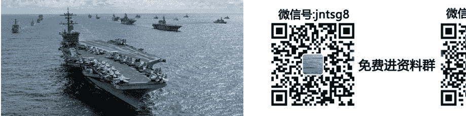
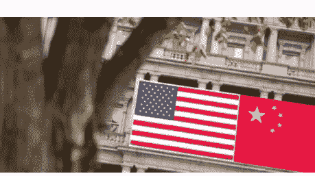
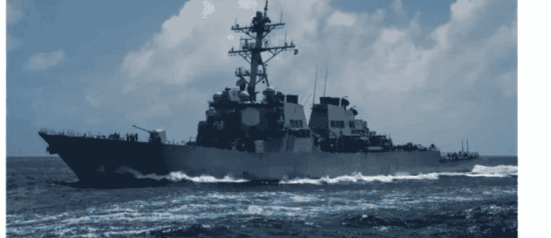
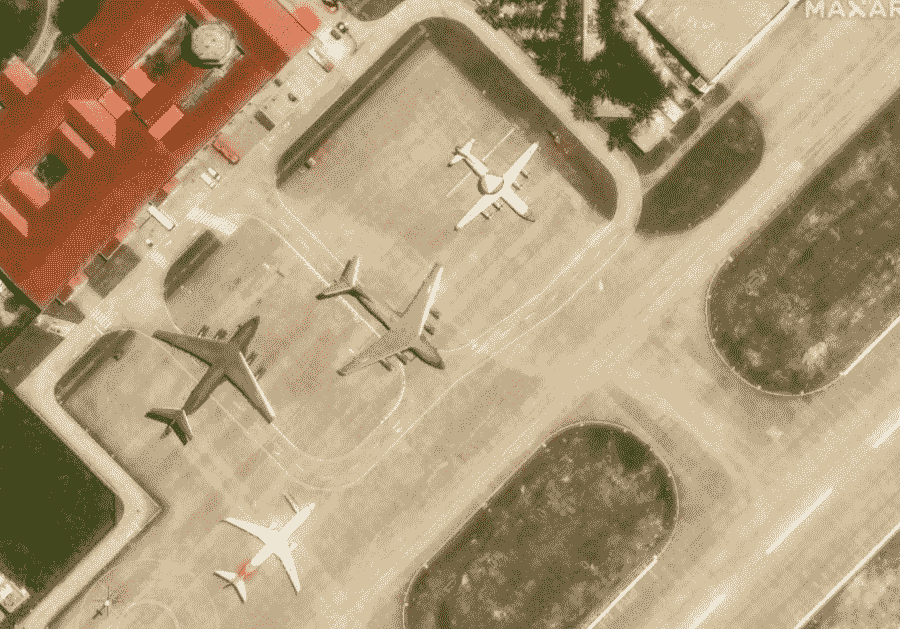
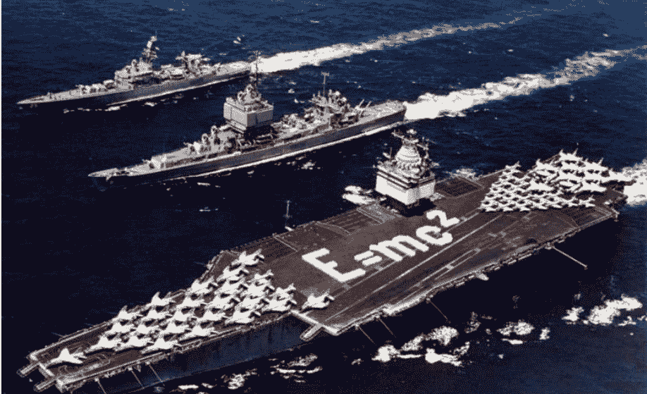
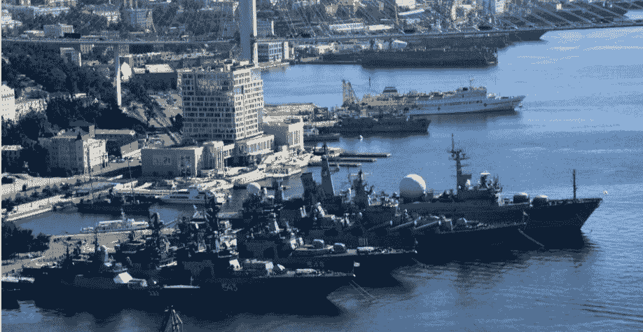
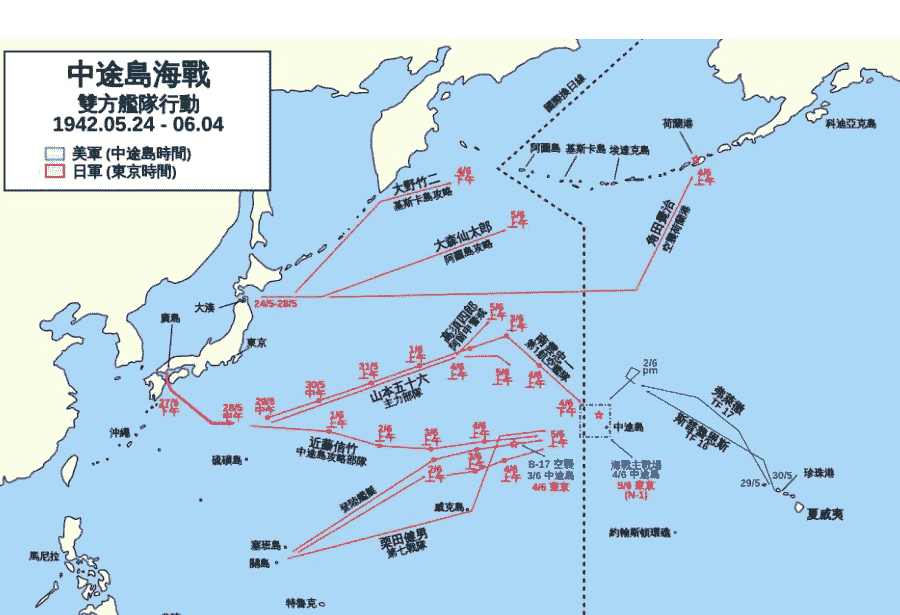
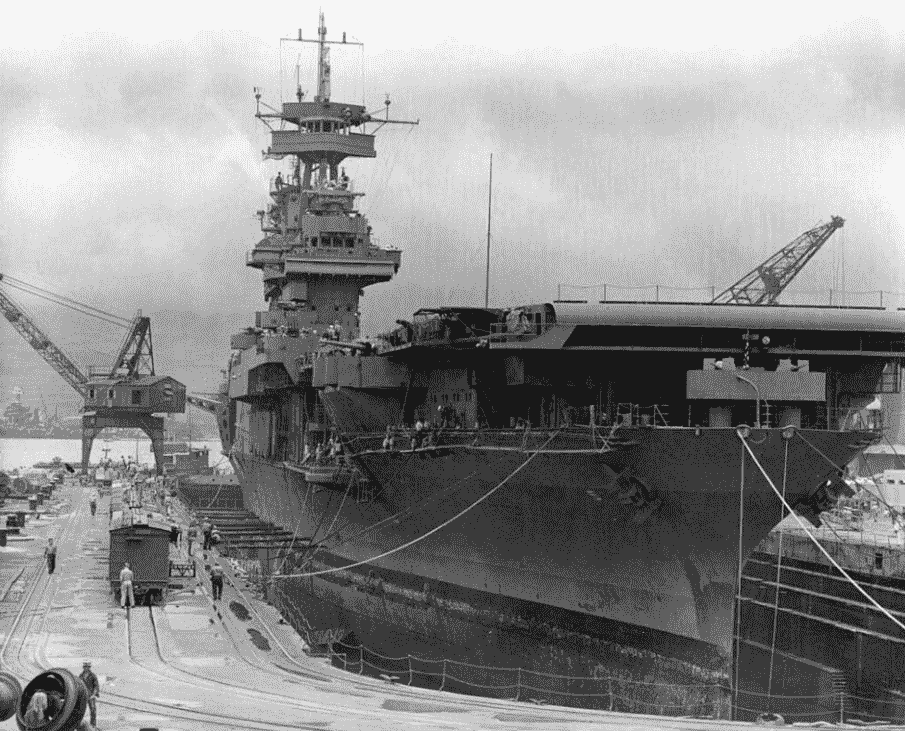
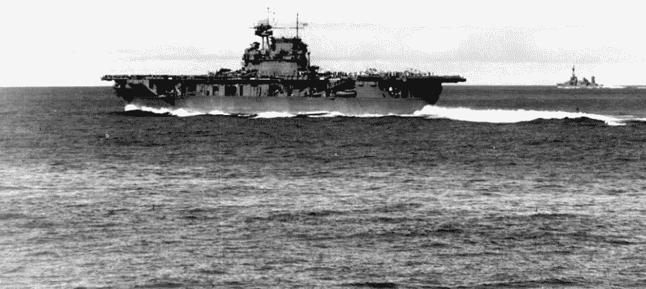
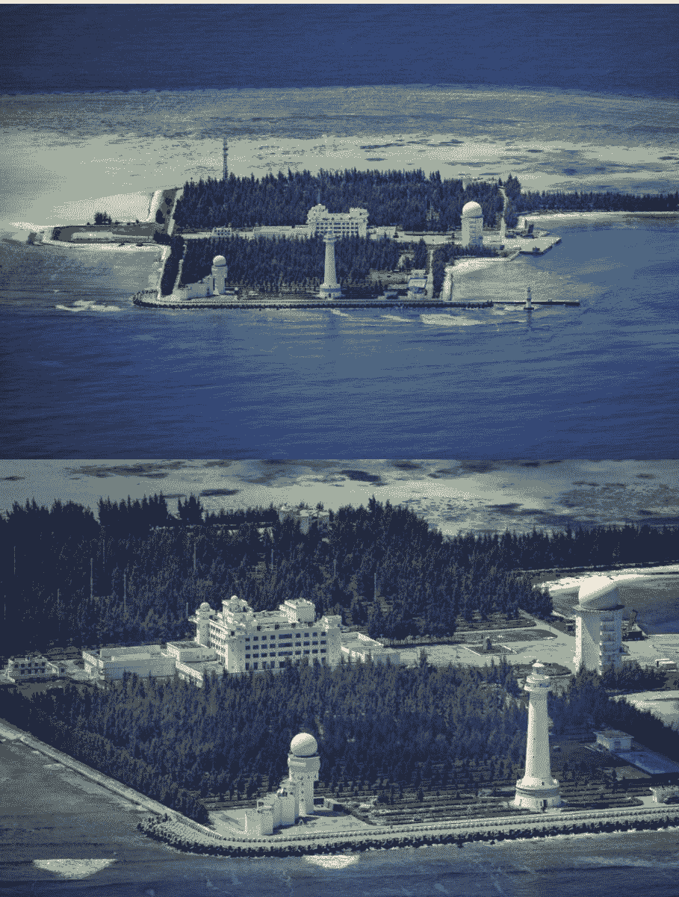

# 中海竞争的起点

西太平洋密罗尼西亚群岛、亚洲、中国大陆以北起俄罗斯堪恰加半岛，南至印尼和澳洲的广阔海域。

1942年中途海战以来，美国成为西太平洋乃至全球范围内的海洋霸已有七余多年。

美国霸权有若干支柱，其中最重要的无无可争议的海上霸权，它一方面可以依靠控制海洋来保障安全，另一方面也可以对国实施海上封锁。

马汉在《海权论》中有句名言：“那些在远处与狂浪泡沫搏斗的军舰，拿仑大军从未放在眼里，恰恰是它们逃避的法国来实现现实世界的美梦。”

美国人这种“以海制陆”的战略维信不疑。

环太平洋联合军演每两年在夏威附近海域举行，中国2014年、2016年曾获邀参加。

从回顾历史的视角出发，中西太平洋之始于2011年。

这一年奥巴马政府宣布将其外交和安全“再平衡”到亚太地区，中方认为此举旨在间接增加对中国周围的地缘政治压力，限制中国的战略空间，最终战略中国（以中国的地图的）。

殊不然，同年也发生黄中美对峙事件。

2013年起，中国在南海岛大规模扩筑海岛，此举引发了一系列外交、军事和法律领域的激烈交锋。

2014年4月，奥巴马与日本首相共同宣布《美日安保条约》第五条适用于东钓鱼岛，在随后的行程中，对菲律宾不断询问《美菲联防条约》是否适用于非属南海海岛，奥巴马再次回访菲律宾称是“铁打的承诺”（ironclad）。

自此之后，美国官方对对方相关提及，沿用奥巴马话术，刻意保持模糊。

2015年9月24日，中国国家元首对美国进行访问——这是迄今为止最后一次对美国的国家访问，期间发生了“准牌式”的对话。

当时恰逢新一轮造岛潮之之际，奥巴马对方表示严重关切，晚宴期间反复说希望中国放弃南海岛建设，但未获得任何承诺。

晚宴结束后，奥巴马随即部署太平洋司令司令，授权他们有机会在南海执行“军事行动”。

美方所谓的“军事行动”，即在中国制造的人工岛12海里内派遣军舰——《国际法》将中国沿海12海里定为禁航，美国就此此处展示不承认“人工”的政治状态。

自此之后，中美在南海的较量日益胶，驱逐与反逐、监控与反监控，几乎为家常便饭。

特朗普第一任期的最后一年，中美在南海频繁紧张，大选期间民主党甚至担心特朗普触发冲突，而最有可能的突袭即美菲军机攻击我南海海岛。

2020年7月17日，美军第七舰队“里号”航母战斗群和“尼米号”航母集群聚南海进行联合演练，宣称“维持最高警戒，能够通过火力应对任何紧急事务”。

不久，中国宣布南海部分海域为禁航区，分别发射一套DF-21导弹和一枚DF-26巡舰导弹。

### 双方释放相互抵抗的信号

为了给局势降温，任美军参谋长联席主席的米利在2020年10月30日和11月8日两次致电中国军方高层，并致电太平洋太平洋司令维森上将，要求其推迟即将举行的军事演习。

2018年9月30日，中美在南海发生了最险的一次对峙事件，两艘驱逐舰最近距离南沙永沙礁仅4米。

作为全球海洋国家，美国虽没有加入《联合国海洋公约》，其目的是避免那些国家过度控制南海周边水域。南海——特别是南沙群岛——是中国争夺的关键所在。

对中国来说，南海是三线：
- 东（至日本和北美）
- 南（至东南亚和澳洲）
- 西（至中东、非洲和欧洲）

南海不仅是航线的出口，还是东南亚战略的前哨地，对中国的经济和军事安全都具有重要意义。从南沙到海南是1850公里，永兴岛等主要岛屿到南海只有1000公里。

由于距离较近，南海大致在中国岸基军事力量的覆盖之内。通过在南沙布局一定数量的军事基地，就可以形成有效的海上控制网络。平时用于海上航行、资源开发和渔业等民事活动保障，战时则用来监控敌舰队，对马六甲一带执行战略威慑。

部署在西沙永兴岛的空警-5、运-20和轰-6K。轰-6K可以挂载发射高音速反舰导弹，对大型水面舰艇构成强烈威慑。

新加坡到永兴岛距离约1700公里，已进入轰-6、歼-20等战机的半径覆盖范围。美国对挑战其海域控制的行为是高度敏感。理论上，美国海军能够对任何沿海国家或岛屿实施海上封锁——对小国足以致命，对大国也能造成显著影响。以太平洋地区为例，一旦美军掌握制海权，“起手式”就是对对方进行海上封锁。二战末期，美国海军曾在日本本土周边及其内海实施大规模布雷，导致日本各港口与亚洲大陆的海运输中断，成为亚洲扶持其经济的最后稻草。越战期间，美军也对北越最重要的海防实施封锁，使其海外海上交通完全被切断。冷战期间，由于苏联太平洋无法直接封锁，美军利用日本列岛构建起封锁苏联的军事基地群，而苏联太平洋海军力败美国，只能依靠岸基力量对峙，因此不易远离远岸，沦为“日本海队”。

所有这些手段的前提，都是制海权。设想一下，一旦不再掌握海上优势，自然会对大陆沿岸国家（韩国、东南亚等）和第一岛链国家的影响力加速其崩溃。实际上，如果世界上没有海洋，或者美国没有在太平洋地区部署如此规模的兵力，今天这一区域不存在任何“博弈”的问题，所有沿海及岛屿国家都会被纳入中国的势力轨道。

反过来考虑，也是因为制海权产生了重大地缘政治影响，才使得美国无拱手让人可能。

1964年，“企业号”航母载核动力巡洋舰长堤号”（CGN-9）与“班布瑞奇号”（DLGN-25）编队，官兵在飞行甲板上派出爱因斯坦相对论的公式。

苏联解体后，俄太平洋舰队更加常见，俄专家对“与美日同盟爆发战争”进行推演：如果日本在南海群岛（北方岛）实施登陆作战，并最终终止爆发冲突，在战争爆发后2~3个昼后，太平洋舰队这一战略集群将不复存在。

回到中美之间的话题：

“权力平衡”论认为，当防御方投入X，进攻方投入Y，这一比率越大，平衡越有利于防御。具体到南海博弈，当中国通过造岛等方式后，美国做了哪些应对？
- 提高“自由航行”的频率；
- 增加航母战斗群在南海演练；
- 加强与菲律宾的盟友关系，重启部分军事基地。

我们将中国定义为防御方（X），在南海范围内攻防平衡（Y/X）显然有利于中国的。

| 太平洋舰队 兵力规模 | 占比 | 太平洋空军 兵力规模 |
| :--- | :--- | :--- | :--- |
| 航空母 | 4 | 36% | 战机/攻击机 | 259 |
| 导弹核 | 8 | 57% | 侦察预警机 | 13 |
| 巡航导弹 | 2 | 50% | 空中加油机 | 18 |
| 攻击型核 | 31 | 56% | 运输舰 | 30 |
| 运舰 | 12 | 55% | 总计 | 324 |
| 逐舰 | 38 | 55% | 海军战队 兵力 |
| 南海母 | 12 | 63% | 太平洋战斗力 | 8.6 万 |
| 两艘登陆舰 | 18 | 56% | 航空舰数量 | 640 |
| 指挥舰 | 1 | 50% | | |
| 反水舰 | 17 | 64% | | |
| 总计 | 143 | 56% | | |

> 资料来源：本文整合Global Firepower，“Asian-Pacific Military Strength 2021”,GFP, March 3, 2021, https://www.globalfirepower.com/countries-listing-asia-pacific；中国南海研究院，《美国在亚太地区的军力报告（2020）》，页20-21。

站在美国角度，将海军舰队开到南海与中国在同一区域打一场海战是非常明智的选择。以中岛距离作为例，美日海军交战的地点位于太平洋边缘，相对于来说有利于美方——中岛距离2100公里，距离日本本土高达4500公里。而无论台海还是南海，中国都是主场作战，岸基反舰导弹和战斗能够在2000公里以内的区域发挥巨大作用。为了防御中国的技术，美国需要要把防空系统装备在紧靠的舰艇上，代价极高，难度也越来越，反而影响其进攻能力。对于中国来说，如果承受某些本土高价值目标的损失，只需要沉没美军主力舰艇，从战略角度来看是值得的。由于大型航艇极其复杂，从建造到服役还需要多年时间，很难在短期将“火线”推到前线。更何况此时，以美国目前的装备能力还能重新打一套“太平洋舰队”（遥远岸，当下下手这里就是金的苦徒）。一步步讲，即使从战略存在的角度衡量，中国方在南海建立的永久性军事设施，美军将以高频穿越作为回应，后者的成本与可持续性均值得怀疑。

1942年6月的中岛海战是美国固守太平洋的关键一战，此役日本海军在远远日本本土数千公里处与美军交战，最终惨败。

1942年5月28日，“约克城号”航母正在珍珠港的干船内停修，准备立刻出发参与中途岛海战。与日军相比，珍珠港是美国重要的前进及补给基地。

中途岛海战期间航速航行的“企业号”航母，正准备派出轰炸机队。二战期间美军主力航母排水约在2.5万吨左右。

美军“大黄蜂”航母起飞的战斗机中，有15架战斗机，找到日军航母后拼死击落，只有一人还生。二战历史高度自豪，情感上认为太平洋权是是用命换来的结果。

文章最后谈南海和台海的不同：为实现统一，台海方向有着明显的倾向；与之相比，南海确实是一种“战术攻、战略守”。实际上，中国在占绝对优势的情况下并未将其他诸岛主权让出去，而是通过小规模避免登陆态势。由于多次遭遇来自海上的攻击（太平洋战争、第二次太平洋侵华等），中国希望提高警备能力，建立缓冲区。这种恐惧，历史上遭遇拿破仑、希特勒等德国在东欧建立“缓冲带”。设想一下，如果苏联没有没有波兰东部、乌克兰等土地作为战略纵深，那么可能已经在希特勒的“闪电战”之中。

南沙岛上环绕的雷达设施。自1970年代以来，东亚一直没有发生过大规模军事冲突，和平红利下多数亚洲和东南亚国家实现了经济腾飞。考虑到之前的四十年里美国多次参与东亚战争，整个地区内战火不断，现今的和平可以说是不小的成就。从根本上讲，东亚和平得益中美两个国家的和谐共处。这种和谐局面是1970年代两国用外交引发的，并被此政府维护巩固。冰冻三尺，非一日之寒。战争不是一蹴而就的，会有迹象表明局势日益加剧——战争是政治性的，它的症状也是如此。现今无论中国还是美国，都有相当声音认为尼克松以来的对华政策已经过时，未来是一种以对抗为主、以合作为辅的关系。然而如果我们仔细析，不免发现，中美在全球利益层面并没有根本性一致，经济领域还存在相互影响。说一万道，中美最大的矛盾是在太平洋，其集中于“第一岛链”周围。此处的矛盾如何解决、用什么方式解决，是21世纪上半叶政治最大的未知数。

# 知识星球TOP

| 序号 | 公号/星球/社群 | 原价 | 领域 |
| :--- | :--- | :--- | :--- |
| 1 | 生态有木 | 2765/年 | 副业、搞钱 |
| 2 | 怂宗从吃群众 | 360/年 | 时政、历史 |
| 3 | 咸茶财经 | 365/年 | 成长、搞钱 |
| 4 | 欧洲靴 | 328/年 | 时政、历史 |
| 5 | 卢克文会 | 699/年 | 、社会 |
| 6 | 体制内主任 | 599/年 | 体制、职场 |
| 7 | 外人的视角 | 669/年 | 金融、成长 |
| 8 | 濑泽异谈 | 4166/年 | 、股票 |
| 9 | 守夜人 | 599/年 | 时政、经济 |
| 10 | 江宁知府 | 365/篇 | 时政、国际 |
| 11 | 顾子明 | 568/年 | 时政、经济 |
| 12 | 唐书院 | 1399/篇 | 金融、财富 |
| 13 | 大树乡谈 | 199/年 | 时政、成长 |
| 14 | 水库欧大 | 10000远 | 房产、经济 |
| 15 | 洪灏的宏观策略 | 4376/年 | 经济、搞钱 |
| 16 | 金政通/北海道山 | 4576/年 | 股票、行研 |
| 17 | 猫留的世界 | 299/年 | 时政、社会 |
| 18 | 飞沫 | 3600/年 | 股市、经济 |
| 19 | 米联储见闻 | 599/年 | 经济、金融 |
| 20 | 鉴茶财经院 | 330/年 | 房产、股票 |
| 21 | 赢在八小时之外 | 365元/年 | 成长、职业 |
