# AI如何真正帮企业赚钱？

从内部试验到商业落地，我们越过的坑与收获

分享人 肖钰 | 网易数据智副总经理

## 知识星球TOP 资源分享群

让更多人获取高价值信息

汇聚网付费资源

公众号：知识星球TOP

微信信号：jntsg8

添加微信免费进群

微信信号：jntsg2

- ◆付费文章，◆付费社群
- ◆付费课程，◆副业&搞钱
- ◆财经&股市，◆行业报告

时政·历史·职场·体制·自媒体
学习·军事·软件·影音·社会学

## PART 1

### 开篇：AI技术到底能帮企业做什么？

### 大模型技术演进时间轴

- **2023年基础年**：大模型普及。企业主主要用AI搭建知识库、润色文档等等。
- **2024年突破年**：Copilot、Agent应用。Copilot普及及智能体 (Agent) 尝试，大模型技术开始与业务深度结合。
- **2025年爆发年**：自主智能体、MCP。Deepseek爆火，自主智能体 (Manus) 问世，多智能体协作 (MCP) 发布。

### 四大支柱技术解读

| 技术 | 通俗解释 | 企业价值 | 应用示例 |
| --- | --- | --- | --- |
| Deepseek大模型 | 企业的知识、运算大脑 | 可私有部署、结合企业自身数据、知识、经验的大脑 | 企业知识库 |
| 智能体 (Agent) | 能感知、会干活、能跑的AI员工 | 直接产生业务价值的AI实体 | 各职员工的数字分身 |
| 自主智能体 | 领导交一代、会自己动脑找方法的AI员工 | 构建成本更低的智能体平台 | 以Manus、扣子代表的自主智能体平台、自主产出报告等 |
| MCP平台 | 跨平台、可协作的AI员工团队 | 降低重复开发、打破数据孤岛的协作中台 | 销售、市场数据打通支撑业务分析及决策 |

### 企业的AI焦虑

#### 老板
- 担心被竞争对手以AI方式彻底颠覆
- 媒体的宏大技术叙事如何落到自己的企业中

#### 管理层
- 缺乏可实际落地的经验，担心投入打水漂
- 缺少数字化基础、组织架构不支持变革

#### 一线员工
- AI恐症，担心会被彻底替代
- 没有形成AI使用习惯

## 从哪里找AI价值创造的方向？

- **业务创新：开拓新机会**
  - 新的游戏NPC互动方式
  - 提供AI导购服务

- **收入提升：精打细算增收入**
  - 千人千面的广告投放系统
  - 自主运营的私域系统

- **降本增效：替代人工、优化流程**
  - Agent智能客服
  - AI简简历筛选官

### 避免技术崇拜，锚定业务价值

认知误区对比：

| 技术崇拜模式 | 价值锚定模式 |
|---|---|
| 核心问题：“怎么用上大模型？” | “哪个环节浪费300万？” |
| 决策场景：IT部门讲解技术参数 | 业务主管展示问题清单 |
| 采购标准：算力/算法排名 | 单个问题解决成本 |
| 验收指标：准确率99% | 客服减少40% |

- AI视觉识别：全国范围内，超市高峰时段单店损耗金额超过2000元，传统超市高达五倍。

## PART 2：网易内部实战篇：我们怎么快速用起

### 电销实战第一枪

#### 业务痛点
- **质检效率黑洞**：人工抽检覆盖率不足10%，海量通话流失；传统规则只能识别不合格。
- **能力提升困境**：人工需2-3个月成长，缺乏实时话术指导。
- **运营困难**：话术迭代依赖主观经验，无法建立能力与业务结果关联。

#### 业务流程
| 查询适配内容 | 有效性判断 | 采集内容 | 客户留存 | 数据落实 |
| --- | --- | --- | --- | --- |

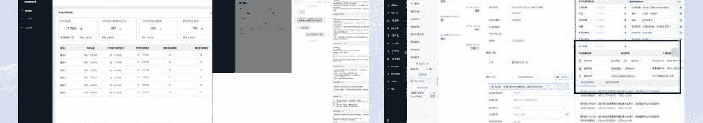

#### 产品实现
电销数据看板（个人主管）、电销实时赋能助手

### 开发工具选型思考
- Deepseek+前端+后端：周期太长，成本高。
- Coze+内置低代码：登录、权限、数据统计等开发方便。
- 开源Agent编排工具+前端+后端：基本满足需求，看看如何降低开发成本。
- 开源Agent编排工具+Dify（低代码）。

### Agent+Workflow到底怎么做？
业务逻辑用 Agent，用户界面和相关配套用 Workflow。

| 资源/数据集 | 工作流 | 用户界面 |
| --- | --- | --- |

### 做能看到效果的MVP需要几天？

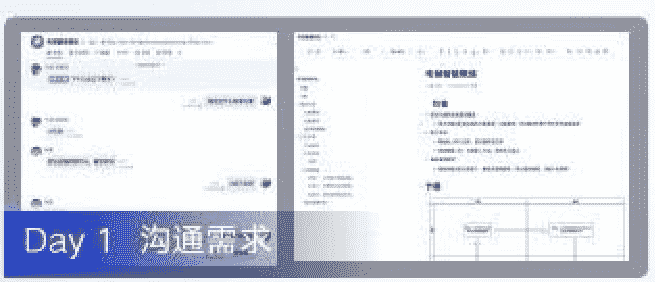
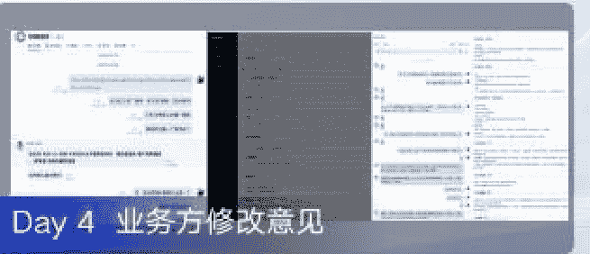

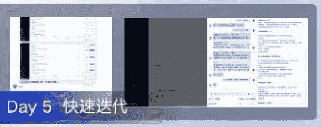
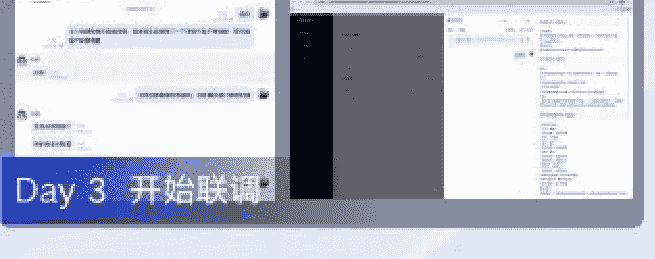

### 创意涌现：全员智能体应用大赛
- 激发创新动力，发现真实业务需求
- AI应用构建平台+效能绑定+奖金激励+开发教练支持
- 筛选出的优秀项目正式立项落地
- 经过评审和投票，筛选出最有实用价值的AI应用场景，正式扩展为AI企业应用

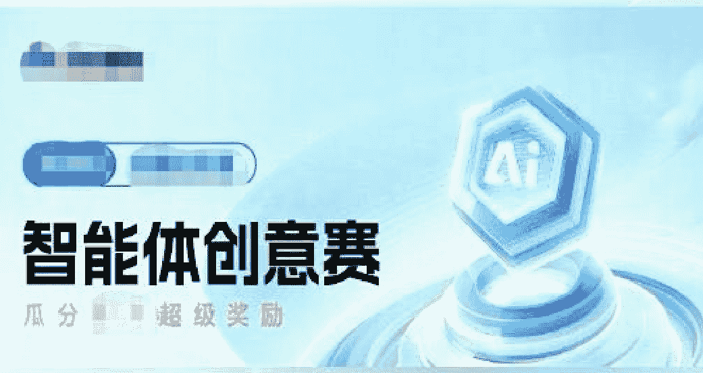
报名 -> 上架 -> 体验 -> 投票 -> 评审 -> 公示

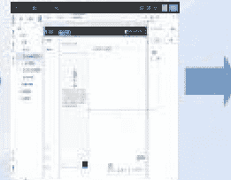
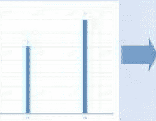

### 智能体大赛-全员AI最好器（网易内部）

| 售中/售后服务 | 互动导购 | 知识百科 |
| --- | --- | --- |
| 私域互动 | 私域个性推荐 | 智能训练 |
| 办公管理 | 智能会议助手 | 智能评测助手 |
| 效能提升 | 产品设计助手 | 智能内容审核 |
| 其它 | 社交助手 | 智能情感陪伴 |
| AI商城 | 智能应用 | 一次开发9天产生23个智能应用

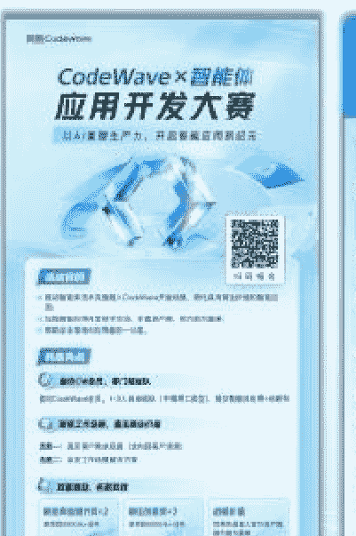

### 成果展示：竞品动态分析
通过收集竞品信息，对信息进行智能整理、归类，并提出策略。

### 应用场景：为了掌握竞品产品、营销策略、技术动态等关键信息，市场部通过人工方式收集信息，人力投入、分析滞后、效率低等问题。

### 痛点描述：
- 分类：产品动态、案例、活动、外部合作
- 重要度：战略级、常规级、资讯级

### 实现逻辑：
| 核心维度 | 核心信息 | 更新时间 | 策略调整 |
| --- | --- | --- | --- |
| 产品动态 | 发布了“安全屏”，新款S100 Ultra膜 | 2023年03月17 | 关注 |
| 营销策略 | 上线了新品促销活动，满购加送赠品 | 2023年03月18 | 关注 |
| 策略调整 | 针对竞品开展促销活动，不直接跟进 | 2023年03月11 | 关注 |
| 活动 | 五一期间举办五一活动，会员专属优惠 | 2023年03月22 | 关注 |
| 外部合作 | 引入了某某中小企业私域系统 | 2023年03月16 | 关注 |
| 外部合作 | 与XX平台达成战略合作，互换流量资源 | 2023年03月18 | 跟进 |
| 用户反馈 | 用户反馈APP某功能过于复杂，导致用户体验卡顿 | 2023年03月14 | 优化 |

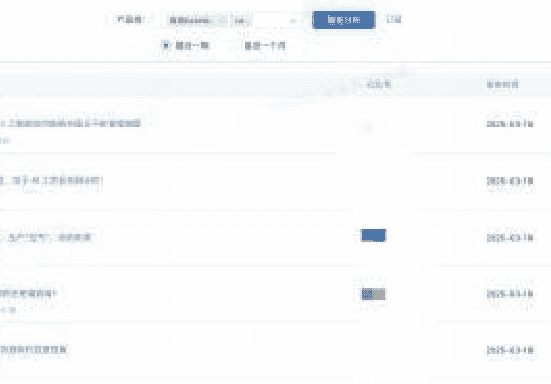

### 成果展示：效能提升
应用场景：适用于传统软件开发、敏捷开发等多种方法的需求拆分与工时估算。

痛点描述：精准的工作量评估一直是难的。传统的的工作量评估往往依赖于丰富的经验、产品/项目经理主观判断，或是使用简单的比例方法，导致结果经常与实际工作量偏差较大。

实现逻辑：通过输入项目需求清单，结合历史项目数据（包括需求清单、预估工作量及实际工作量），运用先进的算法推算本次项目对对应需求的工作量，为项目规划、资源分配和成本提供科学依据。

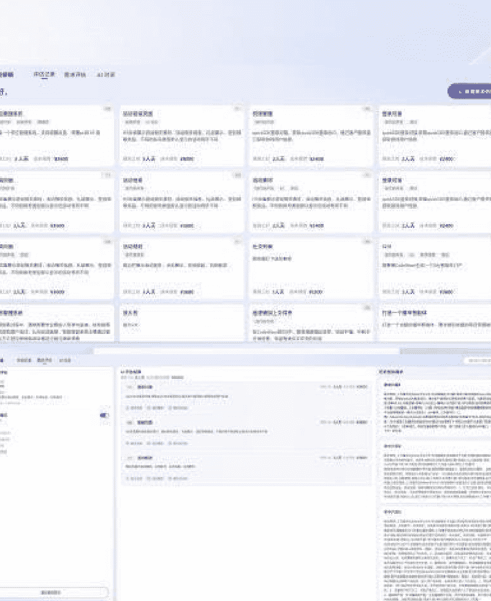

### 快速立项：企业智能化基建的新机会
01 智能体（Agent）编排工具
02 应用开发平台
03 企业级知识库

每个企业都需要一个“自己的”AI应用开发平台！

## 内部经验小结：践行“AI First”战略，杀死时间

### 萃取/固化优秀员工经验
1. 高仿人类的操作，细化成流程图。
2. 每一步看是否可以用AI替代。
3. 把整个流程编排Agent。
4. 过程中使用Deepseek、自主智能体进行提示、补充经验。
5. 快速上线、快速试错。

## PART 3：对外商业化：帮其他企业用AI

### 企业级商业模式
主要痛点：流程较长，多个职能部门期望通过自动化方式提升排查效率。

业务价值：
- 难以标准化
- 流程较长
- 简单配置即可实现
- 逐渐走向

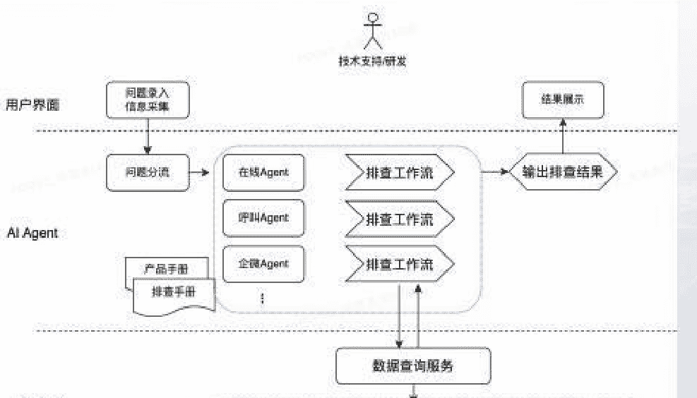

### 量身定制模式
基于行业经验、数据累积：
- 咨询顾问
- 量身定制
- 面向大型企业提供服务
- 面向中型客户，在一定基础上改进

### 以业务价值为导向
#### 智能客服 2.0 时代
- 缺乏可实际落地的经验，担心投入打水漂
- 缺少数字化基础、组织架构不支持变革
- 传统NLP维护工作量较大，特别是商品、活动等无法覆盖
- 传统NLP配置成本较高
- 传统NLP仅针对单一场景，无法具备对话能力

#### 大模型时代
- 担心被竞争对手以AI方式彻底颠覆
- 媒体的宏大技术叙事如何落到自己的企业中
- 组织架构不支持变革
- AI恐症，担心会被会被彻底替代
- 没有形成AI使用习惯

### 智能体（Agent）更适配业务场景
- 能感知、会干活、能跑的AI员工
- 直接产生业务价值的AI实体
- 各职员工的数字分身
- 领导交一代、会自己动脑找方法的AI员工
- 构建成本更低的智能体平台
- 以Manus、扣子代表的自主智能体平台、自主产出报告等

#### 大小模型结合带来的
- 5% 复杂问题人工处理
- 10% 复杂问题自动处理
- 15% 复杂问题自动处理（低体验）
- 15% 复杂问题自动处理（高体验）
- 30% 业务直接办理
- 40% 常见问题回答

### 知识库
- 业务逻辑用 Agent，用户界面和相关配套用 Workflow。
| 资源/数据集 | 工作流 | 用户界面 |
| --- | --- | --- |

### 
- 行业领先的RAG能力
- 业务场景定制的实施方案
- 补充更多的业务知识，提升模型上下理解能力

### 解决方案
| 产品工程 | NLP+LLM 融合 |
| --- | --- |
| | 建立QA索引 |
| 算法工程 | 接入大模型 |
| | 关键技术突破 |
| 实施经验 | Prompt 优化 |
| | 知识库扩充 |
| 实施经验 | Prompt 优化 |
| 业务优化 | 知识库扩充 |

#### 说明
- 精准或固定问题由传统FAQ+知识图谱回答
- 不同渠道/标签建立索引路径由不同的知识库
- 切换幻觉控制较好的模型
- 业务场景定制的实施方案
- 补充更多的业务知识，提升模型上下理解能力

#### 幻觉类型
【客观】存在的事实错误、逻辑矛盾
【主观】认为的身份角色用户误解

## 重新看私域导购机会
从导购能力模型出发，围绕专业度、销售能力、疑难处理出发

#### 专业度升级
- 全面覆盖/竞品产品知识与产品优劣、存量问答数据聚类分析、常见高频关注问题梳理

#### 销售能力升级
- 产品核心卖点、金牌销售话术、挽留话术、逼单策略等
- 存量交流数据聚类转化话术、后续结合VOC持续采集高转化话术策略

#### 疑难问题处理能力升级
- 针对消费者产品使用异常、情绪波动等疑难场景，针对性场景化入话术建议及处理措施

##班期间，开启辅助模式，提供个性化回复建议

#### 用户画像
- 用户标签：女性、双子座、VIP 6
- 行为事件：2.24购买了保险
- 数据模型：畅销妈妈、都市白

#### 触达模板
- 触达目标
- 示例话术
- 调整要求

#### 辅助模式
- 上次活跃：辅助语

#### 托管模式
- 下线回复，自动回复
- 有用的的人学推荐不

### DeepSeek官方观点
最大的挑战：大模型幻觉
- 《三体》的作者是谁？——《三体》的作者是刘慈欣，是一位著名的科幻作家，代表作为《流浪地球》。
- 《三体》里“黑暗森林法则”是谁提出的？——“黑暗森林法则”是由小说中的角色“罗辑”提出的，但罗辑是人类望者，而不是地球三体成员。
- 问题出在哪？——在《三体》原著中，“黑暗森林法则”确实是罗辑提出的，但罗辑是人类望者，而不是地球三体组织（ETO）成员。

## 下班期间，打开托管管模式，自动回复用户咨询

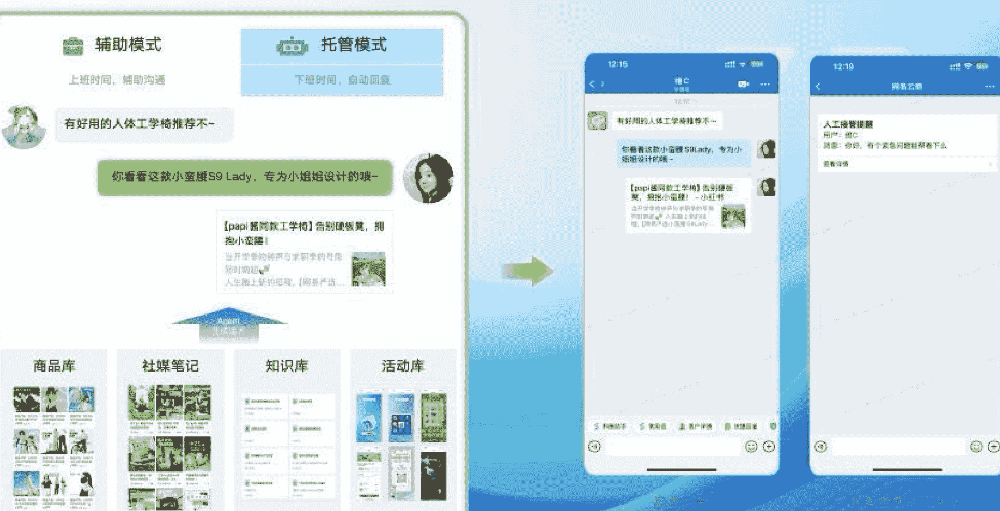

## 产品方案

### 一、信誉聚合 0-0.5

### 二、知识运营 0.5-1

### 三、知识应用

#### 数据收集

##### 公开可信源资料
- 已有的2k+条FAQ知识
- 40+知识文档
- 10+多轮问答流程
- 部分优质标签记录

##### 存量（大批量）聊天记录
算法聚类

Step1: 搭建 & 补充
- 基于现有知识，查漏补缺
- 补充相似问
- 提升知识覆盖

Step2: 运营
- 调整问法和配置，提供知识匹配
- 大模型 Prompt 优化
- 模型底层调优

Step3: 突破
- 优化答案质量，提升准确&采纳率

智能问答->助手机器人
智能辅助/替代人工
数据反馈

### 四、知识运营

## AI应用 vs SaaS应用

## 企业选型决策

业务需求
- 是否需要实时决策 -> 优先传统 SaaS
- 是否数据充足

| 传统SaaS应用 | AI应用 |
| :--- | :--- | :--- |
| 共性 | 云端交付 依赖企业信息化基础 | 以业务价值为锚点持续付费 |
| 场景适配 | 场景通用 | 更加行业细分 更加场景垂直 |
| 技术架构 | 向SaaS+AI混合架构迁移 | 以数据、知识、算法、算法迭代作为核心驱动力 |
| 商业模式 | 按用户/功能模块收费 | 1、基础订阅付费+AI调用量 2、绑定业务结果收费 |

选择规则引导saas+累积数据
选择AI应用
关注AI-ready接口
验证ROI后扩展

## PART 4

## 未来展望篇：企业需要做好哪些准备

## 企业智能化基建

#### 应用层
结合企业自身业务的无限可能

#### 开发层
应用可视化开发平台
- 页面和交互
- 流程和逻辑
- 数据查询与操作
- 系统集成

#### 智能化基建
智能体编排工作站
- 插件工具箱
- 企业级知识库
可视化的 LLMS App 编排专业工作站
- 集成第三方插件或企业自建插件
- 多态文档导入、文档解析、切片配置、算法调整等

#### 大模型能力层

## 岗位重构

## 以典型企业研发流程为例

业务人员提需求
产品经理梳理需求输出PRD
通过大模型理解需求
前端开发
后端开发
自然语言编程工具 AI+
言出法随需求到达结果？
一站式低代码工具
QA测试
自动化测试工具
产品上线

## 2025年需要进化的组织和人

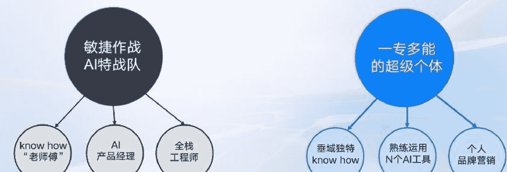

## 感谢观看
