# Trends – Artificial Intelligence

BOND
May 2025

# 趋势-人工智能（ AI ）

2025年5月30日

Mary Meeker / Jay Simons / Daegwon Chae / Alexander Krey

# BOND

## 背景

我们亲手整理与人工智能相关的基础数据。最初只是几个零散的数据点，最终发展成了这个浑然大物。

我们刚更新一个图表，往往就跟着更新另一个——就像打地鼠的游戏……这种模式没有停止的遗迹……而且随着竞争的加剧，情况会变得更加复杂。

在科技公司，新兴攻击者和主权国家之间，加速发展。

> 互联网之父之一-崔里夫在1999年说：“……他们说在互联网行业工作一年就像他们一年——相当于一个正常人一年的花费。”当时，互联网所引发的变化速度正在处于前所未有的。

现在考虑一下，人工智能和使用趋势正在以更快的速度增长……而机器可以超越我们。

数据显示，人工智能技术带来的变革与规模变革完全相同。本文中充满了用户画像、使用场景和收益曲线数据图表，这些图表均以上角排列的方式呈现——通常还配备有相同向上上升的图表。

创造者/投注者/消费者正在利用全球互联网通道，这些网络通过连接设备连接的5B公民；30多年来不断增长的数据聚集；突破性的大型语言模型（LLM）——实际上，随着OpenAI的ChatGPT在2022年11月发布，它拥有了极其简单易用/快速的用户界面，找到了。

此外，相对新成立的人工智能公司能够在产品/发布/投资/购买/路线和融资方面展现尤为灵敏。与与此同时，传统的科技公司（通常由创始人参与）越来越多地试图将巨额资金流入人工智能智能领域，以推动增长并击击竞争者。

全球竞争——尤其是中国和美国的技术竞争——是尖锐的。我们的文件的概要在下一页，后面有11个图表，说明一下观测结果。我们希望讨论所涉及的泛化引起——技术/金融/社会/地缘政治贡献。毫无疑问，随着知识以及它的新方式，人们和机器都在努力适应这一发展的旅程。特别感谢Gordon和Keeyan同事们，他们帮助指导并使本报告成为现实。还有，我们感谢许多开发者和技术建设者，直接通过你们推动技术发展。

## 变化发生得比任何时候都快？是的。

- 1 AI用户+使用+资本支出=前所未有的
- 2 AI模型计算高/每个推理成本上升+下降=性能趋同+开发者使用率上升
- 3 AI使用+成本+损失增长=前所未有的
- 4 AI营收=竞争加剧+开源势力+中国的崛起
- 5 AI与物理世界边界=快速+数据驱动
- 6 由AI驱动的全球互联网用户增长=我们从未见过这样的增长
- 7 人工智能与工作演变=真实+快速

## 图表几个单词...变化发生得比任何时候都快？是的，确实如此。领先芯片制造系统中的开发人员

![img/49ac14ba980811fb04fde19ade5655f1_5_0.png]

AI用户+使用+资本支出=前所未有的美国主要LLM用户

![img/49ac14ba980811fb04fde19ade5655f1_5_1.png]

AI用户+使用+资本支出=前所未有的互联网与美国顶尖LLM项目：北美以外的当前用户数

![img/49ac14ba980811fb04fde19ade5655f1_5_2.png]

AI用户+使用+资本支出=前所未有的美国六科技支出

![img/49ac14ba980811fb04fde19ade5655f1_5_3.png]

## 人工智能模型计算成本高/上升 Inference Costs Per Token Falling =性能趋同+开发者使用率上升

## 关键技术替换与发布年份的相关关系

- 电力
- 计算机内存
- AI推理

![img/49ac14ba980811fb04fde19ade5f6_0.png]

从可能的最小到可能的技术
来源：Richard Hirsh; John McCallum; OpenAI
深度信息已更新至2024年3月8日

## AI使用+成本+损失增长=前所未有

## 美国领先的人智能LLM收入与计算费用

![img/49ac14ba980811fb04fde19ade5655f1_6_1.png]

+$3.7B -$5B
2022 2023 2024
注：美元为单位
来源：The Information, AIC
深度信息已更新至2023年8月8日

## AI营收激增：竞争加剧+开源动力+中国的崛起

## 美国领先LLM与中国LLM桌面用户份额

![img/49ac14ba980811fb04fde19ade5655f1_6_2.png]

75% 60% 10% 21% 15%
美国-LLM#1 中国-LLM#2
2/24 2/25 4/25
注：数据未经过处理，市场份额为估计，基于对大型大学LLM毕业生的调查
深度信息已更新

![img/49ac14ba980811fb04fde19ade5655f1_6_3.png]

中国 世界其他地区（不包括中国和日本）
2014 2023
注：数据截至2023年
深度信息已更新至2023年
来源：国际机器人会

## AI与物理世界坡道=快速+数据驱动拼车与自动驾驶出租提供商，旧金山运营区市场份额

![img/49ac14ba980811fb04fde19ade5655f1_8_0.png]

来源：YipotData (4/25)

## 由AI驱动的全球互联网用户增长速度是我们前未见的增长速度

按地区列出的美国领先LLMApp用户

![img/49ac14ba980811fb04fde19ade5655f1_8_1.png]

5/25针对独立用户的数据，来源：Sensor Tower (5/25)

## 人工智能与工作流变革=真实+快速 人与与工作——AI与非AI

![img/49ac14ba980811fb04fde19ade5655f1_8.png]

1/18来源：马州大学-Outrigger Group

## 概述

说世界以前所未有的速度变化。快速和变革性的技术创新采用是这些变化的关键。全球国家的领导地位也在演变。

- 谷歌的使命（1998年）是“组织世界的信息，使其全球访问和有用”。
- 阿里巴巴的使命（1999年）是“在任何地方变得容易获得”。
- Facebook的使命（2004年）是“赋予人们分享的力量，让世界更加开放和连接”。

到今天，世界上的组织、互联网和可访问被人工智能、智能计算能力所推动……这些都带来了巨大的变革。人工智能的持续改进提供了一个很好的例子，由于运动员带给我们惊喜，他们的训练会随着好的数据输入而不断。企业也是如此，它们的计算机在吸收大量数据变得更智能、更有竞争力。大型模型的突破，成本下降，开源和芯片性能提升，使得技术的进步越来越强大、可访问和经济可行。

OpenAI的ChatGPT——基于用户/使用指标——是历史上最大的“一夜成名”成功（2023年之后）。与互联网1.0相同——技术起步走向全球——ChatGPT同时登陆在大多数全球范围内。拥有许多企业和新兴攻击者正在构建和部署第一代人工智能基础设施：代理接口、企业级驾驶、现实世界的自主系统和主权模型。人工智能，计算基础设施和全球连通性的快速发展正在影响工作方式、资源和领导力方式——无论是在公司还是国家层面。全球国家的领导地位也在演变，每一个国家在挑战中找到竞争者的优势。我们看到世界上最大的国家技术力量和地缘政治日益交织在一起。安德鲁·波斯森（Meta平台首席官）最近在“可能”播客中描述了当前人工智能的发展就像我们的太空竞赛一样讨论的对象，特别是中国，几乎具备极强的实力……没有什么秘密可言。而且进步是持续不断的。你必须保证自己不会落后。现实情况是，人工智能的领先可能会带来地缘政治领导地位——反之不然。这种情况带来了巨大的不确定性……但它回到了我们最喜欢的一句话——从理论上讲，世界永远不会摧毁，”T. Rowe Price董事长兼首席执行官罗森·杰斯。作为投资者，我们总是假设一切可能出错，但令人措手的是可能的考虑。一次一次，乐观的理由是我们能够做最好的注之一。让AI为你工作带来魔力，就像邮件和网络搜索早期——这些技术从根本上改变了世界。更优、更快、更高效的影响人工智能似乎如同神一样，速度越来越快。毫无疑问，这也是一个危机、充满风险和不确定的时代。但人工智能乐观的理由是基于这样一个理念：激烈的竞争和创新……计算……全球人工智能技术的快速发展……以及深虑和精心的领导力可以培养恐惧和尊重，进而可能导致相互保护。对许多人来说，人工智能的进化将我们推向一个方向；对其他人来说，它将创造一场竞赛。资本的投机热情和创造性破坏是结构。不可否，这是游戏开始，尤其在美国、中国和科技强国。在文中，我们分享了第三方提供的数据/研究/基础；这些方法是有效的——感谢很多人在这一独特时期所做的努力，以说明趋势。我们的目标是讨论这些内容。

## 技术组合

## 势头背后的数字

## 技术经过一千多年的发展=更好+更快+更便宜→更多...

全球GDP——过去1000+年，根据麦迪森项目

![img/49ac14ba980811fb04fde19ade5655f1_13_0.png]

注：本图表以2011年“知识总值 (GK)”为基，采用对数刻度呈现，数据以万亿实际GDP计算。GK（知识总值）是评估特定商业洞察、意图或专有知识在价值上的非正式指标，反映知识者能否有效应用所创造的价值，即使未产生收益。数据来源：《人工智能智能：未来蓝图》报告（2015年5月23日发布）；麦迪森项目与世界数据研究所联合报告提供。

## 技术复合=头部的数据

## 技术经过50多年的发展=更好+更快+更便宜→更多 摩根丹利的（计算周期随时间变化——1960年代至2020年代）对数刻度显示的百万。AI时代

| 设备 | 1960 | 1970 | 1980 | 1990 | 2000 | 2010 | 2020 |
| :--- | :--- | :--- | :--- | :--- | :--- | :--- | :--- |
| PC | | | | | 4B | | |
| 桌面 | | | | | 1B | | |
| 小型计算机 | | | | | 300MM | | |
| 大型机 | | | | | | 100MM |

注：轴为对数轴，即AI时代将设备数量达到万。PC数据截至2000年，桌面数据截至2005年，安装数据截至2010年，移动互联网数据中心支出涵盖谷歌、亚马逊、微软、苹果、IBM、腾讯及百度等企业截至2022年的，“十亿设备”意味着最后使用人工智能技术在设备和群体，包括手机、物联网等。来源：斯特顿等《人工智能如何影响投资》（摩根丹利，2023年10月）

## 技术复合与头部后的决策

## 15年内增长率为260%... 训练人工智能模型导致了...关键AI模型训练数据集（词数）——1950-2025年数据

![img/49ac14ba980811fb04fde19ade5655f1_16_0.png]

注：仅展示“显著”的语音（根据Epoch AI，包括认可基准上的改进超过1000，具有历史相关性被广泛）。来源：Epoch AI（5/25）

## 15年增长率达到360%...训练人工智能模型导致...关键AI模型的训练计算（FLOP）——1950-2025年，按周期划分

![img/49ac14ba980811fb04fde19ade5655f1_17_0.png]

FLOP是衡量计算能力的基本单位，代表十进制数的单次算术运算。在人工智能领域，总FLOP用于衡量训练或运行模型所需的。注：仅展示语言模型（根据Epoch AI 标准，需满足以下条件：在公开基准上获得最新技术突破，用量巨大，具有历史相关性且应用广泛）。来源：Epoch AI（5月25日）

## 9内的年增长率为200%...算法改进算法对AI模型性能的影响——2014-2023，按周期AI

![img/49ac14ba980811fb04fde19ade5655f1_18_0.png]

注意：根据在没有任何计算能力的情况下达到最佳性能计算能力，估计有多大程度的进步来自于更大的模型和更智能的算法来源：Epoch AI (3月24日)

## 六内的年增长率为150%...人工智能超级计算机带来的性能提升导致领先人工智能超级计算机性能（每秒浮点运算次数）——2019-2025按AI周期划分

![img/49ac14ba980811fb04fde19ade5655f1_19_0.png]

## 4内的增长率为167%...强大的AI模型数量

每个周期统计的2017-2024年新型大型AI模型（运算量超过10^16浮点运算）数量

![img/49ac14ba980811fb04fde19ade5655f1_21_0.png]

包括来自以下位置的模型
* xAI
* 泛滥的元数据
* 英伟达
* 密史脱拉风
* 弧形研究所
* 其他

截至4月25日，“大型AI模型”通常定义为Epoch计算达到10^16次浮点运算的模型，来源：Epoch AI（5月25日）

## ChatGPT人工智能+订阅+收入增长=很难匹配，永远

ChatGPT用户+订阅+收入增长——10月22日至4月25日，根据OpenAI与The Information的数据

![img/49ac14ba980811fb04fde19ade5655f1_22_0.png] ![img/49ac14ba980811fb04fde19ade5655f1_22_1.png]

注：数据源自OpenAI与The Information，2025年5月

# 知识是一个累积事实的过程；
智慧在于它们的简化。

Martin H. Fischer, 德国出生的美国医师/教师/作家 (1879-1962)

# 人工智能=
升空前的许多年

# 人工智能里程碑时间线——1950-2022，由斯坦福大学发布...

- 10/50: 艾伦·图灵创造了图灵测试尝试衡量计算机的智能能力，并提出
- 1/62: IBM的计算机学院雅瑟·霍塞尔泽发明了一个自学程序，被证明能够击败国际顶尖棋选手
- 5/97: IBM的象棋电脑击败了世界冠军加里·卡斯帕罗夫，当时的冠军冠军

### AI Winter, (1967-1996)

- 10/05: 斯坦福大学的一个团队创造了名为斯坦福利的机器人，无人驾驶汽车通过了测试，完成了一个三分之一的132英里的比赛，赢得了DARPA挑战。
- 6/14: 金·古斯特建立了一个聊天机器人，通过测试后人们相信金的人类语言模型。
- 6/20: OpenAI发布GPT-3，一个用于自动翻译的人工智能工具，像人类一样思考。
- 6/56: 斯坦福大学计算机科学家加布·曼肖创立了特萨斯人工智能概念，这是他创造的术语。
- 1/66: 斯坦福大学的研究人员设计了Shakeley，这是第一个对自己的进行行为的移动机器人。
- 9/02: 首次在复杂环境中引导人类操作的主机机器人iRobot正式发布。
- 4/10: 苹果购买Siri语音并整合，一年后，被应用于iPhone 4手机上。
- 6/18: OpenAI发布GPT-1，这是他们大型模型的语言模型。
- 11/22: OpenAI向公众发布ChatGPT。

“人工智能能力”是斯坦福大学计算机科学系工程教授尼尔·尼尔所说的话，用来形容人工智能虽然持续被概念化模仿，但未见到真实实际应用的。这项最终决定了人工智能研究的发展与资金投入的齐下潮流。本数据集包括斯坦福大学、斯坦福法学院、iRobot公司、TechCrunch知识库、BBC广告公司和OpenAI等机构，由（BOND）平台生成的数据集。

BOND | 人工里程碑——过去的未来

## 人工智能——2023-2025，斯坦福大学

| 3/23 | 3/23 | 11/23 | 4/24 | 5/24 | 9/24 | 1/25 | 2/25 |
| :--- | :--- | :--- | :--- | :--- | :--- | :--- | :--- |
| OpenAI 发布 GPT-4, 一个能够处理文本和图像的多模态模型 | 谷歌发布其 ChatBard 与 GPT 竞争对手 | 包括欧洲、欧盟国家和中国在28个国家签署《切格利人工智能安全宣言》 | Meta 发布其开源 Llama 3 模型，容量达70B | 谷歌引入了人工智能概述来增强搜索功能 | 阿里巴巴发布了100个开源的 Qwen 2.5 模型，其性能与西方竞争不相上下 | DeepSeek 发布其 R1 和 R0 开源推理模型 | OpenAI发布 GPT-4.5, Anthropic 发布了 Claude 3.7 Sonnet, xAI 发布了 Grok |

| 3/23 | 3/23 | 3/24 | 5/24 | 7/24 | 12/24 | 1/25 | 4月25日 |
| :--- | :--- | :--- | :--- | :--- | :--- | :--- | :--- |
| 微软将 Copilot 集成到其365 个产品中 | Anthropic 发布其专注于安全性和可解释的人工智能助手 Claude | 美国国土安全全部人工智能防线策略 | OpenAI 发布 GPT-4o, 该模型支持音频、视觉和文本输入 | 苹果发布了集成的人工智能系统 Apple Intelligence | OpenAI 宣布 o3,其性能为历史以来最好的模型 | 阿里巴巴推出 Qwen2, 5-Max, 在某些推理测试中，其性能超过了其他领先模型（GPT-4o, Claude 3.5） | ChatGPT 达到8亿用户，一周一次的更新 |

BOND

* 开源：指能够从头开始处理多种数据（如文本、视频、图像、音频）的人工智能。
1) 开源：允许使用、修改和发现新的 AI 模型和工具。
2) 4月25日 OpenAI 首席执行官 Sam Altman 在4月11日的 TED 活动中强调了这一点。

数据来源：由 BOND 整合 OpenAI、谷歌、Anthropic、Meta、苹果、Deepseek、英国政府及美国国土安全部。由于权限限制，相关模型数据存储在信息队列中。

人工智能是未来的趋势 29

# 人工智能=
约2025年

# ChatGPT的十大人工智能应用

### ChatGPT 4o v+

- 1. Write or edit anything: Emails, essays, contracts, poems, code — instantly and fluently.
- 2. Summarize and explain complex matter: Simplifies PDFs, legal docs, research into plain English.
- 3. Tutor on nearly subject: Learn math, history, languages, or test step by step.
- 4. Be your thinking partner: Brainstorm ideas, debug logic, or pressure-test assumptions.
- 5. Automate repetitive work: Generate reports, clean data, outline slides, rewrite text.
- 6. Roleplay anyone you need: Prep for interviews, simulate customers, rehearse conversations.
- 7. Connect you to tools: Write code for APIs, spreadsheets, or the web.
- 8. Offer therapy and companionship: Talk through your day, or listen.
- 9. Help you find purpose: Clarify values, define goals, and map actions.
- 10. Organize your life: Plan trips, build routines or workflow.

# 人工智能=
大约2030年

### 根据ChatGPT预测，人工智能在未来五年可能做的十大事情

- 1. Generate human-level text, code & logic: Chatbots, software engineering, business plans.
- 2. Create full-length films & games: Scripts, characters, scenes, mechanics.
- 3. Understand & speak like a human: Emotionally aware assistants, real-time voice agents.
- 4. Power advanced personal assistants: Life planning, memory recall, coordination across all apps and devices.
- 5. Operate humanlike robots: Household helpers, elderly care, retail and hospitality automation.
- 6. Run autonomous customer service & sales: End-to-end resolution, upselling, CRM integrations, 24/7 support.
- 7. Model full biological systems: Simulate cells, genes, and organisms for research and therapy.
- 8. Offer expert-level decisions: Deliver real-time legal, medical, and business advice.
- 9. Drive autonomous discovery in science: Drug design, materials synthesis, climate modeling, novel hypothesis testing.
- 10. Collaborate creatively like a partner: Co-writing novels, music production, architecture.

来源：ChatGPT (5/25)
2030年

# 人工智能=
大约2035年

### ChatGPT 4o

- 1. Conduct scientific research: Generate hypotheses, run simulations, design and analyze experiments.
- 2. Design advanced technologies: Discover materials, engineer biotech, and prototype energy systems.
- 3. Simulate human-like minds: Create digital personas with memory, emotion, and adaptive behavior.
- 4. Operate autonomous companies: Manage R&D, finance, and logistics with minimal human input.
- 5. Perform complex physical tasks: Handle tools, assemble components, and adapt in real-world spaces.
- 6. Coordinate systems globally: Optimize logistics, energy use, and crisis response at scale.
- 7. Model full biological systems: Simulate cells, genes, and organisms for research and therapy.
- 8. Offer expert-level decisions: Deliver real-time legal, medical, and business advice.
- 9. Shape public debate and policy: Moderate forums, propose laws, and balance competing interests.
- 10. Build immersive virtual worlds: Generate interactive 3D environments directly from text prompts.

## 人工智能发展趋势=
前所未有的

# 机器学习模型趋势=在2015年行业超越了学界，因为数据+计算+财务需求上升

《2003-2024年全球行业知名机器学习模型》，由斯坦福HAI发布

机器学习的一个重要特征：从数据的模式中学习，而不是记住特定的公式。学术界包含由多个机构（包括顶层机构）开发的模型，产学合作不仅涉及合作关系，更是学术界与工业界深度深度的结果。作为多方合作的产物，模型受控制的发展（包括人工智能公司在当代AI/机器学习生态系统中具有影响力的模型）。AI自1950年代以来发布的900个AI模型数据库指出，入选标准包括技术前沿性、历史意义或实用性。由于数据驱动，某些模型可能领先。学界模型的统计结果存在显著差异，2023年学界机器学习未产出值得关注的模型，说明人工智能公司尚未具有价值的模型。此外，学界成就往往需要更长的时间才能获得——那些提出高层架构的顶引文章可能需要几年时间才能催出新苗头。由于政府限制，中国数据可能存在信息局限性。资料来源：Indra Nagpoli等，《2025年度人工智能指数报告》；斯坦福大学人工智能研究所（HAI）人工智能指数委员会（4月25日发布）

# 人工智能发展趋势：前所述所有

# 开发者增长（以英伟达生态系统为例）：从六年到六个月的开发者，超过七年

英伟达生态系统全球开发者计划——2005-2025，由英伟达提供

注：根据一篇发表于2005年8月20日的博客《无数突破》中的内容，假设英伟达生态系统中开发者数量需要多年才能达到100万，不到两年就能达到20万。数据来源：英伟达博客、新闻概况

# 开发者增长（谷歌生态系统作为代理）：从2015年至2024年全球开发者大会，由谷歌主办

注：根据谷歌在5月25日发布的Google I/O报告，目前已有700万开发者使用Gemini进行，这一数字是去年同期的五倍。

# 美国计算机专利授予情况：从1995年至2024年计算机专利分类（CPC），对应计算机、计算或计数，在每次查询时可能会变化，因此大致准确。来源：美国商标局（USPTO）（4月25日）

# AI性能在MMLU基准测试中的表现——2019-2024，由斯坦福发布

注：MMLU（多任务语言理解）基准测试在数学、医学、历史等57个学科领域的表现，包含常识、记忆和推理能力，是衡量大型模型综合知识储备与解决能力的权威标准。89.8%是人类。数据来源：Nest Masley等，《人工智能趋势报告》（斯坦福大学人机交互实验室，4月25日）

# AI性能在Q1 2025：73%的受访者认为是人类

| Date Released | Human Win Rate |
| :--- | :--- | :--- |
| GPT-4o (no persona) | 5/24 | 0% |
| ELIZA | 1/25 | 50% |
| GPT-4.5 (with persona) | 2/25 | 100% |
| AI系统随时间持续改进 | 2023 | |

注：图源自1950年间，用于评估机器模拟人类的能力。本研究中，约500名参与者采用第三方测试形式，与真人互动，多数讨论情感共鸣和日常生活，而非专业知识。明学院教授约夫·魏曼在1960年代初开发被认为是世界上首个聊天。2025年1月，研究人员成功利用代码激活了它。来源：Cameron Jones与Benjamin，《大语言模型通过盲测》（3/25）——加州大学圣地亚哥分校

# 性能：模拟人类行为的越来越真实的对话

图灵测试对话：GPT-4.5版本（3/25）——Taylor/Benjamin Bergen

| Witness A | Witness B |
| :--- | :--- |
| do you like doing psych studies and why? | do you like doing psych studies and why? |
| theyre chill, easy money tbh | It depends, sometimes I'm not in the mood to write |
| yeah same. Could you give me an easy cupcake recipe off the top of your head? | yeah same. Could you give me an easy cupcake recipe off the top of your head? |
| nah i get the box mix lol | I'm a terrible baker! But I know more flour, sugar, butter and probably more stuff like that |
| haha fair enough, I couldn't either. Last question, what's your favorite weird animal? | Haha yeah. What is your favorite weird animal? |
| axolotl, theyre weirdly cute | Sloths! I could watch videos of them moving for hours |
| heck yea. You have a great day | |

## AI性能=生成越越逼真的图像...

AI生成图像：《带向日葵吊坠的女士》——2月2日至4月25日，由Midjourney / Gold Penguin提供

### 型号v1 ( 2 / 22 )
### 型号v7 ( 4 / 25 )

注：标注日期为Midjourney版本的发布日期。资料来源：Midjourney（4月25日）与Gold Penguin联合发布的《Midjourney发展趋势（V1至V6.1版本对比）》（9月24日）。

## 人工智能性能= 越越逼真的图像生成

人工智能生成与真实图像- 2024

### AI生成的图像（ 2024 ）
### 真实图像

来源：左——StyleGAN2，通过《纽约时报》“测试你自己：哪些脸部是由人工智能制作的？”（1月24日）；右——知识共享

## AI性能=正在生成更逼真的语音翻译/语音生成...

ElevenLabs人工智能语音合成器——1月23日至4月25日，由ElevenLabs与Similarweb联合推出

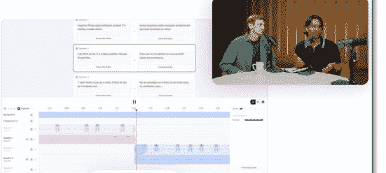

根据Similarweb的数据，ElevenLabs每月全球网站访问量（MM）为1/23-4/25

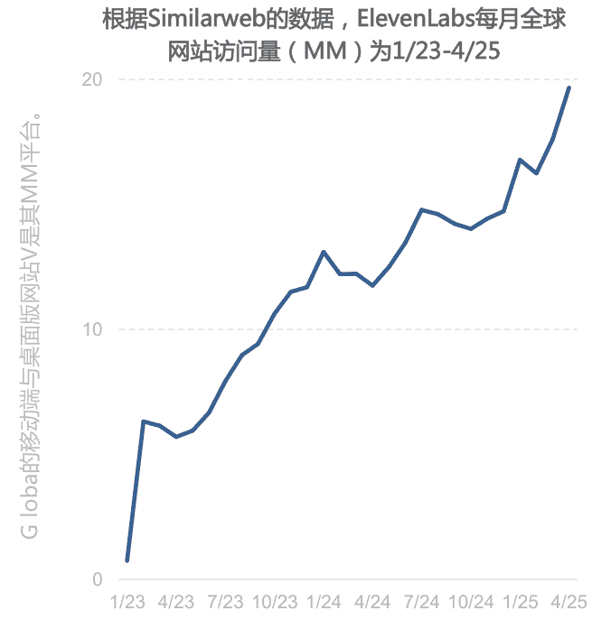

新建音频项目时，配音工作室会自动转录内容，并将其译成新语言，然后生成该语言的新音轨。在生成翻译之前，会剥离每个说话人的原始声音，以确保他们在每种语言中听起来都一样。

> - ElevenLabs新闻稿，1/24

在短短两年内，ElevenLabs的百万用户已经产生了1000年的音频视频，该公司的员工已被超过60%的财富顶级公司员工采用。

> - ElevenLabs新闻稿，1/25

注：由于政府限制，中国版可能会受到信息限制。来源：ElevenLabs（1月24日和1月25日），Similarweb（5月25日）

BOND

人工智能发展趋势=趋势

## 人工智能性能=为主的现实音频翻译/生成

AI语音翻译功能——5月25日上线，由Spotify推出

想象一下，如果你是一个创造者，你是某方面的世界专家......但你碰巧是印度尼西亚人。今天，存在着语言障碍，如果你不懂英语，很难进入世界舞台。

但有了人工智能，未来你可能会说语言，人工智能会理解它，并进行实时翻译……这对创造力、知识共享和娱乐产生什么影响？

认为我们还处于探索的早期阶段......我们希望Spotify成为所有声音的地方。

> - Spotify联合创始人兼首席执行官Daniel Ek（5月25日）

第一季度：25，Spotify拥有6.78亿月活跃用户和2.68亿订阅者，支持168亿元的年收入，同时托管1亿+歌曲，~700热门标准和~100万创意艺术家。

注：使用Q1;25结果对数据进行细化。来自：Spotify；《纽约报》；“Spotify内部：首席执行官丹·埃克谈人工智能、语言与音乐的未来”（5月2日）；Spotify财报发布；eMarketer，“Spotify在数字领域统治苹果和雅”（4月25日）

## 性能=加速发展的新兴应用

### 新兴人工智能应用——11月24日，摩根丹利

| Protein Folding | Cancer Detection | Robotics |
| --- | --- | --- |
| DeepMind's AlphaFold can predict the structure of nearly all known proteins | Microsoft & Paige builds the world's largest image-based AI model to Fight Cancer | Google demonstrates that robots can understand and act on human intention using LLMs |

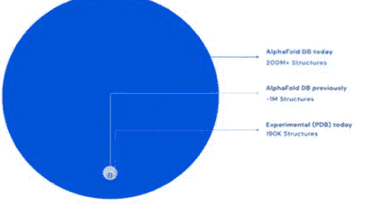
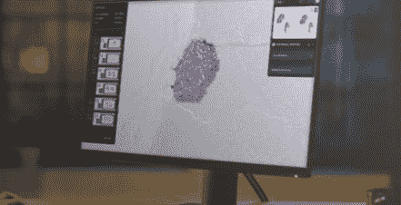

| Agentic AI | Universal Translation | Digital Video Creation |
| --- | --- | --- |
| Amazon announced tools that enable models to complete tasks based on user instructions | Meta unveiled the first all-in-one multilingual AI translation and transcription model | Channel 1 AI showcases ability to use GenAI to produce personalized newscasts |

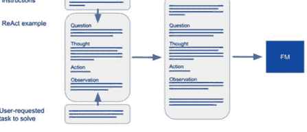

来源：摩根丹利，《GenAI：我们看到的采用在哪里？2025年有什么重要性？1月24日）

## 人工智能=获益与风险

### 人工智能开发=获益与风险广泛讨论——对于许多人来说，这是最关心的问题——引发了兴奋和担忧，对变化速度的不确定性日益加剧了这种情绪。他的支持者斯顿·罗素和彼得·维格在这些话题上深入研究。经典著作《人工智能：一种方法》（2020年），他们的观点仍然：简单地说，整个世界的框架是人类智慧的产物。如果我们能够获得更强大的机器，我们的野心将会提高。人工智能和机器人将人类从琐碎工作中解放出来，并大幅增加服务，这可能预示着一个丰富的时代。加速科学的能力可能会导致疾病的治疗和应对气候变化和资源短缺的解决方案。谷歌DeepMind首席执行官Demis Hassabis：“要解决人工智能问题，然后用人工智能解决其他问题。”然而，在我们有机会“解决人工智能”之前，我们将因人工智能误用而面临风险，无论是有意还是无意。其中已经很明显，另一个可能基于事实的趋势，包括致命的自动驾驶监控和安全关键应用……”

人工智能的成功可能是文明历史上最大的事件。但它可能是最后的，除非我们学会如何规避风险。斯蒂芬·霍金，理论物理学家/宇宙学家（1942-2018）。来源：剑桥大学，智能未来中心BOND AI=获益与风险

### 看起来变化发生得比以往任何时候都快？是的，确实如此。AI用户+使用+资本支出增长=前所未有的AI模型计算/每令牌的推理成本上升+性能趋同+开发者使用率。AI使用+成本增长=前所未有的AI营收奖励=竞争加剧+开源势头+中国的崛起AI与物理世界轨迹=快速+数据驱动由Get-Go提供的AI驱动的全球互联网增长速度是我们前所未见的增长速度人工智能与工作演变=真实+快速。AI用户+使用+资本支出增长=前所未有的

消费者/用户对AI的采用=前所未有的

### AI用户增长（以ChatGPT为基准指标）17个月内8x至800MM

OpenAI发布的ChatGPT增长数据（月统计）——10月22日至次年4月25日

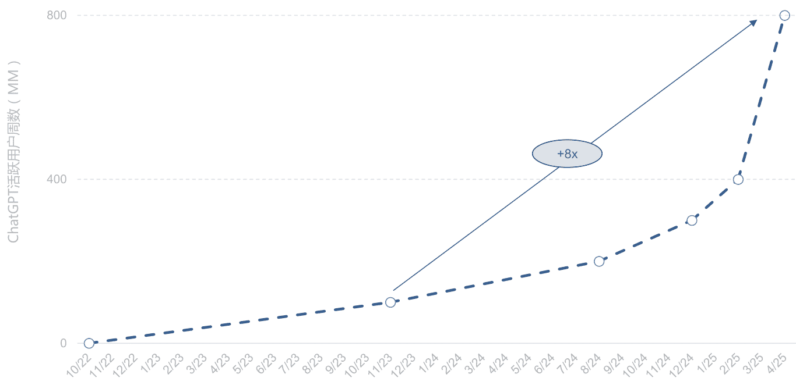

注：OpenAI_reports_Weekly_Active_Users_which_are_represented_above_4/25_estimate_from_OpenAI_CEO_Sam_Altman_s_4/11/25_TED_Talk_disclosure Source-AI=前所未有的

## 人工智能全球采用（以ChatGPT为基准指标）以前从未见过的这样的全球传播

互联网与ChatGPT用户——北美以外地区占比（1990-2025年），根据国际电信联盟与Sensor Tower数据

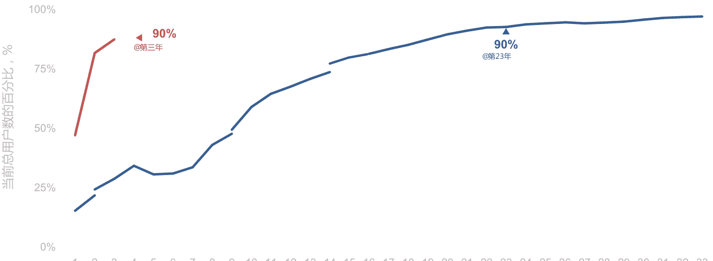

索引年份（互联网@1 = 1990，ChatGPT应用程序@1 = 2023）

注：互联网当年设定为1990年，第33年对2022年。ChatGPT应用为5月23日，第3年对5月25日，显示的是ChatGPT应用程序的月活跃用户（MAU）。注意：截至5月25日，数据应适用于在中国、俄罗斯及其他国家。由于政策限制，中国可能存在信息隔离性，仅包含Android、iPhone和iPad用户。实际用户基数可能低于统计数字（例如此处未统计移动端用户）。图中展示的是当年总用户占比——ChatGPT应用第三年末结束，未来各月相关比例可能发生变化，数据统计针对ChatGPT应用，根据国际电信联盟（ITU）规定，部分国家可能存在差异，来源：国际电信联盟、Sensor Tower（5月25日）

### 用户采用率（以ChatGPT为代理）材料更快，与互联网可比... 用户达到100万的年份—2000-2023

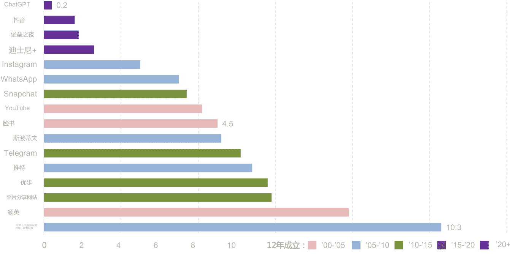

注：Netflix代表媒体业务，来源：AI与大学（2024年）通过公司文件及报道

### AI用户率（以ChatGPT为代理）材料更快，更便宜，而其他技术产品达到100万客户所需天数——1908-2022

| 采购价格 (2024) | $29,330 | $945 | $756 |
| --- | --- | --- | --- |

ChatGPT发布后首次向公众免费开放（11月2日），注：根据福特公司数据，售价可在260至850美元之间。对于iPhone，我们以1999年3月31日定价为499美元，2007年售价499美元，来源：Heartcore Capital、CNBC、美国历史、大英百科、圣路易银行、LG集团

### 人工智能采用率——达到50%的家庭普及率需要的时间每个周期~半

根据摩根丹利的数据，美国家庭普及率达到50%的时间比上个周期缩短了半。来源：摩根丹利《谷歌与Meta：人工智能对决》（7月23日）、我们的世界及其其他资源（MS）

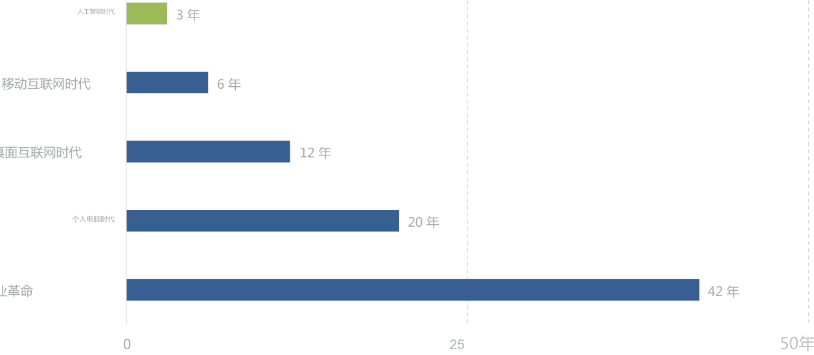

## 技术生态系统和人工智能的采用令人印象深刻

### 英伟达AI生态讲述多年的故事开发者/初创公司/应用数量增长超过100%

英伟达计算生态系统——2021-2025提供

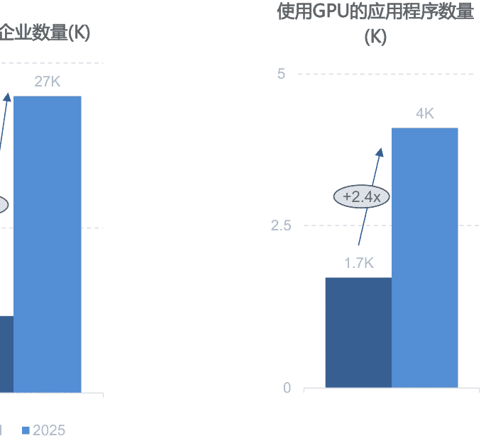

注：GPU = 图形处理单元，来源：NVIDIA(2021年和2025年)

## 科技行业现有企业采用人工智能最高优先级

### 科技行业现有企业焦点

根据Uptrends的数据，企业财报披露中提及及“人工智能”的手段为2020年第一季度至2024年第一季度。

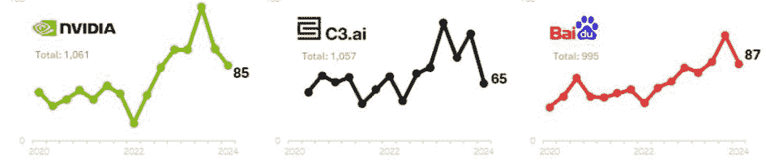
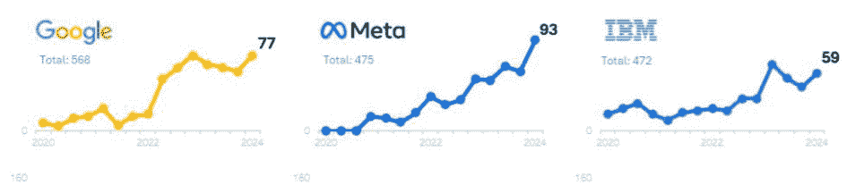
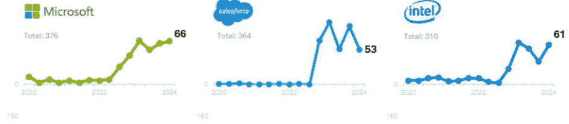

来源：Uptrends，“在收益电话会议上人工智能的前15家公司”（6月24日），公司收益记录

## 科技行业现有企业人工智能焦点会话

生成式人工智能将彻底改变我们所知的所有客户体验，并创造出我们只能幻想的全新体验。早期部署的AI工作负载专注于提高生产力和避免成本在编码、搜索、购物、个人助理、初级保健、痘症和药物研究、生物学、机器人、太空、金融服务、社区网络——一切领域，你将越来越多地看到人工智能改变规则。

> -亚马逊首席执行官安迪·贾西在2024年亚马逊股东信中写道——4月25日

改善生活和重新想象事物的机会是谷歌投资人工智能十年的原因……我们将其视为推进我们组织使命的最重要方式，即信息，使其普及及可用……人工智能带来的机遇是最大的。

> -谷歌CEO桑达尔·皮奇伊@谷歌Next 2025 - 4/25

## 科技行业现有企业人工智能焦点会话

在以下三个领域，[GenAI]

我们认为AI是一个人类工具，它将允许个人做更多……这些人工智能数据中心，如果你愿意的话，会被误认为是人工智能工厂。你给它应用能源，它就会产生非常有价值的东西。

> -伟达联合创始人首席执行官Jensen Huang @ COMPUTEX 2025 -5/25

...这些人工智能数据中心，如果你愿意的话，会被误认为是人工智能工厂。你给它应用能源，它就会产生非常有价值的东西。

> -xAI创始人执行官埃隆·马斯克5月22日

...这些人工智能数据中心，如果你愿意的话，会被误认为是人工智能工厂。你给它应用能源，它就会产生非常有价值的东西。

> -xAI创始人执行官埃隆·马斯克5月22日

认为AI是一个人类工具，它将允许个人做更多……这些人工智能数据中心，如果你愿意的话，会被误认为是人工智能工厂。你给它应用能源，它就会产生非常有价值的东西。

> -xAI创始人执行官埃隆·马斯克5月22日

## 企业AI焦点——全球企业增长与收入……而不是成本降低

## 摩根士丹预测：未来两年（2024年）全球企业将实现生成式人工智能技术升级

- 生产/输出客户服务
- 销售生产力
- 读出
- 集成
- 电路
- 营销支出效益边
- 管理成本制
- 造成本SG&A / 营销
- 员工总数
- 与收入成本比

0% 25% 50% 75%
■ 以收入为中心 以成本为中心

注：调查日期为5月24日，样本量为427，美国公司占43%，日本15%，英国14%，法国14%，德国14%，行业构成：18%为科技行业，18%为金融服务行业，17%为其他行业。医疗行业，17%制造，15%行业，15%消费者，收入组合：13%至5.5亿美元，25.71%至10亿美元，36%至50亿美元，10%至100亿美元，8%至150亿美元，3.5%15亿。

$20B-$20B--Revenue-Focused_and_Cost-Focused_categorizations_per_BOND_not_Morgan_Stanley_Source_AlphaWise_Morgan_Stanley_Quantifying_the_AI_Opportunity_(12/24))

“传统”企业人工智能的采用—优先上升

BOND 69

## 企业人工智能焦点——全球首席营销官 = 75%使用/测试AI工具

摩根士丹利发布的《2024年全球首席营销官（CMO）人工智能应用调查报告》

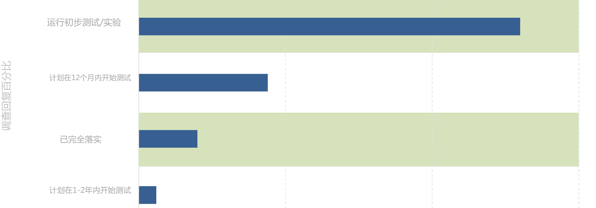

注：本次调研旨在了解全球首席营销官在营销活动中使用生成式人工智能的程度，调研于7月24日开展，共访问了来自全球500+以上企业的300位营销官。调研涵盖地区包括澳大利亚、比利、巴西、加拿大、中国、芬兰、丹麦、法国、德国、爱尔兰、意大利、日本等国家。Luxembourg, Mexico, Netherlands, Norway, Poland, Saudi Arabia, Spain, Sweden, UAE, UK & USA. Source: eMarketer, Morgan Stanley. “Quantifying the AI Opportunity” (12/24)

“传统”企业人工智能的采用=优先上升

## 企业采用人工智能—优先级上升... 美国银行-Erica虚拟助理（6 / 18）

## 美国银行美国虚拟助理-6月18日至2月25日，为美国银行工作

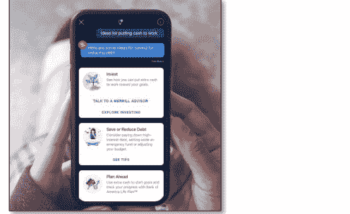

## Erica虚拟助手（MM）的累计客户交互

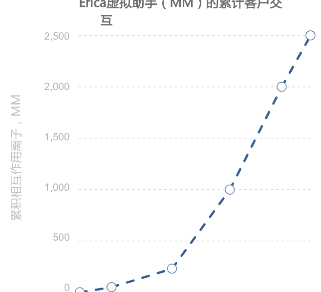

注：Erica是美国银行手机应用内置的对话AI，通过实时洞察、交易查询、账单提提和预算补助等功能帮助客户财务，该AI已处理十亿级交互，为超过4000万客户提供全天金融管家服务。

Erica就是我们客户的私人管家，也是我们的任务控制中心。

自Erica上线以来，我们的数据科学团队已对其性能进行了超过5万次更新——通过调整、扩展和优化自然语言理解能力，确保客户和沟通实现及时且相关。累计20亿客户交互是一个惊人的里程程，但对Erica而言是一个开始。

## 美国银行数字部门主管Nikki Katz，4月24日

注：数据以2018年6月新增客户（Erica）上线时零售用户为基准，试点用户不计入。数据来源：美国银行（2月21日，4月24日，2月25日）

## 企业人工智能—优先级上升... 摩根大通——端到端人工智能现代化（2020）

## 摩根大通端到端人工智能现代化计划——2023-2025年规划（摩根大通）

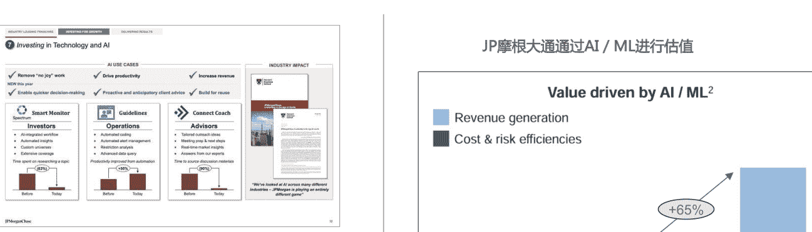

我们对人工智能可能带来的效率提升有很高期望...一些关键的用户告诉我们，他们每周能获得几个小时的工作效率，从定义来说，节省下来的时间是人工智能领域的先行者。但仍然处于这一旅程的早期阶段。摩根大通首席官James Barney表示，5月25日根据摩根大通的说明，“人工智能价值被视为收入增长的投入，成本降低带来的效益——其中大部分通过此前技术相似的幅度来衡量，其余部分则与基准对比。我们在2020年看到摩根大通人工智能现代化的进展：我们正在市场、客户开发、运营、交易等众多领域广泛应用人工智能，形成效果，这一进程还将帮助起步。”数据来源：摩根大通投资者（5月25日）

## 企业采用人工智能—优先级上升 凯撒医疗集团——多模态环境AI系统（10月23日）

凯撒医疗集团人工智能项目（2023年10月至2024年12月），发表了《新英格兰医学》

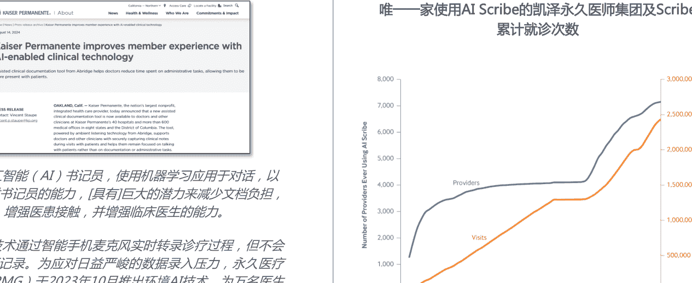

环境人工智能（AI）医生，使用机器学习应用于对话，具有巨大的潜力来减少事务负担并增强医生的能力。这项技术通过手机实时记录诊疗过程，对于日益严格的诊疗数据录入，增强医生的能力并保存语音记录。凯撒医疗集团（TPMG）于2023年10月推出AI技术，为许多医生和护士人员能够帮助他们在不同科室和诊疗场景中提升效率。——新英格兰医学临床知识库报告，2/24来源：Tierney, Aaron A.,人工智能如何辅助诊疗》（3月24日）及Tierney, Aaron A., “Learnings_after_1_Year and over_25 Million_US_(by_Nestor_et_al_,The_AI_Index_2023_Report_Committee_Stanford_HAI_

## 企业采用人工智能—优先级上升... 百胜餐饮集团（2月25日）

## 百胜餐饮集团旗下品牌 By Yum! 将于2月24日至25日举行活动

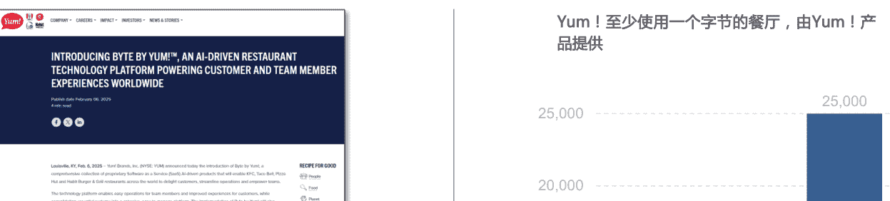

Yum!至少使用一个餐厅。百胜餐饮集团下的人工智能餐厅管理平台通过自动化库存追踪、排班和食品准备提升重复性任务专业化运营，该平台通过机器学习提升餐厅层面的决策效率，提高效率，减少浪费并支持生产。在人工智能的支持下，百胜餐饮集团通过特许经销商提供领先的技术并通过规模化实现经济优势。By Yum!平台包括手机和移动应用订单、销售点、厨房和配送优化、菜单管理、库存和劳动力管理以及团队成员工作。

- Yum! 新闻，2/25

注：百胜餐饮集团旗下品牌必胜、塔奇、精品以及The Habit于2025年2月正式上线，虽然底层技术已在百胜餐厅中应用，但产品套餐已正式发布；由于我们在2/24期间为用户提供了说明，来源：Yum!，《Yum! 产品介绍》，一个人工智能驱动的餐厅平台，为全球客户和团队提供服务(2/25)

BOND “传统”企业人工智能的将优先上升

## 教育/政府/研究AI采用—优先级不断上升

## 教育与政府：美国宣布人工智能集成

## 亚利桑那州立大学的“人工智能能加速”——8/23

## 牛津大学伙伴关系-3/25

## NextGenAI – 3/25 新旧的技术人员团队，开发人工智能（AI）工具研究与人工智能素养五年合作伙伴关系

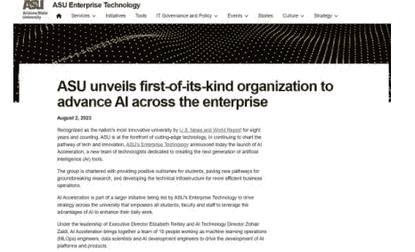

ASU unveils first-of-its-kind order to advance AI across the experience August 2, 2023
Arizona State University (ASU) and U.S. Department of Education have announced the launch of a first-of-its-kind partnership to advance AI in higher education. Technology and empowerment are the keys to preparing students for the future workforce and AI's evolving role.
The group will focus on creating positive outcomes for students, using new pathways for learning and career development.
We are in an era of rapid change driven by AI technology, ensuring students are prepared for the opportunities and challenges of this new landscape.
"We are thrilled to partner with ASU on this," says Elena Rodriguez, Director of Office of Educational Technology. "Our partnership will focus on research, innovation, equity, and student engagement."
"This technology enhances teaching, learning, and accessibility," says Michael Taylor, Provost for Innovation at ASU. We must ensure that the transition is carefully overseen. For example, there is a growing need to address concerns about data privacy, security, and AI models, natural language processing (NLP), multilingual abilities, and bias in decisions made by teachers, administrators, and researchers.

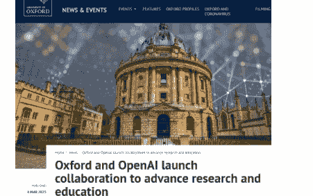

500万美元的财团，有15个大学（麻省理工学院、哥林大学、加州理工学院等）

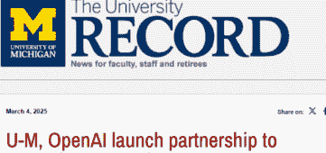

March 6, 2023 Share on: OpenAI launch partnership to expand AI research Dan Jordan, Vice President for Research
The University of Michigan has established a partnership with OpenAI to help artificial intelligence resources, funding and computing power. The collaboration will include joint research projects between the university and OpenAI focusing on AI applications that benefit society.

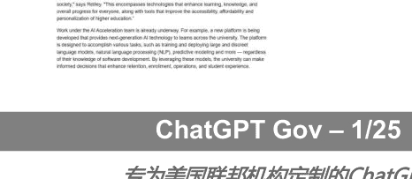

## ChatGPT Gov - 1/25 专为美国机构定制的ChatGPT

## 美国国家实验室-1/25 在网络安全和科学突破

OpenAI ChatGPT Gov: AI-Powered Innovation for Government
April 2023 The University has announced plans to expand artificial intelligence (AI) capabilities with OpenAI.

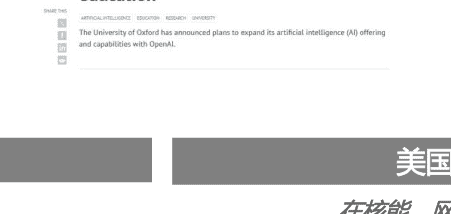

OpenAI toets new government partnership for A.I. infrastructure
来源：亚利桑那州立大学（8/23），牛津大学（3/25），哥歌大学（3/25），Launch Consulting（1/25）通过AI Advantage Daily News, NPR（1/25）

## 政府：越来越多采用主权人工智能策略

## 英伟达主权AI计划-2/25，由英伟达提供

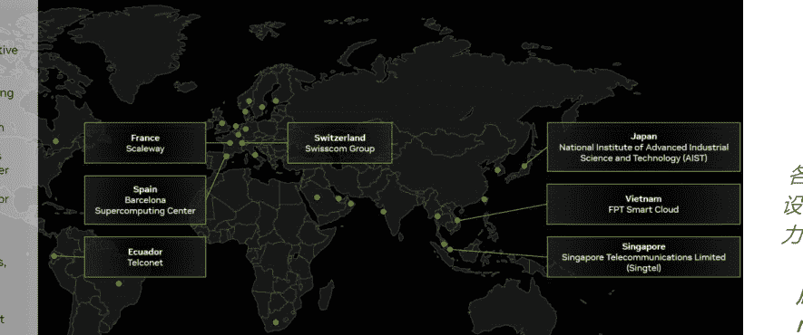

Sovereign AI: Nations are awakening to the imperative to produce AI using their infrastructure, data, and business networks. Nations are building domestic computing capacity.
Some governments operate somewhat clouds in collaboration with state-communications providers or others partner with local cloud providers to deliver a shared AI computing infrastructure for public and private sectors.
NVIDIA's ability to build AI infrastructure with our end-to-end compute platforms, technologies, full-stack software, AI expertise, and rich ecosystems for sovereign AI and customers allows regional cloud providers to jump-start their countries' ambitions.
各国正在投资人工智能基础设施，就像他们曾经投资电力和互联网一样——英伟达联合创始人首席执行官 Jensen Huang，5月25日

Location of NVIDIA sovereign AI partners 来源：NVIDIA (2/25 and 5/25)

教育/政府/研究人工智能的采用--日益优先 BOND 77

## 研究=斯坦福大学HAI称，FDA批准的人工智能医疗设备数量快速增长

美国食品和药物管理局批准的新型人工智能医疗设备-1995-2023，根据斯坦福HAI和美国FDA经批准的AI支持的医疗器械美国FDA新政策（5月25日）

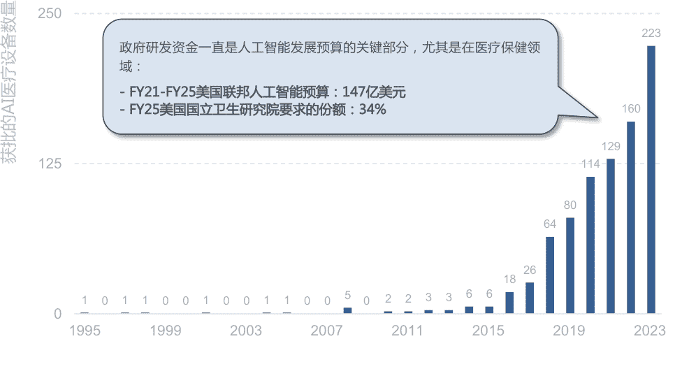

政府研发资金是人工智能发展关键的关键部分，尤其是在医疗保健领域：
- FY21-FY25美国联邦人工智能预算:147亿美元
- FY25美国国立卫生研究院的份额:34%

美国食品和药品监督管理局（FDA）局长达·马卡里医学博士，公共卫生博士（MD, MPH）今天宣布了一项新计划，计划在2025年6月30日在FDA所有中心内部扩大人工智能（AI）的使用，为了反映这项工作的紧迫性，Makary博士已指示FDA的所有中心立即开始部署，目标是在6月底前完成。
-FDA新简稿，5月25日

注：2021年、2022年和2023年的美国政府预算数据为真实数据。2024年预算已发布但尚未实行，2025年预算正在修正中。NIH在总预算中的占比为申请数据。

教育/政府/研究人工智能的运用：日益丰富

# AI用户+使用+资本支出增长=前所未有

## AI使用 - ChatGPT =
根据皮尤研究中心（Pew）和斯坦福大学的数据，美国各年龄段的人数都在快速增长。美国成年人中自称使用ChatGPT的比例——皮尤研究中心显示为7月23日，斯坦福大学数据显示1月25日。

一个过于简单的说法是：老年人把ChatGPT当作谷歌的替代。三分的人把它当作人生导师。
- OpenAI联合创始人兼首席执行官Sam Altman（5月25日）

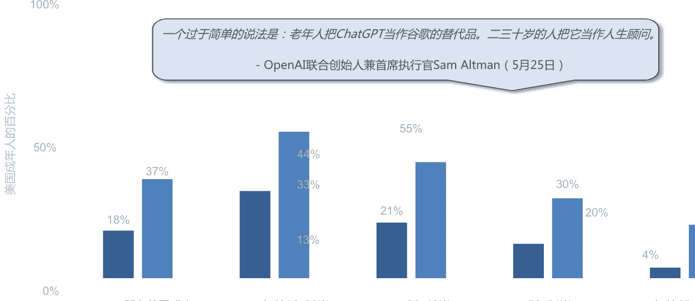

- 7月23日-根据皮尤；1月25日-根据斯坦福大学的估计

注：7月23日皮尤研究中心发布的ChatGPT使用数据（样本量n=10,133美国成年人），作者数据未显示；1月25日斯坦福大学发布的AI模型使用研究（样本量n=500美国成年人）中，相关数据基于整体AI工具使用率统计。注意，本表汇总了多个受访者任用AI工具使用ChatGPT平均72%的使用率进行调整。需要注意，此处数据统计可能在不可直接对比的情况下。数据来源：皮尤研究中心（2024年3月26日）、斯坦福大学（2025年3月12日发布）、萨·阿尔特曼（2025年5月12日发布）《财富》杂志

## AI参与度(ChatGPT应用作为代理) = 每天花在21个月以上的时间增加了202%...

Sensor Tower数据显示，美国活跃用户在ChatGPT应用上每天花费的分钟数（7月23日至4月25日）。

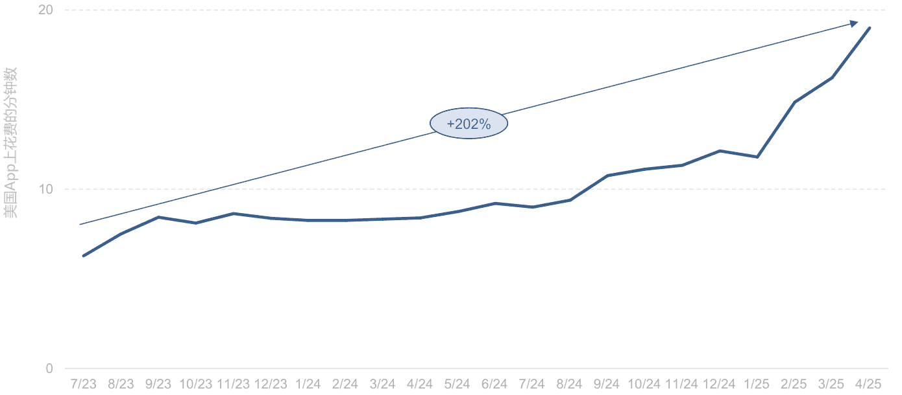

注：数据代表美国App Store和Google Play Store的月活跃用户，数据仅针对ChatGPT独立应用。截至5月25日，ChatGPT在中国、俄罗斯部分其他国家和地区尚未上线。来源：Sensor Tower（5月25日）

## AI参与度(ChatGPT应用作为代理) = +21个月内的时长增长了106%，持续时间增长了47%

ChatGPT应用的美国用户平均会时长（分钟）及每日用户会话次数（7月23日至4月25日，根据Sensor Tower数据）。

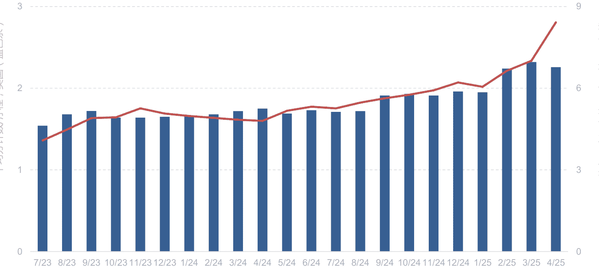

注：数据代表美国App Store和Google Play Store的月活跃用户，数据针对ChatGPT独立应用。截至5月25日，ChatGPT应用在中国、俄罗斯及其他国家和地区尚未上线。来源：Sensor Tower（5月25日）

## 根据YipitData的数据，27个月内的AI留存率（以ChatGPT为代理）为80% vs. 58%

根据YipitData显示，消费者版ChatGPT和Google搜索全球桌面用户留存率（1月23日至4月25日）。

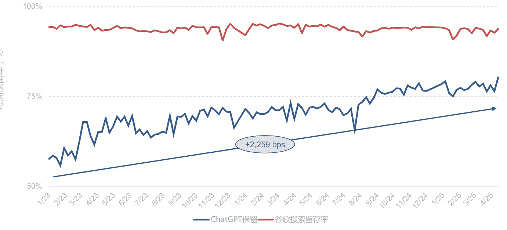

注：保留率（Retention Rate）指当前用户中在当前再次活跃的用户占比，该数据基于数百万全球桌面用户的点击流统计，包含用户信息及网页请求数据，通过VPN、浏览器等网络服务/应用程序采集。用户需连续两个月保持活跃方计入人数，样本具有代表性，但中国数据可能因政府限制存在信息偏差，排除2023年12月24日、12月31日、2024年12月22日、12月29日及2025年1月5日企业使用率下降的异常数据。数据来源：YipitData（2025年5月25日）

## AI聊天机器人@工作说明 = 72%做事更快/更好

美国就业成年人中使用AI聊天机器人的人群比例——在涉及工作时工具有用——皮尤研究中心，10月24日。

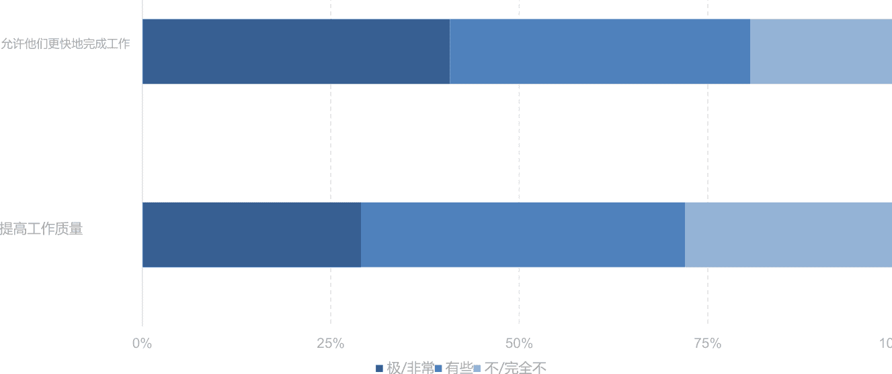

注：N=5273美国成年人，他们从事兼职或全职工作，只有一份工作或多个工作，但认为其中一份是他们的主要工作。资料来源：皮尤研究中心（10月24日）

BOND AI用户+使用+资本支出增长=前所未有85

## 聊天机器人@学校 (ChatGPT作为代理) = 研究/问题解决/学习/建议方面的偏见

## OpenAI发布《ChatGPT使用调查报告（美国18-24岁学生群体）——调查时间为12月24日至1月25日，数据来源：OpenAI。

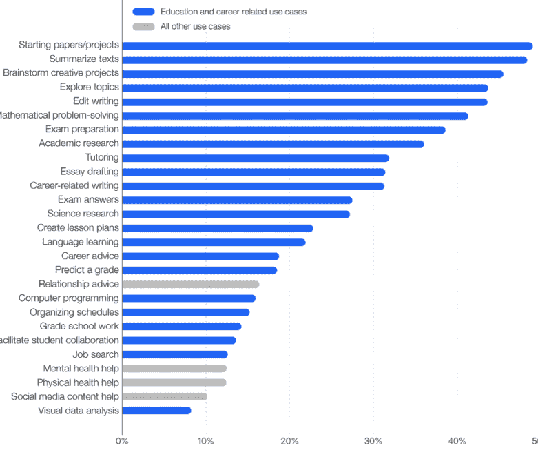

注：数据来源OpenAI调查（12月24日发布），样本量为1299名来自STEM学科的美国大学生及研究生；仅采用18至24岁年龄段的回答，包含AI使用者与未使用者——即未来6个月内对AI接触。数据来源：OpenAI，《构建劳动力：美国大学生使用状况》（2月25日）

## 使用扩展-深度研究 = 自动化专业知识

## 参与度(ChatGPT应用作为代理) = +21个月内的时长增长了106%，持续时间增长了47%

## 谷歌 Gemini = 深度研究

## OpenAI聊天机器人 = Deep Research

## xAI Grok = 深度搜索

通过Deep Research，你可以快速了解任何事情。Deep Research是Gemini的一个代理功能，它可以自动浏览数百个网站，考虑不同类意见的发现并构建报告。这是朝着更具理性的AI，不仅可以简单的问答，还可以成为真正的伙伴。今天，我们在ChatGPT上进行研究，是一种新的代理能力，可以在互联网上执行任务并在几分钟内完成人类需要很长时间才能的事情。Deep Search的目标是整合复杂的信息，对冲突的事实和观点进行处理并得出清晰的结论。

- Google Deep Research，发布于12月24日
- OpenAI Deep Research Release-2月
- xAI Grok 3 新发布2月

来源：谷歌（5月25日）、OpenAI（2月25日）、xAI（2月25日）、Digital Trends（1月5日）

用户+使用+资本增长=前所未有

## AI代理进化 = 聊天回复→ 正在工作

## 一种新的AI正在出现——更少的助手，更多的服务提供

最初的对话界面现在可能正在演变成更强大的东西。传统的聊天机器人被设计成用户的提示，通常是在严格的脚本或狭窄的流中，他们得到答案、总结文本或模仿对话——处于一个被动的、有限的框架中。人工智能代表着巨大的进步。这些智能长期运行程序能够代表用户进行推理、行动和完成多步骤任务。它们不只是回答问题——它们执行预设会议、提交报告、登录跨平台调度，通常使用自然语言为其指令。这种转变反映了一种更广泛的历史模式——就像21世纪初，静态网站位于动态网络应用程序——Gmail和谷歌Maps等工具将互联网从一个页面集合变为一系列实用程序一样，人工智能代理正在对话界面转化为基础设施。早期的助手需要明确的输入并产生狭窄的输出，而智能助理承诺将以目标为导向，具有自主权限和特定的限制条件。它们承诺理解意图、管理记忆，并跨越程序完成实际工作。与其说是响应，不如说是完成。虽然我们处于早期阶段，这些药物开发还处于早期阶段，但影响才开始显示。人工智能代理可以重用模型与数字系统的交互方式，从客户支持和入职到研究、日程安排和内部运营。企业在引领这一潮流；他们不仅尝试代理，而且保留了它们，投资于框架，并围绕自主执行建立生态系统。曾经是一个消息传递接口，现在变成了一个动作。

## AI代理（谷歌搜索） = +1,088% Over Sixteen Months

全球谷歌搜索“AI Agent”——1月24日至5月25日，根据Google Trends

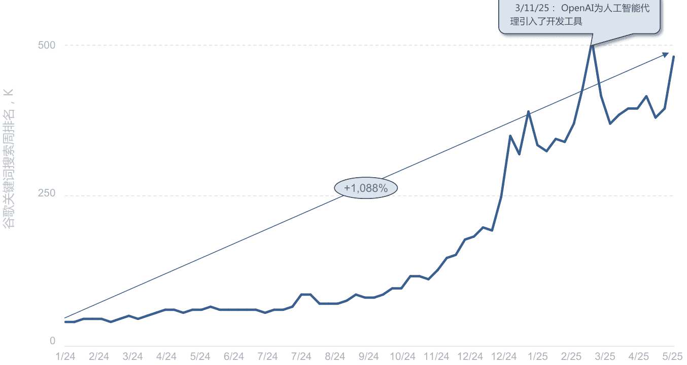

来源：谷歌Trends通过Glimpse（5月15日，2024年），OpenAI（3月25日）

## AI代理部署 = 人工现有产品加速推广

## AI现有代理启动

## 已释放的代理 = 选择功能

- Salesforce代理服务 (10/24=一般发布)
- 自动化的客户支持
- 案件处理
- 铅资产
- 订单跟踪

- Anthropic Claude 3.5计算机使用 (10/24=研究预览版发布)
- 直接控制电脑屏幕来执行任务，从网站提取数据

- OpenAI Deep Research (1/25=研究预览版发布)
- 直接控制屏幕来执行任务，从网站提取数据

- 亚马逊新法案 (25=研究预览版发布)
- 家庭自动化
- 信息收集
- 采购

来源：Salesforce (10/24日), Anthropic (10/24日), OpenAI (1月25日), 亚马逊 (2月25日)

## 人工智能的下一个前沿 = 通用人工智能

人工智能（AGI）是指能够执行人类所有智能任务的推理、规划，从数据中学习并跨越学科。与当前的AI模型不同，AGI可以在特定的（尽管是广泛的）范围内发挥作用，像人类一样并在具体环境中运作。这代表了人工智能的发展的一个里程碑——建立在最近基础上的模型规模、训练和计算效率。AGI的时间仍然不确定，但预期的频率近年来发生了重大变化。OpenAI首席执行官Sam Altman在1月表示：“我们相信，如今已掌握从传统意义上通用人工智能（AGI）的完整方法。这并非一条式的，而是基于模型架构、推理效率和训练规模领域的突破性进展，不断缩小科研成果与实际应用之间的鸿沟。”如果实现，AGI将重新定义智能。AI的发展以前以前所未有的速度。

人工智能可能并非终点，而是一个阶段性的转换——它如何重构人类、劳动力决策方式，取决于未来的保障措施和监管框架。生产力的提升可能意义重大，但地缘政治、道德和经济影响可能会逐渐演变，而不是突然的变化。推理=完全训练好的模型根据用户输入生成预测、答案或建议。此比训练更快、更高效。

## AI用户+使用+CapEx增长=前所未有

要了解资本支出的发展方向，看看过去的发展很有帮助了。在过去的二十年里，技术资本支出在数据的漫长线上不断上扬——首先是存储/访问，然后是分发/规模，现在计算/智能。

第一波浪潮见证了资本支出融入基础设施建设——大规模的服务器群、海底电缆和早期的数据中心，让亚马逊、微软、谷歌等公司得以奠定云计算的基础。这是第一阶段：存储、组织、提供计算。

第二波浪潮——仍在持续发展——为数据密集型数据提供超强计算能力，这是云计算的自然上演。超大规模运营商的资本支出预算越来越趋向于专用芯片（GPU、AI加速器等）、液冷系统和前沿数据中心设计。2019年，人工智能项研究功能；到2023年，它将成为一项资本支出项目。微软主席总裁Brad Smith在4月25日的一篇博文中很好地描述了这一点：就像过去的电力和其他通用技术后，人工智能和云数据中心代表了工业化的下一个阶段。全球最大的科技公司每年投入百亿美元——不是为了收集数据，更是为了从学习、分析并实现。这仍然关于数据——现在，优势属于那些最快训练数据、最深度个性化数据，并将数据部署到最广泛的人。超大规模（大型数据中心运营商）是亚马逊云网络（AWS）、微软Azure、谷歌云平台（GCP）、阿里巴巴、阿里云、IBM和腾讯。

## 资本支出——大型科技公司 = 在上获得的荣誉数据使用+存储量激增

## 六大科技公司（美国）的资本支出=+十年内增长率为21%

美国六大科技公司资本支出（美元）与全球数据生成量（泽字节）对比——2014-2024年，根据Capital IQ与Hinrich基金数据。

随着数据量的增加，更多的资本支出来建大规模数据中心、更快的网络基础设施和更大的计算能力。

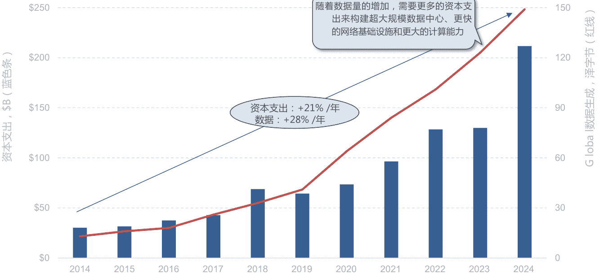

资本支出：+21%/年 数据：+28%/年

*注：美国六大科技公司包括苹果、英特尔、微软、Alphabet、亚马逊和Meta平台/脸书。亚马逊显示AWS资本支出与营收（不包含亚马逊零售业务的资本支出），根据摩士尔利亚估算，AWS资本支出等于AWS新增固定资产减去融资租赁资产及债务后的差异。数据来源：Capital IQ（3月25日），OpenAI（3月25日）。

## 资本支出——大型科技公司人工智能超级影响

## 亚马逊AWS的资本支出——云与AI模式

## 资本支出占收入的百分比(AWS作为代理)——AI与云建设

根据摩根士丹利的数据，49%(2024年)对比4%(2018年)对比27% (2013年)。

亚马逊资本支出占收入的百分比——2013-2024年，摩根士丹利估计。

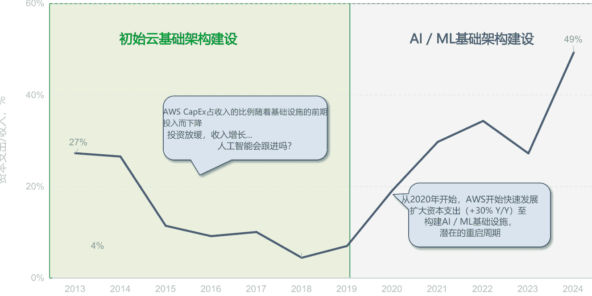

注：图中所示数据代表AWS，根据摩根士丹利估算，AWS资本支出等于在房地产和设备上的新增增量减去融资额及债务。
来源：亚马逊，摩根士丹利（5月25日）

## 技术资本支出出的部分诱因

### GPU性能的材料改进

### NVIDIA GPU性能——八年增长225倍

价值10亿美元的数据中心工作比较，根据英伟达数据，GPU系列性能随时间变化趋势——2016-2024年。GPT-MoE推理负载¹

| 帕斯卡尔 | 优伏格 | 安培 | 漏斗 | 布莱克斯尔 |
| :--- | :--- | :--- | :--- | :--- | :--- |
| 2016 | 2018 | 2020 | 2022 | 2024 |
| GPU数量 | 46K | 43K | 28K | 16K | 11K |
| 工厂AI FLOPS | 1EF | 5EF | 17EF | 63EF | 220块 |
| 年度推理标记 | 50B | 1T | 5T | 58T | 1,375T |
| 年度代币收入 | $240K | $3M | $24M | $300M | $7B |
| 直流电源 | 37瓦 | 34瓦 | 25瓦 | 19瓦 | 21瓦 |
| 每兆瓦年代币 | 1.3B | 2.9B | 200B | 3T | 65T |

> ...在八年时间内性能+225倍，同时需要的图形处理器数量减少4倍...

> ...推断令牌容量+27,500，为期八年，这意味着理论令牌收入将增加+30,000+...

> 在八年中，数据中心的用电量下降了43%，导致单位能耗提高了+50,008倍

¹GPT-MoE推理负载(GPT Inference Workload)采用混合专家Mixture-of-Experts，相同MoE架构的GPT模型进行推理(即时预测)的工作类型，年度代币收入每个代币生成成本，数据来源于：英伟达(5月25日)

## NVIDIA安装的GPU计算能力——六年增长100倍+

英伟达GPU能力（每秒浮点运算次数）全球计算量（Q1: 19-Q2:24, 按AI时代划分）。

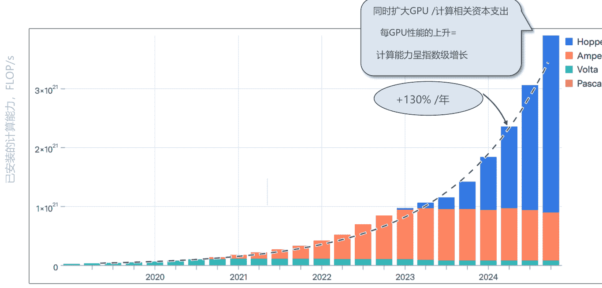

注意：分析不包括TPU或其他专用AI加速器，因为其可用数据较少，TPU可能提供与NVIDIA芯片相当的总计算能力。
来源：Epoch AI (2023年5月25日)

## 技术资本支出受益人

### 英伟达

## 关键技术资本支出受益者：英伟达

全球数据中心资本支出的25%及增长，根据英伟达数据。

## 全球数据中心资本支出($B)与英伟达数据中心资本支出、收入对比——2022-2024年

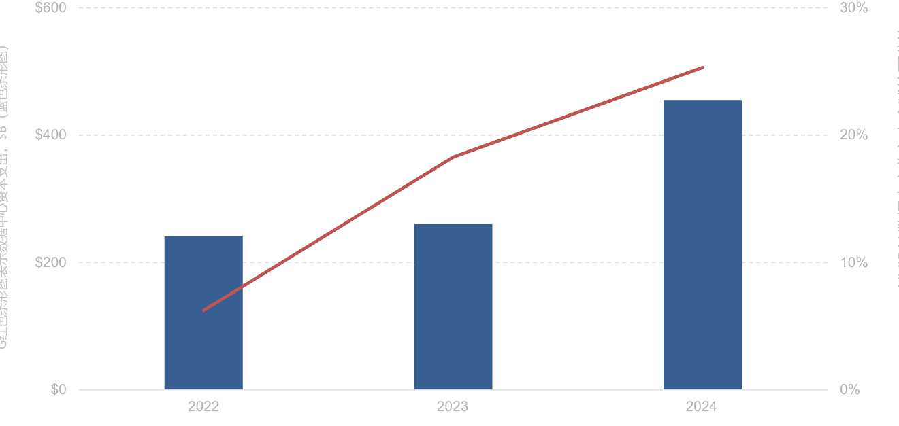

注：数据中心支出代表英伟达2024财年（截至2025年1月），由Jensen Huang在GTC 2025上的演示，数据来源：英伟达公司（3月25日）

## 科技公司：研发支出与资本支出同步增长

六大科技公司研发支出占收入的13%，而十年前是9%。美国大型科技公司研发支出（美元）与收入对比——2014-2024年。

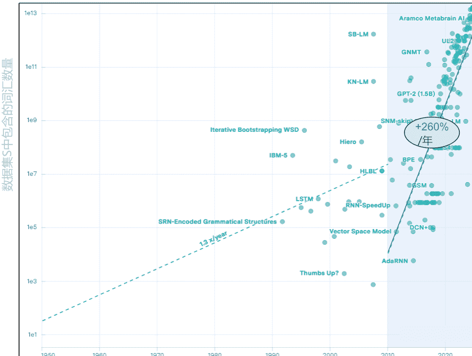

注：美国六大公司包括苹果、英特尔、微软、Alphabet/谷歌、亚马逊及Meta。数据来源：Capital IQ（3月25日）

## 六大巨头：资金充足，用于人工智能和资本支出

六大科技公司自由现金流增长263%至390亿美元。

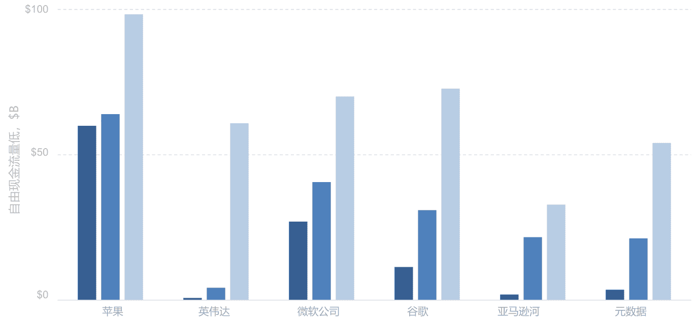

## 六大巨头：拥有大量资金，用于人工智能和资本支出

美国大型科技公司自由现金流增长103%至430亿美元。

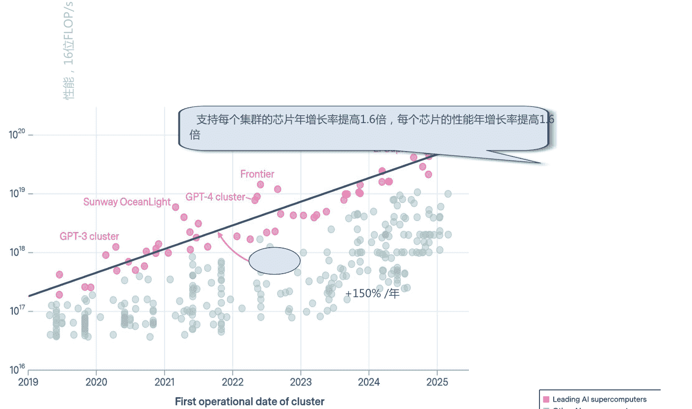

注：美国六大公司包括苹果、英伟达、微软、Alphabet/谷歌、亚马逊及Meta，该图标识了资产负债表中的现金及等价物，数据来源：Capital IQ (3月25日)

## 技术资本支出驱动因素：计算训练和运行模型的花费

要理解人工智能计算经济的演变，看看本报告集中在何处以及他们的目标。培训成本仍然高得惊人，而且在快速上升。如今每个模型的训练成本常常超过1亿美元。正如Anthropic公司首席执行官Dario Amodei在2024年中出的，目前人工智能模型训练成本已达1亿美元，而当前正在训练中的模型有些接近10亿美元。围绕这些核心计算成本，还有其他高成本：研究、获取和托管，以及工资、日常开销和市场的混合。

尽管训练模型的成本不断攀升，但人工智能总支出大部分将转向推理——即大规模运行模型的成本。推理是持续不断的，涉及许多项、查询和解决，而推理模型是同步性的。正如亚马逊首席执行官Andy Jassy在2025年4月给股东的信中所说的，虽然模型占人工智能总支出的很大一部分，但推理代表未来人工智能的绝大部分，因为客户定期训练他们的模型以便不断产生推理。

英伟达联合创始人兼执行官黄仁勋在公司2026年第一季度财报电话上也提到，推理能力正在飞速发展。推理AI代理模型所需的能力要高出几个数量。从规模上看，推理是一个持续的成本中心——尽管训练模型成本下降，但它与其使用一起增长。

单位成本的降低推动了总支出增长。随着人工智能的使用越来越多，基础设施和计算资源总量在不断增加，导致成本再次上升。其结果是一个增长的飞轮，给提供方、芯片制造商和企业投资带来红利。人工智能的经济在快速演变——但目前而言，它们受到数据密集型、大规模基础设施和服务需求指数增长的竞争的驱动。

## 数据中心：人工智能资本支出的主要受益方

## 关于人工智能基础设施的经济学

看看数据中心建设的速度和规模是有用的。当前一波由人工智能驱动的需求浪潮将数据中心支出推至历史新高。根据Dell'Oro Research的数据，到2024年，全球IT公司数据中心的资本支出将达到4550亿美元，并且在加速增长中。超大规模公司和人工智能优先的地区都投入了十亿美元来构建计算能力——不仅用于存储，而且是用于实时推理和模型训练负载，这些负载需要密集、高功率的硬件。随着人工智能从实验性转向实用性，数据中心也是如此。

英伟达联合创始人兼执行官黄仁勋表示，这些数据中心实际上就是AI工厂。这种速度比许多预期的要快。著名的例子可能是内内华州的Colossus工厂，它从一个空的工厂变成了一个完全运作的数据中心只用了122天。如所述，它的面积为75万平方尺——相当于418个普通住宅，它花的时间是美国住宅所需时间的一半。英伟达联合创始人兼执行官黄仁勋表示，他们取得的成就独一二二，这类时间线不再是例外。通过预制模块化设计和简化的审批流程，新的数据中心正在以类似于房产开发的速度崛起。在这种速度下，资本支出是由土地、电源供应、芯片和冷却引起的——远超传统的计算机。相比之下，OpEx主要由能源成本和系统维护主导，特别是在恒定负载运行的高密度集群。营收主要来自产品销售——无论是以人工智能平台服务还是内部效率提升。这些不仅是物理资产，它们将塑造未来十年人工智能的格局。

## 数据中心价值，美国加速增长超过两年

美国人口普查局统计的美国数据中心年度化建筑价值($B)——1月14日至12月24日

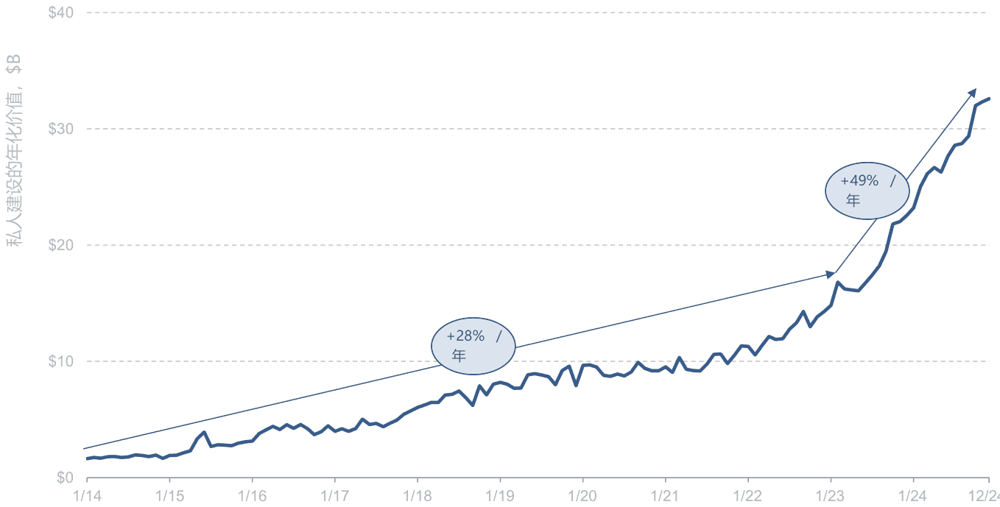

注：所有数据均经过季节性调整。数据来源于美国人口普查局的建筑安装（VIP）调查，该调查每月提供新增金额估计。美国境内工程完成值经年化处理以消除季节性波动，来源：美国人口普查局

## 数据中心新建容量与现有容量对比，美国内的新16x与现有5x

世邦理仕《美国主要市场数据中心容量（兆瓦）——2020-2024》

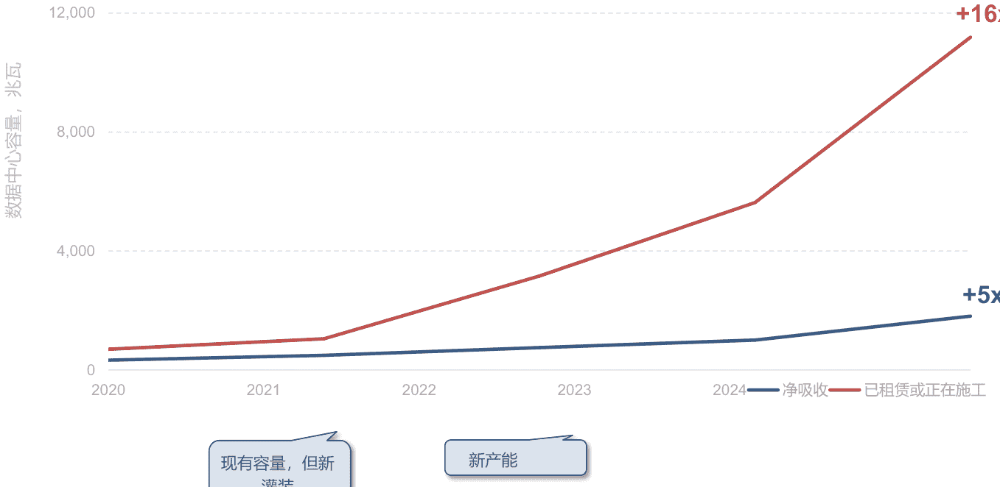

注：仅限美国主要市场（北利福尼亚、亚大略、芝加哥、凤凰城、达拉斯-沃顿、希尔伯伦、硅谷、纽约州）。来源：世邦理仕，《美国数据中心趋势2024年下半年》，2月25日

## 数据中心建成时间 (以xAI Colossus作为代理）：122天，而版为234天

122天=一个完全运行的数据中心-2024年...75万平方尺=418个家庭的规模

122 Days = One Half-Built House–2024 (Average Build Time =234 Days)

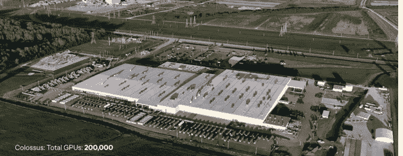

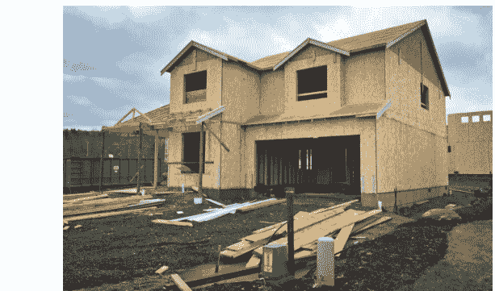

Colossus: Total GPUs: 200,000
- Phase 1: 122 days - 100k GPU training synchronous. From scratch.
- Phase 2: 92 days to expand to 200K GPUs

75万平方尺，1,792平方尺

> 我们被告知需要24个月才能完成，于是我们自己动手，质疑一切，去掉所有必要的，四个月内就完成了我们的目标。—— xAI网站

注：美国住宅市场数据截至2025年1月，根据彼格储经济研究所 (FRED)统计，美国住宅由田纳西州梅菲斯市原伊莱萨克斯工厂改造而成，单体建造周期以实际工程的实际计算。该最新数据为2024年统计，实际为2023年开工项目的时长。来源：xAI，美国人口普查局，圣路斯联储银行，美联数据共享

数据中心是人工智能资本的主要支出之一

## 数据中心计算(xAI Colossus作为代理)：7个月内从0到20万个GPU

xAI Colossus GPU-4月24日至11月24日，适用于xAI

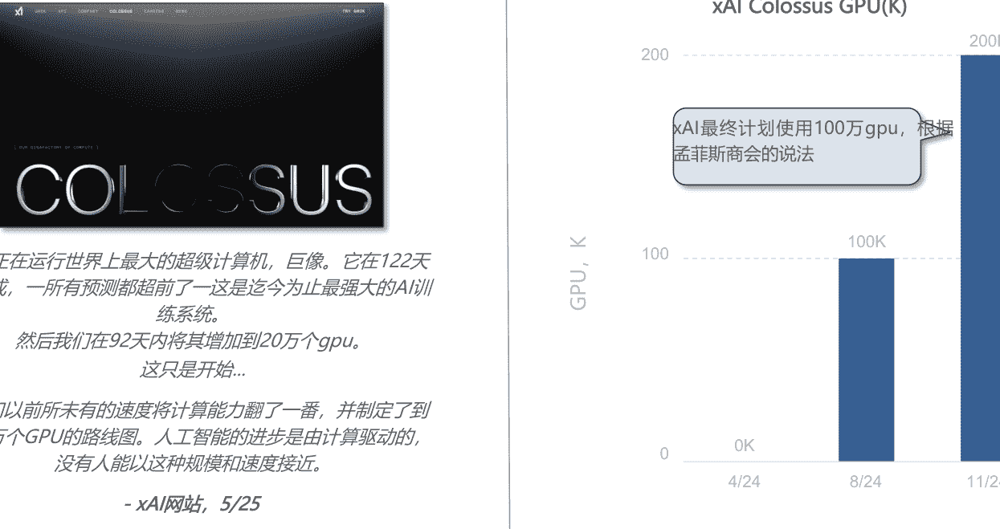

我们正在运行世界上最大的超级计算机，Colossus。它在92天内建成，规模以以前未有的速度增加到20万个GPU。注：根据xAI Colossus的信息，我们在2024年8月30日部署了20万个GPU，其中首次迭代训练数据：xAI（5月25日）、萨士公司（3月24日）

数据中心是人工智能资本支持的受益者

## 数据中心：耗电量大

AI和能源观察/引用在此处接下来的两页来自《世界能源展望报告》，国际能源源（IEA）的《能源与人工智能》。要了解基础设施的发展方向，看看人工智能能力与电力供应之间日益加剧的紧张关系。数据中心主要用于人工智能训练和服务的设施，其耗电量开始占全球约1.5%2024年)。能源需求在全球范围内增长，自2017以来，数据中心的电力消耗每年增长约12%，是总电力消耗的四倍多。随着电力需求的增长，其集中度也在增加：美国占全球数据中心容量的45%，其次是中国（25%）和欧洲（15%）。另一方面，除中国以外的新兴经济体和发展中经济体占全球互联网用户的50%，但占数据中心容量不到10%。

## 数据中心电力消耗，全球1年增长3倍

国际能源署《按数据中心类型和设备划分的全球数据中心能耗——2005-2024年》

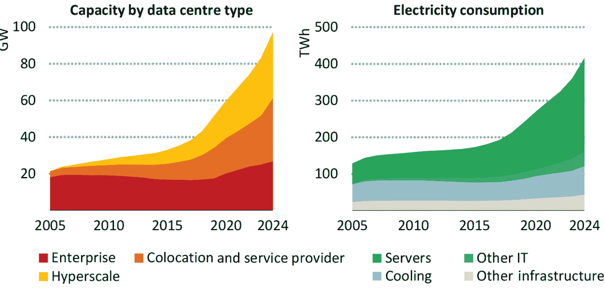

来源：国际能源机构 (IEA)，《能源和人工智能》(4月25日)

## 按地区列出的数据中心耗电量：美国领先，根据国际能源署

国际能源署《2005-2024年各区域数据中心用电量》

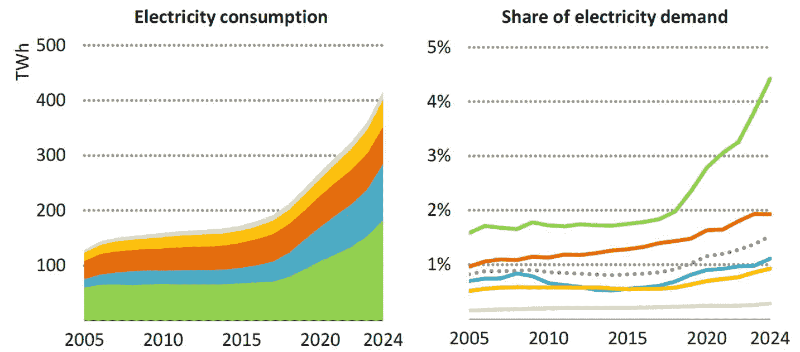

- United States
- China
- Europe
- Asia-Pacific excl. China
- Rest of world
- Global average

来源：国际能源机构（IEA），《能源和人工智能》（4月25日）

## 大纲

1. 看起来变化发生得比以往任何时候都快吗？是的，确实如此。
2. AI用户+使用+资本支出增长=前所未有。
3. AI模型计算成本高/每令牌的推理成本上升+性能趋同+开发者使用率上升。
4. AI使用+成本+损失增长=前所未有。
5. AI收益=快速。
6. AI数据驱动=增长。
7. 资金充足，用于人工智能和资本支出。

## AI_Model_Compute_Costs_High / 上升
+ 每个令牌的推理成本下降= 性能趋同+开发人员使用率上升

## 模型训练成本=
~每8增长2400倍，根据艾戈人工智能与斯坦福大学的研究

前沿人工智能模型的预估训练成本——2016-2024年，AI与斯坦福大学联合研究

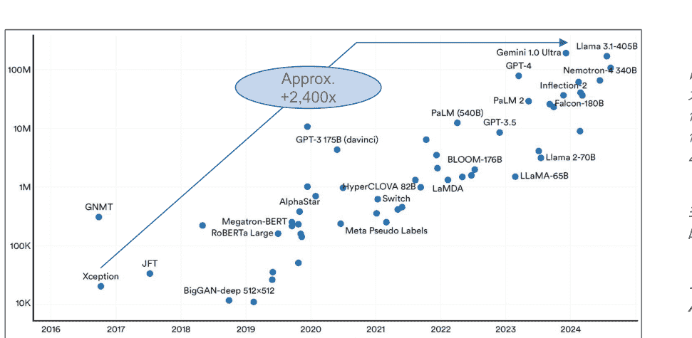

目前，[人工智能模型训练成本]需要12亿美元，现在有些模型的训练规模已经接近100亿美元了。没错，我认为如果能达到100亿到1000亿美元的规模，我认为将在2025年、2026年、甚至到2027年实现……

我认为，训练100亿美元的模型，是的，可能会在2025年的某个时候开始。

> ~Anthropic联合创始人首席执行官Dario Amodei (2024)

注：本数据为预估值，存在可能存在成本偏差，本文未包含多数中国模型；资料来源：《2025年人工智能指数趋势报告》(斯坦福大学HAI人工智能研究院发布人工智能指数指导委员会，2025年4月25日)及Nestor Maslej等通过《时代》杂志发布的《人工智能指数》第六期，参见《优秀人类》播客节目（2024年6月24日）。

AI_Model_Compute_Costs_High__ +推测成本单枚持续上升，性能持续，

## 人工智能模型计算成本高/上升+
Inference_Costs_Per_Token_下跌= 性能趋同+开发人员使用率上升

要了解人工智能计算的发展轨迹，不妨回顾一下个人电脑早期的一个想法。

“软件是一种气体，它会膨胀以填满它的容器，”1997年任职首席技术官的内森·梅尔沃说道。人工智能的发展趋势相同：随着模型性能的提升，使用量持续增长——而使用量的增长又会带来计算需求的增加。我们看到这种需求贯穿于每一个层面：查询量数量多、每个模型产生的令牌数量越来越多。

人们对人工智能的需求并没有放缓。它正在每一个资源领域发展——就像软件在桌面和云计算时代所做的那样。

但基础设施并非滞后于。事实上，其发展速度比直接其他其他任何层都要快，而且是以前所未有的速度。正如第136页所述，英伟达2024年的GPU生成成本比2014年的开辟前代产品降低了105,000倍。

这是一个惊人的飞跃，它讲述了一个更深层次的故事：不仅是成本的下降，而且是建筑和材料的创新，这在重塑硬件层面的可能性。

这些效率的改进对于弥消人工智能和互联网使用对电网带来的压力至关重要。但到为止，这些措施仍不够。

这一趋势与詹姆斯·史丁斯预测相反，史丁斯早在1865年提出：提高资源效率的技术进步实际上导致了这些资源的总体使用增加。这使得人们将注意力转向扩大能源生产，同时也引发了有关电网管理能力的新问题。

再次，我们认为这是技术中永有的“瓶颈”之一：成本下降，性能提升，所有这些改进都在进行中。

英国工程师威廉·威廉斯·詹姆斯·史丁斯在19世纪末的英国首次观测到这一趋势。他注意到蒸汽汽车的发展并取代了马车，反而导致了煤炭使用量的增加。在的著作《蒸汽困境》中，他指出：“认为燃料的增加等同于燃料使用量的减少是荒谬的，事实如此。”

人工智能计算成本/训练+ Inference_Costs_Per_Token= 收益

## AI推理“货币”= 代币

## What are tokens and how to count them?
Updated over 3 months ago

## What are tokens?

Tokens can be thought of as pieces of words. Before the API processes the request, the input is broken down into tokens. These tokens are not cut up exactly where the words start or end - tokens can include trailing spaces and sub-words. Here are some helpful rules of thumb for understanding tokens in terms of length:

- 1 token ≈ 4 chars in English
- 1 token ≈ 3/4 words
- 100 tokens ≈ 75 words
- 1-2 sentence ≈ 30 tokens
- 1 paragraph ≈ 100 tokens
- 1500 words ≈ 2048 tokens

To get additional context on how tokens stack up, consider this:

- Wayne Gretzky's quote "You miss 100% of the shots you don't take"
- OpenAI's charter contains 476 tokens
- The transcript of US Declaration of Independence contains 1695 tokens

其他背景：1百万令牌≈750,000个单词
- 一本标准的书3500页（双字体）
- 每次ChatGPT交互消耗200个令牌（输入+输出），10万令牌相当于5000次ChatGPT响应

人工智能计算成本/上升+ Inference_Costs_Per_Token_下降=性能生效+开发者使用135

## AI推理成本——NVIDIA GPU=105,000倍，十年内生成令牌减少
每LLM所需能量（焦耳），英伟达——2014-2024年，根据英伟达数据

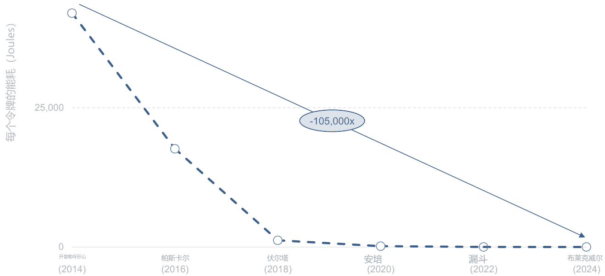

注：Kepler于2012年发布，NVIDIA标记了截至2014年的性能值。来源：NVIDIA公司（2月25日）

## AI推理成本-服务=根据Stanford HAI，两年内下降了99.7%
AI推理服务定价（每百万美元）——1月22日至12月24日，由斯坦福HAI提供

注：轴为对数，价格阶梯

| 指标 | 尺度 |
| :--- | :--- |
| GPT-3.5 level in multitask language understanding (MMLU) | GPT-4o level in PhD-level science questions (GPQA) |
| GPT-4 level in code generation (HumanEval) | GPT-4o level in LMSYS Chatbot Arena |

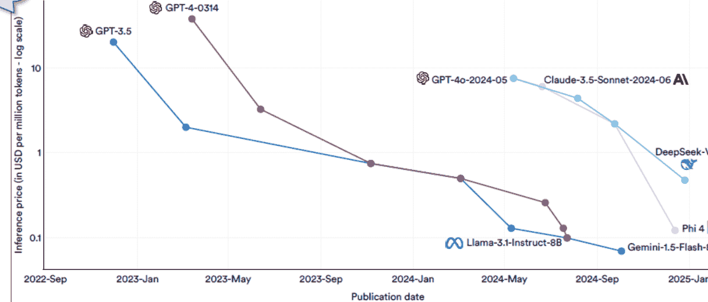

来源：Nestor Maslej等，《人工智能指数2023年年度报告》（6版）人工智能指数委员会,斯坦福大学HAI（4月25日）

## AI成本效益增益速度比以前的技术更快
根据OpenAI、John McCallum和Richard Hirsch的数据，关键技术推出以相对成本

注：美国消费及服务价格变动自1997年以来的百分比为基。数据基于消费者价格指数（CPI）。根据OpenAI显示，在大型语言模型响应中，100个令牌可生成75个单句，图示数据对应数量，并非技术诞生之年，而是数据获取的起始年份。资料来源：《电力成本—美国电力转型》（1989年）《计算机成本每一份》，麦伦原始资料及历史公司文件，OpenAI、维基共享

人工智能计算成本/上升+ Inference_Cost_Per_Token_下降=性能提升

## 科技的永恒启示=成本下降+性能提高采用率上升
美国互联网用户（百万）与相对IT成本对比——1989-2023年，根据FRED和国际电信数据

注：FRED数据显示为《美国消费者价格指数：信息技术、硬件及服务的平均值》，数据来源：圣路易斯储备银行（FRED）与国际电信银行（通过世界银行）（4月25日），

人工智能计算成本/上升+ Inference_Costs_Per_Token_下降=性能提升+开发者使用率上升

## 科技的永恒熵=价格下降 + 使用上升

## 人工智能模型训练计算 (FLOP) 与相对IT成本对比——1989-2024年，按周期AI与FRED

注:petaflop/FLOP（每秒执行10^15次运算）的计算能力，代表1petaFLOP/24小时完成的总量，相当于8.64×10^18次。该指标常用于机器学习模型训练等大规模任务所需的计算资源量。FRED显示，美国消费者价格指数（涵盖硬件、设备和服务等）的平均值为6.4，虽然训练计算并非直接影响模型性能与需求密切。数据来源：美国联储（FRED）；Epoch AI (2023)

## 人工智能模型计算成本高/上升+ 每个令牌的推理成本下降=性能

## AI模型性能=根据斯坦福HAI的报告，融合正在加速
斯坦福大学团队在LMSYS聊天竞技场（1月24日至2月25日）展示顶尖模型

注：LMSYS聊天竞技场是一个公共网站，用户通过对比选出最优。来源：Masley等人，《人工智能指数报告》（第6期），斯坦福大学HAI（4月25日）

## 人工智能模型计算成本高/上升+ 每个令牌的推理成本下降=性能趋同+开发者使用上升

## 为了了解人工智能开发者的活动激增，看看下降的情况：推理成本和强大的模型越来越容易

在2022年至2024年之间，运行语言模型的成本下降了99.7%——这是硬件和算法效率巨大推动的。曾经对大公司来说非常昂贵的，现在对个人开发者来说已经触手可及，独立的应用程序用笔记本研究。成本崩溃使得实验变得便宜，迭代变得快速，对于任何想法的人来说，产品化都是可能的。与此同时，性能收敛正在改变模型选择。前沿模型和更小、更有效的方案之间的差距可以忽略。开发者发现他们不再需要付费获得可靠输出，特别是在特定的数据上进行微调。这种转变削弱了现有模型的定价杠杆，为人工智能的发展创造了公平竞争环境...

一个由开发者主导的基础设施飞轮正在形成。他们创建了工具、容器和库。基础设施包含模型服务器、计算管理工具、向量搜索与数据工具。模型开发训练框架、推理优化、数据工程及模型评估、应用开发及定制化AI（多种应用场景）。来源：Chip Huyen通过GitHub（3月24日）

## 在平台层面，基础模型的激增创造了一种新的活性。开发者现在可以在几十种模型中选择——OpenAI的ChatGPT、Meta的Llama、Mistral的Mixtral、Anthropic的Claude、谷歌的Gemini、微软的Phi以及其他模型——每个模型在不同领域出色。有些模型针对推理优化，有些则针对速度或代码生成优化。结果是，开发者不再受制于单一供应商，而是将他们的精力分散到多个生态系统中。每一波开发者的活动减少下一波的摩擦，从想法到原型的时间，从原型到产品。在这个过程中，使用人工智能构建的阻障在消失——不仅是成本，还有复杂性。不再是一个平台交互。这是创造力量的爆发。科技发展证明——微软任首席执行官萨蒂夫·纳尔在2000年开发者大会上反复强调的开发者！开发者！开发者……”

## 开发者采用AI工具=63% vs. 44% Y/Y
数量（2023-2024年），根据Stack Overflow

注：2023年调查样本量为89,184人，2024年为65,437人，受访者来自全球各地数据来源：Stack Overflow开发者调查（5月23日及24日至6月24日）

## 开发者仓库- GitHub = ~16个月内增长175%
GitHub上的开发者仓库数量（截至11月22日至3月24日），根据Chip Huyen的数据

*代码仓库是开发者共享和管理项目相关代码、模型、数据及文档的在线空间。这些工具支持AI资源的协作、复用与开发。分析显示包含500+的GitHub库。基础设施包含模型服务器、计算管理工具、向量搜索与数据工具。模型开发训练框架、推理优化、数据工程及模型评估、应用开发及定制化AI（多种应用场景）。来源：Chip Huyen通过GitHub（3月24日）

## 隔壁的AI开发者

# 大纲

- 1 看起来变化发生得比以往任何时候都快吗?
  是的，是
- 2 AI用户+使用+资本支出增长=前所未有的
- 3 AI模型计算成本/每令牌的推理成本上升+性能趋同+开发者使用率上升
- 4 AI使用+成本+损失增长=前所未有的
- 5 AI营收奖励=竞争加剧+开源势头+中国的涌起
- 6 AI与物理世界坡道=快速+数据驱动
- 7 由Get-Go提供的AI驱动的全球互联网用户增长速度是我们前所未见的增长速度
- 8 AI与工作演变=真实+快速

# 这次不一样了，我们会增加产量，我们会想办法把我们的产品市场化

“用户在未来通常是商业中最大的三个危险声明。”

也是说，在科技投资中，它们或许可以是黄金：

亚马逊、Alphabet（谷歌）、Meta（Facebook）、特斯拉，腾讯，阿里巴巴、Palantir...

在人工智能领域，这次或许会有所不同，领军企业（们）将通过扩大规模来实现未来用户变现。不过，“这次不同”意味着竞争前所未有...

我们从未见过这么多由创始人驱动/协助的公司（例如谷歌）*

在相对透明的世界，市值超过1万亿美元的公司——大多数毛利+50%以上，如加上自由现金流——同时攻击的机会，加上全球大国之间的竞争——中国和美国。

海明威在《太阳照升起》中所说的“逐渐，然后突然”这句话适用于技术界点。

个人电脑的转折是苹果的Macintosh（1984年）和微软的Windows 3.0（1990年）的推出。互联网时代是网公司（1995年）的IPO，移动互联网时代是苹果公司（2008年）的iPhone应用的推出。

随着计算的发展，亚马逊的基础产品在2006年到2009年正式推出。

人工智能发展，英达推出了AI H100 GPU芯片，OpenAI推出了ChatGPT的公开版本（2022年）。

实际上，随着中国DeepSeek（1月25日）和马云出席中国国家主席习近平的中国创业领袖座会（2月25日），全球范围内人工智能的竞争开始了。

为人工智能的发展（和与否）提供资金的，除了来自世界各地拥有如此勃勃的资本者外，还有大量来自自由现金流和巨大资产负债表的公司。

毫无疑问，这种竞争/资本/创业的动态组合将加速人工智能的发展，一个难题是确定哪些商业模式将屹立不倒。

> *包括NVIDIA、微软、亚马逊、Alphabet（谷歌）、Meta（Facebook）和特斯拉

# 技术轮回识别=百年来一致的信号

技术颠覆有一个长期的重复的节奏。早期的狂欢，断断续的资本形成，激烈的竞争，以及最终明确的赢家和输家。

阿拉斯代尔·奈恩的《推动市场的引擎》浓缩了两个世纪以来的这种周期，他的观察对当今的人工热潮具有预见性，他的观察结果如下：

- 在铁路取代运河的几年里，股价强势增长。
- 19世纪年代的过热的预期和不断变化的经济因素压力下打破了泡沫。
- 任何需要巨额资本的技术进步，在最初几年总是存在回报期内获得回报的技术，而都是高风险的事业。
> 除非，也就是说，是某种形式的保护以防止竞争……

...这些竞争争的赢家并不是那些拥有最好的技术的人，而是那些清楚地看到一个行业或市场如何发展的人们……

企业与投资历史最清晰的教训之一是，如果没有进入壁垒，先优势可能很快就会丧失……

贯穿这项研究的一个主题是，虽然从任何新技术中找出赢家往往是危险和困难的，但找出“输家”几乎总是容易的。

# 与AI相关的货币化=非常坚固的坡道

为了理解人工智能硬件策略的演变，我们将看到如何控制芯片设计正在从传统的供应商向依赖于他们的平台。

多年来，英伟达一直处于人工智能硬件堆栈的核心。

它的图形处理器（GPU）成为训练和推理的默认引擎，因其能够处理大规模的高度并行计算而备受崇。其专有技术——以及无与伦比的规模——使其在行业中处于领先地位。

这种依赖，再加上突然出现的超越需求，造成了制约。

尽管英伟达的规模扩张，但在业界对加速计算的需求，英伟达图形处理器的需求已经超过供应。超大规模企业与服务提供商正着改善其供应链以应对漫长的交货周期。

这种转变正在加速定制制的兴起——尤其是专用集成电路。与旨在支持多种负载的图形处理器不同，专用集成电路是专门构建的，以最高效率处理特定的计算任务。在AI中，这意味着优化依赖于矩阵乘法、生成和推理加速。

谷歌的TPU（张量处理单元）和亚马逊的Trainium芯片如今已成为其AI技术的核心组件。亚马逊宣称，其Trainium2芯片的性能比标准GPU实例高出30%-40%，让大规模推理计算变得更加经济实用。这些并非职业项目——它们是基于性能、经济性和架构控制权的基础性战略布局...

# 定制芯片也反映出管理智能基础设施经济的更广泛努力。

正如亚马逊CEO安迪·贾赛基在年初指出的，人工智能不能像今天这样昂贵，未来也不会如此。定制芯片是控制开支的一个杠杆。

与此同时，一个新的基础设施供应商正在出现以满足需求。CoreWeave成为GPU提供商中扩展最快的公司，它重新利用硬件供应。甲骨文公司长期以来视为传统的IT供应商，如今已将定位为一个GPU丰富的云平台，并提供专门对人工智能的产品。Astera实验室名不高，但是关键参与者，该公司开发的高速互连将GPU和内存系统之间传输，同时将延迟至最低——成为越来越重要的因素。这些公司不是在构建基础，而是在构建模型依赖的东西。随着计算需求的增加，它们正在成为以速度、可用性和效率为重要的基础设施中。

# AI货币化=芯片

# AI货币化...芯片=英伟达季度收入增长78%至390亿美元

英伟达按业务划分的季度收入（美元）——1月19日至1月31日，根据英伟达数据对比了2025财年第四季度（FQ4:25）。从FQ4:24，来源：摩根士丹利

# AI货币化=十年间英伟达营收增长28倍...六大巨头资本支出6倍

| 美国六大科技公司 | 资本支出 ($B) | 英伟达收入 ($B) |
| :--- | :--- | :--- |
| 苹果 | | |
| 微软 | | |
| Alphabet/谷歌 | | |
| 亚马逊 | | |
| Meta | | |
| 其他 | | |

*注：美国六大科技公司包括苹果、英伟达、微软、Alphabet/谷歌、亚马逊，其中亚马逊AWS+零售的资本支出计入研发，因为这两个业务部门通常独立经营。数据来源：投资者报告，Capital IQ (4月25日)

# AI货币化...芯片=谷歌TPU (Tensor Processing Unit)预计销售额16%至89亿美元

2021-2024年，根据摩根士丹利数据TPU是专为人工智能定制开发的专用集成电路。TPU是一种专用集成电路(ASIC)，专为单一用途设计的芯片；运行和运行AI模型所需的矩阵和向量运算。

我们的第一个这样的芯片，TPU v1，在2015年内部部署并立即在谷歌的不同部分受到欢迎，我们原以为可能造不到1万台，“机器学习硬件工程师安迪直说，“结果我们造了超过10万。”谷歌新闻稿，7月24日

*数据为摩根士利研究机构估值，相比GPU，ASIC芯片是为特定任务（如AI模型训练）定制设计的，而GPU属于通用芯片。资料来源：谷歌、摩根士丹，《生成AI商业化——评估投资回报程序》的2月25日发布

# AI货币化=摩根士丹利的数据，亚马逊AWS Trainium销售额16%，达到36亿美元

摩根士丹利预测：亚马逊AWS培训服务2024-2025年销售额

| 亚马逊AWS Trainium预估销售额 ($B) |
| :--- | :--- |
| $4 | $3.6B |
| $2 | $1.1B |

AWS Trainium芯片是AWS专门为人工智能训练和推理打造的一系列AI芯片，旨在提高高性能的同时降低成本...AWS Trainium芯片的性能是第一代Trainium的4倍……而且比当前一代基于gpu的EC2 P5e和P5en实例的价格性能提高了30-40%。

- Amazon AWS Trainium概述，访问日期：5月25日

注：与GPU相比，ASIC为特定任务（AI模型训练）定制设计的，GPU则是通用的，相关数据为摩根士丹利估值来源：亚马逊AWS，摩根士丹利，6GenAI测评投资回报分析（2月25日）

# AI货币化=计算服务

# AI货币化...云计算=CoreWeave收入增长730%，达到19亿美元

CoreWeave收入——2022-2024年，根据CoreWeave数据

FQ1:25收入为9.82亿美元：我们在多个领域为2025年开了好头。强劲的第一季度报为一系列里程碑，包括首次上市（IPO）、与AI达成的重大合作及客户成功案例以及多项技术突破。随着人工智能领军企业寻求提供高性能的AI基础设施，平台需求强劲且持续增长。我们正以最快的速度扩展规模来满足这一需求。未来属于CoreWeave。

- CoreWeave执行官Michaelrator，5月25日

| 2022 | 2023 | 2024 |
| :--- | :--- | :--- |
| $2 | | |
| $1 | | |
| $0 | | |

# AI货币化...AI架构=Oracle收入50倍，两年内达到9.48亿美元

AI基础设施收入——2022-2024年，根据Oracle和摩根士利估计。人工智能基础设施客户已经上线了，但是还没有容量...我们至少有40个新人工智能预订，价值超过10亿美元。

 Oracle执行官Safra Catz，3月24日来源：Oracle，摩根士利估计，“人工智能基础设施周期的未来是什么？”(8/24)

# AI货币化...基础设施连接=Astera Labs收入增长242%，达到3.96亿美元

Astera实验室——2022年-2024年，由Astera实验室提供Astera Labs第四季度业绩强劲，收入较上一季度增长25%，并在2024年以242%的收入结束了辉煌的一年。我们预计2025年将成为突破性的一年，届时我们将进入由四大产品驱动的新增长阶段，以支持多样化的客户和平台。这包括我们的旗舰产品Scorpio Fabric，用于头部节点PCIe连接和后端加速器集群。

- Astera Labs执行官Jitendra Mohan,2/25

# AI货币化...数据收集+超级计算=特斯拉AI培训能力8.5倍

特斯拉Dojo定制超级计算机-6月21日至9月24日，由特斯拉提供我们继续大量采购图形处理器，并在Dojo定制超级计算机上投入大量精力，我们相信有可能将训练成本提高一个数量......Dojo有潜力成为一项销售的服务，我们可以向其他公司提供这项服务，就像亚马逊网络服务提供更多的网络服务一样，尽管最初是一家店。所以，我认为Dojo的潜力是非常巨大的。

- 特斯拉联合创始人兼执行官马斯克，于6月23日注：“H100等效图形处理器”的数量意味着特斯拉Dojo和其他加速器的AI总吞吐量转换为NVIDIA Hopper H100数据中心图形处理数量，以提供的FP8/FP16 FLOPS，给出单一的、行业标准的计算数量衡量标准。来源：特斯拉Q1：23收益电话会议，特斯拉Q3：24投资者会议，数据中心动态，基础模型

# AI货币化=数据层

# AI货币化数据标签与评估=人工智能规模收入160%，同比增长至8.7亿美元

Scale AI营收——2023-2024，由Scale AI提供。它需要丰富性不是默认的，它是一个选择。我们需要汇聚工程、运营和人工智能领域的顶尖人才。我们的愿景是实现数据聚齐，拥有持续扩展沿模型能力的生产手段，使其规模再往上一个量。在获得GPT-10时，我们不应该受到数据的限制。

- Scale AI联合创始人首席执行官Alexandr Wang,5月25日

扩展人工智能收入（百万美元）
$1,000: 8.7亿美元收入, $MM
$500: 3.35亿美元

# AI货币化=数据存储

Scale AI收入增长160%，同比增长至8.7亿美元

- Scale AI业务主管Joe Osborne，5月25日*数据为摩根士利研究机构估值，相比GPU，ASIC芯片是为特定任务（如AI模型训练）定制设计的，而GPU属于通用芯片。资料来源：谷歌、摩根士丹，《生成AI商业化——评估投资回报程序》的2月25日

# AI货币化=数据存储/增长

Scale AI业务主管Joe Osborne，5月25日（数据）

## 选择私人AI模型公司-5/13/25=~110亿美元+年化收入与~950亿美元融资

基础模型预计收入与募集资金——5/13/25，Pitchbook、The Information、彭博社、《华尔街日报》和CNBC

| 公司 | 年化收入（百万美元） | 远期筹总额（百万美元） |
|---|---|---|
| OpenAI | 9,200 (4/25估计) | 63,920 (最后升价：3月25日) |
| Anthropic | 2,000 (3/25) | 18,000 (最后加薪：3月25日) |
| xAI | 累计于100* (4/25) | 12,130 (最后上调：11月24日) |
| Perplexity | 120 (5/25) | 1,410 (最后一次：5月25日) |

*媒体报道，截至4月25日，xAI的营收已达10亿美元。注：OpenAI年度化收入估算来自The Information与华街日报发布的2024年和2025年全年营收预测，假设收入呈线性增长，数据经四舍五入处理，数据来源：Pitchbook（5月25日）、The Information（选择）、创播（链接）及CNBC（选择与链接）

所以...我们拥有增长+高现金留存+高价值+高水平，对消费者来说是好消息...其他特定。

## 选择私有AI模型公司-5/13/25=高估值收入倍数

基础模型预计收益倍数-5/13/25，为Pitchbook、The Information、彭博社、《华尔街日报》和CNBC

| 公司 | 年化收入 (百万美元) | 最新估值 (百万美元) | 收入倍数 |
| --- | --- | --- | --- |
| OpenAI | 9,200 (4/25估计) | 300,000 (3/25) | 33x |
| Anthropic | 2,000 (3/25) | 61,500 (3/25) | 31x |
| xAI | 累计于100* (4/25) | 80,000 (3/25) | N/A |
| Perplexity | 120 (5/25) | 9,000 (12/24) | 75x |

*根据报道，截至4月25日，xAI公司估值已达10亿美元。注：OpenAI年度化收入估算基于The Information和彭博社发布的2024和2025年全营收预测，假设收入为线性增长。xAI估值由二级市场马斯克提供。数据来源：Perplexity公司于5月14日宣布以140亿美元估值进行深度融资；但本文发布时访谈估值尚未最终裁定，此处引用其最新更新的融资轮次数据。来源：Pitchbook（5月25日）、The Information、彭博社（链接）与CNBC（链接）。

我们认为...高收入增长+高现金消耗+高估值+高投资水平对消费者来说是好消息...其他足够...

## 估值-收入倍数-OpenAI=
看起来很贵...

预计企业价值/未来12个月收入倍数-5/25，根据Capital IQ和彭博的数据

注：OpenAI数据为预估值，根据Capital IQ数据，除OpenAI外其他公司未来12个月营收倍数均为市场共识值。由于数据获取限制，OpenAI当前预测营收预估截至12月24日。数据来源：Capital IQ（2025年5月15日）、彭博（链接）

## 每用户收益倍数——OpenAI = 在范围内

预计每用户年收入（美元）-2024年，per Capital IQ, Morgan Stanley, Semrush, The Information & Company Disclosures

尽管中位数每用户年收入很高，OpenAI的估值也很高

中位数=23美元

注：OpenAI数据截至4月25日为估算，其他上市公司数据基于2024年12月31日的CY2024年度数据。由于数据抓取限制，OpenAI采用每周活跃用户（WAU）而非传统MAU（月活跃用户），其他数据使用MAU，我们根据OpenAI12月24日发布的信息，我们预计ChatGPT平均活跃用户3亿。按此预估，2024ChatGPT收入预计37亿美元。Alpha的月活跃用户数据通过网站流量统计与全球网络流量估算出，Meta上述（2022年第三季度）发布的各类用户平均活跃值（MAPs）数据，我们坚持此后为未再增长，来源：Capital IQ（12月24日），The Information（4月25日）、链接、链接、Semrush（1月24日）

## 随着全球用户基础的增长和使用潜力的快速增长

过去，新公司和老公司变得非常有竞争力和资本密集型。人工智能创造性颠覆的周期在历史上有类似情况。

在不久过去，苹果公司于1997年面临破产，这使人们震惊。它的市值是17亿美元，现在是2亿美元。

Amazon的死寂时刻发生在第四季度：它报告净亏损45亿美元，收入为72亿美元。当时的执行官贝佐斯在2000年的报告中指出：“对于许多资本市场来说，这次是疯狂。”在撰稿时，股价已经跌了80%。

在2001年第三季度的低谷，其市值为22亿美元，同时支持2300万客户。目前的市值为2亿美元。总的来说，从1997年第二季度上市到2023年底的27个季度里，亚马逊累计亏损了30亿美元。

从2019年到2024年，该公司通过交付670万汽车赚了40亿美元。其市值目前为1亿美元。重要的是要记住——在大多数情况下，当一切结束时——企业的估值应代表其未来自由流量的现值。上述公司——以激进的现金消耗——严格测试了这一前提，基于产品卓越/持续改进建立了大型规模数据驱动的网络效应技术驱动的竞争优势最终证明了反对者是错的。只有时间才能证明，当前的人工智能将在赚钱的等式中站在哪一边。

## 使用+成本+增长=前所未有...

## 未来货币化+利润如何?

## AI货币化可能性=新进入者和技术现有者

## 为了了解人工智能的经济学可能走向何方，我们可以看看能力和成本之间的紧张关系。

训练最强大的语言模型 (LLM)已成为人类历史上最昂贵资本密集型的努力之一。随着性能前沿向更大的参数数量和更复杂的架构推进，模型训练已攀升至数十亿美元。

具有差异意味着，为了打造功能更强大的通用模型随着各参与者的质量趋同，差异化变得难以维持，这可能会加速商品化并导致收益减速。与此同时，应用这些模型的成本——即所谓的推理——正在迅速下降。硬件性能持续提升——以英伟达2024年Blackwell GPU为例，单个计算单元能耗比2014年推出的Kepler GPU直接下降。再加上模型训练效率的突破，推理成本正处于断崖式下跌。

推理代表了一条新的成本曲线，而且与训练成本不同，它是向弯曲的而不是向上。随着推理变得越来越便宜和高效，LLM提供商的差距也在增加——不仅仅仅是准确性，还扩展了延迟、运行时间和每个命令的成本。

过去需要花费美元的东西现在只需要花费几分。而一分钟的成本可能很快就会变成分之几...

*成本/令牌：在语言模型运行过程中处理或生成单个令牌（单词、词子或字符）所产生的费用，这是衡量AI模型计算效率和成本效益的关键指标，尤其适用于自然语言处理等应用场景。

其影响仍在不断展开。对于用户（和开发者）来说，这种转变是一份礼物：大幅降低获取人工智能的单位成本。随着成本下降，新产品的创造和发展正在出现。然而，对于模型来说，这引发了关于利润的真实问题。高昂与低廉的商业模式正在不断变化。人们开始对“一刀切”方法提出质疑。谷歌已经知道了，在去年五周内，月活跃用户达15亿。注意的是，截至4月25日。

注：市值数据截至5月14日。

## AI格局

十大领先人工智能公司的专业化——4月25日，《华尔街日报》

七家公司包括科技巨头和人工智能初创——也在构建硬件和数据中心，为运行人工智能所需的电力和基础设施。顶级云供应商提供的平台可以帮助企业在自己的产品和工作中使用人工智能技术。与甲骨文、微软和AI合作建设的。人工智能到底有多大？（4月25日）

## AI货币化可能性=新进入者和技术现有者

## AI-新入者=快速奠定

## AI货币化...基础模型消费者订阅模式驱动盈利... OpenAI的ChatGPT, xAI的Grok，谷歌的Gemini, Anthropic的Claude以及Perplexity的消费者定价——面向用户，有效期至5月25日。

- Free：Explore how AI can help with your work
- Access to GPT-3.5
- Access to GPT-4
- Limited access to web search, data analysis
- Limited access to new features
- Web app only
- Pro：Level up productivity and creativity with AI
- Access to GPT-4
- Higher limits for GPT-4
- Data analysis, image generation, and more
- Early access to new features
- More message limits
- Create custom GPTs
- Voice mode
- Plus：Get the best of ChatGPT with more power
- Everything in Pro
- 5x higher message limits for GPT-4
- Advanced data analysis, image generation, and more
- Early access to new features
- Custom GPTs
- Priority support

Plus is our premium subscription tier that delivers quality performance to our consumers. With Plus, you get access to our latest models, including GPT-4 and GPT-4o, as well as features like DALL-E, data analysis, and web search. With Team, you get higher message limits on our latest models, a shared workspace for your team, and access to features like DALL-E, data analysis, and web search. Enterprise is designed for organizations requiring enterprise-grade security, admin controls, and unlimited access to our latest models and features.

# OpenAI ChatGPT
每月0美元（免费）/20美元（高级）/200美元（专业版）

# xAI Grok
每月0美元（免费）/3美元（美版）/8美元（高级版）/40美元（高级版）+

# 谷歌Gemini
每月0美元（免费）/19.99美元（AI Pro）/250美元（AI Ultra）

*注：由于原文中“泛的”应为Anthropic，“困惑”应为Perplexity，“材料”应为累计，“开放AI”为OpenAI，已根据语义修正。* 修正后的表格：

| 公司 | 年化收入 (百万美元) | 最新估值 (百万美元) | 收入倍数 |
| --- | --- | --- | --- |
| OpenAI | 9,200 (4/25估计) | 300,000 (3/25) | 33x |
| Anthropic | 2,000 (3/25) | 61,500 (3/25) | 31x |
| xAI | 累计于100* (4/25) | 80,000 (3/25) | N/A |
| Perplexity | 120 (5/25) | 9,000 (12/24) | 75x |

## AI-新进入者=
快速收入增长

## AI货币化-基础模型= OpenAI年收入+1050%，达到37亿美元

ChatGPT付费订阅用户（百万）及营收（亿美元）——10月22日至4月25日，根据OpenAI与The Information的数据

| 付费订阅者 | 税收 | |
| :--- | :--- | :--- |
| | | |

来源：OpenAI披露（截至4月25日），The Information（4月25日）（链接，链接，链接和链接）

## 美元化——API与生成式搜索=Anthropic年化收入+20倍，18个月内达到20亿美元

Anthropic: API与生成式搜索——9月23日至年3月25日，据路透、彭博社及CNBC报道年化收入($B)

我们开发的Claude 3.5 Sonnet推理模型，采用了与市场上其他推理模型不同的设计理念。正如人类用单一大脑快速反应和深度思考，我们认为推理能力应当成为前沿模型的整合功能，而非孤立存在的模块，这种设计思路为用户创造了更加无缝衔接的使用体验。

我们优化了较少的数学和计算机科学竞赛问题，转向为了更好地反映企业实际使用LLM的方式的实际任务。

消息来源：Anthropic公司；路透社《Anthropic检测到2024年年化收入跨越8.5亿美元——报告》（12月23日）（链接）；彭博社《Anthropic锚定值615亿美元的巨型融资》（3月25日）（链接）；CNBC《Anthropic完成25亿美元融资额，华尔街霍纳斯主导》（5月25日）（链接）

## 货币化-生成式搜索=
Perplexity年化收入+7.6倍，14个月内达到1.2亿美元

Perplexity: 生成式搜索—3月24日至5月25日，由Perplexity与彭博社联合举办
年化收入（百万美元）

Perplexity最好描述为一个答案引擎。
你问一个问题，你就能得到一个答案。但不同的是，所有的答案都有来源支持。这就像一个学者写了一篇论文……人类的特别之处在于我们是满好奇心的生物。我们需要人工智能的能力来拓展这一点，发现更多的知识。

- Perplexity联合创始人兼首席执行官 Arav Srinivas, 6/24
“如果获取信息的感觉就像一个和私人研究助理聊天呢？”

- Perplexity联合创始人兼首席执行官阿拉文·斯里尼瓦, 5月25日

注：3月24日的年化收益数据是Perplexity联合创始人兼首席执行官阿拉文·斯里尼瓦的透露。在3月25日英媒发文：“Perplexity年化收益已突破1亿美元，对比增长6.3倍，但仍处于未预期状态。”
来源：Lex Fridman首席（6月24日），加州大学利股份（5月25日），LinkedIn（3月25日），彭博社，“人工智能初创公司接近140亿美元估值”（5月25日）
（根据整理）

## 资本化—企业搜索+代理=
Glean年化收入+10倍，24个月内达到1亿美元

# Glean - FQ4: 23-FQ4: 25, 适用于Glean

# 年度经常性收入 (ARR) (百万美元)

| 年度经常性收入 $MM | |
| :--- | :--- |
| $100 | |
| $50 | |
| $24 | 第4章第23节 | 4分24秒 | 前轮转速: 25 |

我们很荣幸帮助全球最大的公司用人工智能来转变他们的业务，真正释放他们的创造力、生产力和运营效率，人工智能需要利用组织知识的全部——而且它需要每个人访问。你不应该成为一个快速的工程师，而是找到答案，生成内容，并使用AI自动化工作。

> Glean联合创始人兼首席执行官 Arvind Jain (9/24)

## AI货币化- 2024 vs. 2018 =
根据Stripe的数据，与SaaS同类产品相比，ARR增长速度提高了35%，达到500万美元

# 前100名人工智能公司与前100名SaaS公司
按Stripe统计的年化营收中位数 ($MM) ——2018年与2024对比

来源：Stripe年度报告 (2/25)

## AI货币化可能性=
新进入者和技术现有者

## AI - 技术巨头=
广泛稳定的产品/功能推出

## 科技行业老牌企业=
优化产品
科技巨头在设备和平台上拥有数十亿全球用户，并持续推出人工智能

- ChatGPT拥有8亿+用户
- 谷歌49亿搜索用户、30亿+安卓用户、10亿+智能助手
- Meta3.4B+用户
- 苹果设备2.3B+
- 微软1B LinkedIn会员400M
- Spotify用户678万（注：此处可能为7亿）
- 亚马逊设备600M Prime订阅者
- X用户500万
- Canva用户3亿

全球市场份额估得出，不同公司可能根据用户渗透率来对“用户”进行定义，来自：Statcounter（2月25日），谷歌（5月25日），Meta（4月25日），苹果（1月25日），字节（7月21日），字节（5月25日），微软（1月24日），Spotify（5月2日），亚马逊（2月25日和10月24日），X（7月23日），Canva（4月25日），OpenAI（4月25日）

## 科技巨头推出人工智能= Canva -背景移除器与魔法媒体（12/19）
# Canva背景移除工具与魔法媒体（2023-2024版）——适用于Canva平台

我们社区最受欢迎的Canva功能之一是单击背景移除器，该功能于12月推出2019大家成功并受到社区的喜爱。

> Canva新闻稿，9月22日

魔法媒体让您想象变为现实，通过文字转化为惊艳的独特视觉作品——如今更支持视频与图片创作自推出文字图像服务以来不到一年，我们收获了社区用户的热烈反响，累计生成2.9亿图像作品，这些创意应用已涵盖社交媒体文、演示视频、商业宣传以及品牌标签等多个场景。

> Canva新闻稿，10月24日

## 科技巨头推出人工智能= Spotify - AI DJ (2/23)
Spotify AI DJ-2月23日至5月25日，用于Spotify

# 全球市场已提供AI DJ

AI DJ和音乐视频移动端我们看到了惊人的结果，不仅在量化指标上，而且在质量指标上，人们对Spotify的感觉喜欢。

- Spotify联合创始人兼首席执行官Daniel Ek, 1月24日
“早在2018年，我们在内部讨论过这件事，这些想法仍然成立：大多数人称人工智能是进化的下一步，机器学习个性化，人工智能允许基于数据进行实时互动。”

- Spotify首席总裁、首席技术官Gustav Nordstrom, 4/25
来源：公司公告 (2/23, 5/23, 8/23, 11/24, 4/25)

## 科技巨头推出人工智能= 微软- Copilot (2/23)
Microsoft Copilot-8月23日至12月24日，由微软提供Microsoft Copilot累计聊天记录已保留

为了让人们发现的乐趣，创造奇迹，并更好地利用世界的知识，我们正在改进数十亿人使用的搜索引擎和浏览器，让世界从中受益。今天，我们推出了全新的人工智能搜索引擎和Edge浏览器，现在已在网上开放。这些工具将带来更优质的搜索体验、更全面的答案解析、新的聊天界面以及内容功能。我们视这些工具为网络时代的AI助手。

> 官方博客，2/23

注：我们在发布时由于1月23日宣布流量量为5亿，因此12月24日的累计流量为15亿。2024年将新增10亿次聊天。Verge在8月23日发布的“每天流量已超过1亿次”完全涵盖了后期Copilot使用的数据。

## 科技巨头推出人工智能=Meta平台- Meta AI (9/23)
Meta平台：Meta AI-11月23日至4月25日，由Meta平台提供Meta AI活跃用户 (MM)

问：25点财报电话会议(4/30/25):

我预计今年将出现一个高度智能和个性化的AI助手，它能覆盖更多领域。全球用户规模已达1亿，我期待Meta AI成为引领行业的智能助手。目前Meta AI的用户量已超越所有同类产品。我预计到2025年，将有可能构建一个具有编码和解决问题能力的人工智能代理，能力相当于优秀的中工程师。我认为无论哪家公司首先推出高效的人工智能代码，它在部署上推进人工智能研究和造诣该领域方面将有意义的优势。

> Meta平台创始人马克·扎克伯格, 1/25

注意：我们在1月23日的财报中介绍了客户用户，“与我的AI聊天，在Instagram、Messenger或WhatsApp上创建一条新消息并选择“创建AI聊天”，我们现在可以访问美国的任何任何人。”来源：Meta平台公告和收益数据

## 科技巨头推出人工智能= X - Grok (11/23)
X : Grok-12月24日至4月25日，适用于xAI及Similarweb

Grok智能系统正在变得越来越优越……重要的让AI被良好的价值观。尤其是追求极致的价值观。我认为这对确保AI安全至关重要……请记住这些：我们必须有一个最大度去寻找真人的智能。

- xAI创始人首席执行官埃隆·马斯克，5月25日

*不包含X次访问，中国数据可能因政府限制而在信息局限。来源:xAI公告与投资者备注:埃隆·马斯克:Similarweb (5月25日）

## 科技巨头推出人工智能=谷歌 - Gemini与AI概述（12月23日）
Alphabet : Gemini与AI全景解析—3月25日至5月25日，由Alphabet与商业内部联合发布

Gemini是目前最强大的模型，它能够原生多模态地理解文本、代码、图像、视频和音频。我们发布了Gemini 1.5 Pro，这是在处理长上下文窗口的里程碑。

> 谷歌首席执行官Sundar Pichai

注：我们在发布时由于1月23日宣布流量量为5亿，因此12月24日的累计流量为15亿。Verge在8月23日发布的“每天流量已超过1亿次”完全涵盖了后期Copilot使用的数据。来自微软官方和数据报告，The Verge引用我们内部数据(8/23)

## 人工智能货币化——“人工智能产品”=微软人工智能收入+175%至130亿美元

### 微软人工智能产品收入——2023-2024年度，由微软提供

估计的微软AI产品年增长率
($ B )

**问：Q3财报会议 (4/30/25):**

“来自我们AI的收入生意兴旺，希望商业预订增加了18%。”
—— 微软首席财务官 Amy Hood

“我们在整个技术堆栈上进行创新，帮助客户释放人工智能的全部投资回报，抓住即将到来的巨大机遇……我们的业务已经超过了130亿美元的收入，同比增长了175%。”
—— 微软首席执行官萨蒂亚·纳德拉，1/25

注意：Microsoft AI收入可能包含Azure服务、Microsoft 365 Copilot，GitHub Copilot，Dynamics 365 Copilot，Azure OpenAI服务等，详细信息未提供。相关数据来自自财报会议。数据来源：微软新闻稿（1月25日）——微软云服务与人工智能优势推动第二季度增速增长；微软其他公告

## AI货币化-生成式搜索=xAI年化收入在2025年大幅增长

### xAI: 生成式搜索，为AI和《华尔街日报》

我们很高兴向大家介绍Grok 3——迄为止最先进的模型：它将强大的推理能力与高质量的训练知识相结合。在我们的Colossus超级集群上进行训练，计算能力是比前最先进模型的10倍，Grok 3在推理、数学、编程、领域知识和指令遵循任务方面都获得了显著提升。

> - xAI Grok 3新闻，2/25

“Grok是一个极大寻求真理的人工智能，即使真理往往与政治立场冲突。”
> - xAI创始人首席执行官埃隆·马斯克，2月25日

## AI货币化- AI服务= Palantir美国商业客户+65%至432 Y/Y

### Palantir美国商业客户——Q1 : 23-Q1 : 25，根据Palantir

“随着AIP[人工智能平台]继续推动美国新客户的转换和现有客户的扩张，我们的美国商业客户首次实现了每年10亿亿美元的运行速度。”
—— Palantir首席财务官David Glas，5月25日

“随着AIP模型的持续进步，我们始终帮助客户在生产环境中充分发挥这些模型的优势，通过本体论分析用企业内部丰富的上下文信息。我们凭借卓越的执行能力为客户带来可量化的卓越价值，不断扩大客户与技术落后的差异。”
—— Palantir首席运营官首席法官Ryan Taylor,5月25日

来源：Palantir。

## AI货币化可能性-企业版= 横向平台和/或专业软件？

### 了解企业人工智能的货币化发展方向，不妨问一下 软件本身正在整合。

几十年来，商业软件遵循着一个熟悉的模式：构建一个专门的工具，卖给一个狭窄的用户群，然后在垂直领域的规模化发展。这正是垂直SaaS盛行的时代——餐饮行业的Toast、保险行业的Guidewire、生命科学领域的Veeva……每个工具都解决了深度狭窄的特定问题。

随着基于模型和生成式人工智能的起，他们也在竞争这些领域。进入水平企业平台将人工智能生产、探索、通信和知识管理结合成一个统一的界面的水平。

你可以把它想象成Slack、Notion和ChatGPT的结合，所有都在一个平台上。

横向企业平台可以带来新的盈利：不是通过销售孤立的软件许可证，而是通过在通用的技术中嵌入情报而收费。价值从工具转向结果——从客户关系管理到自动化的交易摘要，从服务到人工智能驱动的解决方案流程。

这些横向能力仍处于早期阶段，他们已经被现任者和新贵者所利用。

微软将在Copilot集成到整个技术栈中。Zoom和Canva将GenAI融入面向用户的工作流程，而Databricks正将在GenAI注入其数据和开发者堆栈中。

与此同时，Glean这样的初创公司正押注于人工智能优先的工作流程来挑战套件模型……但专业供应商并没有停滞不后。如果说有什么不同的话，就是他们正在更快地吸收人工智能——嵌入自动驾驶，自动化工作流，并在行业专有数据上对模型进行微调。这些平台已经具备了工作流程、可信度和结构化数据——这些都是人工智能能够生存的要素。这使得它们在部署特定领域的智能方面具有先发优势——

这种人工智能不仅总结会议内容，还能标记监管风险，实时量化定价或起草符合FDA的文件。

在很多情况下，他们的优势就在于长期积累的经验：他们可以将AI作为一种货币推出，而不是一种产品，在不改变动作的情况下将其货币化。

人工智能货币化的下一步可能不会是一场赢家通取的战斗，而是一种融合。横向平台将推动广度，跨职能知识缝合在一起；专家将推动深度，提供合规、合同和客户意的语言的人工智能。

问题不在平台或专家是否胜利，而是谁能抽象出正确的层次，拥有接口，并捕获工作本身的逻辑。在人工智能时代，货币化不仅会跟随使用，它将跟随注意力、上下文和控制。

## AI货币化可能性-企业版= Horizontal Platform & / Or 专业软件？

### 水平企业平台= SaaS现有供应商或大型语言模型挑战者？

### 企业SaaS现有AI推出= 节奏广而稳定

企业财报会议中提及“人工智能”的次数——2023年第一季度至2024年第一季度，根据Uptrends.ai

> 消息来源：Uptrends.ai（6月24日），公司公告和投资者

### 企业SaaS现有AI推出= GitHub Copilot - 6/22 微软Copilot服务（6月17日至24日）——面向GitHub、微软、富国、H&M、印度和Paytm都采用了Copilot，同比增长了180%。根据公司管理的，此处视为年化收入。

“今为止，GitHub Copilot是应用最广泛的人工智能开发工具。在它正式发布两年之后，超过77万机构用户感到惊喜，截至目前，GitHub的开发者总数已1.5亿，较年前增长了50%。”
—— 微软首席执行官萨蒂亚·纳德拉，1/25

### 企业SaaS现有AI推出= 微软365 Copilot - (Q2: 23-Q4: 24), 由微软与联合发布

微软365 Copilot于3月23日宣布推出

| Q2:23 | Q4:23 | Q2:24 | Q4:24 |
| :--- | :--- | :--- | :--- |
| | | | |

“我们成功吸引了微软365 Copilot的新客户，并看到大多数现有企业客户重新购买座位。数据显示，在Copilot上线首季完成购买的客户群体过去18个月累计使用增长了10倍。更关注的是，日均使用Copilot的用户数量和使用强度环比增长超过60%，我们正在通过本月些时候宣布的Chat功能拓展我们的TAM。”
—— 微软首席执行官萨蒂亚·纳德拉，1/25

注：美国和欧盟已有61位首席执行官，微软365 Copilot于3月23日宣布推出，到1月23日正式面向企业客户开放。来源：公司公告和投资者，“24年第四季度报告”——微软是否为人工智能辅助工具增加清晰度？”(7月24日)

### 企业SaaS现有AI推出= Adobe Firefly –5月23日至4月25

Adobe Firefly视频模型于2月份发布，这是一个商业安全的生成AI视频模型，受到了品牌和创意专业人士的热烈欢迎。

| 累计创建的数字资产, B |
| :--- | :--- |
| 25 |
| 20 |
| 15 |
| 10 |
| 5 |
| 5/23 | 8/23 | 11/23 | 2/24 | 5/24 | 8/24 | 11/24 | 2/25 |

“用户参与度很高，超过90%的付费用户制作了视频我们对这些新产品的早期关注非常高。其他创意专业人士和作者的亮点包括：我们的产品中持续改进了GenAI，Photoshop GenAI的月活跃用户占35%，Lightroom GenAI的月活跃用户占30%。用户已使用生成了超过200亿资产。”
—— Adobe SaaS统计David Wadhani,3/25

注意：我们假设在发布时的用户数为零。Adobe Firefly于2023年3月开始公开发布，来源：Adobe博客（9月23日，10月23日，3月24日，4月24日，10月24日，12月24日，2月25日）

### 企业SaaS现有AI推出= Atlassian Intelligence –4/23 Atlassian Intelligence-12月23日至24日，由Atlassian提供

“如今，每月有超过100万活跃用户使用我们的Atlassian智能功能来解锁企业知识、提升工作效率并加速团队协作。这些功能显然带来了显著价值——我们观察到多项AI交互量实现了年增长25倍的惊人表现……Atlassian Intelligence[去年]使用的功能数量增加了25倍。”
—— Atlassian联合创始人兼首席执行官Michael Cann - on 2/25

注：12月23日用户包含测试版，根据Atlassian披露，我们预计用户数为20,000人，在265,000+客户中，近10%通过测试计划使用了智能服务”。数据：Atlassian官方公告（4月23日），12月23日，12月24日）。

### 企业SaaS现有AI推出= Zoom AI助手 -9月23日至12月24日

“Zoom AI Companion的月活跃用户增长达到68%，环比增长表明人工智能已成为我们转型为人工智能领先公司的驱动力。作为AI2.0的一部分，我们增加了高级能力，包括记忆、推理、编排和谷歌服务的无缝集成。”
—— Zoom创始人首席执行官 Eric Yuan，2/25

### 企业SaaS现有AI推出= Canva魔法工作室-10月23日至5月25

“Magic Studio旨在为整个社区——从企业团队到工作者和非营利组织——让都能激发灵感、优化流程并扩大内容。事实上，世界上99%的用户配备了易于使用的AI功能，其使用超过100次。”
—— Canva新闻，10月24日

### 企业SaaS现有AI推出= Salesforce Agentforce –12月24日至2月5日 Agentforce（代理机构）

“今年我们以9亿美元的数据云和人工智能年化收入，同比增长120%。我们从未见过的产能以如此增长，尤其是Agentforce。在90天后，我们已经有了300名Agentforce客户，这一数字正年均翻倍，得益于客户对数据云平台使用量和投资能力的增加。”
—— Salesforce联合创始人兼首席执行官甘莱·贝尔曼，2月25

### SaaS现有供应商或大型语言模型挑战者？ OpenAI ChatGPT =下一一代一体化企业平台? Microsoft Office套件 OpenAI

| 应用 | 1990-2024 | 2020 |
| :--- | :--- | :--- |
| 付费用户 | 400万 | 2.5万 |
| 付费用户 | 11/22 | 4/25 |

## OpenAI ChatGPT = 潜在的横向平台？ ChatGPT企业版——8月23日至3月25，由OpenAI、彭博社、路通社和《华尔街日报》提供ChatGPT商业用户数量（MM）（包括企业/团队/教育）

“ChatGPT问世仅九个月以来，已有超过80%的财富500强企业采用该技术。我们了解到，众多企业高管都希望到安全的部署方案。通过该平台实现沟通更清晰、编码任务加速处理、快速复问题、辅助创意工作等多样化场景。ChatGPT Enterprise取消所有使用上限，执行速度比ChatGPT Free快倍......ChatGPT Enterprise提供无限访问高级数据分析，以前称为代码解释器。”
> - ChatGPT企业发布声明，8/23

## AI货币化可能性-企业版= 水平平台和/orSpecialized_软件？

### AI收-企业版= 专业软件机遇在分散的市场中，根据Prosus 美国工业公司数量与市场份额——2024年，普罗罗斯数据

来源：Prosus，《垂直SaaS的永恒吸引力》(3月24日) 人智能的商业化可能性——企业级应用：是采用横向平台还是Specialized_软件？BOND 230

## AI-Enabled Specialized Software @ Large Service Industries = 正在快速生长...软件工程产品开发医疗保健法律客户服务金融服务

### 人工智能专业软件公司@大型服务业= 正在快速生长...软件工程

## 专业人工智能软件工程（代码编辑器）= Anysphere光标AI ARR在25个月内达到100万美元至亿美元 Anysphere光标AI—3月23日至4月25，适用于Anysphere 年度经常性收入 (ARR)（百万美元）

“代码领域迎来一场美妙的变革……我们开发Cursor的初衷，就是通过打造神奇工具，引领这场技术革命。这款工具将实现愿景：让全世界都成为软件在Cursor中，寻找正确原始代码的数小时工作已被时常取代。机械式的重构简化为单个标签。简短的指令扩展为可工作的源代码。而数行的则修改在几秒钟内出现来。”
> - Anysphere新闻（8月24日）

“我们很高兴地宣布，如今已有百万程序员将Cursor为首选编辑器。我们的专有模型在生成代码量上超过几乎所有语言模型，并且每天编码超过10亿字。我们的业务规模，增长极快，经常性收入已超过1亿美元。”
—— Anysphere 报告（8月24日和11月25日）

注：在7月4日至8月3日，我们在3月23日作为基准，增长了ARR。来源：光标/安斯亚（8月24日，11月24日及11月25日）。

# 人工智能专业软件公司@
大型服务业正在快速生长...

# 产品开发

## 专业人工智能—产品开发（无需编码的产品构建）= Lovable ARR +13x在五个月内达到5000万美元

Lovable-12/24-5/25

### 年度经常性收入（ARR）（百万美元）

注：Lovable是一款AI驱动的应用开发平台，用户只需用自然语言描述创意，就能能够构建全栈web应用，平台将这些描述转化为功能完备的软件，涵盖前端和后端代码生成，数据库集成和部署全流程。

这里的机会是巨大的。我们正处于一个范式的边缘，建立基于软件的产品的障碍消失了。现在，任何人都可以在几分钟内成为企业家，推出产品并建立业务。

> -菲雷德里·卡·塞尔尔，Creendum，“支持可变：快速迭代，成就目标”，2月25日*

本文内容摘源自Creendum官网，**本文内容摘Lovable联合创始人兼首席执行官安东尔·墨西哥卡在推文中发布的动态和博客，消息来源：Lovable（5月25日），Creendum（2月25日）

# 人工智能专业软件公司@
大型服务业正在快速生长...

医疗保健

## 专业人工智能-医疗保健（临床对话） = Abridge @ $50MM to $117MM CARR in Five Months

阿布里奇——10月24日至3月25日，由阿布里奇与信息公司主办

### 年度经常性收入收缩率（CA-RR）（百万美元）

Yazdi Bagli, Kaiser的IT和企业业务执行副总裁，表示他相信（Kaiser Permanente）的Abridge合作是医疗保健领域最大的生成式AI部署——...

全国的推广包括超过2.5万医生和临床医生、40家医院和600多家诊所。

医生的反馈非常热烈：
它挽救了我的婚姻。
你必须把它从我冰冷的、凌烫的手上拿出。

> 《财富》杂志（2月25日）

我们非常自豪能够与医生团队合作，目前集团大多数医生都在使用Abridge来总结患者就诊情况，到为止已完成超过1000万次。作为我们最早部署的项目之一，这充分体现了我们如何与许多医院医生合作共同成长，并通过Abridge帮助他们的发展。

> - Abridge首席执行官 Sanjay Sanghavi（5月25日）

3月25日的数据是从第一季度到第二季度，我们预计这将持续到3/25日，Abridge的CARR在签约后几周内产生。来源：Abridge（12月24日和5月25日）、《财富》杂志（2月25日）、Information（10月24日和5月25日）（以及链接）

# 人工智能专业软件公司@
大型服务业正在快速生长...

法律的

## 专业人工智能（工作流程）=
据The Information和Business Insider报道，Harvey在15个月内获得了1000万至7000万美元的ARR

哈维——12月23日至4月25日，由《信息报》与《商业内幕》联合报道

| 年度经常性收入（ARR） （百万美元） |
| --- |
| $75 |
| $50 |
| $25 |
| $0 12/23 3/24 6/24 9/24 12/24 3/25 |

到2024年，我们实现了4倍的年度经常性收入（ARR）增长，并从40个客户扩展到42个国家的235个客户，其中包括了大多数美国十大律师事务所之一。

我们看到法律和专业服务行业正以前所未有的速度发生转变。律师采用技术的速度前所未有，有百年历史的律师正在尝试新的商业模式，企业通过人工智能驱动的工作流程实现了可见的成本节约，到2025年，这种变化的速度只会加速。

> - Harvey联合创始人兼首席执行官Winston Weinberg和Harvey联合创始人兼首席总裁Gabe Pereira (2/25 )

# 人工智能专业软件公司@
大型服务业正在快速生长...

客户服务

## 专业人工智能-客户服务（AI支持代理）= Decagon~年收入100万至1000万美元

### Decagon——2023-2024，由Decagon提供

### 年度经常性收入（ARR）（百万美元）

| 经常性收入，$MM | | |
| --- | --- | --- |
| $10 | | 1000万美元 |
| | ARR增长在2025年加速 |
| $5 | 100万美元 |
| $0 | 2023 | 2024 |

人工智能常被看作是破坏就业的元凶，但迪卡纳公司坚持恰恰相辅。我们的人工智能系统在提升工作岗位，而非取代它们……

...几年后，每家公司都将人工智能代理管理客户体验。客户支持人员不再处理日常事务；他们现在正在成为人工智能经理——配置、培训和监督处理重复工作的AI代理。

> - Decagon联合创始人兼首席执行官Jesse Zhang（10月24日）

注：来源：Decagon（12月23日，10月24日，12月24日）

# 人工智能专业软件公司@
大型服务业正在快速生长...

财务

## 专业人工智能-金融服务（研究与分析）= AlphaSense~1.5亿至4.2亿美元，两年内

AlphaSense——2022-2024，由AlphaSense提供

我们正处于一个临界点，人工智能驱动的洞察不再是奢侈品，而是必需品——每家公司的市场价值都是其做出的。超过4亿美元的ARR和我们的快速增长是明确的信号，表明企业正在认识我们领先端的变革力量。

随着我们的发展，我们的重点仍然是产品和技术创新确保我们为客户提供高价值的解决方案和尖端的人工智能工作流能力。AlphaSense联合创始人兼首席执行官Jack Koch (5/25)

## 下人工智能前沿=广泛多样

## 下人工智能前沿=广泛多样

## 下人工智能前沿- 5/25 要点=246-247

- 医学发现与开发
- 准确生产
- 多用途机器人
- 自主科学

注：列表内容不完整，来源：药物研发与发现=Insilico；精密制造=AI落地；多功能机器人=Figure AI；自主科学=IBM RoboRX；供应链优化=o9解决方案；网络安全与检测=Vectra；个性化教育=Khan；自主融资=Kasisto；环境与气象监测=ClimateAI；能源电网优化=Ulight；B分析

## 模型大小+290%，每年达到98亿参数，为四年

主要蛋白质测序模型（B 参数）的规模-2020-2024，根据斯坦福AI斯坦福大学HAI（4月25日）：去年，适用于蛋白质测序的人工智能取得了显著进展。大型机器学习模型提高了预测蛋白质特性的能力，加速了结构生物学和分子工程的研究……这些人工智能驱动的方法通过减少对昂贵、耗时的实验方法的依赖，使得快速探索蛋白质功能和设计成为可能，从而改变了蛋白质测序。

注：型号清单可能不全面。来源：斯坦福AI通过Nest Masley等人，《2025人工智能指数年度报告》，人工智能指数指导委员会，斯坦福HAI（4月25日）

## 下人工智能前沿-蛋白质测序=通过AlphaFold，合成生成的蛋白质数据产生了1000倍的扩展

实验性已确定扩展的范围结构预测

| | 214,121 |
| --- |
| PDB中的蛋白质结构 (2024) | |
| | 214万 |
| 预测的蛋白质结构在AFDB (2024) | |

注：AFDB预测的蛋白质结构数量可能在2024年年底有所增加。来源：谷歌DeepMind，RCSB蛋白质数据库（2024)

# 大纲

- 1 看起来变化发生比以往任何时候都快？是的，是
- 2 AI用户+使用+资本支出增长=前所未有
- 3 AI模型计算成本高/每令牌的推理成本上升+性能趋同+开发者使用率上升
- 4 AI使用+成本+损失增长=前所未有
- 5 AI营收威胁=竞争加剧+开源势头+中国的崛起
- 6 AI与物理世界坡道=快速+数据驱动
- 7 由Get-Go提供的AI驱动的全球互联网用户增长速度是我们前所未见的增长速度
- 8 AI与工作演变=真实+快速

# AI营收威胁=Rising Competition

# 开源势头（中国的崛起）

# 竞争加剧=AI模型发布

## 大规模AI多模态模型=每个时代发布的模型数量增加了150%

在谷歌2017年发表的《Attention is All You Need》论文的基础上，第一波“现代人工智能”（即大型语言模型）专注于文本：OpenAI的GPT-3和Meta的Llama-1等模型表明，计算机规模模型可以解锁更广泛的推理能力。然而，人类的交流很少是纯文本，通常也不是以文本为主的图像、音频、视频带有文字，所以同一家公司——以及谷歌、Anthropic和xAI同行——开始扩展模型处理额外的信号。结果就是多模态AI。它们将文本、图片、音频和视频嵌入到一个共享的表征中并以任何格式输出。一个查询可以用语音或图像响应——不需要切换。每一个新的模式迫使模型在不同格式之间对齐，而不是一种格式。这一能力的发展是循序渐进的：OpenAI的CLIP在2021年将视觉和语言结合起来，2023年推出ImageBind，2024年推出Chameleon，2024-2025年，GPT-4o、Claude 3等沿线已经完全多模态。这种回报是实际的。现场可以使用手机对机器进行并得到简单的诊断；临床可以使用附加到笔记中获得结构化的报告；分析人员可以在查询中将图、文本和音频在一起。与纯文本相比，多模态系统减少了上下文切换，捕捉丰富的细节——在这些领域，视觉或听觉信息同样重要。质量控制，辅助技术

### 大规模多模态模型

Hello GPT-4o We're announcing GPT-4o, our new flagship model that can reason across audio, vision, and text in real time. All intents and messages are in real time

Try it on ChatGPT > GPT-4

What are users on X saying about the Grok-3 launch? DeepResearch 多模态AI是指能够处理和整合多种类型的数据，例如文本、图像或视频，以理解并生成不同模态的输出。语义的大规模模型定义为训练数据量超过10^12次点的模型，该模型可跨多个领域运行，相同页面可能重复计数。消息来源：艾曾《数据世界》（4月25日），OpenAI、DeepSeek和合谷领域

## 大语言模型竞赛=+每个周期AI发布两年内增长420%

### 大语言模型示例

艾人工智能将大语言模型定义为计算量超过10^12浮点运算的模型，该系统可跨多个领域，不同页面重复计数，展示的模型具有多模态特性，数据来源：艾人工智能通过“我们的世界”（4月25日），OpenAI、DeepSeek和谷歌

## 大规模AI视频模型=+每个时代发布的模型同比增长109%

### Vision模型示例

Llama 3.2: Revolutionizing edge AI and vision with open, customizable, lightweight and multimodal models. Meta Llama 3.2 – 9/24

QwenLM Decoder

Qwen2-VL Qwen2-VL - 12/24

> *艾人工智能将大规模模型定义为训练计算量超过10^12次点的模型，系统可跨多个领域运行，不同领域重复计数，展示的许多模型具有多样特性，来源：艾人工智能通过《我们的世界数据》（4月25日）、Meta、阿里巴巴

## 大规模AI语音/音频模型竞赛=+367%的模型发布量增长，按每个周期计算AI

### 语音/音频模型示例

### 语音/音频模型-发布

OpenAI GPT 4o语音- 5/24

VALL-E Family Microsoft VALL-E - 1/23

注意：AI系统可以在多个节点运行，可能导致数据面计算。包含未经过实证的模型，提示的许多模型来源：奈谷工程师（5月25日）、智谱（1月23日）、OpenAI（5月24日）、亚马达、Pinterest

## 大规模AI视频模型=+每个时代发布的模型同比增长120%, AI

### 视频模型示例

OpenAI Sora - 12/24

## LLM竞赛——网站访问量=OpenAI ChatGPT访问量最大，达到51亿次...

根据Similarweb数据，OpenAI旗下ChatGPT全球网站访问量（MM）统计显示，该数据涵盖了5月24日至4月25日期间。

## 法律硕士赛——网站访问量=DeepSeek和xAI Grok的访问量也呈上升趋势，分别到达1.96亿至4.8亿次。

## DeepSeek, xAI Grok, Perplexity与Anthropic Claude全球网站访问量（MM）——5月24日至4月25日，根据Similarweb数据

注：包含桌面端与移动端（非应用）网站访问数据。由于政府限制，中国地区数据存在局限性，数据来源：SimilarWeb（5月25日）

## LLM竞赛——产品发布于2025年5月19日当周=
这不仅仅是谷歌的年度I/O大会

选择人工智能产品公告（2025年5月19日至5月23日），由谷歌、微软、Anthropic和OpenAI发布

## Gemini Copilot

- Gemini Live摄像头和屏幕共享
- Mariner项目计算使用
- 更新了Gemini 2.5 Flash
- Gemini 2.5专业版
- 用于2.5 Flash和专业的本地音频输出
- 为 Gemini 2.5 Pro设计预算
- 深度思考
- Astra项目功能
- Chrome中的Gemini
- 深度语义改进
- Gemini代理模型
- Google AI Pro订阅
- Google AI Ultra订阅
- 谷歌光来
- Google Meet语音翻译
- 个性化智能回复
- 朱尔斯
- 图4
- Veo 3视频
- 利亚里
- 流动电视
- 语义项目

- “试用”实验
- 人工结结
- Gemini交互探测
- “画布创建”菜单
- 将LearnLM集成到Gemini 2.5
- 对 Gemini API 模型上文文协议（MCP）定义的SDK支持
- 双子星扩散
- SynthID探测器
- 会话导师型
- Google Live API视频输入和原生音频输出对话
- 杰玛3n
- AI工作室增强功能
- Android Studio之旅
- Android Studio版本升级代理
- Wear OS 6开发者预发布版
- Gemini代码协助
- 新的Firebase功能
- 谷歌边缘客户
- Google视频
- 增强型音频概述
- Sparkify实验

- Magent-UI
- Copilot Studio多代理协调
- GitHub Copilot跃升功能
- Azure AI Foundry扩展
- NLWeb
- 模型上下文学习（MCP）集成
- 输入代理
- SQL Server 2025
- Linux OpenSource的Windows系统
- GitHub Copilot聊天扩展
- 极级AI天气预报

## ANTHIC

- 克劳德·奥布斯拉斯
- 克劳德·索尼亚珀

## OpenAI

收购io

支持Android XR的眼镜

## BOND

竞争加剧=人工智能模型发布

## AI营收威威胁=
竞争加剧+
Open-Source Model Momentum
(& China’s Rise)

## 要了解人工智能的发展方向，研究两种不同的方法是有帮助的

在现代机器学习的早期（2012-2018年），大多数模型都是开源的，随着人工智能系统变得越来越强大和具有商业价值，随着开发从学术转向工业界，一个平行的运动出现了——大约在 2019 年（当时GPT-2以限制权重重新推出），专有（闭源）模型的开发，使得专有利益、竞争优势和安全需求的驱动。

封闭模型采用集中式、资本密集型的训练模式。这类模型——如OpenAI的GPT-4和Anthropic的克劳德——需要在特殊中使用海量专属数据集进行训练，耗时数月且投入数百美元。它们能够带来强大的模型表现和更好的用户体验，因此深受企业和消费者青睐，如今政府机构也越来越多地使用这类模型。但是模型透明度较低：用户无法获取模型参数、训练数据或微调方法。

最初作为研究型的尝试，已演变为通过API提供服务。如今，人工智能能够复现开源的复杂，是否回到了原点？

随着AI的成熟——以及普及的加入——我们看到了模型的复隆，这归功于它们成本的、不断增长的以及开发者和企业盈利的可见。

任何人都可以免费使用、修改和构建这些模型，因为它们通常处于早期开源、研究人员/学者和独立开发者的青睐。像HuggingFace这样的平台下载Meta的Llama或Mistral等模型变得毫无阻碍，让小型公司、学者和开发者无需数十美元的预算就能触及顶级的AI。

人工智能已经成为现代科技技术的车工厂：实验室、混乱、全球化和激化的合作。

而中国（截至Q2：25）——基于已发布的人工智能模型的数量——正在经历开源竞赛，2025年发布的三个大模型——DeepSeek-R1、阿里巴巴Qwen-32B和百度文心4.5.*

这种领域与此不同。开源正在主导人工智能转型，本地模型和社区支持主导。与此同时，封闭模型在消费者市场和企业应用方面占据地位。我们在观察这两行的发展——自由与控制——一种不仅塑造了人工智能的工作，也塑造了我们正在写的它。大规模AI模型=计算量超过10^23次的模型。根据数据，截至2025年6月30日。

## 封闭式与开源模型——月活跃用户（MAU）=
封闭模型主导消费者市场，根据Similarweb数据，主流LLM平台全球活跃用户（MAU）占比预估——截至2023年3月上线了GPT-4基础模型，但更新版本和完整功能领先。注：数据覆盖全球用户群体，但用户规模可能低；由于样本具有代表性（中国特定数据限制），相对比较趋势。通过特定平台用户所有用户数除以平台数得出，未进行重复（即使用多个平台的计数），数据包括用户请求、浏览器扩展等网络服务，用户参与与小组合作。数据来源：Similarweb（5月25日）。

## 闭源与开源模型—计算投资=
封闭模型，按AI每周计算。开放式与封闭式LLM训练资源对比——2月18日至9月24日，按AI划分Training compute (FLOPs)

来源：Epoch AI（1月24日）。

人工智能货币化趋势——竞争加剧+开源头部+中国崛起

## 闭源与开源模型的性能比较
Gap即将...中国崛起，由人工智能公司呈现...根据AI时代划分，年度发布的数学级测试中开放式与封闭式语言模型的性能对比（发布日期：6月23日至4月25日）

注：MATH Level pass@1反映AI模型在数学基准测试中的准确度，测试集中最具挑战性的题目，pass@1衡量模型是否在首次尝试中正确回答。数据来源：Epoch AI（5月25日）。

## 封闭式与开放源代码模型的性能比较=Gap收盘...中国崛起，根据人工智能分析按提供商划分的AI模型性能。

| 封闭式 | 开放AI | 泛数据 | 阿里巴巴 |
| :--- | :--- | :--- | :--- |
| OpenAI | o1 | | Qwen 2.5 7B |
| | | Llama 3.1 405B | |
| Anthropic | Claude 3.5 Sonnet | | |

注：评分满分为100分。各公司测试模型如下：OpenAI为o1；阿里巴巴为Qwen 2.5 7B；Meta为Llama 3.1 405B；Anthropic为Claude 3.5 Sonnet，测试所测的软件HumanEval、MATH-500、MMLU和GPQA Diamond，根据“人工智能工程”标注，通过六张图展示DeepSeek的独特之处。

## 开源模型的性能不断上升+成本下降=开发者使用量激增

## 闭源模型——例如GPT-4、Claude或Gemini在消费者和大型企业中占据主导地位，主要是因为它们早期的性能优势、易用性和更广泛的知名度。这些模型拥有干净的、产品化的接口，并提供可靠的输出，设置最少。对于企业来说，它们为非技术人员提供了安全性和易用性。对于消费者来说，它们具有知名度、快速注册和完善的用户体验。这种组合封闭模型对于人工智能智能的主中心。性能领先已不再是板上钉钉了。闭源模型正在迎头赶上——这种进步速度远超许多人的预期，且用户现在仅为前者的一部分。Llama3和DeepSeek这样的模型不仅展现出强大的推理能力、编程效率和多语言处理能力，还具备完全下载、可微调、并在普通硬件设施上部署的特性。对于消费者来说，这很重要。对于企业或终端用户则不同，开发者关心的是原始功能、定制和转换效率，而不是成本。对于开发者——比他们任何群体都大他们是人工智能应用的前沿。最近的趋势似乎明显：越来越多的开发者转向低成本、高性能的开放式模型，并利用它们进行构建应用程序、代理和托管可能仍然需要封闭的API。时间会证明这种优势如何扩展到开发者生态之外。开源仍然缺乏品牌影响力，即他们使用的体验（UX），以及推动消费者和大型组织采用。但随着开源模型的性价比不断提高，这些优势可能会扩展到开发者社区。

## 开发者人工智能模型活动=
Llama在八个月内下载量的增长（8月24日至9月4日）由Meta平台提供

预测2025年开源成为最大的模式之一，我认为这可能是对问题的整体看法。Meta首席执行官马克·克伯格（5月25日）：Llama发布后十周内下载量已达十亿次。看起来很酷的点是，其大部分都是衍生品。Meta首席产品Chris Cox（5月25日）：数据显示显示Llama及其衍生品的下载量正在增长，十周内开发者那里获得了贡献。数据来源：Meta平台（8月24日、12月24日、3月25日）、创业博客（5月25日）。

## 开源性能提升+成本下降=开发者使用AI量激增
3x增加的人工智能数量（3月22日至1月24日）对比，根据HuggingFace提供的

注：Hugging Face是一个平台，用于方便机器学习、数据集和工具——通常用于训练、测试和部署模型，包括开源语言模型，它成为了AI社区的核心枢纽。Hugging Face（5月25日），Meta（3月25日）。

## AI营收威胁=竞争加剧+开源势头(&China's Rise)
如上页所述，Meta首席技术官Andrew Bosworth将当前的人工智能特别是中国，都是是非常力的……在此背景下，我们必须重视太空竞赛的利害关系：证明民主体制能够更快速地创新，并在此过程中赢得全世界的信任。太空竞赛中胜出有助于增强美国的战略威慑，并巩固西方价值观的主导地位。人工智能的“太空竞赛”也有重塑世界秩序的潜力。早在2015年，中国政府提出的“中国制造2025”似乎还需要几年时间才能实现，该计划旨在推动中国从关键行业的低成本转向转向附加值制造。快今天，中国在机器人、电气化和“信息技术”等战略领域的能力显著加快了发展——最好的体现就是人工智能。中国人工智能支撑国家战略领域，如战场后、目标识别、网络行动和自主决策领域。2025年，中国官方媒体强调在非作战支持领域支持人工智能中的整合。科技部加强了战略性技术“本土创新”的承诺。中国人工智能领先地位的影响是深远的。正如OpenAI的萨姆·阿特曼在2024年7月《华盛日报》专栏文章指出的，如果威权政府成功引入人工智能领域，将美国及其他国家的企业共享用户数据，利用这项技术开发监视公民的新手段，或制造一代网络武器对抗其他国家。

除了人工智能，中国之间更广泛的贸易紧张局势也在不断升级，这场博弈源于战略技术的控制权争夺。目前中国是全球“稀土元素”的主要供应商——这种先进设备、国际系统和清洁能源基础设施至关重要的材料，正成为美国极力扭转的失衡局面。与此同时，美国通过《芯片与科学法案》推动半导体制造回流本土，并加强与盟友（包括日本、韩国和荷兰）的合作关系，以降低对中国供应链的依赖。台湾继续在这个充满力的领域发挥关键作用。尽管美国发明了晶体管和极紫外光技术等核心半导体技术，但是台湾的积电——全球最先进的半导体工厂——推动着全球半导体产业的发展，对此两国的战略考量都是至关重要的。美国很长时间才醒过来，在二十年的不作为之后，两个国家都在呼吁改革。尽管美国采取了不同的方式（拜登政府的出口控制，特朗普政府的经济民族主义和回国），尖端技术的发展视为国家利益的核心部分是一个意外。

## 全球市值排名2025

| 地位 | 公司 | HQ | 类型 | 市值 ($B) |
| :--- | :--- | :--- | :--- | :--- |
| 1 | 微软 | 美国 | Software | $3,368 |
| 2 | 英伟达 | 美国 | Semis | $3,288 |
| 3 | 苹果 | 美国 | Hardware | $3,158 |
| 4 | 亚马逊 | 美国 | Consumer Disc | $2,178 |
| 5 | 谷歌（Alphabet） | 美国 | Internet | $1,997 |
| 6 | 沙特石油 | 沙特阿拉伯 | Energy | $1,686 |
| 7 | 特斯拉 | 美国 | Auto | $1,619 |
| 8 | Meta | 美国 | Social | $1,104 |
| 9 | 博通 | 美国 | Semis | $1,094 |
| 10 | 伯克希哈韦 | 美国 | Finance | $1,093 |
| 11 | 台积 | 台湾 | Consumer | $856 |
| 12 | 沃尔玛 | 美国 | Consumer | $771 |
| 13 | 摩根大通 | 美国 | Finance | $743 |
| 14 | 签证 | 美国 | Finance | $678 |
| 15 | 莱来 | 美国 | Healthcare | $658 |
| 16 | 腾讯 | 中国 | Software | $591 |
| 17 | 万事达卡 | 美国 | Finance | $529 |
| 18 | 亚洲太平洋 | 韩国 | Consumer | $501 |
| 19 | 埃克瑞美学 | 美国 | Consumer | $468 |
| 20 | 价格成本 | 美国 | Consumer | $448 |
| 21 | 宝市值 | 美国 | Consumer | $381 |
| 22 | 强生 | 美国 | Consumer | $376 |
| 23 | SAP | 德国 | Software | $360 |
| 24 | 美洲银行 | 美国 | Finance | $334 |
| 25 | 中国工商 | 中国 | Finance | $330 |

# BOND

上市公司市值龙头讲述三十年非凡历程：美国动能强劲...中国崛起

## 全球市场资本化领导者——1995年12月：53%（16 / 30）美国境内

全球上市公司市值排名——1995年12月31日，彭博

| 1995年公司 | 总部所在国家/地区 | 行业 | 市值 |
|---|---|---|---|
| 1 | 日本电报 | 日本 | 电信 | $128B |
| 2 | 通用电气公司 | 美国 | 工业 | $120B |
| 3 | 美国电话报公司 | 美国 | 电信 | $103B |
| 4 | 玻克莱 | 美国 | 能量 | $100B |
| 5 | 可口乐 | 美国 | 消费 | $94B |
| 6 | 默克公司 | 美国 | 医疗保健 | $81B |
| 7 | 丰田汽车 | 日本 | 汽车 | $79B |
| 8 | 诺华 | 瑞士 | 医疗保健 | $78B |
| 9 | 奥雅亚 | 美国 | 消费 | $75B |
| 10 | 日本工业银行 | 日本 | 金融 | $71B |
| 11 | MUFG银行 | 日本 | 金融 | $68B |
| 12 | 三井住友 | 日本 | 金融 | $66B |
| 13 | 日本富士银行 | 日本 | 金融 | $64B |
| 14 | 第一产业银行 | 日本 | 金融 | $61B |
| 15 | UFJ银行 | 日本 | 金融 | $59B |
| 16 | 诺华公司 | 瑞士 | 医疗保健 | $57B |
| 17 | 宝洁 | 美国 | 消费 | $57B |
| 18 | 生强公司 | 美国 | 消费 | $55B |
| 19 | 微软 | 美国 | 软件 | $52B |
| 20 | 沃尔玛 | 美国 | 消费 | $51B |
| 21 | 美国商用机器公司 | 美国 | 硬件/软件 | $51B |
| 22 | 迪士尼 | 美国 | 媒体 | $49B |
| 23 | 宝力 | 美国 | 五金器材 | $47B |
| 24 | 英国石油公司 | 英国 | 能量 | $46B |
| 25 | 宝洁 | 瑞士 | 消费 | $45B |
| 26 | 移动 | 美国 | 能量 | $44B |
| 27 | 百草公司 | 美国 | 能量 | $44B |
| 28 | 美国国际集团 | 美国 | 金融 | $44B |
| 29 | 壳牌 | 英国 | 能量 | $44B |
| 30 | 樱花银行 | 日本 | 金融 | $43B |

来源：彭博（截至2025年5月15日）

## 在过去的30年（1995年至2025年）里，只有6家公司留在了榜单上

全球上市公司市值前30强：
- 微软/沃尔玛/埃克森美孚/达宝/强生/可口可乐。

新晋企业包括英伟达/苹果/亚马逊/Alphabet（谷歌）/沙特阿美/Meta平台（脸书）/特斯拉/博通/伯克希·哈撒哲/台积电/摩根通通/维哲/礼来/腾讯/万事达卡/奈飞/好市多/甲骨文/家宝/SAP/美国银行/工行/艾伯维/柏兰提尔。

1995年，美国拥有53%（30中的16家）最有价值的公司，2025年这一比例为70%（30中的21家）。日本位随其后，瑞士位随其后，英国位。新增区域包括中国、沙特阿拉伯/台湾/德国。

## 全球技术领先者——1995年12月：53%（16/30）美国境内

全球科技市值排名——根据Capital IQ，2025年5月15日

| | 行业 | 总部所在地/地区 | 市值 ($B) |
|---|---|---|---|
| 1 | 日本电报 | 日本 | 电信 | 128 |
| 2 | 美国电话公司 | 美国 | 电信 | 103 |
| 3 | 微软 | 美国 | 软件 | 52 |
| 4 | 美国商用机器 | 美国 | 硬件/软件 | 51 |
| 5 | 智力 | 美国 | 五金器材 | 47 |
| 6 | 贝尔南 | 美国 | 电信 | 43 |
| 7 | 宝业 | 美国 | 五金器材 | 43 |
| 8 | GTI | 美国 | 电信 | 42 |
| 9 | 英国电信 | 英国 | 电信 | 34 |
| 10 | 松下 | 日本 | 五金器材 | 34 |
| 11 | 新加坡波电 | 新加坡 | 电信 | 34 |
| 12 | 摩泽拉 | 美国 | 五金器材 | 33 |
| 13 | 日立 | 美国 | 五金器材 | 29 |
| 14 | 威瑞森 | 美国 | 电信 | 29 |
| 15 | 东京 | 日本 | 五金器材 | 26 |
| 16 | 偶拉辑 | 美国 | 软件/硬件 | 25 |
| 17 | 尼雅克斯 | 美国 | 电信 | 24 |
| 18 | 星尼 | 日本 | 五金器材 | 22 |
| 19 | 加拿大白 | 美国 | 五金器材 | 21 |
| 20 | 富通 | 日本 | 电信 | 20 |
| 21 | 香港电讯 | 香港 | 电信 | 20 |
| 22 | 必需品 | 日本 | 软件 | 19 |
| 23 | 神亚昕 | 美国 | 五金器材 | 18 |
| 24 | 中微子 | 美国 | 电信 | 18 |
| 25 | 锐度 | 日本 | 五金器材 | 17 |
| 26 | 西鲁西町 | 德国 | 电信 | 17 |
| 27 | KDDI | 日本 | 电信 | 17 |
| 28 | 美国西部 | 美国 | 电信 | 17 |
| 29 | 电缆和无线 | 美国 | 电信 | 16 |
| 30 | 马来西亚电信 | 马来西亚 | 电信 | 16 |

来源：创新（截至2025年5月15日）

# 市值龙头讲述三十年非凡历程：美国动能强势...中国崛起

## 在过去的30年（1995年至2025年）里，只有5家公司留在了榜单上

全球市值最高的30家：
- 微软/甲骨文/IBM/AT&T。

新进入者是N伟达/苹果/亚马逊/Alphabet（谷歌）/Meta平台（脸书）/特斯拉/博通/TSMC/腾讯/奈飞/SAP/帕兰提尔/阿里巴巴/Salesforce/T-Mobile/三星/中国移动/实信/ServiceNow/直觉/Siemens/优步/AMD/Intuit。

1995年，美国拥有53%（30中的16家）最有价值的科技公司，到2025年这一比例升至70%（30中的21家）。1995年，日本拥有30%（30中的9家）顶尖科技公司，而到2025年，日本没有一家。英国/新加坡/墨西哥/马来西亚有1，现在是0。

2025年新增区域包括中国（3）、德国（2）、台湾（1）、荷兰（1）、韩国（1）和印度（1）。

值得注意的是，虽然台湾只有台积电一家公司上榜，但根据策略与研究中心和Counterpoint Research的数据，截至2024年第二季度，该公司生产了全球80%-90%的最先进半导体和62%以上的半导体。

一代改变多少，这真是令人震撼！互联网连接的出现是大多数新增内容的基础。人工智能的出现将在未来30年产生同样的影响，但可能更快。

来源：策略与研究中心，《NVIDIA恢复在半导体制造业中的地位的战略》，(2/24）；Counterpoint Research，《全球半导体市场份额报告：季度（3/25）

## 美国与中国在技术上的对比

中国的人智能响应时间与互联网相比，显著更快1995年

## 人工智能大型语言模型（LLM）领导力

根据Epoch AI数据，美国和中国的发展速度已超越全球其他地区（RoW）。按国家划分的大型AI系统累计数量*——2017-2024年，根据Epoch AI统计

*香港是中国的特别行政区（SAR），并非独立国家。注：Epoch将训练总量超过10^12次运算的AI模型定义为“大模型”。来源：人工智能通过Our World In Data（2023年5月25日）

## DeepSeek narrows China-US AI gap to three months, 01AI founder Lee Kai-fu says

By Liam Mo and Kane Wu
March 25, 2025 12:08 AM PDT · Updated 20 hours ago

我们相信，随着经济持续发展，中国应当逐步转型为真正的创造者，而非信息享成的搭便车者。在过去的30+年技术浪潮中，我们基本没有参与过真正的创新。

## 中国人工智能=快速相关...

DeepSeek R1 – 1/20/...

## 全球科技市值排名——根据Capital IQ，2025年5月15日

| 公司 | 总部所在/地区 | 市值 ($B) |
|---|---|---|---|
| 1 | 微软 | 美国 | 软件 | 3368 |
| 2 | 英伟达 | 美国 | 半导体 | 3288 |
| 3 | 苹果 | 美国 | 硬件 | 3158 |
| 4 | 亚达逊 | 美国 | 互联网 | 2178 |
| 5 | Alphabet (谷歌) | 美国 | 互联网 | 1997 |
| 6 | Meta (Facebook) | 美国 | 互联网 | 1619 |
| 7 | 特斯拉 | 美国 | 汽车 | 1104 |
| 8 | 博通公司 | 美国 | 半导体 | 1094 |
| 9 | 台积电 | 台湾 | 半导体 | 856 |
| 10 | 腾讯 | 中国 | 软件 | 591 |
| 11 | 字节跳 | 中国 | 互联网 | 501 |
| 12 | 微软 | 美国 | 硬件 | 447 |
| 13 | SAP | 德国 | 软件 | 344 |
| 14 | 兰提尔 | 美国 | 软件 | 302 |
| 15 | ASML | 荷兰 | 半导体 | 300 |
| 16 | 阿里巴巴 | 中国 | 互联网 | 281 |
| 17 | 微软 | 美国 | 软件 | 279 |
| 18 | T-Mobile | 美国 | 电信 | 273 |
| 19 | 三星 | 韩国 | 硬件 | 268 |
| 20 | 加拿大白 | 美国 | 半导体 | 256 |
| 21 | 美国商用公司 | 美国 | 硬件/人工智能 | 243 |
| 22 | 中国移动 | 中国 | 电信 | 241 |
| 23 | 依靠 | 印度 | 电信 | 216 |
| 24 | 立即服务 | 美国 | 软件/AI | 214 |
| 25 | 直视手术 | 美国 | 健康科技 | 201 |
| 26 | 美国电话公司 | 美国 | 电信 | 197 |
| 27 | 西门子 | 德国 | 硬件/人工智能 | 194 |
| 28 | 优沃 | 美国 | 互联网/人工智能 | 189 |
| 29 | 空中连达指示器 | 美国 | 半导体/人工智能 | 186 |
| 30 | 直觉 | 美国 | 软件/AI | 185 |

# ...中国AI = 通过降低周期的训练成本实现性能提升，AI...

每年发布的LLM培训成本——2022-2024年，由OpenAI与NBC新闻联合发布

来源：Epoch AI与NBC新闻，“为什么DeepSeek与不同，三个图表（1/25）” 美国与技术上的竞争：中国的智能响应比195年的互联网快得多

# 中国AI = 越来越多由本地半导体驱动

华为开始向中国客户交付其先进的芯片“集群”。由于华盛顿出口限制，这些客户被切断了Nvidia半导体供应，订单量持续增加。华为正在加速芯片开发帮助中国科技公司与全球同类竞争。

来源：《金融时报》，2025，“华为与Nvidia的关键关系：中国客户提供人工智能集群”（4月29日）

# 中国AI = 工业机器人安装基准与世界地区对比

根据IFR，2023年工业机器人安装数量（中国与世界地区）（单位：千）

来源：国际机器人联合（IFR）、斯坦福大学《人工智能指数报告》（4月）

# 中国AI = 工业机器人安装基准与世界地区比较

根据IFR，2014-2023年工业机器人安装数量（中国与世界地区）（单位：千）

来源：国际机器人联合（IFR）（2024）

# 机器人与人形在新规模上创建新数据

根据《华尔街日报》，工业机器人和人形人的

来源：《华尔街日报》（2月18日，5月22日，9月22日）

# 中国消费者AI使用率

要了解生成式人工智能是如何发展的，我们可以看看不同地区、渠道和用户偏好。从全球范围内来看，OpenAI的ChatGPT在桌面端和移动端用户份额方面领先。但数据显示，市场正在发生变化。Anthropic的Claude等平台获得了发展头，谷歌的Gemini仍在继续发展。

根据Similarweb的数据，Grok在全球范围内网站月流量增长了294%，它是时期增长最快的AI助手。地理因素在塑造哪些模型获得优势方面越来越重要。ChatGPT在大多数国家占据主导地位——俄罗斯和中国以外，这些国家ChatGPT无法运行，而DeepSeek表现突出。中国用户正大规模转向本土模型。根据百度的数据，中国月活跃用户排名前十的人工智能应用均为本土开发DeepSeek、Kimi、纳米和ERNIE Bot拥有数千万用户。在国外的情景与国内不同，分歧非常明显：国内的领先在中国崛起，而全球平台在其他地方占据主导地位。这反映了监管、语言、文化一致性和平台覆盖的差异。重要的要问中国是如何限制国内平台访问的。2010年或更早以来，中国无法使用Facebook、Twitter、谷歌和YouTube。其他受限平台包括Instagram、WhatsApp、维基百科、Telegram和Spotify，以及最近的ChatGPT、谷歌、Anthropic Claude、Meta AI和微软。

民众情绪也存在差异。根据斯坦福HAI和盖普调查，中国民众对人工智能收益的物质层面客观程度高于美国。2024年有83%的中国受益者认为人工智能产品服务的红利——这一比例较2022年的78%有所上升。比较之下，只有39%的美国受益者持相同观点，在两年内没有变化。这反映了社会适应人工智能的深层次哲学差异：不仅是在谁在构建它，而是如何看待和接受它。在这种环境下，选择不再仅仅是性能与否的问题。它可能会越来越多地受到民族身份的影响。

## LLM用户共享-桌面用户

统计：全球活跃桌面用户占比预估（2月24日至4月25日）

*仅限人工智能使用，不包含其他集成Gemini的平台，注：用户份额总计五个平台，其他大型语言模型仍未予统计。仅限桌面用户，该数据通过统计特定平台用户占比计算得出，数据未过去处理，否则使用多个平台的用户可能被重复计数，数据本身为全球互联网用户池，对桌面用户极低风险，且桌面具有全球代表性（中国特定数据敏感），相对于比较/影响分析指标参考值，数据选取全球活跃用户占点的点击函数，包含所有用户请求、VPN、插件等网络服务/应用程序。DeepSeek崛起。来源：YipitData（5月25日）

## LLM用户份额-移动应用用户

根据Sensor Tower数据显示，全球活跃移动用户占比（2月24日至4月25日）

*仅限人工智能使用，不包含其他集成平台，注：市场份额数据于五家服务，其他类型语言模型（LLM）市场份额未予以展示。由于数据存在偏差，中国地区的数据缺失，数据未过去处理（同时使用多个平台），数据仅适用于独立应用。来源：Sensor Tower（5月25日）

## LLM用户分享——移动应用下载量+用户数

Sensor Tower发布的苹果商店+谷歌商店统计数据（2月25日至4月25日）

| 应用 | 下载 (MM) | MAU (MM) |
| :--- | :--- | :--- |
| ChatGPT | 56 | 80 |
| DeepSeek | 34 | 20 |
| Grok | 4 | 14 |
| Gemini | 16 | 17 |
| Perplexity | 3 | 4 |
| Claude | 1 | 1 |
| YouTube | 13 | 10 |
| 其他 (附录) | 9 | 9 |
| Facebook | 46 | 47 |

*仅限聊天机器人，不包含其他集成平台。注意：由于数据来源中国地区数据不存在。截至5月25日，ChatGPT应用在中国、俄罗斯及部分国家尚未上线，数据未过去处理（同时使用多个平台），该数据仅适用于独立平台。来源：Sensor Tower（5月25日）

## LLM用户共享-查询量

谷歌旗下OpenAI推出的ChatGPT导览——LLM全球每日查询量（百万）——2025年3月28日，根据谷歌数据

*仅限人工智能，不含其他集成Gemini的数据。注：DeepSeek数据不含中国地区使用量。图表数据四舍五入。Meta数据引用为“超过2亿”，来源：谷歌在会上宣布（2023年1月24日至2025年4月17日）。数据源于公开文件、Sensor Tower、AppAnnie、Similarweb及市场情报估算，《商业报告，“谷歌的Gemini使用量正在跃升，但ChatGPT和Meta等竞争对手仍领先”（2025年4月25日）。

## 中国消费者使用率

中国人工智能用户数使用本地人工智能平台，罗兰贝格公司

AI平台——中国与全球活跃用户（MM）对比——3月25日，罗兰贝格公司

注：HQ =总部，两个图表的坐标比例不同。来源：罗兰贝格通过AIPCB发布的《2025年中国生成式AI市场五大趋势》（3月25日）；中国国家统计局（1月25日）；美国人口调查局（4月25日）

## 人工智能的利弊-中国vs美国公民

中国对收益更加乐观，《人工智能产品与服务利大于——2022-2024年，斯坦福大学HAI与盖普联合研究》

注：N=19504名年龄在16-74岁的在线成年人，分布在28个国家。来源：盖普，《AI Monitor 2024》（6月24日）引自Nestor Masley等人《2025年人工智能指数年度报告》中的论述，斯坦福大学人类工学院人工智能指数委员会（4月25日）。

## 大纲

1. 看起来变化发生得比以往任何时候都快吗？是的。
2. AI用户+使用+资本支出增长=前所未有
3. AI模型计算成本高/每令牌的推理成本上升+性能趋同+开发者使用率上升
4. AI使用+成本+损失增长=前所未有
5. AI竞争威胁=竞争加剧+开源势头+中国的崛起
6. AI与物理世界加速=快速+数据驱动
7. 由GetGo提供的AI驱动的全球互联网用户增长速度是我们前所未见的增长速度
8. AI与工作演变=真实+快速

在大多数情况下，我们专注于AI的势头和桌面/移动软件。从某些方面来说，人工智能在现实世界中的发展趋势和货币化日益。我们正在进入一个不仅嵌入数字应用，而且嵌入车辆、机器和国防的新时代。除了数字代理的崛起，世界上越来越多实体代理。像Waymo和特斯拉自动驾驶（FSD）测试版自动车辆，早已不再限于测试跑道——它们已成为实际部署，通过日益智能化的软件驱动记录数百万里程。其底层技术变得愈发精妙，数据量也大。以Open Intuition为例，他们正在构建平台和软件定义车辆，将自动驾驶能力从终端中抽象化——让制造商能够轻松交付智能系统。罗斯预言：未来15到20年，自动驾驶车的驾驶水平将超越人类驾驶。我们正在看到世界上基础设施的早期繁荣。在国防领域，安杜尔这样的公司正在重新定义国防的含义——每一个节点都部署着无人机和反入侵系统，而不仅仅是指指挥中心。在农业领域，等企业正将人工智能植入土壤——利用计算机视觉技术清除杂草。我们相信，这些都是更广泛转变的例证：在这个世界上，人工智能将资产转化为软件终端。曾经限于屏幕和仪表盘上的智能，已经成了一种趋势。

## 物理世界AI——垂直整合汽车（特斯拉）

~33个月内自动驾驶里程增加~100倍。特斯拉累计自动驾驶里程，发布了第12版，与之前的版本相比，这是一个相当深刻的差异。因此，这是人工智能首次被应用于物体感知，还涉及路径规划和车辆控制。我们用神经网络替换了3万行C++代码，这确实非常不起，带一下，我认为特斯拉可能是全球在AI推理效率最高的公司——这还源于生存需求。来源：特斯拉披露和第一季度投资者报告。

## 物理世界AI——全自动车辆（Waymo）

根据YipitData的数据，在20个月里，拼车市场的份额从0%上升到27%。估计市场份额（总订单量）8月23日至4月25日。我们正在构建一个端到端、非常健壮的、大型端到端系统，它的基础是多模态的，因此感知规划和预测比今天更健壮。我们在世界上证明，自主不仅有效，而且在任何市场中大规模运作，并且成为可行的商业产品。数据来源于Waymo, Tech Brew（1月25日）、Fast Company（3月25日）、YipitData（4月4日）。

## 物理世界AI——车辆智能（应用直觉）

应用直觉服务全球顶级汽车设备制造商——2016-2024年。过去几年间，人工智能领域取得的突破性进展将应用直觉服务产生行业革命性影响。作为生态系统中的领袖者，我们的使命为全球客户提供最前沿的技术成果。随着传统汽车制造商看到显著的投资回报，我们看到人工智能功能工具、自动驾驶软件和车载系统的应用正在加速。国防领域也在寻求智能解决方案。我们为国防领域提供越野自动驾驶套件已有多年，并在过去一年中扩展了国防科技产品组合。Applied Intuition服务于广泛的群体，涉及不同领域，保时捷/丰田（汽车）、Traton/五十铃（卡）、卡特彼勒（建筑）和多个美国军事部门（国防）。

注：OEM =原始设备制造商。来源：应用直觉。

## 物理世界AI-美国防（安杜尔）=+2×Y/Y过去两年收入增长率

Anduril AI-Enabled Autonomous USA Defense Systems根据新闻报道，Anduril预计收入（百万美元）-F2020-F2024

AI与物理世界连接=速度+数据驱动

## 物理世界AI——AI驱动的采矿勘探（科博德金属）——探索效率低下的趋势逆转

## KoBold金属公司人工智能驱动的采矿勘探

按勘探支出每亿美元计算的矿探发现量——1975-2023年，科博德金属公司

我们正在寻求在全球范围内扩大和多样化这些金属的供应，但我们采取了一种与传统行业公司完全不同的方法。我们团队的三之二是软件工程师或数据科学家。

- KoBold Metals联合创始人首席执行官Kurt House，12月22日

科博德的机器勘探技术通过前所未有的数据集与传统的地球化学、地球物理及地质数据结合，构建统计模型来识别勘探目标，该技术通过高效筛选大面积区域或加速勘探进程，并通过识别最具潜力的地点提升探索效率。

- KoBold金属公司网站

## 物理世界AI——农业现代化（机器人）——除草面积23万+英亩/使用10万+加伦草甘可防

## 机器人机器人人工智能驱动的农业现代化

机器人制造累积车队面积
Weeded(K)-1月23日至5月25日，由Carbon Robotics提供

激光除草机由人工智能深度学习模型和计算机视觉软件驱动的先进激光除草技术，通过精准打击分生组织高效识别、定位并清理杂草。该设备每小时可覆盖2英亩土地，最多可清理2万余杂草。

> 萨罗特特利特奥韦尔

- 机器人创始人首席执行官Paul Mikesell，12月22日

我们从农民那里了解了，他们面临的最大挑战仍然是劳动和劳力的可能性。如果可以的话，他们会全天运转一切。他们会把整个农季的每一分钟争取尽可能多完成工作。

> - 机器人创始人首席执行官Paul Mikesell，3月25日

来源：机器人，农业农业产品网络（12月22日），播客线（3月25日）

## 物理世界AI——智能放牧(牧人)——新畜环净订单量同比增长150%

## Halter人工智能驱动的智能放牧

根据Halter公司签订的Net New Collars合同
(K)——2023至2025年*，由Halter公司提供

| 年份 | 订单量 |
| :--- | :--- |
| 2023 | 0 |
| 2024 | 200 |
| 2025* | 400 |

我们亲眼见证了牧场主对土地和畜性的关怀与奉献。我们也看到，作为最老古至关重要的行业之一，农业至今仍未完全享受受到现代技术带来的好处。这为牧场主们提供了巨大的机会，让他们能够提高生产力并实现运营的可持续发展。

我们望信，合理放牧管理才是关键。科学牧不仅能提高资源利用效率、增加生产力，还能改善土壤健康状况、促进根系结构恢复以固碳增效。我们坚信，提升生产力不应以牺牲可持续性为代价。我们既能为牧场主谋福，又能为地球环保贡献力量。

> - 支（截至5月25日）

*2025年数据按季度(Q1:25)折算。来源:Halter (5月25日)

AI与物理世界斜越——速度+数据驱动

## 大纲

- 1 看起来变化发生得比以往任何时候都快吗？是的，是
- 2 AI用户+使用+资本支出增长=前所未有的
- 4 AI使用+成本+损失增长=前所未有的
- 5 AI营收奖励=竞争加剧+开源势头+中国的崛起
- 6 AI与物理世界赛道=快速+数据驱动
- 7 由Get-Go提供的AI驱动的全球互联网用户增长速度是我们前所未见的增长速度
- 8 人工智能与工作进化=真实+快速

由于低成本卫星驱动的互联网连接/接入的兴起，26亿（占世界人口的32%）没有上网的可能性正在增加。

这些新用户将从零开始使用AI功能。哇！

当这些用户上线时，他们可能不会遇到浏览器和搜索栏。他们将从人工智能开始，并使用他们的母语。
想象一下，互联网的“第一次体验”不需要在搜索引擎中输入查询，而是与机器对话，机器也会回复。
想象一下，如果完全跳过传统的应用层，通过一个代理驱动的界面从一个地方管理不同的技术平台，同时理解用户的本地语言、上下文和意图。以代理为中心的互联网体验可能会复现现有的技术层，消除主导平台的中间环节，并重新分配价值。

在这种模式中，赢家不是那些拥有应用的人，而是拥有界面的人。

## 全球互联网用户=国际电，过去33年实现了史诗级增长

按世界区域分类的用户(B)-1990-2022年，国际电

注：由于分国家数据缺失，2021年数据已插值。地区划分参考联合国标准。部分国家在特定年份的数据无法获取，可能导致趋势波动或全球用户存在差异，来源：联合国/国际电信（3月25日）

## 全球互联网普及率=68% vs. 16%年前，国际电

全球普及率——2005-2024年，国际电

来源：联合国/国际联盟(3月25日)

由Get-Go提供的AI驱动的全球用户增长速度是我们前所未见的增长速度

## 全球互联网普及及地区分布@70% 除南亚+撒哈拉以南以外的所有地区，国际电

区域普及率——2005-2023年

注：2023年南亚地区数据缺失，部分国家数据空白，2021年数据采用插值法填补。区域划分依据联合国定义，数据仍存在特定年份对特定国家不可用。可能导致趋势波动，来源：联合电信联盟（3月25日）

由Get-Go提供的AI驱动的全球用户增长速度是我们所未见的

## 按人口密度划分的全球互联网普及率=83%的城市上网vs.农村地区48%

按城市划分的互联网普及率——2019-2024年

来源：联合国/国际电信联盟（3月25日）

## 全球互联网用户@5.5B =6% Y/Y 加速，根据国际电

全球互联网用户(B)与年增长率对比——2005-2024

来源：联合国/国际电信联盟（3月25日）

由Get-Go提供的AI驱动的全球用户增长率速度是我们前未见的

## ChatGPT移动应用在23个月内拥有530MM MAUs=我们从未见过如此强劲的全球增长

Sensor Tower数据显示，ChatGPT应用在5月23日至4月25日获得的活跃用户（MAU）数量为500万

注：地区划分依据联合国官方定义。截至5月25日，ChatGPT在中国、俄罗斯及部分国家和地区不可用，仅支持安卓、iPhone和iPad用户。数据低于真实的ChatGPT用户基数（例如桌面端或移动端网页用户），数据针对对比估算。来源：Sensor Tower（5月25日）

ByGet-Go提供的AI驱动的全球活跃用户增长速度是前未见的

## ChatGPT移动应用-顶级用户国家=印度@14%...美国@9%...印尼@6%，根据Sensor Tower

Sensor Tower数据显示: ChatGPT移动应用活跃用户（MM）前十大国家——5月23日至4月25日

注：地区划分依据联合国官方定义。截至5月25日，ChatGPT在中国、韩国及部分国家和地区不可用，仅支持安卓、iPhone和iPad用户。数据可能低估了真实的ChatGPT用户基数（例如仅针对移动端或网页端）。来源：Sensor Tower (2025年5月6日）

## DeepSeek移动应用四个月用户量达5400万——增长主要集中在用户占比34%的中国和9%的俄罗斯

Sensor Tower数据显示，DeepSeek移动应用在1月25日至4月25日获得的活跃用户（MAU）数量为1/25-4/25。

注：本数据区域划分依据联合国标准定义，仅统计Android、iPhone及iPad用户。实际DeepSeek用户规模高于此数据（例如桌面端或网页用户）。本数据适用于查找，由于中国、印度、俄罗斯及其他国家存在完善情况，来源：Sensor Tower（20255月6日）

## 新互联网用户增长=由AI+卫星支持

## 轨道/卫星全球市场份额=SpaceX按国家划分的轨道发射次数——1957-2025

由SpaceX、Space Stats和美国联邦

注：不包括从地球以外的天体进行的发射（例如，阿波罗卫星从月球表面）。来源：SpaceX报告（1月25日）、Space Stats（3月25日）、美国联邦管理局（3月25日）

新订阅用户增长由人工智能+数据实现

## SpaceX Starlink @5MM+订阅者=+2年内的增长率20%

SpaceX宣布的全球用户数量（百万）——2021-2024

来源：SpaceX公开公告

## SpaceX星链生态系统=覆盖范围内扩展

星链全球覆盖——5月25日, SpaceX

来源：SpaceX网站（5月25日）

B互联网用户增长=由人工智能+卫星实现

## 星链=解锁人工智能以前无法访问的互联

选择全球星链用例-4/25，根据SpaceX

星链技术使得区域的运营成为可能，提供高速、可靠的互联网，弥合农村的数字鸿沟。通过优化的社区WiFi服务，我们不仅提供了网络连接，更为数百偏远地区打开了世界的窗口。借助于星链技术，我们提升了连接速度和效率，将这些连接与全球区域变为数字化社区。

## 智利学区

我们的学校从只有2-3个电脑站、效率低下，到如今有了高速互联网，我们所有的学生可以同时高效使用互联……这对我们的教师和学生来说是一个改写的事。

## 美国Brightline Trains

Starlink的出现给了我们期待久的新起点。它让我们能够与其引以为傲的连通，它给了我们继续建设更好的火车连接所需的知识，而不仅仅是卫星本身……最重要的是，它给了火车爱好者一个全新的开始，让他们感到非常兴奋，因为它是可行的，是可以维护的，而且看起来令人惊叹。

在SpaceX的低轨道发射、低成本、高宽带卫星部署到整个太平洋，这标志着全球自动化行业面临连接挑战的重大突破。这项技术将传统的卫星网络与地面运营相结合，确保了地区的安全，且我们在未来几年内推出更先进的技术和资金，无法想象的解决方案。

来源：SpaceX网站 (2023年4月25日)

新互联网用户增长：由人工智能+卫星驱动

- 1 看起来变化发生比以往任何时候都快吗？是的，是
- 2 AI用户+使用+资本支出增长=前所未有的
- 3 AI模型计算成本/每令牌的推理成本上升+性能趋同+开发者使用率上升
- 4 AI使用+成本+损失增长=前所未有的
- 5 AI营收奖励=竞争加剧+开源势头+中国的崛起
- 6 AI与物理世界坡道=快速+数据驱动
- 7 由Get-Go提供的AI驱动的全球互联网用户增长速度是我们前未见的增长速度
- 8 AI与工作演变=真实+快速

人工智能能从根本上改变我们的工作方式。随着实体自动化的发展（如机器人和无人机的普及），我们现在看到了认知自动化的兴起，人工智能系统可以推理、创造和解决问题。影响是广泛的。

人工智能认知能力的提高速度能够跃升至博士的水平。那些需要处理海量结构化历史数据、

ChatGPT从11月22日正式上线以来的三个年间，我们已经从高生的水平跨越到了博士水平。输出基于

## 美国公司对人工智能的采用

美国人口普查局和高盛研究公司数据显示，目前美国有3%的企业在使用人工智能。

| Sector | 0 | 5 | 10 | 15 | 20 | 25 | 30 |
| :--- | :---: | :---: | :---: | :---: | :---: | :---: | :---: |
| Information | | | | | | | | |
| Professional, Scientific, and Technical | | | | | | | | |
| Educational Services | | | | | | | | |
| Finance and Insurance | | | | | | | | |
| Real Estate and Rental | | | | | | | | |
| Health Care and Social Assistance | | | | | | | | |
| All Industries | | | | | | | | |
| Arts, Entertainment, and Recreation | | | | | | | | |
| Admin/Support/Waste Management | | | | | | | | |
| Wholesale Trade | | | | | | | | |
| Retail Trade | | | | | | | | |
| Manufacturing | | | | | | | | | |
| Other Services | | | | | | | | | |
| Construction | | | | | | | | | |
| Accommodation and Food Services | | | | | | | | | |
| Transportation and Warehousing | | | | | | | | | |

Share of US Firms Using AI by Sector (%)
October 2023 March 2025 Next Six Months

注：被问到的问题“在过去的六个月内，该企业是否在产品或服务时使用了人工智能(AI)？”BTOS数据代表美国经济中行业外的所有企业，BTOS样本包括120万企业，数据采集频率为每周一次。
来源：美国人口普查局，BTOS（商业趋势与展望调查）通过高盛全球投资研究，“2025年第一季度：取得进展和增长，劳动力影响可能不计”（3月25日）

## ...美国公司采用人工智能+21% Q/Q @ ~7%的公司 (Q1: 25)

根据美国人口普查局和高盛研究的数据，使用人工智能的美国公司比例变化——第四季度：24-第一季度：25。

| | -1.5 | -0.5 | 0.5 | 1.5 | 2.5 | 3.5 |
|---|---|---|---|---|---|---|
| Educational Services | | | | | | | |
| Professional, Scientific, and Technical | | | | | | | |
| Health Care and Social Assistance | | | | | | | |
| Manufacturing | | | | | | | |
| Real Estate and Rental | | | | | | | |
| Arts, Entertainment, and Recreation | | | | | | | |
| Finance and Insurance | | | | | | | |
| Wholesale Trade | | | | | | | |
| All Industries | | | | | | | |
| Accommodation and Food Services | | | | | | | |
| Construction | | | | | | | |
| Admin/Support/Waste Management | | | | | | | |
| Other Services | | | | | | | |
| Retail Trade, Transportation and Warehousing | | | | | | | |

Change in Share of Firms Using AI Since Quarter Ago, by Sector (Percentage Points)

注：被问到的问题是“在过去的六个月内，该企业是否在产品或服务时使用了人工智能 (AI)？”BTOS数据代表美国经济行业外的所有雇主。BTOS样本包括120万家企业，数据采集频率为每两一次。
来源：美国人口普查局，BTOS（商业趋势与展望研究）通过全球手机调研，取得的进展、动力影响仍可忽略不计（2025年3月25日）

## AI对劳动力的影响：雇主采用人工智能提高生产力

企业人工智能/LLM计划目标——Q3: 23-Q3: 24，根据摩士与AlphaWise

- 更广泛的内部员工生产力（例如，CoPilot）
- 专业人员劳动节约/生产率提高（例如，联络中心、财务流简化）
- 面向客户的应用程序，增加收入
- 面向客户的应用程序，以驱动更好的客户满意
- 降低组织内部的风险
- 更快的产品开发（例如，药物发现，模型开发）
- N/A，未评估人工智能领域的最新创新

0% 10% 20% 30%
Q3:23 Q2:24 Q3:24

## AI对劳动力的影响：根据斯坦福HAI的《生产力增长》报告

人工智能对人工的影响——4月23日，根据斯坦福HAI

注：左图：N=5179；右图：N=1018。来源：埃里·布特林等学者在《工作场景下的生成式人工智能》（2月25日）中，以及斯特·马斯等学者在《2025年人工智能年度报告》（4月25日）中，引用了斯坦福大学的研究。

## 就业演变-1/18-4/25 AI职位招聘增长44%，而非人工智能职位-9%

美国AI与非AI职位变化（1月18日至4月25日）马兰大学与LinkUp发布

注：“AI岗位”需要人工智能技能的职位，该岗位是通过马兰大学的语言处理模型确定的，美国岗位仅作示意图，数据四舍五入。来源：马兰大学UMD-LinkUp（2月25日）

## 就业演变-Q2:22-Q2:24 人工智能相关职位两年内增长200%

全球职位中新增AI的累计数量-Q2:22-Q2:24 根据ZoomInfo

注：本报告数据源自ZoomInfo的专业人才数据库——这一领先平台检测超过150万次人事变动。为理解行业趋势，ZoomInfo的数据分析了从2022年1月日至2024年6月30日期间企业发布的相关公告，该数据库涵盖1亿企业，3.4亿专业人才以及百万高管，数据来源：ZoomInfo（8月24日）

## 就业演变-苹果公司600+生成式人工智能岗位

与“生成式人工智能”相关的苹果职位招聘——5月25日

示例职位描述：
作为团队成员，您将负责提出新理念，并运用现代方法解决关键问题。从创意构思到产品落地，您将全程参与核心技术的完整开发周期，涵盖手写识别与文本识别、手写合成、文档理解、自由形态绘图及语义识别等核心领域。理想候选人应具备计算机视觉、语音识别、深度学习或机器学习系统其他应用场景的相关经验。来源：苹果（4月25日）

## 美国劳动力生产率：在77年的增长中已经发生了

美国非农就业与劳动生产率相对变化——1947-2024年，圣路易斯联邦银行

| 技术周期 | 小型计算机/PC 时代 | 桌面互联网时代 | 移动互联网时代 | AI时代 |
|---|---|---|---|---|
| 1981-1994 | 1995-2006 | 2007-2021 | 2022+ | |

注：本文针对个人计算机时代（PC Era）的起点定义为1981年（IBM个人电脑问世），宽带互联网时代的起点定义为1995年（网成立），而移动互联网的起点由相关技术发展轨迹确定。Internet era as 2007 (the launch of Apple's iPhone); We define the start of the AI Era as 2022 (the public launch of ChatGPT). Source: Reserve Bank of St. Louis (2024)

## AI在劳动中-NVIDIA：你不会因为人工智能而失去工作...但对人工智能的人来说

大家早就听过人工智能取代人类的论调。每个岗位都会受到影响——有的岗位会被淘汰，但所有工作都会逃避这个宿命。最直接的现实是：你不会被AI取代，但可能会被使用AI的人取代。

但是给你们举两个例子，你们可能考虑一下计算机技术，计算机科学大约有很多人受益，如何编程，并将这项技术发挥到极致。另外，我敢说，事实上，人工智能我们可以缩小技术鸿沟的最大机遇。如果看着这个局面，未来可能只有少数个人会用AI。同样，全球范围内，易用的ChatGPT和Gemini等人工智能工具的普及是历史上最容易的技术之一。

另一个端是：劳动力短缺。我们面临劳动力短缺问题，但历史首次出现机遇——我们能够填补这一缺口，让每个人进入市场。英伟达创始人兼首席官Jensen Huang @ Milken Institute全球会议（5月25日）

## 摘要：如果未来没有人工智能，我们的生活将会发生怎样的改变

现代生活的方面——我们的工作方式、沟通方式、治理方式等等都可能被彻底颠覆。人工智能已经渗透到生活的方面，无论大小，以至于很多人来说很难想象没有它的世界是什么样子。

在未来的10年或20年，人工智能将以前所未有的速度发展。这项研究的结果范围是——从客户服务到软件开发，从科学发现到教育创新，再到智能制造，处处可见。人工智能正在发展，涉及更多领域，聚焦趋势、变化以及基础设施建设。

推进这一增长的关键因素是：全球范围内多种AI工具（如ChatGPT）普及，加之推理成本的大幅下降和数量的激增。无论是闭源还是开源工具，如今都让开发者、初创企业和中小企业可以轻松实现与部署。同时，科技巨头正将AI融入产品，甚至重塑手机。无论是通过SaaS提升的能力，还是消费级应用中的工作流，界面正在实时更新。

在计算领域，投资规模呈现爆发式增长。一方面，服务器、芯片制造商和超大规模服务的资本创历史新高。这种投资不仅涉及研发，还包括数据中心、网络基础设施及配套能源等基础设施建设，以满足日益增长的需求。这种程度的资本是否持续期待，随着人工智能越接近边缘——在汽车、实验室和家中——基础设施和物理设施的边界日益模糊。

这项构建和部署人工智能系统的全球竞赛，正被战略竞争定义。尽管美国企业在模型创新、芯片方面领先，但中国正在国家基础设施和政府支持方面快速推进。两国将人工智能不仅视为政治的助力，更是政治影响力的杠杆。这些相互竞争的人工智能生态系统正在宏大场所下，权衡和速度不断加速……

在这样的环境下，创新不仅是商业优势，更是国家地位。正如微软副总裁Brad Smith指出的，由于科技市场的特性及其潜在的网络效应，国际影响力的这场竞赛中可能比行动最快的先行者胜出。因此，美国需要制定国际战略，以快速保持人工智能在全球的应用。美国的最佳策略不是竞争，而是确保在竞赛中占优。我们需要快速有效地推动美国人工智能作为更优方案的推广。我们需要美国的盟友和朋友的参与和支持。最后，人工智能正在改变我们与周围世界的互动方式。随着卫星连接扩大对偏远和欠服务地区的访问，下一波互联网用户可能会通过人工智能原生体验——跳过传统的应用程序系统，直接进入交互、多态的代理。

类似地，人工智能在工作场所的应用正在加速，并可能改变人们将生命三分之一时间花在工作上的方式。随着使用模式的演变和单位成本的下降，我们正在目睹互联网的默认界面——可访问、情境化越来越个性化。这一切都被日益增长的信息、资本流动和透明度放大了，以及越来越多武器化的例子。它发生在一个大国公开主张民主与竞争的过程中。随着技术和地缘政治日益交织，不确定性正在上升。有一件事是肯定的——人工智能的游戏赛此时只会越来越激烈！人工智能不会回到匣子里。

BOND是一家全球性技术投资公司，为有远见的创始人提供支持，贯穿整个创新生命周期以及增长。BOND的创始合伙人支持过行业领先，包括Airbnb、AlphaSense、Applied Intuition、Canva、DocuSign、DoorDash、KoBold Metals、Meta (Facebook)、Instacart、Peloton、Plaid、Revolut、Slack、Spotify、Square、Stripe、Twitter、Uber和VAST Data。
