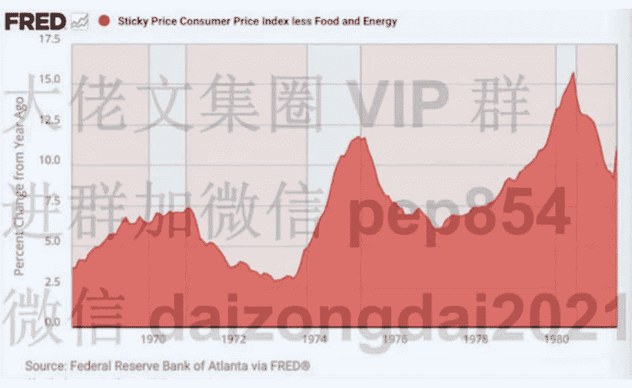

# 合集《十五规划前瞻》之——1、十五规划前瞻分析：未来5年最大的投资蓝图

原创 ME A森 A视野 2025年10月04日 08:31 上海

# 合集《十五规划前瞻》之——1、十五规划前瞻分析：未来5年最大的投资蓝图

文|A森

A视野 2025/10/04 原创
A视野 ID:AndsonVision

发现一个真实的世界，需要提前布局应对。

中国经济最重要的事情，来了！

中国长期按照5年规划运作，因此，每一个5年规划都是一次财富洗牌的窗口期。

另一方面，眼下中美博弈，处于历史性的时刻。

如果未来十五五期间，中国获得领先优势，则中美大国博弈的形态必定是“攻守易”。

此外，重大的政策，尤其是财政政策，务必是以配合5年规划出台的。

因此，前瞻性的十五五规划的核心内容，以及它的影响，对于大家好提前布局，意义重大！

为了抢占先机，【A视野】特此发布深度调研思考内容。

本系列围绕十五五规划，将分后发布三篇文章：

- 第一篇《十五五规划深度解析：未来5年最大的投资蓝图》（今天的这篇文章）
- 第二篇《越时刻的前夜》（于10/6日发布）
- 第三篇《十五五规划，国运跨越的超级水位》（于10/8日发布）

A森将分别从三个维度、系统性、一次性、独家原创性的给大家讲清楚底层逻辑：

- 1、十五五内容、指向与财富逻辑
- 2、十五五全球影响和战略目标，利益与风险深度解析
- 3、十五五规划能否成？影响几何？我们需要做什么？

| 本合集总共3篇文章，共880微信豆 |
| 购买后，可阅读本合集的所有3篇文章 |
| 下面开始今天的正文 |
| 各位多多支持！ |

本次十五五规划的发布，是在一个错综复杂的国际环境下。

因此，它回应的不是当前国内的通胀，也不只是中美博弈，而是有着更加深远的利益诉求。

长期关注【A视野】的老铁都知道，A森反复强调过：

国内现在以长期可持续性为底层，不再以应对短期风险为优先事务。

不过，从实践角度来说，这自然导致，当前一段时间，国内政策面的真空。

真正熟悉运作的人都清楚，上下上下，都在围绕十四五规划的考核和收官。

这无疑是直接影响所有人员的前途、绩效和切实的大事。

如果这次考核有三个良将，很多人就此仕途彻底结束，等到5年后的考核不会又有更多更新的人替代自己？

由于这是国内自上而下的体系性的安排，如此，即使财官和央妈，都不可能选择在十五五规划落地前拿出大招。

但是过来，这就意味着：

**一旦十五规划落地，则规模大招会加速落地。**

这种独特的有形主导的经济周期，与我们看到的西方经济学完全不同，却是长期主导我国国民经济的真正规律律动。

那么，这次十五规划的核心主旨，到底有哪些？

- 全面压注AI+革命
- 加速补齐短板
- 夯实军工自卫能力，做好“随时可能要打”的系统性准备
- 给对手制造短板

大家思考一下，既然一切的假定剧本都是“中美有一次终极牌”，那么，如果你是国内，你会现在做什么？

# AI+革命

放眼全球，现在还能够甚至是真正意义的前沿产业（新产业），就是围绕AI+革命。

坦率说，暂时还真的看不到其他的创新机会。

关键是，AI+是把电力、算力（芯片）、数据等很多重要的科技产业全部串联起来。

## 美国人在美元“收割溃溃后，现在就指AI+革命来收割了？

所以，对于中国而言，破除美国的这一经济图谋，甚至反向收割，也就是立国之本。

目前，我们在调研的过程中，已经耳闻：

### 中国或将公布自己的AI“星际之门”项目。

如果到时候的公布，那么对于这个庞大的产业链下游所有的企业，都将是超级大利好。

可以说，这是本次5年规划中，最值得关注的超级亮点。

那么这个时候，我们拼命夯实芯片短板产业，就不再是避免被卡脖子了，反而是成了创新追赶的一部分。

从这个维度，今天所有的前沿产业国产替代，不是简单的产业避免风险，而是全部服务于自己的创新的需要，是向未来高科技发展的准备。

# 军工超级周期

我们很清楚，美国是长期靠“科技寻利”吃饭的。

一旦没有“科技寻利”，他们整个经济、福利、制度都会出现严重的问题。

因此，这逼得美国后续继续找我们的可能性。

也许，国内在接下来的5年规划中，会持续强化军工投入，而且规模增大，甚至会出现辉煌。

那么，我们如何理解军工？

请注意，在印度、沙特与巴基斯坦签署共同协议后，军工市场频频。

这意味着，军工的逻辑类似于“科技概念”，是一个成长的概念。

由于未来5年内，随时可能爆发，所以军工的基础极为扎实。

# 反向卡脖子

从特朗普2.0开始，中国也会学会更加主动卡脖子。

事实证明，这一招极为有用，让川普为疼。

那么，这些筹码，国内是不轻易松手的。

这里需要注意，其实中国可以卡脖子，不是简单的，而是。

也就是说，一旦进入深水区，后续中国这类卡脖子的，将全面爆发。

这里，A森给大家分享一个例子。近期，中国对美国执行制裁。

众周知，此前美国还要对中国收割，现在我们对美国上游零部件、设备等完全不到。

# 强制性平衡

一个制造占全球1/3的世界工厂，可以找到足够的需求。

因此，本次十五五规划的一个极为重要的定位就是：

- 需求侧的刺激、强化对供给侧的“内卷”。

 尤其是从明年开始，国内会逐步增加需求侧的投入。

# 整个经济目标，“从风险优先”，加速切换“保障增长第一”。

这意味着顺周期板块，还有大消费板块，甚至是地产的部分，会逐步走出一波修复。

毕竟，只有它们修复了，才能看到需求的兜底，才能实现5年的保障增长。

那么，如何观察政策落地？其实很简单，一般1月份是发展的第一波披露期。

如果12月到年初，传统周期、大消费等板块出现明显的修复，那么说明市场领先者的资金对需求的刺激会有相当力度。

如果出现了，下一个观察节点只是明年的3月份。请注意，这对于大家的市场参与要直接相关。

# 美元去魅

现在国内要加速进入美元。毕竟，只要美元还锚可以卡住我们，也很很难进入人家的指数。

从近期利用上海黄金交易所构筑黄金新储备，看得出来，国内对于美元逐渐溃败，已经是加速布局。

另一方面，这些我们要付的美元越来越少了。美国为了洗债，将启动美元周期，全球到处都是美元。

于是，我们实际需要的美元和全球泛滥的美元，两者存在着严重的背离。

可见中国后续就会把手里越来越多的美元，加速配置黄金，加速配置其它南方国家的核心资产。

这就直接引发3个重锁链：

- 出海逻辑
- 重要的矿产
- 黄金超级周期

因此，如果投资方向能够适当加上多个重叠逻辑的，往往就是非常有前景的。这里我们需要一个重要的提示。

这张图展示的描绘的是上一次全球创新周期尾部（1966~1982年）大通胀时代CPI走势。大家看得：

- 一、前后三浪胀，每一次CPI下的底部是不断被抬上去的。
- 二、每一浪胀的高点都是明显高于前一浪的高点。
- 三、这是一场长达10多年的疯狂。
- 四、每一浪滞胀，前后要延续好几年。

目前我们现在所处的本轮创新周期尾部，2021年到2025年，已经是美国这轮大通胀的第一波。看到后面美联储要降息，美国面的国债规模失控还是趋势性的。因此，美国有极强的动力全球输出通胀来缓解自身压力。这件事之所以重要，是因为我们恰是制造大国。

潮流态意味着，收入停滞，成本回升。我们的上游各种成本逐步提高，但是发达国家的经济停滞带来的收入端压力。这也意味着，我们要守住目前的通缩格局，也撑不了多久了。

在美国即刻将全球大通胀的第二浪背景下，我们要守住目前的通缩格局，也撑不了多久了。

重复，重复，重复，重复，重复，重复，重复，重复，重复了。

一旦没有“科技寻利”，他们整个经济、福利、制度都会出现严重的问题。

因此，这逼得美国后续继续找我们的可能性。

也许，国内在接下来的5年规划中，会持续强化军工投入，而且规模增大，甚至会出现辉煌。

那么，我们如何理解军工？

请注意，在印度、沙特与巴基斯坦签署共同协议后，军工市场频频。

这意味着，军工的逻辑类似于“科技概念”，是一个成长的概念。

由于未来5年内，随时可能爆发，所以军工的基础极为扎实。

# 反向卡脖子

从特朗普2.0开始，中国也会学会更加主动卡脖子。

事实证明，这一招极为有用，让川普为疼。

那么，这些筹码，国内是不轻易松手的。

这里需要注意，其实中国可以卡脖子，不是简单的，而是。

也就是说，一旦进入深水区，后续中国这类卡脖子的，将全面爆发。

这里，A森给大家分享一个例子。近期，中国对美国执行制裁。

众周知，此前美国还要对中国收割，现在我们对美国上游零部件、设备等完全不到。

# 强制性平衡

一个制造占全球1/3的世界工厂，可以找到足够的需求。

因此，本次十五五规划的一个极为重要的定位就是：

- 需求侧的刺激、强化对供给侧的“内卷”。

# 整个经济目标，“从风险优先”，加速切换“保障增长第一”。

尤其是从明年开始，国内会逐步增加需求侧的投入。

这意味着顺周期板块，还有大消费板块，甚至是地产的部分，会逐步走出一波修复。

毕竟，只有它们修复了，才能看到需求的兜底，才能实现5年的保障增长。

那么，如何观察政策落地？其实很简单，一般1月份是发展的第一波披露期。

如果12月到年初，传统周期、大消费等板块出现明显的修复，那么说明市场领先者的资金对需求的刺激会有相当力度。

如果出现了，下一个观察节点只是明年的3月份。请注意，这对于大家的市场参与要直接相关。

# 美元去魅

现在国内要加速进入美元。毕竟，只要美元还锚可以卡住我们，也很很难进入人家的指数。

从近期利用上海黄金交易所构筑黄金新储备，看得出来，国内对于美元逐渐溃败，已经是加速布局。

另一方面，这些我们要付的美元越来越少了。美国为了洗债，将启动美元周期，全球到处都是美元。

于是，我们实际需要的美元和全球泛滥的美元，两者之间存在着严重的背离。可见中国后续就会把手里越来越多的美元，加速配置黄金，加速配置其它南方国家的核心资产。

这就直接引发3个重锁链：

- 出海逻辑
- 重要的矿产
- 黄金超级周期

因此，如果投资方向能够适当加上多个重叠逻辑的，往往就是非常有前景的。
