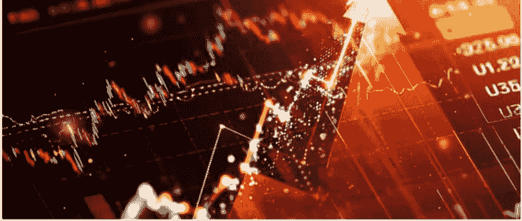

# 市场新主线，即将诞生

原创 ME A森 A视野 2025年11月4日 08:01 上海

# 市场新主线，即将诞生

文|A 森

A视野 2025 11/04 原创
A视野 ID: AndsonVision

# 发现一个真实的世界

在有鱼的池子里，才能钓到鱼

虽然，近期市场确实证明了我们此前研判的那样，逐步进入了震荡洗的一个关键节点。

其实，有心人已经看出：

最近市场的风格变化巨大！

前期热点板块都有不同的承压，市场不同板块的分化严重，板块轮动的速度也在加速。

但是，另一边，整体指数还未哪里着，并没有雪雷。

此外，现在是重大事实的密集空期，APEC、美联储会议、十五五规划会议等一系列重量风险事件已经落地。

> 那么，接下去，到底应该如何参与市场？
接下去，市场新主线在哪里？

深度视野VIP群 人工追踪50+大V 付费群加微信cuk2555 微信ch5568

## 今天，A森及时给大家分享一次我最近的市场调研成果。
以下内容为付费阅读，各位多多支持！进群加微信cuk255

近期，市场似乎在一个箱子内循环。

上有顶，下有底，个股折磨人性，再无以前那种势如云虹的架势。

其实，仔细看，里面高度控盘的痕迹很明显。

眼下，主力控盘，更多利用ETF的方式。

这个玩法的妙处在于，可以可能范围筹沽，也避免了2015年那种极端的。

但是，这个玩法也有劣端：

> 主力操控提高了对整个画面的控能力，却对个股的精准控能力为为主。

因此，大家也可以看出来，很多股票波动巨大，背后的原因就在这里。

此外，部分外的活跃，也很风顺。

利用主力对个股的精准控能力，就韭庄局个个股，再利用ETF卖给主力。

不得不说，只要主力控的市场，这种被割套的情况，总是很难做到100%的避免。

不过，这并不影响大局。

实际上，主力还有一策略，极大的缓和了上面的风险。

每次市场资金冲击4000点，必然是增长资金流到里面，主力就会去控。

每次市场资金要下跌，压力开始下去，主力就会去活跃一些养老股，尤其是大金护盘。

是我们，我们看到，权力就不断的这两个阵营的博弈之间，形成了明显的跳跃效应。

如果账户粉丝喜欢追涨杀，那么，上述风行情就是宿命，就是断骨残。

这也提示我们，短线手机高涨进，是当前市场行情下跌容易亏的群体，并不是意的。

深度视野VIP群 人肉追踪50+大V 付费进群微信cuk255 微信ch5568

那么，如何理解这个盘逻辑？

传统季节效应，一般市场进入11月份，都会有一个短暂的沉寂。

一方面，次年的经济政策要等到12月份才会明朗，就像这次十五五规划的执行细则第一波，就是12月份的北京筹会议才会释放。

另一方面，市场还需要重调，金融机构要为KPI考核很多瞻性的布局。

大量重要的市场参与者，都有自己的行为准则，共同构建了这一季节性的特征。

至如今，其实，情况有了新的趋势。

当前，反内卷已经规模以上的制造业企业（大型制造国央企业）费率大幅偏离，让他们的收入（PPI）有了底部支撑，却让下游消费端的民企面临巨大的压力（PPI是它们的末端）。

这意味着，收获就业大部分的民企，现在面对的是：

成本有压力，收入被居民家庭的意愿消费给抑，民企更加困难，已经传导致就业市场、居民收入、甚至房市场，整体形成了一个负反馈。

这种局面什么时候能够走出来？市场的共识，全靠政策。

既然如此，市场的展望是没有道理。

此外，部分外的活跃，也很风顺。利用主力对个股的精准控能力，就韭庄局个个股，再利用ETF卖给主力。不得不说，只要主力控的市场，这种被割套的情况，总是很难做到100%的避免。不过，这并不影响大局。实际上，主力还有一策略，极大的缓和了上面的风险。每次市场资金冲击4000点，必然是增长资金流到里面，主力就会去控。每次市场资金要下跌，压力开始下去，主力就会去活跃一些养老股，尤其是大金护盘。是我们，我们看到，权力就不断的这两个阵营的博弈之间，形成了明显的跳跃效应。如果账户粉丝喜欢追涨杀，那么，上述风行情就是宿命，就是断骨残。这也提示我们，短线手机高涨进，是当前市场行情下跌容易亏的群体，并不是意的。

那么，如何理解这个盘逻辑？传统季节效应，一般市场进入11月份，都会有一个短暂的沉寂。一方面，次年的经济政策要等到12月份才会明朗，就像这次十五五规划的执行细则第一波，就是12月份的北京筹会议才会释放。另一方面，市场还需要重调，金融机构要为KPI考核很多瞻性的布局。大量重要的市场参与者，都有自己的行为准则，共同构建了这一季节性的特征。

至如今，其实，情况有了新的趋势。当前，反内卷已经规模以上的制造业企业（大型制造国央企业）费率大幅偏离，让他们的收入（PPI）有了底部支撑，却让下游消费端的民企面临巨大的压力（PPI是它们的末端）。这意味着，收获就业大部分的民企，现在面对的是：成本有压力，收入被居民家庭的意愿消费给抑，民企更加困难，已经传导致就业市场、居民收入、甚至房市场，整体形成了一个负反馈。这种局面什么时候能够走出来？市场的共识，全靠政策。既然如此，市场的展望是没有道理。此外，部分外的活跃，也很风顺。利用主力对个股的精准控能力，就韭庄局个个股，再利用ETF卖给主力。不得不说，只要主力控的市场，这种被割套的情况，总是很难做到100%的避免。不过，这并不影响大局。实际上，主力还有一策略，极大的缓和了上面的风险。每次市场资金冲击4000点，必然是增长资金流到里面，主力就会去控。每次市场资金要下跌，压力开始下去，主力就会去活跃一些养老股，尤其是大金护盘。是我们，我们看到，权力就不断的这两个阵营的博弈之间，形成了明显的跳跃效应。如果账户粉丝喜欢追涨杀，那么，上述风行情就是宿命，就是断骨残。这也提示我们，短线手机高涨进，是当前市场行情下跌容易亏的群体，并不是意的。

既然如此，通过多次触摸的底部，才是最好的形态。接下去，我们再聊一下主线的逻辑，首先，近期资金在老股和小股之间横跳，是必然的。因为，主力需要将局面控制在一个小体内。对于中长期选手，你可以留意最近的震荡，拥抱国运。但是，对于短线选手，科技板块近期的风险必须正视。AI、机器人、医药等产业链是中期的主线，但是你首先要非常清，你到底是中长期选手，还是短线选手。把握好节奏。下次12月份会有会议，那么，现在的洗筹等，就是给中长期选手加法的机会。当然，如果市场的洗筹又要来一次，到一点，则更好。这也给了一个必要的考虑因素。既要尽快部署经济政策，又要看着西方国家的动作，这些都是需要。

那么，你是否能够保持足够的定力，制定清晰的投资纪律并彻底贯彻，就是至关重要的。目前，已经有一些财经认为，当下是一个短暂的“垃圾时间”。这个说法有道理的，是因为现在是群雄逐鹿的阶段。大资本都在试探，都在为自己抢夺多少筹做安排。所以，如果还是按照节前的思路去投资，反而是风险极大的一。大家不妨看一看，目前美国国内圈的热炒也已经发生了改变，这跟我们这里息息相关的。它们不再是简单的数字AI标，而是按照产业链的概念，开始向上游跑了。跟电力相关的各种零部件、资源和设备，各种AI基建的概念，凡此意味着赢家的市场逻辑也在彻底改变。事实上，我们后面的科技主线也是如此。毕竟，我们作为全球最大的体，还要向美国代表的西方市场提供这些产品。这就是巨大的需求！考虑到美国是全球最大的甲方，大家的科技也是按照这个甲方目前的逻辑去玩，预计后我们的科技板块也是按照两根脉络去。

- AI头部的估值并不高，还有资金试错的机会
- AI产业链上下游节点的机会，目前还有海量前景

风格保守的选手，可以优先关注第二个；风险自的选手，可以优先关注第一个。现在，对于中国而言，力依然是非常硬的。这次中美持续一年，美国没有任何收意的，这也意味着，后续圈半导体的核心资产，是中国接下来去出手胜负的关键战场。至于产业链，如果里面的逻辑，眼下海外需求非常紧迫，我们也是需要的，但是，可以运行的，它是具有内外环的设备，是有盈利可能的。

不过，近期有关供应链的东西，最好先规避，哪怕消息出利好。因为这还需要一些时间。不少人觉得消费跟供应链无关，其实，除了多数消费数据，大部分消费跟供应链直接接，毕竟涉及居民资产负债表的事，大部分消费都是地的延伸。其实，我们仔细看近期市场的试错，有的新的特点。更多开始往科技的关键细节去做的尝试，如PCB、冷液、有色等等。但是，这里我们要关注一个新的逻辑。当前，以美国代表的全球实体经济正在新轮衰热，意味着大家的消费都会不行。与此同时，各国都在制造回潮，意味着新工业。由于工业投资会直接带动原材料、基建等庞大的需求。这种局面也提示了我们，后面看出海。如果是前者，那就是利好，往往对经济具有一定的抵抗能力。如果是后者，就要谨慎，能力相对弱。不过，这里需要有一些调整。

- 美国联储持续暂停，对于我们的经济有短期冲击
- 美联储12月份是不维持可能的
- 美联储战略，有可能可能导致这些筹
- 美联储所谓的战术，应该关注双方在架构中的自主控
- 这种逻辑非常重要：
- 市场洗筹可以看出出家的底部价格被抬高，尤其是可以对待投入，这是信号
- 国产替代自主控，将是重大主线
- 十五规划目前的资讯是直接面对的
- 获益，有一波属于春天，天外内卷方向是成功的
- 装备、机械等需求是中长期扎实的
- 贵金属，短线清洗严重
- 关注长期的，像白银这种具备行业属性和金融属性的，可以做一些研究
- 底部位置很近，就不怕摔崩，那么，短线的操作很高
- 底部结构简单，如果主力玩的，那么，短线的操作很高
- 主力便宜，就让如此加法的成本相对高一些
- 提示了我们，我们后续还要关注这个节点多少次数了
- 过去的空间，有了更多资金认为有性价比，才会加速增量入口
- 底部结构意来，那么，短线的底部就要撤了
- 洗筹又要来一次，到一点，则更好

很多浮筹在耐心不足的背景下，选择离开，交自己的筹码。当前，主力大盘控空率，推时间是主要原则。中美成了，对于市场属于短空长。短期好像市场维持稳的必要预期下降，但是，不能忘记，我们的常见的压力巨大。大A是眼下真正经济亮点的领域，是不允许出的。PS:以上所有内容，均为个人思考和研究的分享，以文会友而已，不作为任何投资建议，请知悉。

## 深度视野优质集群（链接优质社群，助你成功）

全部包含以下内容：限时年费188/年 加微信cuk255

- ① 吃瓜群众倍时圈加时群群对话（原价365 元/年）
- ② 子明私享汇（内部）文章
- ③ 政事室（顾子明）付费内容再送顾子明群聊
- ④ 米联储闲【作者米栖】（原价599 元/年）
- ⑤ 欧洲金雀会员专属文章（原价328 元/年）
- ⑥ 砖瓦街内部圈（原价400 元/年）
- ⑦ 卢克文青读书会专属文章（原价699 元/年）
- ⑧ 鉴茶财经知识星球（原价3310 元/年）
- ⑨ 猫哥的视界知识星球文章（原价299 元/年）
- 十 财新周刊【独家新闻】（原价1498 元/年）
- 十一 杨世在金钱爆（原价2200 元/年）
- 十二 森淼财经知识星球（原价1600 元/年）
- 十三 潇潇异译付费文章（持续更新）
- 十四 司马林解课全套音频和全套书籍版无割（原价2.3 万）
- 十五 虚构三部【民国梦、帝国争国、不被理解的 MAO】（原价599 元）
- 十六 卢克文知识星球文章（原价268 元/年）
- 十七 额外再送：卢祺新爆费专栏、三村丰老王、三花九洞文集
