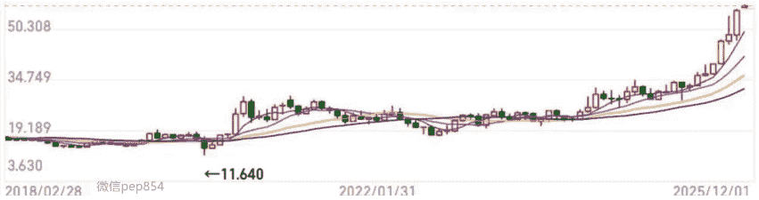

## 金银延续牛市，现在还来得及上车吗？

原创 ME A森 A视野 2025年12月3日 08:02 上海

## 金银延续牛市，现在还来得及上车吗？
文|A森

A视野 2025/12/03 原创
A视野 ID: AndersonVision

> 发现一个真实的世界

今年，投资圈极为炸裂的惊喜，应该是白银了。

其实，从2020年美股2次拆的价格底部（11.64美元）到现在，白银价格早就涨到亲娘都不认识了。

假如，你是在当时这个价格持有了大量白银，那你已经赚了多少%的收益？大家不妨心算一下，然后就知道有多获狂了！

但是，近期，白银的走势更为“溜滑”。

一会儿，有传芝麻所经历引燃白银潮。

一会儿，中国库存位于近十年低。

一会儿，伦欧上演“空大戏”，甚至都要掠夺了。

如此惊人的长期涨趋势，在最近又出现了如此多血狗的剧情，以金银代表的贵金属市场，后市到底会怎么样？

| 还来得及上车吗 | 己有的仓位，又该怎么办？A森今天给大家分了些自己的市场调研、实践和思考的干货。下面开始今天的正文，各位多多支持！ |

此时，美国国防部门已经将白银入了战略储备的清单。

这意味着什么？

其实，市场近的走势，已经出了自己的“担心”。

弄不好，俄罗斯可能会突袭宣布，要对白银收关税。

因此，现在大量的资金，将把全球其它地方的白银，往美国本土去运、去囤。

问题是，白银这个东西，在全球的分布，极为不均衡的。

墨西哥、秘鲁、俄罗斯，光这三家的白银矿产，预计有可能达到已知全球白银矿储备的7成。

然而，另一边，全球都要实施“再工业化”。

从中国的产业升级到美国的制造流，从印度制造替代中国制造到印度德国靠备武装为重工业，类似的例子是不胜理由。

可是，白银恰恰是非常多的前沿产业线过不去之关的关键上游原材料。

光伏产业，白银用于制备伏银，是太阳能电池电极的关键导材料。

电动汽车，白银用于电控、车载电子系统，单车白银量较传统燃车大幅提升。

AI产业，大量上游分类还需要用到白银。

就是说，白银当前非常领先的前产业，是直接绑定的，是不可或缺的。

同时，由于中国打出了稀土牌，让全球其它国家充分意识到关键原材料已经是家家争之地。

这就美国出出金融制裁俄罗斯，让全球其它国家意识到美元体系体系并不靠谱。

所以，现在，大家要竞争关键的上游原材料，就是由此，白银一下，就获得了全新的工业属性能。

另外，我们这里还要留意，川现面对面的2026年11月份的中期选举压力空气。

因此，加速对外贸易协议实际的，也要加速美国制造大量项目落地，已经是他绕不过去的一环。这很意味着，亚洲后面3个季度，是美国制造大量破坏性动工的关键窗口期。类似稀土、白银等重要原材料，你如何受这波需求的影响！

那么，我们还用以往的视角看白银的工业属性，仿佛就是一个一个周期的概念，还要现在的宏观环境实际吗。

此外，白银还是重要的贵金属之一，是具有真正意义的金融属性的。

当前，全球银进减少人类依赖，不再把鸡蛋放在一个篮子里，也是各主要国家的基础微换。

问题是，人家不信美元信用，未必能完全人民币信用。

那么，怎么办？

所以，对对冲的思路，适度增加金银，就成了主要银行们铁定会的事情。

这就相当于，在美元信用不足的前提下，各国以人民币体系信用、金信用做其它冲池，起起来极极端剧本，可以最大化减少损失。

于是，我们现在再来看金银市场的牛市，也明白了。

除非市场事件出现，否则白银易涨涨难。

一直以来，贵金属投资，是有其基础规律的。

首先，几乎每一次都是黄金领先，然后，间隔一段时间，白银尾随。

这个不是没有道理的！

其实，白银是以价格趋势为“锚”（中枢），然后，弹性会更大。毕竟，黄金是纯净的金融属性，白银除了金融属性外，还有工业属性。当黄金长期市场已经成型，那么，在黄金的前提下，白银弹性更加容易。

对于华尔街和美联街而言，这种情况很坏的。华尔街和美联街希望做的事情是全世界用美元，这样就可以随意吸收，再收SWIFT的交易。

然而，现在的全球金融信誉已经破到地步，暂时是不可逆的。因此，华尔街和美联街的压力，白银是很难控制住。以前，白银市场没有来，白银价格涨多了，主力砸一波。

所以，完全是华尔街和美联街联动市场，白银是相对有效的。事实上，这种微调，美国已经做了很多次。

然而，这次不一样！现在的情况是，贵金属最大的玩家，各国央妈纷纷下场。白银市场的规模远超真实的规模。假设大家都要实物，不要空单，这算不是要膨仓了？

华尔街和美联街遇到的问题，显然是老革命遇到形势。今年的双节后（国庆节中秋），出现了一轮白银的抢购，原因就在这里。华尔街和美联街的压力，最后成了纽约市场，拼命去全球吸更多实物，这才将稳定了局面。

于是，为何中国的库存大幅下降，由于交易所引发白银市场的阴谋论？这一切并不是终的！

很明的是，市场认定，华尔街和美联街联动压力的火爆，却变得难以实现这个目的，所以，调整频繁了。既然如此，那么，白银自然就更加愿意跟华尔街和美联街对手。

因为，强如美联街和华尔街压不住金银的泡沫，尤其是白银的，开始流血了！

其实，在森看来，我们完全没有必要关心什么胆。请不要忘记，不管12月份美联储是否息缓，明年，川普为了中期选举，也会让新的美联储主席坐在放水。这也意味着，美元实际购买力会进一步透支。美元通胀自然对贵金属有利，是一个长期的支撑，也是最大的支撑。美债规模已经扛不住了，作为美联储和美国财政部对冲后的产品，美元超发，就会彻底放自我。这种几乎是明牌的基本面，将国际资本更关注贵金属，短期内会有怎样的波动。

投资，而非投机，本质上就是跟趋势走。当金银牛的趋势已经被爆掉了，那么跟涨即可你还要关注短期的价格暴涨吗？这里，白银的工业属性决定它，就会具有弹性，比黄金更加有效了。如此，对于早就打算建仓的，假设未来几年都不用去建仓金银的这钱，完全可以“锁仓”，短期波动，静静耐心趋势自行的离异。然而，对于还没有打算建仓的，只需静候后续市场留下的机会。即，等这一小波行情走完，价格回撤了，再关注上车机会。假设在市场最疯狂的时候上车那，反是不智的。投资，建仓价格（成本）有无优，才是决定你投资能否成功的最大权重。这里，我们打个比方，帮助大家理解。假设，白银涨后，白银回撤了市场，市场适度冷却了，你那个节点开始引入，也比现在直接上车要安全得多的。市场上吃饭，永远的：持久才是真正的收获。本质就是钓鱼，不仅在有鱼的地方去，还要等待自己最佳时机买卖。所以，对于还没有建仓的，或者觉得自己太小的老手，假设12月份美债突然宣布暂停售一次，那概率是威尔给我们的一个“拥抱”。这也告诉我们，短线来说，美联储12月份的会议，是一个非常关键的短线市场节点。如果暂停继续，市场将会冲一冲。如果暂停下一次，市场可能停一下，这里就有机会。在12月会议结束后，一个关键的节点，就是1月的美国经济数据披露。假设经济数据显示低于预期，那么金钱市场也要往上。假设经济数据显示还算中枢，金钱市场就要早休。各位，这两个节点，请务必记住了！不过A森强烈建议，千万不要去囤货，这东西一般人可以持有的。对于普通人而言，金钱市场优先按照配置思路去看。配置意味着是在现金、股票、理财等不同资产中有一定的比例，最终追求的是整体组合的收益率。因此，杠杆是关键要素！这也向了，实物、股票的形式相对安全一些。且既然配置，那么持有期限是不可的。这就就像很多朋友，不管房子多少，但是不能随意买进卖，哪怕是在行情好的时候，往往持几年。请注意，才是牛市下的配置体现！对于普通家庭而言，黄金仓位可能控制在15%以内。守夜司令知识星球、接魔王后星球、生才有知识星球、创始笔记、达叔谈论知识星球、财富富圈、雪花甲老头等。A视野、大树乡谈、江初好说、咩咩说、上海海家等付费文集。西风兑付费文章、老端、赢在八小时之外、局外的视界、升值、老体制内等等其它一些大V付费文章（每月低于600元的付费文章）。

# 深度视野文集
进群微信cuk255
深度视野（付费文集）

