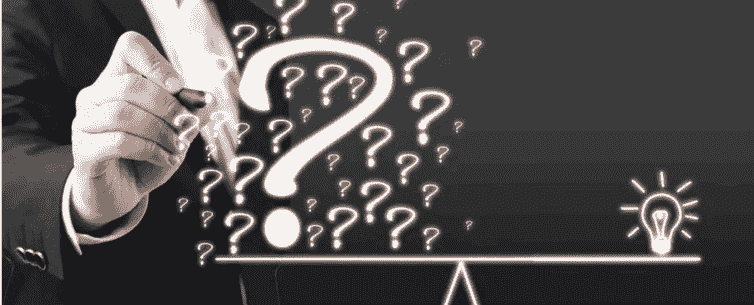

## 康波周期尾部，下一个暴涨的资产会是什么？

原创 ME A森 A视野 2025年12月30日 08:04 上海

## 康波周期尾部，下一个暴涨的资产会什么？

文|A森

A视野 2025 12/30 原创

A视野 ID: AndersonVision

发现一个真实的世界

今年，白银的暴力抬头，已经让很多投资人抓狂了。

一年内，从28美元直接拉升到80美元之上，简直是涨到丧天良的地步。

连马斯克都出来表了！

说赚钱难，尤其是现在康波周期尾部，大家都没有什么新的好生意可以做的境下。

然而，时代旧轮在创造更多的“造富神话”，甚至是令人哑舌的暴力抬头。

> 这意味着着，宏观环境并不是投资不能翻钱的理由。

但是，这并不是康波周期尾部“造富神话”的终结。

长期关注【A视野】的老铁们深知，这轮周期尾部，起还要10年。

其实，白银涨到现在的地步，背后的逻辑已经发生了实质性的改变。

对于我们而言，这个全新的逻辑，恰恰是下一个强势走的投资品种直接有着强相关的逻辑。

在黄金价格涨幅逐渐离底的前提下，白银的上涨，证明了白银的工业属性在加速推进其价格变化。

就是说，工业需求太大了，所以引发白银实物挤兑。

然而，很诡异的是，石油价格现在还是在上地上。

虽然我们可以说，美国成功利用胜利压制阿拉伯石油国家来抑制油价，不具有可持续性。

但是，假设全球需求大，这种地缘操弄对于油的影响不具有可持续性。

这也提示我们，真正的逻辑是：

全球主要的工业需求并没有复苏，甚至疲软；然而，白银服务的特定工业行业却极为繁荣。

事实上，马上就能看出的重大白银工业应用场景，就是AI所需的数据中心、光伏电、电动车产业链。

很明显，这些都是大国博弈的最前沿领域！

有意思的是，AI现在并不挣钱，光伏电力供给国内不是最激烈的行业之一，电动车也是利润率远不及燃油车。

那么，到底谁在为买单？答案只能：各国有形之手是最大的资本爸爸。

如果黄金狂升是各国将不断围圈，那么白银的主要经济体开启一大波前沿产业再工业化的争夺战！

其实，这个就是全球各地的产业结构、国与国之间的科技竞技的主要逻辑。

传统企业都是苦哈哈海的，大多数居民家庭也是如此。

作为最强购买力，只能是有形之手。

### 所以，有形之手哪个城市，哪个城市就会出现明显的造富神话，这可是判断下一个暴涨资产的核心逻辑。

2025年，白银价格拉升，背后恰恰已经是美国意识到了，传统手段没有任何办法阻挡中国。

甚至，川普2.0承认现在是G2模式治理全球，虽然我们不认。

那么，体现在产业上，就是前沿产业游戏博弈，也是命中消耗战。

所以，前沿产业到底现在赚不钱已经不重要，甚至完全可以忽略。

不能做到对对手的压制性优势，这才是重中之重。

这个时候，我们就可以关注了，在有形之手当资本的前提下，几乎是被扶的前沿产业有了超级主爸。

近期，美元指数一直是稳步缓慢下滑。

令人哑舌的是，就是油价不涨，反而基础金属暴涨了。

金融市场的传闻是，川普将加速启动前沿产业再工业化，随着可能对基础工业金属的关税新政。

大家自然是抢在公布后，狂忙将这些基础工业金属运美国本土，白银、铜等都受益于此。

不过，请大家注意，传统能源与新能源是有本质性区别的。

传统能源的核心是制造的。新能源的核心是消耗的。

这种以白银为代表的基础工业产品价格上涨，提示我们，美元对于基础工业金属的定价已经出了明显的问题，否则，如何允许这这样？

换句话说，美元做不到对所有领域的把控，到处都是漏漏洞，这就是中国可以非对称追击的关键。即，美元见到的崩隆声此起起。

其实，现在全球的需求完全依赖“量产能力”。

问就是，美国人撑这么久，规模这么大，截至目前，中国央妈不愿意替代美联储的功能可以向全球投放大量流动性。

这也将在全球推向了一个很有意义的共识：强化工业化，背后是美联储配合。

中国公布了全新的半导体，又公布了巨大的扶持。

经过2025年的博弈，西方获得了一个不甘的认知：西方为了保持前沿产业领先，中国制造何时没有有效替代，这就导致了。

以AI为为主，现在开始用AI被脖子的领域。

对于美国这样的基弱国家而言，是极富吸引力的。

如果基础金属和储能够直接对接AI的需求，那么AI所带来的更广泛的基建需求完全离不开工程机械的全面，否则则没有办法。

矿、建厂、数据中心建设、化工基地、运输基建、电网系统基建等，这是一个虽然围绕AI需求，但规模超大的基建的。

其实，欧美日韩等国家都知道基建建不行，原本就想玩大基建周期来拉动就业，这总比挖出来的钱去金融市场捞机靠谱的。

AI，除了自己造，还要带动传统大基的全面升级，才是真正让大国们愿意听见的意见。

用金融市场筹融资来AI，发展再带动基建，基建带动就业和财政改进，有形之手再想办法增收来解决前期的融资和债升压力，这就是他们真正想要的东西。

这条路到底能不能走得通，其实，现阶段，根本不重要！

你没有看错，根本不重要！

人类全球金融体系周而复始的演进：

实物锚 -> 信用 -> 实物锚 -> 信用

- 实物锚：经济极度内部，全球经济、产业和金融市场需要修复、重塑。
- 信用：金融过度扩张，极盛而衰。

因此，近期来看，类似这样的投资不再是“低风险高收益”的选项。

然而，如果未来没有明显的回撤，刚性工业金属依旧是长期趋势下的狂疯子。

既然大国都要进行产业竞争，就算未来产业终局以中国制造为终局，可是在结果出来前，试问欧美日韩哪个不是不代价去砸钱？

这就是阶段性的需求！10月8日，伦敦交易突然出现1000吨白银的实物需求，现在大概是印度央妈出手。

那么，它为什么要这样呢？也是为了产业啊！

总结一下，后续基础金属（白银）将出现大幅的回撤，或许可以开始新关注的窗口期。

当AI产业链并不完全依赖AI本身的，美国人都觉得这很好，就会撬动量基建。
