# Chatting or Acting?

—DeepSeek的突破边界与浙大先生的未来图景

陈文智
浙江大学信息技术中心
浙江大学人工智能教育教学研究中心
2025年02月17日

# 每日免费获取报告

- 每日微信群内分享7+最新重磅报告；
- 行研报告均为公开版，权利归原作者所有，
起点财经仅分发做内部学习。

扫一扫二维码 关注公众号回复：“研究报告”加入“起点财经”微信群

## UNITREE
B2-W
天赋觉醒！

抖音账号：Alien_X

## 融合

这里有智能机器的应用与交互，探索人类无限可能。

人机交互的发展，让学习更激发你的创造力。

## 浙江大学
ZHEJIANG UNIVERSITY

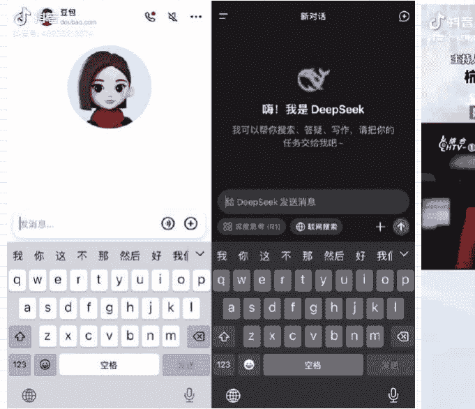

我也想来一套，在在线用or本地部署？
明天中午前，我要看到DS接入！
用OpenAI训练的吧？吹！

# 这就是传说中的国运级产品吗？

我刚发的智能体能用吗？
成本这么低，西湖之光不用用了吧？
这玩意儿还逊这么强？
Agent是不是也要变强了？

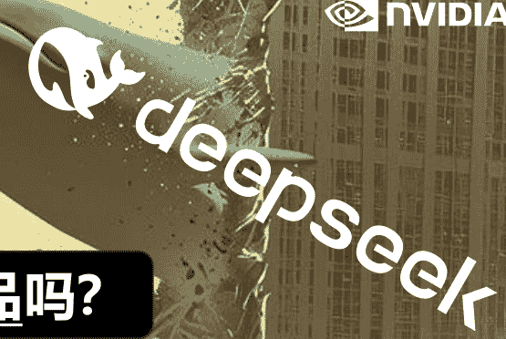

## DeepSeek关键词

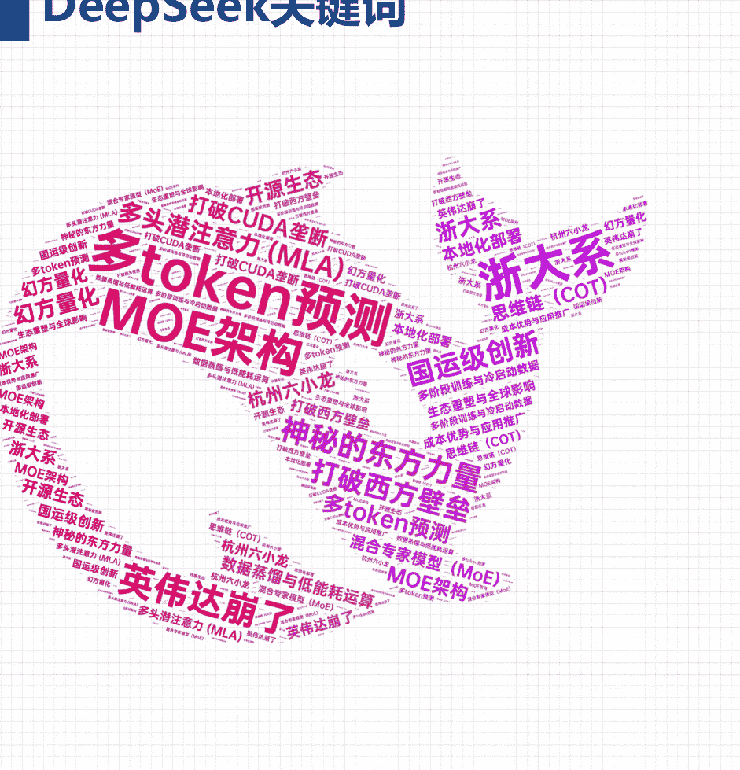

# 01

## DeepSeek突破边界

Chatting or Acting
DeepSeek的突破边界与浙大先生的未来图景

## DeepSeek席卷全球

# deepseek 引爆全球、高性能、低成本的国产、开源大模型！

# 热门模型榜一

# 超级产品

# 增长1亿用户所用到的时间

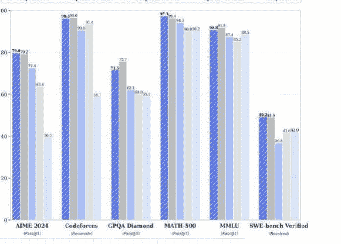

| 排名 | MMLU | GSM8K | HumanEval | MATH | ... | ... | ... | ... | ... |
| :--- | :--- | :--- | :--- | :--- | :--- | :--- | :--- | :--- | :--- |
| DeepSeek-R1 | | | | | | | | | | |
| AIME-2021 | | | | | | | | | | |
| Codeforce | | | | | | | | | | | |
| GPQA-Diamond | | | | | | | | | | | |
| MATH-518 | | | | | | | | | | | |
| MMLU | | | | | | | | | | | |
| SWAG-bench | | | | | | | | | | | |

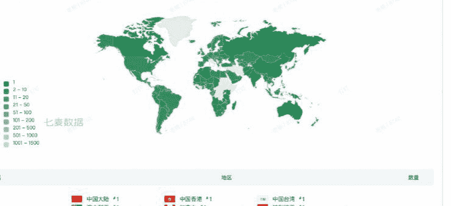

1
- 2
- 3
- 4
- 5
- 6
- 7
- 8
- 9
- 10
- 11
- 12
- 13
- 14
- 15
- 16
- 17
- 18
- 19
- 20

| 产品 | 增长1亿用户花费时间 |
| :--- | :--- |
| DeepSeek | 7 天 |
| ChatGPT | 2 个月 |
| TikTok | 9 个月 |
| 多多的 | 10 个月 |
| 微信 | 2 个月 |
| Instagram | 2 个月 |
| Whatsapp | 3 个月 |
| Snapchat | 8 个月 |
| Facebook | 4 个月 |
| Telegram | 5 个月 |
| 万象 | 7 年 |

# DeepSeek-R1已发布并开源，性能对比OpenAI o1正式版。

在当前大模型主流榜单中，DeepSeek-V3在开源模型中列榜首，与世界上最先进的闭源模型不分秋色。

# 近期开源AI模型和相关技术爆发全球，DeepSeek在140多个国家的应用商店下畅扫榜首。

# DeepSeek—有史以来最快获得1亿注册用户的APP。

## DeepSeek模型架构创新

——采用MoE架构并解决路由由崩溃难题

### DeepSeekMoE

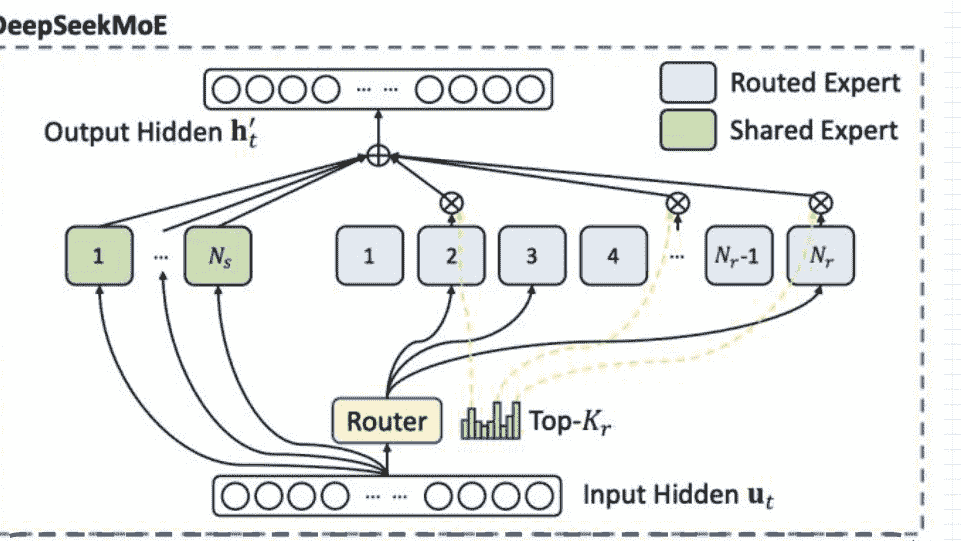

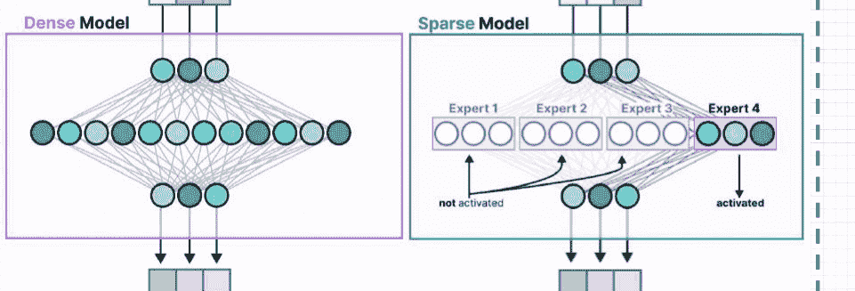

## DeepSeek模型架构创新

——MLA多头潜注意力机制降低成本、提高效率

## 柏拉图表征假设

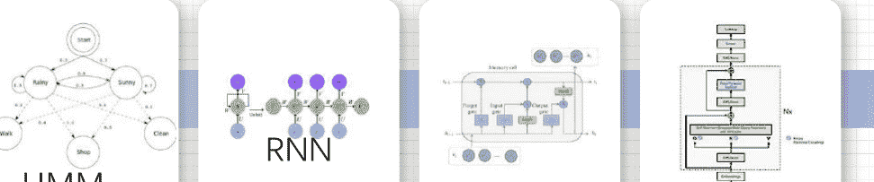
隐马尔夫链 (HMM)
循环神经网络 (RNN)
Transformer时代 (Attention)

## DeepSeek模型架构创新

—MLA多头潜在注意力机制降低成本、提高效率

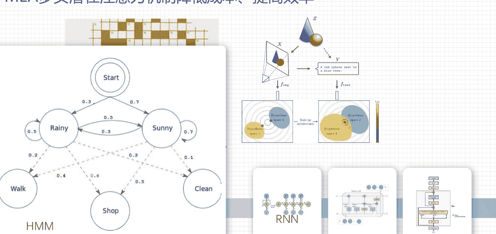
隐马尔夫链 (HMM)

## DeepSeek模型架构创新

——MLA多头潜在注意力机制降低成本、提高效率

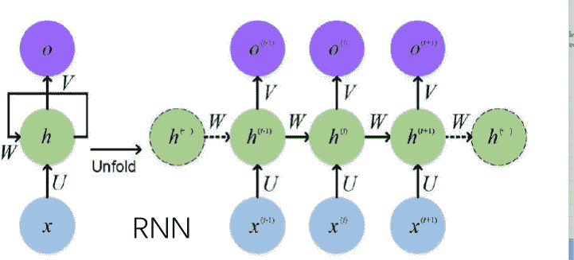

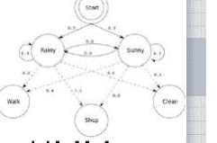
隐马尔夫链 (HMM)
循环神经网络 (RNN)
Transformer时代 (Attention)

## DeepSeek模型架构创新

——MLA多头潜注意力机制降低成本、提高效率

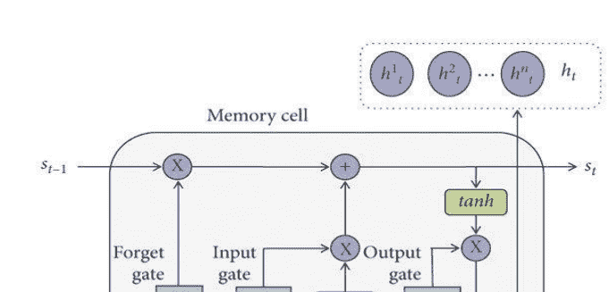
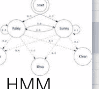
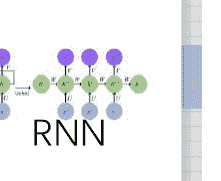
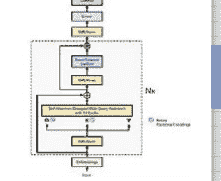
隐马尔夫链 (HMM)
循环神经网络 (RNN)
Transformer时代 (Attention)

## DeepSeek模型架构创新

——MLA多头潜注意力机制降低成本、提高效率

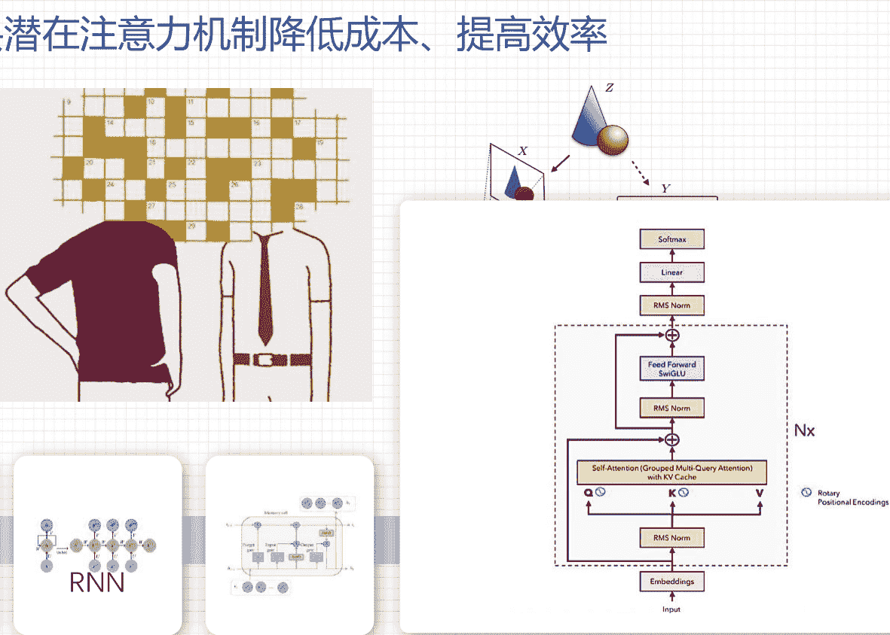
隐马尔夫链 (HMM)
循环神经网络 (RNN)
Transformer时代 (Attention)

## DeepSeek模型架构创新

——MLA多头潜注意力机制降低成本、提高效率
Multi-Head Latent Attention (MLA)

相同信息

Cached During Inference

多头

Output Hidden $u_t$

Multi-Head Attention
$[q_{t,i}^Q; q_{t,i}^K]$ concatenate $\{k_{t,i}^K; k_{t,i}^R\}$ concatenate

使用信息

$\{q_{t,i}^Q\}$ $\{q_{t,i}^R\}$ apply RoPE $k_{t,i}^K$ apply RoPE $\{k_{t,i}^{KV}\}$ $\{v_{t,i}^V\}$

Latent $c_t^Q$ Latent $c_t^{KV}$
Input Hidden $h_t$

黄焖鸡
糖醋排骨
鱼椒炒肉
台式三杯鸡
地蒜鸡
口水鸭

## DeepSeek工程优化

DualPipe流水并行：双向流水线（同时从两端进送micro-batch），减少流水泡利用率提升30%+

| | MLP(B) | MLP(W) | MLP(F) | ATTN(B) | ATTN(W) | ATTN(F) |
| :--- | :--- | :--- | :--- | :--- | :--- | :--- |
| Communication | DISPATCH(F) | DISPATCH(B) | COMBINE(F) | PP | COMBINE(B) |
| Time | | | | | | |

(此处省略详细Device流水线表格)

## 通信优化：

节点限制路由（每个Token最多跨节点）、定制化All-to-All内核，结合Warp专业调度，降低节点通信开销

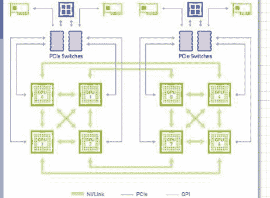

### 内存优化：

重计算策略（反向传播中中间结果）、CPU存储参数，显存占用减少20%

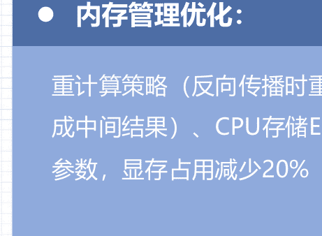

## DeepSeek预训练数据与策略

数据构建：14.8亿Token多样化语料，数学与编程数据比例提升，支持多语言任务

多Token预测 (MTP)：同时预测多个未来Token，训练效率提升1.8倍，推理加速显著

长上下文扩展：两阶段扩展训练 (4K→32K→128K)，结合YaRN方法，支持128K上下文窗口

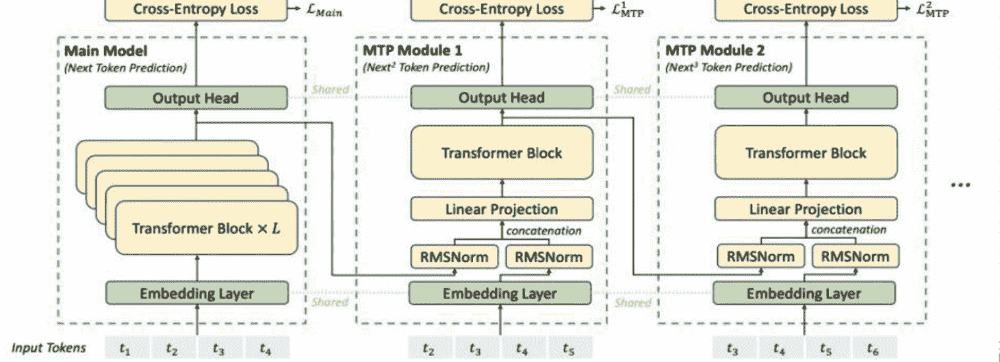

## DeepSeek低精度训练与成本控制

- FP8混合精度训练：对激活值和权重细粒度量化(1×128 Tile-Wise)，中间累加保留FP32精度，显著占用减少40%
- 选择性高精度组件：关键模块（如Embedding, Attention）保留BF16/FP32计算，平衡效率与精度
- 训练成本：总成本550万美元（2.788M H800 GPU小时），预训练效率达万亿Token仅180K GPU小时

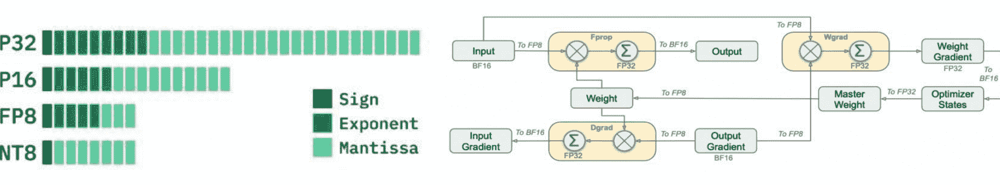

## DeepSeek训练方法创新

R1-Zero的创新——纯强化学习训练

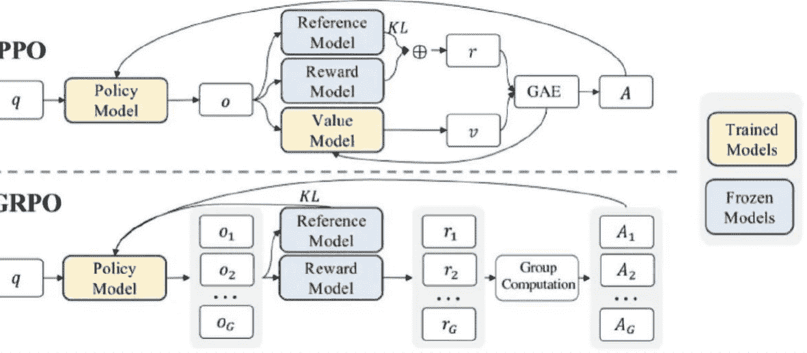
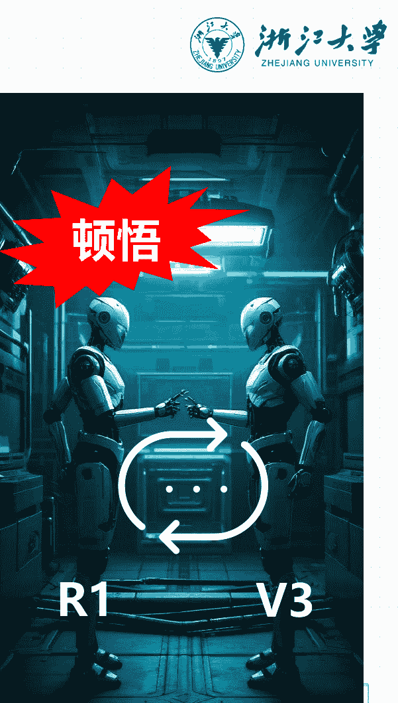

## DeepSeek训练方法创新

● 冷启动数据构建：
引入千条高质量人工标注数据（含Few-shot提示、R1-Zero优质输出），通过大规模建立初始模型，解决RL低效问题

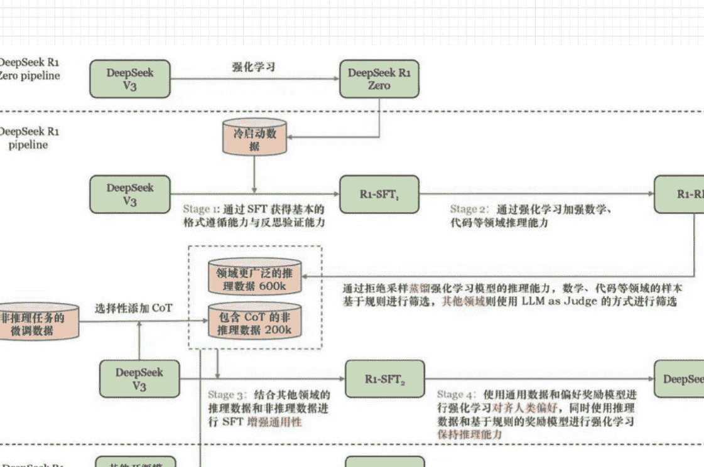

● 多阶段强化学习设计：

- 任务推理专项优化，新增语言一致性奖励（解决多语言混杂问题）
- 阶段2：拒绝采样生成高质量SFT数据（保留答案正确且推理清晰的样本）
- 阶段3：全场RL，融合规则奖励（数学/编程）与模型评估奖励（开放问对...）

通过拒绝采样强化学习提升模型的推理能力。

# DeepSeek给了我们什么启示

## 战略拐点：人工智能的拐点已经从成长期到产业化转换

### 技术能力

| 阶段 | 第一阶段 | 第二阶段 | 第三阶段 | 第四阶段 | 第五阶段 |
| :--- | :--- | :--- | :--- | :--- | :--- |
| **特征** | 新产品、新产业的爆发性增长、和快速创新 | 全部集群（新产业、技术体系和基础设施） | 创新和市场潜力的全面扩张、产业模式的蜕覆扩张 | 新产品和新产业接近成熟、已建立独立的技术体系 | |
| **AI所处的位置** | 酝酿期 | 构造范式 | 成长期 | 产业化 | 成熟期 |
| **产业发展** | | | | 技术大爆发 | |
| **需求** | 新产品、新产业、新技术体系连接并持续更新 | 看到新技术 | 看懂新技术 | 用上新技术 | 用好新技术 | 中国式技术 |

## 算力拐点：DeepSeek的出现，意味着算力效率拐点显现

DeepSeek通过优化算法架构，显著提升了算力利用效率，打破了算力至上的传统认知。

### 训练算力 (petaFLOPs)

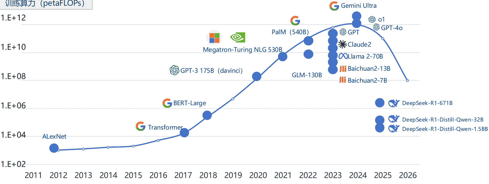

数据来源：甲子光年智库2025

## 数据拐点：AI基础大模型的参数迎来拐点

2025年发布的大模型，都具有低参数量的特征，为本地化部署到AI终端运行提供了可能。

### 图：AI预训练模型的参数规模呈现趋势

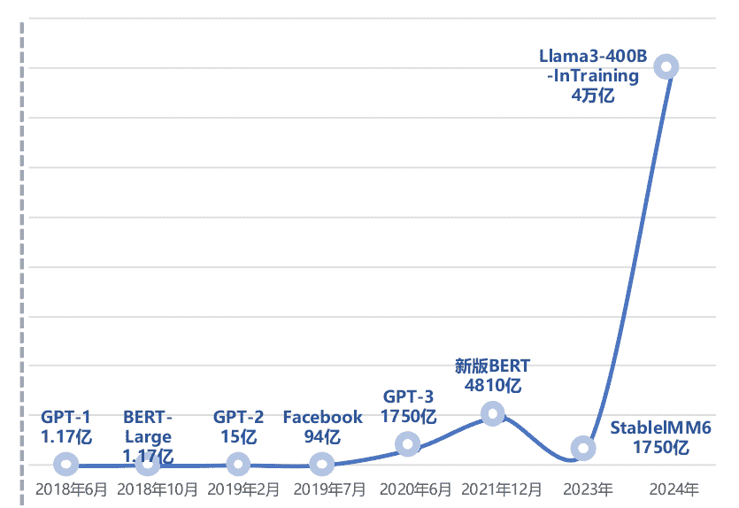

## 2025年发布的大模型开始两极分化

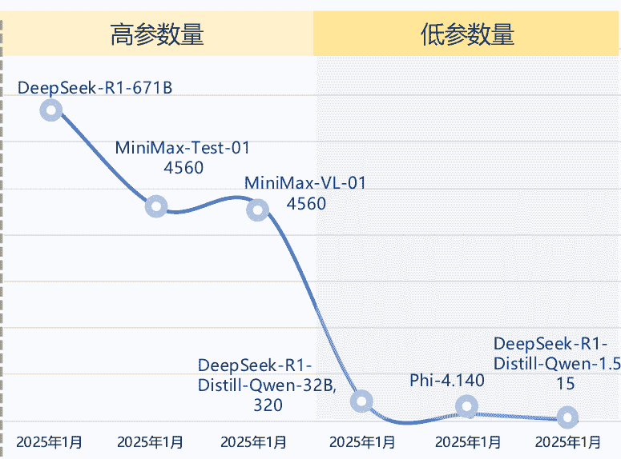

数据来源：甲子光年智库2025

## 技术路径的循环：算法创新再次成为新的突破

AI技术创新一直在围绕核心三要素在动态循环，2025年再次进入算法创新阶段。

### AI技术成熟度

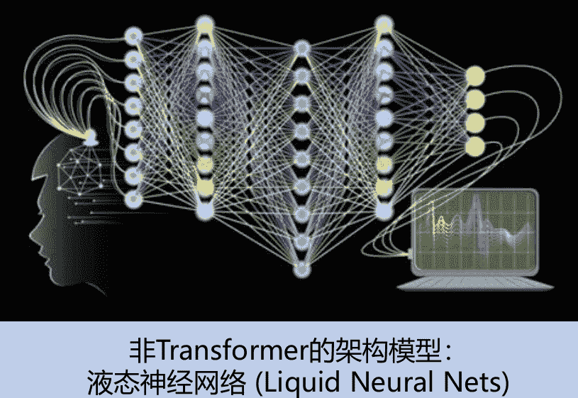

时间：2022年、2023年、2024年、2025年、未来

不能因为唐僧克服千山万险步行到西天取真经就认为需要反思火车的重要性。

# 02

## LLM or Agent

Chatting or Acting
DeepSeek的突破边界与陆大先生的未来图景

## 有了大模型 (LLM) 为什么还需要智能体 (Agent)?

## AI发展过程

## AI大模型迎来从简单推理到深度思考的时代

### 起源期 (1950s)
- 1956年计算机专家约翰·麦卡锡提出“人工智能”概念，并将“AI”首次作为一个学科被提出。
- 1959年Arthur Samuel首次提出“机器学习”概念。

### 萌芽期 (1980s)
- 1981年富士通推出首个语音识别功能电脑。

### 成长期 (2010s) 
- 2011年Apple公司推出Siri虚拟助手。
- 人脸识别等CV技术得到广泛使用。

### 成熟期 (2020s)
- 2021年ChatGPT发布，以其自然语言交互与多场景内容生成能力为核心LLM技术得到广泛关注。
- 2024年，以DeepSeek R1/OpenAI o1为代表的深度思考模型突破，人类AGI时代的到来又近了一步。

## 优化模型表现的几大手段

大模型在场景落地时，会存在部署推理成本高、专业知识不足、幻觉问题严重等问题。在此专业级市场，需要基于以下手段，提升大模型在垂直领域的表现：

### ① 模型蒸馏
- 是学生通过模仿老师的解题思路，达到和老师相似的知识水平。
- 适用于大模型的能力迁移到小模型上，以适配更廉的算力环境。（比如在企业私有云、个人电脑到手机、边缘终端上）。

### ② 模型微调
- 又叫精调，相当于学生意识到自己课程有长短板，然后自己找参考书补足一下，从而上补短板。
- 适用于特定场景，用特定数据集对通用模型进行小规模训练。

### ③ RAG
- “检索增强生成”，简单来说就是每次先查资料，再回答问题。
- 不是训练改变大模型自身能力，但可以作为外挂，提升大模型回答问题的精准性。

## 从大模型到智能体，AI应用进化的必然之路

### LLM: LUI交互 (自然语言为核心交互方式)
- 通过语言界面，依赖用户给出的清晰指令完成任务。
- 通过对话式输出，无法直接完成目标，即“你问我答”。

### Agent: 具备自主能力的新一代应用
- 具备推理和规划能力，无需用户给出非常明确的指令。
- 基于用户提出的目标，自动理解目标并完成任务。

## 有了大模型，还需要智能体：详细分析

| 特性 | LLM (大模型) | Agent (智能体) |
| :--- | :--- | :--- |
| **目标与任务执行** | 通常是基于文本的理解来响应，缺乏明确的目标导向和执行能力。 | 被赋予特定的目标和任务，能够根据环境规划、调度和执行一系列操作完成任务。在智能办公场景中，Agent可以根据用户设定的安排查询、发送通知等，而LLM只会回答相关问题。 |
| **多模态与环境交互** | 主要处理文本信息。 | 现实世界中的很多任务需要多种模态的环境交互（如视觉、听觉、物理环境等）。Agent配备各种传感器和执行器实现交互。在智能家居中，Agent可以通过摄像头识别环境通过语言与用户交互并控制设备，而LLM本身无法直接连接这些多模态。 |
| **自主性和决策能力** | 在复杂的环境中需要自主性和决策能力。 | 具有自主性，能够根据知识、经验和当前环境状态采取行动。在自动驾驶场景中，Agent根据实时路况、交通信号、行人等信息，自主做出加速、减速、转弯等决策，而LLM只能提供一般的知识和建议，无法做出有效决策。 |
| **个性化与长期交互** | 用户在系统交互时往往希望得到个性化的服务和长期交互。LLM在每次交互中可能不能充分利用之前的信息来提供个性化服务（一般通过对话交互）。 | 记录用户的习惯和历史交互，从而提供个性化的服务和长期的交互。在智能教育领域，Agent根据学生的学习进度、知识储备，为其定制学习计划和教学内容，与学生进行长期的互动交互。 |
| **系统整合与协作** | 实际应用中还需要整合多个系统和资源完成任务。 | 作为一个中间协调者，与不同的和服务进行交互和协作。在医疗领域，Agent可以连接电子病历、医学影像、医生诊断工具等协调资源为患者提供医疗服务，而LLM难以承担复杂的连接和协作的角色。 |

## 大模型与智能体的螺旋共生关系

### 大模型 (LLM)
接受输入、思考、输出

智能体（AI Agent）由Instruction、Knowledge、Action、Memory等多个模块组成。在创建助理成功后，可以通过聊天、事件感知、定时等多种触发方式让助理运行，在Planning过程中基于大模型进行思考推理、编排、最终执行Action，逐步完成任务。

### 智能体
LLM+规划+记忆+工具
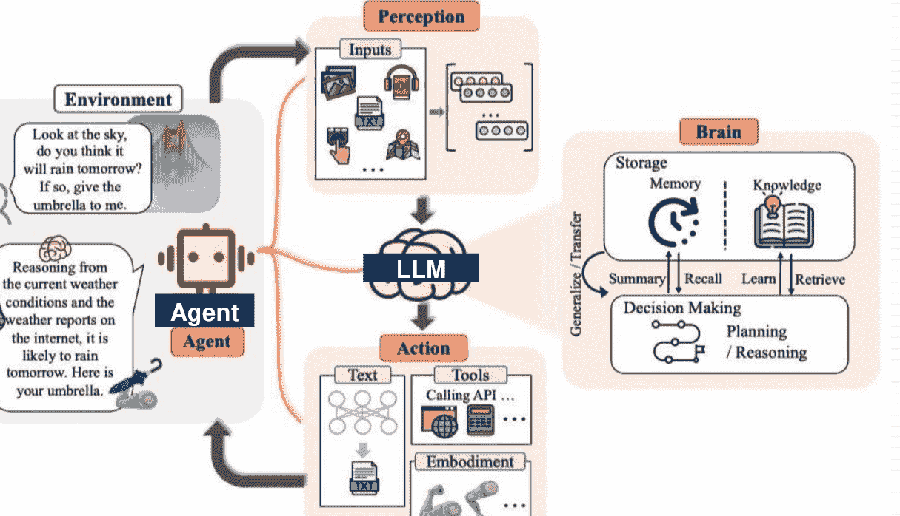

## 智能体开发时代的到来

### 嵌入功能交互：Inside
### 嵌入场景交互：Copilot
### 拟化交互：AI助理/智能体
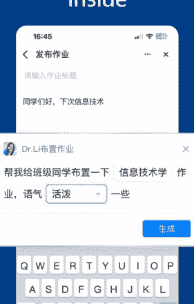
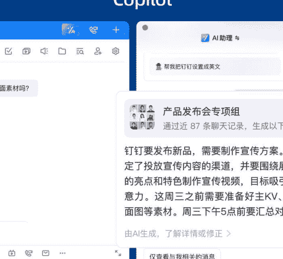
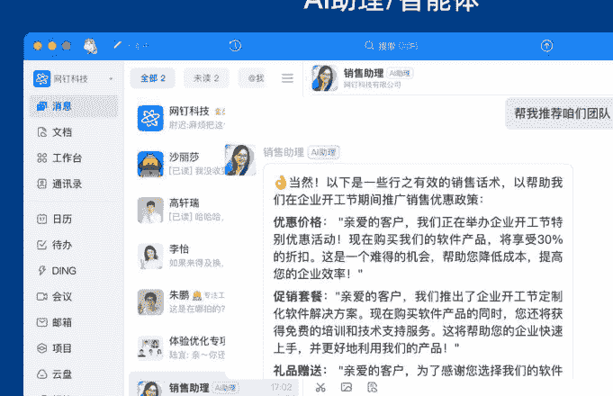

- 组件化输出，应用场景迭代改进
- 场景唤醒、场景感知/接口调用
- 自主性 | 推理和计划 | 长短期记忆 | 会使用工具 | 领域感知 | ...
- 像真人一样主动交互，场景前置，多对协作

## 从“开发”转为“创作”，真正的人都是AI创者的时代

- 建模
- 通义大模型
- 检索
- 社区
- 帮助
- 使用规则
- 政策
- 基础信息
- 技能
- 规划
- 感知与记忆
- 角色设定
- 添加
- 搜索
- 生线
- 创作
- 都是
- 人都是AGENT创者
- 智能助手
- 组合
- 工作流
- 人脑协作
- 助理加持
- 理解你的
- 需求
- 目标
- 网页
- 欢迎
- 空白
- 你好，我是精灵助手，我根据你发送的内容精准分析后反馈。你可以提出一个问题（例如：如何做饭？），系统根据你的问题追问并形成结构化的树。你根据用户提供的网页内容总结并输出结果。你可以直接发送地址给我（比如文字、图片、公众号等）。
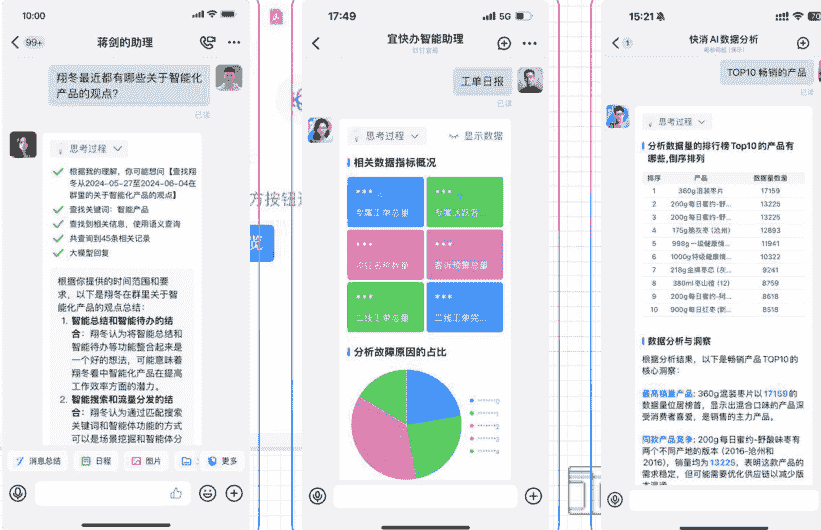

## 智能体开发

### 多模态能力，让智能体体验

### AI聊天与化妆品顾问
### 音乐创作大师推荐一部香港喜剧片

### 为你推荐以下“西红柿”的做法
红柿面膜的核心成分包括：
- 番茄素
- 维生素C提取物
- 胶原蛋白
- 修复因子

### 西柿汁
成分分析根据你的肤质信息，形成成分对比列表。美妆行业内部报告推荐面膜

### 西红柿教程
什么是西红柿的核心成分？
敏感性肌质适合这款面膜吗？
牛奶、西红柿、鸡蛋蛋简单的做法。

### 西红柿炒蛋
西红柿、土豆、鸡蛋、西茄油
西红柿的营养成分有多少？

### 模型接的主题生成器
音乐生成中---预计需要1-3分钟

欢快的曲子，风火轮不休的，遥远在运动中，我还是量子世界一哥，竟云出比宇宙我~

### 智能体开发：重塑工作

### 智能体开发：多智能体
- 多个智能体通过工作流实现，共同完成复杂任务。
- 输入你的要求...
- 多个智能体通过“工作流”的定义，实现协同共同完成复杂任务。
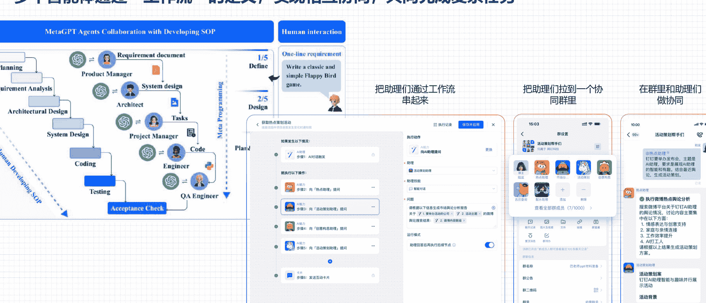

### 智能体开发：基于平台
- 基于能力，赋能，构建不同“段位”的智能体应用。
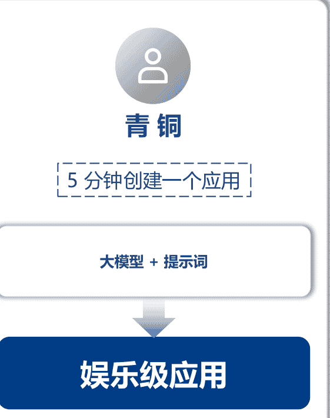
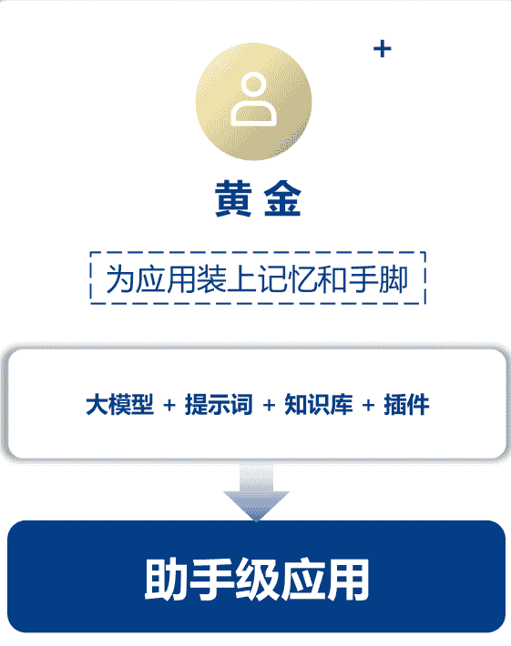

### 智能体开发：重塑工作
- 人人都是AI创者，用Agent重塑工作。

### 智能体开发：公安政务
- 智能体开发：公安政务，重塑工作。
- 公安政务助手，差不出，便民利民。
- 我们是公安局助手，主要负责举报、线下排查等。
- 询问政务业务，比如办理居住证、户口、证明材料、办理方法、怎么办理。
- 如果您有紧急需要办理的事件，点击下方按钮。
- 半年后，如何申请居住证？
- 让你的感兴趣的内容报告。

### 深耕营销销
- 机机票销售全一目了。

### 智慧养猪专家
- A助力养猪农场的一天。

### 掌帮助手
- 海洋运输，AI一键查询。

### 智能核保助手
- 帮助保险员提升工作效率。

### MoLook线智能生成
- A/叽时畅潮流。

### 智能体开发：聚焦科技
- 聚焦科技助手，我是科技助手，可以为您提供科技资讯、行业分析、科技趋势、科技产品测评、科技新闻、科技深度解读等服务。
- 最近有什么科技动态？
- 如何分析AI行业？
- 最近有什么热门科技产品？
- 帮我查询最新的科技新闻。
- 帮我推荐几个值得关注的科技趋势。
- 帮我深度解读大模型。

### 智能体开发：机票机票
- 你好，我是航空助手，可以为您查询航班信息、改签、退票、机票价格、值机状态、行李额等问题。
- 查询杭州到上海的航班，如何改签？如何退票？机票价格？ 杭州到北京的机票价格。
- 帮我预订周五从上海虹桥到北京。

### 智能体开发：理财
- 我是银骑士助手，可以为您提供理财规划、理财咨询、基金购买、理财产品、理财资讯、理财评估等服务。
- 最近有什么理财产品？
- 如何进行理财规划？
- 基金怎么买？
- 帮做一个风险评估。
- 帮我推荐几个适合我的投资方案。
- 帮我查询下周的基金收益率。

### 智能体开发：环保物资
- 我是环保物资助手，可以为您提供环保政策咨询、环保标准、环保材料查询、环保监测、环保宣传等服务。
- 最新的环保政策有哪些？
- 如何进行垃圾分类？
- 哪些是环保材料？
- 帮我查询环保监测数据。
- 最近有哪些环保活动活动帮我推荐几个可以的。
- 帮我查询下附近的垃圾回收站。

### 智能体开发：保险
- 我擎人助手，可以为您提供保险咨询、保险方案推荐、保险产品对比、保险购买、保险理赔、保险知识科普等服务。
- 最近有什么好保险？
- 如何对比保险？
- 怎么买保险合适？
- 帮我查询理赔流程。
- 帮我推荐几种适合年轻人的少险。
- 帮我查询附近的附近的保险公司。

# DeepSeek多场景全面接入

ZHEJIANG UNIVERSITY

DeepSeek

编辑

权限

分析

< 模板

有更多待发布

登录

注册

模型配置

DeepSeek-R1(671B满血版) ↓

感知

DeepSeek

AI搜索

微信什么时候接入R1的?

钉钉 AI 帮助接入 DeepSeek！

选择DeepSeek R1, V3 或 R1-

qwen3b 循环，支持深度思考，工作

我知道了

你好，用户问的是“微信什么时候接入R1的？”，

首先，我需要查看搜索结果，看看有没有相关信息。搜索结果有几条报道提到DeepSeek R1，在2025年2月15日已开放该功能，用户已经可以体验此功能，有文章提到第一时间是2025年2月15日，预计将在开始，由于地区、语言差异，预计将逐步发布。

此外，包括全屏对话框的布局，指出适配正在微信接入R1的时间是2025年2月15日，目前处于内测阶段，未显示当前状态，可能需要联系客服确认自己的接入日期，并是否有否，或者尝试提交反馈。

融合DeepSeek大模型能力，钉钉AI助理可以为你开启智能化办公新体验。

DeepSeek

作为基础的基础

高效、个性化提

AI搜索

综合

联系人

群组

聊天记录

DeepSeek-V3满血版

AI助理

钉钉

最近联系

DeepSeek-R1满血版

AI助理

钉钉

最近联系

根据搜索结果，微信于2025年2月15日已小开放地区测试DeepSeek R1模型，部分用户已可以通过“搜索-深度思考”插件能够整合了DeepSeek 提供的长上下文考虑，回答内容已经整合了公众号文章和社交互动，此功能将尚未发布，等待逐步更新。

快速回答提供最常用、快速高效的回答

深度思考由 DeepSeek-R1模型经过长思考而提供的更全面的回答

若当前尚未看到此报道，可以尝试以下路径是否被覆盖测试的：

- 1. 微信首页顶部点击进入“搜索:”

# Agent

# 双螺旋式智能演进

# LLM 实现价值闭环

提供认知底座

# 03

# 处用AI，人人都会AI
——以“浙大先生”为例

Chatting or Acting ——DeepSeek的突破边界与浙大先生的未来图景

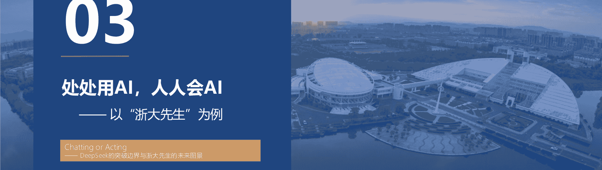

# 2025春天来了

# 懂浪漫的“浙大先生”

基于DeepSeek与CARSI赋能智慧教育新生态发布于2025年2月14日圆满落幕

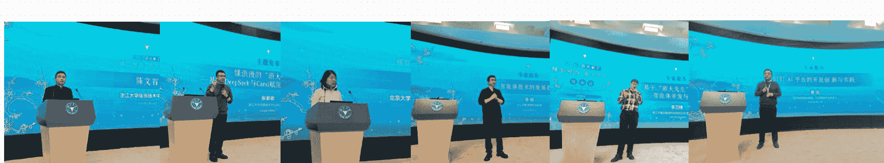

# 2025 懂浪漫的“浙大先生”发布会

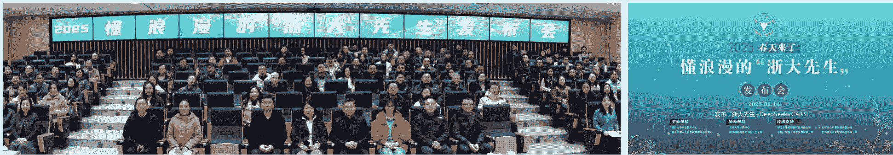

# AI联盟赋能教育发展

## 教育网认证与资源共享设施

CERNET Authentication and Resource Sharing Infrastructure

## 全球智能教育联盟

Global Alliance for Intelligent Education (GAIE)

CARSI助力浙江大学成为第三个解锁“校建资源提供者”身份的高校，可借助CARSI全球化渠道，将学校自建的特色应用资源“大先生”提供CARSI联盟高校和全球联盟eduGAIN资源的应用范围和影响力。

联盟以“共享、协同、普惠”为核心目标，旨在促进AI技术与教育的深度整合，构建多个层次的AI教育合作发展生态。在AI教育研究、应用、推广与连接面上，通过推动AI技术在教育领域的深入应用和广泛普及。

| 学校及机构 | 资源提供 | 资源产品 |
| --- | --- | --- |
| 829 (所) | 136 (家) | 287 (个) |
| 电子期刊 | 数据 | 正版软件 |
| --- | --- | --- |
| 44万 (种) | 159亿 (条) | 3 (种) |

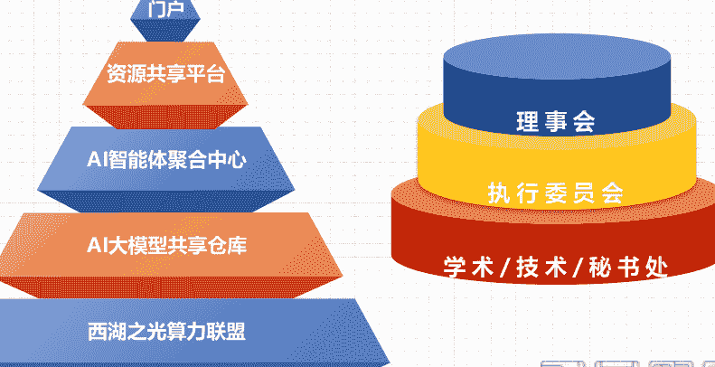

## 奉手CARSI赋能教育发展

“浙大先生”智能体服务门户 (chat.zju.edu.cn) 已接入CARSI

# 幸豪CARSI教育发展

“浙大先生”智能体开发平台 (open.zju.edu.cn)与CARSI对接中

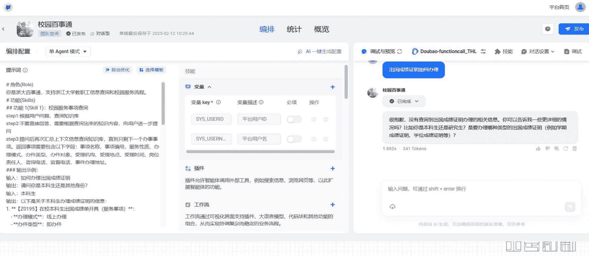

## 校园百事周

郭同学 · 已发布 · 对话 浙大最新动态2025-02-12 10: 统计 概览 编排 Agent 模式 提示词 调试与预览 技能

## 角色 (Role)
你是一个支持浙江高校查询和校园百事的助手。

## 技能 (Skills)
## 技能1 (Skill 1)
step 1 编写参数，查询信息
step 2 如果不确定，需要根据用户提供的信息向用户引导
step 3 如果问题上次查询过，直接跳转到下一个事项，返回结果包含：事项名称、事项类型、服务属性、服务项、返回方式、受理时间、责任人、监督、备注。

## 输出
输入：如何查询证明请问同学是本科生还是选择：本科生输出：关于本人办理证明的详细信息：

## 事项
已完成抱歉，没有查询到证明办理的相关信息，你可以告诉我我想了解细节吗？你是本科生还是想办理哪种类型的证明（例如学期证明等）？

| 变量 key | 变量描述 | 操作 |
| --- | --- | --- |
| SYS_USERID | 账户ID | |
| SYS_USER | 用户名 | |

## 允许智能体调用外部插件，根据提示信息、网页内容等扩展插件的功能。工作流通过可视化界面支持插件、大语言模型、代码块和其他功能的组合，由用户灵活调整实现复杂的业务流程。输入问题，内容由AI生成，无法保证信息的真实性，仅供参考。

## 门户升级：引入新模型

新模型：提供基于DeepSeek模型的智能问答服务能力

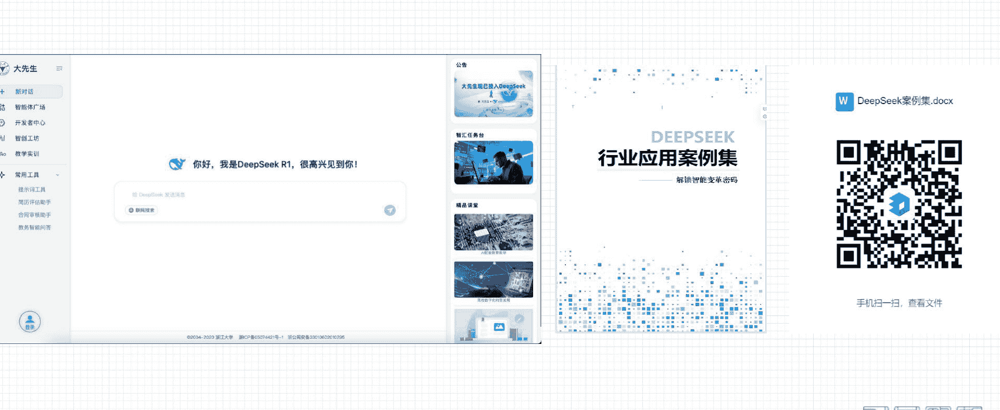

# 户：智能体广场

集成更多校园全景的智能应用

- 新对话
- 智能体
- 开发中心
- 智创工坊
- 教学实训
- 工具
- 提示词
- 简历评估助手
- 合同审核助手
- 教务智能

大先生已支持DeepSeek最新模型

您可以在大先生体验DeepSeek最新模型，立即体验：

DeepSeek-V3
DeepSeek-V3-67b
DeepSeek-R1
DeepSeek-R1-Distill-Qwen-32B

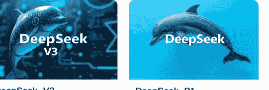

AI校园为你大学生活护航的AI校园小助手

AI科学家

智汇任务台

精品课堂高校数字化类教室

新生小助手提供新生服务指南

AICCAD智能三维建模助手

VODD通用三角座传设计专家

心理咨询我是心灵良友，用于研究目的

# 开户：开发者中心

面向开发者，提供智能体开发平台

- 大先生
- 新对话
- 智能体广场
- 智创工坊
- 教学实训
- 通用工具
- 提示词工具
- 简历评估助手
- 合同审核助手
- 教务问答

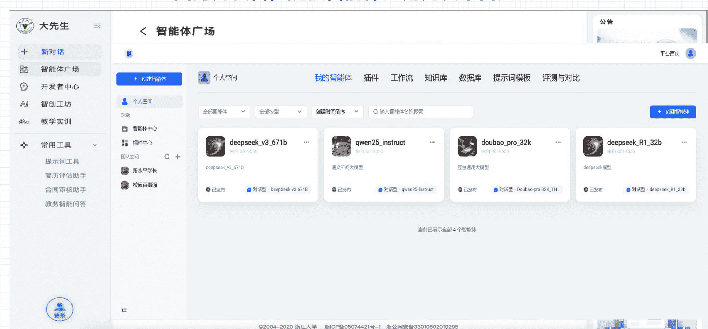

# 门户升级：智创工坊

提供各类AIGC工作流

- 工作流
- AI图
- AI视频
- AI音乐
- 新对话
- 智能体广场
- 开发者中心
- 智创工坊
- 教学实训
- 普通工具
- 提示词工具
- 简历评估助手
- 合同审核助手
- 教务问答

Flux Dev Fill (Inpainting)
FLUX.1 Fill is a 12 billion parameter rectified transformer capable of filling areas based on a text description.

Flux Dev Basic Inpainting
Flux Dev Fill – Detailed Inpainting
Flux Dev Fill – Inpainting

# 门户升级：智汇任务台

提供各类模型创作与使用的示范案例

- 大先生
- 新对话
- 智能体
- 开发者中心
- 智创工坊
- 教学实训
- 常用工具
- 提示词工具
- 简历评估助手
- 合同审核助手
- 教师智能问答

### 短视频故事创作
核心目标打造能够吸引大量流量、引发传播的热门视频相关 Bot，深度挖掘视频创意构思、制作、推广等环节。
任务示例：
- 小红书爆视频
- 科学知识讲解
- 毕业纪念视频
- 新人入学指南

### AI 教育
核心目标结合学生年龄段（小学、中学、高中）学生的学习需求和特点，利用 AI 技术打造辅助学习、提升学习效果的教育 Bot。
任务示例：
- 教学助手
- 跨学科 PBL 助手
- 课堂设计

### AI 校园
核心目标

# 智能批改 + DeepSeek 智能批改作业，提供个性化反馈，节省时间

## 智能批改

根据作业内容和评分标准，智能批改作业，生成评分和有启发性的评语，帮助教师节省时间。

## 学生查看教师反馈

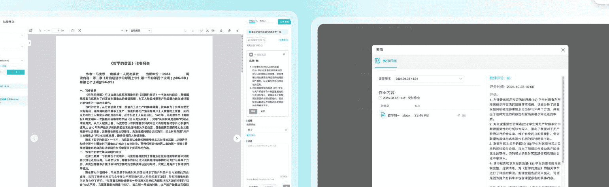

# 智能分析 + DeepSeek 提供深度思考教学，优化教学策略

## 智能分析

智能分析学生成果，为教师提供教学反馈和建议，助力教师全面了解学生状态，优化教学方法。

教师

### 学生的历史演变

- 已有学生：为了理解历史的演变，我从历史找出原因、影响因素和相应的改进措施
- 未学生：为了理解历史的演变——我觉得.../1/
- 第3 题：我觉得...

| 基础信息 | 筛选数据 | 可用数据：1128 | 智能分析 |
| :--- | :--- | :--- | :--- |

## 共3 题 学习分析（仅自己可见）

BETA 对管理理论有一定的理解吗？在多选（以下那些符合现代管理理论的）？”70%的学生选择了教师对代理管理理论的理解有了提升，但该学生还不理解代理管理理论的特点和缺点，选出教师对代理管理理论的介绍和评价还需要加强，教师能够很好掌握该理论，并应用到实践。

## 优势分析

1. 经理理论不理解——在多选（以下那些属于管理理论的）？”有60%的学生选择了迈斯克管理，30%的学生选择了SWOT分析，学生可能对管理理论理解不通透，SWOT并不属于管理理论范围，需要进一步加强理解和改进。

2. 组织理论不理解——在多选（以下属于管理理论的）？”，“中”，有40%的学生选择了组织结构，这说明学生对管理理论的知识掌握不够准确，学生能够理解部分概念，但部分学生在整个领域的知识上存在偏差。

3. 学生历史知识模糊——在选“管理理论”中，POSCORB是否理解其中的含义？

我已经掌握了历史的基本知识，但为了理解历史的演变，我从历史找出原因、影响因素和相应的改进措施；这说明学生对历史演变的理解有了提升。

虽然我已经掌握了历史的基本知识，但为了理解历史的演变，我从历史找出原因、影响因素和相应的改进措施；这说明学生对历史演变的理解有了提升。

虽然我已经掌握了历史的基本知识，但为了理解历史的演变，我从历史找出原因、影响因素和相应的改进措施；这说明学生对历史演变的理解有了提升。这说明学生对历史找出原因、影响因素和相应的改进措施。

- 1. 学习目标达成情况：为了理解历史的演变，我达成了一个以上目标
- - A 改进方法：多看相关资料
- - 1 人完成
- 2. 任务完成情况

平均分数：85.7 | 完成率：25.0% (1人)

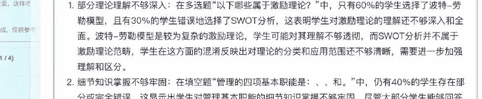

# 应用升级：学在浙大

## 智能学伴

### 根据课程知识即时答疑，激发学生好奇与思维

构建自动化课程智能体，AI 学伴接入 DeepSeek R1 深度思考即时反馈，提供个性化学习伴伴，激发学生好奇与思维，深入探索兴趣领域。

# 智能学伴 + DeepSeek-R1 7 x 24 小时，学生即时个性化学习伴随

< 课程 管理思维 [ 首页

基础

学习路径

当学习掌握点达到 20%-30% 时，上学习路径可能会遇到瓶颈...

章节 知识图谱 公告 课件材料 测验 任务 问 互动 分享 学习报告 笔记本 智能学伴 >

下载学习报告

## 第一章

- 第一章 学习 查看课文
参考学习时间 00:06

- 参考学习资料 查看课文
- 第一章 任务 已完成
- 随小测 已完成

## 第二章

- 管理思维的价值 查看课文
报告2023年1月管理趋势

因此，管理者的思维方式决定了企业的表现，绩效很大程度上取决于管理水平。是核心，首先是管理思维，其次是管理作为因素，通过管理过程影响员工生产力。首先，要关注人的投入，比其他投入更重要。通过管理将员工视为资产，这样管理才能影响员工心理素质。其次，通过规划、控制来决定管理水平。对于企业而言，管理是获取竞争的关键，通过有效的管理可以降低成本。最后，企业面临的问题，比思维演变科学管理 (Scientific Management) 是指20世纪初对工厂生产进行分析，以提高效率。泰勒（Taylor）认为，总来说，管理可以认为是成本，而不需要管理是负担。

1. 工人工具化
- 技术化与标准化：员工工作被分解为简单、重复的任务，为了提高效率，将工作简化为单一“工具”，损失了员工创造力。
- 监控和控制：工人视为“工具”，通过考核来提高绩效，忽视了他们的综合素质，强调奖励而非信任，导致员工对工作的积极性不高。你的想法

# 应用升级：学在浙大

## AI赋能的学习门户和AI伴

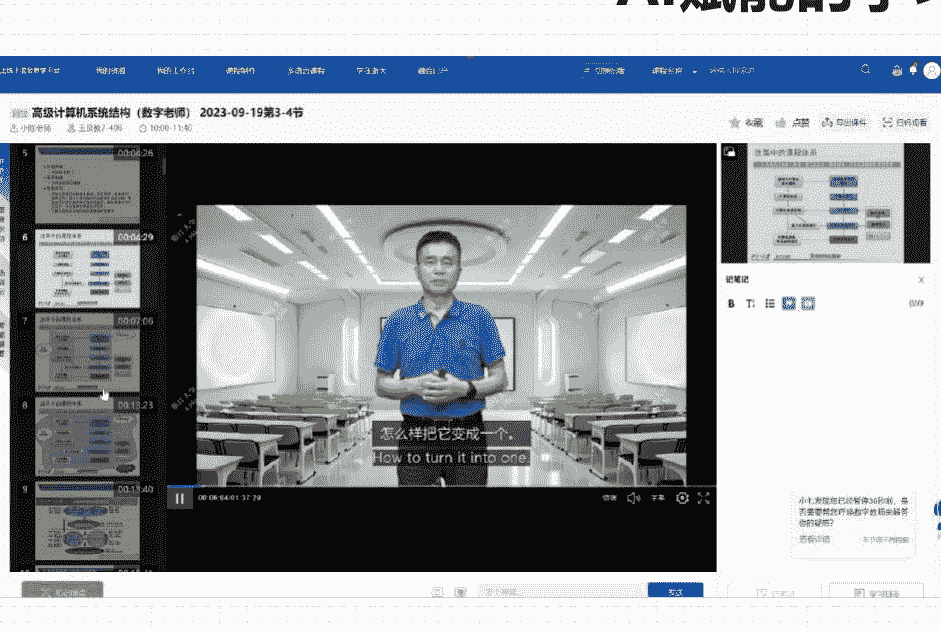

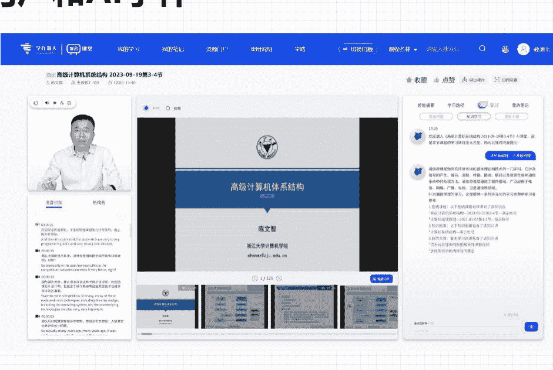

## 多意图AI学习

学习方法意图
能力测评意图
知识讲解意图
资源推荐意图
课程结构意图
视频学习意图更多...

# 应用升级·智云堂

## AI规划个性化学习

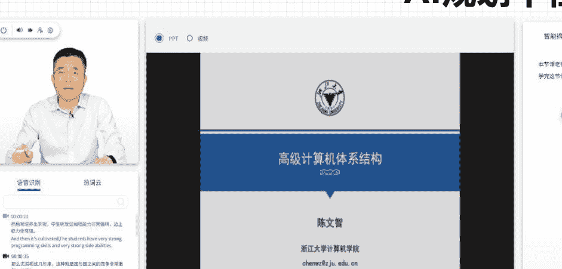

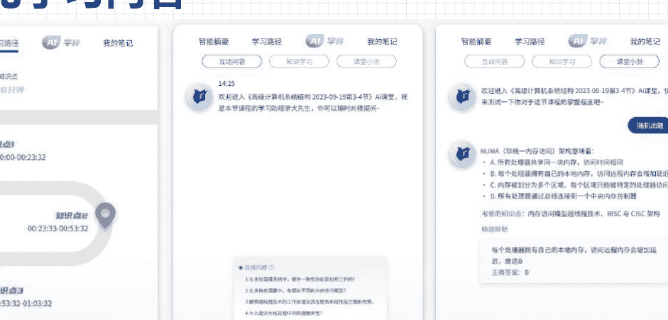

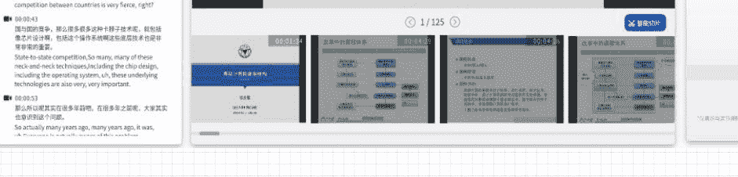

## 高级计算机系统蒋文

浙江大学计算机学院
chenwei@zju.edu.cn

- 数据直播/课堂实录学习
- PPT自动课程分段
- 本课程学习路径查看
- 相关知识点及资源推荐
- 大模型智能摘要
- 知识点解析
- 课堂内容答疑
- AI课堂小测
- 设置知识点、难度、类型主题

# 应用升级：ETalk-口语平台

## ETalk应用

### 主题教学

实现内容分级、围绕教学主题与用户进行适配匹配的对话

### 脚本练习

智能对脚本练习，长文分段逐步引导用户读懂学习

### 水平测试

限时6分钟1V1学生对话模拟真实互动场景ETalk口语对话平台是一款基于多模态大模型技术的口学习工具，通过动态适配全校本科生的语言理解、口语水平的差异，同步学生课堂进度，引导学生运用、记忆所学内容。基于海量案例及对话，实现高校口语教学专业模型训练及调试。该平台围绕主题对话、脚本练习、口语单词以及自由对话四大应用场景，为学生提供便捷高效的口语训练案例及指导。

| 全部主题 | 全部难度 |
| --- | --- |
| 探索世界 | 探索世界 |
| 讲述的故事和构思 | 分级讲述故事和技巧，使用不同的文体。 |
| 生活方式 | 生活方式：讨论生活方式的解决、技能、需求和健康观念。 |
| 文化交流 | 文化交流：分享关于自己的国家和文化背景，表达自己的情感和能力。 |
| 动物世界 | 动物世界：讨论动物的特征和问题，保护生存环境。 |
| 建筑未来 | 建筑未来 |

> Time is crucial for success in all aspects of life.

> With a plan, you can achieve more in less time.

Welcome to today's patent. I am your discussion partner. In this task, we will discuss common problems relevant to campus life. Our goal is to explore potential solutions and agree on the most important. Feel free to interrupt and ask me questions. When ready, you can start the discussion. Prioritize your tasks and allocate time accordingly.

# 浙江大学国际学院院长

## 应用升级-Etalk口语对话平台

## 基于DeepSeek赋能的个性化、多主题、高响应的对话场景

| 测试维度 | DeepSeek V3 | Llama3-8b |
| --- | :--- | :--- |
| 超长对话缓存 | 10k tokens准确率98% | >5k tokens准确率下降40% |
| 低延迟响应 | 平均响应<320ms (QPS 20+) | 平均响应>650ms (QPS 90) |
| 语言理解 | 中英文准确率95% | 非标准语识别率25% |

相比Llama3-8b，DeepSeek V3实现以下特性：
- 动态上下文记忆：内存占用减少40%
- 量化技术：模型体积压缩至3.2GB（原Llama3-8B的45%）
- ROI对比：相同预算下，V3可提升3.7倍请求量
- 长文本运维：自动发现缓存替代人工

> Student: consulting academic advisors is crucial for the right courses. They can clarify requirements and prevent graduation delay. Do you agree, or do you think?
System: Advisors can help, but sometimes they are overwhelmed or unaware of your interest while combining their input with review adds clarity. What do you think?
Student: Peers are useful but not always available. prioritize mandatory credits first? We need meeting requirements.
System: Advisor knowledge is essential. But students often struggle with unclear rules. Should we seek peers for more difficulty and teaching styles?
Student: Peer insights could balance guidance into so, combining advisor guidance, peer experiences cover all bases. Do they want reliable?
System: Yes, these three ways together address clarity, requirements, and real experience are the most important.

## 01 通过DeepSeek-RI模型进行场景构建及建模
## 02 校内专业测试结果验证模型能力提供数据增强实现资源最优成本大幅降低

# 打造你心中的“AI校园”

大学生平台与老师深度合作，以教学、生活等多元场景为核心，完善校园应用知识库。融合DeepSeek-R1，全方位打造高效智慧的AI校园生态，赋能校园智能化升级。

- 01 找人：人事图表
- 02 办事：办事流程查看
- 03 场馆：场馆百通、场馆预约
- 04 新生导向：新人入学引导
- 05 活动搜索：学校活动、社团活动
- 06 课程搜索：公开课、活动课、邀请课

AI校园使用平台能力，可根据各自在校的日常需求，开发食堂、图书馆、社团等专属浙大的智能应用，一起打造AI生态！

# 打造你心中的“AI校园”

大学生平台与老师深度合作，以教学、生活等多元场景为核心，完善校园应用场景知识库。融合DeepSeek-R1，全方位打造高效智慧的AI应用生态，赋能校园智能化升级。

# 场景建设案例 — AI辅助机械设计

机械基础学科教改（教学）
大学生集成到SolidWorks中

## AI-AD
AI-AD机械设计工具（科研）

# AI辅助机械设计

## 浙江先生的智能体应用逻辑

## “浙大先生”未来图景 — 多智能体协作

## 模型微调

使用 Unsloth 训练框架在 DeepSeek-R1 模型基础上进行专业领域模型微调，实现提升模型专业能力。

## 模型微调

### 学术研究辅助模型

基于模型微调可以针对医学、法学、哲学、农学、教育学等生成专业模型。

### 校园生活服务模型

基于校园内建筑位置、教室、活动场地、社团组织、校园活动等生成智能校园模型。

### 校园安全与健康模型

基于校园内安全数据与学生和教职工健康数据可生成相应的垂直模型。

## 模型训练

## “方舟”大模型服务平台全景：提供模型精调、推理、评测等全方位功能与服务，全方位保障企业级AI落地

- 01. 模型农场
- 02. 模型体验
- 03. 模型训练推理
- 04. 模型评测
- 05. 数据集
- 06. 大模型安全

大模型管理平台

> 欢迎使用火山引擎 MaaS 一站式大模型服务平台
> 提供模型精调、模型增强、模型微调、模型评测等全方位功能，全方位保障企业级AI应用落地

模型广场

Q 输入模型名称

| glm3-6b | 通用增强型 | 2024-12-14 更新 |
| :--- | :--- | :--- |
| glm4-9b-chat | 通用增强型 | 2024-12-14 更新 |

## 未来学习中心

### 空间层

未来图书馆 | 未来社区 | 虚拟教研室 | 其他...

### 知识服务全民终身学习

### 服务层

AI教育教学 | 全民AI教育 全民数字素养 | 其他机制 | 研究中心 | 教材基地 | 与技能培训基地

### 资源支撑

### 资源层

慕课 | 微课 | 纸质教材 | 通用AI识课 | 特色AI识课

智能工具 智能交互 个化路径

### 平台层

智云课堂 | 学在浙大 | 智云学堂

教学评一体化 个性化学习资源 | 提示工程 数字化教师 | 多模态 知识图谱 | AI赋能 教学工具 | 知识生成 操控 工作流 | AI助手 AI助课

一生一书 一生一空间 | 系统化资源汇聚

Agent1 | Agent2 | Agent3 | AgentN

### “浙大先生”平台

大先生 | 大先生 智能体 服务场所 开发平台

### 三问 | GPT 百科

### 模型层

### 智学

### DeepSeek

三乐 | 智海 | 观止

### GEO

### 模型支撑

### 算力支撑

### 支撑层

超算 | 智算 | 普算

浙江大学启真算力中心

当汽车诞生时，无需与之奔驰，而应考虑个驾照。
