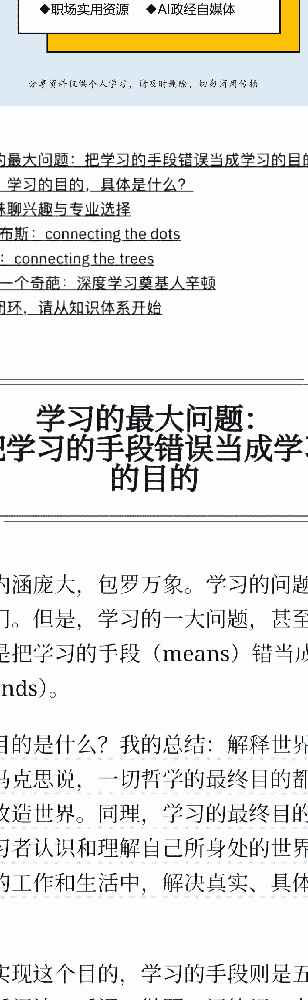
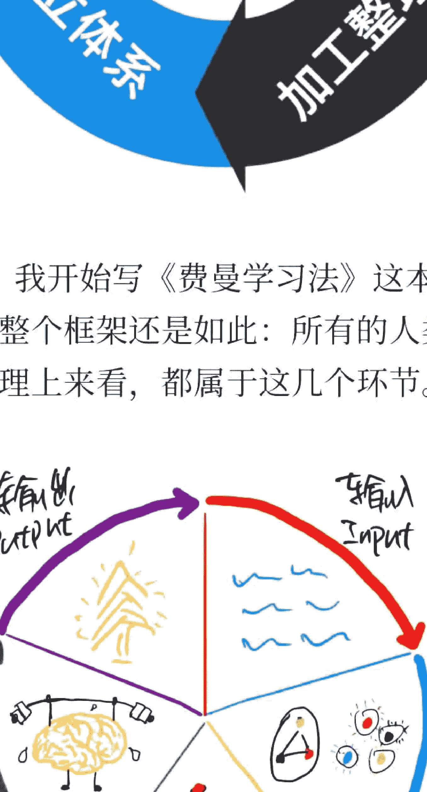
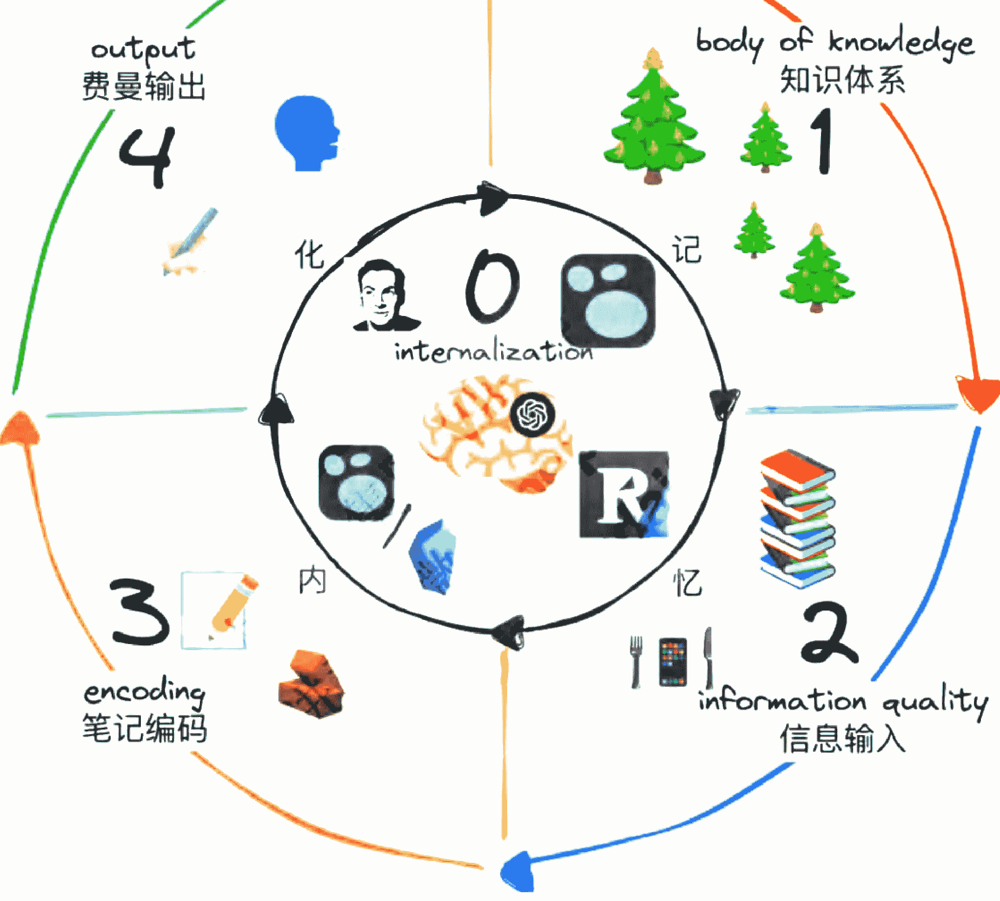

# 学习的大问题：把学习手段当作学习的目的

##学习的大问题：把学习手段当成学习的目的

- 学习的大问题：把学习手段当成学习的目的
- 学习的目的，到底是什么？
- 如何找到这个困惑

学习的内涵，包括学习的手段和目的。学习的手段是手段的，学习的目的是目的的。学习是通过手段（means）来实现目的的。

学习的目的是什么？是为了解决问题，还是为了获得某项技能？是为了理解这个世界，还是改变这个世界？学习的目的，是能够成就更好的自己，还是为了发现更好的自己？在现实生活中如何做，实现具体的目的？

为了实现这些目标，我们学习了许多手段：考试、背诵、逻辑、推理、记忆、记录、思考、写作。但是，手段是手段，不是学习的。

所以，学校并没有教会学生学习的目的。学校只是教会了学生各种手段。在离开学校后，我们发现自己掌握了许多技巧，但并没有学习的目的。

## 学习的目的，到底是什么？

学习的目的是解决问题，适应环境。在不断变化的世界里，一个学生的目标应该是变化的。一个学生通过阅读、读一本书，发现学习的目的，是为了解决问题，适应环境。但“这显然是不够的”。

所以，我们需要找到学习的目的：我们需要什么样的知识，还是什么样的知识，在多个领域中，建立自己的知识体系，建立出一个属于个人的知识体系。

## ——与职业及专业建立联系

我在当时，很快在大学学习了专业。毕业后，我发现自己对以后可以做什么，不确定自己的专业和职业未来。

其实学习专业并不是职业，这只是我们必须要考虑的问题。在当时的我，没有时间去思考专业和职业的问题。这个困惑，直到多年以后才得到了答案。

我想，这里有一个关于乔布斯的例子。在斯坦福的演讲：

### connecting：connecting the dots

乔布斯在大学后，选择了辍学。他回了家里，但他旁听了一门关于书法设计的课。多年后，当他创立了苹果公司时，这种设计改变了他的人生。这就是著名的“connecting the dots”的故事。

乔布斯在斯坦福时，并没有意识到书法对他有什么用。直到多年后他设计第一台电脑时，才发现他可以设计漂亮的字体、行间和间距。

## 我的机器学习之旅

在2018年，我读了一本名为《机器学习》的书，这本书开启了我对机器学习的兴趣。通过这本书，我从零开始了基础知识，逐渐进入了机器学习的大门。到底什么是这门科学？

大学后，我开始对算法工作非常感兴趣。当我开始学习这门课时，我发现我并没有数学基础，基础薄弱。于是我开始自补自己的数学知识。

## 第一阶段：学习机器学习基础

通常情况下，初学者对算法是感兴趣的。在这个阶段，我学习了许多基础的知识：

- 线性代数
- 概率论与统计学
- 微积分
- Python 基础

学习了 Scikit-learn，这个库非常强大，能让我快速上手各种算法。

辛顿，作为一个伟大的机器学习科学家，他学习了 Yann LeCun 和 Geoffrey Hinton。

因为，知识体系的缺乏，解释了学习者的根本问题。缺乏个人知识体系，即使你学习了批判性思维的方法和步骤，但是在具体判断上会因为领域知识的缺乏而无法启动的批判性思维。缺乏个人知识体系，虽然 ChatGPT 无比强大，但是你没法用它服务你的创造。缺乏知识体系，即使你学习了各种启发创造力的课程和技巧，但是，创造力就是无源之水，与你无缘。

由于重大改变，一个“违古祖宗”、推翻传统的决定：把知识体系作为学习闭环的第一个环节。知识体系，才是学习闭环的开头，是学习的起点，也是学习的具体目的。

