# 核心叙事
从L1到L3

## 定义Agent
从“特征”到“看见”

## 实现原理
Less structure

## 使用体验
惊喜与差距

## 暴论输出
全都是私货

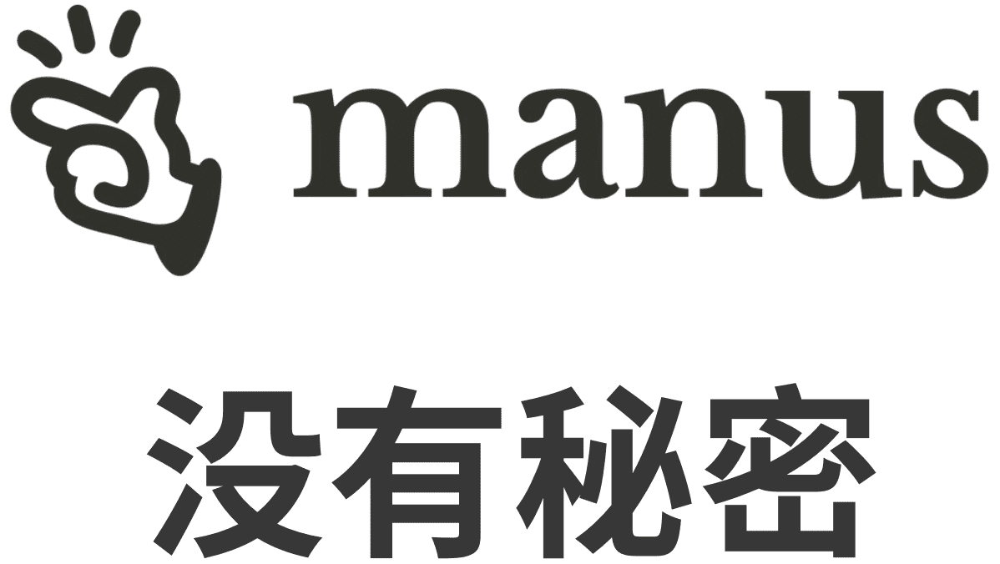

# 扫码加入 知识星球TOP 免费资源群

免费

- 每日免费获取高价值资源
- 可提供各类资源搜索服务

公众号: 知识星球TOP

价值

微信:jntsg8

| 热门付费文章 | 各行各业报告 |
| :--- | :--- |
| 精选图书资源 | 副业赚钱方法 |
| 职场实用资源 | AI政经自媒体 |

及时

微信:jntsg2

专注

分享资料仅供个人学习，请及时删除，切勿商用传播

# 也就是差不多一个月之前

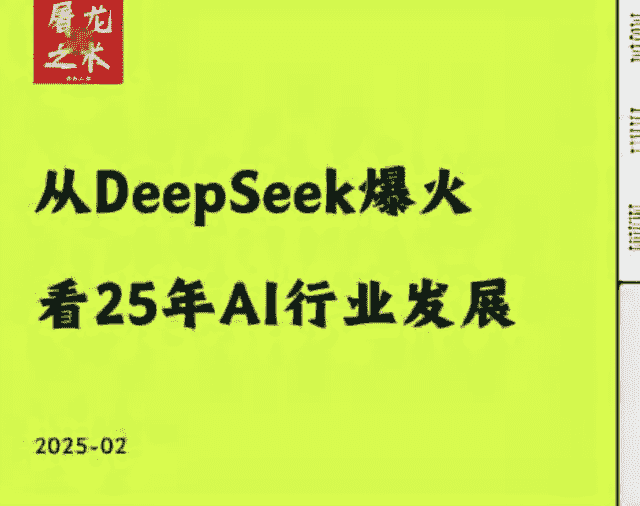
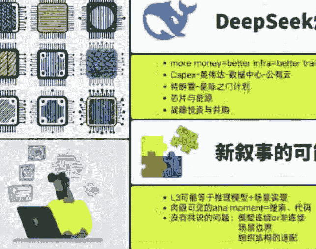
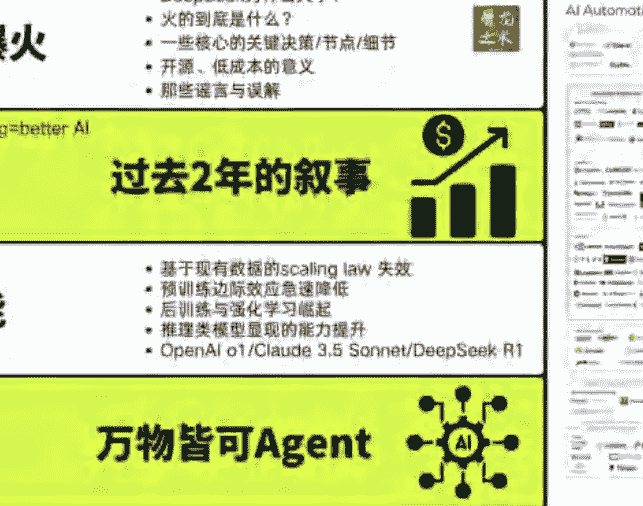
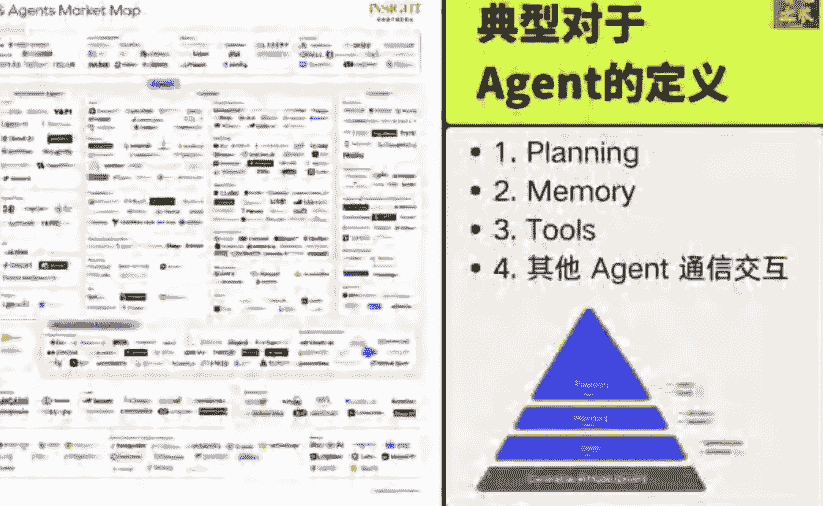

# 核心叙事
从L1到L3

## 定义Agent
从“特征”到“看见”

## 实现原理
Less structure

## 使用体验
惊喜与差值

## 暴论输出
全都是私货

## 当时的内容如果精简到极致

如果今天只有一页PPT

| 聊天机器人 | 推理者 | 智能体 | 创新者 | 组织者 |
| :--- | :--- | :--- | :--- | :--- |
| 有针对对话能力的AI。 | 人类一类能够解决问题的AI。 | 不仅能思考，还可以采取行动的AI系统。 | 能够帮助发现创造的AI。 | 可以完成组织工作的AI。 |
| L1 | L2 | L3 | L4 | L5 |

我们走到哪了？L2-L3之间

## 拆开了揉碎了，说说L1-L3

核心叙事
从L1到L3

定义Agent
从“特征”到“看见”

实现原理
Less structure

使用体验
惊喜与差值

暴论输出
全都是私货

- AI1.0年代和大模型时代的最大区别是什么？
- 我们是怎么走到L1的？
- ChatGPT对于GPT-3.5的意义是什么？
- OpenAI-o1到DeepSeek-R1，我们是怎么走到L2的？
- 为什么每次LLM重大更新，都会有应用公司消失？
- 模型还是产品？不同阶段似乎有不同答案？
- ......

### 核心思想

定义Agent
从“特征”到“看见”

实现原理
Less structure

使用体验
惊喜与落差

暴论输出
全都是私货

核心叙事：从L1到L3

### 通用

- 通用大模型
- 通用推理模型
- 当然也通用Agent

### 技术实现

- “大力出奇迹”
- 预训练+强化学习
- Less structure

### 用户感知

- 所谓“aha moment”
- 超低理解门槛
- 简单-复杂-简单...

怎么感觉我都快成神棍了？

# 核心叙事
从L1到L3

## 定义Agent
从“特征”到“看见”

## 实现原理
Less structure

## 使用体验
惊喜与差距

## 结论输出
全都是私货

### 通用

## AI 2.0 克服了 AI 1.0 领域、模型限制

| DATASET1 | MODEL1 | TASK 1 | DATASET2 | MODEL2 | TASK 2 | DATASET3 | MODEL3 | TASK 3 |
| :--- | :--- | :--- | :--- | :--- | :--- | :--- | :--- | :--- |
| | | | | | | | | |
| 单一领域数据集；多个数据集和模型形成孤岛效应；劳动密集型的数据标注；海量数据无需人工标注；一个具有跨领域知识的“基础模型”，能执行任务 | | | | |

| WORLD'S DATA | ONE MODEL | MANY TASKS |
| :--- | :--- | :--- |
| 如：文本（所有语言） | Foundation Model 基础模型 | Transfer Learning 迁移学习 |
| 来源：多模态（图像、音频、视频、3D...） | Knowledge | |
| 虽然……归纳总结能力还是……

# 核心叙事
从L1到L3

# 我们是怎么做到L2?

## 定义Agent
从“特征”到“看见”

## 实现原理
Less structure

## 使用体验
惊喜与落差

## 暴论输出
全都是私货

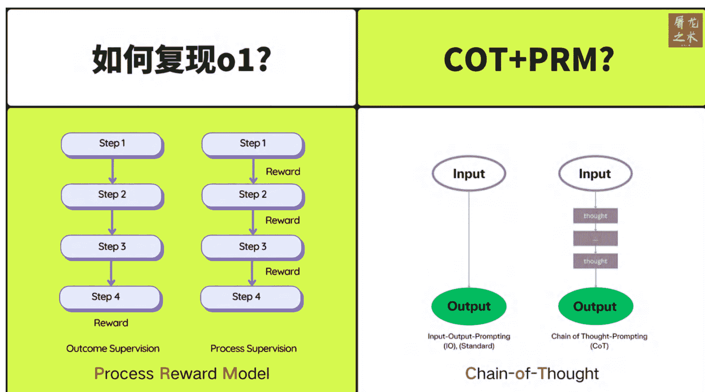

# 核心叙事
从L1到L3

## 定义Agent
从“特征”到“看见”

## 实现原理
Less structure

## 使用体验
惊喜与落差

## 暴论输出
全都是私货

# 我们是怎么到的L2?

不要采取结构化的方法，最终会限制模型的效果，要让模型自己探索范式。思考包含了搜索过程，允许犯错。

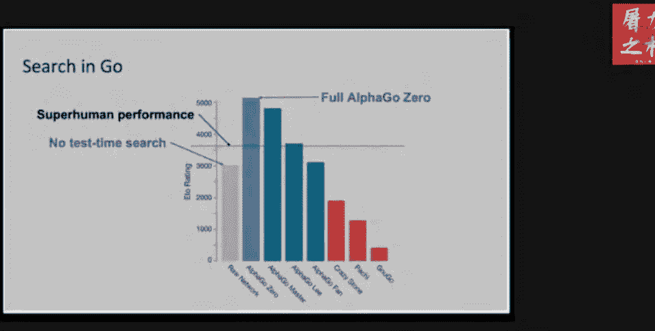

如何评价Kimi发布的多模态推理模型1.5?扫码打开知乎，与我读

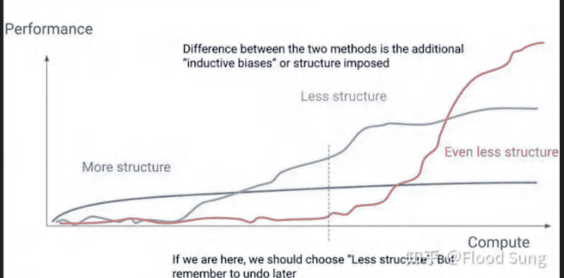

# 核心叙事
从L1到L3

## 定义Agent
从“特征”到“看见”

## 实现原理
Less structure

## 使用体验
惊喜与差值

## 暴论输出
全都是私货

# Alpha-zero
2017年5月，AlphaGo以3.0版本击败了DeepMind，一个超越人类的围棋AI。事实上，我们不需要人类的棋谱，只需从自己的对弈中学习，打破了界限，模型能从快速学会大师水平。研究人员发现，AlphaZero完全不需要人类知识。

## 摆脱人类经验
在此之后，人类开始摆脱局限，AI开始创造新的战略。所以，我们正在超越人类，让AI成为人类的伙伴、导师（甚至是发现人类是不行的），但逐渐超越人类的自我。

## 从V3到RI Zero
这是另一个AlphaZero，在RI Zero的迭代过程中，完全不需要人类的智能引导，通过RL学习进步，推理能力优于所有Reasoning模型。

## 从RI Zero到RI
我们发现了一个非常有效的方法：Chain-of-Thought (CoT) 模型，通过V3模型生成高质量的轨迹并进行筛选。然后，我们在这个轨迹上让它进行修正（Self-Correction），并进行迭代。最后，为了更好的质量，通过改进的提示词让多个模型进行投票。然后将推理轨迹训练数据，使用组合奖励来强化学习。

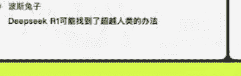
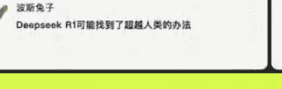

## Deepseek V3-Zero-R1

# 核心叙事
从L1到L3

## 定义Agent
从“特征”到“看见”

## 实现原理
Less structure

## 使用体验
惊喜与落差

## 暴论输出
全都是私货

# 我们是怎么到的L2?

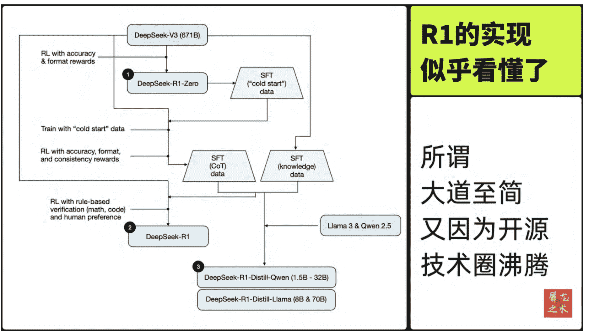

# R1的实现似乎看懂
所谓大道至简，因为开源技术

## 用户需要“Magic”

# 核心叙事
从L1到L3

## 定义Agent
从“特征”到“看见”

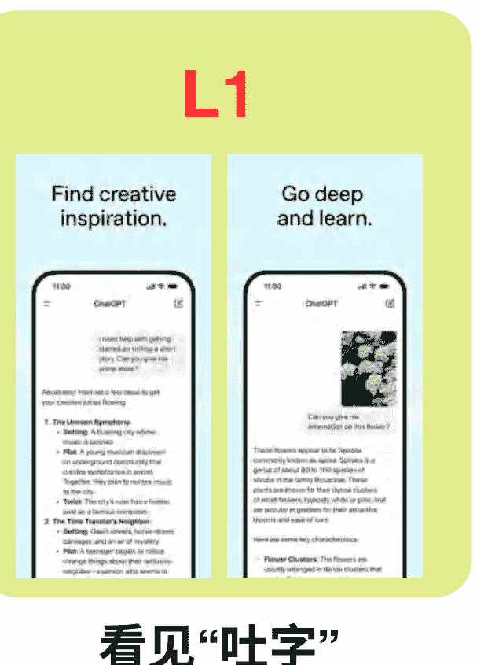

## 实现原理
Less structure

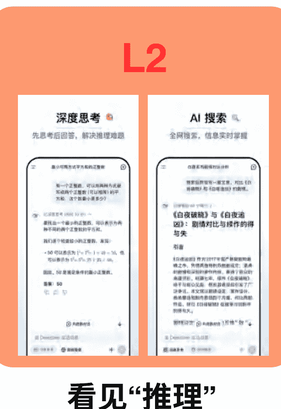

## 使用体验
惊喜与差值

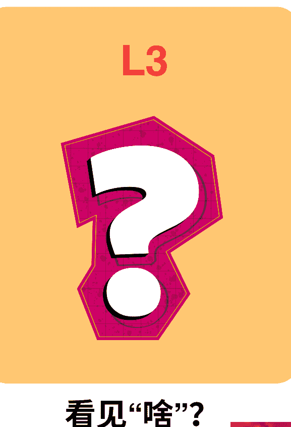

# 所谓的aha moment就是技术人员一眼懂的“看见”了…

## 简单-复杂-简单，重复

# 核心叙事
从L1到L3

## 定义Agent
从“特征”到“看见”

## 实现原理
Less structure

## 使用体验
惊喜与差

## 结论输出
全都是私货

- L1：只需要自然语言，出现了提示词工程
- L2：感觉提示词不需要了，过程还是结果？
- L3：出现了workflow，是不是应该要workflow？限定场景？

从技术实现角度看，路径依赖总把我们提到“弯路”上……

# 总结一下

### 通用
不是垂类，不局限具体场景，边界，当然很难……所以初期实现一定是不完美的

### 让大模型自己来
不要干预、不要添加条件，少的限制，更好的模型；考验成本与结果的博弈

### 傻化操作
要让用户“看见”，哪怕过程也很重要……不能一次走入“复杂”区域

# 还是看那两个最重要的Agent

# 核心叙事
从L1到L3

## 定义Agent
从“特征”到“可见”

## 实现原理
Less structure

## 使用体验
惊喜与差距

## 暴论输出
都是私货

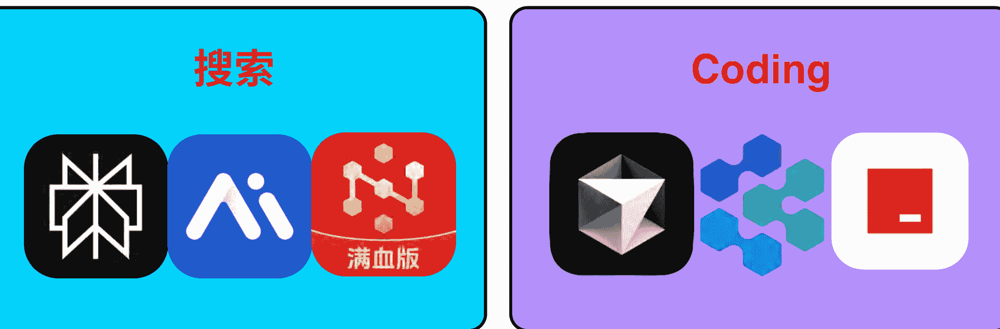

# 核心叙事
从L1到L3

## 定义Agent
从“特征”到“看见”

## 实现原理
Less structure

## 使用体验
惊喜与差值

## 最终输出
全都是私域

# AI搜索

- 需要自己模型吗？
- 没有的话，就不是套壳吗？
- 是传统搜索引擎公司的机会还是初创公司的机会？
- 都接了deepseek，那有什么区别呢？
- 信息的差别能带来持久的竞争优势吗？
- 产品设计上能拉开绝对的差距吗？
- 开源方案似乎也有
- 工程实现上也没有什么难度
- 专门做法律/金融/医疗垂直方向是否有意义？
- ......

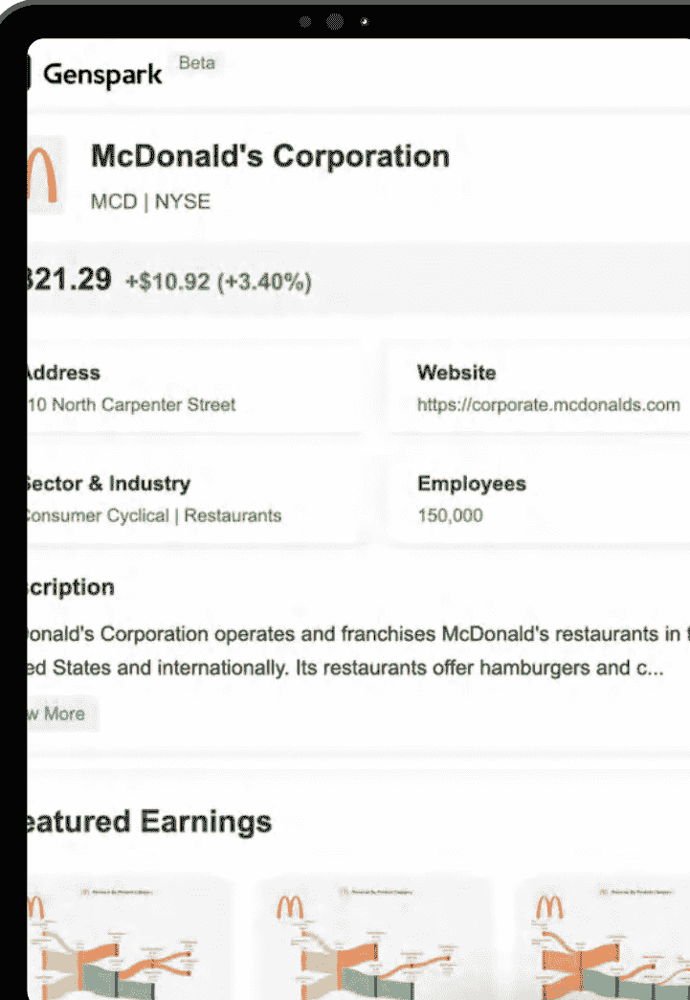

这些问题看着眼熟吗？别急，后面还有更眼熟的......

# 核心叙事
从L1到L3

## 定义Agent
从“特征”到“看见”

## 实现原理
Less structure

## 使用体验
惊喜与差距

## 暴论输出
全都是私货

# AI Coding

- 头部大模型公司的产品也不可以编程？
- “源动力”是大模型本身能力的进化
- 所有人不是就是Claude 3.5/3.7的套壳？
- 那那些目的“护城河”是什么？
- 工程、体验、产品边界能拉差距吗
- 开源方案也有
- 所有大厂大概都会做的
- 产品的品牌效应会有吗？
- 做“垂直”有意义吗？

这些问题不是被频繁的问起来？有答案吗？

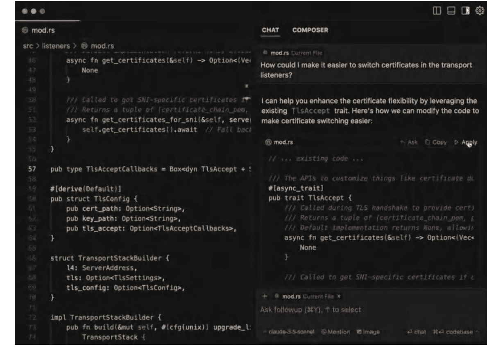

# 核心叙事
从L1到L3

## 定义Agent
从“特征”到“看见”

## 实现原理
Less structure

## 使用体验
惊喜与惊喜

# 最忌输出
全都是私货

## 一千个Agent的概念被严重泛化

## 典型Agent的定义
1. Planning
2. Memory
3. Tools
4. 其他交互

## 24年Agent发展延续到25年

# 核心叙事
从L1到L3

## 定义Agent
从“特征”到“看见”

## 实现原理
Less structure

## 使用体验
惊喜与差值

## 暴论输出
全都是私货

# 提示一下
这页PPT之前，没有提及任何关于Manus的内容接下来我们看看Manus的种类

## 一切的工作让用户“看见”

# 核心叙事
从L1到L3

## 定义Agent
从“特征”到“看见”

## 实现原理
Less structure

## 使用体验
惊喜与反差

## 暴论输出
全部是私货

# 如何做到的？

“技术”
“产品”
“打榜”
“复现”
“故事”

# 核心叙事
从L1到L3

## 定义Agent
从“特征”到“看见”

## 实现原理
Less structure

## 使用体验
惊喜与差错

## 暴论输出
全都是私货

## 已经有了那么多Agent技术

- 大家的底层逻辑差不多
- 拆解任务-执行任务-给出结果
- 因为推理模型的熟悉，感觉上“拆解”似乎很容易了
- MCP协议之后，似乎多种工具并不是门槛了
- 那差的是什么？

## 一个提前看过Manus的投资人问了这样一个问题：

你们自己写了多少workflow?

## 答案：0

还记得我们是怎么到的L2吗？

# 核心叙事
从L1到L3

## 定义Agent
从“特征”到“看见”

## 实现原理
Less structure

## 使用体验
惊喜与差距

## 暴论输出
全都是私货

# 什么叫“通用”啊?

OpenAI-Hyung Won Chung
《Don’t teach. Incentivize》
Manus-hidecloud
Manus发布隔天的闭门分享

# 核心叙事
从L1到L3

## 定义Agent
从“特征”到“看见”

## 实现原理
Less structure

## 使用体验
惊喜与落差

## 暴论输出
全都是私货

# 一个很简单的比喻

“产品”

设想这样一个场景：

+ * 你招聘了一个实习生,
* 博士学位,
* 但你只给了他纸和笔，他能干嘛？
* 如果你再给他一个浏览器，他能干嘛？
* 如果你再给他们内部的数据库权限呢？
* 如果你再做一些必要的训练和要求呢？
* ......

| manus的创新之处 | 产品二组 |
| --- | --- |
| perplexity = 搜索 | + AI |
| Monica = 浏览器 | + AI |
| cursor = IDE | + AI |
| manus = 虚拟机 | + AI |

# 核心叙事
从L1到L3

## 定义Agent
从“特征”到“看见”

## 实现原理
Less structure

## 使用体验
惊喜与反差

## 暴论输出
全都是私货

# 具体都“看见”了什么？
“产品”

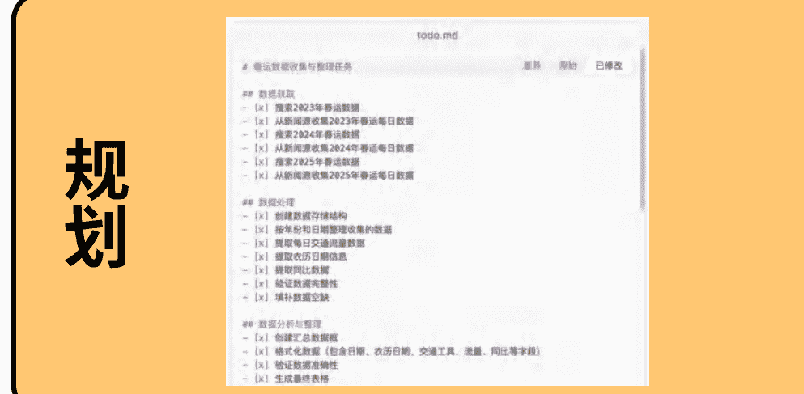
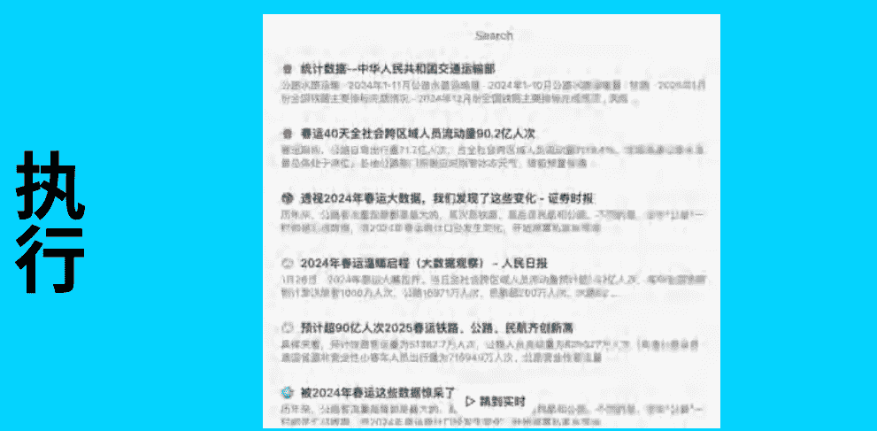
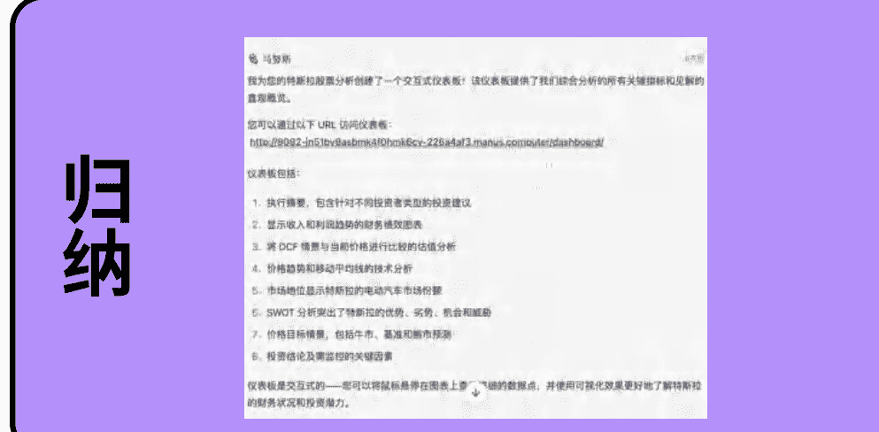
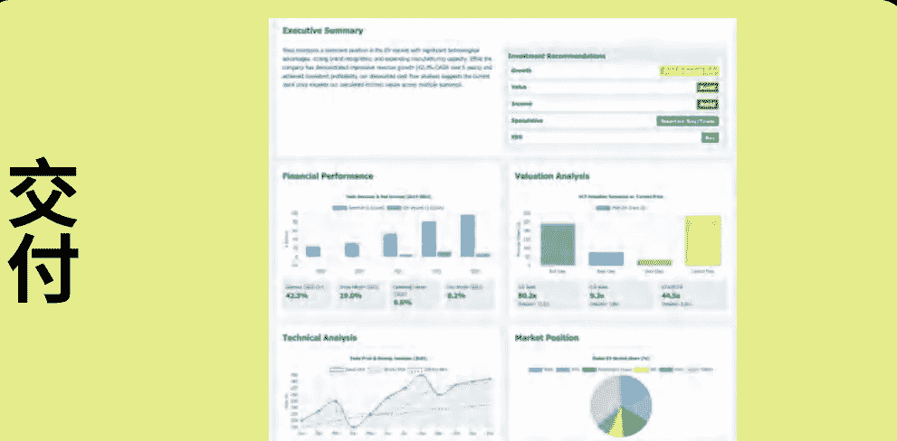

# 核心叙事
从L1到L3

## 定义Agent
从“特征”到“看见”

## 实现原理
Less structure

## 使用体验
惊喜与差距

## 暴论输出
全都是私货

# 东西做完了，得看看好不好使啊
“打榜”

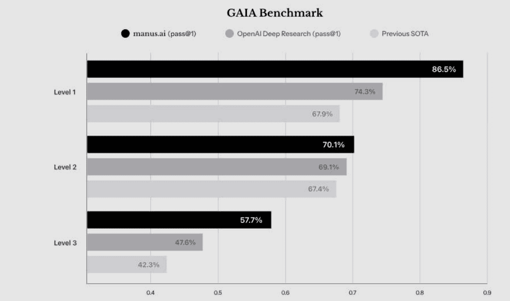
你明白这个打分的含义吗?

# 核心叙事
从L1到L3

## 定义Agent
从“特征”到“看见”

## 实现原理
Less structure

## 暴论输出
全都是私货

# GAIA是什么？
GAIA将题目复杂度划分为三个等级：

- Level 1 (初级)：通常不需要工具，或最多需要一个工具且不超过5个步骤。
- Level 2 (中级)：需要执行约10个步骤，并且组合使用不同工具。
- Level 3 (高级)：要求AI能够执行长时间的推理，并能够访问任意数量的工具。

Level 1 (初级)：在20世纪17年之后，唯一一份记录为已复存不存在家的马洛哈收藏（Malko Collection）中有多少个动物的手是数字？

Level 2 (中级)：在2015年后，北京美术博物馆中有中国青少年姓名的展览，“十二生肖”中中有多少动物是被描绘的？

Level 3 (高级)：在2018年3月上的一段YouTube视频中，自由《指环王》中咕噜（Gollum）角色的配音真人。在视频中第一次出现亮点后，是谁？

给你一台联网的电脑，你觉得它能回答对多少问题？

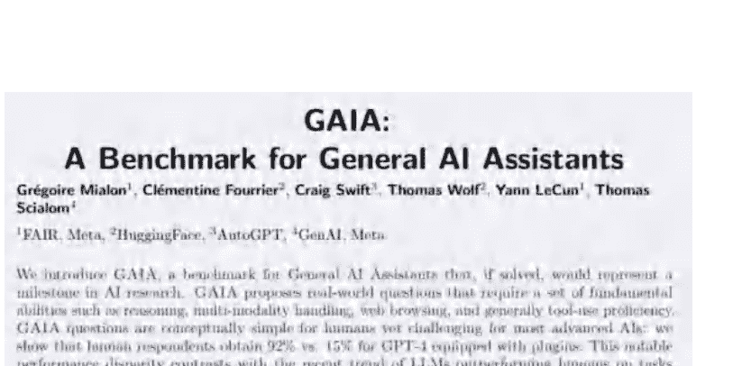
> 甘蓝曾说：Manus到底是技术瓶颈还是营销噱头？我们走了467条弯路才发现。

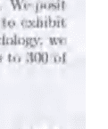

# 核心叙事
从L1到L3

## 定义Agent
从“特征”到“看见”

## 实现原理
Less structure

## 使用体验
惊喜与差距

## 暴论输出
全都是私货

## 题目变态，答题者......
当 Manus尝试 GAIA 测试上的一个项目：“在一个类似地理风格的 YouTube视频链接里，各种企业我们回来退出又进来画面，让 Manus 数一画画面里同时出现最多种企业，是有几种？”
然后，神奇的事情发生了。

Manus 先是打开这个视频链接，接着它的第一个动作是“Press K”，接着截取视频记录一帧出现了什么企业，后，最后得出最多一个画面有3种企业。Manus 接下来要去回去检查，它的下一个动作是“Press 3”......最后检查后给出答案就是3。

> 极客公园：完整复盘：Manus 是怎么诞生的？
> 极客公园：完整复盘：Manus 是怎么诞生的？

你知道YouTube的快捷键“k”和“3”分别是什么干嘛用的吗？

# 核心叙事
从L1到L3

## 定义Agent
从“特征”到“看见”

## 实现原理
Less structure

## 使用体验
惊喜与差值

## 暴论输出
全都是私货

# 哪里还有更多的“实例”测试
复现

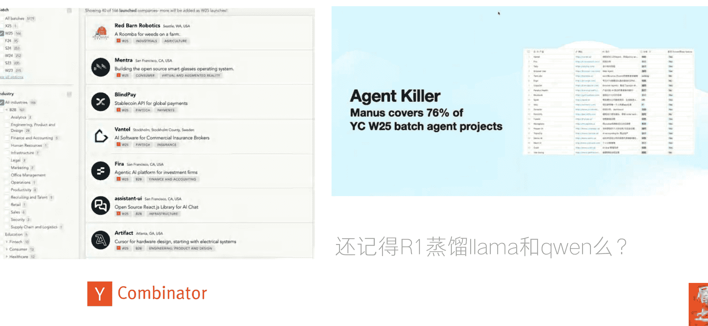
Combinator

## 重新看用户的“使用时长”
核心叙事
从L1到L3
定义Agent
从“特征”到“看见”
实现原理
Less structure
使用体验
惊喜与差值
暴论输出
全都是私货

- Chatbot每轮对话多久？5秒？10秒？20秒？
- 如果复杂任务完全交给agent呢？10分钟？20分钟？几个小时？
- 那算力提升多少？10x?100x?1000x? $20/task---$10/task

# 核心叙事
从L1到L3

## 定义Agent
从“特征”到“看见”

## 实现原理
Less structure

## 使用体验
惊喜与落差

## 暴论输出
全都是私货

## 重新看这页PPT
“成本”
- 5亿token=5000/分钟
- 当下百亿token=5000/天
- 当前市场百万消耗
- 全景是几千亿-100亿......
- 25年成本10-20倍下降，迭代再降几倍需要100倍增长才能维持现在的。
- 极端设想：2小时视频=3亿token/用户
- 百万DA=3000万token

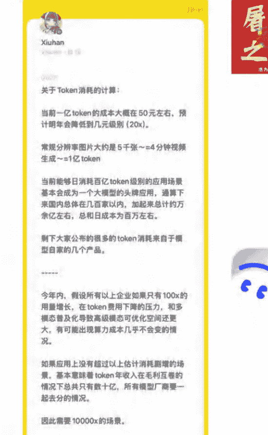

## 如果再发散一下
核心叙事
从L1到L3
定义Agent
从“特征”到“看见”
实现原理
Less structure
使用体验
惊喜与落差
暴论输出
全都是私货

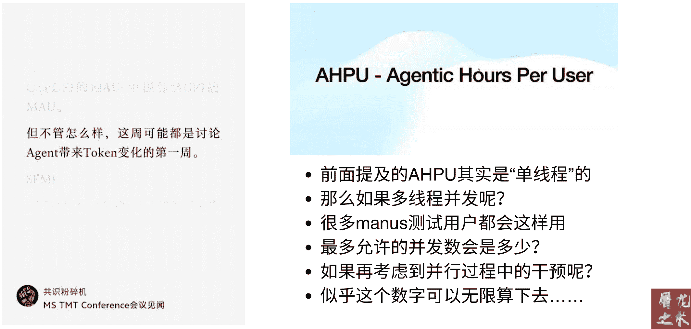
- 前面提到的其实是“单线程”的
- 那么如何多线程并发？
- 很多Manus测试都会这样用允许并发数是多少？
- 如果考虑到并行过程中的干呢？
- 似乎这个数字可以无限下去

# 核心叙事
从L1到L3

## 定义Agent
从“特征”到“看见”

## 实现原理
Less structure

## 使用体验
惊喜与差

## 暴论输出
全都是私货

# 为什么放弃浏览器形态？
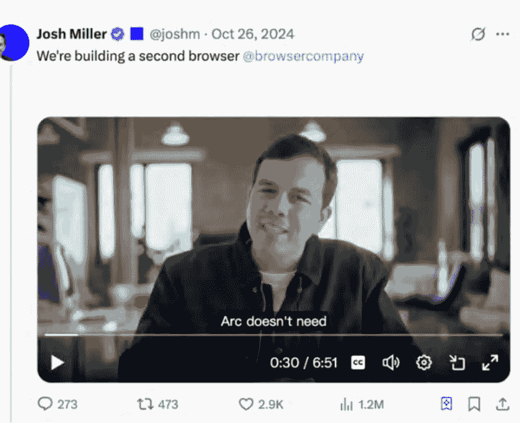
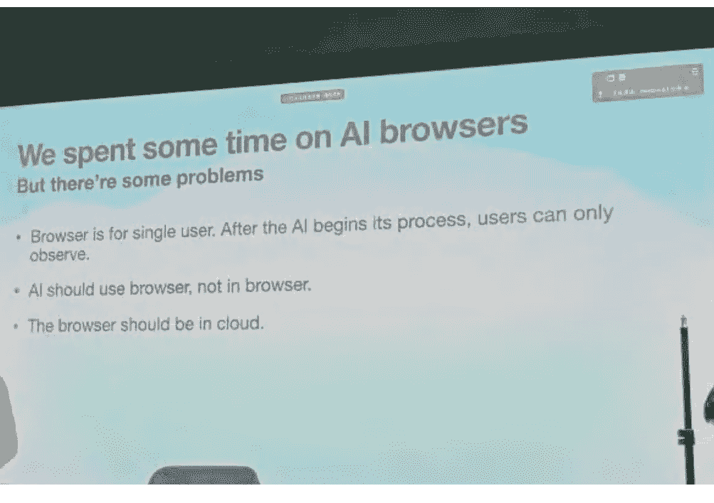

# 核心叙事
从L1到L3

## 定义Agent
从“特征”到“看见”

## 实现原理
Less structure

## 使用体验
惊喜与差距

## 暴论输出
全都是私货

# 为什么说没有秘密？
我想的是OK，也不慢，应该有个虚脑——Chatbot写的，它在云上有个电脑，把它的代码，它就能通过查询在服务器上执行。因为是虚脑，坏了可以再来一次。它甚至可以在当前任务之后换个服务器。我是自己过的，那个架构叫做一个脑服务器、一个数据库、能够自己写代码去调用API，它就能执行各种任务——这就是我们做的事情。

## 向 OpenAI o1迈出的一步：Seek开源模型的进展
自从 OpenAI o1出来以来，我们实在在空间上把时间作为目标来迭代。o1在这个过程中，我们有了许多的启发和结论（以及发现）。是可以解决智能限制的，不能通过一种确定性的方法。我们在探索新的边界时，每一个算子都是重要的，这就像当我有H100 GPU的时候。

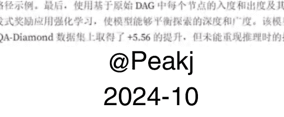

Seek是一种推理算法，它的过程是从树开始，通过节点生成策略对节点扩展，通过剪枝策略剪掉分支，通过压缩将其转化为无环图（DAG），然后，基于前K个DAG中每个节点的输入和其描述的路径进行选择，最后通过后顺序优化，减少搜索的深度来改进推理性能。

## 产品思路上的启发
开车，就是现在
- 绝妙的时间差
- 比较AI，提供捷的价值交付
- ChatGPT不是终点
- 95%的用户第一款AI应该是
- R1 + 质本身是个agent
- 还能做什么？

@xiaohong：2025-02 “虚拟机”
@Peakj：2024-10 RL+推理
@hidecloud：2025-02 “看见”

首先关注Manus的用户和媒体老师们表达一个歉意，我们知道还有很多人还没有体验过Manus。过去的17小时对于团队来说无异于于一场充满了各种意外的冒险。我们完全低估了大家的热情，一开始的初心只是分享一下在探索agent产品形态过程中的阶段性收获。因此服务器资源完全是按照行业里发一个demo的水平来准备的，根本没想到会引起如此大的波澜。目前采取邀请机制，是因为服务器容量确实有限，为此之，团队也熬夜了一天。希望在接下来的时间里有更多waitlist中的用户优先体验。意外之外，Manus还是一个。交付友好度、运行速度方面还有很大的提升。

# 核心叙事
从L1到L3

## 定义Agent
从“特征”到“看见”

## 实现原理
Less structure

## 使用体验
惊喜与差异

## 暴论输出
全都是私货

# 那么我们就来试试demo
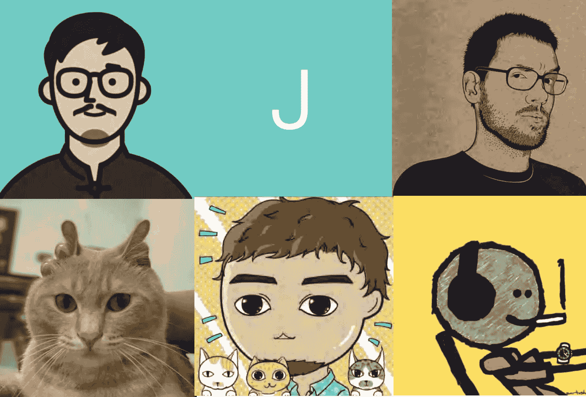

# 核心叙事
从L1到L3

## 定义Agent
从“特征”到“看见”

## 实现原理
Less structure

## 使用体验
惊喜与差值

## 暴论输出
全都是私货

# 那么我们就来试试demo
AI评分

综合能力测评榜
| 排名 | 模型名称 | 开发机构 | 国家/地区 | MMLU(得分) | GSM8K(得分) | SuperCL(得分) | 酷排名2023/5 |
| :--- | :--- | :--- | :--- | :--- | :--- | :--- | :--- |
| 1 | OpenAI-o1 | OpenAI | 美国 | 90.6 | 94.8 | | 90.4 |
| 2 | DeepSeek-R1 | 深度求索 | 中国 | 90.8 | 97.3 | | 67.7 |
| 3 | Claude 3 Sonnet | Anthropic | 美国 | 88.7 | 96.4 | | |
| 4 | GPT-4o | OpenAI | 美国 | 88.7 | 90.5 | | | |
| 5 | DeepSeek-V3 | 深度求索 | 中国 | 88.5 | 90.2 | | 68.3 |
| 6 | Qwen-Max | 阿里巴巴 | 中国 | 87.5 | 76.1 | | 65.2 |
| 7 | Grok 2 | xAI | 美国 | 87.7 | 94.5 | | 63.6 |
| 8 | Kimi 1.5 | 月之谱 | 中国 | 87.4 | 94.6 | | | |
| 9 | Llama3-405B | Meta | 美国 | 87.3 | 96.8 | | | |
| 10 | Claude-3-Opus | Anthropic | 美国 | 86.8 | 95.0 | | | |
| 11 | GPT-4 | OpenAI | 美国 | 85.5 | 88.4 | | 83.2 |

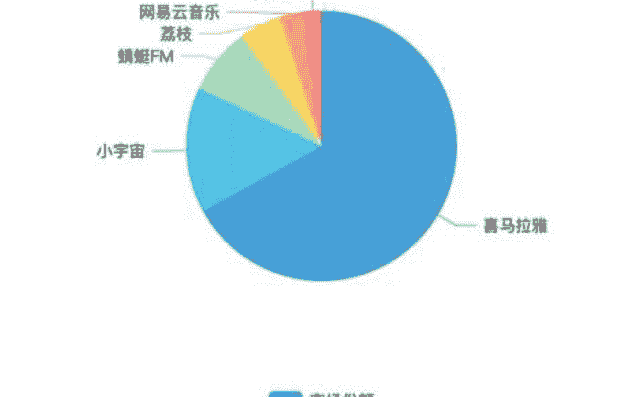

# 核心叙事
从L1到L3

## 定义Agent
从“特征”到“看见”

## 实现原理
Less structure

## 使用体验
惊喜与差距

## 暴论输出
全都是私货

# 那么我们就来试试demo
模型内容分布
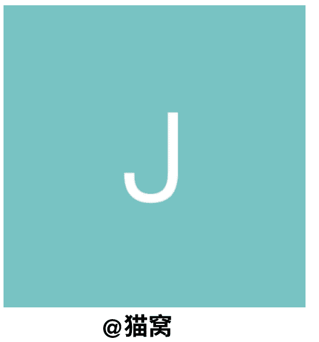
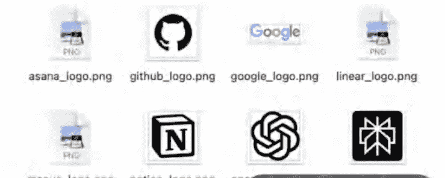
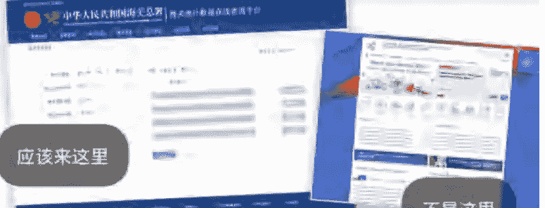

- 收集这些应用的最新官方图标，分辨率至少12像素。背景需要透明，位图格式（最好png）。如果有单色版本的，请使用单色版本。
- 到海关官网获取2019年1月至中国各地对贸易伙伴的商品月出口额
- 到中国海关官网获取(2019年1月到1月为止每个国家对贸易伙伴在每种商品上的月出口额

# 核心叙事
从L1到L3

## 定义Agent
从“特征”到“看见”

## 实现原理
Less structure

## 使用体验
惊喜与差值

## 暴论输出
全都是私货
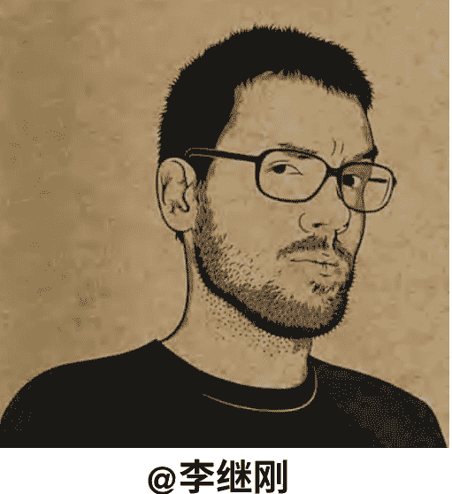
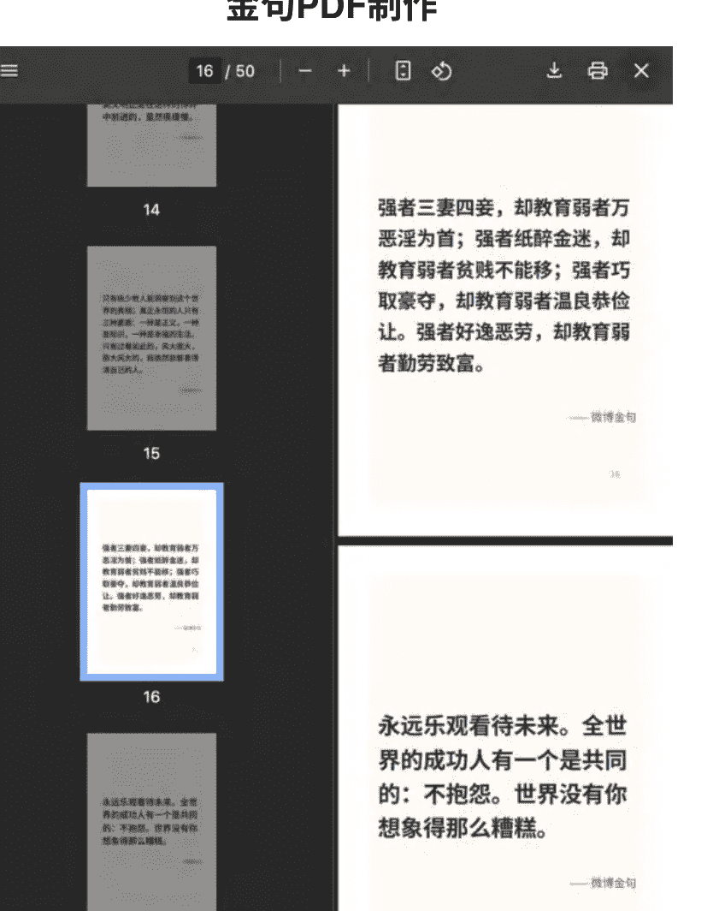
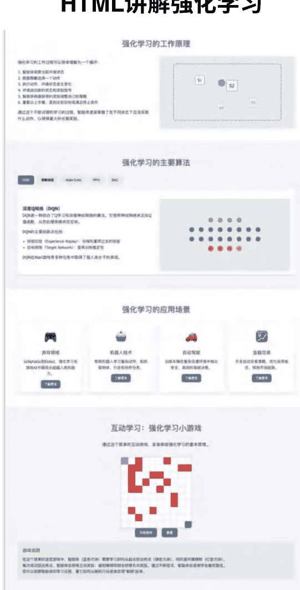

# 核心叙事
从L1到L3

## 定义Agent
从“特征”到“看见”

## 实现原理
Less structure

## 使用体验
惊喜与差距

## 暴论输出
全都是私货

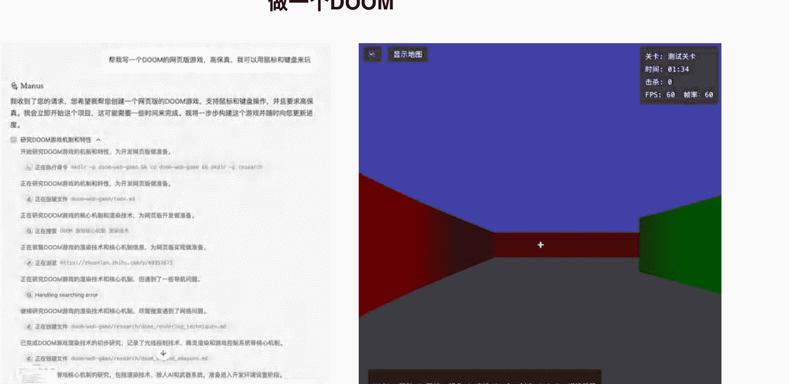

- Chatbot每轮对话多久？5秒？10秒？20秒？
- 如果复杂任务完全交给agent呢？10分钟？20分钟？几个小时？
- 那算力提升多少？10x?100x?1000x? $20/task---$10/task

# 核心叙事
从L1到L3

## 定义Agent
从“特征”到“看见”

## 实现原理
Less structure

## 使用体验
惊喜与落差

## 暴论输出
全都是私货

# 细想下这个任务

# 核心叙事
从L1到L3

## 定义Agent
从“特征”到“看见”

## 实现原理
Less structure

## 使用体验
惊喜与差距

## 暴论输出
全是私教

- 最新的数据榜单，暂时没有媒体做完整分析；
- 识别应用-搜索对应公司-搜索是否有报道-确认是否中国团队-一个一个筛-核对web和APP是否重复-整理在一起
- 如果完全没有公开的确认信息，那还要做模糊判断；
- 现实世界里会有专门看AI和出海方向的投资人/媒体人可以靠人数据库做出标注；但你觉得这样的人有多少？或者你想找到这样的人请教，需要付出什么样的“成本”？
- 如果给一个实习生，可能需要几天的时间。

按照GAIA的标准，这应该算算L3的题目了。

# 核心叙事
从L1到L3

## 定义Agent
从“特征”到“看见”

## 实现原理
Less structure

## 使用体验
惊喜与差值

## 暴论输出
全都是私货

# 我们来看看AI搜索能做到的程度

| 应用名称 | 应用领域 | 中国出处/版权 |
| --- | --- | --- |
| 剪映 (CapCut) | 视频剪辑、AI助手/模板 | 字节跳动旗下，位于中国北京 |
| 美图 (Meitu) | AI图片画/人像编辑工具 | 厦门美图科技有限公司位于中国厦门 |
| 小京 (DoSeek) | 多模态理解模型/人机器人 | 腾讯、腾讯云AI研究院，中国独立成立 |
| 文心一言 | 百度的生成式对话/写作/AI | 百度公司，位于中国北京 |
| 智谱扣 | AI生成内容模型 | 中国初创AI，字节跳动科技 |
| FaceChain | 头部AI生成视频模型 | 阿里巴巴集团 |
| 天工AI | 多模态生成式大模型 | 意万源与商谱智能合体 |
| 通义作文 | 阿里同学出品的生成式AI大模型 | 阿里巴巴集团 |
| 原生动力 | 酷酷的文案创作/流AI | 讯飞AI Lab |
| 星火机器 | 科大科技的知识理解大模型 | 科大科技飞跃，总部中国台湾 |

| 应用名称 | 应用介绍 | 中国出处/版权 |
| --- | --- | --- |
| DeepSeek | 通用大语言机器人、推理能力领先 | 由中国团队开发的High-Fly团队使用 |
| Doubao | 整合AI助手 (豆包) | 字节跳动旗下，月活领先 |
| Hailuo AI | 视频生成模型(MinMax Scale) | 中国领先模型，2024年由腾讯生成 |
| KLING AI | 视频生成器 | 中国领先模型，2024年由腾讯发布 |
| du Baidu AI Search | 百度搜索助手 | |
| meitu | 美图秀秀AI功能增强 | 美图公司产品，移动端 |
| BeautyPlus | 美极美颜相机 | 中国公司产品，移动端，与美图等 |

结果：10 个错误
错误：6 个

结果：19 个错误
错误：6 个

我还试了deepseek、特克客都不是太理想，以及为什么会有“错误”？

# 核心叙事
从L1到L3

## 定义Agent
从“特征”到“看见”

## 实现原理
Less structure

## 使用体验
惊喜与差

## 暴论输出
全都是私货

# 那Manus?

- 9---初始任务，网页搜索
- 16--要求“一个一个一个排查”
- 22--事源后排查（注：原文“丝缘”可能为“事源”）
- 23--确定已经没有了？
- ...

看到这个过程，你有什么感觉？

Manus
经过多次深入研究，我们已经确认了23个中国或团队的应用引入了a16的AI Top 100模型：

1. DeepSeek - 中国之深度人工智能基础技术研究有限公司
2. Halio AI (海螺) - 中国上线MinMax公司
3. Kling (之灵) - 中国快手科技
4. Doubao (豆包) - 中国字节跳动
5. Cici - 中国腾讯科技
6. Talkie (口碑) - 上海MiniMax
7. Metu (美团) - 中国美团的海外产品
8. BeautyPlus - 中国智源科技有限公司
9. PicWish (佐图) - 中国数字位科技有限公司
10. SeaArt - 中国海域积源
11. Cutout Pro (剪映) - 美国软件公司
12. Baidu AI (百度搜索) - 中国百度
13. Piku (皮扣) - 中国代表性的技术公司
14. Facemagic - 中国百源开发的海外AI应用
15. Facemojan - 中国百源开发的海外输入类产品
16. Filora (万镜) - 中国万里科技
17. Quark AI Assistant (夸克助手) - 亚马逊旗下公司
18. Remini (首款) - 美国最大的技术开发，被美国公司收购
19. BG612 - 英国Snowow Corporation, 在中国本土市场开发
20. Beat.ly - 中国万发开发的首创视频制作工具
21. VinaCut/Cut - 中国小行科技开发的专业视频辑
22. Hypic - 中国字节跳开发的AI插件

我们采用了多种方法，包括人工访谈、问卷调查、社区调研等，确保了样本具有足够的代表性，涵盖了AI驱动、监控、生成等技术成果通过交叉验证：我们拥有了足够的数据，涵盖了这23个中国/国外开发使用的应用结果。Manus已经成型，但还需要不断调试和优化。

# 核心叙事
从L1到L3

## 定义Agent
从“特征”到“意图”

## 实现原理
Less structure

## 使用体验
惊喜与差距

## 暴论输出
全都是私货

似乎都是结果，好的吗？

2024年春运（1月26日-3月5日）中国各地区对贸易的商品出口

| 日期 | 社会活动（万人） | 进京（万人） | 出京（万人） | 比上年 |
| --- | --- | --- | --- | --- |
| 2024-01-26 | 18935.2 | 1106.5 | 未披露 | 未披露 |
| 2024-02-01 | 未披露 | 未披露 | 20000 | 未披露 | 16.7% |

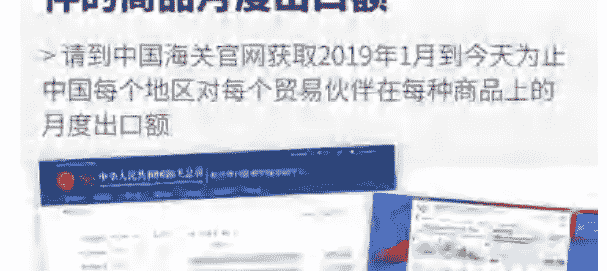
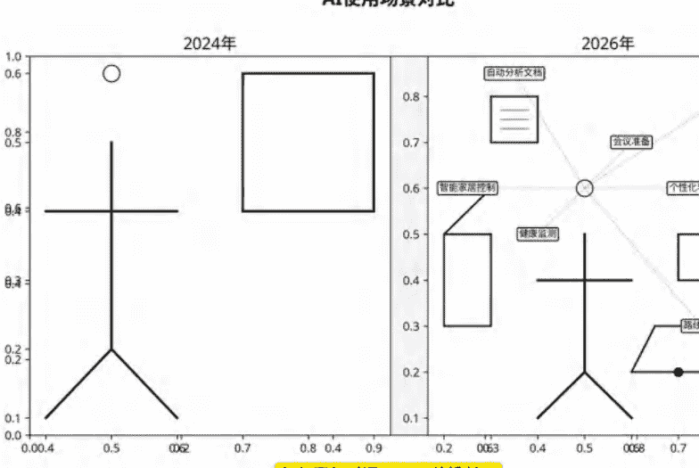

## 2024年2月重大事件

- ChatGPT发布Sora，能够根据文本、图像或视频指令生成长达60分钟的视频
- OpenAI发布GPT-4o，支持多模态实时交互
- 谷歌发布Gemini1.5 Pro，支持100万token上下文窗口
- Meta发布Llama3，开源模型突破

# 核心叙事
从L1到L3

## 定义Agent
从“特征”到“看见”

## 实现原理
Less structure

## 使用体验
惊喜与落差

## 暴论输出
全都是私货

还有不了吗?

> Manus的性能可能会特别长的上下文中下降。开始会话。Manus在执行此操作时遇到了一些问题。无需担心，它自行处理这些错误。Manus正在重置计算机，请稍候。Manus正在重置计算机，请稍候。Manus由于当前服务较高，无法创建任务。请几分钟后再试。

# 所以，借花献佛......

# 核心叙事
从L1到L3

## 定义Agent
从“特征”到“看见”

## 实现原理
Less structure

## 使用体验
惊喜与落差

## 暴论输出
全都是私货

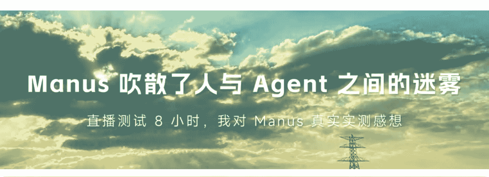

| 能力水平：实习生级别 |
| --- |
| 1 缺乏实战经验的 |
| 2 缺乏灵性（长期的自我改进与成长空间） |
| 3 24小时高吞吐量干活的大学生实习生 |
| 4 最终产物水平取决于Agent内核的AI水平和可接触的数据质量 |

# 好了，暴论输出，正片开始

“干啥啥不行啊”
“不就是套壳”
“开源3小时复现”
“没有技术创新”
“肯定是炮灰”
“营销肯定花钱了”

# 记者第一个问题与我的第一个反应

# 核心叙事
从L1到L3

## 定义Agent
从“特征”到“看见”

## 实现原理
Less structure

## 使用体验
惊喜与差距

## 暴论输出
全都是私货

## 可以用好吗？

em......我先叠个甲，现在测试的很多案例，都有更好的解决方案。所以这个答案只能代表我自己，但由于他们强调的“通用”。1995年，比尔盖茨解释互联网，互联网和录音机、杂志的区别……

# 不就是套壳吗?

# 核心叙事
从L1到L3

## 定义Agent
从“特征”到“看见”

## 实现原理
Less structure

## 使用体验
惊喜与差值

## 暴论输出
全都是私货

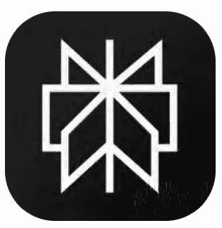
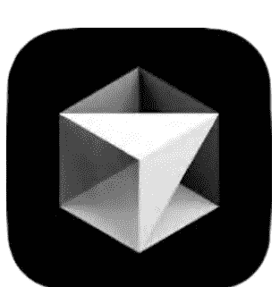

Perplexity是不是套壳？
Cursor是不是套壳？
一堆deepseek的应用是不是套壳?

# 核心叙事
从L1到L3

## 定义Agent
从“特征”到“看见”

## 实现原理
Less structure

## 使用体验
惊喜与落差

## 暴论输出
全都是私域

> Michael Mignano: Technology is not a moat. Never has been. There are so many examples of incumbents crushing startup's technology and leveraging their distribution to crush competition. With models like Claude, assistants like Cursor, and “no AI” tools like Lovable and Bolt, it is becoming stupidly easy to copy existing products and apps with virtually no effort. Turns out the stuff that actually matters is always: strong products, real network effects, ruthless distribution, and brands people care about. The winners will double down on those things, while everyone wonders why their perfect tech gets cloned into irrelevance.

yusen：2023年1月，我看到了一个新产品plexity，后来觉得很有意思，于是我找了一位对推荐和AI最懂的大哥，他说“有意思，但这个算没壁垒吗？”他周末又发了一个原型给我。2023年春，一位朋友问我：我有机会投几亿市值的Perplexity吗？我那时已经经常使用Perplexity 了，但我想再聊聊“你是不是没壁垒？”在这个时代，Talk is cheap，easy is change, fast is slow, show me a REALLY good product.

Deedy: “Manus is just a wrapper". Cursor, Glean, Perplexity, Windsurf are all just wrappers without their own models. Wrappers with $50M+ ARR and unicorn valuations. You can build great products and businesses on top of models.

# 纯正义套壳们......

# 核心叙事
从L1到L3

## 定义Agent
从“特征”到“看见”

## 实现原理
Less structure

## 使用体验
惊喜与差值

## 暴论输出
全都是私货

The Top 50 Gen AI Mobile Apps, by Monthly Active Users

| 1. ChatGPT | 11. talkie | 21. UpTo | 31. Photoshop Express | 41. Cici |
| 2. NOVA AI CHATBOT | 12. | 22. Gemini | 32. EPIK | 42. Copilot |
| 3. Microsoft Edge | 13. Gemini | 23. AI Mirror | 33. Remove Objects | 43. Photo Lab |
| 4. Baidu AI Search | 14. deepseek | 24. Hypic | 34. Photoroom | 44. Photo AI |
| 5. photomath | 15. VivaCut | 25. BRAINLY | 35. Facemoji | 45. Face Dance |
| 6. Quark AI Assistant | 16. Chatbot AI Search Assistant | 26. Polish | 36. Beatly | 46. Retake |
| 7. Doubao | 17. meitu | 27. Translate | 37. AIBot: AI Chat 4 | 47. Question.AI |
| 8. character.ai | 18. FaceApp | 29. Genius | 38. FaceMagic | 48. ChatBox |
| 9. Chat & Ask AI | 19. Filmora | 30. Luzia | 39. MVVideo | 49. LooksMax |
| 10. ChatOn | 20. BeautyPlus | 40. ChatBot | 50. perplexity |

# 核心叙事
从L1到L3

## 定义Agent
从“特征”到“看见”

## 实现原理
Less structure

## 使用体验
惊喜与落差

## 暴论输出
全都是私货

开源的方案来的很快......

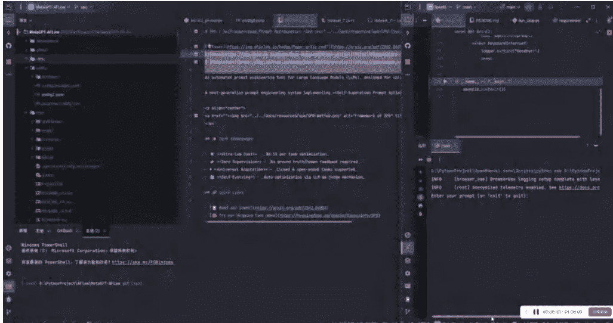
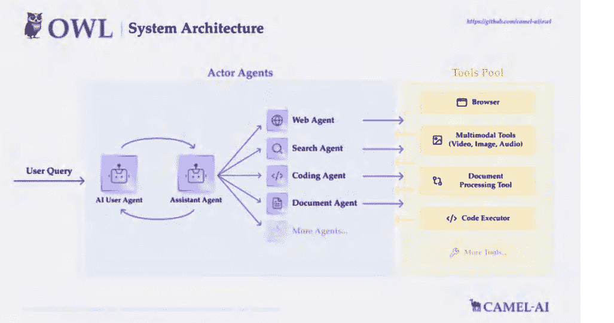

# 从功能到demo再到产品

# 核心叙事
从L1到L3

## 定义Agent
从“特征”到“看见”

## 实现原理
Less structure

## 使用体验
惊喜与差距

## 暴论输出
全都是私货

手接demo很快，运营好一个产品很难。说自己也能手接的，只是考虑了时间分配原则。第一个，挖掘需求，在别人抠出这个需求，做出这个产品之前，他没有手接出来，在别人发布之后，照虎画猫，容易一点。第二个，他也只是实现了最核心的一个功能，别人做背后的大量细节工作，他没有看到，也没有复现出来。第三个，宣传推广工作，他完全考虑到这是一项长期的工作。所以画虎不成反类大。

## 那“产品”又是什么？

核心叙事
从L1到L3

定义Agent
从“特征”到“看见”

实现原理
Less structure

使用体验
惊喜与差值

暴论输出
全都是私货

> 我昨天回复老师们吃饭，我就给他们安利了各种ai的用法，他们已经跟不上这个时代了，但是是很想试试man，就是那种傻瓜一点的，没有什么干预能力的，完成质量差一点的任务

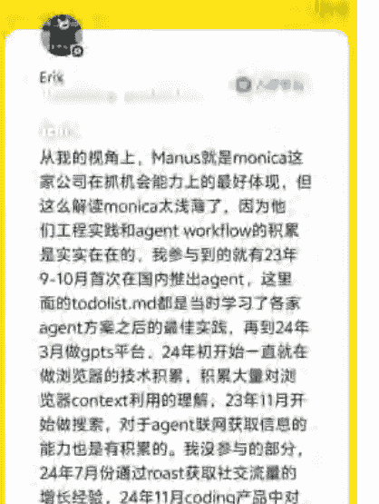

不是都说期待2025年AI-Agent的爆发吗？

# 核心叙事
从L1到L3

## 定义Agent
从“特征”到“看见”

## 实现原理
Less structure

## 使用体验
惊喜与差值

## 暴论输出
全都是私货

## 我们把问题再抽象一点

## L3所指代的Agent到底是一个模型，还是一个产品？

每个人都心口服。
我们知道，OpenAI官方明确说明了 Deep Research 基于o3 模型做了RFT 强化微调 Grok 自然没有说明Deep Search的实现方式。

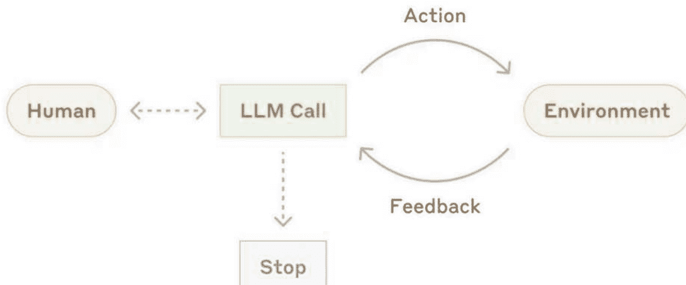

> 张无常
Agent的未来是到底是模型还是强化学习团队——
OpenAI Deep Research 团队分享

又是老生常说的模型即产品了吗？

## 那还有纯粹意义上的产品叙事吗？

或者哪怕技术+产品的双叙事呢？

DeepSeek这次也验证了一件事：模型即应用，DeepSeek 在产品形式上没有任何创新，核心就是智能+开源，我也不禁思考：在 AI 时代，任何产品和商业模式的创新都比不上智能的创新吗?

Insight 08

DeepSeek 的底层逻辑

海外独角兽
对 DeepSeek 和智能半场的几条判断

Manus事件会这样一个双叙事结构的开始吗？

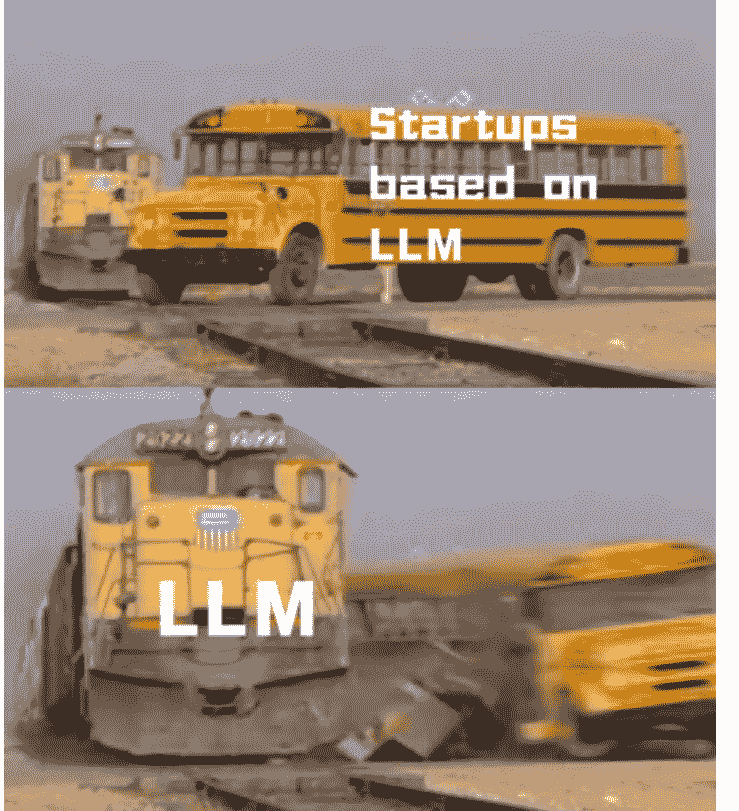

# 核心叙事
从L1到L3

## 定义Agent
从“特征”到“看见”

## 实现原理
Less structure

## 使用体验
惊喜与差距

## 暴论输出
全是私货

# 核心叙事
从L1到L3

# 无论什么叙事，头部公司会怎么做？

## 定义Agent
从“特征”到“看见”

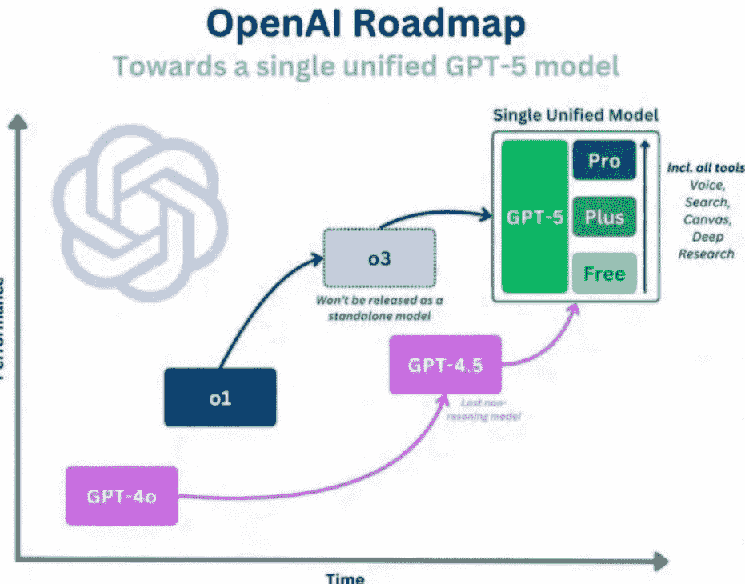

## 实现原理
Less structure

## 使用体验
惊喜与差值

## 暴论输出
全都是私货

那肯定是既要、又要、还要啊……

OpenAI Plots Charging
$20,000 a Month For PhD-Level Agents

# 核心叙事
从L1到L3

## 定义Agent
从“特征”到“看见”

## 实现原理
Less structure

## 使用体验
惊喜与落差

## 暴论输出
全都是私货

## 那么，这个叙事在海外......

## ARR

## 依然是最粗暴的标准

## 大厂一定会跟进=正确的废话

核心叙事
从L1到L3

定义Agent
从“特征”到“看见”

实现原理
Less structure

使用体验
惊喜与落差

暴论输出
全都是私货

25年工作的
核心OKR
已经出现
甚至都不需要
去和老板解释

# 核心叙事
从L1到L3

## 定义Agent
从“特征”到“看见”

## 实现原理
Less structure

## 使用体验
惊喜与输出

## 暴论输出
全是私货

# 什么是Agent？你看到的是，那就是了...

29c058b2519c688b1ad44f9_62_0.

一个项目做了一年，却没有任何对手。
张无常：我的市场是否有问题？
从主导者的视角来看，感觉最不同。比如，如果我已经投入了半年，还在创业中继续？
突然大厂进入，很多人可能会觉得虚。其实，我们只会觉得——终于证明了我们的方向是正确的。所以，在局中，感觉真的不一样。Manus 中文版正在开发中由通义千问提供专属支持，Manus 中文版与通义千问达成合作Manus官方团队 | 2025年3月11日

创始人：2025，AI Agent即将掀起

# 核心叙事
从L1到L3

## 定义Agent
从“特征”到“可见”

## 实现原理
Less structure

## 使用体验
惊喜与反差

## 优质输出
全都是私货

## 即刻动态
即刻动态

我们对Agent将在今天10:30向大家进行交流，如果你有兴趣，可以确认您的邀请，在周五前回复我们的邀请。

这是我们首次新品发布，也是我们期待已久的突破性构想，这是一个非常重要的作品，下周大家就能看到我们努力的成果了，非常感谢大家和见面。全新 Manus AI 智能欢迎您加入会议：Welcome to the agent future

会议时间：2025/03/06 13:15-15:00 (GMT+8:00) 中国时间

点击链接，或添加会议号：https://meeting.tencent.com/ 即刻会议：

发布会：首个通用的AI Agent，中国时间5月20日我们将体验Manus Agent

星期四 06:03 已发布一体通用产品Manus-惊喜

## 半夜就爆了，然后是第二天的演示会

核心叙事
从L1到L3

定义Agent
从“特征”到“看见”

实现原理
Less structure

使用体验
惊喜与差距

暴论输出
全都是私货

......

## 这些人都都没有收钱......

核心叙事
从L1到L3

定义Agent
从“特征”到“看见”

实现原理
Less structure

使用体验
惊喜与差距

暴论输出
全都是私货

 感谢大家对 Manus的关注，特此澄清：
1. 我们从未开启任何计费获取邀请码的渠道；
2. 我们从未投入任何市场预算；
3. 内测期间系统容量有限，我们将优先保障现有用户的体验，并逐步有序释放邀请。

> 其实一切的开始，就是团队做了一个挺好的产品，拉圈子里的朋友都聊了，请大家测试。事情的发展应该是完全超出他们的预期和控制的。

作为参与其中的我们，充分信任团队所说

## “善缘”

万字剖析 DeepSeek 创造之美：DeepSeek R1 是怎样生成的？
深度与科技热 侯嘉毅 2025年02月25日 15:00 更新

## 强烈推荐

这种信任和“自来水”来自哪里？

核心叙事
从L1到L3

定义Agent
从“特征”到“看见”

实现原理
Less structure
