# B2B公众号内容运营AI赋能手册

欢迎联系加入B2B学习交流社群

南京第乔信息技术有限公司出品

# 扫码加入 知识星球TOP免费资源群

公众号: 知识星球TOP

免费

- 每日免费获取高价值资源
- 可提供各类资源搜索服务

价值

微信号: jntsg8

| 热门付费文章 | 各行各业报告 |
| :--- | :--- |
| 精选图书资源 | 副业赚钱方法 |
| 职实用资源 | AI政经自媒体 |

及时

微信号: jntsg2

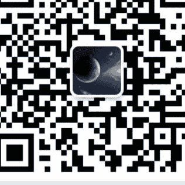

专注

分享资料仅供个人学习，请及时删除，切勿商用传播

# 对于B2B公众号内容，AI可以：

内容生命周期提升：提炼SDR、销售话术

AI数据分析：使用AI分析账号内容数据和转化数据

AI图像创建：巧妙制作视觉元素

AI内容生成：使用AI挖掘选题和优化内容

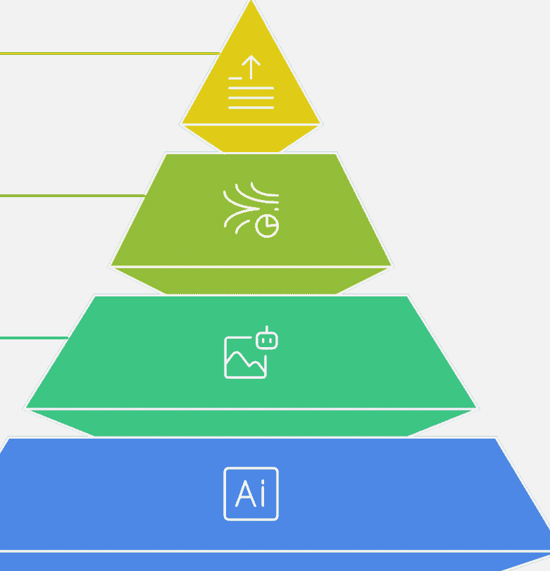

## # 行业选题：【行业】关键词

STEP1: 现在需要写一篇B2B工业电商行业的小程序运营营销文章，给出10个关于B2B工业电商和程序营销的专业关键词

STEP2: 然后组合成5个长尾关键词，基于给我3个关键词

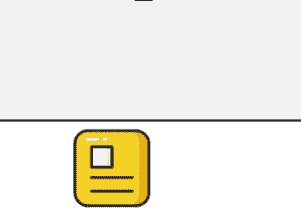

- 以下是电商行业营销内容常用的10个专业词汇及其应用解析，参考：

一、 核心业务模式
- 1. B2B电商
    - 定义：企业与企业之间通过网络进行沟通、交易的平台模式，核心服务于工业原材料、设备等。
- 2. 服务与运营
    - 5. MRO工业电商
        - 定义：Maintenance, Repair & Operations的维护、维修，专门面向工业类材料的线上采购，如：零件、耗品、配件等。
- 3. OEM
    - 定义：代工生产，Original Equipment Manufacturer。
- 6. 流量优化
    - 定义：提高流量转化效率。
- 4. 供应链管理
    - 7. 流量转化
    - 定义：通过营销手段将流量转化为客户。
- 8. 运营策略
    - 定义：针对不同阶段的策略。
- 9. 商品
    - 定义：产品属性。
- 10. 转化模式
    - 定义：成交模式。

- 二、 技术
- 1. 工业物联网
- 2. 数据分析
- 3. 云平台与计算
- 4. 算法
- 5. 人工智能

- 三、 选题
三个选题方向与内容策划（参考方案）
选题1：现在的电商选题针对B2B海外的8类关键词、多语言解析解决方案、本地化运营建议
内容包含：
- 核心关键词：电商行业、电商B2B行业、多语言解析、本地化
- ① 如何通过精准流量的获取与转化，例如案例：
- ② 如何建立证书与信任认证的网站建设
- ③ 区域性优势：东南亚市场差异化竞争
- ④ 技术功能：智能推荐、多语言支持及基础功能。

选题2：建立权威的B2B网站内容管理（参考选题3方案）
内容包含：
- 核心关键词：建立权威网站管理、技术背书、私域流量
- ① 如何进行内容化、通过内容用户下载
- ② 如何制作高质量视频？
- ③ 如何在线询价？
- ④ 从数据库中分析用户行为营销选题

选题3：MRO工业电商的智能管理与成本控制、供应商评估
内容包含：
- 核心关键词：MRO智能管理、成本控制、供应商评估
- ① 效能模型：聚焦供应链优化+定价方案
- ② 运营策略：针对头部企业的个性化策略
- ③ 供需关系：分类体系DeepSeek生成

## 行业选题：【行业】+热点表面关联点

STEP1: 请把流量与事件折射到B2B电子商务行业，找出：表面关联点

STEP2: 我现在需要写一个B2B电商选题，给3个选题建议，包含关联点和冲突

二、表面冲突点
- 行业差异与应对对策
- 选题一：行业协同中的“数据孤岛”与“信任堡垒”关联点
- 选题二：定制化需求与规模化关联点
- 选题三：行业失效引发的博弈关联点：工业接口、传感器数据格式统一，导致品牌差异、头部企业挤压生存空间

深层冲突点
- 技术断层 vs 生态共赢
- 短期利益 vs 长期利益
解决对策：
1. 推动共性标准：由行业协会牵头，联合平台制定行业规则，鼓励数据共享，如企业扩展空间。
2. 建立激励机制：对第三方预期激励，鼓励其开放功能。

价值与应用前景：以上选题聚焦供应链管理与利益分配，一步整合服务：非标领域的模块化运作

## 行业选题：知乎/小红书提炼行业痛点

根据提供的内容，我提取了3个出现率高的客户痛点，并生成了对应的痛点关键词和核心心态

1. 系统操作复杂
2. 操作复杂

以下基于客户痛点生成的（3）个“常识类”选题：

[1. CRM行业]销售难以触达、企业亟待提升30%
- 反馈强度：通常为人们认为数据复杂，即使使用CRM系统来提升增长率，但实际情况可能是销售通过其他方式实现了增长率，即使使用CRM系统也是无效
- 决策效率：销售经理。
- 量化结果：企业亟待提升、效率提升30%

[2. CRM行业]IT部门能够落地CRM项目，成功率提升50%
- 反馈强度：通常为人们认为项目复杂、实施难度大，但有些企业的IT部门通过独特的方式最终实现了落地。
- 决策效率：IT部门。
- 量化结果：成功率提升50%。

[3. CRM行业]管理层重视数据价值，决策准确率提升40%
- 反馈强度：一般认为系统中的数据价值不高，但管理层通过这些数据实现了精准决策。
- 决策效率：管理层。
- 量化结果：准确率提升40%。

STEP1：知乎搜索CRM+痛点/吐槽，找到5-10条真实用户下的回答/文章

STEP2：你是一个敏锐的CRM营销专家，帮我分析链接中所有回答和文章，提取最多3个痛点，并根据真实痛点生成3个痛点关键词和核心场景。

STEP3：基于以上内容，生成3个“常识类”选题，格式：[行业]+[决策链条]+量化结果]

## # 产品选题：从客户会议沟通记录中抠取

STEP1: 会议录音，通过飞书妙记文字

STEP2:(粘贴飞书笔记导出的文字)分析沟通记录，按规则分类信息：
- 一级分类：生产/供应链/财务/人力
- 二级场景：具体业务环节
- 三级情绪：焦虑/烦恼/无奈...反映客户心理状态

STEP3:按照上3级信息，对每个客户提问生成1个“反常识、反常规选题”，例如《什么xx反而加剧了xx?》

- “上了某家ERP后财务对账更乱了，还不如用Excel”
- “ERP很复杂，感觉增加了工作负担”
- “这个系统部门间协同功能不够，对账很累”
- ......

选题：数字化越深，对账越抓狂！让财务最想砸键盘的3个ERP坑
选题：ERP每个部门都说好，却在这个流程出了问题，让制造主管压力大

## 已有选题建议：客户角色评价、细分拆解

假设你是目标职位，如采购总监，评估这个选题：
1. 是否会点击？为什么？
2. 阅读后可能采取什么动作（领取资料/咨询）
3. 认为内容缺失哪些关键信息？

细分拆解：我的选题是xx，请列举5个充分的角度，说明其潜在价值，按痛点排序。

## 文章结构：提炼亮点“复制”

## 复制案例

参考HubSpot案例《如何帮助企业在3个月内留存40%》的结构，突出：
1. 客户画像：目标是ToB企业的CMO，关注客户生命周期和内容营销。
2. 技术细节：包含产品模块与现有系统的对接可行性说明。
3. 数据可视化引导：在哪些部分插入客户旅程地图和ROI对比表。

## 对标SEO结构

将《2025年营销工具指南：从需求评估到供应商对比》对标《如何选择合适的CRM系统避坑》

1. 关键词布局：在标题/子标题中自然融入长尾词、避坑指南。
2. 决策旅程引导：从认知阶段（为什么需要）到意向阶段（如何评估）再到决策阶段（如何选择）。
3. 线索捕获设计：在“供应商对比”章节后插入“免费选型表”CTA。

## 文章润色：多角色测试、企业定位

多角色测试，用不同身份（CMO、老板、客户）判断内容漏洞：
你需要同时通过CMO（策略层）、老板（商业层）、客户（需求层）的三重审核，找出文章中的漏洞，提出三个修改意见。

如果品牌有明确风格（如“科技感”、“面向小型客户”），需在提示词中强调：客户是中小微，希望语言轻化但不失专业，例如将“赋能”替换为“帮助”，“沉淀”改为“积累”，拉近与中小型企业的距离。

## 文章检查：基础检查、专业合规检查

基础检查：直接投给AI让其检查错别字即可。

专业合规检查：上传企业知识库（如产品手册、公司介绍PPT），与文章内容进行对比。

对照《行业标准语库/文档》检查内容：
- 技术名词是否一致
- 岗位名称是否符合公司定义
- 产品功能参数描述是否一致
- 案例中的客户名称是否一致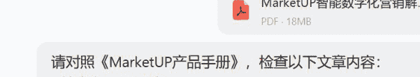

对照《MarketUP产品手册》，检查文章内容：
- 技术名词是否一致
- 岗位名称是否符合B2B决策
- 产品功能描述是否与手册一致

对照《MarketUP产品手册》检查结果：

一、技术名词一致
结论：技术名词高频一致、无冲突或交叉语义错误。

1. 核心逻辑一致性
- 材料中展现的“小程序”“智能名片”“UTM参数”“标签分类”“自动化营销”“数字化”等技术，与手册定义完全一致（如手册中“企业小程序”“智能名片”实现统计UTM参数设置追踪效果等）。
- 涉及数据提取与分析的“智库360”“智能化”“营销自动化工作流”等规模，在手册中有对应模块（如“全链路追踪管理”“自动化营销流程设计”）。

2.差异化逻辑准确
- 材料中提到的“前后台能力”“多渠道聚粉”“双线操作”等差异优势，在手册中可以调整：“全链路追踪管理”“智能小程序访客纽带”等描述，技术术语与逻辑体系一致。

## 文章检查：去AI味-避免过度推理的AI幻觉

同样也可以上传企业知识库内容（如产品手册、公司介绍），给出不许AI乱推理的地方。

示例：
[将术语保证为[医疗设备行业]常用表达：
“客户”→“三级医院采购中心”
“产品”→“影像诊断解决方案”]

[仅基于附件提供的2025年Gartner制造业数字化转型报告中的数据进行推论，不做任何扩展]

提示词里填充：如果你不确定，直接问AI。

## 文章配图：逻辑框架图一键直出

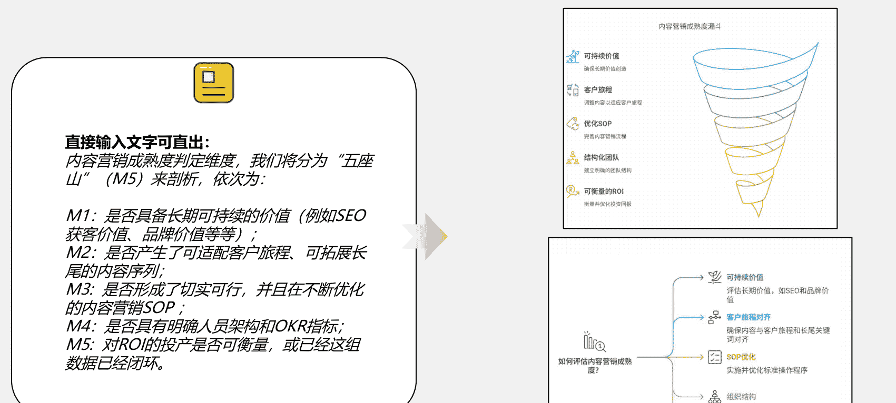

将其分为五座（M5），依次拆解：
- M1：具备长期价值（例如获客价值、品牌价值）。
- M2：适配客户旅程。
- M3：形成不断优化的营销内容。
- M4：具有明确的指标。
- M5：ROI投入可行，形成闭环。

## 文章配图：基础元素、质感

帮我生成图片：底面上有一个放大镜，透明白色磨砂玻璃质感，红色配色，UI设计，等轴视角，梦幻风格，白色背景，色彩明亮，3D艺术，配合4D渲染器，使用Blender软件，采用光线追踪，参考Pinterest/Dribbble风格，减少细节，16K分辨率，比例16:9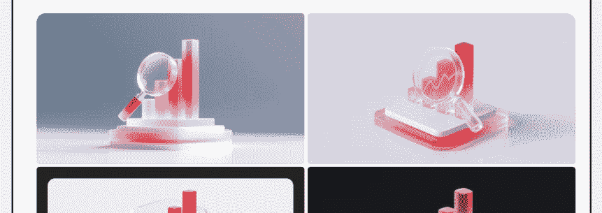

帮我生成图片：底面上显示“MarketUP”，文字“MarketUP”，材质透明玻璃质感，白色红色，UI设计，等轴视角，梦幻风格，白色背景，色彩明亮，3D艺术，配合4D渲染器，使用Blender软件，采用光线追踪，减少细节，8K分辨率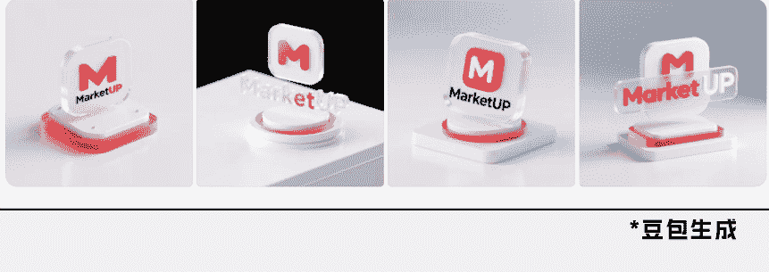

提示词可以结合企业情况，充分替换元素，效果更贴合场景需求。

## 配图：产品场景，融合场景

帮我画图手机海报尺寸：产品展示：海报中央突出了这本书，被设计成三维效果，放置在桌面上，吸引视觉焦点。
色彩装饰：海报使用红色和白色调，增强视觉冲击力。
场景氛围：海报底部和周围布置了科技元素，如数据中心，营造出B2B科技氛围。
光影效果：书籍和背景中的光影模拟了自然光照，增加了立体感和真实感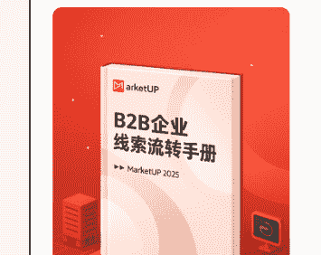

帮我作图封面生成一个3D手机，无影，然后形成三本书平放在一起，等轴侧视角，透视角度大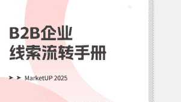

## 封面图/文章标题：找仿参，反推提示

这张海报是AI的，帮我反推这张海报的AI设计提示：拿到提示再结合情况进行调整，比如增加品牌“MarketUP”，增加“电脑”“键盘”“鼠标”元素，调整标识Slogan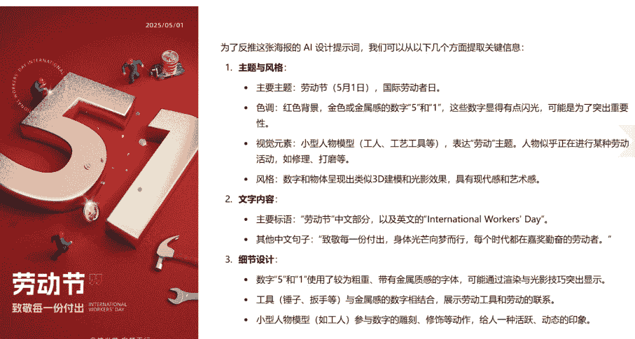

为了反推这张海报的AI设计提示，可以从以下几个方面提取信息：
1. 主题：
- 主题：劳动节（5月1日）；国际劳动者日。
- 色调：红色金色，带有金属质感的数字“5”，数字字体有点光点，为了强调重要。
- 光影：矢量小人物呈现立体3D建模效果（工人、工具等）仿佛是“劳动者”，人物似乎正在进行某些动作（如跑步、工作等），具有科技和艺术感。
2. 内容：
- 主要标题：“劳动节”，以及英文的“International Workers' Day”。
- 其他文字：“每一份付出，身体线条光向扩散的字体，每天都是真实具象的劳动者”。
3. 字体设计：
- 数字“5”和“1”字体大，带有金属质感，通过透视与光影技巧显示。
- 工具（锤子、扳手等）与周围的数字字体结合，展示工具与动作的连接。
- 小型人物模型（工人）与数字穿插，进行移动等动作，给人一种流动、生动的印象。

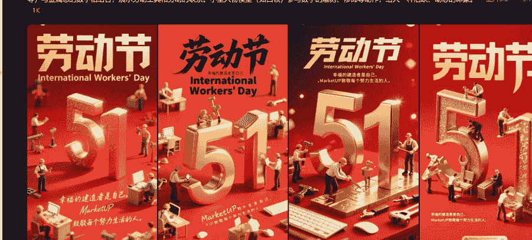

## 封面海报：找参考，进行转换

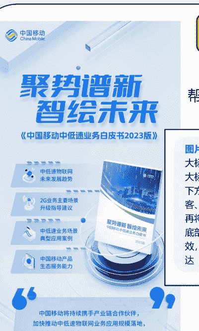

帮我基于参考图片进行替换xx，生成图片：

图片镜基于参考图片，先将图片变成红色调系风格
大标题：渠道客服，实战分享：客户营销白皮书正文发布
下方小标题：SEO客服，客户营销白皮书正文发布
下方内容：内容渠道营销、大内营销、客户聚焦痛点
将图片中的封面标题替换成合适的小号文字
正段落文字替换成：在竞争加剧、传统营销方式逐渐失效，企业需要通过“价值认知”以突破，通过内容增强在顾客中主动连接。

## 内容复盘：号内数据分析

通过提问AI分析：

- 阅读量周环变化率
- 完读率TOP3文章的共性特征
- 新增粉丝来源渠道占比
- 阅读量分布（公众号会话/朋友/搜一搜）
- 完读率与文章长度的相关性
- 阅读量周环增长率
- 完读率均值及标准差
- 阅读量来源占比饼图
- 按时间分组的阅读量热力图
- 文章关键词的微信指数变化趋势与阅读量的相关性
- 识别微信指数峰值未被有效利用的文章案例
- 结合微信指数下个月热点关键词预测
- 生成5个高点击率标题公式（例：数字悬念+痛点提问）
- 制作内容清单（复盘检查重点要素）

阅读数据、完读率、阅读来源、微信指数数据……等维度。

| 指标 | 维度 | 核心指标 |
| :--- | :--- | :--- |
| 留存 | | 1. 次日留存率 2. 七日留存率 3. 十日留存率 4. 周均留存率 5. 月均留存率 6. 新用户留存率 7. 老用户留存率 8. 留存趋势 |
| 活跃 | | 1. 活跃人数 2. 活跃人次 3. 活跃时长 4. 人均活跃时长 5. 活跃频率 6. 活跃度分布 7. 活跃用户占比 8. 活跃趋势 |
| 阅读 | | 1. 阅读量 2. 阅读人次 3. 阅读率 4. 人均阅读量 5. 阅读深度 6. 阅读来源分布 7. 阅读来源渠道占比 8. 阅读趋势 |
| 转化 | | 1. 粉丝人数 2. 粉丝人次 3. 转化率 4. 人均转化数 5. 转化渠道分布 6. 转化渠道占比 7. 转化漏斗分析 8. 转化趋势 |
| 评价 | | 1. 点赞人数 2. 点赞人次 3. 点赞率 4. 人均点赞数 5. 点赞分布 6. 点赞渠道占比 7. 点赞趋势 8. 点赞活跃度 |
| 传播 | | 1. 转发人数 2. 转发人次 3. 转发率 4. 人均转发数 5. 转发分布 6. 转发渠道占比 7. 转发趋势 8. 传播效率 |
| 互动 | | 1. 留言人数 2. 留言人次 3. 互动率 4. 人均互动数 5. 互动分布 6. 互动渠道占比 7. 互动趋势 8. 互动效率 |
| 收藏 | | 1. 收藏人数 2. 收藏人次 3. 收藏率 4. 人均收藏数 5. 收藏分布 6. 收藏渠道占比 7. 收藏趋势 8. 收藏效率 |

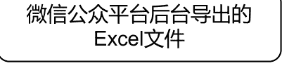

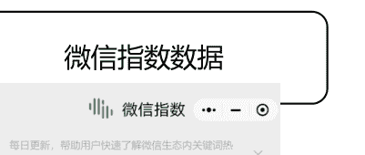

*清晰版可联系微信小绿获取

## 内容复盘：转化分析

通过提问AI分析：

- 公众阅读->点击->留资->MQL->SQL各环节转化率拆解，定位公众号来源的线索流失率在哪里。
- 内容效果与leads行为分析，例如“白皮书类”的文章的点击率（点击下载的）与 Leads转化率相关，而“线索管理”文章的转化率与成交金额关联更强。

文章埋点点击率、文章带来的Leads-MQL-成交数据情况可用MarketUP实现统计。

| 曝光 | 点击 | 留资 | MQL | SQL | 转化率 |
| :--- | :--- | :--- | :--- | :--- | :--- |
| 1317 | 607 | 4943 | 256 | 461 | |

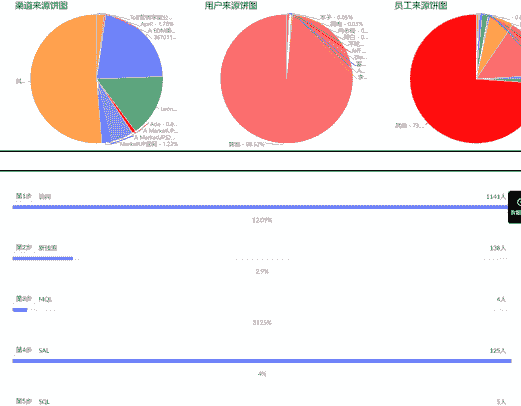

号内数据、埋点UV、表单提交数据、分析转化率、识别线索流失的原因、了解内容效果与行为之间的关系、调整内容以提高转化率和销售额。

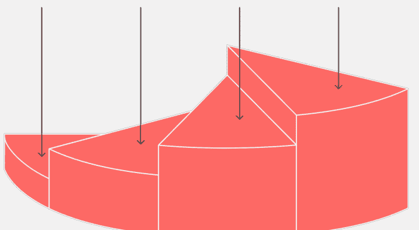

## 内容复盘：公众号渠道分析

通过提问AI分析：

- 将账号数据关联MarketUP进行合并，通过AI分析公众号渠道效能。
- 对比其他渠道如知乎、官网、公众号的转化效能情况。

利用MarketUP实现不同渠道统计。

| 渠道 | 公众号 | 知乎 | 官网 | 统一标准 |
| :--- | :--- | :--- | :--- | :--- |
| 流量 | 推文阅读 | 回答/文章质量 | 网站UV | 阅读量/下载量 |
| 互动 | 转发/在看/菜单 | 点赞/评论 | 互动数据 | 互动值 |
| 转化点 | 点赞点击 | 点赞点击 | 页面单转化 | 转化点 |
| 成本 | 投入费用 | 投入费用 | 投入费用 | 渠道总投入 |
| 转化 | Leads/MQL/SQL | Leads/MQL/成交 | Leads/MQL/成交 | Leads/MQL/成交 |
| 标识 | oneID | oneID | oneID | oneID |

| 渠道统计 | 流量 (PV) | 访问人数 (UV) | 转化率 | 操作 |
| :--- | :--- | :--- | :--- | :--- |
| 渠道名称 | 转化统计 | | | |
| 微信 | | | | |
| 2023新增渠道推广 | | | 1.9% | 4 |
| 智选小程序 | | | 7.7% | 4 |
| 2023其他内容营销效果 | | | 4.4% | 4 |
| MarketUP | | | 12.7% | 3 |
| | | | 5.4% | 3 |
| | | | 25% | 5 |
| 信号数据 | 内容转化数据 | 不同渠道数据 | | |

## 内容复用：外部SEO分发——关键词建议

我正在写一篇公众号文章，目标分发到知乎、小红书等平台。请帮我分析：
① 这个主题的核心关键词有哪些（覆盖3-5个主词）？
② 针对不同平台（如知乎、小红书），需要哪些长尾关键词（每个平台建议3-5个）？
③ 竞品（如同公众号/品牌）常用的关键词有哪些？我可以差异化的关键词有哪些？

基于‘xx’关键词的月度搜索量（工具参考：百度指数），筛选出3个搜索量中等竞争程度低的长尾词，并说明理由。

这是这篇文章，请帮我检测：
① 核心关键词是否明确？是否存在关键词缺失或重复堆砌？
② 段落/句子可以替换为更高价值的长尾词？
③ 标题和开头是否包含目标关键词？需要如何调整利于SEO？

- 关键词调研
- 分析调研
- 检测优化
- 帮助实现关键词推荐
- 关键词位置布局
- 大小标题的针对调整
- 增加关键词密度

## 内容复：知识思维图化

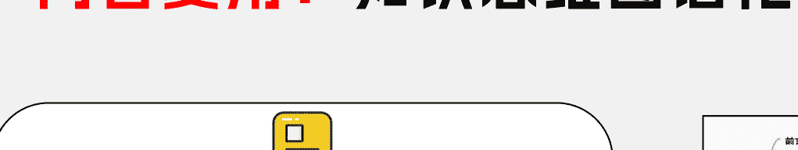

### B2B内容营销，需要如何控热度的“5座山”

明确一下增长点和预算在哪里。根据 MarketUp 的调查报告，2025年04月16日。我们现在不再去复盘B2B内容营销的策略，而是关注我们的增长逻辑以及内容持续的体系化过程。我们已经学会了如何控热的方法，我们已经进入了B2B内容营销的领域，但这并不是终点，而是新的开始。MarketUp基于自己的实战经验，如下所示内容营销控热的方法，我们将其拆解成五座山：

将此文章转化为思维导图。

| B2B内容营销是如何成为体系化工程，策划判断数据对比，MarketUp提出“广义”（M5）模型 |
| :--- | :--- |
| 策略构建 | 策略：访谈行业客户触点、品牌价值衡量（SEM指标）、营销渠道对比、转化率、Leads留存、有Leads留存、策略速度和活跃度（3个维度）、策略留存、策略留存、内容活跃度 |
| 活跃度 | 内容更新频率（每日或每周3次以上） |
| M1: 确定目标 | |
| M2: 策略 | 策略：流量触点 |
| M3: 内容营销 | |
| M4: 运营策略 | |
| M5: 转化效果 | 策略：流量、预算 |

| 渠道统计 | 流量 (PV) | 访问人数 (UV) | 转化率 | 操作 |
| :--- | :--- | :--- | :--- | :--- |
| 渠道名称 | 转化统计 | | | |
| 微信 | | | | |
| 2023新增渠道推广 | | | 1.9% | 4 |
| 智选小程序 | | | 7.7% | 4 |
| 2023其他内容营销效果 | | | 4.4% | 4 |
| MarketUP | | | 12.7% | 3 |
| | | | 5.4% | 3 |
| | | | 25% | 5 |

## 内容复用：SDR销售话术

转化率提升：SDR销售话术。

**Step 1:** 从文中提取产品优势，包含客户痛点，SDR话术。
**Step 2:** 按场景分类：
- 场景1：转化话术
- 场景2：需求话术（首次会议）
- 场景3：价值话术（决策者）
- 场景4：异议话术（常见获客）
**Step 3:** 加入“场景化”细节，例如：“您的客户在本周内未活跃时，是否经常面临人为不足？”
**Step 4:** 建立“问题-方案”对应，将文中每个产品优势对应到客户可能的3个以上概念，形成“弹药库”。

