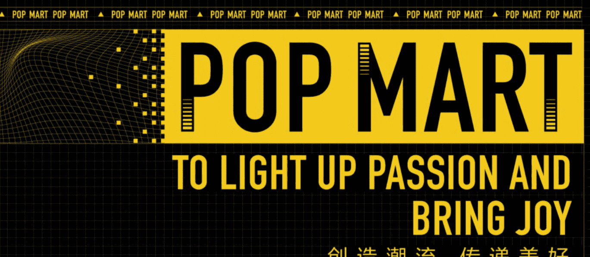

# 知识星球TOP 资源分享社群

让更多人获取高价值信息

汇聚网付费资源

公众号:知识星球TOP

微信号:jntsg8

添加微信免费进群

微信号:jntsg2

- ◆付费文章
- ◆付费社群
- ◆付费课程
- ◆副业&搞钱
- ◆财经&股市
- ◆行业报告

时政·历史·职场·体制·自媒体
学习·军事·软件·影音·社会学

# BRAND MISSION
品牌使命

创造潮流 传递美好

# BRAND VISION
品牌愿景

成为全球领先的
潮流文化娱乐公司

## 覆盖潮流玩具全产业链的平台

### 全球艺术家发掘

### IP运营

### 消费者触达

### 潮流玩具文化推广

全球顶级潮流艺术家经纪
新生代潮流艺术家发掘

成熟完善的IP孵化体系
知名IP的潮玩运营

全球化布局
线上下全渠道运营

亚洲最大专业潮流玩具展
助力潮流文化推广活动

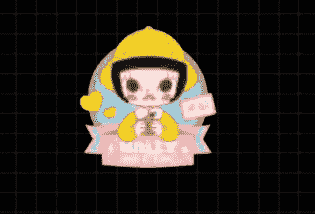

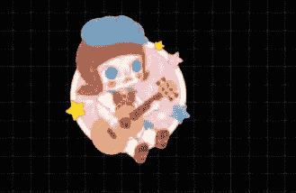

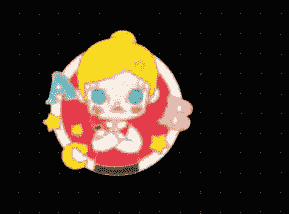

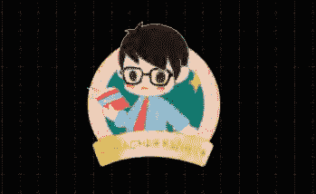

泡泡玛特旗下聚集了众多潮流艺术家资源，包含多位全球顶尖潮流艺术家，以及国内外许多新锐潮流设计师

泡泡玛特目前共运营MOLLY、PUCKY、LABUBU、DIMOO等85个IP，包括12个自有IP、22个独特IP及51个非海外IP

泡泡玛特目标已进入21个国家和地区，中国大陆地区已开设直营门店200家、机器人商店1200余家，线下二十一个玩具大类优质品牌

由泡泡玛特主办的北京国际潮流展及上海国际潮流展，是亚洲最大规模的两大潮流展会，单次参会观众超10w

# GLOBAL ARTIST DEVELOPMENT
全球艺术家发掘

全球顶级潮流艺术家经纪

# WORLD’S TOP ARTISTS AGENTING

# 全顶级潮流艺术家经纪

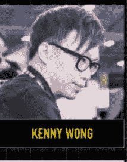

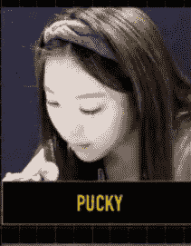

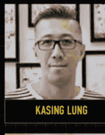

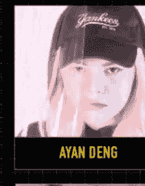

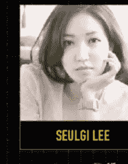

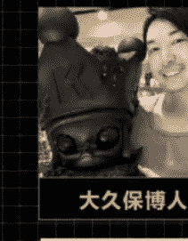

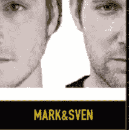

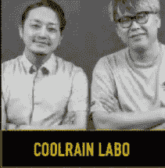

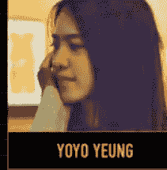

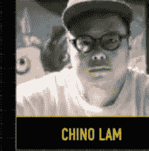

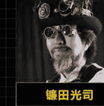

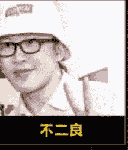

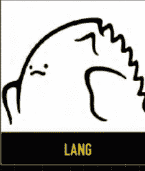

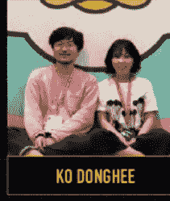

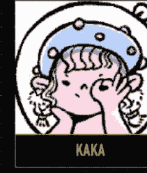

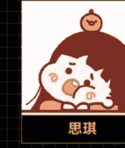

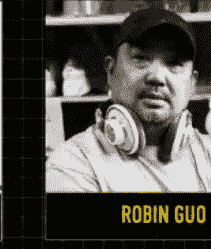

# IP OPERATION
IP运营

成熟完善的IP孵化体系，打造潮流艺术家，知名IP的潮玩运营

POP MART TO LIGHT UP PASSION AND BRING JOY 创造潮流传递美好

# MATURE IP SYSTEM

### 成熟完善的IP孵化体系

- IP孵化开发
- 设计打造
- 供应链
- 市场推广
- 产品销售

POP MART在全球范围内挖掘极具潜力的艺术家，通过成熟完善的IP孵化体系，联合艺术家共同打造了一系列行业级的潮流IP。行业顶尖艺术家，顶级潮流

# SOURCE AND CREATE THE WORLD'S TOP TOY IPS
打造全球潮流IP

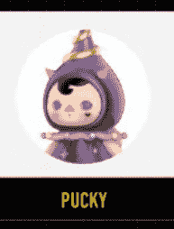

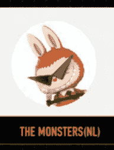

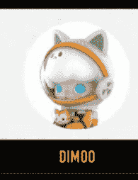

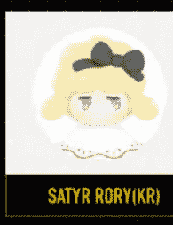

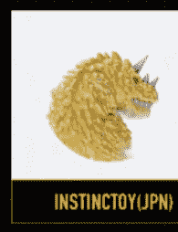

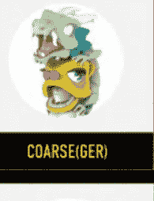

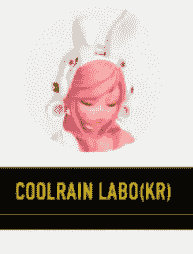

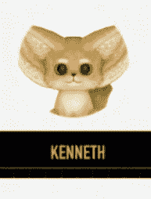

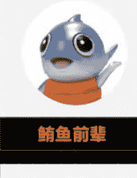

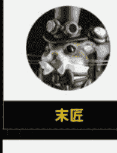

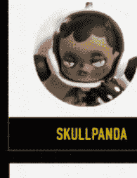

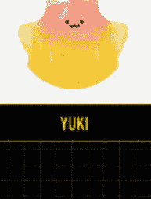

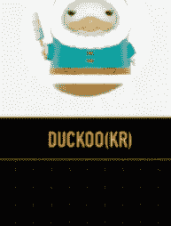

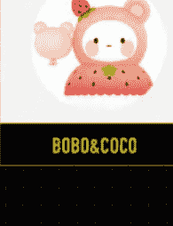

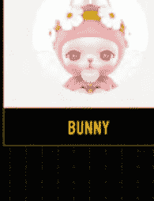

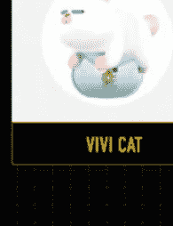

KENNY WONG 中国香港艺术家，知名设计师，自2006年创作出潮流角色MOLLY。自从与POP MART合作，这个有着蓝色眼睛的小女孩已经成为潮流圈最受欢迎的艺术家之一。

## 顶级潮流IP运营

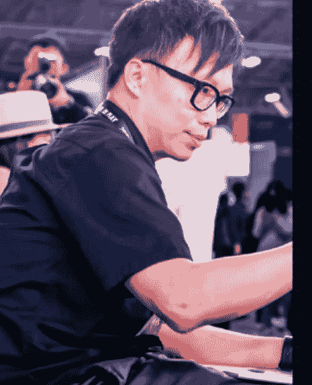

## 顶级潮流IP

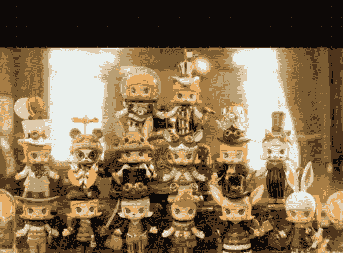

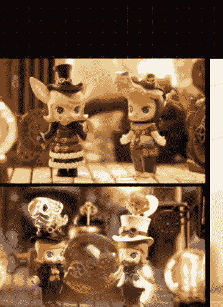

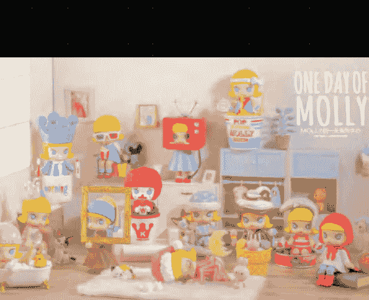
MOLLY蒸汽酷酷系列
MOLLY的一天系列

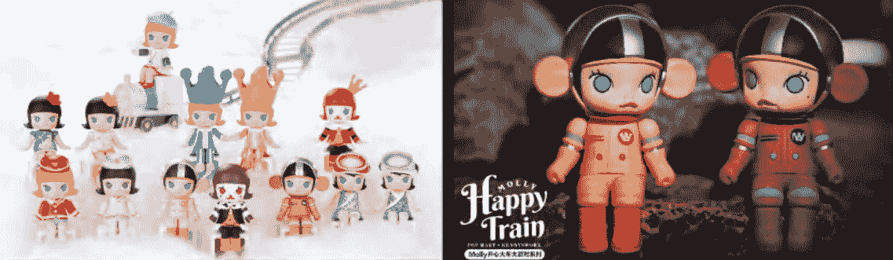

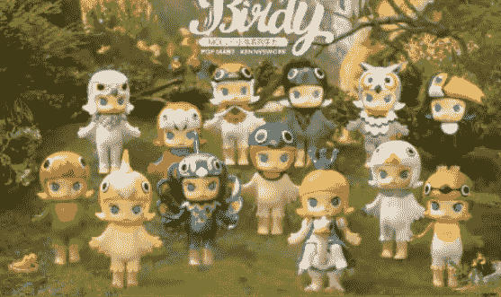
MOLLY升心系列
MOLLY 小鸭系列

# INFLUENCE
影响力

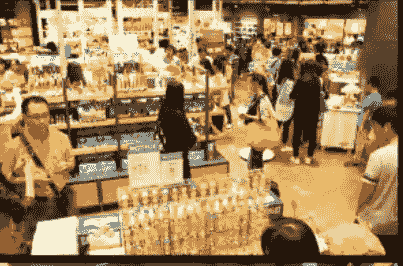

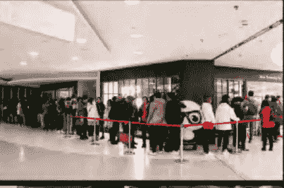

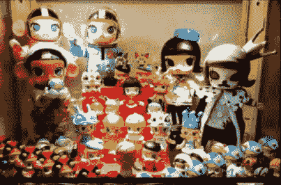

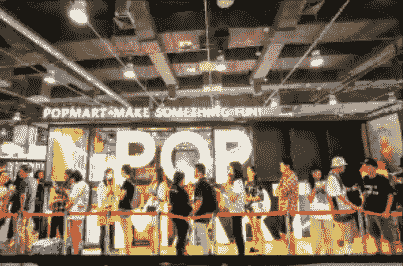

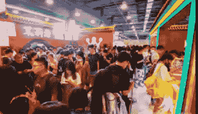

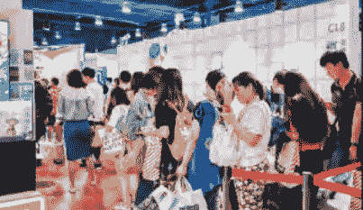

POP MART/ TO LIGHT UP PASSION AND BRING JOY 创造潮流 传递美好

PUCKY，插画艺术家、潮玩设计师，2008年自加加拿大艾米丽卡艺术及设计大学毕业后，回到中国香港以自由创作艺术家及插画师的身份建立了个人工作室POOKIE。从小在两种不同文化熏陶下的成长经历，使她的作品充斥着奇妙的美感，独欢忧乐古俗，又透出黑暗童话，极具特色。POP MART 于2017年签约 PUCKY，挖掘出奇幻作品背后的潮玩属性，在2018年半年与其打造的潮流玩产品，一上线便引起轰。

### PUCKY（中国香港）
### 顶级潮流运营

PUCKY怪兽系列

PUCKY狮宝宝系列 (Wait, text says PUCKY, likely Labubu context or specific series error) -> PUCKY狮宝宝系列

PUCKY星座系列

PUCKY胆胆系列

PUCKY胆胆系列 (Repeated in OCR)

KAAS LUNG 龙升、绘本作家，首位获得欧洲绘本大赛冠军的华人得，现于比利时定居。龙老师拥有十多年的绘本创作经验，画风具有典型的北欧童话特色。THE MONSTERS 精灵推出自绘本《神秘的森林》，与玩具结缘，龙老师继续将绘本中的众多精灵成员变成立体仔作品，每一位都别具特色。2019年4月，POP MART 联合龙升推出的潮玩盲盒产品，上市的第一个系列便刷新了潮玩销售记录。

### 顶级潮玩运营

### THE MONSTERS

LABUBU野外旅行系列

LABUBU精灵艺术系列

LABUBU花之精灵系列

POP MART x adidas Originals x Disney

### AYAN DENG (中国)

中国新一代年轻艺术家、插画师、玩具设计师。
POP MART 签约艺术家。著名设计工作室 MOUNTAIN STUDIO 创始人之一。AYAN STUDIO 品牌经理，DIMOO WORLD 系列的艺术主创与主理人。广州学院毕业，曾职于服装、游戏美术、概念美术等专业领域；但依然怀旧动线条的感觉，所以转向创作表达属于自己心中的角色形象与故事。AYAN 用了两年时间的创作，诞生出 DIMOO WORLD 系列的完整世界故事与角色创作。

顶级潮玩IP运营
DIMOO

DIMOO童话系列
DIMOO社会系列

DIMOO太空系列
POP MART × 芙兰

## POP MART 销售网络: 线下

全渠道的销售网络实现全面且互补的消费者触达
一体化的会员体系覆盖各个渠道，为消费者提供协调统一的消费体验

### 🏠 线下门店
### 🤖 机器人商店/无人店
### ⚡ 美团快闪店

泡泡玛特线下直营门店已突破200家，重点布局主流商圈中高端商场。泡泡玛特线下拥有超过120余台机器人商店，深度覆盖全国79个城市。依托泡泡玛特的丰富IP及趣味场景化搭建，吸引大批粉丝到场打卡与消费。

## GLOBAL ROADMAP
全球化布局

已进入
待进入

POP MART 旗下产品已进驻 21 个海外国家和地区。

## POP MART MULTI-CHANNEL MEMBERSHIP PROGRAM
POP MART全渠道会员计划

### 粉丝画像
- 15-35岁
- 高消费能力
- 热衷分享与展示
- 接触多元文化现代生活方式及海量信息

截止目前，POP MART 通过全渠道会员计划吸引了724万注册会员，2019年会员整体复购率达到58%。

## POP TOY CULTURE PROMOTION
潮流玩具文化推广

- 举办亚洲最大的专业潮流玩具展会
- 联合顶级品牌举办设计比赛
- 与顶级艺术院校合作开设潮玩课程
- 更多潮玩文化主题推广活动

POP MART/ TO LIGHT UP PASSION AND BRING JOY 创造潮流 传递美好

## LARGEST POP TOY SHOW IN ASIA
### 亚洲最大的潮玩展会

- 2017 BEIJING TOY SHOW
- 2018 SHANGHAI TOY SHOW
- 2018 BEIJING TOY SHOW
- 2019 SHANGHAI TOY SHOW
- 2019 BEIJING TOY SHOW
- 2020 SHANGHAI TOY SHOW

POP MART 于2017年9月举办了首届北京国际潮流玩具展会（BTS），获得了巨大的成功，是中国规模最大的潮玩展。2018年4月，POP MART 在上半年举办了上海国际潮流玩具展（STS），是亚洲地区规模最大的潮玩展。自此，POP MART 每年举办两次潮流玩具展会，即北京国际潮流玩具展会（BTS）及上海国际潮流展会（STS），吸引了全球数字潮流艺术家及品牌带来。

累计500家设计师、300,000观众、400家媒体报道、100,000次曝光。POP MART TO LIGHT PASSION AND BRING JOY 创造潮流 传递美好

## JOINT LECTURES WITH ART COLLEGES
与顶级艺术院校开设专业潮玩课程

| CLASS SCHEDULE | |
| :--- | :--- |
| 王宁 | 2019.06.10 10:00-12:30 (潮流设计的心理学) |
| 李华 | 2019.06.14 10:00-12:30 (潮流的自我发现) |
| 李佳 | 2019.06.17 10:00-12:30 (潮流趣味) |
| 龙豪 | 2019.06.19 10:00-12:30 (潮流艺术) |
| 直仰 | 2019.06.21 10:00-12:30 (潮流艺术的未来) |
| 王世明 | 2019.06.17 10:00-12:30 (潮流设计·社会学) |
| COOL RAIN | 2019.06.24 10:00-12:30 (Visual Fashion and Art Toy) |
| 四季 | 2019.06.25 10:00-12:30 (潮流用) |
| 清水 | 2019.06.30 10:00-12:30 (潮流设计) |

2019年6月，POP MART联合中央美术学院开设《潮流设计》系列讲座，这也是中国第一次与高等院校合作以潮流玩具为主的专业课程。

## JOINT COMPETITIONS WITH TOP BRANDS
与顶级品牌举办设计比赛

POP MART 与行业顶尖品牌举办设计比赛，致力于挖掘新生艺术家，帮助具有潜力的艺术设计进行商业化，同时也让更多消费者了解潮流玩具，参与并推动潮流文化及行业的发展。

## THEMED SHOW
### 商场主题展

### 更多门店展示
### PHYSICAL STORES

### 为商场提供更有价值的潮流娱乐消费场景

## 我们的优势
- 品牌价值：潮玩零售行业领军者，与众多业内顶尖的潮流艺术家IP达成独家合作
- 消费群体：强大IP矩阵吸引了众多高忠诚度、高付费能力的年轻消费者群体
- 商品迭代：成熟的供应链体系保障了高频率产品更迭，基本保持每月推出2-3款新品
- 线下营运：从商务对接、工程落地、到业务运营，拥有一套完整的潮玩店铺解决方案

### 北京乔福芳草地
- 泡泡玛特全国首家黑标概念店
- 高透玻璃、镜面不锈钢等强反射特质的饰面材质，同时配合灯光效果，彰显科技未来感

POP MART ART TOY STORE

### 北京三里屯太古里
- 泡泡玛特旗舰店
- 酷炫独特的蓝渐变色系，精心定制的潮流打卡

### 北京王府井APM

### 北京龙湖长天街
- 泡泡玛特特别体验店
- 动态炫彩的定制门头、更多大型打卡场景、开放宽敞的购物环境，公仔仿佛灵活活泼的玩具乐园

### BEIJING 北京望京聚享中心
- 泡泡玛特首个潮玩“博物馆”
- 零售、展品、文化三个功能空间，营造了轻松休闲的购物环境。众多款限定艺术品，打造小型潮玩“博物馆”

### 天津恒隆广场
- 泡泡玛特天津旗舰店
- 粉色系潮流风格，多变的MOLLY造型，满足每位顾客的少女

### SHANGHAI 上海环球港
- 泡泡玛特上海形象店
- 快明亮的黄色灯效，工厂化场景陈列，打造具一格的潮流乐园

### SHANGHAI 上海天地
- 泡泡玛特新天地街定制店
- 蒸汽朋克MOLLY的立体雕刻门头，与新天地街完美融合，入口处大型色彩主题显了潮流新风格

### SHANGHAI 上海万象城
MOLLY的一天主题打卡店
爆款产品“MOLLY的一天”系列形象，趣味融入潮流店铺景，一步一景，生动好玩

### SUZHOU 苏州印象城
泡泡玛特苏州旗舰店
首个400平大店，将购物区与休闲区融合打造潮流乐园，定期举办特色活动

### NANJING 南京东方福来
泡泡特新街口定制店
面向新街口中山铜像，民国风情与青春潮流的碰撞结合，也是南京首家潮流紫色主题

### 武汉楚河汉街

- 泡泡玛特武汉双层旗舰店
- 蒸汽朋克复古之旅在武汉汉街拉序幕，双层销售空间，丰富场景造型，一眼都是潮玩艺术

### 西安老城根Gpark

- 泡泡玛特西安双层旗舰店
- 装修以灰白配原木色为主，流线型设计贯穿整体空间中，简约而不失科技感，逛店时仿佛置身太空主题乐园

### 成都宽窄巷子

- 泡泡玛特景区定制店
- 以“MOLLY入川”为灵感，黛瓦青砖，还原出老茶馆的意象，街口以“茶壶”和“麻将”元素，川味十足

### 成都万象城

- 泡泡玛特概念店
- 泡泡玛特成都首家双层店，面积约400平，配备了特色公仔打卡点

### 福州太古

- 泡泡玛特福州旗舰店
- 太古端升级级门店，将红、紫等色彩元素与老街区结合，吸引众多潮人打卡

## MORE STORES 更多门店

北京朝阳大悦城

西安赛格

POP MART/ TO LIGHT UP PASSION AND BRING JOY 创造 潮流 传递美好

## MORE STORES 更多门店

- 上海兴业太古汇

- 上海五角场合生汇

## MORE STORES 更多门店

- 上海静安大悦城

- 上海万象城MEGA

## 更多门店

- 深圳万象天地

- 宁波太福士

## MORE STORES 更多门店

- 无锡恒隆

- 南京景枫KINGMO

## MORE STORES 更多门店

- 北京颐堤港
- 北京华悦
- 北京大悦春风里

- 北京合生汇
- 沈阳万象城
- 济南奥体天街

## MORE STORES 更多门店

- 上海来福士

- 上海环球购物

- 杭州湖滨银泰

- 上海美罗城

- 上海港恒隆

- 宁波印象城

## MORE STORES 更多门店

- 南京新街口源
- 南通中城
- 常州百货大楼

- 镇江江苏广场
- 无锡宜兴路
- 苏州诚品

## MORE STORES 更多门店

- 成都太古里
- 成都IFS
- 成都银泰广场

- 重庆IFS
- 重庆来福士

- 贵阳亨特CityMall

## MORE STORES 更多门店

- 广州天河城
- 深圳金光华
- 深圳COCOPARK

- 广州天环广场
- 东莞民盈国贸城
- 南宁万象城

# 玩心力
## 玩在一起

泡泡玛特十周年盛华

