● 全大促日历一览先机 ● 最新市场趋势—一键掌握 ● 最新货品需求一网打齐

# TikTok Shop 跨境电商

# 全托管 黑五大促

# 官方备战指南

# 知识星球TOP
汇聚全网高价值资源
打造TOP级分享社群

- 付费文章
- 付费社群
- 时政&国际
- 副业&搞钱
- 财经&市场
- 行业报告

时政·历史·职场·体制·自媒体学习·军事·软件·影音·社会学

公众号: 知识星球TOP 微信: top286888 微信: top28388

添加微信 免费进群

# PREAMBLE 导语

全托管模式为商家带来了许多优势。商家将运营环节托管给平台后，可将更多精力投入到核心业务和产品创新上。TikTok的内容具有电商属性和全托管模式相成就。而在年终节点上，黑五五一大促是商家不可错过的机会。消费者在节日期间购物需求旺盛，营造出了一个巨大的市场空间。

在本次“全托管”黑五五大活动指南中，TikTok Shop将根据行业、用户及各品类的爆款洞察，介绍黑五大一前后的活动节奏及营销节点、各个品类的详细选品建议、以及爆品打造的方法论及全托管模式下商家供货备货的注意事项。希望帮助商家把握销售节奏和重要节点，通过合理备货与选品，制定更精确的选品和营销计划，实现销售增长和品牌亮度的提升。我们也希望指南内的内容对商家有所参考，帮助商家抓住年终大促的机遇，孵化出更多爆品，实现业务飞跃。

— TikTok Shop跨境电商

# 目录
# CONTENTS

# 01 年度最大规模，TikTok Shop多重引擎引爆黑五大促季 01
# 02 黑五大促季，商家应该关注哪些战术节点? 06
- 不可错过的营销机遇和节点
- 节庆拨款策略
# 03 选品指南 | 大促货品需求与选品策略 13
- 服饰鞋包配
-家居户外
- 3C硬件
- 快生活
# 04 爆品攻略 | 如何用内容打造爆款产品 69
# 05 实战攻略 | 备战大促，商家运营必知节点及自查清单 71
# 06 标杆卖家分享：备战大促策略与爆款打造秘籍 75
# 07 结语与入驻指引 81

## 01 年度最大规模
### TikTok Shop
#### 多重引爆黑五大促季

CHAPTER 01

## 年度最大规模
# TikTok Shop跨境电商黑五来了！
### 抢占全球趋势先机，备战年终旺季

TikTok Shop全托管前期战绩

TikTok Shop全托管模式上线，我们在沙特阿拉伯和英国市场开展了古尔兰节大促、夏季大促、返校大促等活动。更多的跨境商家将获得轻松向全球，销量一路拉升。
“内容 + 货架”双驱动的模式，比传统电商单一模式，更能全面覆盖用户的消费路径，让销量潜力更大。内容通过达人直播、短视频带货，让用户发现新品、优质好物，打造爆品更容易；商城通过一级入口流量保障，使销量直观呈现，备战更准确。

# GMV 沙特阿拉伯伯莱兰节大促 英国夏季大促 英国和沙特阿拉伯伯莱兰节大促 黑五大促

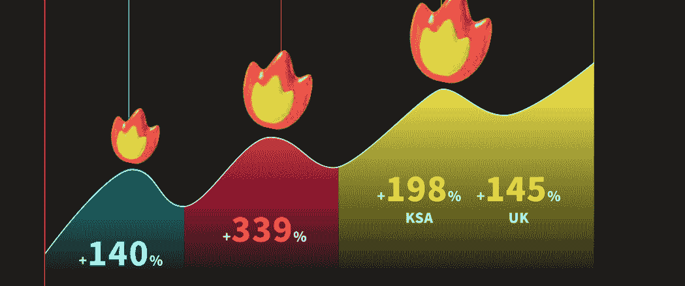

| 地区 | KSA | UK | 其他 |
| :--- | :--- | :--- | :--- |
| 增长率 | +140% | +339% | +198% / +145% |
| 时间 | 6月中旬 | 7月初 | 7月下旬 / Date |

*数据来源：统计于TikTok Shop内部数据。大促期间同销量数据统计，对比了过去一个月内无促销活动的日常销量数据。*

# 一图看遍旺季节奏 把握战术节点

| 商家 | 消费节点 |
| :--- | :--- |
| 9月30日前 | 10月27日前 | 10月31日 | 11月23日 | 11月24日 | 11月27日 | 12月25日 | 12月31日 |
| 希望参与黑五的新商家完成入驻 | 黑五商品完成上架 | 万圣节 | 感恩节 | 网络星期一 | 圣诞节 |

# 为什么商家不可错过本次黑五最大规模促销？
TikTok Shop全托管带来了年度最大规模促销，通过“内容+货架”双驱动，助力商家在不同市场中孵化更多爆款，实现业务飞跃！

- 购物指南
- 内容场：达人直播、短视频带货，让用户发现新品、优质好物。
- 货架场：商城通过一级入口流量保障，使销量直观呈现。

# 热门话题趋势

| 话题 | 播放量 |
| :--- | :--- |
| #blackfridaydeals | 2亿 |
| #haul | 790万 |
| #vlog | 1亿 |
| #blackfridaymeme | 86万 |
| #comedy | 62万 |
*数据来自：2023年统计*

# 营销资源投入

- 流量保障：47% / 38% / 61%
- 流量保障：
- 流量：
- 流量：
- 流量：
- 达人推荐：
- 流量：
- 达人推荐：
- 策划/黑五相关的活动：

# 如何打造爆款，赢在年终狂季？

## 四大品类抢占全球趋势
### 家居场景，打造精致生活
越来越多的人在家里花费更多时间，这创造了新的消费场景。人们对家居氛围的关注，越来越多的卧室、客厅、软装、亲子生活等场景，结合不同节奏创造更多消费场景。

### 节日狂欢，礼物和仪式感需求增强
年末密集，仪式感、送礼、圣诞节等类需求增加，家居可以关注设计元素，针对年末和新年假期行情下，打造符合心意的商品和内容。

- 室内家居用品、摆件、扩展架、地毯、装饰等
- 服装潮流、时尚
- 家用电器
- 收纳、汽车座椅、露营装备
- 趣味玩具、儿童写字板、木玩具、发光玩具
- 装饰毯子
- 倒日日历、生日礼物
- 防风防服
- 圣诞节冬季装饰、毛绒内衣
- 节日过年元素连衣裙、毛绒衣
- 旅行家居、家居用品
- 送礼定制、节日纸巾
- 2024年笔记本

## 妆容时刻，色彩跳跃妆容强势
闪亮的服饰、色彩斑斓的妆容，消费者对自身形象的个性偏好更加明显。在此背景下，妆容可以尝试各种风格，精致、美欧美等，色彩、高亮色、精致妆容产品，很有市场趋势。

## 秋季保暖，质优先行
- 可穿性、牛奶外套、廓形大衣
- 保暖加、内胆、暖风
- 绒卫衣、衬衫、裤（睡衣）
- 毛绒大衣、皮大衣
- 功能性外套
- 保暖配饰
- 暖暖运动裤
- 暖鞋
- 暖暖内衣
- 光泽感
- 红色
- 潮流
-  镜
- 荧光
- 肤
- 身体乳
- 妆

- #pinkchestmart (2.36亿订阅)
- #makeuptutorial (280万订阅)
- #autumfashion (24万订阅)
- #ootd (138万订阅)
- #fallfashion (20万订阅)
- #fallvibes (6.54万订阅)

## 02 黑五大促季，商家应该关注哪些战术节点?

- 不可错过的营销机遇和节点
- 节庆拨款策略

### 商家不可错过的黑五大促节点
TikTok Shop聚焦“秋季”和“黑五购物”两大主题，覆盖美国、英国、沙特三个国家，包含冬季、感恩节、圣诞节等重要节点。

| 节点 | 运营建议 |
| :--- | :--- |
| 9月开始 | 9月30日前完成入驻 |
| 10月初 | 10月27日前完成上架 |
| 10月23日 | 10月24日前完成仓库收货
| 10月31日 | 万圣节，最晚不超过10月8日
| 11月23日 | 感恩节
| 11月24日 | 黑五大促
| 11月27日 | 网络星期一
| 12月25日 | 圣诞节
| 12月31日 | 年末狂欢 |
| 1月 | 1月10日前完成推款，建议主卖在1月5日前完成完成仓收，最晚不超过1月18日 |

| 行业 | 类目 |
| :--- | :--- |
| 服饰配饰 | 休闲保暖服、礼服、户外服饰、运动、时尚鞋、双肩包 |
| 快生活 | 美妆工具、彩妆、美妆盒、美容护肤品、家居玩具 |
| 家居户外 | 家用品、暖色家居织、厨房用品、冬季健身用品、滑雪装备 |
| 3C硬件 | 笔记本电脑、手机、数码相机 |

### 重要节庆 万圣节（10月31日）

- 节庆文化氛围、青春节聚会、合欢、派对时尚品类，卖家需注重把握万圣节及万灵节趋势，以及热门道具等的流行趋势和创新玩法。
- 全托管商的运营建议：建议商家主在9月23日前完成仓库收货，最晚不超过10月8日。

【趋势热点】幽灵搞笑，亲友狂欢
万圣节及各大节庆针对的是合家聚欢及青年爱好者，糖果、Cosplay、美妆、整蛊道具成为热门类，南瓜还是热门元素，此外若能在视觉上达到良好效果，妆造鬼魅氛围的道具也会受到派对消费者的欢迎。

- #holidayparty (4.23亿播放)
- #halloweenhorrornights (7.61亿播放)
- #HalloweenFood (5.54亿播放)
- #hallowweeklook (1.32亿播放)
- #HalloweenCostume (1.12亿播放)
- #halloweencupcakes (0.68亿播放)
- #asmrhalloween (0.68亿播放)
- #HalloweenCountdown (2.21亿播放)
- #TrickorTreat (2.95亿播放)
- #fallmakeup (03亿播放)
- #fallfashion (6.54亿播放)
- #fallstyle (1.99亿播放)
- #outumoutfits (08亿播放)
- #fallphotoshot (17亿播放)
- #fallreadadtrip (00亿播放)
- #fallhike (00亿播放)
- #fallporch (16亿播放)
- #fallhiking (00亿播放)
- #fallhome (15亿播放)
- #falldecor (1亿播放)

### 热门类目及亮点
品质需求主要是节庆装饰及服饰、配饰为主，元素幽灵、南瓜、家居、编码等，主色为黑色及红色，灯光及音效的装饰品在平台上的关注度。

| 行业 | 类目 |
| :--- | :--- |
| 服饰配饰 | 万圣节潮流配饰、发夹、帽子、服装 |
| 快消生活 | 万圣节主题糖果、巧克力、玩具 |
| 家居户外 | 万圣节装饰、家居、登山伞、滑板车 |
| 3C硬件 | 圣诞节灯、手机配件、蓝牙箱、耳机 |

### 重要节庆 圣诞节（12月25日）

- 末狂欢新派对，全类持续上热度，是难得的单量机会，节日主题商品和礼品采购迎来高峰，特别关注节日服装、深夜时光、家居装饰、礼品购物、旅行服饰等类。
- 全托管商家的运营建议：最晚推款时间建议主卖在10月10日前完成，最不超过10月27日；最晚仓收时间建议主卖在1月5日前完成完成仓收，最晚不超过1月18日。

【趋势热点】年末圣诞狂欢派对，礼物互换
卖家可根据圣诞节进行节庆用品、礼物互换等营销，消费者对于冬季服装、礼物增长，红色、白色的礼品，粉色粉色的特色小物、圣诞老人、礼物相关的制品款式都会增长，对氛围类用品需求增长。

- #coylittlechristmas (542亿播放)
- #christmasake (16亿播放)
- #Pinkchristmas (2.38亿播放)
- #pinkmas (0.69亿播放)
- #christmastree (78亿播放)
- #LastChristmasMovie (47亿播放)

- #giftideas (192万播放)
- #giftguide (132万播放)
- #holidayparty (182万播放)
- #luxurygifts (998万播放)
- #makeuptutorial (1017万播放)
- #blackfridayday (1555万播放)
- #minimalist (351万播放)
- #barbiecore (991万播放)
- #pink (505万播放)
- #pinknails (142万播放)
- #pinky (239万播放)
- #pinkhair (502万播放)

### 【趋势点2】热门色类
圣诞、感恩节期间社交媒体上最大的趋势是礼物清单，质感的红色、高饱和度的红色、套装服装、精品类、家居用品等需求很大。芭比粉和亮色是核心视觉趋势，这类元素主要集中在美妆、护肤、家居玩具等。

| 行业 | 类目 |
| :--- | :--- |
| 服饰配饰 | 羊绒、毛衣、冬季服饰、保暖装备、运动鞋 |
| 生活用品 | 口红、眼影、美甲、香水、护肤产品、巧克力、咖啡 |
| 家居户外 | 室内装饰品、摆件、镜具、潮流用具、家居装饰具 |
| 3C硬件 | 手机、笔记本电脑、相机、游戏机及改装灯 |

## 重要节庆

- 新年：12月31日-明年1月1日
- 国家：美国、英国、沙特

新年计划，节庆机遇及大相结合，消费者有较大的换新需求，消费者将为元和春季服饰、家居用品、3C电子等类的产品，礼盒或者合类的商品也有空间。

- 全方位扶商家的运营建议

### 最晚投放时间
建议主货在10月17日前完成推款，最晚不超过11月11日

### 最晚仓收时间
建议主货在11月10日前完成成仓收，最晚不超过11月23日

## 【热门趋势】年末清仓血

“双12”是商家进行销售推广的时机，适合全品类，此时商家可以推出出一系列生活必需品、性价比的快消商品等，增强消费者的购买欲望。

- #hello2024 (170亿预留)
- #2024makeawish (12.47亿预留)
- #bye2023 (460亿预留)
- #happynewyear (265亿预留)
- #storytime (4675亿预留)
- #newyear (306亿预留)
- #yearontiktok (388亿预留)
- #welcome2024 (140万预留)
- #celebrate (32亿预留)

## 热门关注类及亮点

主要的热门类是冬季保暖元素为主的产品，包括厚外套、保暖用品、家居用品等，此外外的节庆类目对需求仍然较高。

| 行业 | 类别 |
| :--- | :--- |
| 服饰鞋包 | 冬季外套、大衣、毛衣、绒衫、厚底靴 |
| 快消生活 | 香水、香薰、节日饰品、暖色调用品 |
| 家居户外 | 灯饰、厨房用品、餐具、毛毯、滑雪装备 |
| 3C硬件 | 笔记本及平板电脑、智能手机、游戏机、智能家居及穿戴设备 |

## 商家节庆爆款攻略

在 TikTok Shop 的年终流量大促中，商家可抓住营销节点契机，基于 TikTok 平台上的丰富内容与用户需求进行爆款孵化。

## 商家应把握以下三大节庆及品类机遇

- 01 秋季换新需求：把握秋冬服饰、家居用品等保暖需求进行备品。
- 02 节庆元素掌握：满足万圣节、圣诞节、感恩节等节庆元素的商品需求，节庆装饰的需求足够，派对场景增长让对元素的服饰包、装饰品分类也有爆发机遇。
- 03 礼物组合商品爆发：Q4大促期间，节庆期间的购物、送礼、社交、暖己等氛围和仪式式流行浓度，在服饰、美妆、3C电子、节庆装饰品分类中，商家可抓住机遇，开展商品组合装、套装、礼品定制营销。

此外商家在控制库存、控内容电商机遇上，也有一些机遇和注意事项。

## 商家爆款孵化注意事项

- 持续供品、保证库存：商家可尽早预测，保证口碑或潜在爆品不断、维持稳定的深度是承接流量、打造爆品的前提。
- 抓住内容爆发潜力：商家可充分利用TikTok电商内容，增加奇奇、易于展示等商品上新，提升内容优势，优目占比。
- 挖掘新市场机遇：TikTok Shop新开国际市场，欧美风格的元素的需求需要快速提升，可以增加辣风格等商品的供给。

## 03

## 选品指南

### 大促商品需求与选品策略

CHAPTER 03

### 服饰鞋包配

黑五一大促的服饰品类主要围绕“节庆”和“换新”两项主题，以“休闲、优雅、派对”为三大格调，卖家可围绕风格进行备货，节庆需求与男士需求是急需的重点，可以进行相关品类准备与风格探索。

#### 女装

##### 年终派对，热辣与优雅并存

女装是主要的消费品类，在黑五一大促等节点，市场上的主要的需求分为两个方向，一方面由于换季变化对于厚款的需求增长，毛衣针、外套、卫衣等款式受到更高关注；另一方面随着节庆的需求，派对风格元素的需求增加，因此此一来，闪亮等元素的需求也在上行。

### 趋势特点

#### 热门元素：派对风格
细分品类：轻风连衣裙衣裤（重点关注身形、鱼尾下款、单肩设计）、裙子套装（重点关注连衣裙裤装）、优雅连体内

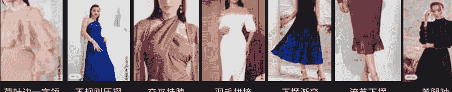
叶边一字领、不规则、交叉拼接、羽毛拼接、流苏下摆、羊绒袖

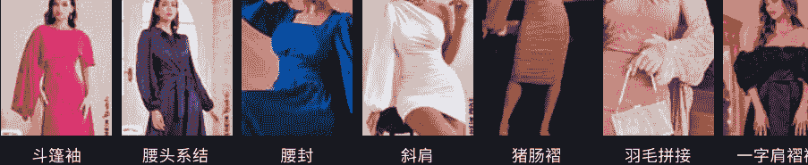
斗篷袖、腰头系结、斜剪、泡荷裙、一字臀、羽毛裙

#### 热门主题
- 多元变：闪粉、粉黄等饱和和亮色
- 无尽：幻变、色彩和暗色的反差造型

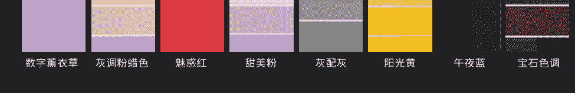
色彩调、红色、甜美粉、灰阳光蓝、宝石色

#### 印花和图案
- 爱心、碎花、大花等典型风格为主，简约画、链条受到用户的欢迎。

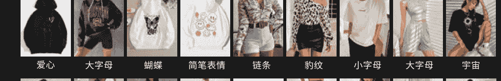
爱心大字母、蝴蝶、表情、链条、豹纹、小字母、宇宙

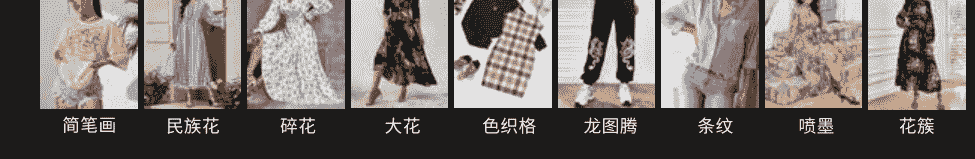
简笔画、民族花、碎花、色彩织、图腾条、喷墨

### 热招品类
重点关注分类：毛织连体裙、毛衣、开衫
款式或印花：圆领、V领、高领、螺纹连体裙、开衫、背心
供货价格带（人民币）：25-90

套头衫、开衫、毛织连体裙、套头毛衣、开衫

#### 外套
重点关注分类：泰迪羊绒外套、格纹大衣、棉服外套
款式或印花：休闲皮草夹克、填充空军夹克、模块化飞行员大衣、基础款风衣、Topcoat 轻便大衣、松软皮草夹克、机能马甲、实用风夹克
供货价格带（人民币）：30-145

无袖、短截、派克、马甲、皮衣、连帽外套、衬衫、大衣、短夹克

卫衣

重点关注分类：连卫衣、外套
款式或印花：撞色单品、爱心印花
供货价格带（人民币）：30-60

基础套头版型、外套、圆领卫衣

#### 男装

#### 简约设计

男装款式简约，以剪裁和实用性作为作业，用户进行购买的原因。印花方面今年没有颠覆性的创新，仍以字母印花、格纹印花等传统类为主。年底涉及节庆多的设计也会得到更多的偏好。

### 趋势特点
- 热门元素：海军绿、实用襟、口袋拉链、前卫面料、极简细节、工装款式。
- 主题：宽松休闲、商务风、肌肉风。
- 配色趋势：绿色调、粉红色、紫色调。
- 印花和图案：字母印花（King印花、地名印花等）、潮流印花、邪魅、格纹印花、撞色单品。

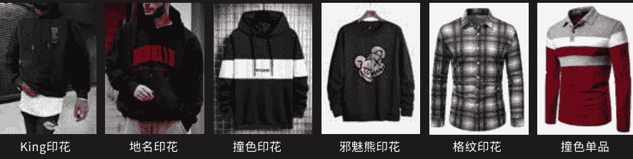

### 热招品类

- 毛织：重点关注分类：背心、套衫、上装
供货价格带（人民币）：25-105
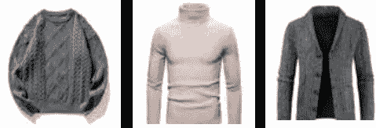

- 外套：重点关注分类：格纹外套、棒球服、撞色单品、大衣、PU大衣
供货价格带（人民币）：30-150
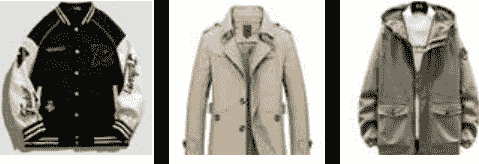

- 卫衣：重点关注分类：厚软加绒卫衣
供货价格带（人民币）：20-40

#### 童装、母婴服饰

### 萌系印花火爆，优先选择明亮色调

童装在印花上的创新是年轻化的关键一步。目前流行的童装印花风格特性明显，主要以儿童偏爱的元素为主，女童偏可爱少女、猫咪、花卉、卡通等萌系元素，男童偏恐、航员、汽车、游戏等让他们体验较多的娱乐元素。在配色方面儿童选择明亮和饱和度的颜色，男童也适用部分暖色。

在款式上，两件套、连衣裙、卫衣、外套等款式均受到欢迎。

### 趋势特点

| 女童 | | | | | | |
| :--- | :--- | :--- | :--- | :--- | :--- | :--- |
| 人像 | 爱心 | 猫咪 | 花卉 | 恐龙 | 游戏机 | 车 |

### 热招品类

- 卫衣裤：重点关注品种: 帽衫、开衫，供货价格带(人民币):25-55
- 两件套：重点关注分类：针织、毛织、毛衣，供货价格带（人民币）：20-65
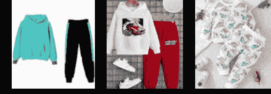
- 连衣裙：重点关注分类：针织、毛衣，供货价格带（人民币）：25-60

#### 配件、饰

### 节日元素亮点，90年代复古风

秋冬季厚重、萌系卡通风、眼镜、围巾等保暖用品增长，同时视觉吸引力高。万圣节蝙蝠、幽灵及南瓜也是刚需。在饰方面，蝴蝶、爱心、字母以及不规则等设计带来新的思路，特别是复古风，商家可以尝试这些复古元素融入到设计中。市场对男士的需求迅速增长，其中可以考虑十字架、爱心、字母和动物等融入到产品中。

### 趋势特点
- 热门元素：万圣节：骷、南瓜、幽灵、蝙蝠等
- 圣诞节元素：圣诞老人、圣诞树、驯鹿
- 配色趋势：黑色调、红色、绿色

### 热招品类

- 帽子：重点关注分类：鸭舌帽、针织帽、礼帽、无缝小帽，供货价格带（人民币）：8-20

- 围巾：重点关注分类：印花、色彩织围巾、简约款，供货价格带（人民币）：5-30

- 手套：重点关注分类：保暖为主、面料耐磨、露指手套，男士需求更高，供货价格带（人民币）：4-15
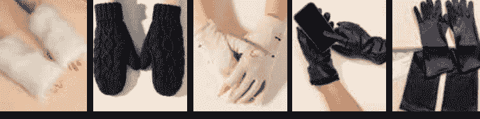

#### 假发 (备注:全纤发)

### 装饰属性套

重点关注分类：南瓜、蜗螺、圣诞等万圣、圣节元素，供货价格带（人民币）：25-65

### 发饰

重点关注分类：南瓜、蜗螺、圣诞等，供货价格带（人民币）：4-15

### 耳环、耳饰

重点关注分类：毛绒、金属、蛇元素、节庆款，供货价格带（人民币）：1-16

### 戒指
重点关注分类：字母、标语、节庆款，1-16，供货价格带（人民币）：1-16

#### 手链和手镯

重点关注分类/款式：雕刻风人体工学、极简、混搭、模块化及蜘蛛、骷髅等元素的节庆款，供货价格带（人民币）：3-20

#### 项链

重点关注分类 / 式：十字架、珍珠、字母、星座、choker、节庆款，供货价格带（人民币）：3-45

#### 鞋子

### 经典潮流并行，暗黑先锋风格受到关注

在黑五网等热门节点，由于为了实用性需求，消费者的主要需求是常规款的靴子以及应季的毛绒拖鞋、鞋子。经典长青类的老款，设计也会得到更多的偏好。

### 趋势特点
- 热门元素：万圣节：骷、南瓜、幽灵、蝙蝠等， 圣诞节元素等
- 配色趋势：黑色调、红色、绿色

- 热门元素：万圣节：骷、南瓜、幽灵、蝙蝠等
- 圣诞节元素：圣诞老人、圣诞树、驯鹿
- 配色趋势：黑色调、红色、绿色

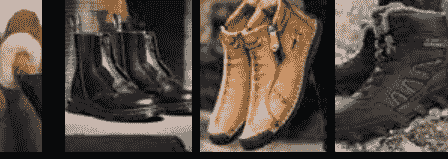

### 热招品类

- 鞋：重点关注：鞋，供货价格带（人民币）：45-100
- 运动鞋：重点关注：鞋，供货价格带（人民币）：48-70
- 拖鞋：重点关注：鞋，供货价格带（人民币）：16-55

### 热招品类

- 女包
重点关注款式: 蛇皮托特、毛绒、毛纹挂饰、晚宴、90 年代极简、醒目极简、至暗时刻
供货价格带（人民币）: 10-68

- 男包
重点关注款式: 皮质托特、斜挎、反马托邦、简约、实用主义、高质量设计
供货价格带（人民币）: 12-70
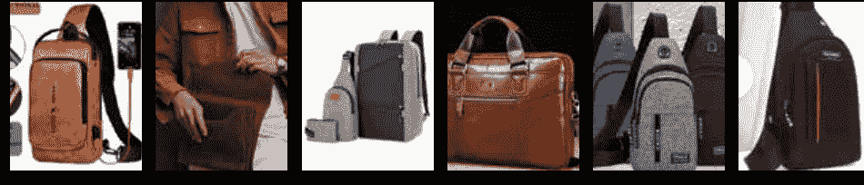

- 儿童箱包
重点关注款式: 千格风、缝线、Y2K 千格风、格子元素、蝴蝶结、百变背包、加绒背包
供货价格带（人民币）: 10-50

#### 旅行箱、功能包

**重点关注款式:** 旅行收纳袋、旅行箱（折叠后 20 寸以内）、旅行包；保温袋、购物袋、化妆包、洗漱包、双肩包、电脑包
供货价格带（人民币）: 旅行箱 25-75; 功能包 4-25
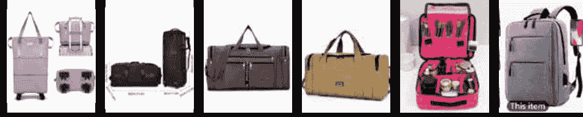

#### 配饰

**重点关注款式:** 行李牌、DIY配件、装饰丝巾、包套、包挂件、护照套、包带
供货价格带（人民币）: 4-18

#### 内衣、睡衣、家居服

可爱庆节印花决定购买意向，冬季需要厚衣服

内衣及睡衣产品中需要注意的是新款印花的开发和延续，庆节期间的购买行为也会让圣诞、万圣元素相关的内衣服装有所涨幅。目前较热门的印花款式仍以爱心和字母为主，性别区域区分明显，并在冬季一般以加绒、毛绒等材质作为秋冬换装的主要需求。圣诞元素单品 10-11 月发热，卖家提前沉淀货和备货。

### 趋势特点

### 热门款式
羽毛饰边、甜美碎叶、撞色边缘

### 热门图案
爱心、字母、可爱动物印花

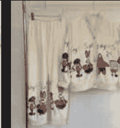

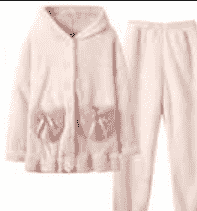

#### 热门品类

- 女式内衣睡衣、家居服
印花: 爱心、豹纹印花、可爱的印花较多
面料: 罗丝拼接、毛绒拼接、摇拉绒等
供货价格带(人民币): 15-50
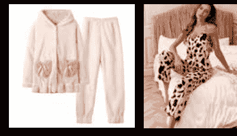

- 男式内衣睡衣、家居服
印花: 格纹、字母
面料: 棉棉、毛绒
供货价格带(人民币): 15-50
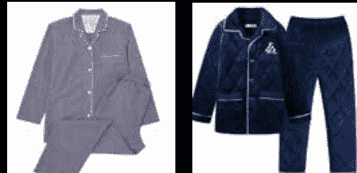

- 儿童内衣睡衣、家居服
印花: 可爱印花单品，女童以猫咪、熊猫、独角兽、爱心印花为主，男童以汽车、可爱熊、恐龙、航天等为主
供货价格带(人民币): 15-60
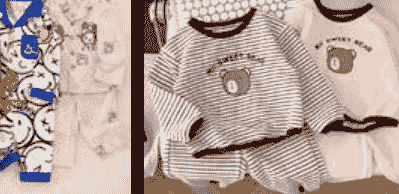

#### 运动&户外服饰

### 专业品类
运动服以纯色设计为主，舒适、透气、紧身、高弹等功能是消费者的刚需。尤其是滑雪服、冲锋等产品，保持稳定的性能。此外，运动手套、运动鞋与运动服的搭配，也是增加购买的手段。

### 趋势特点
粉色、绿色、灰色等流行色。
交叉带、露肩、短款、大理石纹、字母印花、装饰带、透视拼接、字母印花。

### 大码内衣
重点关注款式: 纯色、无缝款
供货价格带（人民币）: 15-38

- 女士运动套装
重点关注款式: 纯色、贴身款、修身、包裹性、色彩花、色彩花纹、色彩花纹
供货价格带（人民币）: 25-76
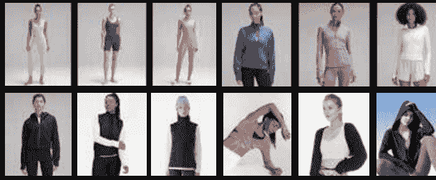

- 男士运动服饰
重点关注款式: 纯色、色彩花
供货价格带（人民币）: 23-50
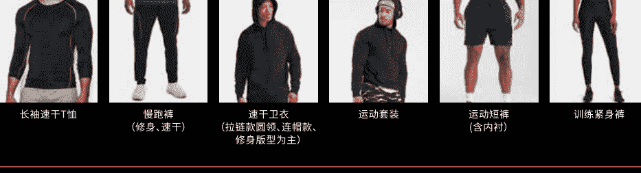

- 运动鞋
重点关注款式: 网状、色彩、气垫减震、透气性、防滑、保暖、稳定
供货价格带（人民币）: 50-150
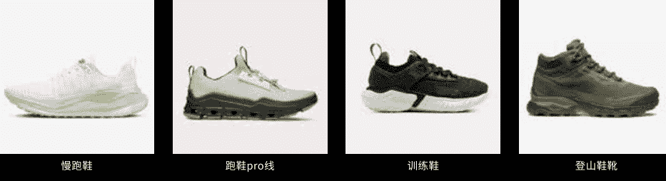

- 户外运动服饰
重点关注款式: 防风、防雨、防污、春秋三合一
供货价格带（人民币）: 60-200

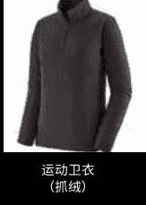

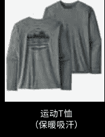

- 运动包
重点关注款式: 防水、划扣、轻便、大容量
供货价格带（人民币）: 30-70
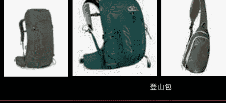

- 运动大卫衣
重点关注款式: 连帽、纯色、时尚印花
供货价格带（人民币）: 30-80

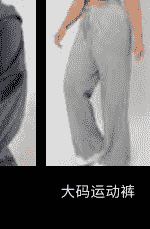

联系【服饰鞋】经理，扫描左侧二维码，根据推送链接，找到【服饰鞋】板块，根据自己的需求，加入飞书群。注意：请使用APP打开TikTok Shop 全托管模式：https://full-tiktokshop.com/

## 家居户外

户外的卖家在Q4旺季聚焦“应季”和“节庆”两个关键点。消费者更倾向于选择那些带来温暖氛围的产品，特别是那些带有万圣节、圣诞节等节日以及毛绒材质的饰品。这些商品在市场上会被消费者的热烈欢迎和广泛关注。趋势包括万圣节、圣诞节、新年等节日，商家可以结合不同的节日内涵进行备货。由于节庆商品通常是套装购买，由于节庆品质的及时性，备货一定要早抢占机！

- 家居装饰
节日元素: 圣诞老人、人鹿、圣诞帽、圣诞袜、墙贴、夜光、其他用品
供货价格带（人民币）: 3-20

- 胶带
节日元素: 圣诞元素，如雪景、圣诞小屋、字母、麋鹿、雪桩
供货价格带（人民币）: 3-10
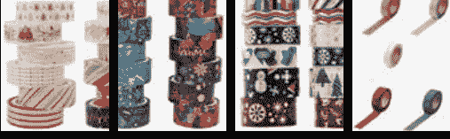

- 气球
节日元素: 圣诞节相关元素，如雪景、圣诞小屋、字母、麋鹿、雪桩
供货价格带（人民币）: 0-1/件; 10-30/套

- 假花
节日元素: 插花、摆件、红色果子、红、绿、白等配色
供货价格带（人民币）: 5-20

- 串灯
节日元素: 装饰灯、挂灯串、树型、圣诞元素类型
供货价格带（人民币）: 3-20

## 机会品类

- 相柜、相册
节日元素: 圣诞、新年、花纹装饰
供货价格带（人民币）: 3-15

- 储蓄罐
节日元素: 储蓄币、纸币
供货价格带（人民币）: 3-20
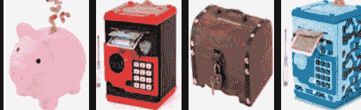

- 音乐盒
节日元素: 音乐盒、纯收键、圣洁 / 新年相关
供货价格带（人民币）: 1-15

- 香炉与灯台
节日元素: 电子蜡烛、含烛台
供货价格带（人民币）: 3~10/件; 5-20

- 一次性用品
节日元素: 圣诞树、鹿角、圣诞花
供货价格带（人民币）: 3-15

## 家纺布艺

冬季热门品类主要以家纺布艺类中的床毯、坐垫、DIY布料等材质符合消费者的保暖需求。此外，防水面料的异形抱枕等也是急需的。在Q4期间较多，万圣节、圣诞节等传统元素的组合也是商家需要关注的。

- 丝类毛毯: 法兰绒、牛奶绒、珊瑚绒、簇苏边
- 床套装: 蘑棉、长绒、植绒
- 抱枕 & 坐垫: 灯芯、人造草
- 沙发布: 推荐雪妮尔、天鹅绒、羊绒
- DIY 布料: 毛毯、长毛、天鹅绒、渔网
- 热门配色: 暖色、大地色、棕色、褐色、绿色、橙色、白色以及略红色
- 图案: 南瓜、蝙蝠、蜘蛛、女巫、裤条、圣诞老人、圣诞树、麦饼、胡糖、格纹、橘大花、碎花
- 风格: 大地色、短绒波西米亚、摩哥风、北欧风

### 热招品类

### 应季床品
重点关注: 防水床罩、乳胶枕、一次性床品、枕套套装
供货价格带（人民币）: 10-149

### 毯子
重点关注: 穿戴毯与异形毯
供货价格带（人民币）: 30-99
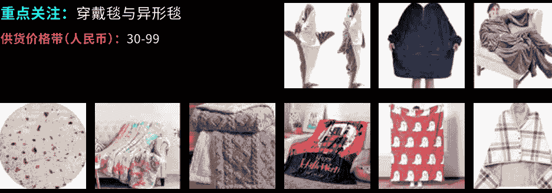

### 窗帘、挂毯
重点关注: 万圣节、节庆典元素
供货价格带（人民币）: 15-99

## 节庆商品

重点关注: 留贴、抱枕套、椅套、桌巾、餐垫、底垫、丝带、欧根纱
供货价格带（人民币）: 5-49

### 客厅软装
重点关注: 异形枕、桌脚、异想垫、沙发套
供货价格带（人民币）: 5-149

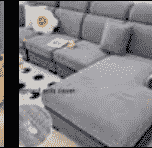

## 厨房用品

厨房用品在9月开始随着消费者保暖需求及节庆氛围的影响下，会有三个增长机会：
- 热门品类: 厨房小工具、厨房收纳、冰激淋工具
- 热门配色: 马卡龙、多巴胺色系
- 热门场景: 派对、咖啡与茶相关
- 热招品类: 爆款水杯、咖啡具、厨房周边

Q4有很多多的节日，圣诞节、感恩节、万圣节，让聚餐变得频繁，和家人在一起没有什么比手下晚餐来的好了！厨房用品必然会大卖。供应价格带（人民币）: 5-60

## 餐具

聚餐场合少不了餐具相关的餐具用品在Q4有明显的销量激增
热门类别: 饭盒、餐杯、餐垫
热门功能或元素: 密封性好、分区容纳
供货价格带（人民币）: 5-20
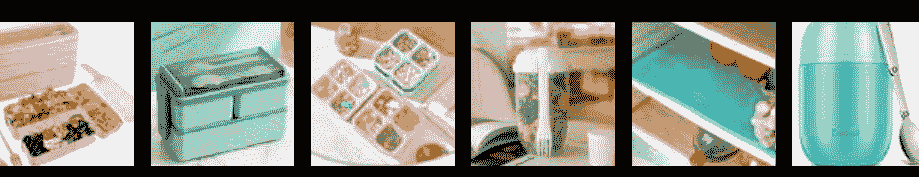

### 饮料

大型跨境电商平台，水杯和酒具在海外的销量都是拔得头的，再一次将饮具品类热卖这个黑五！
热门类别: 水杯、酒具
热门功能或元素: 带有节庆元素的酒具、水杯；适用于聚会、出行场景的产品
供货价格带（人民币）: 20-40
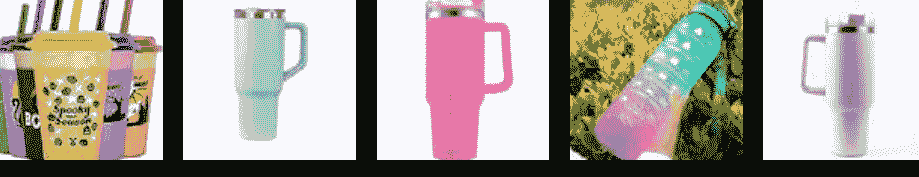

## 办公文具

新年规划本需求上升，文具组合装提升销量
- 常规软款大促有爆发机会，可配置多件折扣或组合装，可引导消费者购买货物来提升客单和爆发度
- 带庆元素的相关产品，如证书收纳和配件、2024新年日历、贴纸、包装材料等
- 送礼场景、礼品性商品上升，文贺卡、文具盒套装、文具电子类产品

### 书写文具与修正文具
重点关注: 铅笔、固货装中性笔、荧光笔、笔芯、马克笔等
供货价格带（人民币）: 1-10
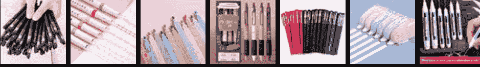

### 笔记本与纸制品
重点关注: 2024年的日历、计划本、笔记本、手账本
供货价格带（人民币）: 2-20

## 办公收纳及桌面配件

重点关注：大件收纳、桌面收纳、理线器、文件收纳、支架

供货价格（人民币）:10-30

### 标签贴纸和分类索引及印章

重点关注：标签签、贴纸、分类索引、便利贴、印章

供货价格（人民币）:1-100

## 教育用品

重点关注：早教卡片机、日历磁吸

供货价格（人民币）:10-30

## 文具电子类产品

重点关注：迷你打印机、计算机、桌面台灯等等

供货价格（人民币）:50-100

## 节庆标签商品

**重点关注：**
节庆元素：感恩节、圣节、万圣节、圣诞节、包装节、2024 新年
商品：卡片、台历、包装纸、包装袋、笔、本子、桌面配件等

供货价格带（人民币）：2-20

## 运动户外设备配件

### 滑雪装备有应有季，保暖用品有强需求

**冬季健身用品：** 室内健身设备如健身器材、阻力带、运动垫、手力量训练器、背后的按摩器器材等。

**滑雪装备：** 冬季运动场景热化，滑雪成为人们冬季户外运动的首选，因此滑雪装备成为冬季畅销商品，如滑雪板、滑雪眼镜、滑雪眼镜。

**保暖功能：** 冬季低温低，进行户外运动时需要更具有保暖功能的产品，比户外露营用品和冬季运动手套、护脸、帽子、耳套等。

**庆节需求：** 许多人在万圣节期间会穿各种服装角色扮演，因此万圣节框服装眼镜、面具、帽子是必不可的。庆节期间许多人参加户外活动，例如各种露营灯、水袋、运动水壶等，也会受欢迎。

### 热销类目

- 滑雪装备
**重点关注：** 滑雪板、滑雪眼镜、滑雪板带、充气滑雪圈、冰壶游戏道具、冰球棒
供货价格带（人民币）：50-200

- 秋季健身用品
**重点关注：** 可收纳、可折叠；健身后的按摩器器材
供货价格带（人民币）：10-100

## 保暖功能装备

**重点关注:** 滑雪手套、保暖发热手套、防风口罩、围脖帽、保暖耳套、头套、袖套

供货价格带（人民币）:10-50

## 冬季户外露营用品

**重点关注:** 露营、钓鱼、保暖睡袋
供货价格带（人民币）:50-200

## 节庆相关元素

**重点关注:**
节庆元素: 感恩节、万节、圣诞节、2024 新年
商品: 游戏装备、口罩袋、水杯、帽子、露营运动装备
供货价格带（人民币）:10-60

## 家居用品

### 装修换新需求助力大促消费，收纳成热门场景

装修换新是家居用品年终大的主角，由于家居用品的购买在黑五期间都是较为热门的类目，主要集中于收纳方式升级、浴室用品购买、香薰礼盒等方面的升级。

收纳的各种场景升级是装修换新的热门场景，其中美妆和珠宝收纳都有可能迎来销量高峰。

- 热门功能：装修换新、收纳升级、香薰、实用礼品
- 热门使用场景：家居收纳（美妆收纳|珠宝收纳|厨房收纳|浴室收纳）、香薰&礼盒、毛巾&香薰礼盒
- 热招品类：香薰、收纳、毛巾、清洁剂

### 热招品类

| 家居家纳 | 亮点功能或元素 | 供货价格 |
| :--- | :--- | :--- |
| 热招商品：珠宝首饰收纳、美妆收纳、厨房收纳、浴室收纳 | 折叠插式收纳盒/架：多功能、可变形、不占空间！ | 供货价带（人民币）：20-50 |

## 浴室用品

招招商品：浴室帘套装、浴室收纳架、浴室套装
亮点功能或元素：不锈钢材质，坚实耐用；容量大；简约大，风格统一的套装最为欧美客户喜爱
供货价格带（人民币）：30-80

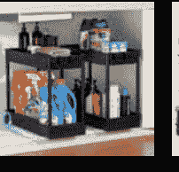
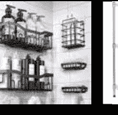

## 家庭护理

招招商品：香薰 & 礼盒、发箍、一次性毛巾、浴巾、浴室垫
亮点功能或元素：节日装及节日造型蜡烛
供货价格带（人民币）：50-150

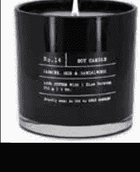

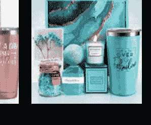

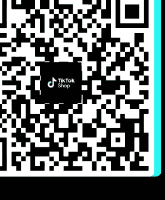

## 3C数码

3C数码产品在年终大促中以常规软款和升级款为热门类目，消费者主要关注折扣及功能性。这些核心品类包括蓝牙、充电线、支架、智能手表&手环、智能穿戴配件、游戏机等。带有生日元素的配件成为爆款。

## 增长机会

- 苹果新品发布带来的周边，如手机&平板电脑、充电头和充电线、表带、配件等
- 每个节日的定制/定制产品：如手机、耳机、表带、游戏配件等
- 大 IP 新奇特的引入

### 热招品类

- 保护壳
重点关注：热销节日图案、功能性手机
供货价格带（人民币）：5-30

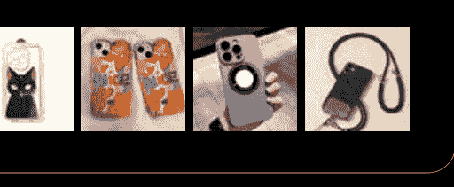

- 充电器、充电线
重点关注：适配苹果最新发布的产品规格、快充线头组合
供货价格带（人民币）：18-30

- 耳机&音响、影音设备配件
重点关注：大 IP 的新奇货源系列
供货价格带（人民币）：耳机：15-50 元；头戴式：20-80 元

- 智能手表&手环、智能穿戴配件
重点关注：节日元素图案、苹果新款发布
供货价格带（人民币）：智能手表：25-100 元；表带：5-40 元

- 游戏机和游戏机配件
重点关注：节日促销
供货价格带（人民币）：掌上游戏机：100-400 元；游戏机配件和周边：30-60 元

## 家电器

主保暖需求，品质生活需求上升

黑五期间电器需求方向主要源自温度下降带来的取暖需求、取暖器、电热毯、加湿器、炸锅、咖啡机等取暖及需求升级。另一方面，生活品质的升级也是年期间消费者的需求方向，特别是在饮食方面的升级，热点类包括榨汁机、破壁机 &豆浆机、搅拌机等。

此外，消费者在电器上的多场域、安装便捷、多功能、电路保护等方面的需求增长，在新年初级消费者有望将学智能门控、方便、性价比高的小型电器。

## 增长机会

- 冬季需求：冬季末，暖暖风、电热毯、加湿器等产品的需求上升
- 生活：榨汁机、破壁机、豆浆机、搅拌机、加湿器、空气炸锅、压力锅、电剪刀、扫地机器人等
- 多场域适用安全安装的便携品：多功能集合，智能化可视化升级

### 热销品牌

- 榨汁机、破壁机 & 豆浆机
关注：榨汁机：30-100；破壁机&豆浆机：100-200
重点关注：无线充电、小巧、压力分离

- 炸锅
重点关注：容量大，不粘清洗，烹饪模式
供货价格带（人民币）：100-300

- 咖啡机 & 配件
重点关注：桌面便捷、半自动
供货价格带（人民币）：300以内

- 电风
重点关注：小型的脚线、石墨暖风机
供货价格带（人民币）：80-300

- 电热毯
重点关注：多档调节、智能温控、面料
供货价格带（人民币）：50-300

- 搅拌机
重点关注：手持：30-200

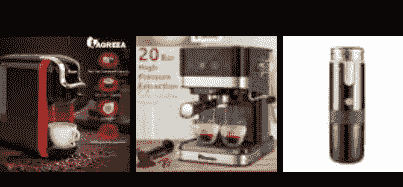
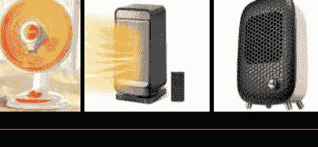

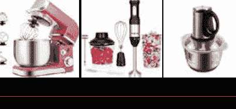

## 温馨提示

- 英国：需要 CE/UKCA资质，符合当地标准
- 沙特：需要 GCC资质，符合当地标准
- 美国：需要 FCC、UL 资质，符合当地标准

## 汽摩配

### 冬季特色类

汽摩配的热销有内饰、清洗养护、维养工具、汽车电子等品类，与其他季节没有差异，卖家在大促期间需要这类常规款式。随着气温下降到来，车内的取暖、除雪铲、毛绒座椅等季节需求旺，卖家可提前规划。

## 增长机会

- 冬季用品：车辆内取暖、除雪等
- 特斯拉配件：遮阳、收纳功能提升，与季节元素结合，满足消费者多元化需求
- 新能源车型：充电桩与新能源相关元素
- 老车焕新：车机、内饰更新在大促中也会增长，也可与节庆相关颜色组合

### 热招品类

- 内饰
重点关注：饰品、车载支架、车载收纳、汽车香薰
供货价带（人民币）：饰品：5-10；车载支架：5-15；车载收纳：10-25；汽车香薰：5-15

## 清洗养护

**重点产品：** 车内护理、水枪和雪沫喷枪、汽车配件、清洁护理液

供货价带（人民币）: 车内护理: 1-5、水枪和雪沫喷枪: 10-50、汽车配件: 5-10、清洁护理液: 5-15

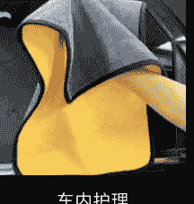

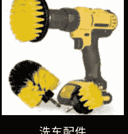

## 外饰

**重点关注：** 遮阳、贴纸、装饰条
供货价格带（人民币）：30-80

- 装饰
**重点关注：** 手机、功能性、功能性：10-30

- 充电器、充电线
**重点关注：**适配苹果最新发布的产品规格、快充线头组合
供货价格带（人民币）：18-30

- 耳机&音响、影音设备配件
**重点关注：**大 IP 的新奇货源系列
供货价格带（人民币）：耳机：15-50 元；头戴式：20-80 元

- 智能手表&手环、智能穿戴配件
**重点关注：**节日元素图案、苹果新款发布
供货价格带（人民币）：智能手表：25-100 元；表带：5-40 元

- 游戏机和游戏机配件
**重点关注：**节日促销
供货价格带（人民币）：掌上游戏机：100-400 元；游戏机配件和周边：30-60 元

- 维修
**重点关注：**手机、功能性、功能性：10-30

- 维修
**重点关注：**手机、功能性、功能性：10-30

- 维修
**重点关注：**手机、功能性、功能性：10-30

- 维修
**重点关注：**手机、功能性、功能性：10-30

- 维修
**重点关注：**手机、功能性、功能性：10-30

- 维修
**重点关注：**手机、功能性、功能性：10-30

- 维修
**重点关注：**手机、功能性、功能性：10-30

- 维修
**重点关注：**手机、功能性、功能性：10-30

## 增长机会点

- 手动工具、五金 —— 冬季来，雪铲、门窗五金等需求增加
- 电动工具 —— 电钻、电动扳手、钻桩机等 DIY 工具即将热销（带电需有资质认证）
- 浴室设备、电器设备 —— 欧美风格落地洒、智能电插排，需要性价比落地式（带电需有资质认证）

### 热招品类

### 电动工具

需求 & 卖点：电钻 —— 动力强劲，无刷电机，锂电续航明确；螺丝批套装：众多功能合一，电子显示，待机时间久。

供货价格带（人民币）：电钻: 60-200；螺丝批套装：30-150

### 门、窗五金

需求 & 卖点：门五金 —— 现代简约门铰链、门缝密封条；窗五金：防风、保暖、隔音窗密封条；儿童锁扣。

供货价格带（人民币）：门五金: 0.5-5；窗五金:0.3-10

## 手动工具

需求 & 卖点：手动工具套装 —— 棘轮扭矩手、扳手、螺丝刀；套组合；手表工具：手表维修工具。

供货价格带（人民币）：手动工具套装: 30-80

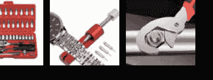

### 花园用品

需求 & 卖点: 花盆；花园浇灌喷头
供货价格带（人民币）：花盆: 5-30; 花园浇灌喷头: 10-50

## 浴室设备

需求 & 卖点: 厕纸挂钩；花洒
供货价格带（人民币）：厕纸挂钩: 5-30; 花洒: 20-80

### 厨房设备

需求 & 卖点: 厨房收纳、厨房五金
供货价格带（人民币）：厨房收纳: 2-30; 厨房五金: 2-50

## 温馨提示

- 英国、美国：锂产品 & 插头产品，需要 UL/FCC/UKCA/MSDS 等资质认证，符合当地标准的插头。

## 节庆灯具灯带来增长，服务于派对场景

灯具的常规软装包括室内照明、便捷照明、奇丽照明、灯管照明、户外照明、灯管灯泡等。这类聚会在节庆期间与节日元素结合，在万圣节加入南瓜、螃蟹等元素，圣诞节雪花、雪人、红白、蜘蛛等元素与灯具品类的结合能够满足消费者广泛的需求，需要卖家准备好库存及备货周期规划。

## 核心关注类

- 新奇照明、灯管灯带、便捷照明

**重点关注元素及品类：** 万圣节元素及灯具产品：可用南瓜、螃蟹等万圣节特色元素与灯具造型进行集合，如灯带、灯泡以及火焰、蜘蛛等万圣节元素的品类也深受欢迎。
圣诞节元素及灯具产品：可用多种圣诞元素进行灯具设计，如雪花、雪红、黑、星星、月亮、小鹿、圣诞树和精致铃等灯带、灯泡和灯车等灯具装饰都可用多种元素进行多元化。此外新奇投影灯和造型配件、户外太阳照明的装饰灯特色产品也可以满足消费者的多样化需求。

报价价格段（人民币）：整条灯带在 12-45 元左右，根据长度、灯带数量不同导致价格不一；发光配件/投影灯、以及万圣节/圣诞主题的装饰，供价 2-300 元不等；便捷的户外灯具供价 5-50 元不等。

新奇照明 | 灯管灯带 | 便捷照明

### 热招品类

- 万圣灯具产品

**重点关注元素及品类：** 带有南瓜、螃蟹灯等造型与万圣节符合的装饰灯带、灯灯、灯泡以及室内内摆。

供货价格带（人民币）：单个供价在 10-50 元，套装供价 10-200 元之间。

### 圣诞灯具

**重点关注元素及品类：** 带有圣诞元素：雪花、雪人、红白、蜡烛、星星、月亮、小鹿、圣诞树、铃铛等灯带、灯泡和挂件类型。

供货价格带（人民币）：整条灯带在 12-40 元左右，根据长度、灯泡数量导致价格不同；发光挂件主要以圣诞主题为主，如雪人、麋、蜘蛛等，2-300 元不等。

## 温馨提示

- 英国：需 CE/UKCA 认证。
- 美国：需 FCC/UL 认证。

**联系经理：** 扫描左侧二维码，根据推送链接，找到【快生活】板块，根据自己经营的业务，加入飞书群（注意：使用【飞书APP】入群）。

**如何注册 TikTok Shop 全托管模式？**
建议使用【电脑】打开链接：https://full-service.tiktokshopglobal-bselling.com/完成注册。

### 快生活

快消品类在黑五及圣诞季的亮点在于：消费者会偏好巧克力、玩具、母婴等领域。整体而言，快消大类中消费者关注折扣因素，商家要做到“库存充足”、做好信息传递、提高短视频视觉效果以销量。

### 美妆护肤

黑五与圣诞季以来，需求日益旺盛。对于美妆类产品的需求增加，节日氛围的产品具有吸引力，色彩系为红色、绿色、紫色及粉色等，商家可以增加套装、礼盒、节日包装。另外在大促折扣氛围中，消费者更愿意购买高单价的产品，商家可以增加如电吹风、按摩器、卷发器等美容个护电器。

## 热点品类

### 美妆护肤

热点产品：口红、唇釉、唇膏、高光眼影、闪闪亮、all-in-one 化妆大礼包。

供货价格带（人民币）：单品供货在 2.5-20 元，套装/礼盒供价在 8-150 元。

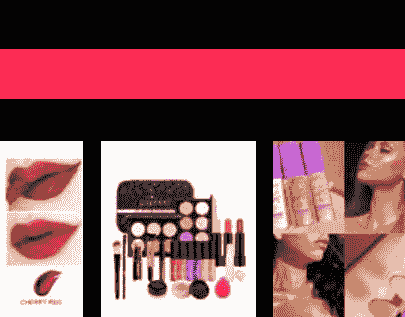

### 美妆工具

热点产品：化妆工具；更有价值感的套刷产品（带有节日感的刷柄）；化妆收包、不插电造型工具。

供货价格带（人民币）：单品供货在 5-15 元，如带刷包的套装供货在 15-40 元。

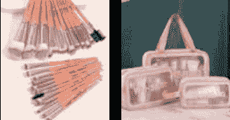

### 美甲护理

热点产品：美甲套装：造型更富有节日气的穿戴甲套装。

供货价格带（人民币）：单品供货在 3-10 元。

### 美容个护电器

热点产品：按摩器，卷 / 直发器，电吹风。

供货价格带（人民币）：供货价在 20-200 元（根据产品本身功能性浮动）。

### 美容护肤

热点产品：身体乳、身体护理类产品、卸妆类产品。

供货价格带（人民币）：单品供货在 2-30 元，套装 / 组合供货价在 10-150 元。

## 关注节日元素与玩具的结合，合家欢聚游戏有望出爆品

玩具预计将成为五大热门中爆发力的品类之一。积木玩具、发光玩具、音乐玩具、儿童遥控车等款式上而言，玩具与节日元素结合也是大促销期间的热卖方向。此外，万圣节的南瓜、圣诞老人等元素，方便合家欢场合的桌游游戏受到更多关注。

### 热招品类

- DIY：热点产品：主题贴纸、夜光纹身贴、DIY串珠材料、编织毛线材料等。
供货价格带（人民币）：贴纸类供货价：0.5-10 元，串珠供货价：8-25 元。

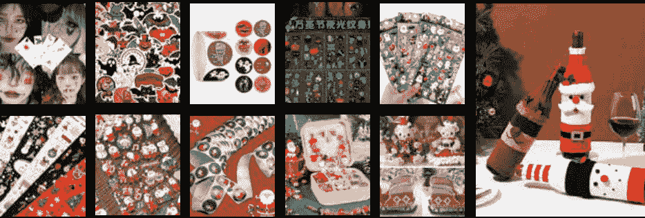

- 传统玩具：热点产品：创意和解压玩具、发光陀螺、主题小玩具套装。
供货价格带（人民币）：套装供价在 1-15 元。

- 娃娃与毛绒玩具：热点产品：主题毛绒、送礼向毛绒。
供货价格带（人民币）：套装供价在 10-50 元。

- 拼装玩具：热点产品：主题积木、音乐盒积木套装。
供货价格带（人民币）：套装供价在 5-100 元。

## 节庆元素服饰易增长

黑五大促前后，宠物用品也有较大的增长。除了常规的猫狗、水族、爬行两栖、农场动物（牛羊鸡）的宠物用品在五大促中有望成为亮点。节庆元素的结合会促进消费者在节日氛围中的消费关注重点。

### 热招品类

- 猫狗服饰：热点产品：节庆服饰、节庆领结。
供货价格带（人民币）：冬季猫服饰 10-20 元，领结 4-8 元。

- 猫狗玩具：热点产品：性价比猫玩具、狗玩具。
供货价格带（人民币）：狗狗玩具 1-10 元。

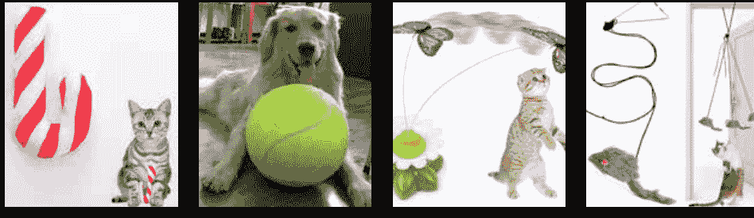

### 喂养用品

热点产品：节庆应景配色喂养用品。
供货价格带（人民币）：喂养用品 2-15 元。

## 清洁用品

热点产品：节庆应景配色清洁用品。
供货价格带（人民币）：清洁用品 5-15 元。

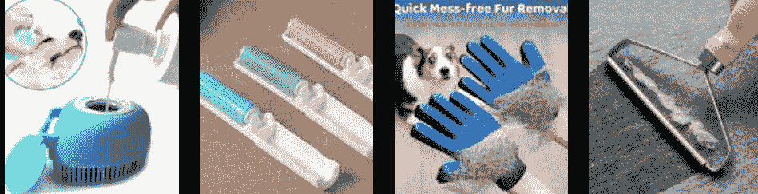

## 04 爆品攻略

### 如何用内容打造爆款产品

### 如何拍好一条商品短视频

TikTok作为一个短视频内容为主的平台，短视频在 TikTok 带货直播中扮演着至重要的角色。值得注意的是，对于全托管的商家来说，一定要提供优质商品视频，通过短视频快速展示产品，提高消费者欲望并促进订单转化。这是决定推广成功的关键之一。

#### 1. 确定受众和核心点

- 在视频之前，首先要了解你的目标消费者是谁，他们的爱好、日常习惯是什么，对应的产品卖点是什么，尝试在视频黄金3秒内传达核心内容。

#### 2. 确定内容和情节

- 故事内容与消费者的兴趣相关，情节要有吸引力，比如可以展示产品的外观、材质以及使用效果，体现如何改变消费者的生活。

#### 3. 确定逻辑

| 模型类型 | 视频结构 | 适用行业及场景 |
| :--- | :--- | :--- |
| 开场视频 | 从开头介绍过程，通过转场提升节奏感，为了解决消费者的痛点。 | 全行业 |
| 测评类 | 直观测评产品，使用前 vs 使用后的效果。 | 美妆、家居、家电 |
| 直播记录 | 真实记录，高节奏吸引观众，细节不可忽视。 | 奇特产品、潮流类 |
| 口播介绍 | 给出需求描述、痛点分析、解决方案。 | 全行业通用 |

#### 4. 制作视频

- 视频并加入音乐和特效。音乐和特效可以让视频更有吸引力，有趣的音效可以在介绍产品时烘托氛围，愉悦消费者下单。

## 05 实战攻略

### 商家必知节点（黑五大促）

- **9月第4周之前：** 商家关注订单状态，积极备货，保持库存。
- **10月第4周之前：** 核心产品上架，备货，记得提前准备好货物，到货时通知！
- **11月第4周（黑五销售高峰期）：** 有能力的商家可持续维持销量，优惠期间，平台活跃，补货如提前迎接高峰。
- **10月第一周（黑五期间）：** 相关商品必须上架、第二周开始备货。
- **11月第1周之前（黑五预热正式开始）：** 密切关注在商品上架，及时补货；部分产品维持上架。
- **黑五活动期间：** 销量极高，每天使用订单，需密切监控减少缺货。

### 运营避坑自查清单

#### 卖家送样 保证样品能顺利流转到质环节

- 电子产品需要清晰，具备说明书。
- 不可以出现在首页、店铺网址或二维码。
- 不可出现在文中（酒精腰片）。
- 大货需随单版样衣一起发货，不可分开快递，放在大货包裹里最后，样衣配样衣。1. 抽绳袋，并且良好标识“尺码”。2. 可手写，填写模特信息。（样衣图：一件红色，长款T恤）

#### 产品品质把控 保证产品能通过质检

产品质检应该注意：
- 成分填写是否正确。
- 外观质量是否完好。
- 产品功能是否与商品详情一致。
- 尺码测量是否准确。
- 标签信息是否完整。
- 商品包装是否规范。

# 06

## 标杆卖家分享：
## 备战大促策略与爆款打造秘籍

CHAPTER 06

## 商家案例:万顺服饰
大促季，占得先机很重要！

| 属性 | 内容 |
| :--- | :--- |
| 经营品类 | 男装 |
| 在架商品数量 | 400款+ |
| 入驻时间 | 2023年5月 |
| 销售数据亮点 | 爆发日峰高100万至1400，增长接近60% |

- 备战大促宣告：库存是最重要的因素，保证有货，做好质检做好发货！做好生意，占得先机，很重要！

### 卖家有什么爆款策略吗？

一方面是流行元素的收集：设计团队对海外社交媒体上的流行元素进行筛选、过滤和延展并快速迭代。另一方面是保持与官方人的沟通：例如之前单色产品，官方指导在相同图案的基础上增加复色，销量明显增加。

### 全托管模式怎么看，TikTok全托管模式体验如何？

全托管模式对于中小型卖家的效率提升很有帮助，有助于平台对接，无需一人运营，全场营销，流量较大：TikTok Shop的官方人员给了我许多指导，海外的文化差异等，消除信息差很重要。

万顺服饰

### 备战大促，有什么经验能给其他卖家分享？

我们在每一个节日的要点要留到10到15天，一定要提前准备。之前经验不足，前期库存有一定误差导致爆仓还是需补货。短视频的推广非常有效，可以学习国内的短视频技巧，增加视觉展示效果。通过达人带货后，增长日增长从800到1400，增长接近60%。

万顺服饰
76 | TikTok Shop 直货笔记

## 服饰商家案例：初六服饰
## 紧跟平台建议，关注节日元素 保证备货充足

| 属性 | 内容 |
| :--- | :--- |
| 经营品类 | 睡衣、家居服 |
| 在架商品数量 | 200+ |
| 入驻时间 | 2023年3月 |
| 销售数据亮点 | 预备好大促规划与日程管理，大备货要点 |

- 备货大促宣告：把控节日时间点，会有很多收获！

### 卖家有什么经验爆款孵化策略吗？

通过TikTok的买家给出的方案开发了印花连衣裙，销量有显著提升。参考国内的成功经验与与其品牌的经验，迁移到海外成功概率更高。

初六服饰

### 对全托管模式如何看待，对TikTok全托管模式体验如何？

视频、直播会是电商爆发点，TikTok大分享有效效率；TikTok全托管模式下在美日销量是其其他平台的2倍。目前TikTok在快速增长阶段，上升与发货比其他平台更直观。且TikTok已经通过数据化的备货计划后，效能有了极大提升。

初六服饰

### 备货大促，有什么经验给其他卖家分享？

大促期间备货量需要提前做好，若库存不足会影响其他商品的销售。Q4从提前准备，在节日期间选用蓝色南瓜、印花为主，此外，家居服绒纹理的连衣裙去年还不是比较好的。

初六服饰
77 | TikTok Shop 跨境电商

## 玩具案例：老万玩具
## 关注国内爆品元素抓住眼球

| 属性 | 内容 |
| :--- | :--- |
| 经营品类 | 玩具 |
| 在架商品数量 | 1500+ |
| 入驻时间 | 2023年6月 |
| 销售数据亮点 | 单品最高能卖80 |

- 备战大促宣告：接下来将放在直播、产能、发货速度上，保证尽快早起！

### 卖家有什么爆款化策略吗？

基于TikTok的对接建议，销售的构成组合，未来趋势是直播与视频，视觉上的效果较好。

### 对全托管模式怎么看，TikTok全托管模式体验如何？

特别看好全托管模式降低了成本，提升了买家转化。TikTok对接提供了很多建议，帮助卖家做出推测，很多商品都很出色，相比其他平台，带动长尾效果更好，目标能够达成。

### 备战大促，有什么经验给其他卖家分享？

以自身来说，会花费多时间做准备，预售前2个月开始。短视频玩法有很多价值，比如流量方面，可以迁移到海外。

老万玩具

## 3C配件案例：倾城数码
## 达人带货让销量增长数十倍

| 属性 | 内容 |
| :--- | :--- |
| 经营品类 | 手机支架 |
| 在架商品数量 | 90+ |
| 入驻时间 | 2023年6月 |
| 销售数据亮点 | 销量可达2000日 |

- 备战大促宣布：目前Q4已经准备好了，爆发会更强，期待。

### 卖家的大多为常规，主要通过业内朋友交流。实用性、质量、性价比是手机配件类的核心竞争力。在分发力上，达人带货后销量从十个增长到一千，效果非常好。

### 对全托管模式怎么看，TikTok全托管模式体验如何？

对于来说参与全托管模式比之前订单数量更加稳定，具有长尾效应。参与达人带货后可能会有爆单的情况，需要自己预估库存情况得到结论。

### 备战后，你有什么经验其他卖家分享？

国内的款式海外也会喜欢，销量好的产品都会备库存。在节奏上，一款配件带有节日元素，需要提前准备这类产品。另外，商品详情和体验不一致会带来差评，更加注意这些方面的问题。

## 节庆装饰商家案例：内秀电商
## 节庆产品早准备芭比粉可能成为今年节庆流行色！

| 属性 | 内容 |
| :--- | :--- |
| 经营品类 | 节庆装饰 |
| 在架商家数量 | 500+ |
| 入驻时间 | 2023年7月 |
| 销售数据亮点 | TikTok上日销300+, 1-2周实际增长相比其他平台增长了更多 |

- 备战大宣言：保证爆品不断！

### 卖家有什么爆款策略

通过同行及社交媒体平台的信息找寻，通过人的消费习惯来拆解流行的色彩等元素，或将元素在不同类目和材质的产品上进行扩展。快速找到爆品元素，计划利用AIGC等新技术，提升设计效率。

### 全托管怎么做，TikTok全托管模式体验如何呢？

全托管模式提供物流，不需要运营，对于商家和省心来说全托管更适合客单价、需求比较频繁、运费低的商品，例如饰品、宠物用品等。在TikTok上爆款日300+、1-2周实现倍增长，相比其他平台高了很多。

### 备战大促前，有什么经验其他卖家分享？

针对大会提前3-4周集中上架，保证库存充足。至节庆期间今年以黑色+金属色为主要色，此外芭比色带来的机会可能会很多。至节庆高峰期是9月中十旬，消费者通常提前15-20天购买，卖家需要提前准备。

# 07
## 结语与入驻指引

CHAPTER 07

## 结语

在黑五大促即将来到之际，希望这份跨境指南能为卖家提供可行的建议，解决卖家对于全托管入驻及销售流程、选品备、消费者洞察等方面的疑问。旺季季节和重要节点的详细解读，会帮助卖家把握每一个关键时刻。

黑五大促季节是一年中最后一个大促节点，卖家可以通过精细选品、确保库存充足、与TikTok的紧密配合，最大化地利用这个高峰期取得新的销售成就。这是一个机遇和挑战并存的时刻，TikTok愿同卖家一道孵化品牌、提升销量，满足消费者的多样需求，在本次大促周期让消费者、卖家、平台实现三赢。

最后，祝各位卖家在年终大促中取得丰硕的成果。

