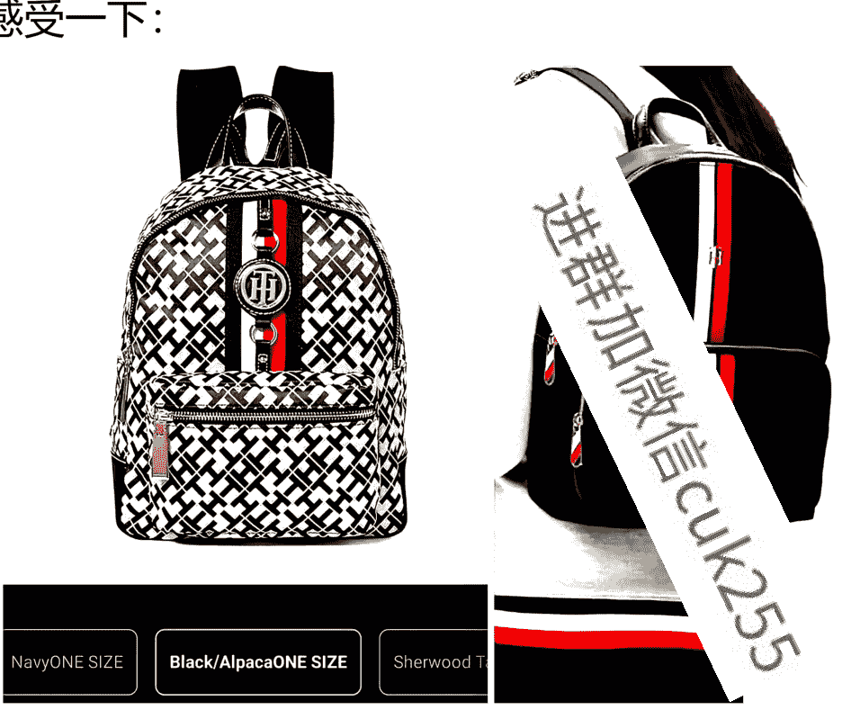

# 小众之人的5个隐藏福利

原文：U 君 公众：U君笔记 25年12月26日

无论是一件商品还是一件事，只要被贴上了“大众化”的标签，那么它就不值钱了，至少不会有值钱感。

一个人如果走的是“大众化”的赛道，那么他就会遭遇非常惨烈的内卷竞争，而且自己永远都不会有话语权。

反之，如果你选择一个“小众的人”，走一条“少有人走的路”，那么你就能收获很多隐藏福利。

今天我就跟大家列举5个“小众之人专属”的隐藏福利：

## 1.购物

我之前在公众号里说过：明白人、有钱人、不随流的人都能在二手市场淘到物美廉的东西。

我给大家举两个例子：三星智能手表，玛莎拉蒂汽车。

别人用全价买的新品，持有了两年（次数不多），然后你就能半价买过来了。

因为这类商品足够小众，认可这些品牌的用户非常少，所以如果你是个识货的人，你就可以用极低的价格淘到好货。

就拿汽车来说，假设你的购车预算是 50 万元，但是是想花最少的钱装最大的X，那么玛莎拉蒂绝对是首选。

至于奔驰、宝马、保时捷，都要往后靠，在“装X”方面的性价比较，还不及玛莎拉蒂的三分之一。

这就是小众的威力。

下面我通过“双肩包”来跟大家聊聊，怎么能花最少的钱、装最大的X。

如果你经常背着双肩包通勤，或者去旅行，那么通常会有以下几种选择：迪卡侬、瑞士军刀、耐克/阿迪、LV/Gucci......

前三个品类，偏运动，偏户外，而且都是烂大街的存在，大学生背还好，如果你想要精致一点，那么这些背包都应该避开。

我自己也买过奢侈包包，但是我觉得它们并不适合我。

一方面是因为，动辄两三万元，我背着它们过安检去旅行，弄脏了肚子都会心疼，还要小心翼翼养护。

另一方面是因为，无论何时、在任何场合背着奢侈品包包，都会让人起疑惑：ta背的包包到底是真的还是假的？

所以，双肩包必须选择价位不高、设计和质感都不错的小众品牌。这时候，就得在欧美（非奢侈品）品牌里面选择。

比如，我就买过 Kipling（比利时钟品牌）和 Tommy Hilfiger（美国品牌）的箱包。

我找两张 Tommy Hilfiger 的女士背包，大家可以感受一下：

我背的是男款的，logo和条纹更小、更简洁，价都是一千元左右。

国内很多城市的商场里都有这个品牌，不过，在国外能买到的款式比国内更多（我的很多包都是在日本或者韩国买的）。

当然，Tommy Hilfiger的衣服也很不错，价位接受，而且 logo 比较精致、小巧、小众。

我个人觉得，它比同价位的 Ralph Lauren、Hugo Boss、Calvin Klein、Lacoste 更适合我。

不过，我说的这几衣服品牌都不不错，我在公众号里也多次推荐过，至于哪个品牌的格调和 logo 更好适合你，你需要自己去店里体验。

总之呢，这些品牌不算奢侈，但是我觉得穿在身上更舒服，logo 不掉价，也不扎眼，肯定不会有人怀疑“你这件衣服是不是仿品”。

有人会说：你提到的那些包包，外形一般吧，我在路边摊花 50 元就能买到比你这个还精致、还亮的背包。

这个我相信，但是 50 元的背包，做工、走线、拉链这些比较水了，可能你拉100次的时候，拉链就坏了。

还有就是，材质、光泽、山寨logo出来的廉价感，明白一眼就看穿了。

## 2.健身

我喜欢游泳这项运动，因为它是一种相对小众的运动，费钱耗时（需要换衣服、洗澡、通勤）。

如果冬天去游泳馆的话，里面人就更少了，一个人可以占一个泳道，非常畅快。

就这样，我还觉得健身不够，专挑下午两点去游泳馆，那个时间人是最少。如果是夏天的周末，绝对不能去游泳，否则泳池里就像饺子一样，让人累。

健身也是道理，明白人都知道，最重要的肌肉都在腿：小腿前侧和后侧、臀肌。因为我的膝盖不好（正常人觉得膝盖压力太大），所以我会负重蹲、单腿臀桥、单腿抬脚等比较小的动作（有康复指导）。

我的目标不是增肌，而是让肢肌肉保持活跃，不会萎缩。我觉得健身之前，一定要先明确目的。如果你的目的是练出一身肌肉，那你需要长期去健身房。你需要客观评估自己的身体条件、兴趣、痛点，然后找到自己的小众运动，不要跟风。

## 3.择偶

无论是男人还是女人，择偶时都有一些“大众标准”：

- 男人要求女性：年轻、漂亮
- 女人要求男人：有钱、得好

但是很多人都被这些标准绑架了。你一定要清楚，每个人都是一个独立的、有个性的个体，你的标准应该跟自己。

如果你择偶时忽略了内心的“小众要求”，向“大众要求”妥协，早晚会后悔。当然，这一切的大前提是：你是一个心智成熟的人。

## 4.择业

一份事业、一份职业好不好，其实存在一些“大众标准”：

- 收入高
- 有前途
- 离家远
- 人际关系好
- 消耗能量、每天工作顺心

但是，为了多赚一些钱，自己每天加班到晚，很累，真的弥补不了自己在心理上的损失。那么问题来了，怎么才能找到既轻松、又享受、收入高的工作？答案就是：去蓝海的小众赛道。比如：

- 冷门利器
- 复古胶机
- 小众植物培育
- 小众宠物等等

纯粹你不需要成为顶尖专家，只要积累足够的经验，就能成为圈子里的意见领袖，大佬不仅能赚得盆满，还能收获认可和尊重。我现在做的运营也算是比较小众的生意了，根本就没有竞争对手，也从来感受到过内卷。

## 5.旅行

我之前说过，如果你是个男的，想在朋友圈通过“晒旅行照”来给社交价值加分，那你必须去国外旅行。在国内转遍100个城市，也不如去国外一趟，一点都不夸张。

虽然很多人说，出国也没有什么不起的，国内风景比国外强多了。但是，出国终究是一个“小众”的旅行活动，因为4亿人里面有3亿人没有出过国。所以，如果你能出国旅行，不仅能开眼界，在那些不能出国、不想出国的人眼里你就多了一层神秘色彩。

比如，昨天我看到这样篇文章：有人退了日本的机票，改去看新疆景色、滑雪了。我当时就知道，这个作者要是是个穷鬼，要在意那些没有出过的。无论是新疆还是新疆，自然风景绝对比日本的差，但是人文方面，差距就太大了，说是了一个世纪都不分。去日本旅行，永远都不担心会被坑、被骗、被套路（除非遇到个别坏人）。在日本这方面的信用值、礼仪程度，在全球能排前三名，说是第一名也不过（泰国也能排前10名）。但是印度这些方面的排名，至少得在100名之外了。

要知道，人永远都无法想象自己没有见过的场景。举个例子，我去过日本的十几个城市，每次都能让我感到感动的场景。比如，我正常在路边行走，前面有两个人在车上卸货，拦住了去，我需要等他卸完一箱货物之后，趁着问过去。然后他们见到我要通过，就停止了卸货，一致给我鞠躬道歉，让我过，把我感动的坏了。按照理，工人卸货影响到行人正常走路了，占用人时间了，道歉是天经义的。但是这意外我在前辈子没有体验过，突然间在异国他乡遇到了，我能不感动吗？类似的感人瞬间，太多太多了。不光是日本，我在英国、泰国，甚至是很多人瞧不起的菲律宾都遇到过。你觉得这种事情，新疆发生过吗？所以，如果有人跟你说：国内的大好河山都看不出来，为什么还要出国旅行呢？你就要清楚，这个个人是个没见过世面的纯傻X。

记住，在世界上无论是男人还是女人，择偶时，符合自己的感觉很舒服。

---

### 资源汇总表

| 序号 | 名称 | 内容/描述 | 价格/备注 |
| :--- | :--- | :--- | :--- |
| 1 | U君笔记 | 优质笔记分享 | 25年12月26日 |
| 2 | 小众物美 | 二手市场、三星、玛莎拉蒂 | 低价淘好货 |
| 3 | 小众包包 | Kipling, Tommy Hilfiger | 1000元左右 |
| 4 | 小众健身 | 游泳、特定负重训练 | 避开盲目跟风 |
| 5 | 小众择偶 | 独立个性、符合内心 | 避免被标准绑架 |
| 6 | 小众择业 | 蓝海领域、冷门行业 | 轻松且高收入 |
| 7 | 小众旅行 | 国外旅行、人文体验 | 拓展眼界 |
| 8 | 粉丝福利 | 运营公众号资源 | 粉丝专享 |
| 9 | 守夜人 | 星球优质资源 | 365元/年 |
| 10 | 接鸽魔王 | 知识星球/资源 | 568元/年 |
| 11 | 达沃译论 | 深度内容 | 599元/年 |
| 12 | 欧洲金雀 | 文章资源 | 328元/年 |
| 13 | 传五 | 内部资源 | 400元/年 |
| 14 | 卢克文读书会 | 星球专属文章 | 699元/年 |
| 15 | 鉴茶 | 知识星球 | 3310元/年 |
| 16 | 猫哥的视界 | 知识星球 | 299元/年 |
| 17 | 财新周 | 独家内容 | 1498元/年 |
| 18 | 杨世光 | 在金钱 | 2200元/年 |
| 19 | 森森财经 | 知识星球 | 1600元/年 |
| 20 | 源译 | 持续更新文章 | - |
| 21 | 司马林 | 解读毛选全套音频书籍 | 2.3万 |
| 22 | 虚虚三部曲 | 民国梦、帝国扩张等 | 599元/年 |
| 23 | 卢克文 | 知识星球文章 | 268元/年 |
| 24 | 额外赠送 | 卢阡、斯特西边老王、三花九等 | - |

