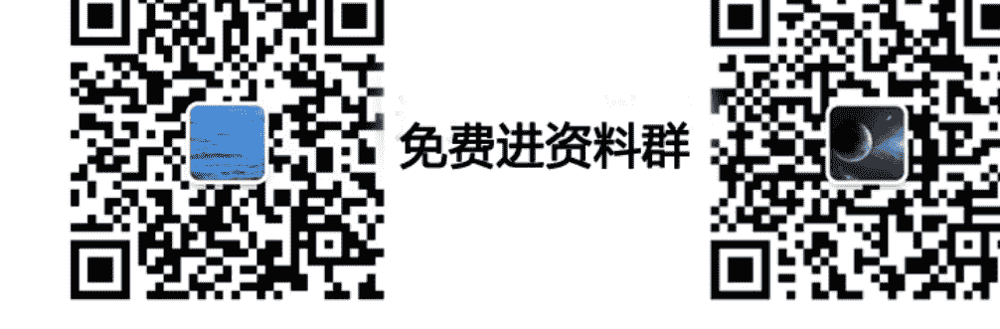
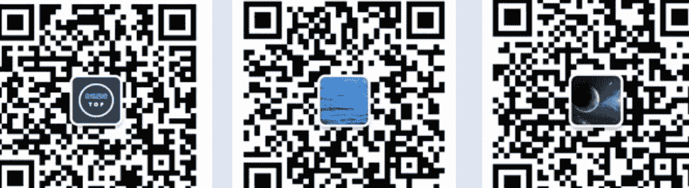

# 富人最大的资产是穷人

本文是 2025 年 1 月 24 日公众号 (U 君笔记) 的付费文章。

如果你去过其他的发达国家，你应该发现一个很有意思的现象：过了晚上 10 点，你想点外卖就很难了。

如果你非要点点，也能点到，就是选择非常少，配送费可能非常贵。

白天的话，单单外卖的配送费可能要三四十人民币，晚上可能直接翻倍，甚至几倍（还有额外的服务费）。

为什么这样？

原因很简单，无论是欧美还是日韩，只要它是发达国家，那么穷人的比例还是很小的，中产的比例很大。

说白了，愿意牺牲自己的睡眠时间和和家人的时间，然后辛辛苦苦去赚钱的人比较稀。

为什么印度这样愿意拿低工资，后半夜都可以不休息的人那么多呢？

加微信信号jntsg2，免费进资料群

一方面是因为人均资源少，另一方面是因为，有人能从这种收入结构中受益。

我记得有个诺贝尔奖获得者说过这样一句话：富人最大的资产是穷人。

而且，越是在富贫差距大的国家，这种现象越严重。

比如，你只需要花 5 元钱的跑腿费，就能让外卖哥在深夜冒大雨来为你配送外卖。

你只需要花费 20 元的车费，就能让一个司机远道而来，把你送到你要去的地方。

这在发达国家是不敢想象的。

但是，如果人均收入大大提高了，扫街、外卖、开网约车都能轻松月入过万，甚至到达两万、三万，那么他们在提供服务时也会变得很挑剔。

这时候，损失最大的其实是富人，他们再无法廉价的、便捷的人力服务了，而是需要付出高昂的代价。

最后你会发现，富人最大的资产就是穷人，而且让他们穷人一直下去，想尽一切办法阻止他们原始资本的积累。

加微信jntsg2，免费资料群

## 什么叫“原始资本”呢?

就是说，当你手里的存款和优质资产达到了一定金额之后，就不用再参加任何的社会劳动了。

这时候，你不需要卖自己的时间和体力去获取报酬，只靠资本产生的自动收入或者半自动收入就可以养活自己。

只要你完成了原始资本的积累，那么你就实现了最低限度的“财务自由”。

大家不要误会，这里说的财富自由，并不是像网上说的那样的，需要三五千万、两个亿才算。

在很多情况下，只要你手里有 100 万元的存款，就已经相当于拥有了“原始资本”，完成了最低限度的财富自由。

这时候，你可以选择回家躺平，也可以在城市里做一些轻松的工作，或者在网上做自媒体、拍视频。

我之前就说过一个案例，人在油管和 B 站上更新这种视频：《100 万元躺平的 xx 天》，每天更新一期，围观的还是挺多的。

加微信jntsg2，免费资料群

B 站的收益大概，每 10 万播放有 50 元人民币的收入，油管的收益大概，每 10 万播放有 500 美元的收入。

所以，这个人之所以能靠 100 万元躺平，可不仅只是吃利息，而是他还搞了一些其他收入途径。

但是，他的工作肯定非常清闲、自在，再也不用去朝九晚五上班了，也不用送外卖、开网约车了。

这恰恰富人最不愿意看到的，因为要是所有人都有了被动收入，那就没有人再去努力工作了呀。

那马路谁来打扫？工地谁去拆砖？公司谁来加班？外卖谁来送？

这时候，富人拥有再多的财富，也没有任何意义了。

所以，资本和富人会想尽一切办法阻止他人完成原始资本的积累。

U 君总结，他们主要有 3 大杀器来完成这件事。

穷人如果看不清局势，很容易就被这 3 大杀器彻底落在马下，永远无法完成原始资本的积累，这辈子只能做富人的牛马。

### 1. 富人养了很多“吸金兽”

很多人之所以常年不下钱，一直在徘徊，并不是他的赚钱不行，而是当他积累一点钱后，就会有一些“吸金兽”把他的钱吸走，让他无法实现财富自由。

比如，当你手里有 5000 元的时候，鼓励你去喝咖啡、买衣服、化妆品、追星、买演唱会；

当你手里有 10 万元的时候，资本和媒体不断向你灌输钱的重要性，房子才是成功的象征；

当你手里有 30 万元的时候，有人告诉你可以买一套房子，男人没有房子就不算独立……

那么问题来了，把存款换成车、房子，这样就会变得幸福了吗？

如果在年前，房价不高的时候，房子可能是一项吸金兽。

加微信jntsg2，免费资料群

车也是如此，99% 的汽车，买到家里就开始值了，第二天卖掉还要打折、保养、保险、停车费。

所以如果你是月薪几千块的人，千万不要被他们蛊惑，他们包装出来的看起来是资产，实际上是负债。

所以你必须学会存钱，不要觉得自己工资低没有存钱的必要。

哪怕每个月存 1000 元，存钱不能让你短时间内拥有被动收入，但可以让的人生拥有更多的选择。

一个年轻人完全不需要为生计奔波，专心研究自己热爱的事情，未来翻盘的可能性是大的。

当你手里一旦三十万存款，你的目光就会变得长远，看待事物也会更透彻，这时做出决定更加英明。

有人会说，买房在哪里？加微信jntsg2，免费资料群

我想说，“结婚并且做一辈子牛马，孩子将来也做一辈子牛马”和“不婚不做牛马”你怎么选？

另外，人与人的差异很大，在 25-35 岁之间，如果一个人天天忙碌，那么他概率无法翻身。

但是，如果不再为了小钱而奔波，反而有空闲时间去思考、学习和成长，那么会有概率逆袭，实现上面说的“财务自由”。

### 2. 富人发明了很多“奶头乐”

大家都，个税起征点是 5000 元，那么低于起征点的人就不纳税了吗？并不是，他们买的每一件商品都是含税的。烟酒茶糖，水电气都是含税的。

除此之外，还有一个重要的税种，就是智商税。比如，30 元一杯的咖啡，1000 元一件的衣服，2000 元一张的演唱会门票。我想多说一句，短视频、电视剧、游戏、明星经济，其实是针对穷设计的奶头乐。

他们在现实生活中无法获得成就感，就通过刷短视频、看剧、游戏充值、追星来获得一点虚无的满足。最后，自己的闲时间全部消耗掉了，根本无暇思考和成长。

只要收入稍微高一点的人，肯定不会花大钱去看什么明星演唱会、买他们的周边产品。上面这些奶头乐对穷人最大的伤害不仅仅是钱包，而是脑子。这就引出了下一个话题：

### 3. 扰乱你的视听，封印你的智慧，让你无法觉醒

穷父母给孩子灌输的思想，以及穷孩子在学校里接受的教育，基本都是阻碍他挣钱和获得幸福的东西。父母让你懂事、听话，学校让你努力奉献，网上报道的所有新闻，这些东西都在努力干扰你的视听，封印你的智慧，让你一辈子都无法觉醒。

微信:jntsg8
微信:jntsg8
免费资料群

总之呢，如果你接受的是“主流价值观”，那么你的结局就是牛马工人、外卖骑手、网约司机。

一过 40 岁，男的就去做保安，女的就去做保姆。月薪大概率在 3000-6000 元之间徘徊。如果还背上了房贷、车贷，那么一辈子都不敢松懈。

那么问题过来了，如何培养自己的“非主流价值观”呢？

一方面，要多听不同的声音。只要一个人跟你聊天时，你发现他脑里的价值观都是主流价值观，你一定要远离他，否则他身上的穷气息会传染到你。

反之，如果发生了一件轰动全国的新闻（比如日本排废水、明星在东南亚被绑架），全国都在声讨，这时候有人发出了不同的声音，那你一定要认真倾听。

因为真理始终掌握在少数手里，几乎所有的轰动性新闻，最终会被反转。

另一方面，要重新审视所有的价值观和信息流。加微信jntsg2，免费资料群

比，你要努力回忆时候父母和老师灌输的那些观点，他们到底是让你的人生更加轻松，还是更加辛苦的？

比如，上面鼓励、提倡的事情，你也要思考：如果真的对我有利，可能能够得到我吗？

如果你不出去，也可以多看看那些有些成果的人，他们是如何看待万事物的，你也跟着学习一下。

| 免费 | 价值 | 及时 | 专注 |
| :--- | :--- | :--- | :--- |

# 扫码加入 知识星球 免费资源群

- 每日免费获取有价值资源
- 提供各类资源搜索服务

| 热门付费文章 | 各行各业报告 |
| 精选图书资源 | 副业赚钱方法 |
| 职场实用资源 | AI政经自媒体 |

公号：知识星球TOP   微信信号：jntsg8   微信信号：jntsg2

分享资料仅供个人学习，请及时删除，请勿商用传播 加微信信号jntsg2，免费进资料群
