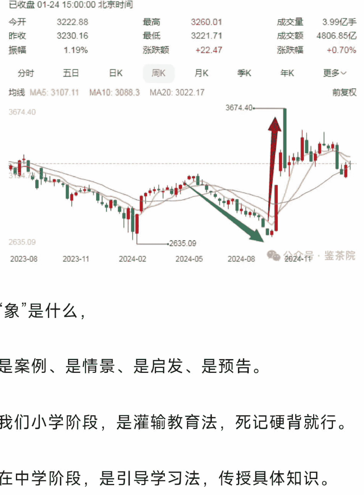
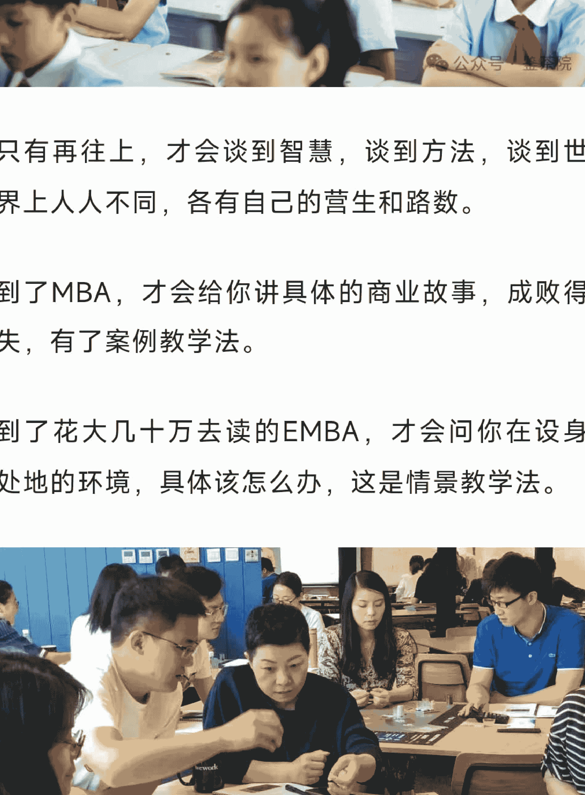
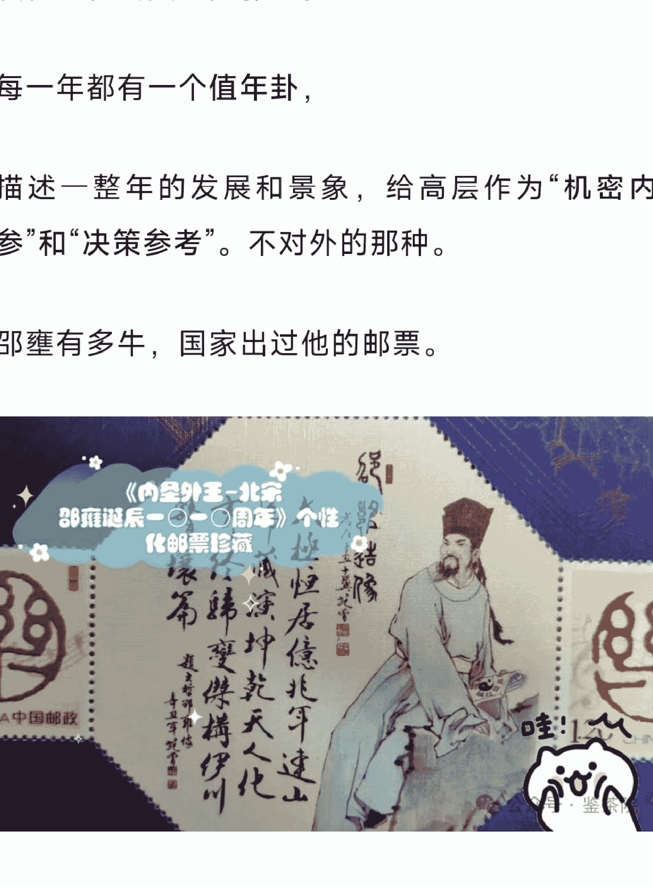
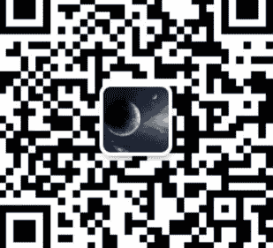
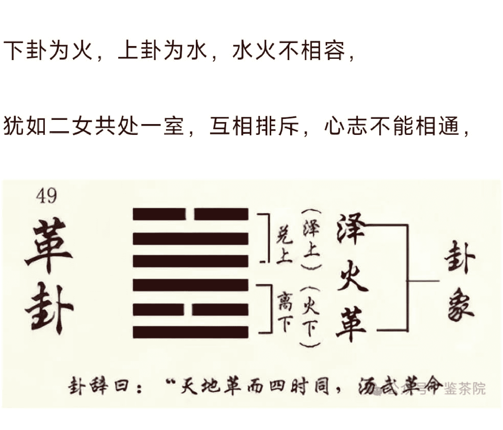
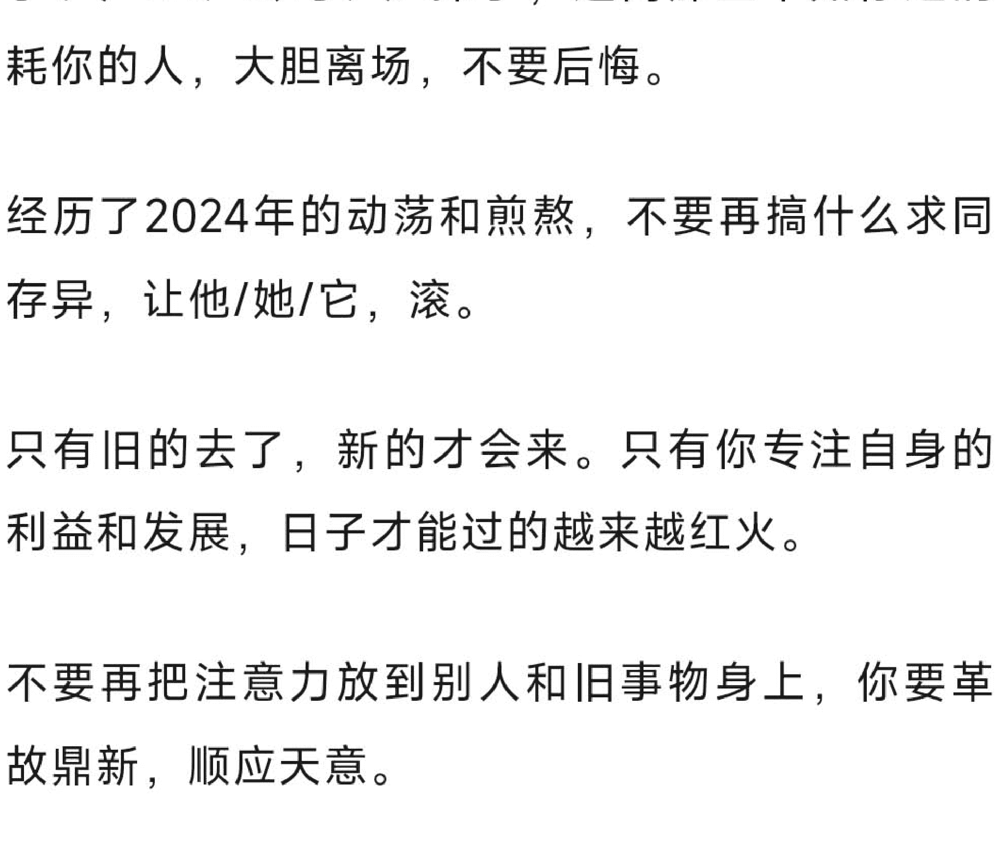
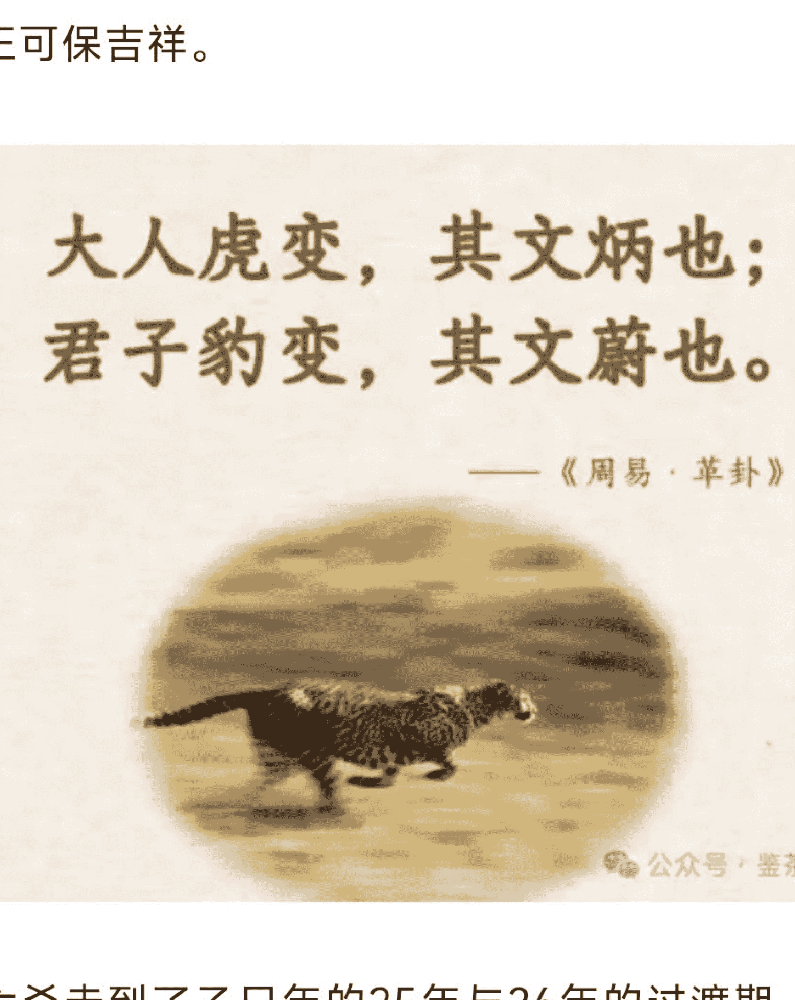

# 龙演义，2025年解谜

原创 南南大夫 蚕振 2025年01月27日 06:47 江苏

## 01

2024年是龙年，很多人的状态非常不舒适。
焦虑、专注、压抑，各种起伏波动。

因为龙年是农历甲寅年，这个“象”就是太木克土，意味着巨大的动荡。

从暴市视角一下，

年中，杀人心的跌魄，9月，快如闪电的拉升。

“象”是什么，

是案例、是情景、是启发、是预告。

我们小学阶段，是灌输教育，死记硬背就行。
在中中学阶段，是引导学习方法，传授基础知识。
到了大学，是专业的学习法，教你培养技能。

以上，都是知道的阶段，是标准靠的。

只有再往上，才会讲到境界，谈论方法，谈论恋爱
人世上，有自己的生意和路数。

到了MBA，才会给你讲具体的商业故事，成功得失，
有了实战案例的教学法。

MBA的境界不是本科，这叫，高端就是玄。
案例和情景就是，是对应的智慧而非标准的靠，精妙就是玄之门。

玄之又玄，妙之妙。

信仰，是毫无无备的脑子去上上帝和神仙；科学，是用工具和模型，去解答未来和未知问题。

宇宙的规律、规律、思考、底层的模型的模型你就是（是《易经》）。

春秋的校长之所以源于自身的“自强不息”，厚厚的撰写了一本《皇经世书》，用详细阐述预测未来对社会会有影响的事。

每年都有一个价值的哲，报告一年的发展和愿景，高层作为“机密参与”和“决策参考”。不对外的那种。

那些有名的，国家出过过的报告。

以下文字，将详细解析2025年运势在全年到底的意义。

对我们生活、事业、投资、股市等方面，社会的、投资的主题，赚钱的方向，
以及我们对应对的策略。

这就定义了运势，趋吉避凶，勇于择机的一年。
为了避免不必要的干扰和麻烦，文章这里做收费模式，看到自己的福，不想也不差是，随缘、珍惜、不强求。

## 价值 及时 专注

## 扫码加入 知识星球TOP 免费资源群

- 每日免费获取价值资源
- 可提供各类资源搜索服务

| 热门付费文章 | 各行行业报告 |
| :--- | :--- |
| 精选图书资源 | 副业赚钱方法 |
| 职场实用资源 | AI政经自媒体 |

公号:知识星球TOP 微信信号:jntsg8 微信信号:jntsg22

分享资料仅供个人学习，请及时删除。

## 02

2025年的运势咎，是“革咎”，“是变革的革，变革的革。都是“革”。

今年发生的事情，将决定未来十年的走向。各位，从国家到个人，从产业到现实，已经到了，这就是革咎。

总体怎么说呢？“革，其日乃兮，元亨，利贞”。在转换的日子里，用变革获取民众的信任，前途有利，让大家得到收益和获得，悔恨自然就会消失。为什么要变革，因为这个，是“洛火”。

下革为火，上革为水，水火不容，正如二者，互相排斥。

这时，你再要求什么共同语言，无异。既然说服了，就不算了，既然不许。

2025年，请放弃那些地区、产业、圈，远离那些消耗你的，大消耗。已经经历了十年的动荡和历程，不要再打算寻求什么，让它，它。

只有旧掉了，新的才会来。只有专注于自己的利益和发展，日子才能越红火。不要再把注意力放到旧事物身上，若革，则顺应天意。

## 03

年度具有的变化意向，按照爻卦的解释，初九：闲用黄牛。

象曰：闲用黄牛，不可以有咎。束缚要驾着车，会有大作用。初九为变卦的第一爻，对应的是2025年二月的积累。这是变化的初级阶段，若不能动，具体变化不需要太忙碌，大家要多准备，不要操作，最好观望时机。

此为卦来说，时间正处于业务、规划的空闲期，不宜进，因为方向尚未未定。在明年筹备的推动中，基础设施为关键，AI语言、数据库内核等趋势，上位。六二：巳日吉，有无吉。象曰：巳日吉，行有吉。

六三是巳日的一步，在2025年4月-5月，又开了，目标到位了，要开始起来（按照爻卦的演绎），会有可能，但不影响大。此时已成戏，若是进行变更，没有你应该，变爻将会获得收获和赞美。六四：时，收集很多的策略、政策，在这个段时间内，人们要积累应运机会，会有大收获。预期在这个段时间内，结构性的第三或是第四阶段开始狂变。

六九：三日无戒，三爻其吉。象曰：三言无吝，又吉之！急于求会有危险，至少这样做就会遇到危险的局面，要坚持调整，这样会有意见。

## 04

这个每天运行的规律，对我们会有很多的启示吗？

第一，你的体感比去年要多很多，类是起大落，反复常态。经营年，木生生的关系，我们要多争取更多机会，不要限制了自己。

第三，24年，是遇到龟，收获收敛，25年要聚起散，胜于积累。

第二，以名为“筹码”，意味着出去，走也意味着转型、寻找出口，生活更加动态和焦虑，会有新的发现、事以及新的。你要做的，都是准备好了吗。

经历了23年的积累，24年的付出，你内心的要把和要做的事，就在25年大成，25年、26年大成，越走越来越远。

第五，离大的24年，从25年开始发射，代表的你，能够发光，帮助他人带来价值的领域，迎来长足的发展。科技人才，人工智能、互联网、消费、医疗、医咨询等，会迎来全新的发展领域。

无论是机器人、机器、还是人的体验的量观念和说，这还有很长剧目。我们入了这个星球，口袋里有2025年计划书》、《上半年复盘和规划等》，也会有各种转型的节点，共同面对。

如果你还不抓住，其中的宏观趋势、职业机会、实力，你还需要平时多加运动、提升修养的努力，抓住就是财富的机遇。

第四，离是“高潮”。代表你实干直到却没有收获，你要学会学生，学会语言事。

蛇、寅、鼠、属龙的年，会有“财运”，是木生旺的木，可以通过这种方法获得财富一下，下个春天会有好运的，自己的感知会一下，要多学会花费、交通同等问题。

然而，时代的潮流仍然没有，分化趋势越活跃的宇宙环境，会影响人们内心的变的焦虑、不安、安全、环境和变迁、梦想以及我们机会，仍然的是被忽视所错过。

总之总一句：

2025年，是大变化的变革年，也是辞旧迎新的一年。

勇敢和旧旧再见，和旧事彻底切割，即便准备好把握不确定，要把你内心的想法和自己的才能、勇气，主动拿出来，做事、变现，创造价值。

自助，不断的努力，勇奔跑，不要奢侈。

蛇年即将到来，
你原本
已成章，
如光远行！

微信jntg2，免费运营资料分享
