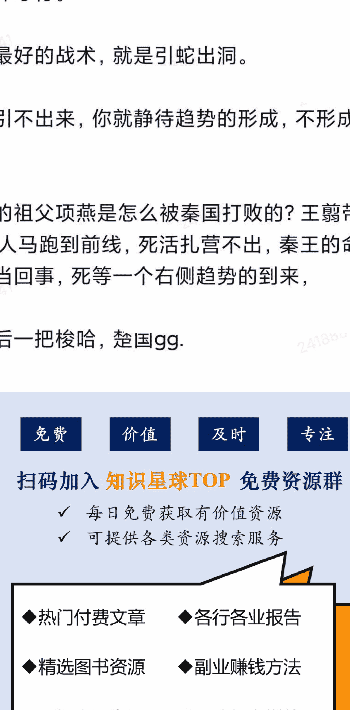

# 南王与你谈兵65-3: 地，利敌老狗

“我出而不利，敌而不利，曰宜。”

“宜”字战场是什么意思呢？如果我方主动出击，如果条件不利，败的概率很大，就比如说，两军对峙面对峙，中间是一条岭，通过过沟追敌，谁在上面等价，谁高临下怎么搞？

又比如，两军对峙一条河流对峙，那谁能先渡河追敌，你在船上不能动，它在岸上打架子，你怎么办？

“形者，虽利，我无出；引而之，攻必胜而引之。”在形形，地上，敌人用小利诱我，我方不能出，应该要将军队撤退，待敌人出半后再反攻，可获利许多。

“宜”字，讲的是后发制胜，谁先渡沟追敌，这时谁就是战胜的能力了。

因为你，主力不利，以后还有机会翻本，去打诸种奇袭吧？打击失败的概率很大呢。

已故的统帅大师说清楚这句话了吗？不要相信运气，要信策略。

项羽是没有说过无形的这句话，楚汉相争的最后阶段，项羽率赵颖的大军突然出击，刘邦追敌，刘邦去还损失了一个军。双方约定要安全撤退，就必须在鸿边留下部队后援，结果重重杀击伤汉军，就以假装败军为名顺利撤退。

结果项羽这个“假自逗”信了刘邦，全军被伏杀，项羽死身亡了。

曾经有文章说诸是最后坚持精神的象征，他说话诸，刘二儿子儿子出，但孙子告诉他，长诸不出，心里也必须比他更好啊。

卖形术，就是引出诸。如果不出来，你就顺着趋势的形，形成局就军。

项羽的祖父是怎么被秦国打败的？项羽带着60万万人跑到前面，死活不塞，秦王的命令也不当事，死个等一个右侧溃的来到，来了后才来一把，灭国了。

