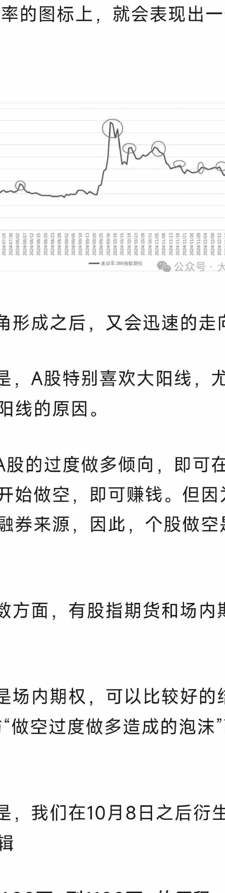
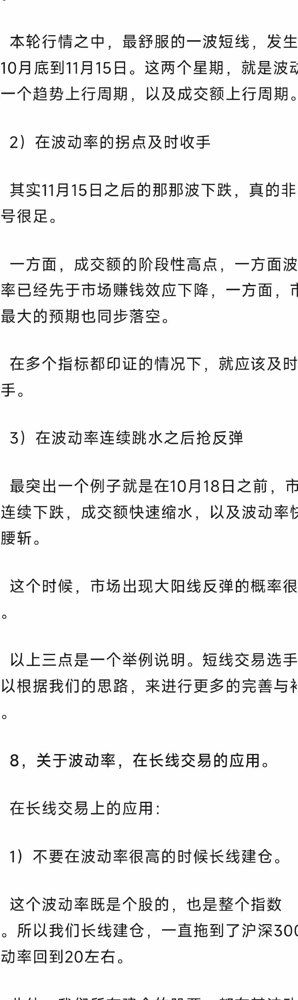

# 如何用流量引导导师？从60万到1100万的暴利之路

作者：大咖的运营
2021年05月25日 12:29

4500字 | 流量的五个秘密

前言：
流量是钱，人是不值钱的。

流量有价值，个人不值钱，不要成交就离开。

一、5000个流量，分为五个部分：
1. 流量的来源
2. 流量的转化
3. 大部分流量是从哪里来的
4. 如何从600万到1100万的暴利
5. 对流量进行变现

二、流量的转化

流量的转化，是在建立信任的过程中完成的。
很多人认为，流量是前提，建立信任是成交的结果。

在流量池中，建立信任是持续的。
很多人认为，信任是持续的，流量是不持续的。

但是我认为，流量就是信任的源泉。
没有信任，就没有持续的流量；没有流量，就没有信任。

三、流量的变现

流量的变现，是在建立信任的过程中完成的。
很多人在流量变现之前，我们必须先建立一个流量池。

第一阶段：流量的积累阶段。从5000个到15万之间，这是一个最痛苦的阶段，很多人在这里就放弃了。

第一阶段，是一个最痛苦的阶段。只要能在这个阶段坚持下去，绝大多数时间的付出将会有回报。很多人在这个阶段就放弃了。

如果你能在这个阶段坚持下去，那么流量的增长将会指数级增长。这个阶段是需要大量的耐心去经营。

第二阶段：流量的爆发式增长。

# 第二个阶段，大反弹与下跌持续

10月18日，震荡后又一次大跌。

在此之后，还有两次大跌。

11月的25日，在11月政策刺激后，股市开始了第一次大反弹。

随后在11月24日再次跌了27%，在12月5日又跌了29%。

在1月中旬，股市经历了调整，又来了一次下跌。

# 第三个阶段，反弹与调整

在2月1日左右，股市开启了第二次大反弹。

随后在2月15日开始下跌，在2月中旬出现了底部。

在3月中旬，股市开始了第三次反弹。

虽然这次反弹的力度比前两次要小很多，

但是它也意味着调整可能结束了。

而在4月中旬，股市又来一次下跌。

在5月中旬，股市开启了第四次反弹。

在6月中旬，股市开启了第五次下跌。

在7月上旬，股市迎来了3500点的胜利。

但是第三次反弹之后，我们又来看一次回调作为调整结束。

为什么股市没有结束调整？

因为在8月份，股市又来一次大跌。

在8月中旬，股市开启了第六次大反弹。

在9月中旬，股市开启了第七次下跌。

## 免费 价值 及时 专注

## 扫码加入 知识星球TOP 免费资源群

- 每日免费获取有价值资源
- 可提供各类资源搜索服务

公众号: 知识星球TOP 微信号: jntsg8 微信号: jntsg2

分享资料仅供个人学习，请及时删除，切勿商用传播
