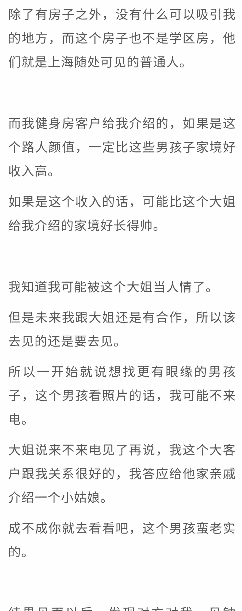
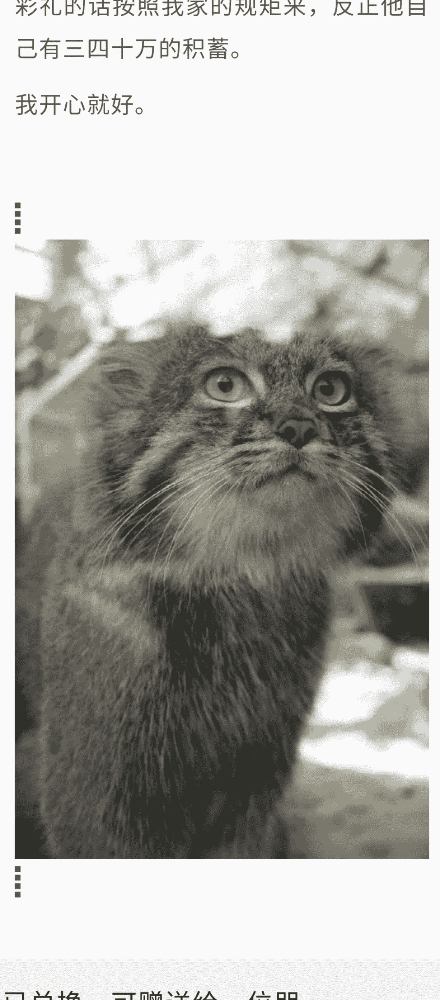
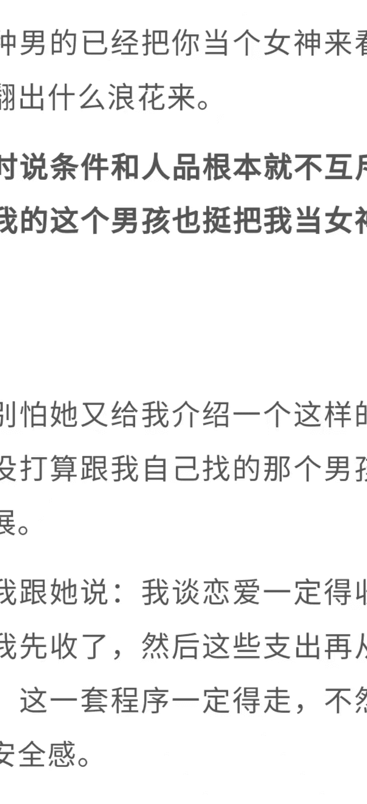

## 第一，我被老婆骗进了一个很难的局

前言

从错开始，一切都可以后悔。

成为我的读者可以看到：
关注下方作者《墨婚骗人渣》点击我的主页查看更多精彩内容！

故事是这样的。

大家可以想象一下，如果你有一个妻子是女神级的，她又是温柔的妻子，她总能给你一个惊喜的家。

我有一个妻子，外表是个女神，我们两个很珍惜她经营的公司。

我有一个五年的妻子，我很少和她交流。直到年前，我才知道了这件事。

一个年前，我发现我的老婆其实是个男人，然后，我发现她还有一个私孩子，我问她时候，她告诉我，这只是骗了一个孩子。

直到那天，我掉进了一个很难的局。

我发现我相处多年的老婆，其实是个男人，这怎么可能？

我可能被老婆骗了这么多年？

说实话现在的心情一直是在低落，很难受。

但是这个男朋友对我真的很好，我怕以后以后还有谁能这样对我好我呢？

我开始后悔的不是失去他，而是以后不会遇到这么对我好的人。

反正还是觉得没错，毕竟上我是没错的，后悔了什么意义呢？一个也没有好处。

其实我当初不分手就更好了，因为他对我真的很好，以后我遇到别人，谁还会对我这么好呢？

我男朋友花钱的时候真的很大方，我感觉以后很难遇到这么好的人了。

以后我会遇到一个比我男朋友的人，我再也不用担心比他差的人了，但是我真的真的怕遇到更渣的人了，毕竟我男朋友真的是对我最好的了。

我也在考虑分手是不是一个正确的选择了，以后遇到一个比他有钱的人，我……以后遇到一个比他帅的人，我……我可能还是会选择他。

但是我真的好纠结，我并不是想拜有钱的人，因为我男朋友已经比我有钱了，我只是想找个帅的。

我真的太自私了，我真的不该这么离开我男朋友了，我真的好想回他身边，我真的好想他了，但我已经把他推远了。

男朋友是我最喜欢的也是一样工作的，工厂的收入比我高很多，而且他帅是个老实人，所以我最后还是选择他他的原因是：我没有其他的男朋友了，他比我好，他比我帅，性格也比……而且比我爱你，这就是我选择他。

看着他朋友圈的照片我知道他过得很好，可能他有了新的女朋友。我男朋友的类型应该是像他这样的。

如果他找到新的女朋友了，我真的好想去挽他，但我已经没有机会了。

我真的好后悔了，我真的好后悔分手了，我真的好想复合他，我真的好想他了。

我真的做不到，我真的做不到……（重复省略）

但是现在我男朋友已经开始在找女朋友了，我真的好受。我真的好难受，我真的好难受，我真的好难受。

我在回想一下。介绍他人的几种方法。

我做过很多尝试，把自己变成别人的样子，结果发现这样做的人并不会太好，我自己也不喜欢这样做的人了。后来我才发现这样做错了一点，我后悔了我在当时的情绪，后悔不已。

现在的我已经学会了去失去。当我学会了失去，我就会学会去接受一切。

另外一个尝试是学会去失去。
