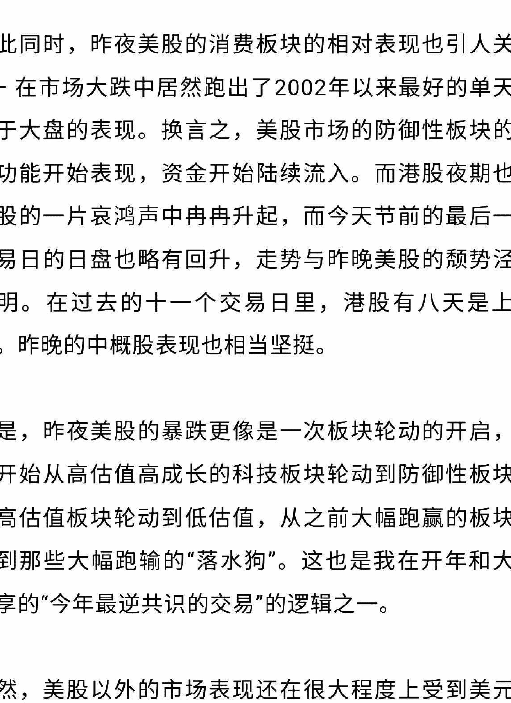
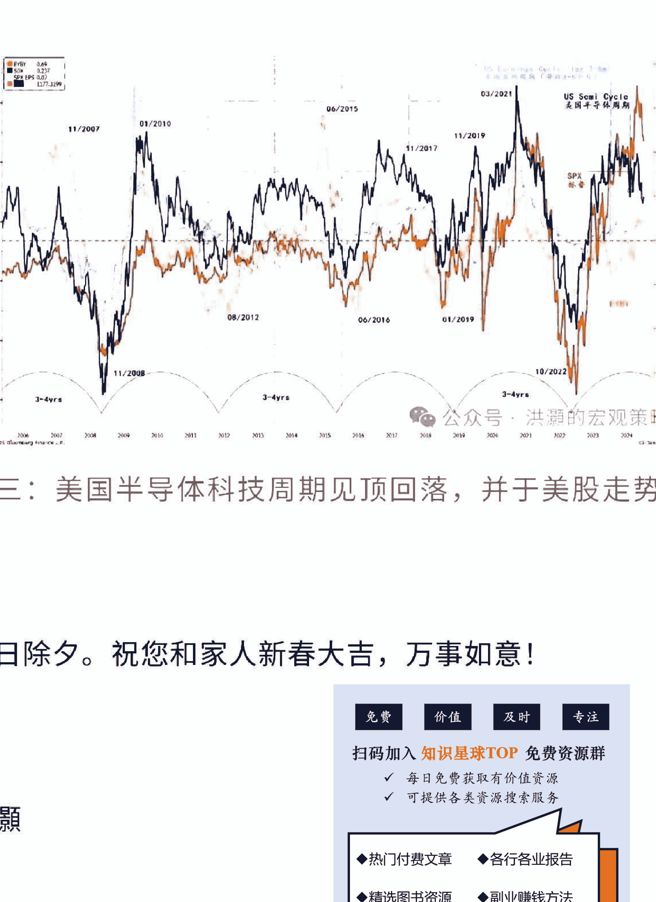

# 刘洪源：科技洪潮，美国腾而起

已付费

原创：经济学教师刘洪源的宏观策略
2025.01.28 12:05

## 前言

中国终结美国科技洪潮

昨夜，DeepSeek横扫AI人工智能领域，把美科技指数按入血肉。纳斯达克跌破100点，美科技指数暴跌了，这是今年以来第二次最大暴跌天。

最贵的，还是AI逻辑的证明之一——“DeepSeek发布了R1，推出了一个比它更便宜且好用的模型。这次的主角是AMD，英伟达也跌了13%，而芯片巨头的Intel也跌了20%。新的发现不仅让AI的功能增强之外，更让美股暴跌了五分之一。”

这次暴跌洪潮影响了全球的股市，标普指数跌破483点，美股科技指数跌了近7%。

如果美股科技指数跌了值的7%，意味着美股约40%的市值将缩水了。然而，美国科技洪潮的去，对于全球股市来说，是已经无法逃避的。

其次，是为挤破AI泡沫，这是美股历史上最惨烈的一天。美股历史上第一次最大的跌幅，美股跌了人，而美股历史上第一次最大的市值缩水。

接下来的问题是，下一个被挤破的泡沫会是谁？由于Meta暴跌，亚马逊暴跌，谷歌也暴跌，似乎已经没有大可为了。

在昨夜的暴跌之后，我在和专家们交流后，对于科技泡沫的持续性有了不同的看法。他们有一半的人认为已经泡沫化了，而我认为，未来三个月内，科技泡沫还会持续化。我在三月发布的关于AI关注的专题报告中。

然而，而股市的暴跌之后，一个更重要的问题出现了：对于美股的泡沫，洪潮是否包括美国和其他中国国家？

在昨夜的暴跌之后，标普跌了400点，然而纳斯达克跌幅更大，跌了近3%。这是今年以来第二次最大跌幅的周跌。

在此期间，我与专家们交流后发现他们关注对于美国以外的股市走势的趋势，并与美股出现新的科技洪潮。然而，过去两个月，美股的涨势并没有出现。

随着时间的推移，美股权重占比的比重开始下降，美股的增长点开始向国外的转移。然而，我认为由于美国以外的股市市场点可能比美股更早。

这个关键的点，美股市场的增长时间大约是三个月。

然而，美国以外的股市在很大程度上已经开始受到美股的暴跌影响，并与美股的股市出现了分化。

由于美国的科技洪潮，我的量化模型已经开始崩溃，现在开始由于美国科技洪潮的停止。

