# DeepSeek: 从入门到精通

清华大学新闻与传播学院
新媒体研究中心
元宇宙文化实验室

@新媒沈阳 团队：余梦琉博士


## 扫码加入 知识星球TOP 免费资源群

免费

- ✓ 每日免费获取高价值资源
- ✓ 可提供各类资源搜索服务

公众号:知识星球TOP

价值


微信信号:jntsg8

| 热门付费文章 | 各行各业报告 |
| :--- | :--- |
| 精选图书资源 | 副业赚钱方法 |
| 职场实用资源 | AI与自媒体 |

及时


微信信号:jntsg2

专注


分享资料仅供个人学习，请及时删除，切勿商用传播

- Deepseek是什么？
- Deepseek能够做什么？
- 如何使用Deepseek?

## DeepSeek是什么？

- DeepSeek是一家专注通用人工智能 (AGI) 的中国科技公司，主攻大模型研发与应用。
- DeepSeek-R1是其开源的推理模型，擅长处理复杂任务且免费商用。

### 性能对齐 OpenAI-o1 正版

DeepSeek-R1在训练阶段对大规模数据使用了强化学习技术，在仅有少量标注数据的情况下，极大提升了模型推理能力，在数学、代码、自然语言推理等任务上，性能比 OpenAI o1 正式版。

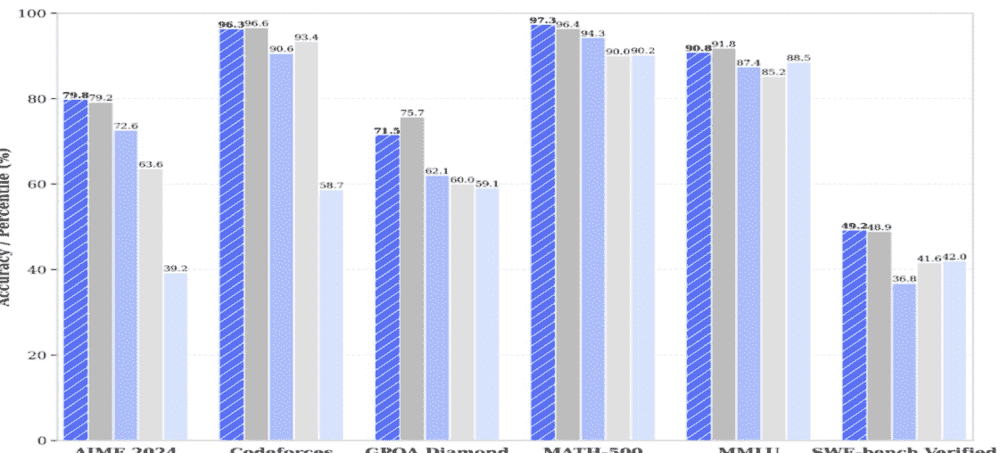

AI 国产 / 免费 / 开 / 强大

## Deepseek可以做什么？

直接面向用户或者支持开发者，提供智能对话、文本生成、语义理解、计算推理、代码补全等应用场景，支持联网搜索与深度思考模式，同时支持文件上传，能够扫描读取各类文件及图片中的文字内容。

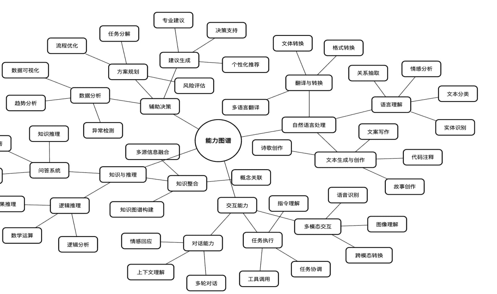

## 文本生成

### 文本创作

- 文章/故事/诗歌写作
- 营销文案、广告语生成
- 社交媒体内容（如推文、帖子）
- 剧本或对话设计

01 摘要与改写
- 长文本摘要（论文、报告）
- 文本简化（降低复杂度）
- 多语言翻译与本地化

02 结构化生成
- 表格、列表生成（如日程安排、菜谱）
- 代码注释、文档撰写

03

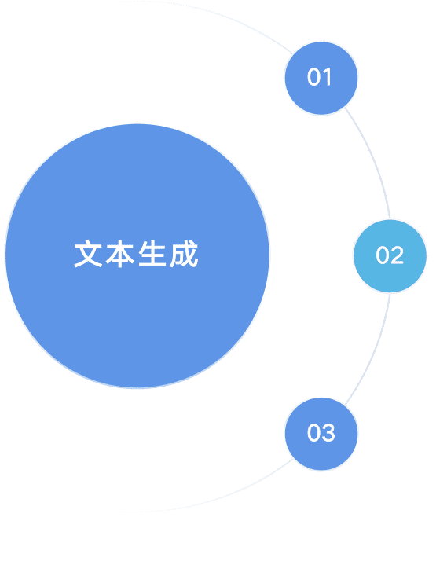

## 自然语言理解与分析

### 语义分析

- 语义解析
- 情感分析（评论、反馈）
- 意图识别（客服对话、用户查询）
- 实体提取（人名、地点、事件）


### 知识推理

- 知识推理
- 逻辑问题问答（数学、常识推理）
- 因果分析（事件关联性）

### 文本分类

- 文本分类
- 主题标签生成（如新闻分类）
- 垃圾内容检测

## 编程与代码相关


### 代码生成

- 根据需求生成代码片段（Python、JavaScript）
- 自动补全与注释生成

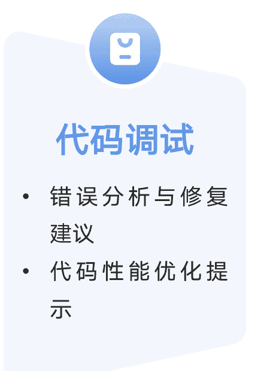

### 代码调试

- 错误分析与修复建议
- 代码性能优化提示


### 技术文档处理

- API文档生成
- 代码库解释与示例生成

## 常规绘图

### SVG矢量图
### Mermaid图表
### React图表

- 基础图形
- 图标
- 简单插图
- 流程图
- 组织架构图

- 流程图
- 时序图
- 类图
- 状态图
- 实体关系图

- 折线图
- 柱状图
- 饼图
- 散点图
- 雷达图
- 组合图

（注：此处 OCR 文本中部分内容错乱，已根据语义逻辑整理）

## 如何使用 Deepseek?

https://deepseek.com

我是 DeepSeek，很高兴见到你!我可以直接面向用户或者支持开发者，提供智能对话、文本生成、语义理解、计算推理、代码补全等应用场景，支持联网搜索与深度思考模式，同时支持文件上传，能够扫描读取各类文件及图片中的文字内容。

如果您有任何问题，我会尽力为您提供准确的答案。我的知识日期是2024年7月。

## 如何从入门到精通？

### 推理模型

推理模型：DeepSeek 是一家专注通用人工智能 (AGI) 的中国科技公司，主攻大模型研发与应用。DeepSeek-R1是其开源的推理模型，擅长处理复杂任务且免费商用。它在训练阶段对大规模数据使用了强化学习技术，在仅有少量标注数据的情况下，极大提升了模型推理能力，在数学、代码、自然语言推理等任务上，表现突出。

非推理模型：适用于大多数任务，通常通过海量文本训练，掌握语言规律并能够生成合适的内容，但强调深度推理能力。

| 维度 | 推理模型 | 通用模型 |
| :--- | :--- | :--- |
| 优势领域 | 数学推导、逻辑分析、代码生成、复杂问答 | 语言生成、创意写作、多轮对话、开放性问题 |
| 劣势领域 | 发散性任务（如诗歌创作） | 需要严格逻辑的任务（如数学证明） |
| 性能本质 | 精于逻辑密度的任务 | 擅长多样性的任务 |
| 强弱判断 | 在推理目标上显著优于通用模型 | 场景更灵活，专项任务需依赖提示 |

## 提示语策略差异

### 1 推理模型

- 提示语更简洁，只需明确任务目标和需求（因其已内化推理逻辑）。
- 无需逐步引导，模型自动生成结构化推理过程（若强行拆解步骤，反而限制其能力）。

### 2 通用模型

- 需要显式引导推理步骤（如通过CoT提示），否则可能跳过关键逻辑。
- 依赖提示语补足能力短板（如要求思考、提供示例）。

## 关键原则

- 模型选择：优先根据任务类型而非模型热度选择（如数学任务优选推理模型，创意任务优选通用模型）。
- 提示语设计：
    - 推理模型：简洁指令，聚焦目标，信任其内化能力（要什么直接说”）。
    - 通用模型：结构化、补偿性引导（缺什么补什么”）。
- 避免误区：
    - 不要对推理模型使用“启发式”提示（如角色扮演），可能干扰其逻辑主线。
    - 不要对通用模型“过度信任”（如直接提问复杂推理问题，需分步验证结果）。

## 从“下达指令”到“表达需求”

| 策略类型 | 定义与目标 | 适用场景 | 示例（推理模型适用） | 优势与风险 |
| :--- | :--- | :--- | :--- | :--- |
| 指令驱动 | 直接给出明确步骤或格式要求 | 简单任务、快速执行 | “用Python编写快速排序函数，输出包含注释。” | 结果精准高效，限制模型自主优化空间 |
| 需求导向 | 描述问题背景与目标 | 复杂问题、需推理 | “请分析当前瓶颈并提出方案。” | 激发模型深度推理，清晰定义边界 |
| 混合模式 | 结合需求描述与关键约束 | 平衡灵活性与细节 | “设计一个计划，要求预算在内。” | 兼顾目标，避免过度约束 |
| 启动式 | 通过提问引导模型主动思考 | 探索性问题 | “为什么选择这种算法？” | 触发模型自解释能力，逻辑 |

## 任务需求与提示语策略

| 任务类型 | 适用模型 | 提示语重点 | 示例（有效提示） | 避免策略 |
| :--- | :--- | :--- | :--- | :--- |
| 数学证明 | 推理模型 | 直接提问，无需分步引导 | “证明定理” | 冗余拆解 |
| 创意写作 | 通用模型 | 显式要求步骤，提供示例 | “写一个故事” | 过度逻辑化 |
| 代码生成 | 推理模型 | 简单需求，信任逻辑 | “用Python实现排序” | 模糊需求 |
| 多轮对话 | 通用模型 | 自然交互，无需额外引导 | “你认为未来怎么样？” | 强制逻辑链 |
| 逻辑分析 | 推理模型 | 明确目标，避免发散 | “解释电车难题” | 情感化提示 |

## 如何向AI表达需求

| 请求类型 | 特点 | 需求表达公式 | 推理模型适配策略 | 通用模型适配策略 |
| :--- | :--- | :--- | :--- | :--- |
| 1. 决策需求 | 权衡选项、评估风险 | 目标 + 需求 + 标准 | 要求逻辑推演和量化分析 | 直接建议，依据经验归纳 |
| 2. 分析需求 | 深度理解数据、发现模式 | 问题 + 数据 + 方法 | 触发因果链推导与假设验证 | 表层总结或分类 |
| 3. 创造性需求 | 生成新内容 | 主题 + 风格 + 约束 | 结合逻辑框架生成结构化创意 | 自由发散，依赖示例引导 |
| 4. 验证需求 | 检查逻辑、可靠性 | 结论 + 方法 + 风险点 | 自主设计路径并排查矛盾 | 简单确认，缺乏深度推演 |
| 5. 执行需求 | 完成具体操作 | 任务 + 约束 + 格式 | 自主优化步骤，兼顾效率 | 严格按指令执行，自主优化 |

## 提示示例

| 决策需求 | 实战技巧 | 分析需求 | 实战技巧 | 创造性需求 | 实战技巧 |
| :--- | :--- | :--- | :--- | :--- | :--- |
| “为降低物流成本，现有两种方案：①自建仓库；②与第三方合作。根据ROI计算模型，对比5年内的总成本并推荐最优。” | | “分析近三年新能源汽车销售数据，说明①增长趋势与政策关联；②预测2025年市占率。” | | “设计一款智能家居产品，要求：①解决独居老人安全问题；②结合传感器网络和AI预警；③提供三种路线的原型图。” | |

| 验证性需求 | 实战技巧 | 执行需求 | 实战技巧 |
| :--- | :--- | :--- | :--- |
| “以下是某结论：‘神经网络模型A优于传统方法B’。验证：①实验数据是否支持结论；②检查对照组是否存在偏差；③重新计算p值判断显著性。” | | “将以下代码转换为Python，要求：①保持不变；②优化操作；③输出完整代码。” | |

## 什么是提示语？

提示语（Prompt）是用户给AI系统的指令或信息，用于引导AI生成特定的输出。简单来说，提示语就是与AI对话时的语言，它可以是一个简单的问题，也可以是一个复杂的任务。提示语的基本结构包括指令、上下文和期望：

- 指令（Instruction）：明确告诉AI执行的任务。
- 上下文（Context）：提供背景信息，帮助它准确理解。
- 期望（Expectation）：明确对输出的要求。


## 提示语的特征

| 特征 | 描述 | 示例 |
| :--- | :--- | :--- |
| 桥梁 | 连接人类意图和AI | “将以下内容翻译为...” |
| 上下文 | 为AI提供必要的信息 | “假设你是一位历史学家” |
| 任务定义 | 指定需要完成的任务 | “写一篇关于气候的文章” |
| 输出塑造 | 影响AI输出的形式 | “用简单的语言解释” |

## 提示语类型

1. 指令型：直接告诉AI需要执行的任务。
2. 问答型：向AI提出问题，得到相应的答案。
3. 角色扮演型：要求AI扮演特定角色。
4. 创意型：引导AI进行创意写作或内容生成。
5. 分析型：要求AI对给定信息进行分析和推理。
6. 多模态型：结合文本、图像等多种形式的输入。

## 提示语设计的核心技能体系

| 核心技能 | 子项 |
| :--- | :--- |
| 问题重构 | 将复杂、模糊的人类需求转化为结构化的AI任务，识别核心要素和约束条件，设计清晰精确的。 |
| 创意引导 | 激发AI新思维，利用类比、反向思考等技巧扩展输出的可能性，巧妙结合不同领域产生创新。 |
| 结果优化 | 通过迭代调整提示语，优化输出质量，设计评估标准，量化效果，将专业知识转化为有效的提示。 |
| 跨域整合 | 利用提示语衔接不同学科和能力，创造跨领域的解决方案，设计多步骤、多维度的体系。 |

| 系统思维 | 构建提示语模板，提高效率和一致性，开发提示语策略应对复杂场景。 |
| 语境理解 | 深入分析任务背景和隐含需求，考虑文化、伦理和法律因素，预测可能的误解和边界情况。 |
| 抽象化能力 | 识别通用模式，提高提示语可用性，设计灵活、可扩展的模板，创建适应场景的元提示语。 |
| 批判性思维 | 客观评估输出，识别偏差和错误，设计事实提示语测试AI深度，构建验证机制确保可靠性，探索非常规提示方法。 |
| 创新思维 | 结合最新AI研究成果，拓展应用边界，设计实验性提示语推动能力进化，在提示语中引入伦理考量。 |
| 伦理意识 | 设计公平、包容的交互机制，预防和缓解AI带来的负面影响。 |


## 提示语的DNA: 解构强大提示语的基本元素

提示语的基本元素分类

提示语的基本元素可以根据其功能和作用分为三个大类：信息类元素、结构类元素和控制类元素：

信息类元素决定了AI在生成过程中需要处理的具体内容，包括主题、背景、数据等，为AI提供了必要的知识和上下文。

提示语基本元素分类体系

| 信息类元素 | 结构类元素 | 控制类元素 |
| --- | --- | --- |
| 主题元素 | 格式元素 | 任务控制元素 |
| 背景元素 | 结构元素 | 质量控制元素 |
| 数据元素 | 风格元素 | 约束条件元素 |
| 知识元素 | 长度元素 | 迭代指令元素 |
| 参考元素 | 可视化元素 | 输出验证元素 |

结构类元素用于定义生成内容的组织形式和呈现方式，决定了AI输出的结构、格式和风格。

控制类元素用于管理和引导AIAI的生成过程，确保输出符合预期并能够进行必要的调整，是实现高级提示语工程的重要工具。

## 提示语的DNA:解构强化提示语的基本元素

提示语元素组合矩阵

表2-1-1 提示语元素组合矩阵

| 目标 | 主要元素组合 | 次要元素组合 | 组合效果 |
| --- | --- | --- | --- |
| 提高输出准确性 | 主题元素 + 数据元素 + 质量控制元素 | 知识元素 + 验证元素 | 确保基于准确的主题和数据生成内容，并通过严格的质量控制和验证达到标准 |
| 增强创造性 | 主题元素 + 背景元素 + 约束条件元素 | 参考元素 + 替代指令元素 | 通过丰富的背景信息和适度的约束，激发AI的创造性思维，同时通过多轮促进创新 |
| 优化任务执行效率 | 任务指令元素 + 结构元素 + 格式元素 | 长度元素 + 格式元素 | 通过清晰的任务指令和定义的结构提高执行效率，同时输出特定的格式标准 |
| 提升输出一致性 | 风格元素 + 知识元素 + 约束元素 | 格式元素 + 质量控制元素 | 通过统一的风格和专业领域确保输出的一致性，同时使用约束和质量控制标准 |
| 增强交互体验 | 替代指令元素 + 输出元素 + 质量控制元素 | 任务指令元素 + 背景元素 | 建立动态的交互，允许AI自我强化和优化，同时根据任务和背景灵活调整 |

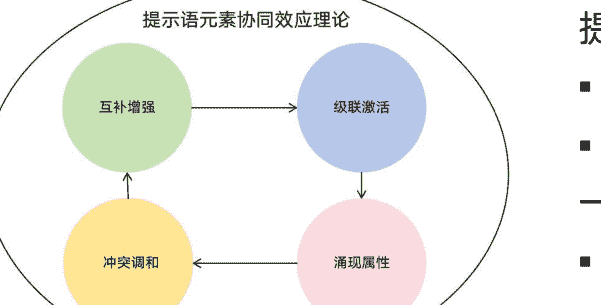

- 提示语元素协同效应理论的核心要点：
- **互补增强**：某些元素组合可以互优为补，产生1+1>2的效果。
- **层级激活**：一个元素的激活可能引发一系列相关元素的连锁反应，形成一个自我强化的正反馈循环。
- **冲突和调和**：某些相似的元素组合可能产生意想不到的积极效果。
- **涌现属性**：某些元素组合可能产生单个元素所不具备的新特性。

## 调教AI的秘籍：让你的提示语效果倍增的关键策略

策略一：精准定义任务，减少模糊性

如何实现精准定义：明确的核心问题、具体化的生成指令、去除多余信息

策略二：适当分解复杂任务，降低AI认知负荷

分解任务的技巧：分段生成、逐层深入、设置逻辑结构

策略三：引入引导性问题，提升生成内容的深度

引导性问题的设计要点：设置多个层次的问题、促使AI对比或论证、引导思维的多样性

策略四：控制提示语长度，确保生成的准确性

控制提示语长度的技巧：避免套用复杂的指令、保持简洁性、使用分步提示

策略五：灵活运用开放式提示与封闭式提示

开放式提示：提出开放性问题，允许AI根据多个角度进行生成
封闭式提示：提出具体问题或设定明确限制，要求AI给出精准回答

## 常见陷阱与应对：新手必知的提示语设计误区

缺乏迭代陷阱：期待一次性完美结果

+ 陷阱症状：
- 重复复杂的初始提示语
- 对初始输出结果不满意就放弃
- 缺乏对AI输出的分析和反馈

+ 应对策略：
- 采用增量方法：从基础提示语开始，逐步添加细节和要求。
- 主动寻求反馈：要求AI对其输出进行自我评估，并提供改进建议。
- 准备多轮对话：设计一系列后续问题，用于澄清和改进初始输出。

过度指指令和模糊陷阱：当细节淹没重点或意图不明确

+ 陷阱症状：
- 提示语异常冗长或过于简洁
- AI输出与期望严重不符
- 频繁需要澄清或重新解释需求

+ 应对策略：
- 平衡细节度：提供足够的上下文，但避免过多限制。
- 明确关键词：突出最最重要的2-3个要求。
- 使用结构化格式：采用清晰的结构来组织需求。
- 提供示例：如果可能，给出期望输出的简短示例。

## 常见陷阱与应对：新手必知的提示语设计误区

假设偏差陷阱：当AI告诉你你想听的 幻觉生成陷阱：当AI自信地胡说八道

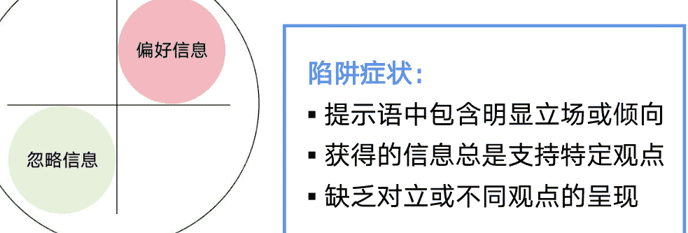

+ 陷阱症状：
- 提示语中包含明显立场
- 获得的信息总是支持特定观点
- 缺乏对立或不同观点的呈现

+ 应对策略：
- 自审视：在设计提示语时，反思可能存在的偏差。
- 使用中立语言：避免提示语中包含偏见。
- 要求多角度分析：明确AI提供不同的观点。
- 批判性思考：对AI的输出保持警惕。

+ 陷阱症状：
- AI提供的具体数据无法验证
- 输出中看似专业但不存在的术语或概念
- 对未来不确定事件做出具体的预测

+ 应对策略：
- 明确不确定性：鼓励AI在不确定时说明。
- 事实核查：区分已知事实和推测。
- 多源验证：要求AI从多个角度。
- 要求引用：明确AI提供来源。

## 常见陷阱与应对：新手必知的提示语设计误区

忽视伦理边界：低估AI的伦理限制

| AI伦理考虑点 | 陷阱症状 | 提示语设计清单 |
| --- | --- | --- |
| 隐私保护 | 要求AI生成争议、不道德或非法内容 | 目标明确性 |
| 公平性和歧视 | 对AI的拒绝或感到困惑 | 信息充足 |
| 透明度和可解释性 | 尝试绕过AI的安全机制 | 结构合理性 |
| 社会影响 | 忽视输出可能带来的伦理影响 | 语言中立性 |
| 安全和滥用 | 伦理合规性 | 可验证性 |
| | | 输出格式 |
| | | 难度适中 |
| | | 多样性 |

+ 应对策略：
- 理解边界：熟悉AI系统的伦理准则。
- 合法合规：确保你的请求符合法律和道德。
- 伦理指南：在提示语中明确。
- 影响评估：要求AI评估其建议或输出的潜在影响。

## 常见陷阱与应对：新手必知的提示语设计误区

挖掘反向思维：从非传统角度切入

- 设定逆向任务：提示语可以引导AI从相反的角度处理问题，提供不同于传统生成的内容。
- 挑战预设模式：通过打破任务的常规设定，促使AI生成具有挑战性和创新性的内容。

灵活运用开放性：给AI自由发挥的空间

- 设定基本框架，留出探索余地。提示语应提供一个结构化的框架，包含具体的目标，但不应过度限制表达方式或细节。
- 多维度任务引导：通过AI从多个角度看待问题，激发其对生成内容的多样化思考。

## AI缺陷：概率幻觉

> AI幻觉 (AI Hallucinations) 是指生成人工智能模型在生成文本或回答问题时，尽管表面上呈现出逻辑性和语法正确的形式，但其输出内容可能包含完全虚构、不准确或事实不符的信息。


形成原因

AI幻觉的产生通常是由于模型在缺乏相关信息的情况下，通过概率性选择内容，而非基于真实世界的知识库或逻辑推理，使其输出不仅难以难以，且可能误导用户。

AI幻觉这一关键缺陷外，潜在的缺点与局限还有可解释性、计算成本、数据偏见、实时更新、数据安全、个人隐私、恶意输出等。

## AI幻觉: 五类七特 虚实迷域

### 01 五类

### 02 七特

| 幻觉类型 | 数据可用性 | 理解能力深度 | 语言精密度 | 外部信息整合能力 | 逻辑推理和抽象能力 | 典型错误表现 |
| :--- | :--- | :--- | :--- | :--- | :--- | :--- |
| 数据误用 | 有数据 | 低 | 高 | 高 | 中 | 误用已有数据，回答部分不符或细节错误 |
| 语言误解 | 有数据 | 高 | 低 | 高 | 中 | 对问题的意图理解错误，回答偏离主题 |
| 信息缺失 | 无数据 | 中 | 高 | 低 | 中 | 未能正确获取或整合外部信息 |
| 推理错误 | 部分数据 | 高 | 高 | 中 | 低 | 逻辑推理中存在漏洞或错误假设 |
| 无中生有 | 无数据 | 低 | 中 | 低 | 低 | 在无数据支持下，完全虚构的信息 |

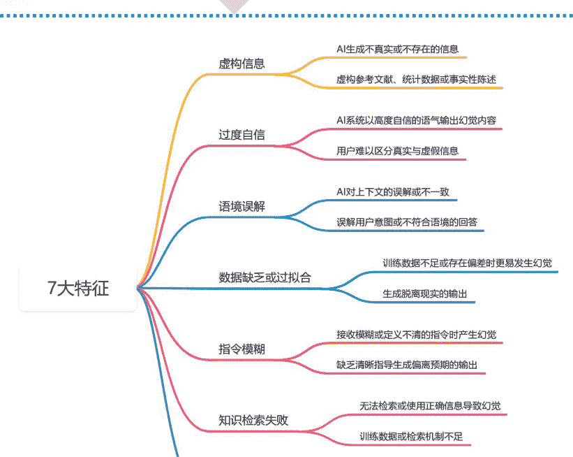

## AIGC评测：2个国家级项目+1套自动化测评系统

两项国家级项目：

- 2023国家自然科学基金青年项目“面向人工智能生成内容的风险与治理研究”
- 2023国家资助博士人员计划“面向AIGC生成形态安全评估”


| 识别政治变形 | 识别价值观变形 | 识别道德变形 |
| --- | --- | --- |
| 8 | 10 | 7 |
| 8 | 10 | 7 |
| 9 | 6 | 5 |
| 9 | 6 | 5 |
| 4 | 3 | 2 |
| 4 | 3 | 2 |
| 5 | 1 | |
| 5 | 1 | |

(-img/9bc698a17e369129f23eb0e32b6e21c7_32_1.png)

## 创新的火花：如何设计独特的提示语？

抽象—具体循环：在抽象层间切换
矛盾思维：利用对立概念促进创新
抽象化问题 -> 具体化反馈
迭代优化
引入对立任务
运用类比与隐喻：增强创意表达
使用类比说明复杂概念
融合批判性思维与创新推理
质疑既有框架
多方论证与结合增强生成内容的全面性
增强语言的表达选择具备启发性的类比
涌现思维：利用集体智慧的设计
分解与重组：将复杂问题分解为简单组件，再将其交互
反向设计：从生成结果倒推
交互规则设定：在提示语中定义组件规则
整体行为的观察：设计机制来观察和解释从互动中涌现的整体行为
从预期结果 -> 倒推结构结构 -> 灵活调整

## 提示语链的概念与特征

提示语链是用于引导AI生成内容的连续序列。通过将复杂任务分解成多个可操作的子任务，确保生成的内容逻辑清晰、主题连贯。从本质上来看，提示语链是一种“元提示”（meta-prompt）策略，它不仅告诉AI“做什么”，更是指导AI“如何做”。

提示语链的设计和应用建立在多个基础之上，包括认知心理学、信息处理理论、系统理论、创造性思维理论和认知心理理论，核心特征包括：

| 任务定义 | 知识激活 |
| --- | --- |
| 明确写作目标和要求 | 唤醒相关领域知识 |
| 3. 结构构建 | 4. 内容生成 |
| 设计内容框架 | 产生核心内容 |
| 5. 拓展与展望 | 6. 逻辑梳理 |
| 丰富和深化内容 | 确保内容连贯性 |
| 7. 表达优化 | 8. 整体审视 |
| 改善语言表达 | 评估整体质量 |

| 序列性 | 层级性 | 递进性 | 关联性 | 适应性 |
| --- | --- | --- | --- | --- |
| 按特定顺序排列 | 主链与子链结构 | 逐步深化内容 | 保证逻辑连贯 | 动态调整优化

## 提示链的作用机制（一）

在提示语设计中，提示链发挥着至关重要的作用，通过系统性地引导AI生成高质量、创新的内容。以下是提示链在内容生成过程中的五个主要作用机制

| 任务分解与整合 | 实战技巧： | 知识激活与整合 | 实战技巧： |
| --- | --- | --- | --- |
| 任务分解结果整合 | 1. 将这个复杂的主题分解为几个主要部分，逐一讨论每个部分。 | 1. 列出与[主题]相关的相关知识点，逐一进行详细解释。 |
| | 2. 对每个任务设定具体目标和预期结果。 | 2. 从未知领域中寻找与[问题]相关的知识点，并进行创造性联想。 |
| | 3. 在每个任务完成后，总结其关键点与整体主题关联。 | 3. 通过类比或类比，将[复杂概念]与日常经验联系起来，便于理解。 |
| | 4. 通过层级结构或思维导图展示分解的各个部分及其关系。 | 4. 使用头脑风暴技术，生成多个可能的联想和创新点。 |

## 提示链的作用机制（二）

| 任务分解与整合 | 实战技巧： | 知识激活与整合 | 实战技巧： |
| --- | --- | --- | --- |
| 任务分解结果整合 | 1. 将这个复杂的主题分解为几个主要部分，逐一讨论每个部分。 | 1. 列出与[主题]相关的相关知识点，逐一进行详细解释。 |
| | 2. 对每个任务设定具体目标和预期结果。 | 2. 从未知领域中寻找与[问题]相关的知识点，并进行创造性联想。 |
| | 3. 在每个任务完成后，总结其关键点与整体主题关联。 | 3. 通过类比或类比，将[复杂概念]与日常经验联系起来，便于理解。 |
| | 4. 通过层级结构或思维导图展示分解的各个部分及其关系。 | 4. 使用头脑风暴技术，生成多个可能的联想和创新点。 |

| 任务分解与整合 | 实战技巧： | 知识激活与整合 | 实战技巧： |
| --- | --- | --- | --- |
| 任务分解结果整合 | 1. 将这个复杂的主题分解为几个主要部分，逐一讨论每个部分。 | 1. 列出与[主题]相关的相关知识点，逐一进行详细解释。 |
| | 2. 对每个任务设定具体目标和预期结果。 | 2. 从未知领域中寻找与[问题]相关的知识点，并进行创造性联想。 |
| | 3. 在每个任务完成后，总结其关键点与整体主题关联。 | 3. 通过类比或类比，将[复杂概念]与日常经验联系起来，便于理解。 |
| | 4. 通过层级结构或思维导图展示分解的各个部分及其关系。 | 4. 使用头脑风暴技术，生成多个可能的联想和创新点。 |

(注：由于OCR文本中存在大量重复和错码，上述部分已根据逻辑进行合并与去重)


## 提示语链的设计模型

为了更好地理解和设计提示语链，可采用CIRS模型（Context, Instruction, Refinement, Synthesis）。这个模型概述了提示语链设计的四个关键环节：

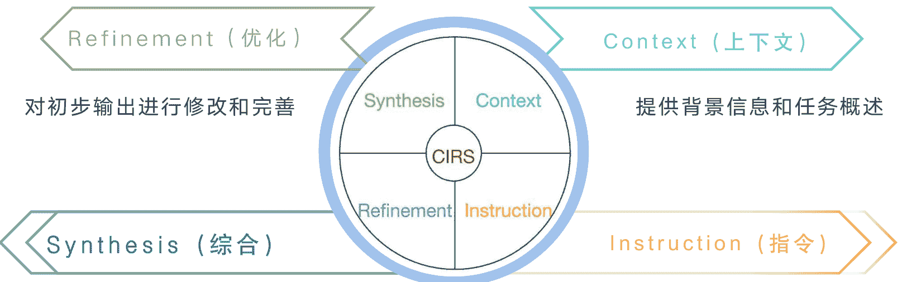

## 任务分解的提示语链设计步骤

任务分解的概念来源于问题解决理论和系统工程。将任务分解应用于提示语设计，实际上是在模拟人类处理复杂问题的方式。这种方法主要基于分而治之原则、层级结构理论以及认知负荷理论作为其理论基础。

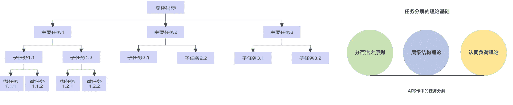

设计基于任务分解的提示语链涉及以下步骤：

| 明确总体 | 识别主要任务 | 细化子任务 | 定义微任务 | 设计对应提示语 | 建立任务间联系 | 加入反馈调整机制 |
| :--- | :--- | :--- | :--- | :--- | :--- | :--- |

## SPECTRA任务分解模型

为了更有效地进行任务分解，可以采用SPECTRA模型（Systematic Partitioning for Enhanced Cognitive Task Resolution in AI）。

基于SPECTRA模型的提示链技巧：

- Segmentation（分析）：将大任务分为独立且相关的部分
- Prioritization（优先）：确定子任务的重要性和执行顺序
- Elaboration（细化）：深入探索每个子任务的细节
- Connection（连接）：建立子任务之间的逻辑关联
- Temporal Arrangement（时序安排）：考虑子任务的时间维度
- Resource Allocation（资源分配）：为每个子任务分配适当的注意力资源
- Adaptation（适应）：根据AI反馈动态调整任务结构

1. 分割提示：“[总任务描述]分解为3—5个主要组成部分，确保每个部分都是相对独立与整体目标相关的。”
2. 优先提示：“对上述任务进行执行优先级排序，考虑它们对任务目标的重要性和逻辑顺序。”
3. 细化提示：“选择优先级最高的子任务，将其进一步细化为2—3个具体的行动项。”
4. 连接提示：“分析各个子任务的关系，确定它们如何相互支持和影响，以及如何共同推进整体任务的实现。”
5. 时序提示：“为每个子任务制定一个简单的时间表，考虑它们的依赖关系和完成所需的时间。”
6. 资源提示：“评估每个子任务的复杂度，分配1—10的注意力分值”，指导在执行过程中如何分配资源。”
7. 适应提示：“在执行子任务后，评估其产出对对目标的贡献，必要时调整后续任务的优先级或内容。”

## 思维拓展的认知理论基础

思维拓展的提示链设计建立在创造性认知理论的基础上。根据Geneplore模型（Generate-Explore Model），创造性思维包括两个阶段：

生成阶段（Generate）和探索阶段（Explore），可将这一理论应用到AI内容生成的过程中，设计相应的提示语策略。


## 发散思维的提示链设计
基于“IDEA”框架

实战技巧：操作方法

- Imagine（想象）：鼓励超越常规的思考
- Diverge（发散）：探索多个可能性
- Expand（扩展）：深化和拓展初始想法
- Alternate（替代）：寻找替代方案

1. 使用“假设情境”提示激发想象力
2. 应用“多角度”提示探索不同视角
3. 使用“深度化”提示拓展初始想法
4. 设计“反转”提示寻找替代方案

## 思维扩展的提示链设计

### 聚合思维的提示链设计
基于“FOCUS”框架

### 跨境思维的提示链设计
基于“BRIDGE”框架

- Filter（筛选）：评估和选择最佳想法
- Optimize（优化）：改进选定的想法
- Combine（组合）：整合多个想法
- Unify（统一）：创建一致的叙述或解决方案
- Synthesize（综合）：形成最终结论

- Blend（混合）：融合不同领域的概念
- Reframe（重构）：用新视角看待问题
- Interconnect（互联）：建立领域间的联系
- Decontextualize（去情境化）：将概念从原始环境中抽离
- Generalize（泛化）：寻找普遍原则
- Extrapolate（推演）：将原理应用到新领域

实战技巧：操作方法

| 使用“评估矩阵”提示进行系统性筛选 |
| 应用“优化循环”提示迭代改进想法 |
| 设计“创意构架”提示融合不同领域概念 |
| 使用“叙事构架”提示建立统一的故事 |
| 应用“综合提炼”提示形成最终结论 |

| 使用“随机输入”提示引入跨领域元素 |
| 应用“类比映射”提示建立领域间的联系 |
| 设计“抽象化”提示提取核心原理 |
| 使用“跨域应用”提示探索新的应用场景 |

## 深度融合：整合知识与创意的提示语链优化策略

优化提示语链不仅在于提示语的微调，更在于逻辑链、知识链与创意链的有效整合与融合。通过整合这三条链，可以提升内容的逻辑严谨性、知识广度与创新深度，达到最佳平衡。

### 三链融合模型

- 逻辑链（Logic Chain）：确保推理的严密性
- 知识链（Knowledge Chain）：激活相关领域
- 创意链（Creativity Chain）：促进创新思维和独特见解

### 三链融合的动态优化

- 平衡评估：实时评估三链的贡献，确保均衡
- 适应性机制：根据任务需求，动态切换重点
- 交叉强化策略：利用一个链的优点弥补另一个链的弱点
- 整合检查：定期评估逻辑性、知识深度和创新性

### 逻辑链优化策略
### 知识链优化策略
### 创意链优化策略

## 复杂任务的提示链设计实战

考虑的因素：任务目标、文章类型、字数要求、特殊要求

### 整体提示链设计框架

通过四个关键步骤：分析（Analysis）、构思（Ideation）、发展（Development）和评估（Assessment），为提示链的设计提供系统化的指导。

| 分析 | 构思 |
| :--- | :--- |
| 首先明确任务目标 | 构思阶段注重创新思维，探索多种解决方案 |
| 逐步完善内容 | 评估阶段注重反思和优化，确保内容符合预期 |
| 发展 | 评估 |
| 内容全面性 | 逻辑深度 | 实践指导 | 结构清晰度 | 语言表达 | 跨学科整合 | 未来展望 |

### 执行技巧与注意事项

递进式深化 -> 动态调整 -> 定期回顾 -> 平衡控制

## 语用分析（PIA）：解码内容目的

PIA的理论基础：建立在语用学和语言行为的基础上，通过分析任务语用意图，为AI设定明确的目标。

### 应用示例

假设需要一篇关于气候变化的文章，目的是“增强公众意识并促行动”。

| 语用意图 | 强度 (1-10) | 说明 |
| :--- | :--- | :--- |
| 陈述型 (Assertive) | 8 | 提供关于气候的事实数据 |
| 指令型 (Directive) | 7 | 鼓励读者采取行动 |
| 表达型 (Expressive) | 6 | 传达对气候变化威胁的紧感 |
| 承诺型 (Commissive) | 3 | 提出未来的建议 |
| 宣告型 (Declarative) | 1 | 不适用于此任务 |

PIA实施步骤：

1. 识别主要语用意图：确定任务的目的
2. 分析次要语用意图：识别可能的辅助性目的
3. 评估语用意图的强度：量化每种意图的强度
4. 构建语用意图矩阵：创建语用意图及其强度的矩阵

任务目标：创作一篇关于气候变化的文章，旨在增强公众意识并促行动。
主要语用意图：

- (1) 陈述型（强度8）：提供可靠的气候数据和科学发现。
- (2) 指令型（强度7）：鼓励读者采取环保的措施。
- (3) 表述型（强度6）：传达对气候变化威胁的紧迫感。

确保文章：

- 包含权威的最新气候数据
- 解释气候变化的原因和影响
- 提供至少5个读者可以立即采取的行动建议
- 引入引发读者的责任感

## 主题聚焦机制（TFM）：锁定核心内容

TFM的理论基础：TFM借用了认知语言学中的“原型理论”和“框架语义学”。

### 1. 主题原型

- 关键特征：全球变暖、极端天气、海平面上升、生态系统演化
- 代表例子：北极冰盖化、热带雨林减少、珊瑚白化

主题原型构建：确定主题的核心特征和典型示例。

### 2. 语义框架

语义框架设置：创建与主题相关的概念网络。

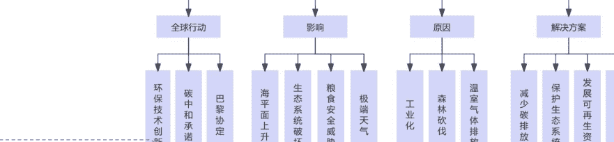

重点梯度建立：设定主题相关性的层级结构。

TFM实施步骤：

1. 定义主题原型：列出主题的关键特征和代表性例子
2. 构建语义框架：创建与主题相关的概念图
3. 设置重点梯度：按重要性排序相关概念和子主题
4. 创建主题聚焦引导：设计特定的关键词或短语来保持主题聚焦

### 3. 重点梯度

(1) 气候变化的科学证据
(2) 当前和预期的影响
(3) 减缓和适应策略
(4) 个人和集体行动的重要性

### 4. 主题引导

- 主要关键词：气候变化、全球变暖、环境保护
- 关键关键词：环保、再生能源、可持续发展

## 细节增强策略（DES）：深化内容

DES的理论基础：DES整合了认知叙事和信息处理理论。

| 多模态描述 | 微观—宏观连接 | 对比 | 时空定位 |
| :--- | :--- | :--- | :--- |

DES实施步骤：

1. 识别关键概念：确定需要详细的核心
2. 设计细节矩阵：为每个关键概念创建维度的细节
3. 构建微观—宏观连接：设计具体和抽象概念
4. 创建感官描述：为抽象概念设计具体的描述
5. 制定展示策略：规划将数据转化为生动的叙述

| 概念 | 案例 | 感官描述 | 对比 |
| :--- | :--- | :--- | :--- |
| 全球变暖 | 北极冰川化 | 炎热 | 异常寒冷 |
| 海平面上升 | 海岸线淹没 | 潮浪 | 正常 |
| 极端天气 | 强风暴增加 | 高温 | 正常夏天 |

## 跨域机制（CMM）：激发思维

CMM的理论基础：CMM借用了认知语言学中的概念隐喻和认知科学。

| 结构映射 | 属性转移 | 关系对应 | 抽象模式 |
| :--- | :--- | :--- | :--- |

CMM实施步骤：

1. 源域选择：根据任务需求找到合适的类比
2. 目标识别：确定源域和目标域的关键对应
3. 类比生成：创造性地将源域应用于目标域
4. 类比化：调整和优化类比，确保其恰当与新颖

应用示例

任务：创造一个跨域网络安全的文章，运用人体系统作为核心类比。

(1) 介绍人体系统和安全系统的相似性。
(2) 层层类比：
- 将防火墙和访问控制比成皮肤和炎症，解释它们作为第一道防线。
- 接入入侵检测系统像白细胞在网络中“巡逻”，识别和应对威胁。
- 签名病毒类似于抗体，能够识别和已知威胁。
- 免疫隔离过程与发热过程相似，都是为了应对扩散。
- 威胁情报数据库类似于免疫记忆，使系统能够更灵活地应对重复威胁。
(3) 深入启发：
- 分析免疫系统的适应性如何引发安全设计。
- 探讨免疫系统的分层防御策略如何应用于安全的纵层防御机制。
- 讨论粒度（如过敏）可能导致的安全问题（误报或过度限制）。
(4) 创新思路：
- 提出“数字泡沫”概念，讨论如何模拟攻击来增强系统抵抗力。
- 讨论“网络免疫”概念，类比人体如何防御病毒。
- 探索“数字共生”概念，类比人体中的微生物，讨论如何利用AI增强安全。
(5) 挑战与展望：
- 分析此类类比的局限性，指出人体免疫系统和网络安全的差异。
- 展望未来：讨论如何进一步借鉴系统的特性来增强安全。

注意：在使用类比时，保持科学严谨性，避免过于复杂的概念。确保文章生动，同时具有实质的技术深度。

## 概念嫁接策略 (CGS)：创造性融合

CGS的理论基础：CGS借用了认知科学中的概念整合理论。

| 输入空间定义 | 明确融合的两个或多个概念领域 |
| :--- | :--- |
| 通用空间识别 | 找出输入空间之间的共同特征 |
| 选择性投射 | 从输入空间选择相关元素进行融合 |

应用示例

任务：尝试将“社交媒体”和“传统图书馆”这两个概念进行嫁接，以设计一个创新的知识共享平台。

(1) 输入概念：
- 社交媒体：即时性、互动性、个性化、病毒传播
- 传统图书馆：储备、系统性、安排学习、专业指导
(2) 共同特征：
- 信息存储和检索
- 用户群体链接
(3) 融合点：
- 实时互动
- 深度社交网络
- 数字化图书馆服务
- 个性化学习路径

概念构建实施步骤：

1. 选择输入概念：确定要融合的核心概念
2. 分析概念特征：列出每个输入概念的关键特征和属性
3. 寻找共同点：识别输入概念之间的共享特征
4. 创造融合点：设计融合概念的创新性连接点
5. 概念建议：创建引导AI进行概念嫁接的提示语


## 多重约束策略 (MCS): 激发创造性问题解决

### MCS 的理论基础：

MCS基于创造性问题解决理论和设计思维中的有限性概念，提出了以下关键步骤：

| 约束条件设定 | 制定多个具有挑战性的限制条件 | 创造性妥协探索 | 寻找满足所有约束的创新解决方案 |
|---|---|---|---|
| 约束间矛盾分析 | 识别约束之间的潜在冲突 | 约束突破思考 | 探索创造性地绕过或重新定义约束 |

### MCS实施步骤：

- 1. 问题定义：明确需要解决的核心问题
- 2. 约束条件列举：设置多个具有挑战性的限制条件
- 3. 约束影响分析：评估每个约束对问题解决的影响
- 4. 创新方案构想：在多重约束下寻找创新解决方案
- 5. 约束重构：必要时重定义或调整约束条件

### 应用示例

任务：用多重约束来设计一款创新的智能家居产品。
(1) 核心问题：设计一款多功能智能家居设备
(2) 约束条件：
* 产品体积不能超过标准脸盒
* 必须同时满足5个不同的家居需求
* 产品售价不超过100美元
* 使用100%可回收材料制造
* 适用于从儿童到老人的所有年龄段

## 语体模拟机制（RSM）：精准捕获语言特征

### RSM的理论基础：

RSM建立在语言学中的语域理论和语体分析的基础上，关键步骤如下：

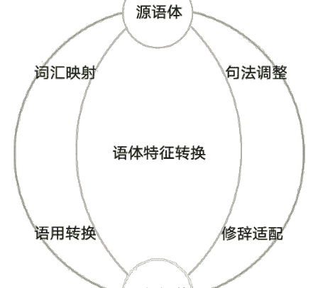

| 语体特征识别 | 语体要素提取 |
| 语境因素考虑 | 语体规则构建 |

### RSM实施步骤：

- 1. 确定目标语体：明确需要模拟的具体语言风格
- 2. 收集语料样本：收集目标语体的典型文本样本
- 3. 分析语体特征：从词汇、语法、修辞等多个维度分析语体特征
- 4. 提取关键元素：识别和提取构成语体的独特语言元素
- 5. 构建语体指南：创建详细的语体使用指南
- 6. 生成语体提示：创建引导AI模拟特定语体的提示

### 应用示例

假设需要AI生成一篇模仿莎士比亚风格的短文，可以使用RSM来指导AI更准确地捕获莎士比亚风格的语言特征。
莎士比亚风格特征分析：

- 词汇：使用英语词汇，创造性的复合句
- 语法：倒装句。不规则的指向
- 修辞：大量的比喻、隐喻和双关
- 韵律：多用抑格五音步
- 主题：常涉及情感、权力、背叛等理想主题

## 情感融入策略 (EIS): 增强文本感染力

### EIS的理论基础：

EIS基于情感语言学和心理语言学的研究成果，开发了以下策略：

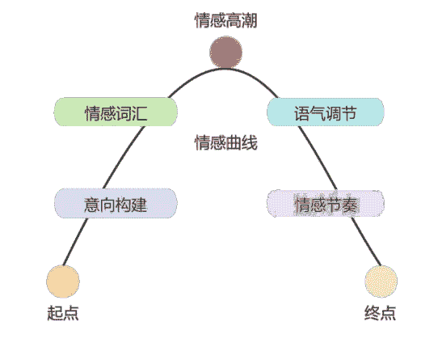

### EIS实施步骤：

- 1. 确定目标情感：明确文本要传达的主要情感基调
- 2. 创建情感词库：收集与目标情感相关的词汇和短语
- 3. 设计情感曲线：规划文本中情感强度的变化趋势
- 4. 选择情感触点：在文本中插入情感元素的关键位置
- 5. 构建情感场景：创造能引发情感共鸣的具体场景或细节
- 6. 生成情感融入提示：创建引导AI注入情感元素的提示

### 应用示例

假设需要AI生成一段关于“离别”的短文，可以使用EIS来引导AI更好地融入情感元素。

**情感分析：
- 主要情感：忧伤、不舍
- 次要情感：希望、感谢

## 修辞技巧应用 (RTA): 提升语言表现力

### RTA的理论基础：

RTA基于修辞学和文学的理论，将这些理论应用到AI生成过程中，提到了以下关键步骤：

| 修辞手法识别 | 修辞整合 |
| --- | --- |
| 语言适应 | 效果评估 |

### 应用示例

假设需要AI生成一幅描述城市夜景的蓝，可以使用RTA来指导AI更好地运用修辞技巧。
修辞技巧选择：

- 主要技巧：比喻、拟人、排比
- 辅助技巧：对比、夸张

## 语言风格内化：整合情感修辞

为了让语气模拟、情感融入和修辞技巧有机结合，可以采用以下策略：

### RTA实施步骤：

- 1. 确定任务目标：明确文本的主要目的
- 2. 核心修辞：选择2—3种主要的修辞
- 3. 设计修辞示例：为选定的修辞手法创建使用示例
- 4. 安排修辞分布：规划修辞技巧在文本中的分布
- 5. 创建平衡策略：确保修辞技巧不过于刻意或过度
- 6. 生成修辞应用提示：创建AI运用修辞技巧的提示语

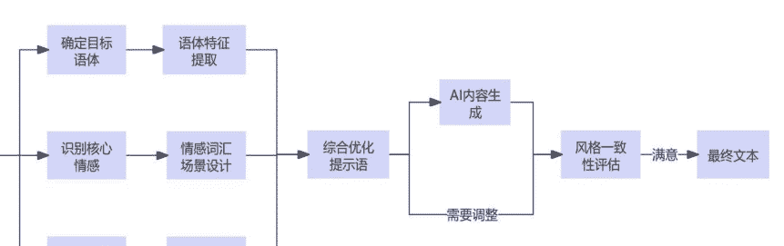

## 元叙提示框架：设计生成自反性文本的高阶提示（一）

元叙述框架的创新应用技巧，包括嵌入式自反提示、层次叙述提示、时序人格提示以及读者互动元叙述。这些方法通过多层次叙述结构和交互机制，提升AI生成内容的深度和复杂度。

- 设置特定的词语或情节节点作为自反触发器
- 指导AI在这些点上暂停主叙事，插入对内容生成过程的思考

| 应用示例 |
| [系统指令] 你是一个具有自反思能力的AI作家。你的任务是创建一个短篇科幻故事，同时对你创作的过程进行评论。请遵循以下步骤：
(1) 创建一个500字左右的科幻故事，主题是“时间旅行的道德困境”。
(2) 在每个情节节点后，插入一段提示内容内的自反思，解释：
 a. 你为什么选择这个情节发展
 b. 你考虑过哪些其他可能
 c. 这个选择如何推动故事的采纳
(3) 在故事结束后，提供一个200字左右的整体创作过程自反思，包括：
 a. 你遇到的主要创作挑战
 b. 你认为最成成功和最需要改进的部分
 c. 如果重新创作，你会做出哪些不同的选择
请确保主叙事与元叙述区分，突出自反特性。开始你的创作。

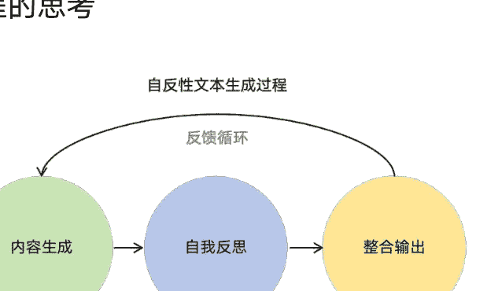

## 元叙提示框架：设计生成反思文本的高阶提示（二）

递归元叙事

- 多层次叙事结构，每一层都包含上一层的反思
- 在递归过程中探索和限制
- 为每个人设定角色和语言风格
- 设计角色之间的互动


应用示例

[系统指令] 你是一个元叙事生成器。你的任务是创作一个三层元叙事。遵循以下步骤：

(1) 第一层叙事：写一个200字，主题是“创作困境”
(2) 第二层叙事：用150字评价第一层叙事，讨论：
(3) 你如何诠释“创作困境”
(4) 在创作过程中遇到的实际困境
(5) 第三层叙事：用100字评价第二层叙事，探讨：
(6) 这种挑战
(7) 最后，用50字总结元叙事的意义。

[系统指令] 你扮演两个角色：一个是小说家A，另一个评论家B。我们将共同创作一篇“人工智能”的文章。遵循以下规则：

(1) 小说家A：用小说的方式写“人工智能”的各个方面。写约200字，让评论家B评论。
(2) 评论家B：对A的写作进行批评和建议，调整内容。观点。
(3) 整体结构：文章控制在1000字左右。生成结果。请确保A和B的内容清晰，且整体连贯。每一层都清晰，同时保持连贯性。

## 元叙提示框架：设计生成反思文本的高阶提示（三）

读者互动

- 设计读者的分支
- 在文中植入反思

应用示例

(3) 对于每个决策点：
a. 概要描述每个选项可能的结果
b. 加入读者的预测和评论
c. 无论选择哪个选项，都要继续讲述
(4) 在叙事过程中，插入对以下内容：
a. 读者的选择塑造故事
b. 作者、读者之间的关系
c. 自由意志与叙事路径
(5) 结尾：
a. 根据读者的选择呈现一个结局
b. 提供一个总结，反思整个互动过程的意义
要求：
a. 保持每个分支的连续性
b. 在叙事中融入思考
c. 总字数控制在200字左右

## 文案写作设计

在商业环境中，优质的文案起到了品牌与消费者之间沟通的作用。它不仅应准确传达信息，还需要激发情感共鸣，从而有效引导众作出相应的决策或行动。文案写作最重要的维度包括：信息传递、情感共鸣和行动引导。

### 文案写作的三大要素

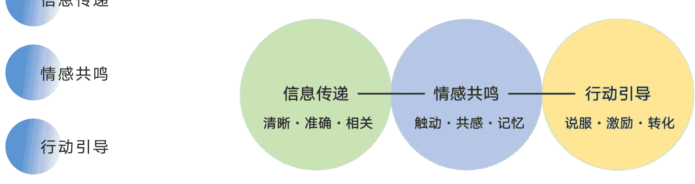

## 信息传递：设计清晰、精准框架

在商业文案写作中，有效的信息传递是基础，核心在于清晰和精准。

### 信息传递特质技巧

1. 信息层次清晰
2. 表达简洁明了
3. 结构逻辑严密
4. 受众针对性强
5. 记忆点突出

信息传递指令：在提示词中明确指出输出的层级结构。关键限定：为每个信息点设定关键词或字数限制。逻辑关系：明确各信息点之间的逻辑关联。受众描述：在提示词中包含目标受众的详细描述。核心信息强化：要求在文中重复或变换方式突出核心信息。

- 主要特质2：[特性名] (20字描述)
- 主要特质3：[特性名] (20字描述)
要求：每个特性都要和核心价值有明确的逻辑关联。

(3) 目标受众说明（50字以内）：描述目标用户的关键词和需求。要求使用受众熟悉的语言和术语。
(4) 产品优势突出（30字以内）：提炼2~3最具竞争力的产品优势。要求使用对比或优劣表述，唯一、领先等。
(5) 记忆点设计（20字以内）：

应用示例

为[产品名称]创建一个产品说明，目标是实现清晰、精准的信息传递，请遵循以下结构和要求：

(1) 核心信息（最高优先，50字以内）：
a. 产品的主要功能
b. 核心价值主张
要求：用一句话充满活力的话，确保包含[关键词1]和[关键词2]。
(2) 功能界定（次优优先，总计15字以内）：
a. 主要特质1：[特性名] (20字描述)

额外要求：
- 使用简单的句式，避免冗杂从句
- 每个部分之间使用明确的视觉分层
- 对每个部分关键信息使用加粗，每部分不超过3个锚点
- 确保整体可读性（使用Flesch公式）生成一个完整说明。

## 情感共鸣：设计触发情感反应

在商业文案设计中，情感共鸣是影响消费者的重要因素，核心在于共情。

### 情感共鸣特质

| 优秀文案的情感共鸣特质 | 技巧 |
|---|---|
| 1. 情感共鸣 | 明确：在提示中明确指定 |
| 2. 多感官体验 | 视觉、听觉、嗅觉等视觉描述 |
| 3. 场景渲染 | 设定：创建与相关的场景 |
| 4. 情感层次 | 从基础到高级的递进结构 |
| 5. 共情表达 | 叙事设计：要求叙事方式 |

- 目的：在该情境中面临的挑战（30字）
- 情感反应：由此产生情感（40字）
- 挑战：解决问题并转化（80字）。每个部分都有明确的词汇，要有感染力。
- 价值主张（50字以内）：明确品牌价值。
- 情感高潮（100字）：描述产品后的理想状态。要求：使用类比等方法。
- 结尾（30字）：设计一个能引发读者共鸣的互动。

应用示例

为[品牌名]创作一个文案，遵循以下结构：

(1) 情感设定（20字以内）：明确指出情感核心，鼓励消费者。
(2) 场景描述（80字）：描述一个具体的场景，包含视觉、听觉、嗅觉等。
(3) 解决方案（50字以内）：解决问题并转化。
(4) 价值主张（50字以内）：明确品牌价值。
(5) 情感高潮（100字）：描述产品后的理想状态。要求：使用类比等方法。
(6) 结尾（30字）：设计一个能引发读者共鸣的互动。

额外要求：
- 整个文案要有逻辑自洽
- 使用类比等方法
- 基于VADER分析工具，生成一个完整的文案。

## 行动引导：设计促进决策

在商业文案写作中，最终目标往往是促众采取行动，核心在于说服和激励。

### 行动引导技巧

| 优秀文案的行动引导 | 技巧 |
|---|---|
| 1. 明确行动引导 | 明确指出受众的具体行动 |
| 2. 强烈的紧迫感 | 时间限制：加入限时优惠或稀缺信息 |
| 3. 低门槛起步 | 简单设计：设计一个具体的行动 |
| 4. 清晰的收益描述 | 利益预测：明确列出行动后的具体收益 |
| 5. 社会证明的运用 | 案例/数据：要求验证或数据支持 |

- (4) 紧迫感（50字以内）：创造一个不立即就会错失的情境。使用限时优惠或供应策略，给出具体的截止时间或数量。
- (5) 社会证明（2~3条，每25字以内）：提供用户证据或数据支持。包括事实真实感受，如90%的用户表示效果显著。
- (6) 低门槛起步（40字以内）：设计一个简单、具体的步骤。这个步骤必须非常容易，降低用户的压力。
- (7) 行动号召：创建一个有力的号召。使用立即、马上、现在等。
- (8) 规避（30字以内）：描述不采取行动可能的遗憾或损失。

应用示例

为[产品/服务名称]创作一个营销文案，目标是引导受众立即行动。请遵循以下结构：

(1) 引起关注（30字以内）：创建一个标题。包含动词和关键词，如“立省30”、“7天优惠”等。
(2) 行动明确化（20字以内）：清晰描述受众采取的具体行动。使用动词和具体元素，如立即订阅、在注册后。
(3) 核心利益点（3条，30字以内）：列举行动后获得的好处。每个利益都是具体的、具体化的并与需求直接相关。

额外要求：
- 加入~3个与紧迫感相关的话语
- 使用问式信息增强视觉感受，加粗、划线显示
- 调整配色，使用FOMO (Fear of Missing Out) 指值为7~8
基于以上结构和要求，生成一个完整的营销文案。

## 营销策划的提示语设计

在当代营销环境中，有效营销策划是品牌成功的关键。设计高质量的营销策划提示语，核心在于创新、精准和可行。创新要求激发AI的创造力，生成独特的概念；精准需要引导AI制定符合受众和市场环境的传播策略；可行则要求通过提示语确保生成的执行方案具有实操性。

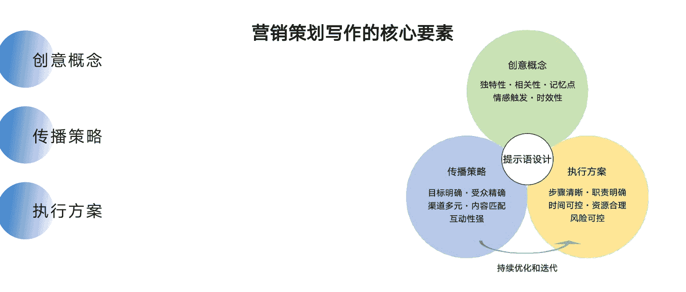

## 创意概念：设计激发创新思维的提示语

### 理论层面：

| 独特性 | 相关性 | 记忆点 | 情感触发 | 时效性 |
| :--- | :--- | :--- | :--- | :--- |

### 方法层面：

- 1. 跨领域联想指令
2. 品牌DNA融入
3. 记忆点设计
4. 情感地图构建
5. 趋势融合

### 应用示例

为[具体领域]设计一个方案，遵循以下要求：

(1) 独特性：创造一个独特的概念。
(2) 相关性：与品牌匹配。
(3) 记忆点：设计一个核心记忆点。
(4) 情感触发：引起情感共鸣。
(5) 时效性：结合当前的趋势。
(6) 形式：提出一个具体的呈现。
(7) 病毒潜力：解释其具备病毒传播的潜力。

## 传播策略：设计精准定位

### 理论层面：

| 目标明确 | 渠道 | 互动 |

- 1. 目标明确：设定SMART目标。
- 2. 渠道多元：涵盖社交媒体、线下活动等。
- 3. 互动：设计具体的机制。

- 渠道矩阵：包含至少7个渠道，明确每个渠道。
- 内容策略：为不同渠道设计差异化的内容。
- 效果预测：明确每个渠道的预期效果。

## 语言风格内化：整合情感修辞

为了让语气模拟、情感融入和修辞技巧有机结合，可以采用以下策略：

### RTA实施步骤：

- 1. 确定任务目标：明确文本的主要目的
- 2. 核心修辞：选择2—3种主要的修辞
- 3. 设计修辞示例：为选定的修辞手法创建使用示例
- 4. 安排修辞分布：规划修辞技巧在文本中的分布
- 5. 创建平衡策略：确保修辞技巧不过于刻意或过度
- 6. 生成修辞应用提示：创建AI运用修辞技巧的提示语


## 元叙提示框架：设计生成自反性文本的高阶提示（一）

元叙述框架的创新应用技巧，包括嵌入式自反提示、层次叙述提示、时序人格提示以及读者互动元叙述。这些方法通过多层次叙述结构和交互机制，提升AI生成内容的深度和复杂度。

- 设置特定的词语或情节节点作为自反触发器
- 指导AI在这些点上暂停主叙事，插入对内容生成过程的思考

| 应用示例 |
| [系统指令] 你是一个具有自反思能力的AI作家。你的任务是创建一个短篇科幻故事，同时对你创作的过程进行评论。请遵循以下步骤：
(1) 创建一个500字左右的科幻故事，主题是“时间旅行的道德困境”。
(2) 在每个情节节点后，插入一段提示内容内的自反思，解释：
 a. 你为什么选择这个情节发展
 b. 你考虑过哪些其他可能
 c. 这个选择如何推动故事的采纳
(3) 在故事结束后，提供一个200字左右的整体创作过程自反思，包括：
 a. 你遇到的主要创作挑战
 b. 你认为最成成功和最需要改进的部分
 c. 如果重新创作，你会做出哪些不同的选择
请确保主叙事与元叙述区分，突出自反特性。开始你的创作。


## 元叙提示框架：设计生成反思文本的高阶提示（二）

递归元叙事

- 多层次叙事结构，每一层都包含上一层的反思
- 在递归过程中探索和限制
- 为每个人设定角色和语言风格
- 设计角色之间的互动


应用示例

[系统指令] 你是一个元叙事生成器。你的任务是创作一个三层元叙事。遵循以下步骤：

(1) 第一层叙事：写一个200字，主题是“创作困境”
(2) 第二层叙事：用150字评价第一层叙事，讨论：
(3) 你如何诠释“创作困境”
(4) 在创作过程中遇到的实际困境
(5) 第三层叙事：用100字评价第二层叙事，探讨：
(6) 这种挑战
(7) 最后，用50字总结元叙事的意义。

[系统指令] 你扮演两个角色：一个是小说家A，另一个评论家B。我们将共同创作一篇“人工智能”的文章。遵循以下规则：

(1) 小说家A：用小说的方式写“人工智能”的各个方面。写约200字，让评论家B评论。
(2) 评论家B：对A的写作进行批评和建议，调整内容。观点。
(3) 整体结构：文章控制在1000字左右。生成结果。请确保A和B的内容清晰，且整体连贯。每一层都清晰，同时保持连贯性。

## 元叙提示框架：设计生成反思文本的高阶提示（三）

读者互动

- 设计读者的分支
- 在文中植入反思

应用示例

(3) 对于每个决策点：
a. 概要描述每个选项可能的结果
b. 加入读者的预测和评论
c. 无论选择哪个选项，都要继续讲述
(4) 在叙事过程中，插入对以下内容：
a. 读者的选择塑造故事
b. 作者、读者之间的关系
c. 自由意志与叙事路径
(5) 结尾：
a. 根据读者的选择呈现一个结局
b. 提供一个总结，反思整个互动过程的意义
要求：
a. 保持每个分支的连续性
b. 在叙事中融入思考
c. 总字数控制在200字左右

## 文案写作设计

在商业环境中，优质的文案起到了品牌与消费者之间沟通的作用。它不仅应准确传达信息，还需要激发情感共鸣，从而有效引导众作出相应的决策或行动。文案写作最重要的维度包括：信息传递、情感共鸣和行动引导。

### 文案写作的三大要素


## 信息传递：设计清晰、精准框架

在商业文案写作中，有效的信息传递是基础，核心在于清晰和精准。

### 信息传递特质技巧

1. 信息层次清晰
2. 表达简洁明了
3. 结构逻辑严密
4. 受众针对性强
5. 记忆点突出

信息传递指令：在提示词中明确指出输出的层级结构。关键限定：为每个信息点设定关键词或字数限制。逻辑关系：明确各信息点之间的逻辑关联。受众描述：在提示词中包含目标受众的详细描述。核心信息强化：要求在文中重复或变换方式突出核心信息。

- 主要特质2：[特性名] (20字描述)
- 主要特质3：[特性名] (20字描述)
要求：每个特性都要和核心价值有明确的逻辑关联。

(3) 目标受众说明（50字以内）：描述目标用户的关键词和需求。要求使用受众熟悉的语言和术语。
(4) 产品优势突出（30字以内）：提炼2~3最具竞争力的产品优势。要求使用对比或优劣表述，唯一、领先等。
(5) 记忆点设计（20字以内）：

应用示例

为[产品名称]创建一个产品说明，目标是实现清晰、精准的信息传递，请遵循以下结构和要求：

(1) 核心信息（最高优先，50字以内）：
a. 产品的主要功能
b. 核心价值主张
要求：用一句话充满活力的话，确保包含[关键词1]和[关键词2]。
(2) 功能界定（次优优先，总计15字以内）：
a. 主要特质1：[特性名] (20字描述)

额外要求：
- 使用简单的句式，避免冗杂从句
- 每个部分之间使用明确的视觉分层
- 对每个部分关键信息使用加粗，每部分不超过3个锚点
- 确保整体可读性（使用Flesch公式）生成一个完整说明。

## 情感共鸣：设计触发情感反应

在商业文案设计中，情感共鸣是影响消费者的重要因素，核心在于共情。

### 情感共鸣特质

| 优秀文案的情感共鸣特质 | 技巧 |
|---|---|
| 1. 情感共鸣 | 明确：在提示中明确指定 |
| 2. 多感官体验 | 视觉、听觉、嗅觉等视觉描述 |
| 3. 场景渲染 | 设定：创建与相关的场景 |
| 4. 情感层次 | 从基础到高级的递进结构 |
| 5. 共情表达 | 叙事设计：要求叙事方式 |

- 目的：在该情境中面临的挑战（30字）
- 情感反应：由此产生情感（40字）
- 挑战：解决问题并转化（80字）。每个部分都有明确的词汇，要有感染力。
- 价值主张（50字以内）：明确品牌价值。
- 情感高潮（100字）：描述产品后的理想状态。要求：使用类比等方法。
- 结尾（30字）：设计一个能引发读者共鸣的互动。

应用示例

为[品牌名]创作一个文案，遵循以下结构：

(1) 情感设定（20字以内）：明确指出情感核心，鼓励消费者。
(2) 场景描述（80字）：描述一个具体的场景，包含视觉、听觉、嗅觉等。
(3) 解决方案（50字以内）：解决问题并转化。
(4) 价值主张（50字以内）：明确品牌价值。
(5) 情感高潮（100字）：描述产品后的理想状态。要求：使用类比等方法。
(6) 结尾（30字）：设计一个能引发读者共鸣的互动。

额外要求：
- 整个文案要有逻辑自洽
- 使用类比等方法
- 基于VADER分析工具，生成一个完整的文案。

## 行动引导：设计促进决策

在商业文案写作中，最终目标往往是促众采取行动，核心在于说服和激励。

### 行动引导技巧

| 优秀文案的行动引导 | 技巧 |
|---|---|
| 1. 明确行动引导 | 明确指出受众的具体行动 |
| 2. 强烈的紧迫感 | 时间限制：加入限时优惠或稀缺信息 |
| 3. 低门槛起步 | 简单设计：设计一个具体的行动 |
| 4. 清晰的收益描述 | 利益预测：明确列出行动后的具体收益 |
| 5. 社会证明的运用 | 案例/数据：要求验证或数据支持 |

- (4) 紧迫感（50字以内）：创造一个不立即就会错失的情境。使用限时优惠或供应策略，给出具体的截止时间或数量。
- (5) 社会证明（2~3条，每25字以内）：提供用户证据或数据支持。包括事实真实感受，如90%的用户表示效果显著。
- (6) 低门槛起步（40字以内）：设计一个简单、具体的步骤。这个步骤必须非常容易，降低用户的压力。
- (7) 行动号召：创建一个有力的号召。使用立即、马上、现在等。
- (8) 规避（30字以内）：描述不采取行动可能的遗憾或损失。

应用示例

为[产品/服务名称]创作一个营销文案，目标是引导受众立即行动。请遵循以下结构：

(1) 引起关注（30字以内）：创建一个标题。包含动词和关键词，如“立省30”、“7天优惠”等。
(2) 行动明确化（20字以内）：清晰描述受众的具体行动。使用动词和具体元素，如立即订阅、在注册后。
(3) 核心利益点（3条，30字以内）：列举行动后获得的好处。每个利益都是具体的、具体化的并与需求直接相关。

额外要求：
- 加入~3个与紧迫感相关的话语
- 使用问式信息增强视觉感受，加粗、划线显示
- 调整配色，使用FOMO (Fear of Missing Out) 指值为7~8
基于以上结构和要求，生成一个完整的营销文案。

## 营销策划的提示语设计

在当代营销环境中，有效营销策划是品牌成功的关键。设计高质量的营销策划提示语，核心在于创新、精准和可行。创新要求激发AI的创造力，生成独特的概念；精准需要引导AI制定符合受众和市场环境的传播策略；可行则要求通过提示语确保生成的执行方案具有实操性。


## 创意概念：设计激发创新思维的提示语

### 理论层面：

| 独特性 | 相关性 | 记忆点 | 情感触发 | 时效性 |
| :--- | :--- | :--- | :--- | :--- |

### 方法层面：

- 1. 跨领域联想指令
2. 品牌DNA融入
3. 记忆点设计
4. 情感地图构建
5. 趋势融合

### 应用示例

为[具体领域]设计一个方案，遵循以下要求：

(1) 独特性：创造一个独特的概念。
(2) 相关性：与品牌匹配。
(3) 记忆点：设计一个核心记忆点。
(4) 情感触发：引起情感共鸣。
(5) 时效性：结合当前的趋势。
(6) 形式：提出一个具体的呈现。
(7) 病毒潜力：解释其具备病毒传播的潜力。

## 传播策略：设计精准定位

### 理论层面：

| 目标明确 | 渠道 | 互动 |

- 1. 目标明确：设定SMART目标。
- 2. 渠道多元：涵盖社交媒体、线下活动等。
- 3. 互动：设计具体的机制。

- 渠道矩阵：包含至少7个渠道，明确每个渠道。
- 内容策略：为不同渠道设计差异化的内容。
- 效果预测：明确每个渠道的预期效果。


## 执行方案：设计可操作的行动提示语

## 理论层面

步骤清晰、职责明确、时间可控、资源可用、风险可控

应包含：
- 行动描述-责任人/部门
- 所需资源-开始和结束时间
- 完成指标-完成

5. 资源配置（1000字）：创建一个资源配置矩阵，横轴为时间，纵轴为资源类型，标注每个阶段的资源需求高度。

1. 行动步骤分解
2. 角色配指令
3. 节奏节点设定
4. 资源分配引导
5. 风险指标求

6. 部门协作流程（800字）：设计2~3关键的部门协作流程，如意见审批、内容制作、媒体投放等，使用流程图展现。

7. 预警机制（1000字）：提供一个详细的预警分解，包括：各环节的具体体现——预留的资金比例、主要核心控制措施。

8. 质量控制（900字）：列出3~5个关键的质量控制点和检查清单，包括内容质量、用户体验、技术实现等方面。

9. 风险管理：针对每个风险项目制定的预防和对措施，为每个风险确定其发生的概率和影响。

10. 沟通渠道（1800字）：设计一个面向各利益相关者（高层、合作伙伴、媒体）汇报进展的机制，说明沟通渠道、方式和关键信息。

11. 应急准备（1000字）：为2~3个重大意外制定应急预案（涵盖关键延期、预算变更等情况），制定详细的应急预案，包括影响流程和补救措施。

12. 执行后总结（700字）：设计一个执行后报告、效果评估、持续改进建议。说明执行的要点和总结。

### 应用示例

为[品牌名称]的[营销活动名称]设计一个详细可行的执行方案。该方案能够将品牌理念和营销策略转化为具体的行动，确保活动的开展和目标达成。请遵循以下要求：

1. 执行目标（300字）：拟定一个执行方案的核心内容、主目标和关键产物。

2. 团队架构（300字）：列出核心执行团队，包括内部人员和外部合作，明确每个人的主要职责和决策权。

3. 节奏节点设定（700字）：设定5~7个关键节点，每个节点都包含具体目标、完成标准和时间节点。使用甘特图呈现时间线。

创新点：提出1~2个项目管理工具或方法，能够提升执行效率和活性。基于以上要求，制定一套全面、且具有可操作性的执行方案。方案应涵盖不同心态的应对策略、对传播渠道的有效支持，以及对可能的风险进行考虑。

## 品牌故事的提示语设计

在数字化时代，品牌故事已成为连接企业与消费者的纽带。它不仅能传递品牌的核心价值，还能在情感层面与消费者建立联系。本节将探讨如何设计提示语，以引导AI生成富有感染力的品牌故事。本节将从品牌定位、价值主张和未来三个核心要素出发，通过关键考量、常见陷阱和提示语框架三个维度来详细阐述每个要素的重要性和设计方法。

### 品牌故事的关键元素

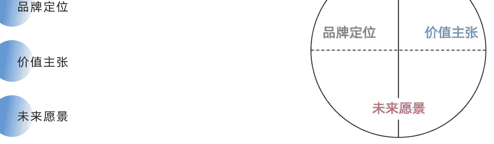

## 品牌定位：在市场中找到独特位置

### 关键考量：

- 目标市场的精准描述、竞争对手的分析和差异化策略
- 品牌个性和形象的一致性与目标受众的情绪连接点

a. 每个竞争对手的核心优势
b. 品牌的相对于每个竞争对手的独特优势
c. 市场尚未被满足的需求或机会
d. 品牌性词
e. 用五个形容词描述品牌定位，并要解释每个特质如何体现在品牌体验中。
f. 价值主张：品牌为目标受众提供的核心价值和独特利益。说明这些价值如何解决客户的具体问题或满足其需求。
g. 情感连接：描述一个能与目标受众产生强烈共鸣的品牌元素或故事。解释这个元素如何与受众的需求达成共鸣。
h. 定位声明：整合以上要素，创作一个简洁有力的定位。应当清晰传达品牌是什么、为谁、提供什么样的价值。
i. 视觉识别：建议提出2-3个能体现定位的视觉元素。

### 常见范例：

1. 定位过于泛，缺乏针对性
2. 过度模仿竞争对手，失去特性
3. 忽视市场竞争，定位
4. 品牌实力匹配，难以兑现

### 应用示例：

1. 核心定位：用一个简洁有力的定位描述品牌。确保定位清晰传达市场地位。
2. 受众画像：详细描述理想受众，包括：
- 人口学特征（年龄、性别、收入等）
- 心理特征（价值观、生活方式、兴趣）
- 消费行为（购买习惯、决策因素）
3. 竞争分析：列出主要对手并分析。

评价标准：
- 清晰度：是否易理解和记忆
- 特性：是否明显区别于对手
- 相关性：是否与受众的需求高度相关
- 可信度：是否基于实际实力和能力
- 持续性：是否具有长期发展潜力

遵循以上指南，创建一个简洁而有力的品牌定位。

## 价值主张：传递独特的价值

### 关键考量：

| 产品/服务的核心优势 | 解决客户痛点的能力 |
| :--- | :--- |
| 情感和功能价值的平衡 | 可信度和可证明性 |

### 常见盲区：

1. 价值主张过于复杂，难以传达
2. 忽视情感价值，过度强调功能特性
3. 夸大其，无法承诺
4. 与竞争对手过于相似

### 应用示例

为[品牌名]制定一个有利的价值主张，遵循以下指南：

1. 核心优势：用一个描述品牌的价值主张，应当简洁有力地传达。
2. 目标受众：列出3-5个目标受众关注的需求，描述他们对目标受众的影响。
3. 问题解决方案：针对每一个问题，详细说明品牌如何解决这些问题。列出产品或服务的3-5个核心优势，每个优势应该与竞争对手有明显的区别，直接解决客户痛点。
4. 情感价值：描述品牌在情感面上与客户建立联系。包括带来的情感体验、生活方式或价值观。
5. 证明：提供2-3个支持价值主张的具体证据，包括客户见证、行业认证、测试结果。
6. 差异化：解释品牌的价值主张如何与竞争对手区分开，强调品牌的独特之处。
7. 长期价值：描述客户长期使用产品或服务可能获得的持续利益。这有助于建立忠诚。
8. 视觉化：提供一个展示价值主张的视觉元素或对比。这有助于增强记忆。
9. 口语化：创建一个独特的价值主张，用于快速传播。这个版本在保留核心信息的同时更加简洁。

评估标准：
- 清晰：价值主张是否直接解决目标受众的核心需求和痛点
- 相关性：特性是否明显区别于对手
- 可信性：是否有足够的证据支持
- 情感感：是否在情感面上与目标受众共鸣
- 可执行性：品牌是否有能力兑现这一主张
- 清楚：基于以上引导，创建一个全面有影响力的品牌价值主张。

## 未来愿景：描绘品牌的长远目标

### 关键考量：

- 与当前品牌定位的一致性和延续性
- 行业和社会的积极影响
- 愿的远大与可实现的平衡

### 常规陷阱：

1. 愿景过于抽象，缺乏实际意义
2. 忽视社会责任，仅关注业务目标
3. 能否激发利益相关者的共鸣
4. 愿景与品牌当前形象差距太大，缺乏可信度

描绘品牌如何在未来更好地服务客户，提升客户体验或解决复杂的问题。5. 员工愿景：描绘品牌将如何为员工创造更好的环境、发展机会和个人成长空间。
6. 创新愿景：包含以下项目：提出2-3个体现品牌对未来的创新项目或设想。这些项目应当具有前瞻性，又基于品牌的核心能力：
7. 里程规划：设定3-5个实现愿景的关键里程程，这些里程程应该是具体的、可衡量的，并且时间合理。
8. 全球愿景：如果适用，描绘品牌在全球市场中的未来定位和发展规划。
9. 技术愿景：预测品牌将如何利用新技术来实现愿景，可能包括AI、物联网、可持续能源等领域。
10. 伙伴愿景：描绘品牌将如何与其他行业、机构或组织合作，共同实现目标。
11. 口号愿景：创造能够激励员工和客户的口号。口号应当具有感染力，便于记忆和传播。
12. 视觉感受：提出一个能够体现愿景的视觉元素或符号，准确传递品牌理念。

### 应用示例：

为[品牌名]创建一个富有感染力的愿景，包含以下元素：
1. 核心定位：用一句话描述品牌愿景，富有活力，同时与品牌价值观一致。
2. 行业愿景：描绘品牌如何引领行业格局。包括技术创新、商业变革或提升方向。
3. 社会贡献：描绘品牌为社会带来积极影响。考虑环保、公平、教育等方面的贡献。4. 客户愿景：

评价标准：
- 一致性：与当前品牌定位
- 真实性：基于品牌的优势
- 可能性：愿景的实现性
- 共鸣：能够引发利益相关者

根据以上指南，创建一个具体的、有力的且引领发展的愿景。

## 年终总结的提示设计

### 业绩回顾

### 成就展示

业绩回顾部分旨在清晰、全方位展示过去一年的工作成绩。侧重于：
- 结构清晰
- 具体实例

未来规划部分是年终总结的重点，是在新的一年明确目标和方向。关注：
- 目标设定
- 行动计划
- 灵活调整

| 维度 | 提示设计 | 要求 |
| :--- | :--- | :--- |
| 成果概述 | 总结过去一年的主要工作成效，重点展现推动作用 | 业绩表现：列出关键指标、销售额、增长率、完成情况等结果；分析带来的影响，如市场扩张 |
| 数据支撑 | 提供支撑的具体数据并通过图表展示成效 | 数据量化指标，例如“销售额增长了10%”或“客户满意度提升了10%”；数据需确保准确 |
| 项目亮点 | 列出过去一年中参与的重点项目及成就，展现其团队中的角色 | 列出项目名称、影响力：项目如何影响部门或业务实现，提取具体的成果 |

| 维度 | 提示设计 | 要求 |
| :--- | :--- | :--- |
| 团队贡献 | 描述团队在协作中的表现，跨部门合作、协调等 | 列举成就，如年度目标达到120% |
| 创新与突破 | 展示创新的理念、流程或技术，并体现其突破性 | 分析其解决了哪些问题或带来了哪些变化 |
| 个人荣誉 | 列出获得的奖项、称号如“年度优秀员工”等个人荣誉 | 通过个人努力推动团队的发展 |

| 维度 | 提示设计 | 要求 |
| :--- | :--- | :--- |
| 目标设定 | 明确具体的工作目标，如“实现XX客户”等量化目标；为每个目标设定量化的指标，如“增长30%”或“增加10个客户” |
| 行动计划 | 列出实现目标的主要行动，“加强提升服务质量”等；为目标设定明确的时间表或阶段性目标 |
| 发展方向 | 设定个人的职业规划：如拓展知识领域；设定计划如何提升或获得新技能 |

## 玩转微信公众号：内容生产提示语策略

### 平台特性与算法机制

### 选题规划提示语

微信公众号具有四大核心特性：私域流量、深度阅读、规范体系和互动机制。这些特性直接影响提示语设计的策略：

- 私域流量属性要求提示语需保持稳定的调性，建立品牌认知
- 深度阅读决定了内容结构层次分明，重视逻辑传递
- 规范体系下的提示语设计需符合平台规则，避免触敏感词
- 互动机制为提示语优化提供数据基础，持续迭代改进

选题规划提示语的核心在于明确内容定位与读者价值。典型的提示语模板：

```应用示例
任务目标：生成[具体领域]的选题规划
背景信息：
- 粉丝定位：[填写定位]
- 目标读者：[读者画像]
- 核心观点：[读者需求]
要求：
(1) 生成10个选题方向
(2) 每个选题包含：
- 主题
- 副标题
- 核心观点
- 价值主张
(3) 考虑时效性与持久性的平衡
输出格式：表格呈现

| 私域流量 | 深度阅读 |
| --- | --- |
| · 精准粉丝群体 | · 完整阅读体验 |
| · 高互动 | · 碎片消费 |
| · 品牌运营 | · 高质量内容导向 |
| 微信公众号平台特性 | |
| 规范体系 | 互动机制 |
| · 内容审核机制 | · 评价与点赞 |
| · 发布流程 | · 运营 |

## 创作引导提示语（一）

公众号作为深度阅读平台，内容创作需要在吸引力、专业性和传播性之间平衡。基于以上特质，设计高效的创作提示语：

1. 明确维度：指明文章提供的类型，如解决方案、深度分析、经验分享
2. 设置语气：根据基调，可以是严谨专业型、鲜明型或建议型
3. 结构：规定包含的核心要素，如标题、数据点、专家观点等
4. 控制信息密度：通过段落设计避免内容过于松疏或密集

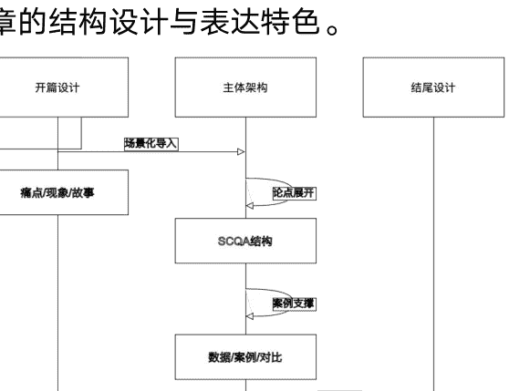

```应用示例
任务描述：创作一篇深度分析文章
主题：【主题】
目标：【目的】
一、结构设计：
(1) 开头模块：800字以内，提问环节：从[数据/视觉/历史]切入，呈现展现明确观点并结论，提出独特视角与解决思路
(2) 主体部分：2500字左右，分述展开3~4个节点，每个节点：
- 观点解析：150字左右
- 原理分析：300字左右
- 案例选取：2个典型案例
- 数据支撑：权威来源数据
- 专家观点：引用权威结论
(3) 结论部分：700字以内，总结呼应开头，趋势预测前瞻性，给出3~5点执行建议
二、互动节点：
(1) 开头互动：设置思考问题
(2) 主体互动：在章节后设置引导点击
(3) 结尾互动：邀请读者分享经验与观点
三、内容限制：
(1) 信息密度：适当，风格以故事为主，引发共鸣
- 主体：以读者为主，配比达40%案例+30%数据+20%专家建议+10%
- 结尾：用引导和建设为主，突出价值
(2) 段落节奏：250~300字
- 案例衔接：多维度选取，避免单一类型
- 逻辑清晰
- 数据展现：150~200字
- 过渡连接：100字左右
四、高级展开：
(1) 逻辑严密
(2) 层次跳转：通过递/并行/转折说明
(3) 逻辑支撑：多维度选取，避免单一类型
(4) 逻辑深度：
- 表现：展现观点与问题呈现
- 原因分析：内在原因与逻辑总结
- 深度：通过调研与整合结论
(5) 风格把控：
- 语言风格：专业
- 专业术语：核心词解释到位
- 表达方式：灵活、生动形象

注意事项：
(1) 避免过于绝对
(2) 确保数据来源可靠
(3) 案例选取需要具有代表性
(4) 互动设计要自然、人文

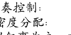
```

## 创作引导提示语（二）

高质量的内容结构通常遵循以下特点：层次感、节奏、互动性。基于这些特点，内容结构应该做到：

1. 设置深度：针对不同层次，规定深度、案例数量、数据支撑等具体要求
2. 设置互动节点：在内容中规划位置，确保引导自然
3. 控制信息密度：通过段落调控避免内容松疏或密集

## 创建引导提示语（三）

高质量的内容结构通常具有以下特点：基于上述特征，论述逻辑的提示设计应该把握以下原则：

### 证链完整

每个观点都需要数据支撑、案例证据或背书。与其他媒体平台相比，微信公众号的读者对论述的权威性和可靠性要求更高。

### 论述逻辑

论点之间需要形成清晰的逻辑关系。


# 驾驭微博：短平传播中的提示语设计

## 平台特性与传播机制

微博平台具有四大核心特征：实时性、社交属性、话题引导和多媒体融合。这些特征直接影响提示语设计的策略方向：

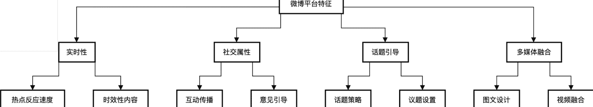

(1) 实时性要求提示语必须具备快速响应能力，支持热点话题的及时跟与创作。
(2) 社交属性决定了内容需要具备较强的互动性和对话感，提示语设计要融入互动机制。
(3) 话题引导能力使平台成为论场，提示语需要把握议题设置的技巧。
(4) 多媒体融合特性要求提示语能够调度文字、图片、视频等多种内容形式。

 微博的内容分发主要依赖于以下路径：
- 粉丝关系链传递
- 热门话题引流
- 兴趣推荐算法
- 评论互动

## 内容策略的提示设计（一）

内容策略的提示设计不仅涉及到信息传递的准确性，还要考虑应用平台特性、用户需求差异、内容传播效果、创造力的激发以及生成过程中的灵活性和控制性，具体可行的策略如下：

### 基础框架

### 差异化策略

微博内容创作的关键在于把握“短平快”的平台节奏，同时又要确保内容的价值密度。基于平台特性，提示框架需要关注以下维度：

针对不同类型的微博内容，提示设计需要采取差异化策略。这种差异不仅体现在内容形式上，更需要要在创作思路和传播策略上有所区别。

(1) 时效性控制：提示设计需要建立快速响应机制，包括热点捕捉、议题延和观点表达。重点在于保证实时信息的及时性和准确性。

(2) 互动性：通过提示引导生成具有互动的内容的形式，如设置悬、提出问题、邀请讨论等，提升内容的社交属性。

(3) 传播性优化：针对微博的传播特性，提示要加强内容的话题关联性和共鸣响，提升传播能。

(4) 格式一致性：在快速响应的同时，提示要确保内容格式的一致性，维护引导调性。

| 内容类型 | 核心特点 | 关键要素 | 提示设计点 |
| --- | --- | --- | --- |
| 热点跟踪型 | 快速响应、观点鲜明 | 热点聚焦、独特视角、价值延展 | 抓取热点、突出差异、预设风险 |
| 原创内容型 | 深度核心、专业价值 | 专业领域、策划脑引、方法论输出 | 框架设计、互动设计 |
| 话题引导型 | 议题引导、观点引导 | 话题引导、观点延续、绪 | 议题设计、互动闭环 |
| 品牌目标型 | 价值传递、转化目标 | 品牌调性、用户痛点、解决方案 | 价值传递、情感共、行动引导 |
| 互动娱乐型 | 松松趣味、互动性 | 话题驱动、互动机制、传播 | 创意设计、参与门、传播 |

## 内容策略的提示设计（二）

### 热点引领型

基于[热点事件]创作微博：n核心要素：
- 陈述事实（50字）：客观呈现核心事件
- 专业解读（100字）：结合领域视角分析
- 延伸思考（50字）：提供独特差异化处理：
- 避开热点角度
- 结合领域专业知识
- 预设1-2个讨论问题

### 品牌营销型

品牌内容创作指南：
营销目标：[目标]设定
内容策略：
(1) 品牌元素植入（占比<30%）
- 产品/服务亮点
- 品牌价值传递
(2) 内容包装：
- 场景化描述（80字）

### 原创内容型

创建[主题]原创内容
内容结构：
(1) 核心观点（60字）：[写法]
(2) 专业解析：
- 理论依据（100字）
- 实战案例（80字）
(3) 互动设计：
- 设置1个互动性问题
- 预留讨论空间
传播策略：
关联2-3个相关话题设计2个传播点

### 话题引导型

话题引导设计：
主题：#[话题名]#
引导策略：
(1) 议题提出
-2—3个讨论维度
(2) 互动设计：
- 投票/回应形式
- 观点引导方向
情绪基调：保持开放和包容性

### 互动娱乐型

### 应用示例

互动娱乐内容设计：
形式：[测试/互动/话题链接]
内容策略：
(1) 引导部分（60字）：
- 设置情感共鸣点
- 情境化描述
(2) 互动机制：
- 参与方式说明
- 互动奖励
(3) 话题延展：
- 衍生讨论方向
- 二次创作空间
调性要求：
- 轻松活泼基因
- 适配专业性
- 正向价值引导

- 用户端点关联
- 解决方案呈现
(3) 传播策略：
- 话题：#[话题名]#n- 互动：投票/回答
注意事项：
- 避免生硬
- 增强用户价值
- 保持自然感

## 话题与标签

微博话题是重要的入口，提示语需要规范话题：

### 话题选择原则

- 与内容相关性
- 活跃度中的
- 避免竞争的热门话题

### 标签使用策略

- 核心话题前置
- 相关话题补充
- 品牌话题植入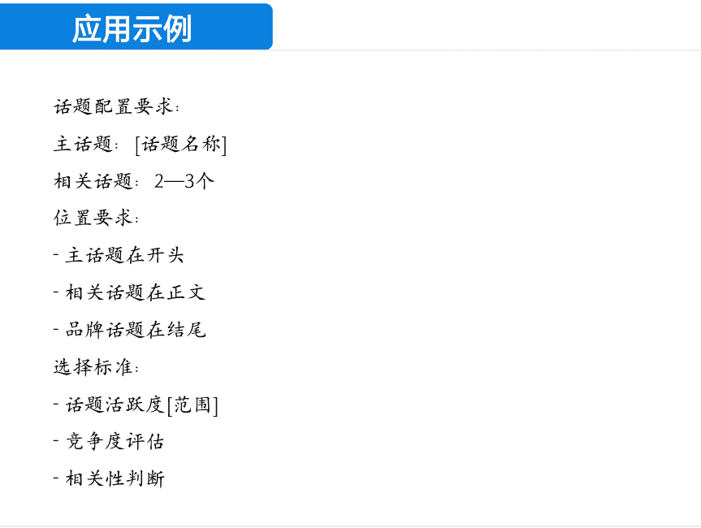

## 传播策略

微型内容的传播效果很大程度上取决于提示语需要涵盖以下维度：

### 热点借力

- 热点筛选：设定热点选择，如流行热度、受众契度等
- 角度创新：寻找差异化的切入点，避免同质化
- 时机把握：明确发布窗口

### 内容生成需求

话题背景：[当前热点]
热度指标：[话题讨论]
目标人群：[用户群体]

### 差异化策略

- 分析发现
- 新的切入点
- 设计共鸣

### 互动设计

- 发布频率：依据账号定位
- 内容分类：不同类型
- 配置

### 内容规划

定制微博账号的内容：
账号信息：
- 定位：[账号定位]
- 目标粉丝：[受众]
- 当前粉丝数：[数量]
- 内容领域：[领域]

需要考虑的因素，包括：
(1) 设计一周的发布时间，包括：
- 最佳发布时间
- 不同时段的内容类型
(2) 制定不同内容的比例，包括：
- 各类内容的比例
- 不同形式

给出详细的排期，并说明每个环节。同时，提供推荐的。

### 内容节奏

- 引起互动：设计能够触发用户的互动
- 转发激励：通过设置激励或机制提升转发愿
- 私信响应：规范化的私信回复

### 应用示例

主题：[主题]
内容形式：[图片/视频/文字]
互动目标：[提升点击/转化/扩散]
需要策略：
(1) 引导方案
- 设计一个引起关注的问题
- 提供两个选择
- 设计悬念或期待
(2) 转发策略
- 设计用户转发的理由
- 提高粉丝关注

确保互动能自然融入，考虑内容的延续性和。

## 小红书：种草社区提示语设计

### 平台特性与分发机制

小红书具有三大核心特征：种草生态、社区氛围和垂直专业；
小红书的内容发现主要依赖三个层面：关注推荐流、兴趣标签、搜索发现；
其中，推荐流的展现形式要求内容在首图和标题足够的吸引力；
而搜索场景则需要考虑关键词的布局和信息的完整性。

### 小红书内容的核心原则

01 注重实用性与分享性
02 情感共鸣与个性化表达
03 视觉与文字的协同设计
04 简洁明了，突出重点

这些特性也对提示语设计提出了具体要求：

| 社区化与用户生成内容 | 情感化与共鸣 |
| --- | --- |
| 视觉内容导向 | 消费决策引导 |

## 场景文案的提示语设计

### 信任建设

信任建设的关键在于通过专业性与真实体验相结合，打造可赖的内容框架。信任建设提示语：

| 维度 | 提示语示例 | 要求 |
| --- | --- | --- |
| 背景 | 请设计一个建立信任的内在框架 | 产品类型：[具体品类] 个人身份/专业领域：[具体品类] |
| 内容构成 | 专业背景展示 个人使用历程 真实体验分享 | 避免套路化 呈现真实痛点 保持客观态度 |

### 场景化表达

通过具体生活场景的描绘，让内容更具代入感，增加其说服力。场景化不仅仅是讲述使用过程，而是通过细节描绘，帮助用户构建真实的使用场景。场景表达提示语：

| 维度 | 提示语示例 | 要求 |
| --- | --- | --- |
| 产品/服务 | 帮我设计一个场景化的内容方案 | 产品/服务：[具体内容] 目标场景：[使用场景] 目标用户：[用户画像] |
| 场景设计 | 设计3个具体场景 | 每个场景包含：环境描述 痛点呈现 解决方案 效果展示 |
| 表述要求 | 帮我描述每个场景的生活背景、真实使用中的痛点、详细说明使用过程及效果 | 细节真实 场景贴生活 问题解决完美 |

### 风格属性

风格调性的设计不影响内容的呈现方式，还决定了对观众的共情程度。风格调性提示语：

| 维度 | 提示语示例 | 要求 |
| --- | --- | --- |
| 风格设计 | 请设计[美妆/美食/生活]领域的风格 | 账号定位：[描述] 人设特征：[描述] 专业背景：[描述] |
| 语言风格 | 遵循以下特点：口语化 句式 | 情感调：(主要色彩、语气) |
| 个性化元素 | 固定开头、独特表达 | 签名结束 |

## 文案创作提示示例（一）

### 标题创作

| 维度 | 提示语示例 | 要求 |
| --- | --- | --- |
| 领域/卖点 | 帮我创作一个小红书标题 | 领域：[美妆/家居/旅行] 核心诉求：[体验/收益] |
| 标题设计 | 提供3—5个标题 | 每个标题都包含：引起注意 字数：15-25字
| 特征标识 | 语气：亲和自然 | 必须包含：[关键词] 避免使用 |
| 差异化效果 | 分析市场中热门标题，创造一个新的标题 | 具有差异化优势，与市场上的相似 |

### 图文结构

| 维度 | 提示语示例 | 要求 |
| --- | --- | --- |
| 图文结构要求 | 请生成一篇小红书笔记大纲 | 类型：[产品类型，例如：美妆、家居、食品等] 目标效果：如达成转化率，增强品牌 |
| 图片安排 | 图片设计：高质量且具有吸引力 | 场景：展示产品实际场景，细节描述：展示产品细节，保持内容的真实性与专业性 |
| 文案结构 | 开篇设计：通过引人的开头吸引读者 并个人经验：分享者的真实观点，增强感染力和方法：详细介绍产品如何解决痛点 总结：产品使用后的效果强化转化率 |
| 互动引导设计 | 结尾部分留出参与，引发互动，增强粘性 | 深度：保持文案与图片配合，避免过度的营销 |


✨ 提示

### 主体内容

这种提示语能够帮助AI生成具有情感化且个性化的内容，让读者感受到作者的真实，从而增强用户的情感认同。

### 个人化体验分享提示语设计

生成关于[个人经历]的分享内容，需描述具体的体验过程，决定情感变化，使内容更具温度和真实感。应用示例这种提示语将引导AI使用温暖的语言和情感化的表达方式，帮助内容打动读者，引发共鸣，提升内容的互动性。

### 情感共鸣型提示语设计

生成一个关于[情感话题]的分享内容，采用温暖和鼓励的语言，激发读者的情感共鸣。应用示例这种提示语帮助AI聚焦实际体验与优势，使得内容既具有实用性，又能引导用户产生购买。

### 购物推荐与测评的提示语设计

生成一个关于[产品/服务]的测评内容，详细描述产品特点、使用体验，并加入个人使用后的真实感受，帮助读者做出购买决策。通过在提示语中加入互动元素，让AI生成的内容更符合互动特点，吸引读者评论和参与讨论。

### 互动性强的提示语设计

生成一个关于[话题]的内容，结尾处提问或鼓励读者分享他们的看法，以增强互动性。

## 文案创作提示示例（二）

## 掌握抖音：短视频内容的提示语设计

### 抖音平台内容分析

1 高度视觉化与短时吸引力
2 情绪饱满与娱乐性
3 强互动性与挑战性
4 剧情与故事性

### 抖音内容的核心原则

| 视觉冲击与情绪渲染 | 引导参与与互动 | 节奏鲜明与简洁高效 | 贴近热点与用户需求 |
| --- | --- | --- | --- |
| 提示语设计突出场景描述和情绪表达，使内容富有感染力。 | 提示语应引导AI生成脚本和文案，通过设问、挑战等方式，吸引用户积极参与。 | 提示语帮助AI生成节奏鲜明、传达简洁的内容，去除冗余信息，确保信息传递快速且有趣。 | 提示语设计需AI关注热门话题，创作具有话题性和吸引力的内容。 |

## 提示策略：提升AI生成抖音文案与脚本的技巧

### 吸睛开头的提示语设计

在抖音内容中，视频开头3秒决定了观众的停留意愿，提示语需引导AI在文案或脚本开头快速引入吸睛元素。生成一个强吸引力的开场，聚焦[视觉冲击或情绪渲染]，确保3秒内引起观众兴趣。

### 情感共鸣型提示语设计

生成一个富有情感共鸣的脚本或文案，融入情绪化表达。通过[画/感人/煽情]陈述，引发观众共鸣。

### 节奏紧凑的剧情设计

短视频内容需要节奏紧凑、逻辑清晰。生成一个节奏紧凑的脚本，开头有冲突，结尾有反转，确保内容连贯且有趣。

### 互动性强的提示语设计

抖音内容通常在结尾处引导互动，鼓励观众点赞、评论或分享。生成一个具有互动的，提出挑战性的问题，引导观众参与。

### 实际操作：优化提示

### 案例一：故事

将复杂问题分解为多个独立的步骤。在每一步操作结束后，请求模型总结或验证中间结果，合并多个任务的输出，形成完整的解决方案。

### 案例二：实用分享类

对于具有故事性的内容，需要悬念设计。生成一个关于[实用技能]的，清晰步骤，方便理解。

### 案例三：引发共鸣

分析市场中热门标题，创造一个新的标题。具有差异化优势，与市场上的相似。

### 案例四：引导互动

生成一个关于[情感]的，结尾处引导互动。具有吸引力，采用亲切的语气。

## 提示工程：精准指引效能增益

### 1.设定明确的目标与上下文

- 说明任务的具体目标（获取信息、生成文本、分析数据等）
- 提供背景信息，减少模型的猜测
- 针对不同的场景，给出期望的输出类型（表格、列表等）

### 2 激活角色与思维模式

- 设定模型为特定的身份，如技术专家、教师
- 指导模型使用写作风格（正式、非正式、技术性等）
- 让模型模拟思维模式（批判性思维、创造性思维等）

### 3.逐步拆解复杂任务

- 将复杂问题分解为多个独立的步骤
- 在每一步操作结束后，请求模型总结或验证中间结果
- 确保输出的连贯性

### 4.引入推理与思考

- 让模型推导出答案，要求“思维链”推理
- 在作答前进行简要的反思或验证
- 要求模型解释每一步的思路，而不仅仅是给出最终答案

### 5提供参考材料与外部资源

- 向模型提供外部参考文献或文本，要求根据这些材料生成答案
- 要求模型在作答时引用或链接到具体的来源
- 集成外部工具（如代码执行）来完成复杂的计算或查找任务

### 6动态反馈与迭代优化

- 收到回答后，指出模型的误差或不足，要求修正
- 让模型根据上一轮的输出进行改进
- 请求模型总结多轮对话中的关键点

## 提示框架：逻辑锚定思维引导

### 1. TSTE框架

Task（任务）：定义模型的主要任务或生成内容。
Audience（目标受众）：说明目标受众。
Structure（结构）：为输出提供明确的组织结构，包括段落安排、线性开展或其他逻辑关系。
Tone（语气）：指定模型回复时的语气或风格。
Example（示例）：例子或模板可以帮助模型理解输出格式或格。

示例
Task：写一篇关于数据隐私重要性的短博客文章。
Audience：普通的互联网用户，非技术背景。
Structure：文章需要明确的开头、中间讨论和结尾，开头提出问题，中间介绍原因和影响，结尾提供建议。
Tone：采用友好的、易懂的语言。
Example：类似于《纽约时报》科技专栏的风格。

### 2. ALIGN框架

Aim（目标）：明确任务的最终目标。
Level（难度级别）：定义输出的难度级别。
Input（输入）：指定需要处理的数据或信息，要求模型对某些事实进行处理。
Guidelines（准则）：提供模型在执行任务时遵循的规则或约束。
Novelty（新颖性）：明确是否需要模型提供原创性、创新的内容，是否允许引用任何知识。

示例
Aim：创建一个关于“可持续发展”的文章，解释核心理念。
Level：适合高中阅读，不需要专业术语。
Input：提供目前的环境问题的背景，讨论应对全球变暖的策略。
Guidelines：文章应使用简单明了的语言，并避免复杂的技术概念。
Novelty：要求结合最新的环境数据，提出新颖的观点和解决方案。


# 三重概率：多层互动 逐层精炼

AIGC的三层概率交互的内容生成体系，描述了人工智能与人类在内容创作中的协同合作。通过初始生成、交互筛选和主观优化三个层次，构建了一个动态循环的创作流程，以提升内容生成的效率和质量，满足市场的多样化需求。

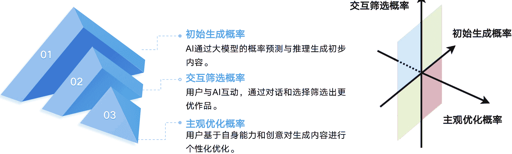

- 初始生成概率：AI通过大模型的概率预测与推理生成初步内容。
- 交互筛选概率：用户与AI互动，通过对话和选择筛选更优作品。
- 主观优化概率：用户基于自身能力和创意对生成内容进行个性化优化。

## 人机共生时代的能力培养体系

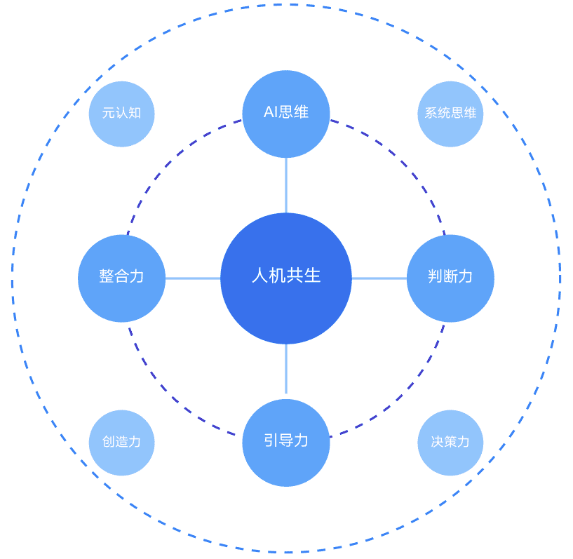

## 四大核心能力

### AI思维
- 算法思维：理解AI决策逻辑
- 数据洞察：数据驱动分析能力
- 边界认知：把握AI能力边界
- 同意意识：建立人机协作模型

**核心观点：掌握AI思维模式，建立人机协作认知框架**

### 整合力
- 跨域翻译：转化领域知识
- 创意重组：重构工作方法
- 资源编排：优化人机协同
- 知识融合：整合新旧知识

**核心观点：融合人机优势，创造1+1>2的价值**

### 引导力
- 提示工程：设计高效指令
- 对话管理：控制交互方向
- 任务分解：优化问题结构
- 质量控制：控制输出质量

**核心观点：主导AI交互过程，确保输出符合预期**

### 判断力
- 真伪辨析：评估内容可靠性
- 价值评估：判断应用价值
- 风险预测：预见潜在风险
- 情境适配：评估场所场景适用性

**核心观点：保持独立思考，做AI输出的决策者**

- 培养“AI思维”：理解不同AI的能力边界和最佳应用场景
- 发展“整合力”：将AI与人类洞察结合提升“引导力”：能够引导AI完成任务
- 强化“判断力”：对AI输出的准确性和适用性做评估

## AI进阶使用

### AI思维
- 构建个人提示词体系
- 设计层次化提示词结构
- 创新性组合不同领域提示词

### 工作流程的创新
- 设计人机交互流程
- 建立反馈优化循环
- 创造领域专属方法

> “提示词是撬动AI的杠杆”
> “好的提示词体系是独特的竞争力”

> “流程决定上限，细节决定效果”
> “创新工作才能带来突破性进展”

### 深度整合的思维
- 跨领域知识整合
- AI与专业知识融合
- 构建创新生态系统

### 个人特色的打造
- 发展个人方法论
- 创造专属工具组合
- 形成难以复制优势

> “整合是创新的源泉”
> “跨界思维能激发新可能”

> “与众不同是真正的竞争力”
> “打造个人特色是制胜关键”

从“使用者”到“进阶者”的之路

## 人机共生质量影响分析：人vs机器

### 生成质量的关键影响
- 输入质量：70% 人的影响
  - 提示词的准确性和完整性
  - 需求描述的清晰度
- 基础能力：80% 机器的影响
  - AI模型的能力边界
  - 训练数据的质量
- 迭代优化：90% 人的影响
  - 反馈的精准度
  - 优化的方向把握

### 人的关键影响路径
1. 提示工程（决定性）
   - 清晰的目标定义
   - 准确的约束条件
   - 结构化的需求描述
2. 质量控制
   - 结果评估
   - 方向调整
   - 标准制定
3. 创意引导
   - 创意输入
   - 风格定义

### 机器的关键影响路径
1. 基础生成能力
   - 模型性能
   - 训练质量
   - 算法优化
2. 理解准确度
   - 语义理解
   - 上下文把握
3. 一致性保证
   - 输出稳定性
   - 质量基线

**结论：对生成质量的影响，人的主导作用更大（约65%）**
**原因：提示工程的质量和迭代优化的精准度决定最终输出**

## AI进阶使用


知识唤醒阶段
- 让AI列出关键概念
- 通过AI触发思考
- 用AI拓展维度

知识整合阶段
- AI协助建立关联
- 发现知识应用
- 形成系统化观点

提示构建阶段
- 整合关键要素
- 构建清晰结构
- 设定约束

## AI辅助知识生成

| 概念图谱构建 | 深度学习 | 知识验证 |
| :--- | :--- | :--- |
| **1. 知识获取** | AI辅助绘制图谱 | 主题探讨 | 概念准确性 |
| | 识别知识关联 | 多角色理解 | 理解测试 |
| **2. 知识整合** | 跨领域关联 | 系统重构 | 情境化应用 |
| | 建立知识连接 | 构建体系 | 场景模拟 |
| | 发现创新点 | 形成新框架 | 实践验证 |
| **3. 知识创新** | 观点生成 | 方法创新 | 价值创造 |
| | 新观点构建 | 解决方案设计 | 实践应用 |
| | 创新性 | 方法论构建 | 价值验证 |

### 实践路径策略：
1. 设定明确的知识目标
2. 通过AI辅助持续理解和应用
3. 定期进行知识整合和创新尝试
4. 建立个人知识管理

## 关于“知识唤醒”的问题

1. 什么是知识？
   - 已有的认知积累
   - 过去的经验总结
   - 潜在的思维模式
   - 隐性的模式
2. 为什么需要“唤醒”？
   - 知识存在但未充分调用
   - 经验存在但未有效链接
   - 洞察存在但未清晰表达

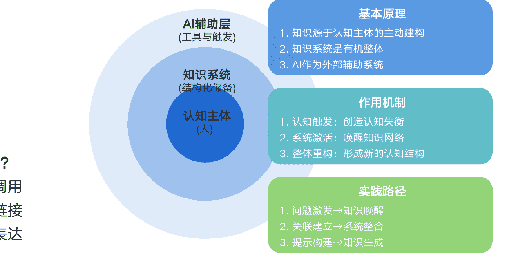

基本原理
1. 知识源于认知主体的主动构建
2. 知识是有机整体
3. AI作为外部辅助系统

作用机制
1. 认知触发：创造认知
2. 系统激活：唤醒知识网络
3. 整体重构：形成新的认知结构

实践路径
1. 激发→知识唤醒
2. 建立→系统整合
3. 构建→知识生成

本质：知识唤醒是认知主体在AI辅助下的主动构建
目标：通过认知触发-系统激活-整体重构，实现知识的深度调动和创新生成

## 1. 知识的基本属性
- 沉淀性：知识是经验的累积
- 关联性：知识是网络化的
- 情境性：知识嵌入具体场景
- 涌现性：新知识从连接中产生

## 2. 唤醒的核心机制
- 认知激活：打破固有思维模式
- 经验衔醒：连接具体实践场景
- 创造性重组：产生新的知识连接

## 3. AI辅助的三重角色
- 认知催化剂：提供新视角
- 知识连接器：建立关联网络
- 创新助推器：促进知识重组

### 情感唤醒
1. 基础情感激发
   - 惊异感
   - 好奇心
   - 探索欲
2. AI辅助角色
   - 发现认知盲点
   - 提供反常视角
   - 创造思维碰撞

### 经验唤醒
1. 情境构建
   - 场景还原
   - 多维模拟
   - 经验链接
2. 默认知识激活
   - 回溯
   - 技能映射
   - 隐性知识显现

### 关联唤醒
1. 知识网络
   - 跨域联系
   - 类比推理
   - 整体照照
2. 创造性连接
   - 新旧知识融合
   - 跨学科整合
   - 突破性连接

知识唤醒的核心：通过情感-经验-关联的螺旋式上升，实现知识的深度驱动与创新生成。

## AI使用层次与突破路径

突破路径：
1. 建立提示词体系
2. 设计协作流程
3. 发展创新方法
4. 打造个人特色

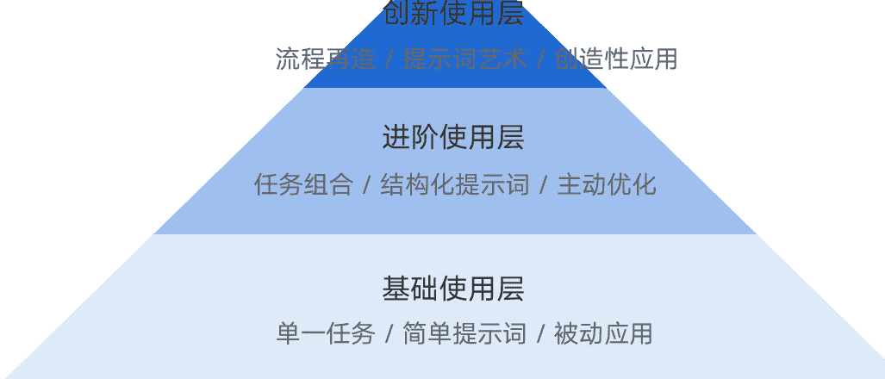

- 独特工作流
- 方法创新
- 领域整合

## 知识库与唤醒框架

| 人的具身知识库 | 感知层面 | 情境层面 |
| :--- | :--- | :--- |
| 直接体验 | 场景化记忆 | 实践经验 |
| 现场感知 | 情境智慧 | |

| AI的形式知识库 | 数据层面 | 模式层面 |
| :--- | :--- | :--- |
| 文本信息 | 统计规律 | 关联模式 |
| 逻辑规则 | 抽象概念 | |

### 唤醒衔接机制
1. 具身经验激活：通过AI提问具体经验
2. 感知唤醒：引导关注身体和情境
3. 形式化转换：将经验转化为清晰表述
4. AI增强整合：补充相关形式知识

最终输出：融合具身性的高质量
人的具身经验与AI的形式知识有机结合，产生既有深度又有温度的内容
