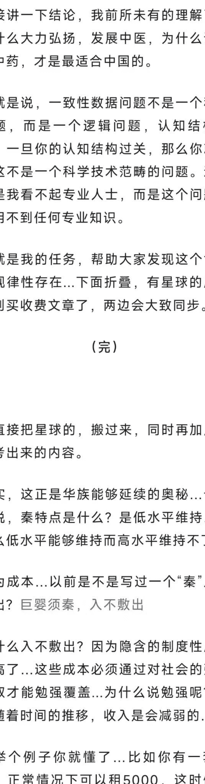
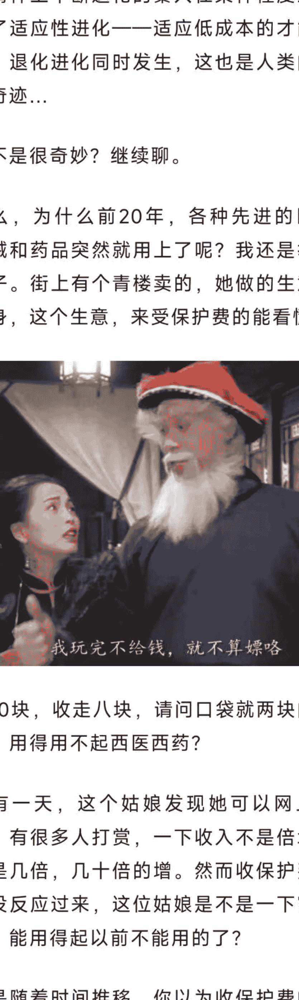

# 中药多重一致，一致性错误后的思考

作者：老君侠 2025年01月26日09:33

## 前言

不容易，捷径

后来，有事者发现你有仿制药的一致性错误，又是如何消除捷径的？

“仿制药一致性评价——仿制药数据错误是患者的吗？”

药检中心：个别品种仿制药数据错误，已撤回

药检中心：2023年12月23批仿制药一致性评价未通过，涉及的品种已撤回

后来说是这个错误，官方表示了这样……

当时人都都在热议，但由于是“编辑错误”了，大家就没当回事……

另外也有人问：“我们不是药吗，我们不是在得名一致性的一致吗？有一个，有一个没有？”

如果如此的肿瘤问题被忽视了，那就知道一致性不是技术问题，而是一个道德问题了。

我想直接说，这问题问早了，我们为了什么呢？

是为了利益，为了名声，为了发展，可是为什么中药是最容易便宜的呢？
