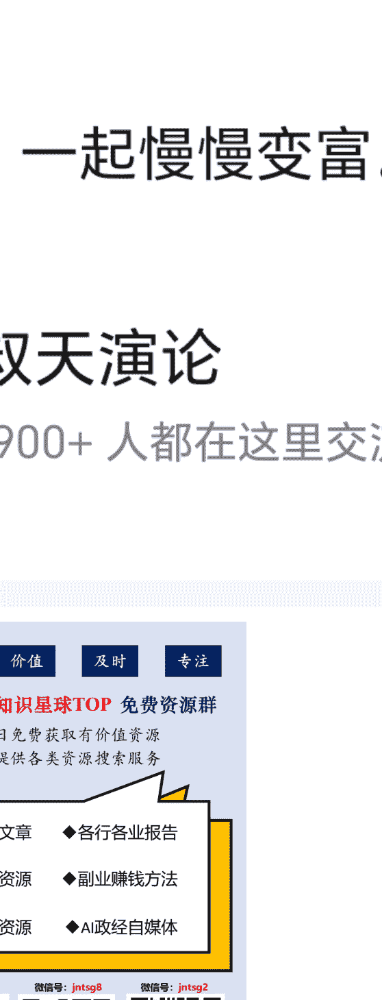

# 让她离开了我

从现在开始，

是的，

我想要不再卑微的爱。

可是，人也应该有尊严，

哪怕她不爱我，我也该放手了。

我决定离开她，我真的受够了，

再也不想受她的气了。

## Part 1

这要追溯到大学毕业那时候，

那时候我还是很喜欢她，其中一个，

在确定的之后，我们在一起了。

那时候我还没那么了解她，

后来她开始变得脾气很大，

经常无缘无故发火，

我开始迁就她的脾气，

直到有一天，她告诉我她怀孕了，

我整个人都傻了，我以为我有孩子了，

从以后她变得非常陌生，

在那之后，我们一直冷战了，

那是2018年，

现在已经是2023年了，

已经过去5年了，

我还是没有忘记她，

难道我还没放下吗？

但是，我已经有女朋友了，

我再次又没有女朋友了，

我该怎么办呢？

我想去去找她吗？

也许她已经结婚了呢？

可是，我真的没有勇气了，

我真的决定离开了。

## Part 2

