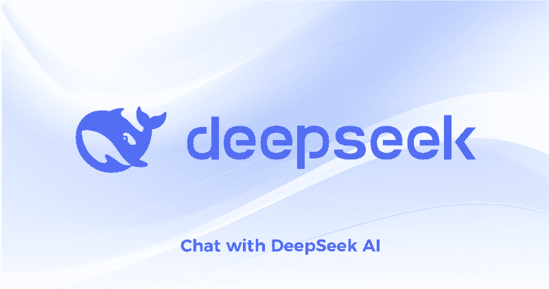
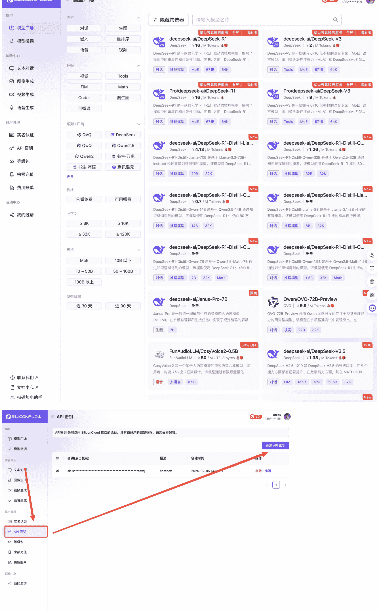
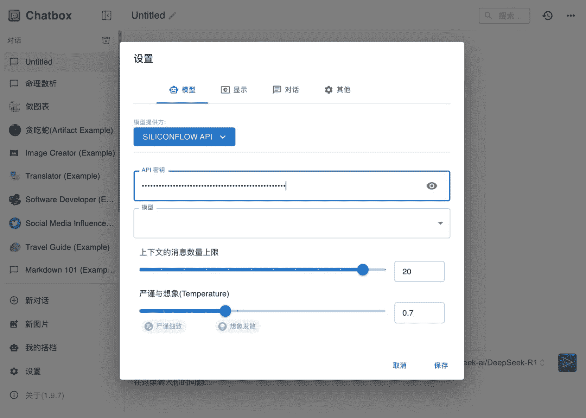

# 全方位拥抱 DeepSeek，本地部署、AI编程、辅助写作、网页/PDF全文翻译

作者：文森

# 目录

DeepSeek 能力获取:

- 方式 1:在线使用
- 方式 2:本地部署
- 方式 3:官方 API
- 方式 4:第三方 API

Deepseek + Chatbox

Deepseek + Cherry Studio

DeepSeek + Cursor AI 辅助编程

DeepSeek + Obsidian 辅助写作

DeepSeek + 沉浸式翻译



## DeepSeek 能力获取

### 方式 1:在线使用

```
在线使用
https://chat.deepseek.com/
```


### 方式 2:本地部署

#### 1 安装 Ollama
本地安装 Ollama: https://ollama.com

#### 2 运行命令
然后命令运行
ollama run deepseek-r1:7b

#### 3 选择参数
请视自己电脑/显卡性能情况选择对应参数，从 1.5b 到 671b

具体参考: https://ollama.com/library/deepseek-r1


### 方式 3:官方 API

1 申请 API
申请：https://platform.deepseek.com/api-keys

2 获取信息
copy 一下申请好的 api_key
记一下 base_url: https://api.deepseek.com/v1

3 使用 API
使用参考 API 手册：https://api-docs.deepseek.com/guides/reasoning_model

最近太火热，官方 api 经常挂掉

### 方式：第三方API

## 注册 siliconflow

想要翻译的，可以使用官方 API，接入 siliconflow，deepseek 翻译了一本40页的注册后免费额度 14 元（用够很久，deepseek 翻译了）

几页的，可以吗？https://cloud.siliconflow.cn/en/eqTDBH3

注册地址：

它不仅支持 OpenAI API，还可以使用 Qwen、GLM 等多种模型！

## 获取 API

API 注册地址：https://cloud.siliconflow.cn/account/api



## Deepseek + Chatbox



Made with Gamma

## Deepseek + Cherry Studio

| 模型服务 | 硅基流动 | |
| --- | --- | --- |
| 默认模型 | AIHubMix | API 密钥 |
| 常规设置 | 深度求索 | |
| 显示设置 | Ollama | |
| 快速方式 | Anthropic | |
| 快速助手 | OpenAI | |
| 数据设置 | Azure OpenAI | |
| 关于我们 | Gemini | |
| | GitHub Models | |
| | 零一万物 | |
| | 智谱AI | |
| | 月之暗面 | |
| | 百川 | |
| | 阿里云百搭 | |
| | 跃星辰 | |
| | 豆包 | |
| | MiniMax | |
| | GraphRAG | |
| | OpenRouter | |
| | Groq | Toether |

## DeepSeek + Cursor AI 辅助编程


### 1 设置 Cursor
在 Cursor Settings-Models 中关闭其他模型，添加并复制上面模型。

### 2 使用
使用参考 API Key。

### 3 验证
使用正常。

## DeepSeek + Obsidian 辅助写作

### 1 安装 Obsidian
首先下载: https://obsidian.md

### 2 安装插件
安装 Copilot 插件。

### 3 添加模型
添加 DeepSeek。

### 4 使用
使用侧边框。


## DeepSeek + 沉浸式翻译

### 1 安装插件
安装沉浸式翻译: https://immersivetlate.com/chrome-extension

### 2 设置服务
选择 DeepSeek 或 Siliconflow。

### 3 配置 API
把申请到的 api key 进去。

### 4 使用
现在就可以沉浸式翻译。


## 进阶技巧: Temperature

### 什么是 Temperature?

使用建议：
1. 根据任务类型选择温度值
2. 需要准确时用低温度
3. 需要创意发挥用高温度
4. 不确定可以使用默认值 1.0

- 温度越低 -> 回答越确定、保守、稳定
- 温度越高 -> 回答越创意、多样、随机

### Deepseek官方关于不同场景的 Temperature 推荐

| 低温度 (0.0) | 适用场景:代码生成/数学解题 | 需要准确、精确的答案 / 每次运行都得到相同的结果 / 不需要创意发挥 |
| 中等温度 (1.0) | 适用场景:数据抽取/分析 | 需要在准确性和灵活性之间取得平衡 / 默认的温度值 |
| 高温度 (1.3) | 适用场景:通用对话和翻译 | 让对话更自然、更有韵味 / 翻译时更灵活地处理语言 |
| 高温度 (1.5) | 适用场景:创意写作/诗歌 | 产生更有创意的内容 / 表达更丰富多样 / 每次可能不同的创意结果 |

## 扫码加入 知识星球免费资源群

免费

- 每日免费获取高价值资源
- 提供各类资源搜索服务
公众号：知识星球TOP

价值

微信信号：jntsg8

| 热门付费文章 | 各行各业报告 |
|---|---|
| 精选图书资源 | 副业赚钱方法 |
| 职场实用资源 | AI政经自媒体 |


及时

微信信号：jntsg2


专注

分享资料仅供个人学习，请及时删除，切勿商用传播
